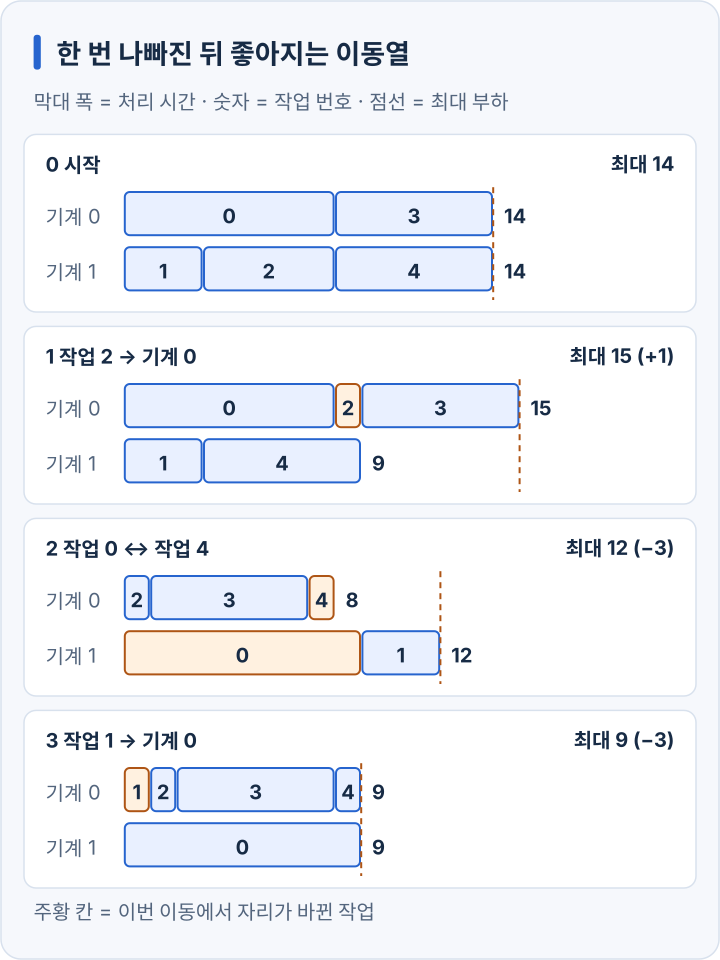
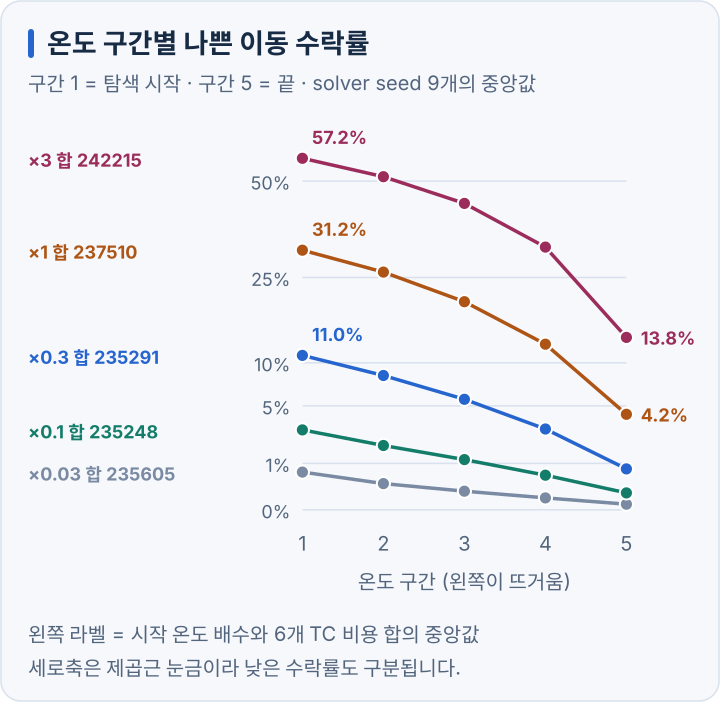

# 배정 문제의 지역 탐색과 SA

[SCHEDULX](/practice/SCHEDULX)는 작업을 기계에 배정해 가장 늦게 끝나는 기계의 시간을 줄이는 문제입니다. [배송 순서 개선](https://h.readiz.com/learn/heuristic/ordering-route-improvement)의 2-opt와 [초기해와 지역 탐색](https://h.readiz.com/learn/heuristic/search-strategies)의 SA를 같은 틀로 다시 쓰되, 이번에는 점수가 합이 아니라 **최댓값**이고 상태가 순열이 아니라 **작업 → 기계 배정**입니다. 이 두 차이가 차분 평가와 온도 설정을 어떻게 바꾸는지를 실제 점수로 확인합니다.

앞의 두 강의와 [Testing과 Stress Test](https://h.readiz.com/learn/testing-and-stress)를 읽었다고 가정합니다. 난수는 [공통 코드의 `random` 블록](https://h.readiz.com/learn/cpp-common-library)을 먼저 붙여 씁니다.

## 문제 계약을 상태로 옮기기

> **코드 환경: h-contest 제출용 선언.** 아래는 구현할 함수의 선언이고, 완성 코드는 뒤의 블록들을 순서대로 붙입니다.

```cpp
#define MAX_MACHINE_COUNT 20

void schedule_jobs(
    int job_count,
    int machine_count,
    const int processing_time[][MAX_MACHINE_COUNT],
    int assignment[]
);
```

| 항목 | 계약 |
| --- | --- |
| 입력 | `processing_time[j][m]`: 작업 `j`를 기계 `m`에서 처리하는 시간. 읽기 전용. 흔히 `cost[job][machine]`이라 부르는 비용 행렬입니다. |
| 상한 | `job_count`는 200, 400, 800, 1500, 2500, 4000, `machine_count`는 6, 8, 10, 12, 16, 20 중 하나. TC 6개, 전체 실행 4초 |
| 상태 | 모든 `j`에 대해 `0 <= assignment[j] < machine_count`인 배정 |
| 점수 | 기계별 부하(배정된 작업 시간의 합)의 **최댓값**. 낮을수록 좋고, 최종 점수는 TC 6개의 합 |
| 무효 | 범위 밖 기계가 하나라도 있으면 점수가 패널티 `10^12`가 되고 이후 TC는 채점하지 않음 |

문제 설명은 처리 시간의 상한을 주지 않으므로 부하 합은 `long long`으로 둡니다. 제출할 상태는 `assignment[]` 하나이고, 기계별 부하·부하의 합·최댓값은 이 배열에서 다시 계산할 수 있는 **보조 값**입니다. 탐색 중에는 보조 값을 갱신하며 가고, 검사에서는 항상 처음부터 다시 계산한 값과 대조합니다.

## 0단계: 유효한 기준선

가장 단순한 유효 답은 작업 번호를 기계 수로 나눈 나머지입니다.

> **코드 환경: h-contest 제출용(완성 코드).**

```cpp snippet=assign-baseline
#define MAX_MACHINE_COUNT 20

void schedule_jobs(int job_count, int machine_count, const int processing_time[][MAX_MACHINE_COUNT], int assignment[]) {
    for (int job = 0; job < job_count; ++job) {
        assignment[job] = job % machine_count;
    }
}
```

이 기준선의 6개 TC 합은 510045입니다. 이후 단계는 모두 같은 TC 6개의 같은 합으로 비교합니다.

## 1단계: 탐욕 초기해

작업을 입력 순서대로 보면서, 놓았을 때 그 기계의 부하가 가장 작아지는 기계에 넣습니다. 기계마다 처리 시간이 다르므로 현재 부하가 가장 낮은 기계가 아니라 `load[m] + processing_time[j][m]`이 가장 작은 기계를 고릅니다. 같은 값이면 번호가 작은 기계입니다.

> **코드 환경: h-contest 제출 확장용 1/4.** 이 블록과 이어지는 두 블록은 `random` 블록 뒤에 붙입니다. 배열 상한은 작업 4000개, 기계 20개이며 `Plan`은 호출마다 새로 만듭니다.

```cpp snippet=assign-plan
#define MAX_MACHINE_COUNT 20

namespace sched {
const int MAX_JOB = 4000;

struct Plan {
    int n, m;
    const int (*time)[MAX_MACHINE_COUNT];
    int machine[MAX_JOB];
    long long load[MAX_MACHINE_COUNT];
    long long total;     // load[]의 합
    long long makespan;  // load[]의 최댓값. 실제 점수

    // machine[]만 믿고 load, total, makespan을 처음부터 다시 계산한다.
    void rebuild() {
        for (int k = 0; k < m; ++k) load[k] = 0;
        for (int j = 0; j < n; ++j) load[machine[j]] += time[j][machine[j]];
        total = 0;
        makespan = 0;
        for (int k = 0; k < m; ++k) {
            total += load[k];
            if (load[k] > makespan) makespan = load[k];
        }
    }
};

// 작업을 입력 순서대로, 놓은 뒤 부하가 가장 작아지는 기계에 넣는다.
void greedy(Plan& p) {
    for (int k = 0; k < p.m; ++k) p.load[k] = 0;
    for (int j = 0; j < p.n; ++j) {
        int best = 0;
        for (int k = 1; k < p.m; ++k) {
            if (p.load[k] + p.time[j][k] < p.load[best] + p.time[j][best]) best = k;
        }
        p.machine[j] = best;
        p.load[best] += p.time[j][best];
    }
    p.rebuild();
}
}
```

`rebuild()`가 보조 값을 `machine[]`에서 처음부터 계산하는 기준 구현입니다. 탐욕 초기해의 합은 263314로 기준선보다 48.4% 낮습니다.

## 2단계: 이웃과 차분 평가

이웃은 두 가지입니다. **이동**은 작업 하나를 다른 기계로 옮기고, **교환**은 서로 다른 기계에 있는 두 작업의 기계를 맞바꿉니다. 둘 다 `assignment[]`를 유효하게 유지합니다.

점수식이 합이면 차분은 간단합니다. 작업 `j`를 `from`에서 `to`로 옮길 때 부하의 합은 `processing_time[j][to] - processing_time[j][from]`만 바뀝니다. 최댓값은 다릅니다. 옮긴 두 기계의 새 부하는 알지만, 옛 최댓값만으로는 새 최댓값을 모릅니다. `from`이 유일한 최대 기계였다면 최댓값은 내려가는데 얼마나 내려가는지는 **다음으로 큰 부하**에 달려 있고, `to`가 새 최대가 될 수도 있습니다. 그래서 기계별 부하 `load[]`를 유지하고, 새 최댓값을 `max(새 from 부하, 새 to 부하, 나머지 기계의 최대 부하)`로 `O(기계 수)`에 계산합니다. 기계가 20대 이하라서 이 정도면 충분하며, 더 커지면 부하 상위 두 개나 힙을 유지하는 방법을 씁니다.

> **코드 환경: h-contest 제출 확장용 2/4.** `hc::Random`(공통 `random` 블록)에 의존합니다. `tryMove`·`trySwap`은 `Plan`을 바꾸지 않고 결과만 계산합니다. 거절할 이동은 아무것도 바꾸지 않았으므로 되돌릴 일이 없습니다.

```cpp snippet=assign-delta
namespace sched {
struct Change {
    long long makespan, total;  // 이동 뒤의 값
};

// 두 기계의 새 부하와, 그 둘을 뺀 나머지 기계의 최댓값으로 새 makespan을 만든다.
static Change finish(const Plan& p, int a, int b, long long newA, long long newB, long long newTotal) {
    long long best = newA > newB ? newA : newB;
    for (int k = 0; k < p.m; ++k) {
        if (k != a && k != b && p.load[k] > best) best = p.load[k];
    }
    Change c = {best, newTotal};
    return c;
}

// job을 to 기계로 옮긴 결과. p는 바꾸지 않는다. 전제: to != p.machine[job]
Change tryMove(const Plan& p, int job, int to) {
    int from = p.machine[job];
    long long newFrom = p.load[from] - p.time[job][from];
    long long newTo = p.load[to] + p.time[job][to];
    return finish(p, from, to, newFrom, newTo, p.total + p.time[job][to] - p.time[job][from]);
}

// 서로 다른 기계에 있는 두 작업의 교환. 전제: p.machine[x] != p.machine[y]
Change trySwap(const Plan& p, int x, int y) {
    int a = p.machine[x], b = p.machine[y];
    long long newA = p.load[a] - p.time[x][a] + p.time[y][a];
    long long newB = p.load[b] - p.time[y][b] + p.time[x][b];
    long long newTotal = p.total + (p.time[y][a] - p.time[x][a]) + (p.time[x][b] - p.time[y][b]);
    return finish(p, a, b, newA, newB, newTotal);
}

struct Move {
    int kind;  // 0: x번 작업을 y번 기계로, 1: x번과 y번 작업 교환
    int x, y;
    Change after;
};

// 전제: n >= 2, m >= 2. 같은 기계의 두 작업을 고르면 한 작업 이동으로 바꾼다.
Move propose(const Plan& p, hc::Random& rng, int swapPercent) {
    Move mv;
    mv.x = (int)rng.below((unsigned)p.n);
    if ((int)rng.below(100u) < swapPercent) {
        mv.y = (int)rng.below((unsigned)p.n);
        if (p.machine[mv.x] != p.machine[mv.y]) {
            mv.kind = 1;
            mv.after = trySwap(p, mv.x, mv.y);
            return mv;
        }
    }
    mv.y = (int)rng.below((unsigned)(p.m - 1));
    if (mv.y >= p.machine[mv.x]) ++mv.y;
    mv.kind = 0;
    mv.after = tryMove(p, mv.x, mv.y);
    return mv;
}

void apply(Plan& p, const Move& mv) {
    if (mv.kind == 0) {
        int from = p.machine[mv.x];
        p.load[from] -= p.time[mv.x][from];
        p.load[mv.y] += p.time[mv.x][mv.y];
        p.machine[mv.x] = mv.y;
    } else {
        int a = p.machine[mv.x], b = p.machine[mv.y];
        p.load[a] += p.time[mv.y][a] - p.time[mv.x][a];
        p.load[b] += p.time[mv.x][b] - p.time[mv.y][b];
        p.machine[mv.x] = b;
        p.machine[mv.y] = a;
    }
    p.total = mv.after.total;
    p.makespan = mv.after.makespan;
}

// 탐색용 에너지 변화: 실제 점수 변화 + weight * 평균 부하 변화
double energyChange(const Plan& p, const Change& c, double weight) {
    return (double)(c.makespan - p.makespan) + weight * (double)(c.total - p.total) / p.m;
}
}
```

`propose`가 같은 기계의 두 작업을 교환하려 하면 이동으로 바꿉니다. `apply`는 `Change`에 이미 계산한 새 값을 그대로 저장하며, 이 저장값이 틀리면 이후 모든 비교가 틀리므로 뒤의 검사가 가장 먼저 확인하는 곳입니다.

## 작은 손계산: hill climbing이 멈추는 곳

작업 5개, 기계 2개입니다. 탐욕 초기해는 작업 0, 3이 기계 0, 작업 1, 2, 4가 기계 1입니다.

<!-- check:handtime -->
| 작업 | 기계 0에서 | 기계 1에서 |
| --- | ---: | ---: |
| 0 | 8 | 9 |
| 1 | 1 | 3 |
| 2 | 1 | 5 |
| 3 | 6 | 9 |
| 4 | 1 | 6 |

두 기계의 부하는 14와 14로 최대 14입니다. 이동 5개와 교환 6개, 이웃 11개를 모두 계산한 표입니다.

<!-- check:hand -->
| 이웃 | 기계 0 부하 | 기계 1 부하 | 최대 부하 |
| --- | ---: | ---: | ---: |
| 시작 상태 | 14 | 14 | 14 |
| 작업 0 → 기계 1 | 6 | 23 | 23 |
| 작업 1 → 기계 0 | 15 | 11 | 15 |
| 작업 2 → 기계 0 | 15 | 9 | 15 |
| 작업 3 → 기계 1 | 8 | 23 | 23 |
| 작업 4 → 기계 0 | 15 | 8 | 15 |
| 작업 0 ↔ 작업 1 | 7 | 20 | 20 |
| 작업 0 ↔ 작업 2 | 7 | 18 | 18 |
| 작업 0 ↔ 작업 4 | 7 | 17 | 17 |
| 작업 1 ↔ 작업 3 | 9 | 20 | 20 |
| 작업 2 ↔ 작업 3 | 9 | 18 | 18 |
| 작업 3 ↔ 작업 4 | 9 | 17 | 17 |

어느 이웃도 14보다 작지 않고 같은 값도 없으므로 개선만 받는 hill climbing은 여기서 멈춥니다. 2⁵ = 32개 배정을 전부 보면 최솟값은 9이고, 작업 0만 기계 1에 둔 배정이 그 값입니다. 이동열은 다음과 같습니다.

1. 작업 2를 기계 0으로 옮깁니다. 부하는 15와 9, 최대 15로 **1 나빠집니다**.
2. 작업 0과 4를 교환합니다. 부하는 8과 12, 최대 12.
3. 작업 1을 기계 0으로 옮깁니다. 부하는 9와 9, 최대 9.



[그림 크게 보기](https://git.readiz.com/h-contest-lesson/lessons/assignment-local-search/lesson-assets/hand-moves.svg)

막대의 폭이 처리 시간이고 주황 칸이 그 단계에서 자리가 바뀐 작업입니다. 첫 이동의 손해는 1이라서, 온도가 1이면 약 37%(`e^-1`), 0.3이면 약 4%로 받아들입니다. **손해가 1인 문제의 온도를 수천으로 두면** 이 구조 자체가 사라집니다. 온도는 이동 한 번의 점수 차이에 맞춰야 한다는 [앞 강의](https://h.readiz.com/learn/heuristic/search-strategies)의 기준을 이 예시가 보여 줍니다. 이 표와 이동열은 검사 스크립트가 같은 11개 이웃을 독립적으로 다시 계산해 대조합니다.

## 3단계: hill climbing과 SA를 한 코드로

hill climbing은 온도 0인 SA입니다. 같은 `anneal`에서 시작·끝 온도만 0으로 두면 에너지가 같거나 좋아지는 이동만 받습니다.

그런데 실제 점수 변화만으로 에너지를 만들면 문제가 생깁니다. 최댓값은 **평지가 많습니다**. 탐욕 초기해에서 이동 2000개를 제안해 보면 점수가 그대로인 제안이 37~74%입니다(표는 아래). 최대 기계와 무관한 이동은 항상 손해 0이고, 손해가 있는 이동의 크기만 봐서는 부하가 낮은 쪽으로 가는 이동의 가치를 알 수 없습니다. 그래서 탐색용 에너지에 **평균 부하 항**을 더합니다.

```text
에너지 변화 = (새 최대 부하 - 옛 최대 부하) + weight × (새 부하 합 - 옛 부하 합) / 기계 수
```

최대 부하를 직접 줄이는 이동을 우선하되, 기계의 합계가 줄어드는 이동(그 작업을 더 빠른 기계로 보내는 이동)도 조금씩 에너지를 낮춥니다. **제출 점수는 그대로 최대 부하**이고, `best`는 실제 최대 부하가 처음으로 더 작아질 때만 갱신합니다. 이 분리가 hill climbing과 SA 모두에서 `current`와 `best`를 나누는 이유입니다.

> **코드 환경: h-contest 제출 확장용 3/4.** `Stats`는 온도 구간별 나쁜 이동의 제안·수락 횟수를 남깁니다. 시작 온도는 현재 해에서 샘플링한 손해의 중앙값으로 정합니다(다음 절).

```cpp snippet=assign-anneal
namespace sched {
const int SEGMENTS = 5;

// x >= 0. 헤더 없이 exp(-x)를 근사한다. (search-strategies의 ordering_sa::expNegative와 같은 방식)
double expNegative(double x) {
    if (x >= 32.0) return 0.0;
    int halves = 0;
    while (x > 0.5) { x *= 0.5; ++halves; }
    double sum = 1.0, term = 1.0;
    for (int k = 1; k <= 12; ++k) {
        term *= -x / k;
        sum += term;
    }
    for (int k = 0; k < halves; ++k) sum *= sum;
    return sum;
}

// 현재 해에서 무작위 이동을 samples번 제안해 양수 손해의 중앙값을 돌려준다. p는 바꾸지 않는다.
double medianLoss(const Plan& p, unsigned seed, int samples, double weight, int swapPercent) {
    static double loss[4096];
    if (p.n < 2 || p.m < 2) return 1.0;
    if (samples > 4096) samples = 4096;
    hc::Random rng;
    rng.reset(seed);
    int count = 0;
    for (int i = 0; i < samples; ++i) {
        Move mv = propose(p, rng, swapPercent);
        double d = energyChange(p, mv.after, weight);
        if (d <= 0.0) continue;
        int pos = count++;  // 삽입 정렬
        while (pos > 0 && loss[pos - 1] > d) { loss[pos] = loss[pos - 1]; --pos; }
        loss[pos] = d;
    }
    return count == 0 ? 1.0 : loss[count / 2];
}

struct Params {
    long long attempts;
    unsigned seed;
    double startTemp, endTemp;
    double weight;
    int swapPercent;
};

struct Stats {
    long long initialMakespan, bestMakespan;
    long long proposedWorse[SEGMENTS], acceptedWorse[SEGMENTS], acceptedOther[SEGMENTS];
};

// p에서 시작해 best[]에 가장 좋았던 배정을 남긴다. p는 current로 계속 움직인다.
Stats anneal(Plan& p, const Params& prm, int best[]) {
    Stats st;
    st.initialMakespan = st.bestMakespan = p.makespan;
    for (int s = 0; s < SEGMENTS; ++s) st.proposedWorse[s] = st.acceptedWorse[s] = st.acceptedOther[s] = 0;
    for (int j = 0; j < p.n; ++j) best[j] = p.machine[j];
    if (p.n < 2 || p.m < 2 || prm.attempts <= 0) return st;

    hc::Random rng;
    rng.reset(prm.seed);
    for (long long step = 0; step < prm.attempts; ++step) {
        double progress = prm.attempts == 1 ? 0.0 : (double)step / (double)(prm.attempts - 1);
        double temperature = prm.startTemp + (prm.endTemp - prm.startTemp) * progress;
        int seg = (int)(step * SEGMENTS / prm.attempts);
        Move mv = propose(p, rng, prm.swapPercent);
        double d = energyChange(p, mv.after, prm.weight);
        double u = (rng.next() >> 8) / 16777216.0;  // 개선 이동에서도 난수를 하나 쓴다.
        bool accept = d <= 0.0;
        if (d > 0.0) {
            ++st.proposedWorse[seg];
            if (temperature > 0.0) accept = u < expNegative(d / temperature);
        }
        if (!accept) continue;  // 거절한 이동은 p를 건드리지 않았으므로 되돌릴 것이 없다.
        apply(p, mv);
        if (d > 0.0) ++st.acceptedWorse[seg]; else ++st.acceptedOther[seg];
        if (p.makespan < st.bestMakespan) {
            st.bestMakespan = p.makespan;
            for (int j = 0; j < p.n; ++j) best[j] = p.machine[j];
        }
    }
    return st;
}
}
```

주의할 점이 몇 가지 있습니다. 개선 이동에서도 난수를 하나 소비하므로, 난수 소비 횟수가 수락 여부와 무관하게 제안 횟수에만 비례합니다. 반환하는 `best[]`는 항상 처음 해보다 나쁘지 않습니다. `medianLoss`는 `Plan`을 바꾸지 않으므로 샘플링이 탐색 상태를 오염시키지 않습니다.

## 완성 코드와 단계별 측정

> **코드 환경: h-contest 제출용 4/4.** 위 세 블록 뒤에 붙이는 진입 함수입니다. 후보 수는 TC마다 2,000,000으로 고정했고, 모든 TC에서 같은 solver seed를 씁니다.

```cpp snippet=assign-entry
void schedule_jobs(int job_count, int machine_count, const int processing_time[][MAX_MACHINE_COUNT], int assignment[]) {
    sched::Plan plan;
    plan.n = job_count;
    plan.m = machine_count;
    plan.time = processing_time;
    sched::greedy(plan);

    sched::Params prm;
    prm.attempts = 2000000;
    prm.seed = 20261118u;
    prm.weight = 2.0;
    prm.swapPercent = 50;
    double loss = sched::medianLoss(plan, prm.seed ^ 0x5bd1e995u, 2000, prm.weight, prm.swapPercent);
    prm.startTemp = 0.1 * loss;
    prm.endTemp = 0.02 * prm.startTemp;
    sched::anneal(plan, prm, assignment);
}
```

아래는 2026-11-18에 공개 채점기의 TC 6개를 그대로 실행한 결과입니다. 환경은 macOS Darwin 26.3 arm64 / Apple clang version 17.0.0 (clang-1700.6.3.2) / -std=c++17 -O2이고, 채점기 `main.cpp`의 SHA-256 앞 12자는 `35a403ffd216`입니다. 시간은 채점기가 TC를 생성하는 시간까지 포함한 6개 TC 전체 시간의 중앙값(9번 실행 중 첫 번째 제외)입니다. hill climbing과 SA 행은 **같은 후보 수 2,000,000개**이고 같은 실행 시간이 아닙니다.

<!-- check:stages -->
| 방식 | TC 1 | TC 2 | TC 3 | TC 4 | TC 5 | TC 6 | 합 ↓ | 탐욕 대비 | 시간(ms) |
| --- | ---: | ---: | ---: | ---: | ---: | ---: | ---: | ---: | ---: |
| 작업 번호 % 기계 수 | 32336 | 54143 | 61323 | 97710 | 115573 | 148960 | 510045 | - | 0.5 |
| 탐욕 초기해 | 14436 | 23921 | 32422 | 51239 | 62703 | 78593 | 263314 | - | 2.1 |
| hill climbing, 실제 점수만 | 12839 | 21525 | 29433 | 45974 | 57700 | 74023 | 241494 | -8.3% | 392.6 |
| hill climbing, 평균 부하 항 포함 | 12947 | 21209 | 30222 | 45134 | 56680 | 72692 | 238884 | -9.3% | 395.8 |
| SA, 실제 점수만 | 12392 | 21488 | 29876 | 48166 | 61679 | 78576 | 252177 | -4.2% | 635.6 |
| SA, 평균 부하 항 포함 | 12364 | 21010 | 28980 | 45137 | 56124 | 71765 | 235380 | -10.6% | 502.4 |

- 같은 후보 수에서 SA(평균 부하 항 포함)가 가장 낮은 235380로, 탐욕보다 10.6% 낮습니다. 본문의 제출 코드를 채점기에 그대로 연결한 결과도 같은 TC별 비용입니다(검사 스크립트가 비교).
- 실제 점수만 쓴 SA는 hill climbing보다도 **나쁩니다**(252177 대 241494). 이 실험이 원인을 증명하지는 않지만, 평지가 넓고 합계를 줄이는 방향을 알려 주는 항이 없다는 점과 일치합니다.
- 평균 부하 항은 hill climbing에도 도움이 되지만(241494 → 238884) 그 격차보다 SA와의 결합 효과가 훨씬 큽니다.

## 온도·수락률 실험

**시작 온도는 점수 단위의 손해 크기에서 정합니다.** 탐욕 초기해에서 이동 2000개를 제안해 에너지가 나빠지는 것만 모아 중앙값 `loss`를 구하고, `T_start = factor × loss`, `T_end = 0.02 × T_start`로 선형 냉각합니다. TC마다 값이 다르므로 상수 하나를 모든 TC에 쓰지 않습니다.

<!-- check:losses -->
| TC | 작업 수 × 기계 수 | 중앙 손해 | 시작 온도 0.1배 | 끝 온도 | 점수가 그대로인 제안 |
| --- | ---: | ---: | ---: | ---: | ---: |
| 1 | 200 × 6 | 258.3 | 25.8 | 0.52 | 37% |
| 2 | 400 × 8 | 169.0 | 16.9 | 0.34 | 48% |
| 3 | 800 × 10 | 90.8 | 9.1 | 0.18 | 55% |
| 4 | 1500 × 12 | 55.5 | 5.6 | 0.11 | 71% |
| 5 | 2500 × 16 | 34.8 | 3.5 | 0.07 | 74% |
| 6 | 4000 × 20 | 40.3 | 4.0 | 0.08 | 58% |

`factor`를 0.03, 0.1, 0.3, 1, 3으로 바꾸고 solver seed 1~9를 돌려 합의 중앙값과 온도 구간별 나쁜 이동 수락률을 모았습니다. 수락률은 구간별로 (받아들인 나쁜 이동) / (제안된 나쁜 이동)을 6개 TC에서 합산한 뒤 seed 9개의 중앙값을 낸 것입니다. 구간은 후보 2,000,000개를 5등분한 것입니다.

<!-- check:temperatures -->
| 시작 온도 | 합의 중앙값 ↓ | 최소~최대 | 구간 1 | 구간 2 | 구간 3 | 구간 4 | 구간 5 |
| --- | ---: | ---: | ---: | ---: | ---: | ---: | ---: |
| 0 (나쁜 이동 거절) | 239031 | 238626~239666 | - | - | - | - | - |
| 중앙 손해의 0.03배 | 235605 | 235352~235857 | 0.7% | 0.3% | 0.2% | 0.1% | 0.0% |
| 중앙 손해의 0.1배 | 235248 | 235105~235463 | 3.0% | 1.9% | 1.2% | 0.6% | 0.1% |
| 중앙 손해의 0.3배 | 235291 | 235173~235531 | 11.0% | 8.3% | 5.7% | 3.0% | 0.8% |
| 중앙 손해의 1배 | 237510 | 237227~237765 | 31.2% | 26.2% | 20.0% | 12.7% | 4.2% |
| 중앙 손해의 3배 | 242215 | 241708~243223 | 57.2% | 51.4% | 43.5% | 31.9% | 13.8% |



[그림 크게 보기](https://git.readiz.com/h-contest-lesson/lessons/assignment-local-search/lesson-assets/acceptance-by-temperature.svg)

- 0.1배와 0.3배의 합 중앙값 차이(43)는 0.1배 한 설정의 seed 9개 최소~최대 폭(358)보다 작으므로 **둘 사이의 우열은 이 실험으로 정하지 않습니다**. 본문 코드는 합의 중앙값이 가장 낮았던 0.1배를 씁니다.
- 1배 이상은 시작 구간에서 나쁜 이동을 31% 이상 받아들여 후반에 되돌아오지 못합니다. 3배는 시작 온도 0 행(239031)보다도 나쁩니다.
- 0.03배는 거의 아무것도 받아들이지 않아(첫 구간 0.7%) hill climbing에 가깝지만 그래도 SA가 낫습니다.
- 수락률을 직접 맞추는 값은 아닙니다. 이 데이터에서는 첫 구간의 나쁜 이동 수락률이 3.0%(0.1배)와 11.0%(0.3배)일 때 가장 좋았습니다. 다른 문제에서는 같은 방법으로 `factor`와 수락률 표를 다시 만들어야 합니다.

가중치도 같은 방식으로 고정했습니다. `factor`는 0.1, solver seed는 9개입니다.

<!-- check:weights -->
| 평균 부하 항 가중치 | 합의 중앙값 ↓ | 최소~최대 |
| ---: | ---: | ---: |
| 0 | 251448 | 251086~252108 |
| 1 | 235964 | 235733~236238 |
| 2 | 235248 | 235105~235463 |
| 4 | 235846 | 235743~236451 |
| 8 | 243667 | 243051~244163 |

0은 앞에서 본 평지 문제이고, 8은 합계를 줄이는 쪽이 최대 부하 감소보다 커져서 균형이 무너집니다. 본문은 2를 씁니다.

**한 번의 좋은 결과로 결론 내리지 않았는지**는 위 표처럼 seed 범위를 함께 확인합니다. 조합 선택은 공개 TC 6개로만 했으므로 [실험 비교와 평가](https://h.readiz.com/learn/testing-and-stress/experiment-evaluation)의 튜닝/검증 분리 기준에 맞춰, 선택에 쓰지 않은 입력에서도 확인했습니다. 아래는 채점기 생성기를 쓰지 않고 이 강의에서 직접 만든 입력 6개(기계 유형 3종, 두꺼운 꼬리의 작업 시간)에 같은 코드를 **파라미터 변경 없이** 돌린 결과입니다.

<!-- check:own -->
| 방식 | 6개 입력 비용 합의 중앙값 ↓ | solver seed 5개의 최소~최대 |
| --- | ---: | ---: |
| 탐욕 초기해 | 237421 | 237421~237421 |
| hill climbing | 232978 | 232624~233503 |
| SA | 220825 | 220619~220883 |

탐욕 > hill climbing > SA 순서는 같지만 이 입력은 직접 만든 분포일 뿐 다른 채점 입력의 대표가 아니며, 개선 폭은 입력 분포에 따라 달라집니다.

## 실패 사례: 최댓값 차분을 잘못 쓰면

`finish`에서 나머지 기계의 최댓값을 구하는 반복문 대신 옛 최댓값을 쓴 변형입니다.

```cpp
static Change finish(const Plan& p, int a, int b, long long newA, long long newB, long long newTotal) {
    long long best = newA > newB ? newA : newB;
    if (p.makespan > best) best = p.makespan;  // 나머지 기계 최댓값 대신 옛 최댓값을 쓴다.
    Change c = {best, newTotal};
    return c;
}
```

이 변형은 `a`, `b`를 뺀 나머지 기계가 아니라 옛 최댓값을 하한으로 쓰기 때문에, 새 최댓값이 옛 값보다 작아지는 이동을 한 번도 볼 수 없습니다. 컴파일도 되고 유효한 답을 내지만, 실제로 같은 제출 구조에서 실행하면 6개 TC 합이 263314으로 **탐욕 초기해와 같은 값**이 됩니다. `best`가 한 번도 갱신되지 않고 초기해가 그대로 제출되기 때문입니다. 점수가 틀렸다는 경고는 어디에도 나오지 않습니다.

잡는 검사는 두 가지입니다. 모든 이동·교환에 대해 `tryMove`·`trySwap`의 결과를 `rebuild()`로 처음부터 계산한 값과 비교하고(무작위 인스턴스 300개, 값 상한 3, 50, 10^9), 이동을 적용한 뒤마다 저장한 `load`, `total`, `makespan`이 다시 계산한 값과 같은지 확인합니다. `scripts/check_assignment_search.py`는 이 변형을 직접 만들어 같은 검사가 실패하는 것까지 확인합니다. 검사를 짠 뒤에는 일부러 틀린 구현을 넣어 실제로 실패하는지 보는 편이 안전합니다.

```bash
python3 scripts/check_assignment_search.py
python3 scripts/check_assignment_search.py \
  --judge /path/to/SCHEDULX/main.cpp --output /tmp/schedulx-bench.json
```

앞은 본문 코드를 추출해 ASan/UBSan으로 차분·손계산 표·`best` 불변식·재현성·실패 변형을 검사하고, 저장된 측정과 본문의 표를 대조합니다. 뒤의 명령은 위 표의 측정을 다시 만듭니다.

## 연습: SCHEDULX

[SCHEDULX](/practice/SCHEDULX)에서 다음을 직접 해 봅니다.

1. 기준선과 탐욕 초기해를 제출해 점수를 기록합니다. 이 강의의 표(510045, 263314)와 문제 화면의 점수가 같은 TC 합인지 먼저 확인합니다.
2. 본문 블록을 붙여 SA를 제출합니다. 후보 수를 500,000, 1,000,000, 2,000,000으로 바꿔 점수와 시간을 기록하고, 4초 제한까지 남는 시간을 확인합니다.
3. `factor`를 0.03, 0.1, 0.3, 1, 3으로 바꿔 보고, 직접 만든 입력과 공개 TC 양쪽에서 solver seed 5개 이상의 중앙값을 비교합니다. 한 번의 점수만으로 선택하지 않습니다.
4. 새 이웃을 하나 추가합니다(예: 부하가 가장 큰 기계의 작업만 이동 대상으로 고르기). 추가 후에도 `rebuild()`와의 일치, 범위, 같은 seed 재현성이 유지되는지 먼저 검사한 뒤 점수를 비교합니다.

확인 기준: 모든 TC가 유효하고, `Stats.bestMakespan`이 제출한 `assignment[]`에서 다시 계산한 최대 부하와 같으며, 같은 seed에서 같은 점수가 나오고, `best`가 초기해보다 나쁘지 않아야 합니다.

다음: 승객 배정에 방문 순서가 붙어 점수가 달라지는 [배정과 경로가 결합된 문제: 택시 배정](https://h.readiz.com/learn/assignment-with-routes)에서 같은 최댓값 점수에 경로 항을 더합니다.
