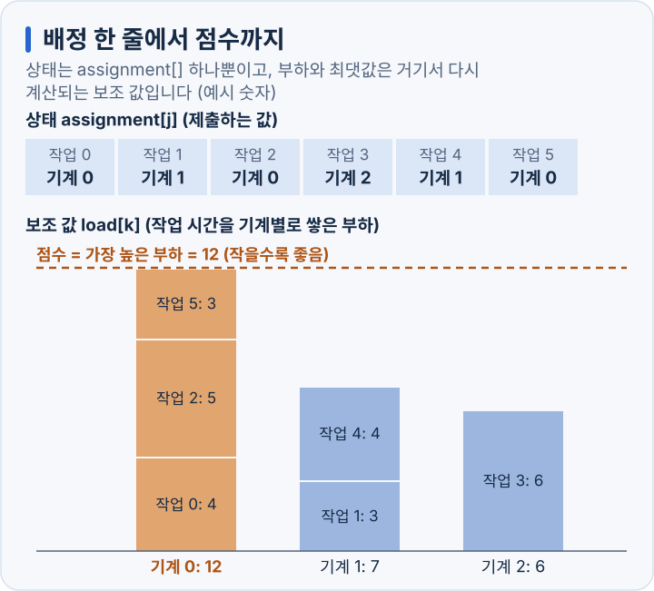

# 배정 문제의 지역 탐색과 SA: 문제 계약과 기준선

SCHEDULX의 입력과 점수를 상태로 옮기고 기준선과 탐욕 초기해까지 만듭니다. 전체 흐름은 [강의 개요](../lesson.md)에 있습니다.

## 문제 계약을 상태로 옮기기

> **코드 환경: h-contest 제출용 선언.** 아래는 구현할 함수의 선언이고, 완성 코드는 뒤의 블록들을 순서대로 붙입니다.

```cpp
#define MAX_MACHINE_COUNT 20

void schedule_jobs(
    int job_count,
    int machine_count,
    const int processing_time[][MAX_MACHINE_COUNT],
    int assignment[]
);
```

| 항목 | 계약 |
| --- | --- |
| 입력 | `processing_time[j][m]`: 작업 `j`를 기계 `m`에서 처리하는 시간. 읽기 전용 비용 행렬 |
| 상한 | `job_count`는 200, 400, 800, 1500, 2500, 4000, `machine_count`는 6, 8, 10, 12, 16, 20 중 하나. TC 6개, 전체 실행 4초 |
| 상태 | 모든 `j`에 대해 `0 <= assignment[j] < machine_count`인 배정 |
| 점수 | 기계별 부하(배정된 작업 시간의 합)의 **최댓값**. 낮을수록 좋고, 최종 점수는 TC 6개의 합 |
| 무효 | 범위 밖 기계가 하나라도 있으면 점수가 패널티 `10^12`가 되고 이후 TC는 채점하지 않음 |

제출할 상태는 `assignment[]` 하나입니다. 기계별 부하·부하의 합·최댓값은 이 배열에서 다시 계산할 수 있는 **보조 값**이라, 탐색 중에는 갱신하며 가고 검사에서는 처음부터 다시 계산한 값과 대조합니다. 문제 설명은 처리 시간의 상한을 주지 않으므로 부하 합은 `long long`입니다.



[그림 크게 보기](https://git.readiz.com/h-contest-lesson/lessons/assignment-local-search/lesson-assets/contract-score.svg)

## 0단계: 유효한 기준선

가장 단순한 유효 답은 작업 번호를 기계 수로 나눈 나머지입니다.

> **코드 환경: h-contest 제출용(완성 코드).**

```cpp snippet=assign-baseline
#define MAX_MACHINE_COUNT 20

void schedule_jobs(int job_count, int machine_count, const int processing_time[][MAX_MACHINE_COUNT], int assignment[]) {
    for (int job = 0; job < job_count; ++job) {
        assignment[job] = job % machine_count;
    }
}
```

이 기준선의 6개 TC 합은 510045입니다. 이후 단계는 모두 같은 TC 6개의 같은 합으로 비교합니다.

## 1단계: 탐욕 초기해

작업을 입력 순서대로 보면서, 놓았을 때 그 기계의 부하가 가장 작아지는 기계에 넣습니다. 기계마다 처리 시간이 다르므로 현재 부하가 가장 낮은 기계가 아니라 `load[m] + processing_time[j][m]`이 가장 작은 기계를 고릅니다. 같은 값이면 번호가 작은 기계입니다.

> **코드 환경: h-contest 제출 확장용 1/4.** 이 블록과 이어지는 두 블록은 `random` 블록 뒤에 붙입니다. 배열 상한은 작업 4000개, 기계 20개이며 `Plan`은 호출마다 새로 만듭니다.

```cpp snippet=assign-plan
#define MAX_MACHINE_COUNT 20

namespace sched {
const int MAX_JOB = 4000;

struct Plan {
    int n, m;
    const int (*time)[MAX_MACHINE_COUNT];
    int machine[MAX_JOB];
    long long load[MAX_MACHINE_COUNT];
    long long total;     // load[]의 합
    long long makespan;  // load[]의 최댓값. 실제 점수

    // machine[]만 믿고 load, total, makespan을 처음부터 다시 계산한다.
    void rebuild() {
        for (int k = 0; k < m; ++k) load[k] = 0;
        for (int j = 0; j < n; ++j) load[machine[j]] += time[j][machine[j]];
        total = 0;
        makespan = 0;
        for (int k = 0; k < m; ++k) {
            total += load[k];
            if (load[k] > makespan) makespan = load[k];
        }
    }
};

// 작업을 입력 순서대로, 놓은 뒤 부하가 가장 작아지는 기계에 넣는다.
void greedy(Plan& p) {
    for (int k = 0; k < p.m; ++k) p.load[k] = 0;
    for (int j = 0; j < p.n; ++j) {
        int best = 0;
        for (int k = 1; k < p.m; ++k) {
            if (p.load[k] + p.time[j][k] < p.load[best] + p.time[j][best]) best = k;
        }
        p.machine[j] = best;
        p.load[best] += p.time[j][best];
    }
    p.rebuild();
}
}
```

`rebuild()`가 보조 값을 `machine[]`에서 처음부터 계산하는 기준 구현입니다. 탐욕 초기해의 합은 263314로 기준선보다 48.4% 낮습니다.
