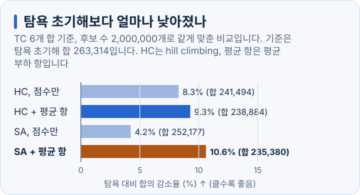
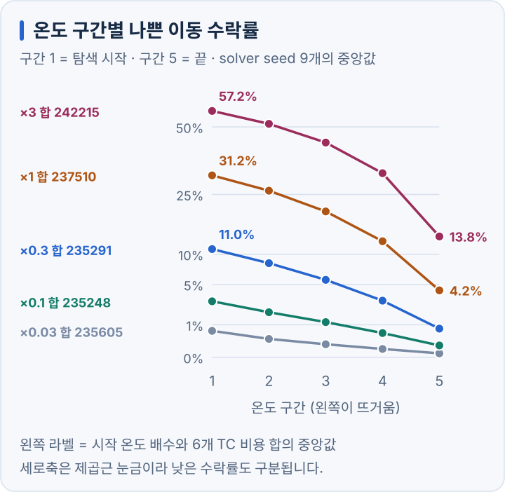
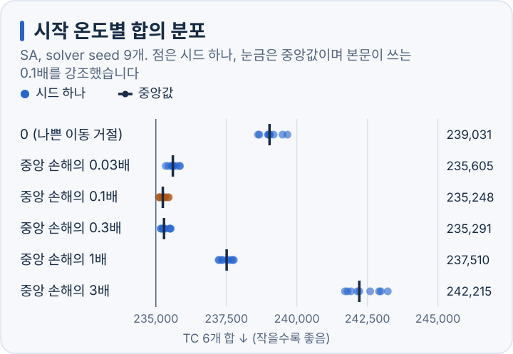
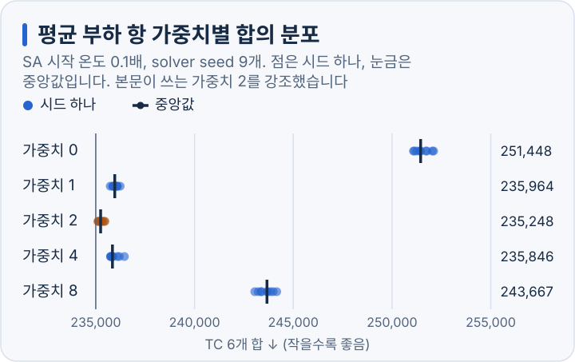

# 배정 문제의 지역 탐색과 SA: 실측과 실패 사례

완성한 제출 코드를 공개 채점기로 단계별로 재고, 온도와 가중치를 바꿔 보고, 최댓값 차분을 잘못 쓴 실패를 재현합니다. 코드는 [풀이](solution.md)에서 이어집니다.

## 완성 코드와 단계별 측정

> **코드 환경: h-contest 제출용 4/4.** [풀이](solution.md)의 세 블록 뒤에 붙이는 진입 함수입니다. 후보 수는 TC마다 2,000,000으로 고정했고, 모든 TC에서 같은 solver seed를 씁니다.

```cpp snippet=assign-entry
void schedule_jobs(int job_count, int machine_count, const int processing_time[][MAX_MACHINE_COUNT], int assignment[]) {
    sched::Plan plan;
    plan.n = job_count;
    plan.m = machine_count;
    plan.time = processing_time;
    sched::greedy(plan);

    sched::Params prm;
    prm.attempts = 2000000;
    prm.seed = 20261118u;
    prm.weight = 2.0;
    prm.swapPercent = 50;
    double loss = sched::medianLoss(plan, prm.seed ^ 0x5bd1e995u, 2000, prm.weight, prm.swapPercent);
    prm.startTemp = 0.1 * loss;
    prm.endTemp = 0.02 * prm.startTemp;
    sched::anneal(plan, prm, assignment);
}
```

아래는 2026-11-18에 공개 채점기의 TC 6개를 그대로 실행한 결과입니다. 환경은 macOS Darwin 26.3 arm64 / Apple clang version 17.0.0 (clang-1700.6.3.2) / -std=c++17 -O2이고, 채점기 `main.cpp`의 SHA-256 앞 12자는 `35a403ffd216`입니다. 시간은 채점기가 TC를 생성하는 시간까지 포함한 6개 TC 전체 시간의 중앙값(9번 실행 중 첫 번째 제외)입니다. hill climbing과 SA 행은 **같은 후보 수 2,000,000개**이고 같은 실행 시간이 아닙니다.

<!-- check:stages -->
| 방식 | TC 1 | TC 2 | TC 3 | TC 4 | TC 5 | TC 6 | 합 ↓ | 탐욕 대비 | 시간(ms) |
| --- | ---: | ---: | ---: | ---: | ---: | ---: | ---: | ---: | ---: |
| 작업 번호 % 기계 수 | 32336 | 54143 | 61323 | 97710 | 115573 | 148960 | 510045 | - | 0.5 |
| 탐욕 초기해 | 14436 | 23921 | 32422 | 51239 | 62703 | 78593 | 263314 | - | 2.1 |
| hill climbing, 실제 점수만 | 12839 | 21525 | 29433 | 45974 | 57700 | 74023 | 241494 | -8.3% | 392.6 |
| hill climbing, 평균 부하 항 포함 | 12947 | 21209 | 30222 | 45134 | 56680 | 72692 | 238884 | -9.3% | 395.8 |
| SA, 실제 점수만 | 12392 | 21488 | 29876 | 48166 | 61679 | 78576 | 252177 | -4.2% | 635.6 |
| SA, 평균 부하 항 포함 | 12364 | 21010 | 28980 | 45137 | 56124 | 71765 | 235380 | -10.6% | 502.4 |



[그림 크게 보기](https://git.readiz.com/h-contest-lesson/lessons/assignment-local-search/lesson-assets/stage-gain.svg)

- 같은 후보 수에서 SA(평균 부하 항 포함)가 가장 낮은 235380로, 탐욕보다 10.6% 낮습니다. 본문의 제출 코드를 채점기에 그대로 연결한 결과도 같은 TC별 비용입니다(검사 스크립트가 비교).
- 실제 점수만 쓴 SA는 hill climbing보다도 **나쁩니다**(252177 대 241494). 이 실험이 원인을 증명하지는 않지만, 평지가 넓고 합계를 줄이는 방향을 알려 주는 항이 없다는 점과 일치합니다.
- 평균 부하 항은 hill climbing에도 도움이 되지만(241494 → 238884) 그 격차보다 SA와의 결합 효과가 훨씬 큽니다.

## 온도·수락률 실험

**시작 온도는 점수 단위의 손해 크기에서 정합니다.** 탐욕 초기해에서 이동 2000개를 제안해 에너지가 나빠지는 것만 모아 중앙값 `loss`를 구하고, `T_start = factor × loss`, `T_end = 0.02 × T_start`로 선형 냉각합니다. TC마다 값이 다르므로 상수 하나를 모든 TC에 쓰지 않습니다.

<!-- check:losses -->
| TC | 작업 수 × 기계 수 | 중앙 손해 | 시작 온도 0.1배 | 끝 온도 | 점수가 그대로인 제안 |
| --- | ---: | ---: | ---: | ---: | ---: |
| 1 | 200 × 6 | 258.3 | 25.8 | 0.52 | 37% |
| 2 | 400 × 8 | 169.0 | 16.9 | 0.34 | 48% |
| 3 | 800 × 10 | 90.8 | 9.1 | 0.18 | 55% |
| 4 | 1500 × 12 | 55.5 | 5.6 | 0.11 | 71% |
| 5 | 2500 × 16 | 34.8 | 3.5 | 0.07 | 74% |
| 6 | 4000 × 20 | 40.3 | 4.0 | 0.08 | 58% |

`factor`를 0.03, 0.1, 0.3, 1, 3으로 바꾸고 solver seed 1~9를 돌려 합의 중앙값과 온도 구간별 나쁜 이동 수락률을 모았습니다. 수락률은 구간별로 (받아들인 나쁜 이동) / (제안된 나쁜 이동)을 6개 TC에서 합산한 뒤 seed 9개의 중앙값을 낸 것입니다. 구간은 후보 2,000,000개를 5등분한 것입니다.

<!-- check:temperatures -->
| 시작 온도 | 합의 중앙값 ↓ | 최소~최대 | 구간 1 | 구간 2 | 구간 3 | 구간 4 | 구간 5 |
| --- | ---: | ---: | ---: | ---: | ---: | ---: | ---: |
| 0 (나쁜 이동 거절) | 239031 | 238626~239666 | - | - | - | - | - |
| 중앙 손해의 0.03배 | 235605 | 235352~235857 | 0.7% | 0.3% | 0.2% | 0.1% | 0.0% |
| 중앙 손해의 0.1배 | 235248 | 235105~235463 | 3.0% | 1.9% | 1.2% | 0.6% | 0.1% |
| 중앙 손해의 0.3배 | 235291 | 235173~235531 | 11.0% | 8.3% | 5.7% | 3.0% | 0.8% |
| 중앙 손해의 1배 | 237510 | 237227~237765 | 31.2% | 26.2% | 20.0% | 12.7% | 4.2% |
| 중앙 손해의 3배 | 242215 | 241708~243223 | 57.2% | 51.4% | 43.5% | 31.9% | 13.8% |



[그림 크게 보기](https://git.readiz.com/h-contest-lesson/lessons/assignment-local-search/lesson-assets/acceptance-by-temperature.svg)



[그림 크게 보기](https://git.readiz.com/h-contest-lesson/lessons/assignment-local-search/lesson-assets/temperature-seeds.svg)

- 0.1배와 0.3배의 합 중앙값 차이(43)는 0.1배 한 설정의 seed 9개 최소~최대 폭(358)보다 작으므로 **둘 사이의 우열은 이 실험으로 정하지 않습니다**. 본문 코드는 합의 중앙값이 가장 낮았던 0.1배를 씁니다.
- 1배 이상은 시작 구간에서 나쁜 이동을 31% 이상 받아들여 후반에 되돌아오지 못합니다. 3배는 시작 온도 0 행(239031)보다도 나쁩니다.
- 0.03배는 거의 아무것도 받아들이지 않아(첫 구간 0.7%) hill climbing에 가깝지만 그래도 SA가 낫습니다.
- 수락률을 직접 맞추는 값은 아닙니다. 이 데이터에서는 첫 구간의 나쁜 이동 수락률이 3.0%(0.1배)와 11.0%(0.3배)일 때 가장 좋았습니다. 다른 문제에서는 같은 방법으로 `factor`와 수락률 표를 다시 만들어야 합니다.

가중치도 같은 방식으로 고정했습니다. `factor`는 0.1, solver seed는 9개입니다.

<!-- check:weights -->
| 평균 부하 항 가중치 | 합의 중앙값 ↓ | 최소~최대 |
| ---: | ---: | ---: |
| 0 | 251448 | 251086~252108 |
| 1 | 235964 | 235733~236238 |
| 2 | 235248 | 235105~235463 |
| 4 | 235846 | 235743~236451 |
| 8 | 243667 | 243051~244163 |



[그림 크게 보기](https://git.readiz.com/h-contest-lesson/lessons/assignment-local-search/lesson-assets/weight-seeds.svg)

0은 [앞에서 본](solution.md) 평지 문제이고, 8은 합계를 줄이는 쪽이 최대 부하 감소보다 커져서 균형이 무너집니다. 본문은 2를 씁니다.

**한 번의 좋은 결과로 결론 내리지 않았는지**는 위 표처럼 seed 범위를 함께 확인합니다. 조합 선택은 공개 TC 6개로만 했으므로 [실험과 튜닝](https://h.readiz.com/learn/experiments-and-tuning)의 튜닝/검증 분리 기준에 맞춰, 선택에 쓰지 않은 입력에서도 확인했습니다. 아래는 채점기 생성기를 쓰지 않고 이 강의에서 직접 만든 입력 6개(기계 유형 3종, 두꺼운 꼬리의 작업 시간)에 같은 코드를 **파라미터 변경 없이** 돌린 결과입니다.

<!-- check:own -->
| 방식 | 6개 입력 비용 합의 중앙값 ↓ | solver seed 5개의 최소~최대 |
| --- | ---: | ---: |
| 탐욕 초기해 | 237421 | 237421~237421 |
| hill climbing | 232978 | 232624~233503 |
| SA | 220825 | 220619~220883 |

탐욕 > hill climbing > SA 순서는 같지만 이 입력은 직접 만든 분포일 뿐 다른 채점 입력의 대표가 아니며, 개선 폭은 입력 분포에 따라 달라집니다.

## 실패 사례: 최댓값 차분을 잘못 쓰면

`finish`에서 나머지 기계의 최댓값을 구하는 반복문 대신 옛 최댓값을 쓴 변형입니다.

```cpp
static Change finish(const Plan& p, int a, int b, long long newA, long long newB, long long newTotal) {
    long long best = newA > newB ? newA : newB;
    if (p.makespan > best) best = p.makespan;  // 나머지 기계 최댓값 대신 옛 최댓값을 쓴다.
    Change c = {best, newTotal};
    return c;
}
```

이 변형은 `a`, `b`를 뺀 나머지 기계가 아니라 옛 최댓값을 하한으로 쓰기 때문에, 새 최댓값이 옛 값보다 작아지는 이동을 한 번도 볼 수 없습니다. 컴파일도 되고 유효한 답을 내지만, 실제로 같은 제출 구조에서 실행하면 6개 TC 합이 263314으로 **탐욕 초기해와 같은 값**이 됩니다. `best`가 한 번도 갱신되지 않고 초기해가 그대로 제출되기 때문입니다. 점수가 틀렸다는 경고는 어디에도 나오지 않습니다.

잡는 검사는 두 가지입니다. 모든 이동·교환에 대해 `tryMove`·`trySwap`의 결과를 `rebuild()`로 처음부터 계산한 값과 비교하고(무작위 인스턴스 300개, 값 상한 3, 50, 10^9), 이동을 적용한 뒤마다 저장한 `load`, `total`, `makespan`이 다시 계산한 값과 같은지 확인합니다. `scripts/check_assignment_search.py`는 이 변형을 직접 만들어 같은 검사가 실패하는 것까지 확인합니다. 검사를 짠 뒤에는 일부러 틀린 구현을 넣어 실제로 실패하는지 보는 편이 안전합니다.

```bash
python3 scripts/check_assignment_search.py
python3 scripts/check_assignment_search.py \
  --judge /path/to/SCHEDULX/main.cpp --output /tmp/schedulx-bench.json
```

앞은 본문 코드를 추출해 ASan/UBSan으로 차분·손계산 표·`best` 불변식·재현성·실패 변형을 검사하고, 저장된 측정과 본문의 표를 대조합니다. 뒤의 명령은 위 표의 측정을 다시 만듭니다.
