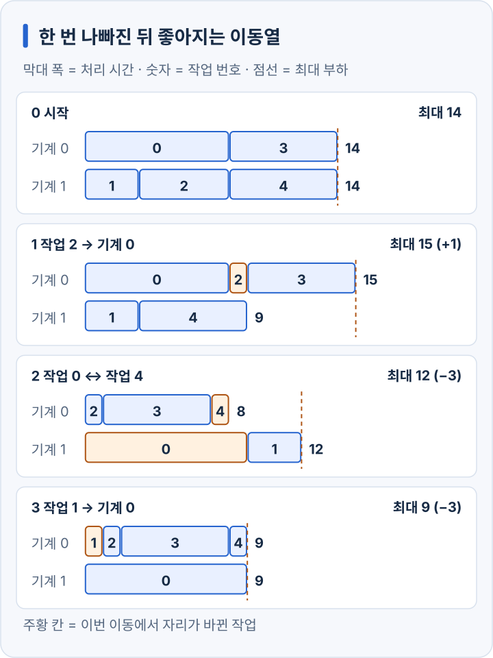

# 배정 문제의 지역 탐색과 SA: 풀이

최댓값 점수의 이동·교환 차분, 손계산으로 본 hill climbing의 정지, hill climbing과 SA를 한 코드로 묶는 과정을 다룹니다. 앞 단계는 [문제 계약과 기준선](contract-and-baseline.md)입니다.

## 2단계: 이웃과 차분 평가

이웃은 두 가지입니다. **이동**은 작업 하나를 다른 기계로 옮기고, **교환**은 서로 다른 기계에 있는 두 작업의 기계를 맞바꿉니다. 둘 다 `assignment[]`를 유효하게 유지합니다.

점수식이 합이면 차분은 간단합니다. 작업 `j`를 `from`에서 `to`로 옮길 때 부하의 합은 `processing_time[j][to] - processing_time[j][from]`만 바뀝니다. 최댓값은 다릅니다. 옮긴 두 기계의 새 부하는 알지만, 옛 최댓값만으로는 새 최댓값을 모릅니다. `from`이 유일한 최대 기계였다면 최댓값은 내려가는데 얼마나 내려가는지는 **다음으로 큰 부하**에 달려 있고, `to`가 새 최대가 될 수도 있습니다. 그래서 기계별 부하 `load[]`를 유지하고, 새 최댓값을 `max(새 from 부하, 새 to 부하, 나머지 기계의 최대 부하)`로 `O(기계 수)`에 계산합니다. 기계가 20대 이하라서 이 정도면 충분하며, 더 커지면 부하 상위 두 개나 힙을 유지하는 방법을 씁니다.

> **코드 환경: h-contest 제출 확장용 2/4.** `hc::Random`(공통 `random` 블록)에 의존합니다. `tryMove`·`trySwap`은 `Plan`을 바꾸지 않고 결과만 계산합니다. 거절할 이동은 아무것도 바꾸지 않았으므로 되돌릴 일이 없습니다.

```cpp snippet=assign-delta
namespace sched {
struct Change {
    long long makespan, total;  // 이동 뒤의 값
};

// 두 기계의 새 부하와, 그 둘을 뺀 나머지 기계의 최댓값으로 새 makespan을 만든다.
static Change finish(const Plan& p, int a, int b, long long newA, long long newB, long long newTotal) {
    long long best = newA > newB ? newA : newB;
    for (int k = 0; k < p.m; ++k) {
        if (k != a && k != b && p.load[k] > best) best = p.load[k];
    }
    Change c = {best, newTotal};
    return c;
}

// job을 to 기계로 옮긴 결과. p는 바꾸지 않는다. 전제: to != p.machine[job]
Change tryMove(const Plan& p, int job, int to) {
    int from = p.machine[job];
    long long newFrom = p.load[from] - p.time[job][from];
    long long newTo = p.load[to] + p.time[job][to];
    return finish(p, from, to, newFrom, newTo, p.total + p.time[job][to] - p.time[job][from]);
}

// 서로 다른 기계에 있는 두 작업의 교환. 전제: p.machine[x] != p.machine[y]
Change trySwap(const Plan& p, int x, int y) {
    int a = p.machine[x], b = p.machine[y];
    long long newA = p.load[a] - p.time[x][a] + p.time[y][a];
    long long newB = p.load[b] - p.time[y][b] + p.time[x][b];
    long long newTotal = p.total + (p.time[y][a] - p.time[x][a]) + (p.time[x][b] - p.time[y][b]);
    return finish(p, a, b, newA, newB, newTotal);
}

struct Move {
    int kind;  // 0: x번 작업을 y번 기계로, 1: x번과 y번 작업 교환
    int x, y;
    Change after;
};

// 전제: n >= 2, m >= 2. 같은 기계의 두 작업을 고르면 한 작업 이동으로 바꾼다.
Move propose(const Plan& p, hc::Random& rng, int swapPercent) {
    Move mv;
    mv.x = (int)rng.below((unsigned)p.n);
    if ((int)rng.below(100u) < swapPercent) {
        mv.y = (int)rng.below((unsigned)p.n);
        if (p.machine[mv.x] != p.machine[mv.y]) {
            mv.kind = 1;
            mv.after = trySwap(p, mv.x, mv.y);
            return mv;
        }
    }
    mv.y = (int)rng.below((unsigned)(p.m - 1));
    if (mv.y >= p.machine[mv.x]) ++mv.y;
    mv.kind = 0;
    mv.after = tryMove(p, mv.x, mv.y);
    return mv;
}

void apply(Plan& p, const Move& mv) {
    if (mv.kind == 0) {
        int from = p.machine[mv.x];
        p.load[from] -= p.time[mv.x][from];
        p.load[mv.y] += p.time[mv.x][mv.y];
        p.machine[mv.x] = mv.y;
    } else {
        int a = p.machine[mv.x], b = p.machine[mv.y];
        p.load[a] += p.time[mv.y][a] - p.time[mv.x][a];
        p.load[b] += p.time[mv.x][b] - p.time[mv.y][b];
        p.machine[mv.x] = b;
        p.machine[mv.y] = a;
    }
    p.total = mv.after.total;
    p.makespan = mv.after.makespan;
}

// 탐색용 에너지 변화: 실제 점수 변화 + weight * 평균 부하 변화
double energyChange(const Plan& p, const Change& c, double weight) {
    return (double)(c.makespan - p.makespan) + weight * (double)(c.total - p.total) / p.m;
}
}
```

`propose`가 같은 기계의 두 작업을 교환하려 하면 이동으로 바꿉니다. `apply`는 `Change`에 이미 계산한 새 값을 그대로 저장하며, 이 저장값이 틀리면 이후 모든 비교가 틀리므로 뒤의 검사([실패 사례](experiments-and-failures.md))가 가장 먼저 확인하는 곳입니다.

## 작은 손계산: hill climbing이 멈추는 곳

작업 5개, 기계 2개입니다. 탐욕 초기해는 작업 0, 3이 기계 0, 작업 1, 2, 4가 기계 1입니다.

<!-- check:handtime -->
| 작업 | 기계 0에서 | 기계 1에서 |
| --- | ---: | ---: |
| 0 | 8 | 9 |
| 1 | 1 | 3 |
| 2 | 1 | 5 |
| 3 | 6 | 9 |
| 4 | 1 | 6 |

두 기계의 부하는 14와 14로 최대 14입니다. 이동 5개와 교환 6개, 이웃 11개를 모두 계산한 표입니다.

<!-- check:hand -->
| 이웃 | 기계 0 부하 | 기계 1 부하 | 최대 부하 |
| --- | ---: | ---: | ---: |
| 시작 상태 | 14 | 14 | 14 |
| 작업 0 → 기계 1 | 6 | 23 | 23 |
| 작업 1 → 기계 0 | 15 | 11 | 15 |
| 작업 2 → 기계 0 | 15 | 9 | 15 |
| 작업 3 → 기계 1 | 8 | 23 | 23 |
| 작업 4 → 기계 0 | 15 | 8 | 15 |
| 작업 0 ↔ 작업 1 | 7 | 20 | 20 |
| 작업 0 ↔ 작업 2 | 7 | 18 | 18 |
| 작업 0 ↔ 작업 4 | 7 | 17 | 17 |
| 작업 1 ↔ 작업 3 | 9 | 20 | 20 |
| 작업 2 ↔ 작업 3 | 9 | 18 | 18 |
| 작업 3 ↔ 작업 4 | 9 | 17 | 17 |

어느 이웃도 14보다 작지 않고 같은 값도 없으므로 개선만 받는 hill climbing은 여기서 멈춥니다. 2⁵ = 32개 배정을 전부 보면 최솟값은 9이고, 작업 0만 기계 1에 둔 배정이 그 값입니다. 이동열은 다음과 같습니다.

1. 작업 2를 기계 0으로 옮깁니다. 부하는 15와 9, 최대 15로 **1 나빠집니다**.
2. 작업 0과 4를 교환합니다. 부하는 8과 12, 최대 12.
3. 작업 1을 기계 0으로 옮깁니다. 부하는 9와 9, 최대 9.

[이웃을 하나씩 평가하는 데모: 부하 막대와 최대 부하](https://git.readiz.com/h-contest-lesson/demos/index.html?demo=assignment-moves)

위 표의 이웃 11개를 하나씩 계산해 기계별 부하 막대가 어떻게 바뀌는지 봅니다. 개선만 받으면 14에서 멈추고, 한 번 나빠지는 이동을 허용하면 9에 닿는 과정을 전환해 비교해 보세요.



[그림 크게 보기](https://git.readiz.com/h-contest-lesson/lessons/assignment-local-search/lesson-assets/hand-moves.svg)

막대의 폭이 처리 시간이고 주황 칸이 그 단계에서 자리가 바뀐 작업입니다. 첫 이동의 손해는 1이라서, 온도가 1이면 약 37%(`e^-1`), 0.3이면 약 4%로 받아들입니다. **손해가 1인 문제의 온도를 수천으로 두면** 이 구조 자체가 사라집니다. 온도는 이동 한 번의 점수 차이에 맞춰야 한다는 [앞 강의](https://h.readiz.com/learn/heuristic-case-studies/search-strategies)의 기준을 이 예시가 보여 줍니다. 이 표와 이동열은 검사 스크립트가 같은 11개 이웃을 독립적으로 다시 계산해 대조합니다.

## 3단계: hill climbing과 SA를 한 코드로

hill climbing은 온도 0인 SA입니다. 같은 `anneal`에서 시작·끝 온도만 0으로 두면 에너지가 같거나 좋아지는 이동만 받습니다.

그런데 실제 점수 변화만으로 에너지를 만들면 문제가 생깁니다. 최댓값은 **평지가 많습니다**. 탐욕 초기해에서 이동 2000개를 제안해 보면 점수가 그대로인 제안이 37~74%입니다(표는 아래, [온도·수락률 실험](experiments-and-failures.md)에 있습니다). 최대 기계와 무관한 이동은 항상 손해 0이고, 손해가 있는 이동의 크기만 봐서는 부하가 낮은 쪽으로 가는 이동의 가치를 알 수 없습니다. 그래서 탐색용 에너지에 **평균 부하 항**을 더합니다.

```text
에너지 변화 = (새 최대 부하 - 옛 최대 부하) + weight × (새 부하 합 - 옛 부하 합) / 기계 수
```

최대 부하를 직접 줄이는 이동을 우선하되, 기계의 합계가 줄어드는 이동(그 작업을 더 빠른 기계로 보내는 이동)도 조금씩 에너지를 낮춥니다. **제출 점수는 그대로 최대 부하**이고, `best`는 실제 최대 부하가 처음으로 더 작아질 때만 갱신합니다. 이 분리가 hill climbing과 SA 모두에서 `current`와 `best`를 나누는 이유입니다.

> **코드 환경: h-contest 제출 확장용 3/4.** `Stats`는 온도 구간별 나쁜 이동의 제안·수락 횟수를 남깁니다. 시작 온도는 현재 해에서 샘플링한 손해의 중앙값으로 정합니다([다음 페이지의 온도·수락률 실험](experiments-and-failures.md)).

```cpp snippet=assign-anneal
namespace sched {
const int SEGMENTS = 5;

// x >= 0. 헤더 없이 exp(-x)를 근사한다. (search-strategies의 ordering_sa::expNegative와 같은 방식)
double expNegative(double x) {
    if (x >= 32.0) return 0.0;
    int halves = 0;
    while (x > 0.5) { x *= 0.5; ++halves; }
    double sum = 1.0, term = 1.0;
    for (int k = 1; k <= 12; ++k) {
        term *= -x / k;
        sum += term;
    }
    for (int k = 0; k < halves; ++k) sum *= sum;
    return sum;
}

// 현재 해에서 무작위 이동을 samples번 제안해 양수 손해의 중앙값을 돌려준다. p는 바꾸지 않는다.
double medianLoss(const Plan& p, unsigned seed, int samples, double weight, int swapPercent) {
    static double loss[4096];
    if (p.n < 2 || p.m < 2) return 1.0;
    if (samples > 4096) samples = 4096;
    hc::Random rng;
    rng.reset(seed);
    int count = 0;
    for (int i = 0; i < samples; ++i) {
        Move mv = propose(p, rng, swapPercent);
        double d = energyChange(p, mv.after, weight);
        if (d <= 0.0) continue;
        int pos = count++;  // 삽입 정렬
        while (pos > 0 && loss[pos - 1] > d) { loss[pos] = loss[pos - 1]; --pos; }
        loss[pos] = d;
    }
    return count == 0 ? 1.0 : loss[count / 2];
}

struct Params {
    long long attempts;
    unsigned seed;
    double startTemp, endTemp;
    double weight;
    int swapPercent;
};

struct Stats {
    long long initialMakespan, bestMakespan;
    long long proposedWorse[SEGMENTS], acceptedWorse[SEGMENTS], acceptedOther[SEGMENTS];
};

// p에서 시작해 best[]에 가장 좋았던 배정을 남긴다. p는 current로 계속 움직인다.
Stats anneal(Plan& p, const Params& prm, int best[]) {
    Stats st;
    st.initialMakespan = st.bestMakespan = p.makespan;
    for (int s = 0; s < SEGMENTS; ++s) st.proposedWorse[s] = st.acceptedWorse[s] = st.acceptedOther[s] = 0;
    for (int j = 0; j < p.n; ++j) best[j] = p.machine[j];
    if (p.n < 2 || p.m < 2 || prm.attempts <= 0) return st;

    hc::Random rng;
    rng.reset(prm.seed);
    for (long long step = 0; step < prm.attempts; ++step) {
        double progress = prm.attempts == 1 ? 0.0 : (double)step / (double)(prm.attempts - 1);
        double temperature = prm.startTemp + (prm.endTemp - prm.startTemp) * progress;
        int seg = (int)(step * SEGMENTS / prm.attempts);
        Move mv = propose(p, rng, prm.swapPercent);
        double d = energyChange(p, mv.after, prm.weight);
        double u = (rng.next() >> 8) / 16777216.0;  // 개선 이동에서도 난수를 하나 쓴다.
        bool accept = d <= 0.0;
        if (d > 0.0) {
            ++st.proposedWorse[seg];
            if (temperature > 0.0) accept = u < expNegative(d / temperature);
        }
        if (!accept) continue;  // 거절한 이동은 p를 건드리지 않았으므로 되돌릴 것이 없다.
        apply(p, mv);
        if (d > 0.0) ++st.acceptedWorse[seg]; else ++st.acceptedOther[seg];
        if (p.makespan < st.bestMakespan) {
            st.bestMakespan = p.makespan;
            for (int j = 0; j < p.n; ++j) best[j] = p.machine[j];
        }
    }
    return st;
}
}
```

주의할 점이 몇 가지 있습니다. 개선 이동에서도 난수를 하나 소비하므로, 난수 소비 횟수가 수락 여부와 무관하게 제안 횟수에만 비례합니다. 반환하는 `best[]`는 항상 처음 해보다 나쁘지 않습니다. `medianLoss`는 `Plan`을 바꾸지 않으므로 샘플링이 탐색 상태를 오염시키지 않습니다.
