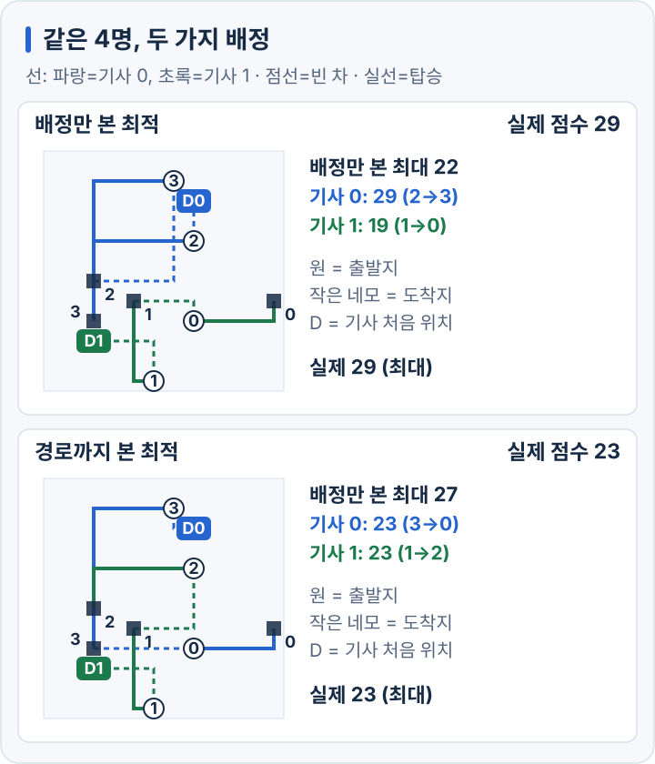
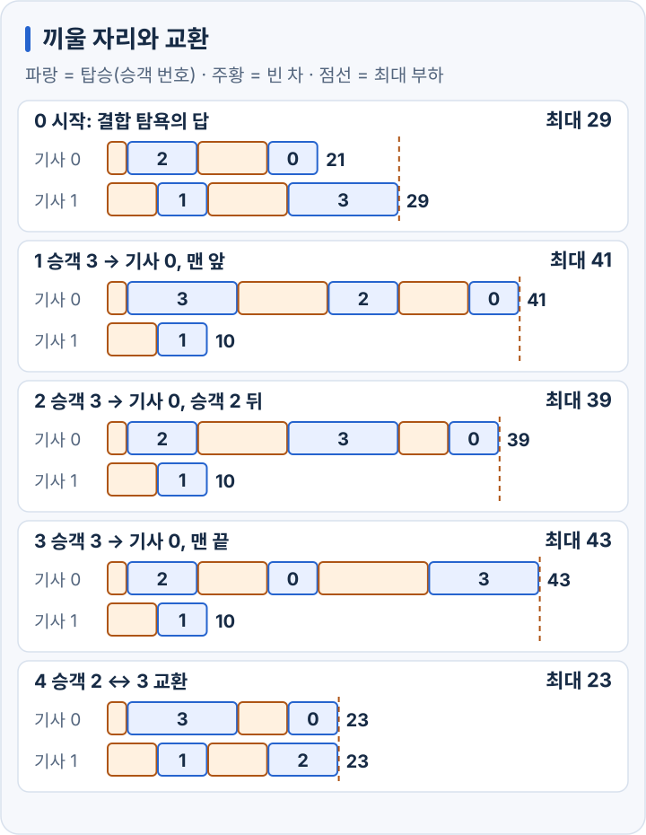

# 배정과 경로가 결합된 문제: 택시 배정

[TAXIASSIGN](/practice/TAXIASSIGN)은 승객을 기사에게 나누는 **배정**과 각 기사가 승객을 도는 **순서**를 함께 제출하는 문제입니다. [SCHEDULX](https://h.readiz.com/learn/assignment-local-search)에서는 작업을 기계에 나누면 끝났지만, 여기서는 같은 배정도 순서에 따라 점수가 크게 달라집니다. [배송 순서 개선](https://h.readiz.com/learn/heuristic/ordering-route-improvement)의 이동과 차분 평가를 "누가 맡는가"와 합쳐, 점수가 **최댓값**인 문제에서 쓰는 방법을 실제 점수로 확인합니다.

앞의 두 강의와 [Testing과 Stress Test](https://h.readiz.com/learn/testing-and-stress)를 읽었다고 가정합니다. 난수는 [공통 코드의 `random` 블록](https://h.readiz.com/learn/cpp-common-library)을 먼저 붙여 씁니다. 승객과 기사를 1:1로 정확히 짝지어야 하는 문제라면 [Hungarian 알고리즘](https://h.readiz.com/learn/hungarian-algorithm)을 선택할 수 있지만, 여기서는 기사 한 명이 여러 승객을 순서대로 맡습니다.

## 문제 계약을 상태로 옮기기

| 항목 | 계약 |
| --- | --- |
| 구현 | `void run(int N, int M, Coordinate mDriver[], int K, Passenger mPassenger[])`에서 `assign_driver(기사, 승객 수, 승객 번호 배열)`로 기사별 처리 순서를 제출 |
| 상한 | `N = 1,000,000`, `51 <= M <= 100`, `5,001 <= K <= 10,000`. TC 5개, 전체 실행 10초 |
| 점수 | 기사별 총 이동 거리의 **최댓값**의 TC 5개 합. 낮을수록 좋고 431,000,000 이하가 통과 기준 |
| API·무효 | 같은 기사에 여러 번 호출하면 마지막 호출만 사용하고, 범위 밖 값은 `false`를 돌려주며 반영되지 않음. 승객이 누락되거나 두 번 이상 나오면 패널티 `10^13`을 받고 이후 TC는 채점하지 않음. 승객이 없는 기사는 허용 |

기사 `d`는 처음 위치 → `p0`의 출발지 → 도착지 → `p1`의 출발지 → … 순서로 맨해튼 거리를 움직입니다. 이동 거리에서 **누가 맡는가**와 **어떤 순서인가**가 들어가는 항은 다릅니다.

```text
load(d) = Σ ride(p)                                          … 배정만 정한다.
        + hop(처음 위치 → p0) + Σ hop(p_i 도착지 → p_i+1 출발지)  … 배정과 순서가 함께 정한다.
점수    = max over d of load(d)
```

`ride(p)`(승객의 출발지와 도착지 사이 거리)는 누가 어떤 순서로 맡아도 같은 상수이고, 빈 차로 다음 승객에게 가는 `hop`은 앞 승객이 누구인지에 따라 달라집니다. 최댓값은 평균 이상이므로 `Σ ride / M`은 점수의 하한이며, TC 5개의 합은 412,143,544입니다. 이 하한을 넘는 부분이 빈 차 구간과 기사 사이의 불균형입니다.

> **코드 환경: h-contest 제출용.** 이 강의의 코드 블록은 `3단계` 블록(실험용 확장)과 실패 사례 조각을 빼고 `random` 블록 뒤에 순서대로 붙여 제출합니다. 기사 100명·승객 10,000명 상한의 `Plan`은 4MB가 넘으므로 `static`으로 둡니다. 첫 블록은 문제가 주는 선언과 이 강의 전체의 상태입니다.

```cpp snippet=taxi-plan
struct Coordinate {
    int y, x;
};

struct Passenger {
    Coordinate departure;
    Coordinate arrival;
};

extern bool assign_driver(int driverID, int passengerSize, int passengerIDs[]);

namespace taxi {
const int MAX_K = 10000, MAX_M = 100;

// 노드 0..K-1은 승객, K+d는 기사 d의 처음 위치. (ay, ax)는 그 노드에서 다음 승객에게 출발하는 좌표다.
struct Plan {
    int k, m;
    int ay[MAX_K + MAX_M], ax[MAX_K + MAX_M];  // 승객이면 도착지, 기사 노드면 처음 위치
    int dy[MAX_K], dx[MAX_K];                  // 승객의 출발지
    int ride[MAX_K];                           // 탑승 거리: 누가 맡든, 어떤 순서든 같은 상수
    int route[MAX_M][MAX_K], len[MAX_M];       // 기사별 승객 순서
    int owner[MAX_K], pos[MAX_K];              // route[owner[p]][pos[p]] == p
    long long load[MAX_M], total, maxLoad;     // 기사별 이동 거리, 그 합, 그 최댓값(실제 점수)
};

inline int absInt(int v) { return v < 0 ? -v : v; }
// 노드 x에서 승객 y의 출발지까지 빈 차로 가는 거리
inline int hop(const Plan& p, int x, int y) { return absInt(p.ay[x] - p.dy[y]) + absInt(p.ax[x] - p.dx[y]); }
void init(Plan& p, int m, const Coordinate driver[], int k, const Passenger passenger[]) {
    p.k = k; p.m = m;
    for (int i = 0; i < k; ++i) {
        p.dy[i] = passenger[i].departure.y; p.dx[i] = passenger[i].departure.x;
        p.ay[i] = passenger[i].arrival.y;   p.ax[i] = passenger[i].arrival.x;
        p.ride[i] = absInt(p.ay[i] - p.dy[i]) + absInt(p.ax[i] - p.dx[i]);
    }
    for (int d = 0; d < m; ++d) { p.ay[k + d] = driver[d].y; p.ax[k + d] = driver[d].x; p.len[d] = 0; }
}

// route[]와 len[]만 믿고 나머지를 처음부터 다시 계산한다.
void rebuild(Plan& p) {
    p.total = p.maxLoad = 0;
    for (int d = 0; d < p.m; ++d) {
        int prev = p.k + d;
        p.load[d] = 0;
        for (int i = 0; i < p.len[d]; ++i) {
            int q = p.route[d][i];
            p.load[d] += p.ride[q] + hop(p, prev, q);
            p.owner[q] = d; p.pos[q] = i; prev = q;
        }
        p.total += p.load[d];
        if (p.load[d] > p.maxLoad) p.maxLoad = p.load[d];
    }
}

void submit(Plan& p) {
    for (int d = 0; d < p.m; ++d) assign_driver(d, p.len[d], p.route[d]);
}
}
```

`owner`·`pos`·`load`·`total`·`maxLoad`는 `route`에서 다시 계산할 수 있는 보조 값입니다. 탐색 중에는 갱신하며 가고, 검사에서는 `rebuild()`로 처음부터 계산한 값과 대조합니다.

**0단계, 유효한 기준선.** 승객 `i`를 기사 `i % M`에게 번호 순서로 맡깁니다. `taxi-plan` 블록의 맨 앞(문제가 주는 선언) 뒤에 붙이면 단독으로 제출할 수 있는 완성 코드입니다. TC 5개 합은 894481017이고, 아래의 모든 단계는 같은 TC 5개의 같은 합으로 비교합니다.

```cpp snippet=taxi-baseline
void run(int N, int M, Coordinate mDriver[], int K, Passenger mPassenger[]) {
    static int ids[10000];
    for (int d = 0; d < M; ++d) {
        int n = 0;
        for (int i = d; i < K; i += M) ids[n++] = i;  // 기사 d에게 승객 d, d+M, d+2M, ...
        assign_driver(d, n, ids);
    }
}
```

## 이웃과 차분 평가: 옮기며 끼우기, 자리 바꾸기

- **옮기며 끼우기**: 승객 `x`를 지금 기사에게서 빼서 노드 `q` 바로 뒤에 넣습니다. `q`는 아무 기사의 승객이거나 기사의 처음 위치(맨 앞)이므로 담당자와 삽입 위치가 한 번에 정해지고, 같은 기사 안에서 옮기면 경로 개선이 됩니다.
- **자리 바꾸기**: 서로 다른 기사의 승객 `x`, `y`가 서로의 자리로 갑니다.

차분 평가에서 유지할 값은 **기사별 부하 `load[]`**입니다. 이웃 하나가 바꾸는 것은 두 기사의 부하뿐이고, 새 점수는 `max(바뀐 두 기사, 나머지 기사의 최댓값)`입니다. `x`를 빼면 `hop(앞, x) + hop(x, 뒤)`가 사라지고 `hop(앞, 뒤)`가 새로 생기며, `q` 뒤에 넣으면 그 반대가 일어납니다. 탑승 거리 `ride(x)`는 담당자와 함께 옮겨 갑니다. 전체 합 `total`도 함께 유지하면 뒤의 탐색 에너지에 쓸 수 있습니다.

```cpp snippet=taxi-delta
namespace taxi {
// 바뀐 두 기사 a, b의 새 부하와 전체 합, 새 최댓값. a == b이면 loadA만 쓴다.
struct Change {
    int a, b;
    long long loadA, loadB, total, maxLoad;
};

inline int prevOf(const Plan& p, int x) {  // 승객 x 바로 앞의 노드
    return p.pos[x] > 0 ? p.route[p.owner[x]][p.pos[x] - 1] : p.k + p.owner[x];
}

inline int nextOf(const Plan& p, int node) {  // 노드 바로 뒤의 승객. 없으면 -1
    int d = node >= p.k ? node - p.k : p.owner[node], i = node >= p.k ? 0 : p.pos[node] + 1;
    return i < p.len[d] ? p.route[d][i] : -1;
}
// 승객 x를 노드 q 바로 뒤로 옮긴 결과. p는 바꾸지 않는다. 전제: q != x, q != prevOf(x)
Change relocateChange(const Plan& p, int x, int q) {
    Change c;
    c.a = p.owner[x];
    c.b = q >= p.k ? q - p.k : p.owner[q];
    int pa = prevOf(p, x), na = nextOf(p, x), s = nextOf(p, q);
    long long cut = hop(p, pa, x);                       // x를 빼면 사라지는 빈 차 구간
    if (na >= 0) cut += hop(p, x, na) - hop(p, pa, na);  // pa에서 na로 바로 이어진다.
    long long add = hop(p, q, x);                        // x를 넣으면 생기는 빈 차 구간
    if (s >= 0) add += hop(p, x, s) - hop(p, q, s);
    c.total = p.total - cut + add;
    if (c.a == c.b) {
        c.loadA = c.loadB = p.load[c.a] - cut + add;
    } else {
        c.loadA = p.load[c.a] - p.ride[x] - cut;         // 탑승 거리는 담당자와 함께 옮겨 간다.
        c.loadB = p.load[c.b] + p.ride[x] + add;
    }
    return c;
}
// 서로 다른 기사의 승객 x, y가 서로의 자리로 간다. 전제: p.owner[x] != p.owner[y]
Change swapChange(const Plan& p, int x, int y) {
    Change c;
    c.a = p.owner[x];
    c.b = p.owner[y];
    int pa = prevOf(p, x), na = nextOf(p, x), pb = prevOf(p, y), nb = nextOf(p, y);
    long long dA = p.ride[y] - p.ride[x] + hop(p, pa, y) - hop(p, pa, x);
    long long dB = p.ride[x] - p.ride[y] + hop(p, pb, x) - hop(p, pb, y);
    if (na >= 0) dA += hop(p, y, na) - hop(p, x, na);
    if (nb >= 0) dB += hop(p, x, nb) - hop(p, y, nb);
    c.loadA = p.load[c.a] + dA;
    c.loadB = p.load[c.b] + dB;
    c.total = p.total + dA + dB;
    return c;
}
// 바뀐 두 기사와 나머지 기사의 부하로 새 최댓값을 채운다.
Change finish(const Plan& p, Change c) {
    c.maxLoad = c.loadA > c.loadB ? c.loadA : c.loadB;
    for (int d = 0; d < p.m; ++d) if (d != c.a && d != c.b && p.load[d] > c.maxLoad) c.maxLoad = p.load[d];
    return c;
}
void settle(Plan& p, const Change& c) {
    p.load[c.a] = c.loadA;
    if (c.a != c.b) p.load[c.b] = c.loadB;
    p.total = c.total;
    p.maxLoad = c.maxLoad;
}
// c는 finish(relocateChange(p, x, q))의 결과여야 한다.
void applyRelocate(Plan& p, int x, int q, const Change& c) {
    int a = p.owner[x], b = c.b;
    for (int j = p.pos[x]; j + 1 < p.len[a]; ++j) {  // x를 빼고 왼쪽으로 당긴다.
        p.route[a][j] = p.route[a][j + 1];
        p.pos[p.route[a][j]] = j;
    }
    --p.len[a];
    int at = q >= p.k ? 0 : p.pos[q] + 1;            // 같은 기사라면 pos[q]는 이미 당겨진 값이다.
    for (int j = p.len[b]++; j > at; --j) {          // 자리를 벌리고 x를 넣는다.
        p.route[b][j] = p.route[b][j - 1];
        p.pos[p.route[b][j]] = j;
    }
    p.route[b][at] = x; p.pos[x] = at; p.owner[x] = b;
    settle(p, c);
}

void applySwap(Plan& p, int x, int y, const Change& c) {
    int a = p.owner[x], b = p.owner[y], ix = p.pos[x], iy = p.pos[y];
    p.route[a][ix] = y; p.owner[y] = a; p.pos[y] = ix;
    p.route[b][iy] = x; p.owner[x] = b; p.pos[x] = iy;
    settle(p, c);
}
}
```

계산 함수는 `Plan`을 바꾸지 않으므로 거절할 이웃을 되돌릴 일이 없습니다. `relocateChange`의 전제 `q != prevOf(x)`는 제자리로 넣는 경우를 막습니다. 같은 기사 안에서 옮길 때 `applyRelocate`는 `x`를 **뺀 뒤의** `pos[q]`로 삽입 위치를 구해야 합니다. 두 곳 모두 틀리기 쉬워서 뒤에서 틀린 변형으로 확인합니다.

## 작은 손계산: 배정만 최적과 경로까지 본 최적

기사 0은 (2,7), 기사 1은 (9,2)에서 출발하고, 승객 0 (8,7)→(7,11) 탑승 5, 승객 1 (11,5)→(7,4) 탑승 5, 승객 2 (4,7)→(6,2) 탑승 7, 승객 3 (1,6)→(8,2) 탑승 11입니다. SCHEDULX처럼 "승객 `p`를 기사 `d`에게 맡기는 비용"을 `(기사 처음 위치 → 출발지) + 탑승 거리`로 두고 그 합을 기사 부하로 보는 것이 **배정만 본** 모형입니다. 두 번째 승객부터는 이전 도착지에서 출발한다는 사실이 이 모형에서 사라집니다. 아래는 2⁴ = 16개 배정을 전부 계산한 표이며, 실제 부하는 각 기사가 순서를 모두 시도해 가장 좋게 고른 값입니다. 표와 아래 이동 결과는 검사 스크립트가 순열을 전부 시도하는 독립 계산으로 다시 구해 대조합니다.

<!-- check:hand -->
| 기사 0 / 기사 1 | 배정만 본 부하 | 최적 순서의 실제 부하 | 실제 점수 |
| --- | --- | --- | ---: |
| {} / {0,1,2,3} | 0 / 61 → 61 | 0 / 53 (1→0→2→3) | 53 |
| {0} / {1,2,3} | 11 / 50 → 50 | 11 (0) / 43 (1→2→3) | 43 |
| {1} / {0,2,3} | 16 / 51 → 51 | 16 (1) / 45 (0→2→3) | 45 |
| {0,1} / {2,3} | 27 / 40 → 40 | 25 (1→0) / 37 (2→3) | 37 |
| {2} / {0,1,3} | 9 / 44 → 44 | 9 (2) / 39 (1→3→0) | 39 |
| {0,2} / {1,3} | 20 / 33 → 33 | 21 (2→0) / 29 (1→3) | 29 |
| {1,2} / {0,3} | 25 / 34 → 34 | 22 (2→1) / 33 (0→3) | 33 |
| {0,1,2} / {3} | 36 / 23 → 36 | 31 (2→1→0) / 23 (3) | 31 |
| {3} / {0,1,2} | 13 / 38 → 38 | 13 (3) / 33 (1→0→2) | 33 |
| **{0,3} / {1,2}** | 24 / 27 → 27 | 23 (3→0) / 23 (1→2) | **23** |
| {1,3} / {0,2} | 29 / 28 → 29 | 24 (3→1) / 25 (0→2) | 25 |
| {0,1,3} / {2} | 40 / 17 → 40 | 33 (3→1→0) / 17 (2) | 33 |
| **{2,3} / {0,1}** | **22 / 21 → 22** | 29 (2→3) / 19 (1→0) | **29** |
| {0,2,3} / {1} | 33 / 10 → 33 | 37 (3→0→2) / 10 (1) | 37 |
| {1,2,3} / {0} | 38 / 11 → 38 | 37 (3→1→2) / 11 (0) | 37 |
| {0,1,2,3} / {} | 49 / 0 → 49 | 47 (3→1→0→2) / 0 | 47 |

배정만 본 최적은 `{2,3} / {0,1}`로 22인데, 기사 0이 어느 순서로 돌아도 29가 되어 실제 점수는 29입니다. 실제 최적 `{0,3} / {1,2}`는 두 기사가 모두 23이고, 배정만 본 값은 27이라 최적이 아닙니다. 순서도 중요합니다. 기사 1이 `{1,2}`를 1 → 2로 돌면 23이지만 2 → 1이면 30입니다.



[그림 크게 보기](https://git.readiz.com/h-contest-lesson/lessons/assignment-with-routes/lesson-assets/hand-two-answers.svg)

결합 이웃이 하는 일도 이 예시에서 보입니다. 뒤의 탐욕이 만드는 답 `[[2, 0], [1, 3]]`(기사 0은 승객 2 → 0, 기사 1은 1 → 3)의 부하는 21과 29입니다. 승객 3을 기사 0으로 옮기면 끼우는 자리마다 결과가 달라서 맨 앞은 41, 승객 2 뒤는 39, 맨 끝은 43이고 기사 1은 10이 됩니다. 최선의 자리(39)도 29보다 나빠 옮기는 이웃으로는 벗어나지 못하지만, 승객 2와 3을 **바꾸면** 한 번에 23과 23이 됩니다. 그런데 `climb`을 이 예시에서 돌리면 seed 1~9 중 5개는 23에 닿고 나머지 4개는 배정만 본 최적 `{2,3} / {0,1}`로 들어가 29에서 멈춥니다. 그 상태에서는 이동도 교환도 최대 부하를 줄이지 못해, 같은 시작에서도 먼저 받아들인 이웃이 결과를 가릅니다.



[그림 크게 보기](https://git.readiz.com/h-contest-lesson/lessons/assignment-with-routes/lesson-assets/hand-neighbors.svg)

[경로 삽입 데모: 끼우는 자리와 교환 비교하기](https://git.readiz.com/h-contest-lesson/demos/index.html?demo=route-insertion)

승객 3을 기사 0에게 옮길 때 끼우는 자리마다 두 기사의 탑승·빈 차 거리와 최댓값이 어떻게 달라지는지 보고, 교환 한 번으로 23과 23이 되는 과정을 단계별로 확인해 보세요.

## 1~3단계: 배정만, 경로만, 번갈아

**배정만**은 탑승 거리의 합이 가장 작은 기사에게 번호 순서대로 줍니다. **경로만**은 담당자를 두고 기사 안에서 승객 하나를 다른 자리로 옮겨 부하가 줄면 받아들이기를 반복하며, 승객마다 탑승 방향이 있어서 구간을 뒤집는 2-opt는 쓸 수 없습니다. **번갈아**는 가장 오래 달리는 기사의 승객 하나를 다른 기사의 **맨 끝에** 붙여 최댓값이 줄어드는 첫 이동을 적용하고 두 기사의 경로를 다시 고치기를 반복합니다. 삽입 위치까지 고르지 않는 배정 이동입니다.

> **코드 환경: h-contest 제출 확장용(실험 단계용).** 최종 제출에는 필요 없습니다.

```cpp snippet=taxi-stages
namespace taxi {
void balanceRides(Plan& p) {  // 1단계: 배정만. 탑승 거리의 합이 가장 작은 기사에게 번호 순서대로 넣는다.
    static long long rides[MAX_M];
    for (int d = 0; d < p.m; ++d) p.len[d] = 0, rides[d] = 0;
    for (int i = 0; i < p.k; ++i) {
        int d = 0;
        for (int e = 1; e < p.m; ++e) if (rides[e] < rides[d]) d = e;
        p.route[d][p.len[d]++] = i;
        rides[d] += p.ride[i];
    }
    rebuild(p);
}

// 2단계: 담당자는 두고 기사 d의 순서만 고친다. 승객 하나를 같은 기사의 다른 자리로 옮겨
// 부하가 줄면 받아들이기를 반복한다. 승객마다 탑승 방향이 있어서 구간을 뒤집는 2-opt는 쓰지 못한다.
void improveRoute(Plan& p, int d) {
    for (bool improved = true; improved;) {
        improved = false;
        for (int i = 0; i < p.len[d]; ++i) {
            int x = p.route[d][i];
            for (int j = -1; j < p.len[d]; ++j) {
                int q = j < 0 ? p.k + d : p.route[d][j];
                if (q == x || q == prevOf(p, x)) continue;
                Change c = relocateChange(p, x, q);
                if (c.loadA >= p.load[d]) continue;
                applyRelocate(p, x, q, finish(p, c));
                improved = true;
                break;
            }
        }
    }
}

// 3단계: 번갈아. 가장 오래 달리는 기사 a의 승객 하나를 다른 기사 b의 맨 끝에 붙여 최댓값이 줄면
// 적용하고, 두 기사의 경로를 다시 고친다. 줄이는 이동이 없으면 멈춘다.
void alternate(Plan& p) {
    for (bool moved = true; moved;) {
        moved = false;
        int a = 0;
        for (int d = 1; d < p.m; ++d) if (p.load[d] > p.load[a]) a = d;
        for (int i = 0; i < p.len[a] && !moved; ++i) {
            for (int b = 0; b < p.m && !moved; ++b) {
                int x = p.route[a][i], q = p.len[b] > 0 ? p.route[b][p.len[b] - 1] : p.k + b;
                if (b == a) continue;
                Change c = relocateChange(p, x, q);
                if (c.loadA >= p.maxLoad || c.loadB >= p.maxLoad) continue;  // 새 최댓값이 이 값 이상이다.
                c = finish(p, c);
                if (c.maxLoad >= p.maxLoad) continue;
                applyRelocate(p, x, q, c);
                improveRoute(p, a);
                improveRoute(p, b);
                moved = true;
            }
        }
    }
}
}
```

## 결합 탐욕과 탐색

`nearestFree`는 배정과 순서를 따로 정하지 않습니다. 지금까지 가장 적게 달린 기사가 자기 현재 위치에서 출발지가 가장 가까운 남은 승객을 태우므로, 부하를 맞추는 일과 빈 차 구간을 줄이는 일을 같은 선택에서 처리합니다.

```cpp snippet=taxi-greedy
namespace taxi {
// 배정과 경로를 한 번에 정하는 초기해: 지금까지 가장 적게 달린 기사가, 자기 현재 위치에서
// 출발지가 가장 가까운 남은 승객을 태운다. 매번 남은 승객을 모두 보므로 O(K^2)다.
void nearestFree(Plan& p) {
    static unsigned char used[MAX_K];
    static int at[MAX_M];  // 기사가 지금 서 있는 노드
    for (int i = 0; i < p.k; ++i) used[i] = 0;
    for (int d = 0; d < p.m; ++d) p.len[d] = 0, p.load[d] = 0, at[d] = p.k + d;
    for (int step = 0; step < p.k; ++step) {
        int d = 0, best = -1;
        for (int e = 1; e < p.m; ++e) if (p.load[e] < p.load[d]) d = e;
        for (int i = 0; i < p.k; ++i) {
            if (!used[i] && (best < 0 || hop(p, at[d], i) < hop(p, at[d], best))) best = i;
        }
        used[best] = 1;
        p.route[d][p.len[d]++] = best;
        p.load[d] += hop(p, at[d], best) + p.ride[best];
        at[d] = best;
    }
    rebuild(p);
}
}
```

남은 승객을 모두 훑는 이 비교는 `O(K²)`로 `K = 10,000`이면 TC마다 약 1억 번이지만, 5개 TC의 전체 시간이 388ms라서 후보를 줄일 필요가 없었습니다. 줄여야 했던 것은 **탐색의 후보**입니다. 승객 한 명을 넣을 자리는 전체 `K + M`개(약 10,100개)인데, 아래 `propose`는 대상 기사를 하나 정하고 그 기사의 경로 위치(`K / M + 1`개, 최대 약 200개)만 훑습니다. 제안 400,000개를 모든 자리로 평가하면 TC마다 약 40억 번이지만 이 방식은 약 4천만~8천만 번입니다.

대상 기사는 무작위로 `choices`명을 뽑아 부하가 가장 적은 기사를 씁니다. 부하가 큰 기사로 승객을 옮겨서는 최댓값이 내려가지 않기 때문입니다. 승객도 `focusPercent`%는 가장 오래 달리는 기사에게서 고릅니다. 받아들이는 기준은 SCHEDULX와 같은 에너지 `Δ최대 부하 + weight × Δ합 / M`이고, 합의 항이 빈 차 구간의 총합을 줄이는 방향을 알려 줍니다. 최대 부하를 올리는 제안은 받아들이지 않으므로 끝난 `Plan`이 항상 가장 좋은 해입니다.

```cpp snippet=taxi-climb
namespace taxi {
struct Params {
    long long attempts;
    unsigned seed;
    double weight;  // 평균 부하 항의 가중치
    int swapPercent, focusPercent, choices;
};

struct Move {
    int kind;  // -1: 제안 없음, 0: 승객 x를 노드 y 바로 뒤로 옮김, 1: 승객 x와 y의 자리 교환
    int x, y;
    Change after;
};

// 승객 x를 고른다(focusPercent%는 가장 오래 달리는 기사 worst의 승객). 대상 기사 b는 무작위로
// choices명을 뽑아 부하가 가장 적은 기사다. 옮길 때는 b의 모든 삽입 위치 중 b의 부하가 가장 적게
// 느는 곳을 쓴다. p는 바꾸지 않는다.
Move propose(const Plan& p, hc::Random& rng, const Params& prm, int worst) {
    Move mv;
    mv.kind = -1;
    mv.x = (int)rng.below((unsigned)p.k);
    if ((int)rng.below(100u) < prm.focusPercent && p.len[worst] > 0) mv.x = p.route[worst][rng.below((unsigned)p.len[worst])];
    int b = (int)rng.below((unsigned)p.m);
    for (int t = 1; t < prm.choices; ++t) {
        int c = (int)rng.below((unsigned)p.m);
        if (p.load[c] < p.load[b]) b = c;
    }
    if (b != p.owner[mv.x] && p.len[b] > 0 && (int)rng.below(100u) < prm.swapPercent) {
        mv.kind = 1;
        mv.y = p.route[b][rng.below((unsigned)p.len[b])];
        mv.after = finish(p, swapChange(p, mv.x, mv.y));
        return mv;
    }
    long long bestLoad = 0;
    Change best;
    for (int j = -1; j < p.len[b]; ++j) {
        int q = j < 0 ? p.k + b : p.route[b][j];
        if (q == mv.x || q == prevOf(p, mv.x)) continue;
        Change c = relocateChange(p, mv.x, q);
        long long load = c.a == c.b ? c.loadA : c.loadB;
        if (mv.kind < 0 || load < bestLoad) { mv.kind = 0; mv.y = q; bestLoad = load; best = c; }
    }
    if (mv.kind == 0) mv.after = finish(p, best);
    return mv;
}

// 최대 부하를 올리지 않고 에너지도 늘지 않는 제안만 받아들인다. 에너지 = 최대 부하 변화 + weight * 평균 부하 변화.
// 최대 부하는 줄기만 하므로 끝난 p가 항상 가장 좋은 해다. 그 점수를 돌려준다.
long long climb(Plan& p, const Params& prm) {
    if (p.k < 2 || p.m < 2) return p.maxLoad;
    int worst = 0;
    for (int d = 1; d < p.m; ++d) if (p.load[d] > p.load[worst]) worst = d;
    hc::Random rng;
    rng.reset(prm.seed);
    for (long long step = 0; step < prm.attempts; ++step) {
        Move mv = propose(p, rng, prm, worst);
        if (mv.kind < 0 || mv.after.maxLoad > p.maxLoad) continue;
        double energy = (double)(mv.after.maxLoad - p.maxLoad) + prm.weight * (double)(mv.after.total - p.total) / p.m;
        if (energy > 0.0) continue;
        if (mv.kind == 0) applyRelocate(p, mv.x, mv.y, mv.after);
        else applySwap(p, mv.x, mv.y, mv.after);
        worst = 0;
        for (int d = 1; d < p.m; ++d) if (p.load[d] > p.load[worst]) worst = d;
    }
    return p.maxLoad;
}
}
```

```cpp snippet=taxi-entry
void run(int N, int M, Coordinate mDriver[], int K, Passenger mPassenger[]) {
    static taxi::Plan plan;  // 4MB가 넘으므로 스택에 두지 않는다.
    taxi::init(plan, M, mDriver, K, mPassenger);
    taxi::nearestFree(plan);
    taxi::Params prm = {400000, 20261118u, 8.0, 30, 60, 3};  // 제안 수, seed, weight, 교환%, 집중%, 후보 기사 수
    taxi::climb(plan, prm);
    taxi::submit(plan);
}
```

## 측정: 단계별, 설정별

아래는 2026-11-18에 공개 채점기의 TC 5개를 그대로 실행한 결과입니다. 환경은 Darwin 26.3 arm64 / Apple clang version 17.0.0 (clang-1700.6.3.2) / -std=c++17 -O2이고 채점기 `main.cpp`의 SHA-256 앞 12자는 `36d8a12abf46`입니다. 시간은 채점기의 TC 생성을 포함한 5개 TC 전체의 중앙값(9번 실행 중 첫 번째 제외)이고, 탐색이 있는 행은 모두 TC마다 제안 400,000개입니다.

<!-- check:stages -->
| 방식 | TC 1 | TC 2 | TC 3 | TC 4 | TC 5 | 합 ↓ | 번호 대비 | 시간(ms) |
| --- | ---: | ---: | ---: | ---: | ---: | ---: | ---: | ---: |
| 승객 번호 % 기사 수 | 84663222 | 172445731 | 217830982 | 180628453 | 238912629 | 894481017 | - | 3 |
| 배정만: 탑승 거리의 합을 맞춤 | 83239583 | 171150885 | 219165590 | 184455983 | 232330210 | 890342251 | -0.5% | 9 |
| + 경로만: 기사 안에서 순서 개선 | 53234435 | 105077875 | 134589649 | 110146295 | 140978142 | 544026396 | -39.2% | 333 |
| + 번갈아: 끝에 붙이기와 경로 개선 | 48984542 | 100818070 | 128126272 | 105764029 | 137723710 | 521416623 | -41.7% | 998 |
| 결합 탐욕 초기해 | 40297730 | 84096986 | 107712839 | 88334924 | 116071699 | 436514178 | -51.2% | 388 |
| 번갈아 결과 + 결합 이웃 탐색 | 45026651 | 96039102 | 122443528 | 100768313 | 132443888 | 496721482 | -44.5% | 2745 |
| 결합 탐욕 + 결합 이웃 탐색 | 39057544 | 82672840 | 106417211 | 86966605 | 114316381 | 429430581 | -52.0% | 2198 |
| 하한 참고: 탑승 거리 합 / 기사 수 | 37040405 | 79562950 | 101853681 | 83550415 | 110136093 | 412143544 | - | - |

- 번호 순서에서 배정만 균형을 맞추면 0.5%밖에 줄지 않습니다. 하한이 번호 순서 점수의 46%라서 점수의 절반 이상이 탑승이 아닌 빈 차 구간이기 때문입니다.
- 경로만 고치면 39.2%, 번갈아 하면 41.7% 줄고 거기서 멈춥니다. 결합 탐욕은 한 번의 선택으로 51.2% 줄입니다.
- 결합 이웃 탐색을 더한 제출 코드는 429430581로 통과 기준 431,000,000보다 낮습니다(TC별 점수는 실험 코드의 같은 행과 같고, 검사 스크립트가 비교합니다). 같은 탐색을 번갈아 결과에서 시작하면 496721482에 그칩니다. 시작점의 질 차이를 탐색이 따라잡지 못했습니다.

설정은 한 번의 좋은 결과로 정하지 않고 solver seed 1~9의 합의 중앙값과 최소~최대로 비교했습니다([실험 비교와 평가](https://h.readiz.com/learn/testing-and-stress/experiment-evaluation)). 모두 결합 탐욕에서 시작합니다. 설정은 공개 TC 5개로 골랐으므로 선택에 쓰지 않은 입력에서의 확인은 연습으로 남깁니다.

<!-- check:setups -->
| 설정 | 합의 중앙값 ↓ | 최소~최대 | 전체 시간(ms) |
| --- | ---: | ---: | ---: |
| 본문 설정 | 429489414 | 429273641~429598951 | 2166 |
| 교환 없이 이동만 | 429506756 | 429264294~429631042 | 2767 |
| 승객을 무작위로만 고름(집중 0%) | 431737879 | 431475353~432305850 | 2176 |
| 평균 부하 항 가중치 0 | 433637574 | 433346677~433969990 | 2160 |
| 가중치 16 | 429611029 | 429482185~429737729 | 2177 |
| 대상 기사 후보 1명 | 430147324 | 430052185~430566532 | 2180 |
| 제안 100,000개 | 429942865 | 429743637~430098001 | 834 |
| 제안 2,000,000개 | 429119890 | 428903919~429277408 | 9125 |

가중치 0(최대 부하만 봄)이 가장 나쁘고 승객을 무작위로만 고르는 설정이 그다음이며, 대상 기사를 무작위 1명으로 정하는 것도 본문(3명 중 부하가 가장 적은 기사)보다 나쁩니다. 반대로 교환을 빼도, 가중치를 16으로 바꿔도 차이가 seed 폭 안이라 이 5개 TC에서는 우열이 없습니다. 손계산에서는 교환이 필요한 순간이 있었지만 그 순간이 이 TC들의 병목은 아니었다는 뜻이지 교환이 필요 없다는 증거는 아닙니다. 가중치 0이 나쁜 것은 평지에서 합을 줄이는 방향이 없어서라는 [SCHEDULX](https://h.readiz.com/learn/assignment-local-search)의 설명과 일치하지만 이 실험이 원인을 증명하지는 않습니다. 제안 수를 4배(100,000 → 400,000)로 늘려도 합은 0.1%밖에 줄지 않고, 2,000,000개는 이 환경에서 9.1초로 10초 제한에 가깝습니다.

## 실패 사례 두 가지

아래는 일부러 틀린 **설계 조각**이며 제출 코드가 아닙니다.

**1. 빈 차 구간을 이어 붙이는 항을 빠뜨린 차분.** `relocateChange`에서 `if (na >= 0) cut += hop(p, x, na);`처럼 `- hop(p, pa, na)`를 빼먹어 `x`를 뺄 때 새로 생기는 `hop(앞, 뒤)`를 세지 않습니다.

컴파일되고 유효한 답을 내지만 모든 옮기기의 이득이 부풀려져 탐색이 나쁜 이동을 좋은 이동으로 받아들입니다. 같은 제출 구조를 채점기에 돌리면 5개 TC 합이 1728071147으로 결합 탐욕 초기해(436514178)는 물론 번호 순서 기준선(894481017)보다도 나쁩니다.

**2. 같은 기사 안에서 옮길 때 삽입 위치를 빼기 전의 `pos[q]`로 구한 적용.** `applyRelocate`에서 `int a = p.owner[x], b = c.b, stale = q >= p.k ? 0 : p.pos[q] + 1;`로 위치를 먼저 읽어 두고 `int at = stale;`로 씁니다.

차분은 맞지만 `q`가 `x`보다 뒤에 있으면 삽입 위치가 한 칸 어긋나고, `q`가 경로의 마지막 승객이면 새 길이를 넘어 `x`가 사라지고 다른 승객이 한 번 더 나옵니다. 채점기 결과는 10^13 (패널티)이며 경로가 유효하지 않아 TC 3에서 패널티를 받고 이후 TC는 채점되지 않습니다.

두 변형은 같은 검사가 잡습니다. 모든 `x`, `q`에 대해 `relocateChange`·`swapChange`의 결과를 승객 순서에서 처음부터 다시 계산한 값(문제 설명에서 직접 쓴 별도 구현)과 비교하고(무작위 인스턴스 240개, 좌표 범위 3, 50, 10^6), 이동을 적용한 뒤마다 `load`·`total`·`maxLoad`·`owner`·`pos`가 다시 계산한 값과 같은지 확인합니다. `python3 scripts/check_assignment_routes.py`는 본문 코드를 추출해 ASan/UBSan으로 이 차분 검사·손계산 표 전수·재현성을 실행하고, 위 두 변형을 직접 만들어 같은 검사가 실패하는 것까지 확인하며, 저장된 측정과 본문의 표를 대조합니다. `--judge /path/to/TAXIASSIGN/main.cpp --output FILE`을 붙이면 위 측정을 다시 만듭니다.

## 연습: TAXIASSIGN

[TAXIASSIGN](/practice/TAXIASSIGN)에서 다음을 직접 해 봅니다.

1. 기준선, `balanceRides`, 경로 개선, `nearestFree`를 차례로 제출해 점수를 기록하고 이 강의의 표(894481017, 436514178)와 같은 TC 합인지 확인합니다.
2. `climb`의 제안 수를 100,000, 400,000, 2,000,000으로 바꿔 점수와 시간을 기록하고 10초 제한까지 남는 시간을 확인합니다. `focusPercent`, `weight`, `choices`를 바꿀 때는 solver seed 5개 이상의 중앙값을 비교합니다.
3. 새 이웃을 하나 추가합니다. 이어진 승객 두세 명을 함께 옮기거나 두 기사 경로의 뒷부분 전체를 맞바꾸는 이웃이 후보입니다. 추가하기 전에 `rebuild()`와의 일치와 같은 seed의 재현성을 먼저 검사한 뒤 점수를 비교합니다.
4. 이 강의의 `climb`은 나쁜 이동을 받아들이지 않습니다. 온도를 도입한 SA로 바꿔 SCHEDULX와 같은 온도 표를 만들고 이 문제에서 이득이 있는지 확인합니다.

확인 기준: 모든 TC가 유효하고, `climb`이 돌려준 점수가 제출한 경로에서 다시 계산한 최대 이동 거리와 같으며, 같은 seed에서 같은 점수가 나오고, 탐색 결과가 초기해보다 나쁘지 않아야 합니다.
