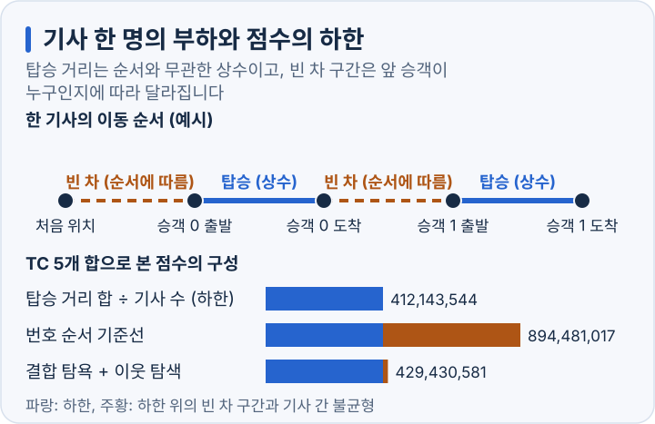

# 배정과 경로가 결합된 문제: 문제 계약과 기준선

TAXIASSIGN의 제출 계약, 부하가 배정과 순서로 나뉘는 점수식과 하한, 상태 설계와 번호 순 기준선을 다룹니다. 전체 흐름은 [강의 개요](../lesson.md)에 있습니다.

## 문제 계약을 상태로 옮기기

| 항목 | 계약 |
| --- | --- |
| 구현 | `void run(int N, int M, Coordinate mDriver[], int K, Passenger mPassenger[])`에서 `assign_driver(기사, 승객 수, 승객 번호 배열)`로 기사별 처리 순서를 제출 |
| 상한 | `N = 1,000,000`, `51 <= M <= 100`, `5,001 <= K <= 10,000`. TC 5개, 전체 실행 10초 |
| 점수 | 기사별 총 이동 거리의 **최댓값**의 TC 5개 합. 낮을수록 좋고 431,000,000 이하가 통과 기준 |
| API·무효 | 같은 기사에 여러 번 호출하면 마지막 호출만 사용하고, 범위 밖 값은 `false`를 돌려주며 반영되지 않음. 승객이 누락되거나 두 번 이상 나오면 패널티 `10^13`을 받고 이후 TC는 채점하지 않음. 승객이 없는 기사는 허용 |

기사 `d`는 처음 위치 → `p0`의 출발지 → 도착지 → `p1`의 출발지 → … 순서로 맨해튼 거리를 움직입니다. 이동 거리에서 **누가 맡는가**와 **어떤 순서인가**가 들어가는 항은 다릅니다.

```text
load(d) = Σ ride(p)                                          … 배정만 정한다.
        + hop(처음 위치 → p0) + Σ hop(p_i 도착지 → p_i+1 출발지)  … 배정과 순서가 함께 정한다.
점수    = max over d of load(d)
```

`ride(p)`(승객의 출발지와 도착지 사이 거리)는 누가 어떤 순서로 맡아도 같은 상수이고, 빈 차로 다음 승객에게 가는 `hop`은 앞 승객이 누구인지에 따라 달라집니다. 최댓값은 평균 이상이므로 `Σ ride / M`은 점수의 하한이며, TC 5개의 합은 412,143,544입니다. 이 하한을 넘는 부분이 빈 차 구간과 기사 사이의 불균형입니다.



[그림 크게 보기](https://git.readiz.com/h-contest-lesson/lessons/assignment-with-routes/lesson-assets/contract-bound.svg)

> **코드 환경: h-contest 제출용.** 이 강의의 코드 블록은 `1~3단계` 블록(실험 단계용)과 실패 사례 조각을 빼고 `random` 블록 뒤에 순서대로 붙여 제출합니다. 기사 100명·승객 10,000명 상한의 `Plan`은 4MB가 넘으므로 `static`으로 둡니다. 첫 블록은 문제가 주는 선언과 이 강의 전체의 상태입니다.

```cpp snippet=taxi-plan
struct Coordinate {
    int y, x;
};

struct Passenger {
    Coordinate departure;
    Coordinate arrival;
};

extern bool assign_driver(int driverID, int passengerSize, int passengerIDs[]);

namespace taxi {
const int MAX_K = 10000, MAX_M = 100;

// 노드 0..K-1은 승객, K+d는 기사 d의 처음 위치. (ay, ax)는 그 노드에서 다음 승객에게 출발하는 좌표다.
struct Plan {
    int k, m;
    int ay[MAX_K + MAX_M], ax[MAX_K + MAX_M];  // 승객이면 도착지, 기사 노드면 처음 위치
    int dy[MAX_K], dx[MAX_K];                  // 승객의 출발지
    int ride[MAX_K];                           // 탑승 거리: 누가 맡든, 어떤 순서든 같은 상수
    int route[MAX_M][MAX_K], len[MAX_M];       // 기사별 승객 순서
    int owner[MAX_K], pos[MAX_K];              // route[owner[p]][pos[p]] == p
    long long load[MAX_M], total, maxLoad;     // 기사별 이동 거리, 그 합, 그 최댓값(실제 점수)
};

inline int absInt(int v) { return v < 0 ? -v : v; }
// 노드 x에서 승객 y의 출발지까지 빈 차로 가는 거리
inline int hop(const Plan& p, int x, int y) { return absInt(p.ay[x] - p.dy[y]) + absInt(p.ax[x] - p.dx[y]); }
void init(Plan& p, int m, const Coordinate driver[], int k, const Passenger passenger[]) {
    p.k = k; p.m = m;
    for (int i = 0; i < k; ++i) {
        p.dy[i] = passenger[i].departure.y; p.dx[i] = passenger[i].departure.x;
        p.ay[i] = passenger[i].arrival.y;   p.ax[i] = passenger[i].arrival.x;
        p.ride[i] = absInt(p.ay[i] - p.dy[i]) + absInt(p.ax[i] - p.dx[i]);
    }
    for (int d = 0; d < m; ++d) { p.ay[k + d] = driver[d].y; p.ax[k + d] = driver[d].x; p.len[d] = 0; }
}

// route[]와 len[]만 믿고 나머지를 처음부터 다시 계산한다.
void rebuild(Plan& p) {
    p.total = p.maxLoad = 0;
    for (int d = 0; d < p.m; ++d) {
        int prev = p.k + d;
        p.load[d] = 0;
        for (int i = 0; i < p.len[d]; ++i) {
            int q = p.route[d][i];
            p.load[d] += p.ride[q] + hop(p, prev, q);
            p.owner[q] = d; p.pos[q] = i; prev = q;
        }
        p.total += p.load[d];
        if (p.load[d] > p.maxLoad) p.maxLoad = p.load[d];
    }
}

void submit(Plan& p) {
    for (int d = 0; d < p.m; ++d) assign_driver(d, p.len[d], p.route[d]);
}
}
```

`owner`·`pos`·`load`·`total`·`maxLoad`는 `route`에서 다시 계산할 수 있는 보조 값입니다. 탐색 중에는 갱신하며 가고, 검사에서는 `rebuild()`로 처음부터 계산한 값과 대조합니다.

**0단계, 유효한 기준선.** 승객 `i`를 기사 `i % M`에게 번호 순서로 맡깁니다. `taxi-plan` 블록의 맨 앞(문제가 주는 선언) 뒤에 붙이면 단독으로 제출할 수 있는 완성 코드입니다. TC 5개 합은 894481017이고, 아래의 모든 단계는 같은 TC 5개의 같은 합으로 비교합니다.

```cpp snippet=taxi-baseline
void run(int N, int M, Coordinate mDriver[], int K, Passenger mPassenger[]) {
    static int ids[10000];
    for (int d = 0; d < M; ++d) {
        int n = 0;
        for (int i = d; i < K; i += M) ids[n++] = i;  // 기사 d에게 승객 d, d+M, d+2M, ...
        assign_driver(d, n, ids);
    }
}
```
