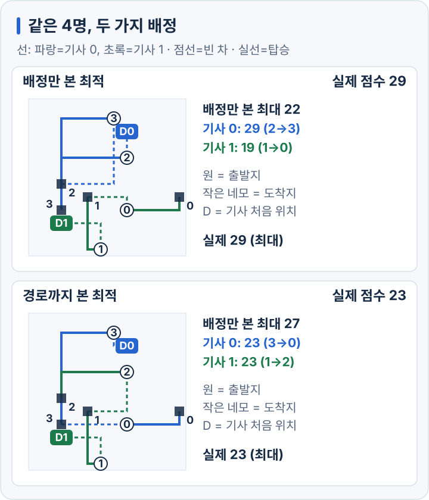
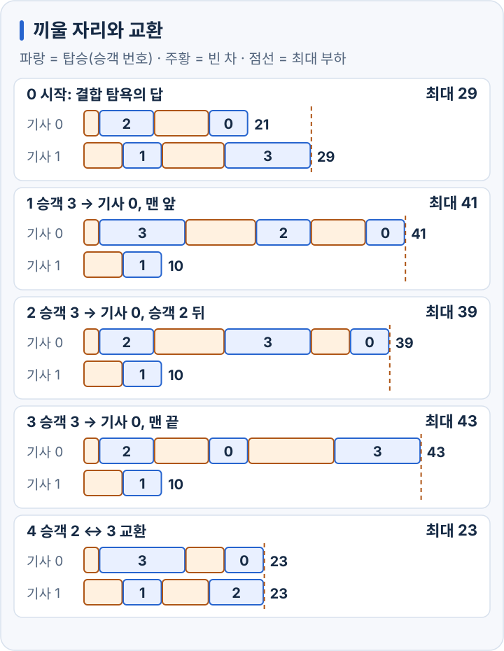

# 배정과 경로가 결합된 문제: 풀이

담당자와 삽입 위치를 함께 고르는 이웃의 차분, 배정만 최적과 경로까지 본 최적의 손계산, 단계별 확장과 결합 탐욕·탐색을 구현합니다. 앞 단계는 [문제 계약과 기준선](contract-and-baseline.md)입니다.

## 이웃과 차분 평가: 옮기며 끼우기, 자리 바꾸기

- **옮기며 끼우기**: 승객 `x`를 지금 기사에게서 빼서 노드 `q` 바로 뒤에 넣습니다. `q`는 아무 기사의 승객이거나 기사의 처음 위치(맨 앞)이므로 담당자와 삽입 위치가 한 번에 정해지고, 같은 기사 안에서 옮기면 경로 개선이 됩니다.
- **자리 바꾸기**: 서로 다른 기사의 승객 `x`, `y`가 서로의 자리로 갑니다.

차분 평가에서 유지할 값은 **기사별 부하 `load[]`**입니다. 이웃 하나가 바꾸는 것은 두 기사의 부하뿐이고, 새 점수는 `max(바뀐 두 기사, 나머지 기사의 최댓값)`입니다. `x`를 빼면 `hop(앞, x) + hop(x, 뒤)`가 사라지고 `hop(앞, 뒤)`가 새로 생기며, `q` 뒤에 넣으면 그 반대가 일어납니다. 탑승 거리 `ride(x)`는 담당자와 함께 옮겨 갑니다. 전체 합 `total`도 함께 유지하면 뒤의 탐색 에너지에 쓸 수 있습니다.

```cpp snippet=taxi-delta
namespace taxi {
// 바뀐 두 기사 a, b의 새 부하와 전체 합, 새 최댓값. a == b이면 loadA만 쓴다.
struct Change {
    int a, b;
    long long loadA, loadB, total, maxLoad;
};

inline int prevOf(const Plan& p, int x) {  // 승객 x 바로 앞의 노드
    return p.pos[x] > 0 ? p.route[p.owner[x]][p.pos[x] - 1] : p.k + p.owner[x];
}

inline int nextOf(const Plan& p, int node) {  // 노드 바로 뒤의 승객. 없으면 -1
    int d = node >= p.k ? node - p.k : p.owner[node], i = node >= p.k ? 0 : p.pos[node] + 1;
    return i < p.len[d] ? p.route[d][i] : -1;
}
// 승객 x를 노드 q 바로 뒤로 옮긴 결과. p는 바꾸지 않는다. 전제: q != x, q != prevOf(x)
Change relocateChange(const Plan& p, int x, int q) {
    Change c;
    c.a = p.owner[x];
    c.b = q >= p.k ? q - p.k : p.owner[q];
    int pa = prevOf(p, x), na = nextOf(p, x), s = nextOf(p, q);
    long long cut = hop(p, pa, x);                       // x를 빼면 사라지는 빈 차 구간
    if (na >= 0) cut += hop(p, x, na) - hop(p, pa, na);  // pa에서 na로 바로 이어진다.
    long long add = hop(p, q, x);                        // x를 넣으면 생기는 빈 차 구간
    if (s >= 0) add += hop(p, x, s) - hop(p, q, s);
    c.total = p.total - cut + add;
    if (c.a == c.b) {
        c.loadA = c.loadB = p.load[c.a] - cut + add;
    } else {
        c.loadA = p.load[c.a] - p.ride[x] - cut;         // 탑승 거리는 담당자와 함께 옮겨 간다.
        c.loadB = p.load[c.b] + p.ride[x] + add;
    }
    return c;
}
// 서로 다른 기사의 승객 x, y가 서로의 자리로 간다. 전제: p.owner[x] != p.owner[y]
Change swapChange(const Plan& p, int x, int y) {
    Change c;
    c.a = p.owner[x];
    c.b = p.owner[y];
    int pa = prevOf(p, x), na = nextOf(p, x), pb = prevOf(p, y), nb = nextOf(p, y);
    long long dA = p.ride[y] - p.ride[x] + hop(p, pa, y) - hop(p, pa, x);
    long long dB = p.ride[x] - p.ride[y] + hop(p, pb, x) - hop(p, pb, y);
    if (na >= 0) dA += hop(p, y, na) - hop(p, x, na);
    if (nb >= 0) dB += hop(p, x, nb) - hop(p, y, nb);
    c.loadA = p.load[c.a] + dA;
    c.loadB = p.load[c.b] + dB;
    c.total = p.total + dA + dB;
    return c;
}
// 바뀐 두 기사와 나머지 기사의 부하로 새 최댓값을 채운다.
Change finish(const Plan& p, Change c) {
    c.maxLoad = c.loadA > c.loadB ? c.loadA : c.loadB;
    for (int d = 0; d < p.m; ++d) if (d != c.a && d != c.b && p.load[d] > c.maxLoad) c.maxLoad = p.load[d];
    return c;
}
void settle(Plan& p, const Change& c) {
    p.load[c.a] = c.loadA;
    if (c.a != c.b) p.load[c.b] = c.loadB;
    p.total = c.total;
    p.maxLoad = c.maxLoad;
}
// c는 finish(relocateChange(p, x, q))의 결과여야 한다.
void applyRelocate(Plan& p, int x, int q, const Change& c) {
    int a = p.owner[x], b = c.b;
    for (int j = p.pos[x]; j + 1 < p.len[a]; ++j) {  // x를 빼고 왼쪽으로 당긴다.
        p.route[a][j] = p.route[a][j + 1];
        p.pos[p.route[a][j]] = j;
    }
    --p.len[a];
    int at = q >= p.k ? 0 : p.pos[q] + 1;            // 같은 기사라면 pos[q]는 이미 당겨진 값이다.
    for (int j = p.len[b]++; j > at; --j) {          // 자리를 벌리고 x를 넣는다.
        p.route[b][j] = p.route[b][j - 1];
        p.pos[p.route[b][j]] = j;
    }
    p.route[b][at] = x; p.pos[x] = at; p.owner[x] = b;
    settle(p, c);
}

void applySwap(Plan& p, int x, int y, const Change& c) {
    int a = p.owner[x], b = p.owner[y], ix = p.pos[x], iy = p.pos[y];
    p.route[a][ix] = y; p.owner[y] = a; p.pos[y] = ix;
    p.route[b][iy] = x; p.owner[x] = b; p.pos[x] = iy;
    settle(p, c);
}
}
```

계산 함수는 `Plan`을 바꾸지 않으므로 거절할 이웃을 되돌릴 일이 없습니다. `relocateChange`의 전제 `q != prevOf(x)`는 제자리로 넣는 경우를 막습니다. 같은 기사 안에서 옮길 때 `applyRelocate`는 `x`를 **뺀 뒤의** `pos[q]`로 삽입 위치를 구해야 합니다. 두 곳 모두 틀리기 쉬워서 뒤에서([실패 사례](experiments-and-failures.md)) 틀린 변형으로 확인합니다.

## 작은 손계산: 배정만 최적과 경로까지 본 최적

기사 0은 (2,7), 기사 1은 (9,2)에서 출발하고, 승객 0 (8,7)→(7,11) 탑승 5, 승객 1 (11,5)→(7,4) 탑승 5, 승객 2 (4,7)→(6,2) 탑승 7, 승객 3 (1,6)→(8,2) 탑승 11입니다. SCHEDULX처럼 "승객 `p`를 기사 `d`에게 맡기는 비용"을 `(기사 처음 위치 → 출발지) + 탑승 거리`로 두고 그 합을 기사 부하로 보는 것이 **배정만 본** 모형입니다. 두 번째 승객부터는 이전 도착지에서 출발한다는 사실이 이 모형에서 사라집니다. 아래는 2⁴ = 16개 배정을 전부 계산한 표이며, 실제 부하는 각 기사가 순서를 모두 시도해 가장 좋게 고른 값입니다. 표와 아래 이동 결과는 검사 스크립트가 순열을 전부 시도하는 독립 계산으로 다시 구해 대조합니다.

<!-- check:hand -->
| 기사 0 / 기사 1 | 배정만 본 부하 | 최적 순서의 실제 부하 | 실제 점수 |
| --- | --- | --- | ---: |
| {} / {0,1,2,3} | 0 / 61 → 61 | 0 / 53 (1→0→2→3) | 53 |
| {0} / {1,2,3} | 11 / 50 → 50 | 11 (0) / 43 (1→2→3) | 43 |
| {1} / {0,2,3} | 16 / 51 → 51 | 16 (1) / 45 (0→2→3) | 45 |
| {0,1} / {2,3} | 27 / 40 → 40 | 25 (1→0) / 37 (2→3) | 37 |
| {2} / {0,1,3} | 9 / 44 → 44 | 9 (2) / 39 (1→3→0) | 39 |
| {0,2} / {1,3} | 20 / 33 → 33 | 21 (2→0) / 29 (1→3) | 29 |
| {1,2} / {0,3} | 25 / 34 → 34 | 22 (2→1) / 33 (0→3) | 33 |
| {0,1,2} / {3} | 36 / 23 → 36 | 31 (2→1→0) / 23 (3) | 31 |
| {3} / {0,1,2} | 13 / 38 → 38 | 13 (3) / 33 (1→0→2) | 33 |
| **{0,3} / {1,2}** | 24 / 27 → 27 | 23 (3→0) / 23 (1→2) | **23** |
| {1,3} / {0,2} | 29 / 28 → 29 | 24 (3→1) / 25 (0→2) | 25 |
| {0,1,3} / {2} | 40 / 17 → 40 | 33 (3→1→0) / 17 (2) | 33 |
| **{2,3} / {0,1}** | **22 / 21 → 22** | 29 (2→3) / 19 (1→0) | **29** |
| {0,2,3} / {1} | 33 / 10 → 33 | 37 (3→0→2) / 10 (1) | 37 |
| {1,2,3} / {0} | 38 / 11 → 38 | 37 (3→1→2) / 11 (0) | 37 |
| {0,1,2,3} / {} | 49 / 0 → 49 | 47 (3→1→0→2) / 0 | 47 |

배정만 본 최적은 `{2,3} / {0,1}`로 22인데, 기사 0이 어느 순서로 돌아도 29가 되어 실제 점수는 29입니다. 실제 최적 `{0,3} / {1,2}`는 두 기사가 모두 23이고, 배정만 본 값은 27이라 최적이 아닙니다. 순서도 중요합니다. 기사 1이 `{1,2}`를 1 → 2로 돌면 23이지만 2 → 1이면 30입니다.



[그림 크게 보기](https://git.readiz.com/h-contest-lesson/lessons/assignment-with-routes/lesson-assets/hand-two-answers.svg)

결합 이웃이 하는 일도 이 예시에서 보입니다. 뒤의 탐욕이 만드는 답 `[[2, 0], [1, 3]]`(기사 0은 승객 2 → 0, 기사 1은 1 → 3)의 부하는 21과 29입니다. 승객 3을 기사 0으로 옮기면 끼우는 자리마다 결과가 달라서 맨 앞은 41, 승객 2 뒤는 39, 맨 끝은 43이고 기사 1은 10이 됩니다. 최선의 자리(39)도 29보다 나빠 옮기는 이웃으로는 벗어나지 못하지만, 승객 2와 3을 **바꾸면** 한 번에 23과 23이 됩니다. 그런데 `climb`을 이 예시에서 돌리면 seed 1~9 중 5개는 23에 닿고 나머지 4개는 배정만 본 최적 `{2,3} / {0,1}`로 들어가 29에서 멈춥니다. 그 상태에서는 이동도 교환도 최대 부하를 줄이지 못해, 같은 시작에서도 먼저 받아들인 이웃이 결과를 가릅니다.



[그림 크게 보기](https://git.readiz.com/h-contest-lesson/lessons/assignment-with-routes/lesson-assets/hand-neighbors.svg)

[경로 삽입 데모: 끼우는 자리와 교환 비교하기](https://git.readiz.com/h-contest-lesson/demos/index.html?demo=route-insertion)

승객 3을 기사 0에게 옮길 때 끼우는 자리마다 두 기사의 탑승·빈 차 거리와 최댓값이 어떻게 달라지는지 보고, 교환 한 번으로 23과 23이 되는 과정을 단계별로 확인해 보세요.

## 1~3단계: 배정만, 경로만, 번갈아

**배정만**은 탑승 거리의 합이 가장 작은 기사에게 번호 순서대로 줍니다. **경로만**은 담당자를 두고 기사 안에서 승객 하나를 다른 자리로 옮겨 부하가 줄면 받아들이기를 반복하며, 승객마다 탑승 방향이 있어서 구간을 뒤집는 2-opt는 쓸 수 없습니다. **번갈아**는 가장 오래 달리는 기사의 승객 하나를 다른 기사의 **맨 끝에** 붙여 최댓값이 줄어드는 첫 이동을 적용하고 두 기사의 경로를 다시 고치기를 반복합니다. 삽입 위치까지 고르지 않는 배정 이동입니다.

> **코드 환경: h-contest 제출 확장용(실험 단계용).** 최종 제출에는 필요 없습니다.

```cpp snippet=taxi-stages
namespace taxi {
void balanceRides(Plan& p) {  // 1단계: 배정만. 탑승 거리의 합이 가장 작은 기사에게 번호 순서대로 넣는다.
    static long long rides[MAX_M];
    for (int d = 0; d < p.m; ++d) p.len[d] = 0, rides[d] = 0;
    for (int i = 0; i < p.k; ++i) {
        int d = 0;
        for (int e = 1; e < p.m; ++e) if (rides[e] < rides[d]) d = e;
        p.route[d][p.len[d]++] = i;
        rides[d] += p.ride[i];
    }
    rebuild(p);
}

// 2단계: 담당자는 두고 기사 d의 순서만 고친다. 승객 하나를 같은 기사의 다른 자리로 옮겨
// 부하가 줄면 받아들이기를 반복한다. 승객마다 탑승 방향이 있어서 구간을 뒤집는 2-opt는 쓰지 못한다.
void improveRoute(Plan& p, int d) {
    for (bool improved = true; improved;) {
        improved = false;
        for (int i = 0; i < p.len[d]; ++i) {
            int x = p.route[d][i];
            for (int j = -1; j < p.len[d]; ++j) {
                int q = j < 0 ? p.k + d : p.route[d][j];
                if (q == x || q == prevOf(p, x)) continue;
                Change c = relocateChange(p, x, q);
                if (c.loadA >= p.load[d]) continue;
                applyRelocate(p, x, q, finish(p, c));
                improved = true;
                break;
            }
        }
    }
}

// 3단계: 번갈아. 가장 오래 달리는 기사 a의 승객 하나를 다른 기사 b의 맨 끝에 붙여 최댓값이 줄면
// 적용하고, 두 기사의 경로를 다시 고친다. 줄이는 이동이 없으면 멈춘다.
void alternate(Plan& p) {
    for (bool moved = true; moved;) {
        moved = false;
        int a = 0;
        for (int d = 1; d < p.m; ++d) if (p.load[d] > p.load[a]) a = d;
        for (int i = 0; i < p.len[a] && !moved; ++i) {
            for (int b = 0; b < p.m && !moved; ++b) {
                int x = p.route[a][i], q = p.len[b] > 0 ? p.route[b][p.len[b] - 1] : p.k + b;
                if (b == a) continue;
                Change c = relocateChange(p, x, q);
                if (c.loadA >= p.maxLoad || c.loadB >= p.maxLoad) continue;  // 새 최댓값이 이 값 이상이다.
                c = finish(p, c);
                if (c.maxLoad >= p.maxLoad) continue;
                applyRelocate(p, x, q, c);
                improveRoute(p, a);
                improveRoute(p, b);
                moved = true;
            }
        }
    }
}
}
```

## 결합 탐욕과 탐색

`nearestFree`는 배정과 순서를 따로 정하지 않습니다. 지금까지 가장 적게 달린 기사가 자기 현재 위치에서 출발지가 가장 가까운 남은 승객을 태우므로, 부하를 맞추는 일과 빈 차 구간을 줄이는 일을 같은 선택에서 처리합니다.

```cpp snippet=taxi-greedy
namespace taxi {
// 배정과 경로를 한 번에 정하는 초기해: 지금까지 가장 적게 달린 기사가, 자기 현재 위치에서
// 출발지가 가장 가까운 남은 승객을 태운다. 매번 남은 승객을 모두 보므로 O(K^2)다.
void nearestFree(Plan& p) {
    static unsigned char used[MAX_K];
    static int at[MAX_M];  // 기사가 지금 서 있는 노드
    for (int i = 0; i < p.k; ++i) used[i] = 0;
    for (int d = 0; d < p.m; ++d) p.len[d] = 0, p.load[d] = 0, at[d] = p.k + d;
    for (int step = 0; step < p.k; ++step) {
        int d = 0, best = -1;
        for (int e = 1; e < p.m; ++e) if (p.load[e] < p.load[d]) d = e;
        for (int i = 0; i < p.k; ++i) {
            if (!used[i] && (best < 0 || hop(p, at[d], i) < hop(p, at[d], best))) best = i;
        }
        used[best] = 1;
        p.route[d][p.len[d]++] = best;
        p.load[d] += hop(p, at[d], best) + p.ride[best];
        at[d] = best;
    }
    rebuild(p);
}
}
```

남은 승객을 모두 훑는 이 비교는 `O(K²)`로 `K = 10,000`이면 TC마다 약 1억 번이지만, 5개 TC의 전체 시간이 388ms라서 후보를 줄일 필요가 없었습니다. 줄여야 했던 것은 **탐색의 후보**입니다. 승객 한 명을 넣을 자리는 전체 `K + M`개(약 10,100개)인데, 아래 `propose`는 대상 기사를 하나 정하고 그 기사의 경로 위치(`K / M + 1`개, 최대 약 200개)만 훑습니다. 제안 400,000개를 모든 자리로 평가하면 TC마다 약 40억 번이지만 이 방식은 약 4천만~8천만 번입니다.

대상 기사는 무작위로 `choices`명을 뽑아 부하가 가장 적은 기사를 씁니다. 부하가 큰 기사로 승객을 옮겨서는 최댓값이 내려가지 않기 때문입니다. 승객도 `focusPercent`%는 가장 오래 달리는 기사에게서 고릅니다. 받아들이는 기준은 SCHEDULX와 같은 에너지 `Δ최대 부하 + weight × Δ합 / M`이고, 합의 항이 빈 차 구간의 총합을 줄이는 방향을 알려 줍니다. 최대 부하를 올리는 제안은 받아들이지 않으므로 끝난 `Plan`이 항상 가장 좋은 해입니다.

```cpp snippet=taxi-climb
namespace taxi {
struct Params {
    long long attempts;
    unsigned seed;
    double weight;  // 평균 부하 항의 가중치
    int swapPercent, focusPercent, choices;
};

struct Move {
    int kind;  // -1: 제안 없음, 0: 승객 x를 노드 y 바로 뒤로 옮김, 1: 승객 x와 y의 자리 교환
    int x, y;
    Change after;
};

// 승객 x를 고른다(focusPercent%는 가장 오래 달리는 기사 worst의 승객). 대상 기사 b는 무작위로
// choices명을 뽑아 부하가 가장 적은 기사다. 옮길 때는 b의 모든 삽입 위치 중 b의 부하가 가장 적게
// 느는 곳을 쓴다. p는 바꾸지 않는다.
Move propose(const Plan& p, hc::Random& rng, const Params& prm, int worst) {
    Move mv;
    mv.kind = -1;
    mv.x = (int)rng.below((unsigned)p.k);
    if ((int)rng.below(100u) < prm.focusPercent && p.len[worst] > 0) mv.x = p.route[worst][rng.below((unsigned)p.len[worst])];
    int b = (int)rng.below((unsigned)p.m);
    for (int t = 1; t < prm.choices; ++t) {
        int c = (int)rng.below((unsigned)p.m);
        if (p.load[c] < p.load[b]) b = c;
    }
    if (b != p.owner[mv.x] && p.len[b] > 0 && (int)rng.below(100u) < prm.swapPercent) {
        mv.kind = 1;
        mv.y = p.route[b][rng.below((unsigned)p.len[b])];
        mv.after = finish(p, swapChange(p, mv.x, mv.y));
        return mv;
    }
    long long bestLoad = 0;
    Change best;
    for (int j = -1; j < p.len[b]; ++j) {
        int q = j < 0 ? p.k + b : p.route[b][j];
        if (q == mv.x || q == prevOf(p, mv.x)) continue;
        Change c = relocateChange(p, mv.x, q);
        long long load = c.a == c.b ? c.loadA : c.loadB;
        if (mv.kind < 0 || load < bestLoad) { mv.kind = 0; mv.y = q; bestLoad = load; best = c; }
    }
    if (mv.kind == 0) mv.after = finish(p, best);
    return mv;
}

// 최대 부하를 올리지 않고 에너지도 늘지 않는 제안만 받아들인다. 에너지 = 최대 부하 변화 + weight * 평균 부하 변화.
// 최대 부하는 줄기만 하므로 끝난 p가 항상 가장 좋은 해다. 그 점수를 돌려준다.
long long climb(Plan& p, const Params& prm) {
    if (p.k < 2 || p.m < 2) return p.maxLoad;
    int worst = 0;
    for (int d = 1; d < p.m; ++d) if (p.load[d] > p.load[worst]) worst = d;
    hc::Random rng;
    rng.reset(prm.seed);
    for (long long step = 0; step < prm.attempts; ++step) {
        Move mv = propose(p, rng, prm, worst);
        if (mv.kind < 0 || mv.after.maxLoad > p.maxLoad) continue;
        double energy = (double)(mv.after.maxLoad - p.maxLoad) + prm.weight * (double)(mv.after.total - p.total) / p.m;
        if (energy > 0.0) continue;
        if (mv.kind == 0) applyRelocate(p, mv.x, mv.y, mv.after);
        else applySwap(p, mv.x, mv.y, mv.after);
        worst = 0;
        for (int d = 1; d < p.m; ++d) if (p.load[d] > p.load[worst]) worst = d;
    }
    return p.maxLoad;
}
}
```

```cpp snippet=taxi-entry
void run(int N, int M, Coordinate mDriver[], int K, Passenger mPassenger[]) {
    static taxi::Plan plan;  // 4MB가 넘으므로 스택에 두지 않는다.
    taxi::init(plan, M, mDriver, K, mPassenger);
    taxi::nearestFree(plan);
    taxi::Params prm = {400000, 20261118u, 8.0, 30, 60, 3};  // 제안 수, seed, weight, 교환%, 집중%, 후보 기사 수
    taxi::climb(plan, prm);
    taxi::submit(plan);
}
```
