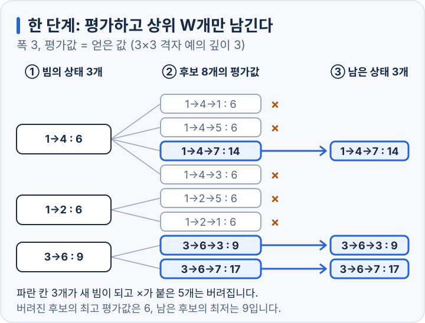
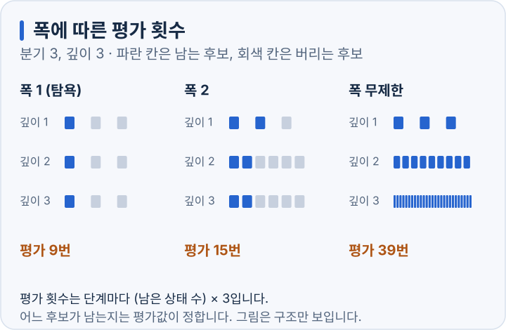
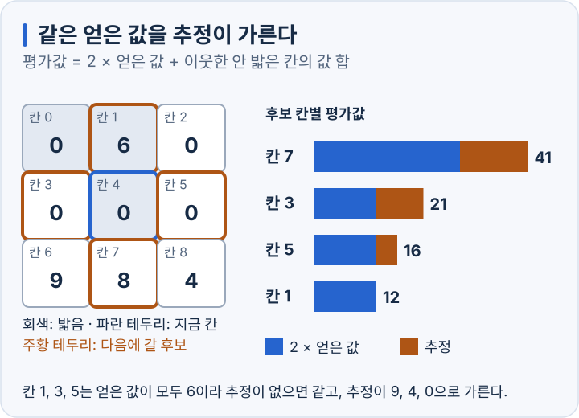
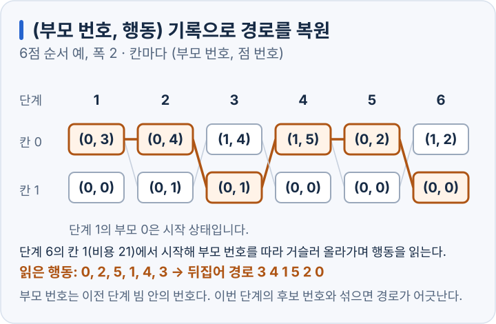

# 원리: 빔 서치와 평가 함수, 손으로 따라가는 예

답이 "행동을 차례로 정해 가는 열"인 문제에서는 해를 앞에서부터 한 단계씩 만듭니다. 한 단계마다 후보를 하나만 남기면 [탐욕](https://h.readiz.com/learn/greedy)이고, 모든 후보를 남기면 완전 탐색입니다. **빔 서치**는 그 사이에서 한 단계마다 상태를 `W`개(폭)만 남기고, 남은 상태마다 행동을 하나씩 더해 다시 `W`개로 추리는 일을 끝까지 반복합니다. 무엇을 남길지는 **평가 함수**가 정하며, 이 쪽은 평가 함수가 하는 일과 설계 방법을 중심으로 손으로 따라갑니다. 코드는 [구현](implementation.md), 실험 결과는 [실험과 점검](practice.md)에 있습니다.

## 언제 쓰고 언제 쓰지 않는가

| 상황 | 판단 |
| --- | --- |
| 답이 행동의 열이고, 앞의 행동이 정해진 상태만으로 뒤의 선택지와 점수가 정해진다 | 쓴다. 상태를 단계별로 키우며 비교할 수 있다 |
| 중간 상태를 "얼마나 좋은가"로 비교할 수 있다(지금까지 얻은 것에 앞으로의 추정을 더할 수 있다) | 쓴다. 평가 함수가 곧 빔 서치의 성능이다 |
| 한 단계에서 서로 다른 행동의 열이 같은 상태로 모인다 | 합쳐서 쓴다. 같은 상태가 빔을 채우는 일을 막는다 |
| 점수가 끝까지 가 봐야만 알려지고 중간 상태는 점수와 상관이 없다 | 쓰지 않는다. 폭을 키워도 비교가 의미 없다 |
| 완성된 해가 이미 있고 일부를 고쳐 개선한다 | 쓰지 않는다. [근방 설계와 차분 평가](https://h.readiz.com/learn/neighborhood-and-delta), [언덕 오르기와 담금질](https://h.readiz.com/learn/hill-climbing-and-annealing)이 맞다 |
| 상태가 크고 복사가 비싸며 단계 수가 많다 | 상태를 작게 줄이고 (부모, 행동) 기록으로 경로를 복원한다 |
| 입력이 작아 상태 전체를 세어도 시간 안에 끝난다 | 완전 탐색(또는 DP)이 더 간단하고 최적을 보장한다 |
| 행동이 상대의 응수에 따라 바뀐다(게임) | [미니맥스와 알파-베타](https://h.readiz.com/learn/minimax-alpha-beta)의 주제다 |
| 상태의 일부가 가려져 있다 | [정보가 부분적일 때 결정하기](https://h.readiz.com/learn/partial-information)로 간다 |

선수 지식은 [문제를 상태·행동·점수로 옮기기](https://h.readiz.com/learn/problem-modeling)의 "상태 표현과 점수 계산"과 [초기해 만들기](https://h.readiz.com/learn/construction-heuristics)의 "한 번에 하나씩 정하는 구성법"입니다. 빔 서치는 구성법에서 한 단계마다 남기는 후보를 1개에서 `W`개로 늘린 것입니다. 우선순위 큐는 [우선순위 큐와 힙](https://h.readiz.com/learn/priority-queue-heap)에서 다룹니다.

## 연습용 문제 틀

이 강의의 수치는 아래 두 가지 연습용 입력에서 나오며 어떤 문제의 채점 결과에도 의존하지 않습니다. 시드는 1부터 20까지 씁니다.

- **격자 수집(순차 결정, 주 예시):** 세로 `h` × 가로 `w` 격자(기본 `20 × 20`)의 칸마다 값(0..9, 60%는 0)이 있습니다. 칸 `(0, 0)`에서 시작해 상하좌우로 `T`번(기본 60) 움직이고 처음 밟는 칸의 값을 얻습니다(시작 칸 포함). 격자 밖으로는 나갈 수 없고 같은 칸을 다시 밟아도 됩니다. 얻은 값의 합이 클수록 좋습니다. 칸 번호는 행 순서로 `0 .. h × w − 1`입니다.
- **순서 문제(경로)를 순차 결정으로 보기:** 점 `N = 200`개가 `0..999` 정수 좌표에 있고, 모든 점을 한 번씩 지나는 순서를 정합니다(시작점 자유, 돌아오지 않음). 비용은 이웃한 점 사이 맨해튼 거리의 합이고 작을수록 좋습니다. "다음에 갈 점을 하나씩 정한다"로 보면 행동이 점 번호이고 깊이가 `N`인 순차 결정이며, 첫 결정은 시작점입니다.

배정 문제는 쓰지 않습니다. 이 강의에서 보일 구조(같은 상태 합치기, 평가 함수)는 앞의 두 틀로 충분히 드러납니다.

:::hint 입력 생성 난수 규칙
난수는 64비트 정수 `x`를 시드로 시작해 `x = x * 6364136223846793005 + 1442695040888963407`로 한 번 갱신한 뒤 `r = x >> 33`을 읽고, 값은 `r % 범위`입니다. 격자는 칸마다 행 순서로 `u = r % 10`을 읽어 `u < 6`이면 값 0, 아니면 한 번 더 읽어 값 `1 + r % 9`입니다. 순서 문제의 점은 점마다 `x`, `y` 순서로 읽습니다. 같은 시드를 입력 생성과 탐색 난수에 함께 씁니다(탐색 난수는 평가값 흔들기에서만 쓰입니다).
:::

## 순차 결정 문제의 구조

해가 행동의 열 `a₁, a₂, …, a_T`이고, 행동을 하나 할 때마다 상태가 바뀌는 문제를 **순차 결정 문제**라고 합니다. 다음이 정해져 있으면 빔 서치를 쓸 수 있습니다.

| 이름 | 뜻 | 격자 수집 | 순서 문제 |
| --- | --- | --- | --- |
| 상태 | 지금까지의 행동이 뒤에 주는 영향을 모은 요약 | 밟은 칸의 집합, 현재 칸, 얻은 값 | 지난 점의 집합, 마지막 점, 지금까지의 비용 |
| 행동 | 상태에서 할 수 있는 선택 | 이웃한 칸(최대 4개) | 아직 안 간 점(최대 200개) |
| 단계 | 결정 한 번 | 움직임 1번(`T`단계) | 점 1개 정하기(`N`단계) |
| 점수 | 완성된 열의 가치 | 얻은 값의 합(클수록) | 이동 비용의 합(작을수록) |

상태는 **요약**이어야 합니다. 행동의 열 전체를 상태로 삼으면 같은 상태가 서로 다른 열로 나뉘어 합칠 수 없고 복사도 단계마다 늘어납니다. 격자 수집에서는 현재 칸과 밟은 칸의 집합만 알면 앞으로의 점수가 정해지므로 밟은 순서는 상태에 넣지 않습니다. 이 "순서는 잊어도 된다"가 상태 합치기의 근거입니다.

## 빔 서치의 틀

한 단계는 네 가지 일로 이루어집니다. 빔에는 `W`개 이하의 상태가 있다고 합니다.

1. **평가:** 빔의 상태마다 가능한 모든 행동을 해 본 후보의 평가값을 계산합니다. 후보 수는 (빔 안의 상태 수) × (행동 수)이고, 이것이 이 단계의 평가 횟수입니다.
2. **합치기:** 같은 상태가 된 후보를 하나로 합칩니다(평가값이 큰 것을 남깁니다). 같은 상태인지는 상태를 구별하는 값인 **키**로 알아냅니다. 같은 상태는 같은 키를 갖습니다.
3. **추리기:** 평가값이 큰 순서로 `W`개만 남깁니다.
4. **상태 만들기:** 남은 후보에 대해서만 새 상태를 만들고, 부모 번호와 행동을 기록합니다.

아래 그림은 폭 3인 빔에서 후보 8개가 만들어지고 평가값 상위 3개만 남는 한 단계입니다.

[그림 크게 보기](https://git.readiz.com/h-contest-lesson/lessons/beam-search/lesson-assets/beam-layers.svg)

끝까지 반복한 뒤 마지막 빔에서 점수가 가장 좋은 상태를 고르고, 기록한 부모 번호를 거슬러 올라가 행동의 열을 복원합니다. 평가 횟수는 한 단계에 최대 `W × b`(`b`는 행동 수), 전체로 최대 `T × W × b`입니다. 폭을 두 배로 하면 평가 횟수도 대략 두 배입니다.

[Beam Search: 빔 너비에 따라 남기는 후보 비교하기](https://git.readiz.com/h-contest-lesson/demos/index.html?demo=beam-search)

위 데모는 선택지 3개, 깊이 3의 작은 결정 트리에서 `W`를 바꿔 가며 남는 후보를 봅니다. 입력은 이 강의와 다르지만 한 단계의 흐름은 같습니다.

## 폭 1과 폭 무제한 사이

`W = 1`이면 한 단계에 상태를 하나만 남기므로 탐욕입니다. `W`를 한 단계의 후보 수 이상으로 두면 아무것도 버리지 않는 완전 탐색입니다(같은 상태를 합치면 서로 다른 상태의 수가 한도입니다). 빔 서치는 이 둘 사이에서 평가 횟수와 답의 질을 맞바꿉니다. 아래 그림은 분기 3, 깊이 3의 같은 트리에서 세 경우의 평가 횟수를 비교합니다.

[그림 크게 보기](https://git.readiz.com/h-contest-lesson/lessons/beam-search/lesson-assets/width-spectrum.svg)

폭을 키우면 좋은 상태를 놓칠 가능성이 줄지만 항상 그렇지는 않습니다. 평가값이 최종 점수를 정확히 반영하지 않으면 "평가값은 높지만 막다른" 상태가 빔을 채울 수 있습니다. 이 점을 [실험과 점검](practice.md)에서 20개 시드로 확인합니다.

## 손으로 따라가기 1: 격자 수집 (평가값 = 지금까지 얻은 값)

`3 × 3` 격자에서 `T = 4`번 움직이는 입력입니다. 칸 번호는 행 순서이고 값은 아래와 같습니다. 시작은 칸 0입니다.

| 행 \ 열 | 0 | 1 | 2 |
| --- | ---: | ---: | ---: |
| 0 | 0 (칸 0) | 6 (칸 1) | 0 (칸 2) |
| 1 | 0 (칸 3) | 0 (칸 4) | 0 (칸 5) |
| 2 | 9 (칸 6) | 8 (칸 7) | 4 (칸 8) |

행동의 순서는 위, 오른쪽, 아래, 왼쪽이고 평가값이 같은 후보는 앞선 후보를 남깁니다. 아래 표는 단계마다 남은 상태를 `경로 : 얻은 값`으로 적었습니다(경로는 시작 칸 0 다음에 밟은 칸 번호).

<!-- check:hand-grid -->
| 단계 | 폭 1 | 폭 2 | 폭 3 |
| --- | --- | --- | --- |
| 1 | 1 : 6 | 1 : 6, 3 : 0 | 1 : 6, 3 : 0 |
| 2 | 1 2 : 6 | 3 6 : 9, 1 2 : 6 | 3 6 : 9, 1 2 : 6, 1 4 : 6 |
| 3 | 1 2 5 : 6 | 3 6 7 : 17, 3 6 3 : 9 | 3 6 7 : 17, 1 4 7 : 14, 3 6 3 : 9 |
| 4 | 1 2 5 8 : 10 | 3 6 7 8 : 21, 3 6 7 4 : 17 | 1 4 7 6 : 23, 3 6 7 8 : 21, 1 4 7 8 : 18 |
| 평가 횟수 | 10 | 18 | 25 |
| 최고 점수 | 10 | 21 | 23 |

폭 1은 첫 단계에서 값 6인 칸 1을 고릅니다. 칸 1의 이웃(칸 2, 칸 4, 시작 칸)은 값이 0이라 후보의 평가값이 모두 6으로 같고, 앞선 행동인 "오른쪽"(칸 2)으로 갑니다. 마지막 단계에서야 값 4인 칸 8을 밟아 10에서 끝납니다. 폭 2는 값 0인 칸 3(시작 아래)도 남기므로 칸 3 → 칸 6(값 9) → 칸 7(값 8)로 이어지는 길이 살아 21을 얻습니다. 평가값이 낮았던 칸 3이 "지금은 0이지만 가까이 9와 8이 있는" 상태였던 것이 핵심입니다. 폭 3은 4단계에서 칸 1 → 4 → 7 → 6의 23을 찾고, 이것이 이 입력의 최적입니다(모든 걸음으로 세어 확인). 폭을 아무리 키워도 23을 넘을 수 없고, 폭 100으로 아무것도 버리지 않고 돌린 평가 횟수는 72입니다.

**평가값이 "지금까지 얻은 값"뿐이면** 이 예의 폭 1처럼 주변의 값을 보지 못합니다. 단계 1의 두 후보 "칸 1로(값 6)"와 "칸 3으로(값 0)"에서 평가값은 6 대 0이라 칸 1이 이기지만, 칸 3 쪽에는 앞으로 9와 8이 놓여 있습니다. 이 정보를 평가값에 넣는 것이 다음 절의 주제입니다.

## 평가 함수: 지금까지 + 앞으로의 추정

평가값은 "이 상태에서 끝까지 갔을 때 얻을 점수"의 추정입니다.

> 평가값 = (지금까지 얻은 것) + (앞으로 얻을 것의 추정)

앞의 항은 상태에서 정확히 계산되고, 뒤의 항이 평가 함수의 설계입니다. 추정이 없으면 뒤의 항은 0이어서 지금까지 얻은 것만으로 비교하며, 두 가지 일이 생깁니다.

- 비교가 앞을 보지 못해, 지금 많이 얻는 상태가 이깁니다(위 폭 1의 예).
- 지금 얻는 것이 같은 후보(주변이 모두 0인 경우)가 많아 동점이 늘고, 동점 규칙(행동의 순서)이 선택을 정합니다. 폭 1에서는 이미 밟은 두 칸 사이를 왔다 갔다 하는 걸음이 많아집니다([실험](practice.md)에서 센 값을 보입니다).

추정을 만드는 방법은 아래와 같습니다. 모두 상태에서 값싸게 계산할 수 있어야 합니다.

| 방법 | 내용 | 격자 수집 | 순서 문제 |
| --- | --- | --- | --- |
| 낙관적 합 | 남은 것이 줄 수 있는 점수를 실제보다 후하게 센 값(최대화에서는 상한, 최소화에서는 하한) | (입력에서만 정해지는 상한은 후보마다 같아 순서를 바꾸지 못해 쓰지 않음) | 안 간 점 `u`마다 `u`에서 가장 가까운 다른 점까지의 거리 `nn[u]`의 합. 안 간 점마다 들어오는 간선이 하나씩 있고 길이가 `nn` 이상이므로 남은 비용의 하한이다 |
| 가까운 값의 합 | 현재 위치 둘레의 남은 값을 가까울수록 크게 센 합 | 거리 `d ≤ R`인 안 밟은 칸의 `값 × (R + 1 − d)`의 합 | |
| 거리 벌점 | 남은 것에 닿기까지의 거리를 깎는 값 | 값이 있는 가장 가까운 안 밟은 칸까지의 거리를 뺀다 | |
| 탐욕 완성 | 간단한 규칙으로 끝까지 진행한 점수 | | 지금 점에서 가장 가까운 안 간 점으로 끝까지 갈 때의 남은 비용(탐욕 완성) |

**낙관적**은 "실제보다 후하게"라는 뜻입니다. 낙관적인 추정은 "이 상태로는 아무리 잘해도 이 점수를 넘지 못한다"를 말해 주므로 해석이 쉽지만, 빔 서치에서 반드시 낙관적일 필요는 없고 후보를 구별하는 힘이 더 중요합니다.

모든 후보에 같은 값이 붙는 추정은 순서를 바꾸지 못합니다. 예를 들어 [문제를 상태·행동·점수로 옮기기](https://h.readiz.com/learn/problem-modeling)의 상한(입력에서 닿을 수 있는 칸 중 큰 값 `T + 1`개의 합)은 상태와 무관하게 하나로 정해지므로 어느 후보도 앞서게 하지 못합니다. 이미 밟은 칸을 빼는 식으로 상태에 따라 달라지게 해야 후보를 구별합니다.

**단위를 맞춥니다.** 평가값 `= 점수 × scale + 추정`처럼 두 항을 더할 때 점수 한 점이 추정의 몇 단위인지를 정해야 합니다. 추정이 점수보다 훨씬 크면 점수를 얻는 행동이 손해로 보여 점수를 얻지 않는 쪽으로 빔이 쏠릴 수 있습니다([실험](practice.md)의 `scale` 표).

### 손으로 따라가기 2: 같은 격자에서 가까운 것의 합

같은 `3 × 3` 격자에서 평가값을 `2 × 얻은 값 + (이웃한 안 밟은 칸의 값의 합)`으로 바꿉니다(위 표의 `R = 1`, `scale = 2`). 폭 1입니다. 행의 칸은 후보가 가는 칸, "추정"은 그 칸의 이웃 중 안 밟은 칸의 값의 합입니다.

<!-- check:hand-estimate -->
| 단계 | 후보(가는 칸) | 얻은 값 | 추정 | 평가값 | 남김 |
| --- | --- | ---: | ---: | ---: | --- |
| 1 | 칸 1 | 6 | 0 | 12 | 칸 1 |
| 1 | 칸 3 | 0 | 9 | 9 | |
| 2 | 칸 2 | 6 | 0 | 12 | |
| 2 | 칸 4 | 6 | 8 | 20 | 칸 1 → 4 |
| 2 | 칸 0 | 6 | 0 | 12 | |
| 3 | 칸 1 | 6 | 0 | 12 | |
| 3 | 칸 5 | 6 | 4 | 16 | |
| 3 | 칸 7 | 14 | 13 | 41 | 칸 1 → 4 → 7 |
| 3 | 칸 3 | 6 | 9 | 21 | |
| 4 | 칸 4 | 14 | 0 | 28 | |
| 4 | 칸 8 | 18 | 0 | 36 | |
| 4 | 칸 6 | 23 | 0 | 46 | 칸 1 → 4 → 7 → 6 |

단계 1에서는 칸 1이 이기지만(12 대 9), 단계 2에서는 이웃에 값 8인 칸 7이 있는 칸 4가, 단계 3에서는 이웃에 값 9인 칸 6이 있는 칸 7이 추정 덕분에 앞서 경로를 끌어 줍니다. 폭 1인데도 최적 23을 얻습니다. 추정이 폭을 대신한 예입니다. 그러나 늘 이득은 아닙니다. 추정도 후보마다 계산하므로 평가 한 번의 비용이 늘고, [실험](practice.md)은 같은 연산 수라면 추정 없이 폭을 키우는 쪽이 낫다는 결과를 보입니다.

아래 그림은 단계 3(칸 0, 1, 4를 밟은 뒤)의 네 후보(칸 1, 3, 5, 7)를 보입니다. 칸 1, 3, 5는 얻은 값이 모두 6이라 추정이 없으면 같은 12이고, 추정(0, 9, 4)이 서로 다른 평가값(12, 21, 16)을 줍니다. 칸 7은 얻은 값이 14라 가장 높은 41입니다.

[그림 크게 보기](https://git.readiz.com/h-contest-lesson/lessons/beam-search/lesson-assets/estimate-eval.svg)

### 손으로 따라가기 3: 순서 문제와 같은 상태 합치기

점 6개입니다: `P0 (1,1)`, `P1 (6,5)`, `P2 (1,7)`, `P3 (9,8)`, `P4 (7,4)`, `P5 (2,6)`. 각 점에서 가장 가까운 다른 점까지의 거리는 `nn = [6, 2, 2, 6, 2, 2]`이고 합은 20입니다(예: `P0`은 `P2`와 `P5`가 6, `P1`은 `P4`가 2). 평가값은 `−(지금까지의 비용 + 안 간 점의 nn 합)`입니다. 점 `u`를 고른 뒤의 "안 간 점의 nn 합"은 `20 − (이미 지난 점의 nn 합)`입니다. 비용이 작을수록 좋으므로 평가값은 음수이고, 큰 쪽(0에 가까운 쪽)이 좋습니다. 폭 2입니다.

<!-- check:hand-route -->
| 단계 | 남은 상태(경로 : 비용 + nn 합 = 평가값의 절댓값) |
| --- | --- |
| 1 | 0 : 0 + 14 = 14, 3 : 0 + 14 = 14 |
| 2 | 3 1 : 6 + 12 = 18, 3 4 : 6 + 12 = 18 |
| 3 | 3 4 1 : 8 + 10 = 18, 3 1 4 : 8 + 10 = 18 |
| 4 | 3 1 4 0 : 17 + 4 = 21, 3 4 1 5 : 13 + 8 = 21 |
| 5 | 3 4 1 5 0 : 19 + 2 = 21, 3 4 1 5 2 : 15 + 6 = 21 |
| 6 | 3 4 1 5 2 0 : 21 + 0 = 21, 3 4 1 5 0 2 : 25 + 0 = 25 |

표는 평가값이 큰 순서(같으면 앞선 후보)로 적었습니다. 단계 1에서는 `nn`이 큰 점이 시작점으로 유리하고(남은 점의 nn 합이 작아집니다) 나머지 4개 시작점은 평가값이 18이어서 탈락합니다. 단계 2에서는 평가값이 같은 18인 `0 2`, `0 5`가 뒤에 있어 탈락합니다. 최종 결과는 `3 4 1 5 2 0`, 비용 21이고 6점의 모든 순서를 세어 보면 최소가 21이므로 최적입니다.

단계 3의 두 상태 `3 4 1`과 `3 1 4`는 같은 점 `{1, 3, 4}`를 지났지만 마지막 점이 `1`과 `4`로 다릅니다. 단계 4의 후보 6개는 같은 상태가 둘씩 세 쌍입니다.

<!-- check:hand-merge -->
| 후보 | 지난 점의 집합 | 마지막 점 | 비용 | nn 합 | 평가값 | 처리 |
| --- | --- | ---: | ---: | ---: | ---: | --- |
| 3 1 4 0 | {0, 1, 3, 4} | 0 | 17 | 4 | −21 | 남김 |
| 3 1 4 2 | {1, 2, 3, 4} | 2 | 17 | 8 | −25 | 합침 |
| 3 1 4 5 | {1, 3, 4, 5} | 5 | 15 | 8 | −23 | 합침 |
| 3 4 1 0 | {0, 1, 3, 4} | 0 | 17 | 4 | −21 | 합침 |
| 3 4 1 2 | {1, 2, 3, 4} | 2 | 15 | 8 | −23 | 남지만 상위 2개에 못 듦 |
| 3 4 1 5 | {1, 3, 4, 5} | 5 | 13 | 8 | −21 | 남김 |

같은 상태끼리는 평가값이 큰 쪽이 남습니다. `3 1 4 2`는 같은 상태인 `3 4 1 2`보다 비용이 커서, `3 1 4 5`는 `3 4 1 5`보다 비용이 커서 합쳐지고, `3 4 1 0`은 `3 1 4 0`과 평가값이 같아 앞선 후보를 남기는 규칙으로 합쳐집니다. 합친 뒤 남은 후보는 `3 1 4 0`(−21), `3 4 1 2`(−23), `3 4 1 5`(−21)이고 상위 2개는 `3 1 4 0`과 `3 4 1 5`입니다.

**상태는 (지난 점의 집합, 마지막 점)입니다.** 어떤 순서로 지났는지는 앞으로의 비용에 영향을 주지 않습니다. 합치지 않으면 `3 1 4 0`과 `3 4 1 0`이 두 자리를 차지하고 폭 2가 사실상 1이 되어 비용 25에서 끝납니다. 합치면 `3 4 1 5`가 두 번째 자리를 얻어 21에 닿습니다.

이 6점 입력에서 폭을 바꿔 돌린 결과입니다(코드와 같은 규칙: 평가값 동점이면 앞선 후보를 남깁니다).

<!-- check:hand-route-widths -->
| 설정 | 비용 |
| --- | ---: |
| 폭 1 | 25 |
| 폭 2 | 21 |
| 폭 2, 합치지 않음 | 25 |
| 폭 3 | 23 |
| 폭 1,536(아무것도 버리지 않음) | 21 |

폭 3의 결과(23)가 폭 2(21)보다 나쁩니다. 폭을 늘렸는데 결과가 나빠지는 작은 예입니다. 폭 3은 단계 1에서 평가값 18인 시작점 `1`까지 남깁니다. 단계 2에서 평가값이 같은 18인 후보가 `1 3`, `1 4`, `3 1`, `3 4` 등 여럿인데 앞선 후보를 남기는 규칙 때문에 `1`에서 나온 둘이 자리를 차지하고, 폭 2에서 최적으로 이어지던 `3 4`가 사라집니다. 평가값이 같은 후보가 많을 때는 어느 쪽을 남기느냐가 결과를 가르므로 이런 일이 생깁니다.

## 다양성을 지키는 방법

합치기는 같은 상태가 빔을 채우는 일을 막습니다. 상태가 달라도 비슷한 곳에 몰리면 빔이 좁아지므로 다양성을 지키는 방법이 세 가지 있습니다.

| 방법 | 내용 |
| --- | --- |
| 같은 상태 합치기 | 키가 같은 후보 하나만 남깁니다. 완전히 같은 상태에만 적용됩니다 |
| 묶음별 상한 | 후보를 묶음(예: 현재 칸, 마지막 점)으로 나누고 묶음마다 평가값 상위 `q`개까지만 남깁니다. 비슷한 상태가 한곳에 몰리는 일을 줄입니다 |
| 평가값 흔들기 | 평가값에 작은 무작위 값을 섞어 동점을 흩습니다. 평가값 순서를 바꾸므로 폭 안의 질을 해칠 수 있습니다 |

어느 쪽이 도움이 되는지는 문제에 달려 있어서 [실험](practice.md)에서 두 틀로 재 봅니다.

## 상태 복사와 부모 번호 기록

후보마다 상태를 통째로 복사하면 한 단계에 `W × b`번의 복사가 들고, 경로까지 상태에 넣으면 복사량이 단계 수에 비례해 늘어납니다. 줄이는 방법은 두 가지입니다.

- **후보는 상태가 아니라 (부모 번호, 행동, 평가값, 키)만 담습니다.** 평가는 부모 상태를 읽기만 하면 계산되므로 복사하지 않습니다. 추리고 난 뒤 살아남은 `W`개에 대해서만 새 상태를 만듭니다.
- **경로를 상태에 넣지 않고 단계마다 (부모 번호, 행동)을 기록합니다.** 끝에서 마지막 상태의 기록을 따라 거꾸로 올라가면 행동의 열이 복원됩니다.

[그림 크게 보기](https://git.readiz.com/h-contest-lesson/lessons/beam-search/lesson-assets/parent-log.svg)

그림의 "칸 0, 칸 1"은 그 단계 빔 안의 번호입니다. 부모 번호는 "이전 단계의 빔 안의 번호"입니다. 후보 번호(이번 단계에서 만든 후보의 번호)와 섞으면 경로가 어긋납니다. 이 실수는 [실험과 점검](practice.md)에서 잡는 방법과 함께 다룹니다.
