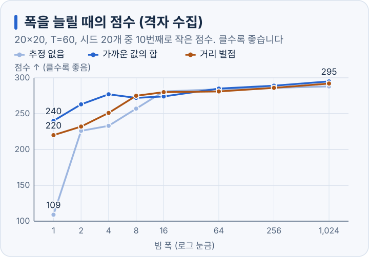
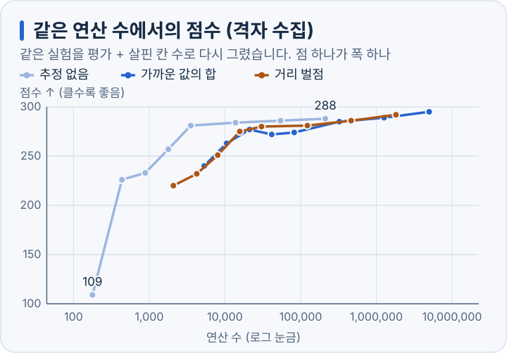
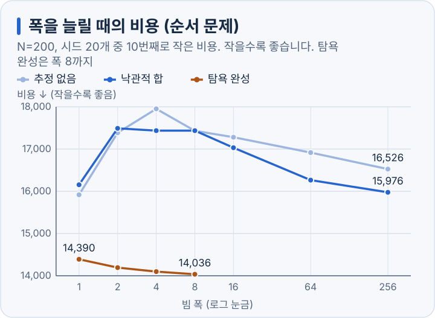
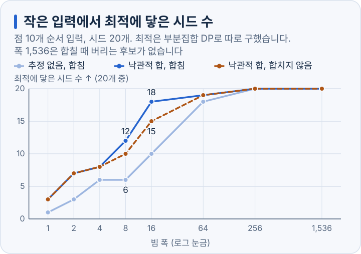

# 실험과 점검: 폭, 추정, 합치기, 흔한 실수

[구현](implementation.md)의 코드를 연습용 문제 틀(격자 수집 `20 × 20`, `T = 60`, 순서 `N = 200`, 정의는 [원리](idea.md))에서 시드 1~20으로 돌린 결과입니다. 모든 표는 `scripts/check_beam_search.py`가 다시 계산해 `lesson-assets/measurements.json`과 이 본문에 대조합니다.

## 실측

측정 방법은 다음과 같습니다.

- **연산 수:** 시간(ms) 대신 센 값을 씁니다. 후보 하나를 평가할 때마다 1(평가 횟수), 추정이 칸이나 점 하나를 살필 때마다 1(살핀 수)이고, 연산 수가 필요한 비교에서만 둘의 합을 씁니다. 둘의 실제 비용 비는 구현에 달려 있습니다. 상태 복사와 힙·해시 연산은 세지 않고, 복사는 따로 셉니다.
- **요약:** 표의 값은 시드 20개의 결과 중 10번째로 작은 값(중앙값의 아래쪽)입니다. 격자 수집은 클수록, 순서 문제는 비용이므로 작을수록 좋습니다. 평가 횟수·연산 수도 같은 방식의 중앙값입니다.
- **판정:** 두 설정을 같은 시드끼리 짝지어 "앞이 나은 시드 / 뒤가 나은 시드"를 셉니다. 한쪽이 20개 중 15개 이상에서 나으면(부호 검정의 양쪽 유의확률 0.041) 차이가 있다고 쓰고, 아니면 "결정 못 함"이라고 씁니다. 이 판정은 이 입력 가족(위 정의의 난수 입력)과 이 설정에 한정됩니다.
- **난수:** 탐색 난수는 평가값 흔들기에서만 쓰이므로 나머지 실험은 결정적입니다.

## 격자 수집: 폭과 추정

추정 세 가지(없음, 가까운 값의 합, 거리 벌점)를 폭별로 비교합니다. 가까운 값의 합과 거리 벌점은 `scale = 8`, `radius = 3`입니다. 점수입니다(클수록 좋음).

| 폭 | 추정 없음 | 가까운 값의 합 | 거리 벌점 |
| ---: | ---: | ---: | ---: |
| 1 | 109 | 240 | 220 |
| 2 | 226 | 263 | 232 |
| 4 | 233 | 277 | 251 |
| 8 | 257 | 272 | 275 |
| 16 | 281 | 274 | 280 |
| 64 | 284 | 285 | 281 |
| 256 | 286 | 289 | 286 |
| 1,024 | 288 | 295 | 292 |

아래 그림은 같은 표를 그린 것입니다. 폭 1~4에서 추정 있는 곡선이 앞서고 폭이 커질수록 세 곡선이 모이는 것을 봅니다.

[그림 크게 보기](https://git.readiz.com/h-contest-lesson/lessons/beam-search/lesson-assets/grid-width.svg)

:::hint 평가 횟수와 살핀 칸 수
같은 실험에서 센 평가 횟수와 추정이 살핀 칸 수입니다(`평가 / 살핀 칸`, 중앙값).

| 폭 | 추정 없음 | 가까운 값의 합 | 거리 벌점 |
| ---: | ---: | ---: | ---: |
| 1 | 178 / 0 | 233 / 5,094 | 222 / 1,852 |
| 2 | 436 / 0 | 462 / 10,065 | 451 / 3,780 |
| 4 | 886 / 0 | 916 / 20,192 | 899 / 7,131 |
| 8 | 1,786 / 0 | 1,811 / 39,750 | 1,788 / 13,944 |
| 16 | 3,538 / 0 | 3,586 / 78,516 | 3,536 / 26,879 |
| 64 | 13,812 / 0 | 14,010 / 310,200 | 13,851 / 108,676 |
| 256 | 54,239 / 0 | 54,706 / 1,211,345 | 54,263 / 409,024 |
| 1,024 | 211,592 / 0 | 214,697 / 4,774,765 | 211,988 / 1,601,330 |
:::

### 추정이 없을 때

폭 1에 추정이 없으면 점수가 109로, 같은 폭에서 추정이 있는 240, 220의 약 절반입니다. 경로가 밟은 서로 다른 칸 수(시작 칸 포함, 최대 61)와, 두 걸음 전의 칸으로 되돌아간 걸음(A → B → A)의 수를 세면 이유가 보입니다.

| 추정 | 폭 | 서로 다른 칸 수(중앙값) | 되돌아간 걸음 수(중앙값) |
| --- | ---: | ---: | ---: |
| 추정 없음 | 1 | 32 | 26 |
| 추정 없음 | 2 | 58 | 2 |
| 가까운 값의 합 | 1 | 58 | 2 |
| 가까운 값의 합 | 2 | 59 | 1 |
| 거리 벌점 | 1 | 57 | 2 |
| 거리 벌점 | 2 | 58 | 1 |

추정 없는 폭 1은 61칸 가운데 32칸만 밟았습니다. 60걸음 중 29걸음이 이미 밟은 칸으로 갔고 되돌아간 걸음은 26번입니다(가까운 값의 합 폭 1은 2번). 주변의 값을 모두 먹고 나면 이동의 평가값이 모두 같아지고 동점 규칙(앞선 행동)이 같은 방향을 고르므로 두 칸 사이를 왕복하는 것으로 보입니다. 폭 2에서는 서로 다른 칸 수가 늘어납니다(58칸).

### 연산 수가 비슷하면 추정이 이기는가

추정은 후보마다 칸을 살피므로 연산이 늘어납니다. 추정 있는 설정과, 연산 수(평가 + 살핀 칸)가 더 적은 추정 없는 설정을 짝지어 비교합니다.

| 추정 있는 설정 | 연산 수 | 점수 | 추정 없는 설정 | 연산 수 | 점수 | 추정 없는 쪽이 나은 시드 / 못한 시드 |
| --- | ---: | ---: | --- | ---: | ---: | --- |
| 가까운 값의 합, 폭 1 | 5,329 | 240 | 추정 없음, 폭 16 | 3,538 | 281 | 19 / 1 더 좋음 |
| 거리 벌점, 폭 1 | 2,082 | 220 | 추정 없음, 폭 8 | 1,786 | 257 | 18 / 2 더 좋음 |
| 가까운 값의 합, 폭 4 | 21,101 | 277 | 추정 없음, 폭 64 | 13,812 | 284 | 17 / 2 더 좋음 |
| 가까운 값의 합, 폭 16 | 82,106 | 274 | 추정 없음, 폭 256 | 54,239 | 286 | 18 / 2 더 좋음 |

아래 그림은 같은 실험을 연산 수로 다시 그려, 같은 가로 위치에서 세 곡선의 높이를 비교하게 합니다.

[그림 크게 보기](https://git.readiz.com/h-contest-lesson/lessons/beam-search/lesson-assets/grid-ops.svg)

네 쌍 모두 추정이 없는 쪽이 더 적은 연산으로 20개 중 17~19개 시드에서 더 높은 점수를 얻었습니다. 이 입력 가족과 이 연산 수의 정의에서는 추정을 넣는 것보다 같은 연산으로 폭을 키우는 편이 낫습니다. "평가 함수를 좋게 하는 것이 폭을 키우는 것보다 이득이 크다"는 경험 법칙을 이 격자 실험은 지지하지 않습니다. 순서 문제에서는 지지합니다(뒤의 순서 문제 절).

:::hint 이 비교의 한계
추정이 칸 20여 개를 살피는 일이 평가 한 번에 비해 훨씬 싸다면(예: 살핀 칸 하나를 0.1로 센다면) 평가 횟수만 비교한 값(첫 줄은 233 대 3,538)에 가까워져 결과가 달라질 수 있고, 이 강의는 시간을 재지 않았습니다.
:::

### 폭을 늘려도 항상 좋아지지 않는다

폭을 두 배 안팎으로 키울 때의 짝지은 비교입니다(`넓은 쪽이 나은 시드 / 못한 시드`와 판정).

| 폭 | 추정 없음 | 가까운 값의 합 | 거리 벌점 |
| --- | --- | --- | --- |
| 1 → 2 | 20 / 0 더 좋음 | 12 / 2 결정 못 함 | 13 / 6 결정 못 함 |
| 2 → 4 | 12 / 8 결정 못 함 | 11 / 3 결정 못 함 | 13 / 7 결정 못 함 |
| 4 → 8 | 15 / 3 더 좋음 | 12 / 3 결정 못 함 | 13 / 2 결정 못 함 |
| 8 → 16 | 13 / 6 결정 못 함 | 8 / 8 결정 못 함 | 12 / 5 결정 못 함 |
| 16 → 64 | 13 / 3 결정 못 함 | 16 / 3 더 좋음 | 9 / 8 결정 못 함 |
| 64 → 256 | 7 / 5 결정 못 함 | 13 / 3 결정 못 함 | 14 / 4 결정 못 함 |
| 256 → 1,024 | 14 / 2 결정 못 함 | 9 / 4 결정 못 함 | 14 / 3 결정 못 함 |

일곱 구간 중 "더 좋음"이 나온 것은 추정 없음의 두 구간과 가까운 값의 합의 한 구간뿐이고 나머지는 결정 못 함입니다. 중앙값도 오르내립니다(가까운 값의 합에서 폭 4는 277, 폭 8은 272, 폭 16은 274). 폭 8개(1에서 1,024까지)의 모든 쌍 28개 가운데 넓은 쪽이 더 낮은 점수를 받은 쌍이 하나라도 있는 시드의 수는 다음과 같습니다.

| 추정 | 그런 시드 수 |
| --- | ---: |
| 추정 없음 | 19 / 20 |
| 가까운 값의 합 | 18 / 20 |
| 거리 벌점 | 17 / 20 |

"폭을 키울수록 결과가 좋아진다"는 경험 법칙은 폭 1에서 1,024까지의 큰 흐름(추정 없음 109에서 288, 가까운 값의 합 240에서 295)에는 맞지만, 두 배씩 키우는 한 단계마다 성립한다고 말할 수 없습니다. 시드 한 개에서 "폭을 키웠더니 나빠졌다" 또는 "좋아졌다"는 흔하므로 일반 법칙으로 쓰지 않고, 폭을 두 배로 할 때의 효과가 시드 흔들림보다 큰지를 여러 시드로 봅니다.

### 점수와 추정의 단위, 반경

가까운 값의 합에서 점수 한 점의 무게 `scale`을 바꿔 본 점수입니다(`radius = 3`). 추정 항은 칸마다 `값 × (4 − d)`(최대 `3 × 값`)를 더하므로 `scale`이 작으면 추정이 점수를 압도합니다.

| `scale` | 폭 1 | 폭 4 | 폭 16 |
| ---: | ---: | ---: | ---: |
| 1 | 12 | 17 | 30 |
| 2 | 20 | 43 | 104 |
| 4 | 118 | 242 | 260 |
| 8 | 240 | 277 | 274 |
| 16 | 261 | 263 | 274 |

`scale = 1`에서는 폭 1의 점수가 12로, 추정이 없는 폭 1(109)보다 낮습니다. 추정을 넣었는데 폭 1의 결과가 추정 없는 폭 1보다 나쁘면 단위를 의심합니다. 이 입력 가족에서 `scale`이 8과 16일 때는 폭 4와 16의 점수가 비슷했고, 4 이하는 폭 1에서 크게 나빴습니다(폭 16에서도 `scale = 1`은 30). 폭을 키워도 `scale` 1과 2는 회복되지 않았고(폭 16에서 30, 104), 4는 폭 16에서야 260으로 올랐습니다.

살피는 거리 `radius`를 바꾼 점수입니다(`scale = 8`).

| `radius` | 폭 1 | 폭 4 | 폭 16 |
| ---: | ---: | ---: | ---: |
| 1 | 202 | 251 | 271 |
| 2 | 244 | 266 | 277 |
| 3 | 240 | 277 | 274 |
| 5 | 202 | 229 | 260 |

반경 1과 5는 폭 1에서 같은 202였고, 폭 16에서는 1이 271, 5가 260으로 3(274)·2(277)보다 낮았습니다. 이유는 재지 않았습니다. 반경이 클수록 연산도 늘어납니다.

## 합치기와 다양성 (격자 수집)

폭 16과 64에서 같은 상태 합치기, 묶음별 상한(묶음 = 후보가 가는 칸), 평가값 흔들기를 바꿨습니다. 괄호는 같은 추정의 기준(합침)과 짝지은 비교입니다. "서로 다른 상태 비율"은 빔 안의 서로 다른 상태 수의 합을 빔 크기의 합으로 나눈 값입니다(폭 16).

| 추정 | 설정 | 폭 16 | 폭 64 | 서로 다른 상태 비율 |
| --- | --- | --- | --- | ---: |
| 추정 없음 | 합침(기준) | 281 | 284 | 1.000 |
| 추정 없음 | 합치지 않음 | 274 (1 / 6 결정 못 함) | 283 (3 / 5 결정 못 함) | 0.982 |
| 추정 없음 | 묶음 상한 1 | 286 (12 / 8 결정 못 함) | 288 (11 / 7 결정 못 함) | 1.000 |
| 추정 없음 | 묶음 상한 2 | 282 (9 / 8 결정 못 함) | 288 (12 / 6 결정 못 함) | 1.000 |
| 추정 없음 | 묶음 상한 4 | 270 (4 / 10 결정 못 함) | 289 (11 / 8 결정 못 함) | 1.000 |
| 추정 없음 | 평가값 흔들기 4 | 270 (4 / 16 더 나쁨) | 283 (4 / 11 결정 못 함) | 1.000 |
| 추정 없음 | 평가값 흔들기 16 | 275 (7 / 11 결정 못 함) | 288 (8 / 4 결정 못 함) | 1.000 |
| 가까운 값의 합 | 합침(기준) | 274 | 285 | 1.000 |
| 가까운 값의 합 | 합치지 않음 | 274 (0 / 2 결정 못 함) | 285 (2 / 1 결정 못 함) | 0.989 |
| 가까운 값의 합 | 묶음 상한 1 | 288 (18 / 2 더 좋음) | 289 (15 / 3 더 좋음) | 1.000 |
| 가까운 값의 합 | 묶음 상한 2 | 286 (17 / 3 더 좋음) | 292 (15 / 3 더 좋음) | 1.000 |
| 가까운 값의 합 | 묶음 상한 4 | 284 (13 / 5 결정 못 함) | 294 (16 / 2 더 좋음) | 1.000 |
| 가까운 값의 합 | 평가값 흔들기 4 | 268 (3 / 2 결정 못 함) | 284 (1 / 4 결정 못 함) | 1.000 |
| 가까운 값의 합 | 평가값 흔들기 16 | 274 (4 / 4 결정 못 함) | 285 (1 / 3 결정 못 함) | 1.000 |

- **합치기:** 합치지 않아도 빔의 98~99%가 서로 다른 상태이고(0.982, 0.989) 점수 차이는 결정하지 못했습니다. 격자 수집에서는 같은 상태로 모이는 후보가 드뭅니다. 순서 문제는 다릅니다(뒤의 순서 문제 절).
- **묶음별 상한:** 가까운 값의 합에서는 상한 1과 2가 폭 16·64 모두 "더 좋음"이고(점수 274에서 288, 286으로), 상한 4는 폭 64에서만 "더 좋음"입니다. 추정 없음에서는 모두 결정하지 못했습니다. 같은 칸에 있는 후보가 여럿이면 앞으로의 선택지가 비슷하므로 묶음을 칸으로 잡으면 빔이 여러 칸으로 퍼집니다. 퍼짐의 크기는 재지 않았습니다.
- **평가값 흔들기:** 이득이 없었습니다. 추정 없음·폭 16·흔들기 4는 기준보다 4개 시드에서만 나아 "더 나쁨"이고, 나머지는 결정 못 함입니다.

## 순서 문제: 평가 함수의 차이가 폭을 이긴다

순서 문제를 순차 결정으로 풀었습니다(깊이 200, 행동은 안 간 점 전부). 세 가지 평가 함수는 추정 없음(`−비용`), 낙관적 합(`−(비용 + 안 간 점의 nn 합)`), 탐욕 완성(낙관적 합으로 후보를 `4 × 폭`개로 추린 뒤 그 후보에만 `−(비용 + 탐욕 완성 비용)`)입니다. 비용입니다(작을수록 좋음). 탐욕 완성은 연산이 커서 폭 8까지만 쟀습니다.

| 폭 | 추정 없음 | 낙관적 합 | 탐욕 완성 |
| ---: | ---: | ---: | ---: |
| 1 | 15,917 | 16,154 | 14,390 |
| 2 | 17,386 | 17,490 | 14,193 |
| 4 | 17,951 | 17,435 | 14,098 |
| 8 | 17,432 | 17,435 | 14,036 |
| 16 | 17,280 | 17,032 | - |
| 64 | 16,916 | 16,264 | - |
| 256 | 16,526 | 15,976 | - |

[그림 크게 보기](https://git.readiz.com/h-contest-lesson/lessons/beam-search/lesson-assets/route-width.svg)

평가 횟수와 살핀 점 수입니다(`평가 / 살핀 점`, 중앙값).

| 폭 | 추정 없음 | 낙관적 합 | 탐욕 완성 |
| ---: | ---: | ---: | ---: |
| 1 | 20,100 / 0 | 20,100 / 0 | 20,100 / 5,333,195 |
| 2 | 40,000 / 0 | 40,000 / 0 | 40,000 / 10,666,351 |
| 4 | 79,800 / 0 | 79,800 / 0 | 79,800 / 21,332,712 |
| 8 | 159,400 / 0 | 159,400 / 0 | 159,400 / 42,665,412 |
| 16 | 318,600 / 0 | 318,600 / 0 | - |
| 64 | 1,273,800 / 0 | 1,273,800 / 0 | - |
| 256 | 5,083,374 / 0 | 5,083,396 / 0 | - |

각 추정에서 폭 1의 결과와 짝지은 비교입니다(`폭 1보다 나은 시드 / 못한 시드`와 판정).

| 폭 | 추정 없음 | 낙관적 합 | 탐욕 완성 |
| ---: | --- | --- | --- |
| 2 | 3 / 17 더 나쁨 | 1 / 19 더 나쁨 | 15 / 5 더 좋음 |
| 4 | 0 / 20 더 나쁨 | 0 / 20 더 나쁨 | 17 / 3 더 좋음 |
| 8 | 1 / 19 더 나쁨 | 0 / 20 더 나쁨 | 18 / 2 더 좋음 |
| 16 | 1 / 19 더 나쁨 | 3 / 17 더 나쁨 | - |
| 64 | 2 / 18 더 나쁨 | 7 / 13 결정 못 함 | - |
| 256 | 4 / 16 더 나쁨 | 8 / 12 결정 못 함 | - |

- 추정 없음과 낙관적 합에서는 폭을 키워도 폭 1(탐욕)을 넘지 못합니다. 추정 없음은 폭 2~256 모두 "더 나쁨"이고, 낙관적 합은 폭 2~16이 "더 나쁨", 폭 64와 256은 결정 못 함입니다. 단계마다 비용이 작은 부분 경로를 남기는 것은 가까운 점부터 먹는 규칙을 폭 `W`로 반복하는 것과 비슷해 보입니다. 비용이 작은 부분 경로가 뒤에서 치르는 비용을 평가가 보지 못하기 때문으로 보며, 이 인과는 따로 재지 않았습니다.
- 탐욕 완성은 폭 1(14,390)이 이미 폭 256의 추정 없음(16,526)·낙관적 합(15,976)보다 좋습니다. 연산 수가 비슷한 쌍으로 비교합니다.

| 탐욕 완성 | 연산 수 | 비용 | 비교 대상 | 연산 수 | 비용 | 탐욕 완성이 나은 시드 / 못한 시드 |
| --- | ---: | ---: | --- | ---: | ---: | --- |
| 탐욕 완성, 폭 1 | 5,353,295 | 14,390 | 추정 없음, 폭 256 | 5,083,374 | 16,526 | 20 / 0 더 좋음 |
| 탐욕 완성, 폭 1 | 5,353,295 | 14,390 | 낙관적 합, 폭 256 | 5,083,396 | 15,976 | 20 / 0 더 좋음 |

- 탐욕 완성에서는 폭을 키우면 나아집니다(폭 1 대비 폭 2는 15 / 5, 폭 4는 17 / 3, 폭 8은 18 / 2로 모두 "더 좋음"). 평가가 앞을 어느 정도 보기 때문에 폭이 의미를 가집니다.
- 평가 횟수 대부분은 값싼 평가입니다. 탐욕 완성은 폭 1에서 후보 20,100개 중 794개에만 비싼 평가를 합니다.

추정마다 잰 폭 전부(추정 없음·낙관적 합은 7개, 탐욕 완성은 4개)의 모든 쌍 가운데 넓은 쪽이 더 비싼(나쁜) 쌍이 하나라도 있는 시드의 수입니다.

| 추정 | 그런 시드 수 |
| --- | ---: |
| 추정 없음 | 20 / 20 |
| 낙관적 합 | 20 / 20 |
| 탐욕 완성 | 14 / 20 |

같은 연습용 순서 입력에서 완성된 해를 고쳐 가는 지역 탐색이 맞는 구조도 있습니다([근방 설계와 차분 평가](https://h.readiz.com/learn/neighborhood-and-delta)). 이 강의의 연산 수와 그 강의의 연산 수는 세는 단위가 달라 직접 비교하지 않습니다.

### 순서 문제에서 합치기와 다양성

순서 문제에서는 같은 점의 집합을 서로 다른 순서로 지난 상태가 많아 합치기의 효과가 큽니다. 아래는 폭별 비용입니다(괄호는 합침 기준과의 짝지은 비교). "서로 다른 상태 비율"은 폭 16의 값입니다.

| 추정 | 설정 | 폭 4 | 폭 16 | 폭 64 | 서로 다른 상태 비율 |
| --- | --- | --- | --- | --- | ---: |
| 추정 없음 | 합침(기준) | 17,951 | 17,280 | 16,916 | 1.000 |
| 추정 없음 | 합치지 않음 | 16,907 (15 / 5 더 좋음) | 16,969 (12 / 8 결정 못 함) | 16,950 (6 / 14 결정 못 함) | 0.405 |
| 추정 없음 | 합침 + 묶음 상한 1 | 18,402 (6 / 14 결정 못 함) | 17,780 (7 / 13 결정 못 함) | 17,566 (2 / 18 더 나쁨) | 1.000 |
| 추정 없음 | 합침 + 묶음 상한 2 | 18,078 (5 / 7 결정 못 함) | 17,239 (11 / 9 결정 못 함) | 17,125 (7 / 13 결정 못 함) | 1.000 |
| 낙관적 합 | 합침(기준) | 17,435 | 17,032 | 16,264 | 1.000 |
| 낙관적 합 | 합치지 않음 | 16,701 (16 / 4 더 좋음) | 16,933 (10 / 10 결정 못 함) | 16,566 (3 / 17 더 나쁨) | 0.593 |
| 낙관적 합 | 합침 + 묶음 상한 1 | 17,754 (10 / 10 결정 못 함) | 17,622 (2 / 18 더 나쁨) | 17,372 (1 / 19 더 나쁨) | 1.000 |
| 낙관적 합 | 합침 + 묶음 상한 2 | 17,663 (3 / 9 결정 못 함) | 16,901 (11 / 9 결정 못 함) | 16,556 (4 / 16 더 나쁨) | 1.000 |

- 합치지 않으면 빔에 같은 상태가 가득합니다(폭 16에서 서로 다른 상태 비율이 추정 없음 0.405, 낙관적 합 0.593). 그런데 결과의 부호는 평가 함수와 폭에 따라 바뀝니다. 폭 4에서는 합치지 않는 쪽이 "더 좋음"(15 / 5, 16 / 4)이고, 낙관적 합의 폭 64에서는 합치지 않는 쪽이 "더 나쁨"(3 / 17)입니다. 이 인과는 따로 가르지 않았습니다. 합치지 않은 빔은 같은 상태가 많아 서로 다른 상태가 적고, 이 입력에서는 평가가 약해 좁은 쪽이 나은 구간이 있었다고 추측할 뿐입니다.
- 묶음(마지막 점)당 상태를 줄이는 것은 이 틀에서 이득이 아니었습니다. 상한 1은 폭 64에서 모두 "더 나쁨"이고 상한 2는 낙관적 합 폭 64에서 "더 나쁨"입니다.

## 작은 입력에서 최적과의 차이

폭 무제한(상태 수 이상)은 완전 탐색이므로 최적과 같아야 합니다. 점 10개의 순서 입력(시드 20개, 최적은 부분집합 DP로 따로 구함)에서 폭별로 최적에 닿은 시드 수와 비용 차의 중앙값입니다(`최적에 닿은 시드 / 20 · 비용 차의 중앙값`).

| 폭 | 추정 없음, 합침 | 낙관적 합, 합침 | 낙관적 합, 합치지 않음 |
| ---: | --- | --- | --- |
| 1 | 1 / 20 · 227 | 3 / 20 · 165 | 3 / 20 · 165 |
| 2 | 3 / 20 · 136 | 7 / 20 · 26 | 7 / 20 · 26 |
| 4 | 6 / 20 · 101 | 8 / 20 · 23 | 8 / 20 · 23 |
| 8 | 6 / 20 · 23 | 12 / 20 · 0 | 10 / 20 · 0 |
| 16 | 10 / 20 · 0 | 18 / 20 · 0 | 15 / 20 · 0 |
| 64 | 18 / 20 · 0 | 19 / 20 · 0 | 19 / 20 · 0 |
| 256 | 20 / 20 · 0 | 20 / 20 · 0 | 20 / 20 · 0 |
| 1,536 | 20 / 20 · 0 | 20 / 20 · 0 | 20 / 20 · 0 |

[그림 크게 보기](https://git.readiz.com/h-contest-lesson/lessons/beam-search/lesson-assets/small-optimal.svg)

점 10개에서 서로 다른 상태 수는 단계마다 최대 1,260개이므로 폭 1,536이면 합치는 설정에서 버리는 후보가 없고 20개 시드 모두 최적이었습니다. 같은 폭에서 낙관적 합이 추정 없음보다 자주 최적에 닿습니다(폭 16에서 18 대 10). 합치지 않으면 폭 8과 16에서 최적에 닿는 시드가 줄었습니다(12에서 10, 18에서 15).

격자 수집(`6 × 6`, `T = 10`)입니다(`최적에 닿은 시드 / 20 · 점수 차의 중앙값`, 최적은 모든 걸음으로 따로 구함).

| 폭 | 추정 없음 | 가까운 값의 합 |
| ---: | --- | --- |
| 1 | 1 / 20 · 16 | 10 / 20 · 0 |
| 2 | 4 / 20 · 4 | 12 / 20 · 0 |
| 4 | 9 / 20 · 2 | 15 / 20 · 0 |
| 8 | 11 / 20 · 0 | 17 / 20 · 0 |
| 16 | 16 / 20 · 0 | 17 / 20 · 0 |
| 64 | 19 / 20 · 0 | 20 / 20 · 0 |
| 256 | 20 / 20 · 0 | 20 / 20 · 0 |

:::hint 5 × 5 격자의 작은 입력
`5 × 5`, `T = 8`입니다. "버린 후보 없는 시드"는 `dropped == 0`이었던 시드 수로, 폭 8,192가 상태 수보다 크므로 이 폭에서만 모든 시드가 해당합니다(완전 탐색).

| 폭 | 추정 없음 | 가까운 값의 합 |
| ---: | --- | --- |
| 1 | 3 / 20 · 버린 후보 없는 시드 0 | 12 / 20 · 버린 후보 없는 시드 0 |
| 2 | 13 / 20 · 버린 후보 없는 시드 0 | 15 / 20 · 버린 후보 없는 시드 0 |
| 4 | 14 / 20 · 버린 후보 없는 시드 0 | 19 / 20 · 버린 후보 없는 시드 0 |
| 8 | 15 / 20 · 버린 후보 없는 시드 0 | 19 / 20 · 버린 후보 없는 시드 0 |
| 8,192 | 20 / 20 · 버린 후보 없는 시드 20 | 20 / 20 · 버린 후보 없는 시드 20 |
:::

작은 입력의 결과는 "폭이 작아도 최적이 나온다"는 뜻이 아닙니다. 점 10개에서 폭 16이 20개 중 10~18개 시드만 최적에 닿았고, 입력이 커지면 최적을 모르므로 이 격차를 잴 수 없습니다. 이 표는 폭 무제한이 최적과 같다는 사실(코드의 정확성)을 보이는 데 쓰입니다.

## 복사 비용

같은 실행에서 새 상태를 만들며 복사한 원소 수와, 후보마다 상태와 지금까지의 경로를 통째로 복사했다면 들었을 원소 수입니다(중앙값, `통째 복사 / 실제`의 비).

| 설정 | 복사한 원소 수 | 통째 복사였다면 | 비 |
| --- | ---: | ---: | ---: |
| 격자 수집, 가까운 값의 합, 폭 16 | 9,360 | 150,390 | 16.1 |
| 격자 수집, 가까운 값의 합, 폭 256 | 142,970 | 2,364,417 | 16.5 |
| 순서 문제, 낙관적 합, 폭 16 | 25,536 | 24,200,200 | 947.7 |
| 순서 문제, 낙관적 합, 폭 64 | 102,000 | 96,795,400 | 949.0 |

후보 수는 폭의 약 4배(격자)와 약 100배(순서)입니다. 후보는 (부모 번호, 행동, 평가값, 키)만 담고 살아남은 폭만큼만 상태를 만들어 격자에서 16배, 순서 문제에서 약 950배를 줄였습니다. "통째 복사였다면"은 `copiedWhole` 계수기의 값이고, 검사 스크립트의 참조 구현이 실제로 후보마다 복사해 센 값과 같음을 확인했습니다.

## 흔한 실수와 잡는 검사

아래 실수는 모두 본문 코드에 직접 넣어 보고 검사가 잡는지 확인했습니다(`scripts/check_beam_search.py`가 매번 다시 수행). 각 칸은 그 검사에서 어긋난 정도입니다. "독립 구현"은 같은 규칙으로 따로 쓴 Python 빔과 198개 설정의 결과를 대조한 검사입니다. 정상 코드는 `0 / 40`, `0`, `40 / 40`, `0 / 13`, `0 / 198`입니다. 정상과 같은 값이면 그 검사로는 못 잡습니다.

| 흔한 실수 | 경로 재생(어긋난 실행 / 40) | 키 대조(충돌 수) | 작은 입력의 최적(최적에 닿은 시드 / 40) | 손계산 대조(어긋난 결과 / 13) | 독립 구현(다른 설정 / 198) |
| --- | ---: | ---: | ---: | ---: | ---: |
| 키에서 현재 칸·마지막 점 빠뜨림 | 0 / 40 | 557 | 6 / 40 | 2 / 13 | 189 / 198 |
| 부모 번호 자리에 후보 번호 기록 | 40 / 40 | 0 | 40 / 40 | 잡힘 | 198 / 198 |
| 부모 상태를 직접 고쳐 씀 | 40 / 40 | 0 | 0 / 40 | 7 / 13 | 180 / 198 |
| 합칠 때 나쁜 쪽을 남김 | 0 / 40 | 0 | 0 / 40 | 3 / 13 | 80 / 198 |
| 최소화 문제의 평가값 부호 | 0 / 40 | 0 | 0 / 40 | 7 / 13 | 108 / 198 |

1. **키에서 빠진 것(현재 칸, 마지막 점).** 같은 집합이지만 위치가 다른 상태가 합쳐져 더 좋은 상태가 사라집니다. 유효한 경로가 나와서 재생으로는 못 잡고, 모든 상태를 만들어 "같은 키 ⇔ 같은 상태"를 대조하는 검사가 가장 확실합니다(충돌 557개).
2. **부모 번호 자리에 후보 번호를 기록.** 복원한 경로가 이동 규칙을 어기거나 점수가 어긋나 경로 재생이 모든 시드에서 잡습니다(40 / 40). 복원이 이전 단계 기록 밖을 읽어 손계산에서 몇 개가 어긋나는지는 컴파일러와 메모리 배치에 따라 달라지므로, 표에는 잡혔다는 사실만 적었습니다.
3. **부모 상태를 직접 고쳐 씀.** 같은 부모의 다른 자식이 앞 자식의 변화를 물려받습니다. 경로 재생이 40 / 40으로 잡고 작은 입력의 최적도 0 / 40으로 어긋납니다.
4. **같은 상태를 합칠 때 나쁜 쪽을 남김.** 경로가 유효해 경로 재생은 0 / 40입니다. 작은 입력에서 최적에 닿지 못하는 것(0 / 40)과 손계산(3 / 13)이 잡습니다.
5. **최소화 문제의 평가값 부호.** 평가값을 `−비용`이 아니라 `+비용`으로 쓰면 가장 나쁜 상태를 남깁니다. 경로 재생은 통과하고(0 / 40) 작은 입력의 최적과 손계산(7 / 13)이 잡습니다.
6. **점수와 추정의 단위 불일치.** 코드의 실수가 아니라 설정의 실수이므로 위 표에 없습니다. 추정을 넣은 폭 1의 점수가 추정 없는 폭 1보다 낮으면 의심합니다(위 `scale` 표에서 12 대 109).

경로 재생이나 최적 검사가 0이라는 사실은 평가 함수가 좋다는 뜻이 아닙니다. 코드가 정의대로 도는지만 확인합니다. 평가 함수의 질은 폭별 점수와 연산 수의 표로 확인합니다.

## 다른 문제에 옮길 때 점검 목록

1. 답이 행동의 열이고, 상태가 앞으로의 선택지와 점수를 정하는 요약인가? 경로나 순서가 상태에 들어 있지 않은가?
2. 같은 상태로 모이는 후보가 있는가? 키가 상태를 모두 구별하고, 같은 상태는 같은 키를 갖는가? 같은 키에서 평가값이 큰 쪽을 남기는가?
3. 평가값이 얻은 것에 앞으로의 추정을 더한 값인가? 두 항의 단위가 맞는가? 추정을 넣은 폭 1이 추정 없는 폭 1보다 나쁘지 않은가? 추정이 후보마다 달라 순서를 바꾸는가?
4. 평가 한 번의 비용과 폭을 맞바꿨는가? 같은 연산 수에서 폭을 키운 설정과 비교했는가? 비싼 평가는 상위 후보에만 하는가?
5. 폭과 결과의 관계를 여러 시드로 쟀는가? 한 시드에서 폭을 키웠더니 좋아졌다(나빠졌다)는 결과를 일반화하지 않았는가?
6. 상태 복사량은 어떤가? 후보가 상태를 복사하지 않고 (부모, 행동)만 담는가? 부모 번호가 이전 단계 빔 안의 번호인가?
7. 최소화인지 최대화인지에 맞게 평가값의 부호와 동점 규칙을 정했는가? 폭을 상태 수 이상으로 준 작은 입력에서 독립 완전 탐색(DP)과 같은가?
8. 이 문제가 빔 서치에 맞는 구조인가? 평가가 앞을 못 보는 순서 문제처럼 완성된 해를 고치는 쪽이 맞지 않은가?

## 적용 사례

- [31일 설치 일정 Beam Search(AIRCONTECH)](https://h.readiz.com/learn/heuristic-case-studies/aircontech-beam-search): 다음 주택 후보를 평가값 상위 8개로 줄이는 단계와, 경로 상태 32개를 남기는 단계를 서로 다른 시간 벌점으로 나누고, 상태를 살리는 평가값과 실제 점수를 따로 두어 최고 점수 상태를 별도로 갱신합니다.
- [채점기 상태를 따라 그리며 행동하기](https://h.readiz.com/learn/observe-and-act): 상태가 채점기 안에 있어 직접 읽을 수 없을 때 내가 호출한 행동의 기록으로 상태를 쌓는 방법입니다. 빔 서치의 상태를 만드는 데 필요한 관측을 다룹니다.

게임 트리는 [미니맥스와 알파-베타](https://h.readiz.com/learn/minimax-alpha-beta), 정보가 가려진 문제는 [정보가 부분적일 때 결정하기](https://h.readiz.com/learn/partial-information), 후보를 줄이는 자료구조는 [후보 줄이기와 시간 예산](https://h.readiz.com/learn/candidate-and-time-budget), 시드 여러 개로 설정을 비교하는 방법은 [실험과 튜닝](https://h.readiz.com/learn/experiments-and-tuning)에서 이어집니다.

## 로컬 연습

1. `Grid`의 `est = 1`에서 가중치 `(radius + 1 − d)`를 모두 1로 바꿔 폭 1, 4, 16의 점수와 연산 수를 시드 20개로 비교하고 판정을 적습니다.
2. `Route`에 추정 `est = 3`(비용에 "지금 점에서 가장 가까운 안 간 점까지의 거리"를 더하는 벌점)을 추가하고 벌점의 무게를 바꿔 가며 폭 1, 4, 16을 비교합니다. 무게가 너무 크면 어떻게 되는지 위 `scale` 표와 같은 모양으로 기록합니다.
3. 순서 문제에서 묶음별 상한 1과 2를 폭 16, 64에서 다시 재고 본문과 같은 판정인지 확인합니다.
4. 점 10개 입력에서 `refineK`를 `width`의 2배, 4배, 8배로 바꿔 최적에 닿는 시드 수를 셉니다(`est = 2`).
5. `mergeSame`을 `mergeBySort`로 바꿔 결과와 평가 횟수가 같은지, 정렬이 하는 비교 횟수를 따로 세어 후보 수에 따라 어떻게 늘어나는지 기록합니다.
6. 부모 번호 기록을 일부러 틀리게 하고 `replayGrid`가 몇 개 시드에서 잡는지 기록합니다.

확인 기준: 모든 변경 뒤 경로 재생이 점수와 같고, 폭을 상태 수 이상으로 준 작은 입력의 결과가 독립 완전 탐색과 같고, 표의 모든 비교에 시드 수와 판정(더 좋음·더 나쁨·결정 못 함)이 붙어 있어야 합니다.
