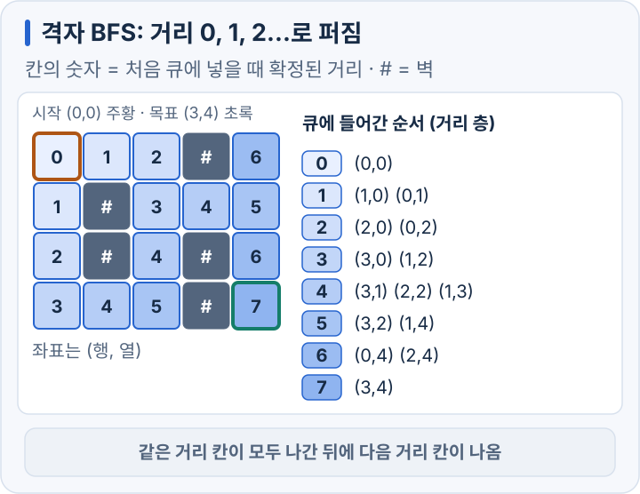

# BFS/DFS와 격자 탐색

BFS와 DFS는 그래프에서 갈 수 있는 곳을 빠짐없이 방문하는 가장 기본적인 탐색 방법입니다. 문제에서 정점과 간선이 직접 나오지 않아도, 격자 칸, 지도, 상태 전이, 이동 가능한 위치를 그래프로 보면 같은 도구를 쓸 수 있습니다.

```text
DFS: 한 방향으로 깊게 들어갔다가 돌아온다.
BFS: 시작점에서 가까운 곳부터 차례로 본다.
```

아래 예시는 미방문 정점 표시와 최단거리 계산의 차이를 다룹니다. 인접 목록 표현의 개념은 [그래프와 트리](https://h.readiz.com/learn/graph-tree-basics)에 있고, 이 강의의 제출용 코드는 아래 `head`/`next` 배열로 구현합니다.

## 그래프로 생각하기

격자에서는 보통 한 칸이 정점이고, 상하좌우로 이동할 수 있으면 간선이 있다고 봅니다.

```text
....
.##.
....
```

`.` 칸은 지나갈 수 있고, `#` 칸은 벽이라면 각 `.` 칸이 정점입니다. 상하좌우로 붙어 있는 `.` 칸 사이에 간선이 있습니다.

## 발견한 시점에 방문 표시하기

[BFS: 발견 표시와 큐를 함께 따라가기](https://git.readiz.com/h-contest-lesson/demos/index.html?demo=bfs)

합류하는 정점이 있는 예제에서 큐에 넣는 순간 거리가 정해지는지 확인해 보세요. 이미 발견한 정점에 다시 도달해도 큐에 중복으로 넣지 않습니다.

아래 방향 그래프에서 1과 2는 모두 3을 발견할 수 있습니다. 큐에 넣을 때 `dist[3]`을 기록하면 3은 한 번만 들어가고, 거리 2가 확정됩니다.

이미 발견한 정점을 다시 넣지 않도록 표시합니다. BFS나 반복 DFS에서는 큐·스택에서 꺼낼 때까지 기다리지 않고 **넣는 순간** 표시해야 여러 이웃이 같은 정점을 중복으로 넣지 않습니다.

## 제출용 인접 리스트

> **코드 환경: h-contest 제출용 코드.** 표준 헤더·STL·동적 할당 없이 고정 배열로 구현합니다. 아래 그래프·DFS·BFS 블록과 `gridDistance`는 [공통 코드](https://h.readiz.com/learn/cpp-common-library)의 `queue` 블록을 먼저 붙인 뒤 이어서 사용합니다.

STL 컨테이너 대신 간선을 번호로 저장하는 head/next 배열을 씁니다. `head[u]`는 `u`에서 나가는 마지막 간선 번호이고, `next[e]`는 같은 정점에서 나가는 이전 간선입니다. 간선을 추가한 반대 순서로 이웃을 돕니다. 정점 상한 `MAX_V = 200000`, 간선 상한 `MAX_E = 400000`은 이 사이트 그래프 연습의 입력 상한과 같은 값이며, 실제 문제에서는 제한에 맞춰 바꿉니다. 큰 `Graph`는 전역으로 선언하고, TC마다 `init(n)`으로 사용할 정점만 비웁니다. 무방향 간선은 `addEdge`를 양쪽으로 두 번 호출하므로 `MAX_E`에서 두 칸을 씁니다.

```cpp
const int MAX_V = 200000; // 정점 수 상한
const int MAX_E = 400000; // 방향 간선 수 상한

struct Graph {
    int head[MAX_V];
    int next[MAX_E];
    int to[MAX_E];
    int edgeCount;

    void init(int n) { // 전제: 0 <= n <= MAX_V
        for (int i = 0; i < n; ++i) head[i] = -1;
        edgeCount = 0;
    }
    bool addEdge(int u, int v) { // 간선이 가득 차면 false
        if (edgeCount == MAX_E) return false;
        to[edgeCount] = v;
        next[edgeCount] = head[u];
        head[u] = edgeCount++;
        return true;
    }
};
```

## DFS

한 경로를 따라 깊이 들어갔다가 되돌아옵니다. 아래 함수는 `u`와 연결된 모든 정점을 표시합니다. 호출하기 전에 `visited[0..n)`를 0으로 채웁니다.

```cpp
void dfs(int u, const Graph& graph, int visited[]) {
    visited[u] = 1;

    for (int e = graph.head[u]; e != -1; e = graph.next[e]) {
        int v = graph.to[e];
        if (visited[v]) continue;
        dfs(v, graph, visited);
    }
}
```

길게 이어진 그래프에서는 재귀 깊이도 정점 수만큼 늘어납니다. `MAX_V`까지 이어진 경로에서는 실행 환경의 스택 제한을 넘을 수 있으므로 명시적인 스택으로 바꿉니다. 정점은 발견할 때 표시하고 넣기 때문에 한 번만 들어가며, 스택은 `MAX_V`칸이면 충분합니다. 다음 구현은 방문한 정점 수도 반환합니다.

```cpp
int dfsStack[MAX_V];

int dfsSizeIterative(int start, const Graph& graph, int visited[]) {
    int size = 0;
    int top = 0;

    visited[start] = 1;
    dfsStack[top++] = start;

    while (top > 0) {
        int u = dfsStack[--top];
        size++;

        for (int e = graph.head[u]; e != -1; e = graph.next[e]) {
            int v = graph.to[e];
            if (visited[v]) continue;
            visited[v] = 1;
            dfsStack[top++] = v;
        }
    }
    return size;
}
```

## BFS로 최단거리 구하기

모든 간선 비용이 1이면 거리 0, 1, 2인 정점 순서로 큐에서 나옵니다. `dist[v] == -1`을 미방문 표시로 함께 사용합니다.

공통 `queue` 블록의 `hc::Queue<MAX_V>`를 씁니다. 발견할 때 `dist`를 기록하므로 각 정점은 한 번만 넣고 누적 push는 `n <= MAX_V`입니다. `dist[0..n)`은 함수가 -1로 채우고, 호출 전제는 `0 <= start < n <= MAX_V`입니다.

```cpp
hc::Queue<MAX_V> vertexQueue;

void shortestDistance(int start, const Graph& graph, int n, int dist[]) {
    for (int i = 0; i < n; ++i) dist[i] = -1;
    vertexQueue.clear();

    dist[start] = 0;
    vertexQueue.push(start);

    int u;
    while (vertexQueue.pop(u)) {
        for (int e = graph.head[u]; e != -1; e = graph.next[e]) {
            int v = graph.to[e];
            if (dist[v] != -1) continue;
            dist[v] = dist[u] + 1;
            vertexQueue.push(v);
        }
    }
}
```

새 정점은 현재 거리보다 정확히 1 멀리 있으므로 처음 넣을 때 거리가 확정됩니다. 다른 비용의 간선이 섞이면 이 성질이 깨집니다.

## 연결 요소 세기

무방향 그래프에서 연결 요소 개수는 아직 방문하지 않은 정점마다 탐색을 시작해서 셉니다. 깊은 재귀를 피하려고 반복형 DFS를 씁니다. `visited[0..n)`는 함수가 0으로 채웁니다.

```cpp
int countComponents(const Graph& graph, int n, int visited[]) {
    for (int i = 0; i < n; ++i) visited[i] = 0;
    int components = 0;

    for (int i = 0; i < n; ++i) {
        if (visited[i]) continue;
        components++;
        dfsSizeIterative(i, graph, visited);
    }
    return components;
}
```

## 격자를 탐색할 때의 경계

격자 칸을 정점으로 보고 상하좌우 이웃을 생성합니다. 다음 좌표를 만든 뒤에는 **배열을 읽기 전에 범위를 확인**해야 합니다. 범위 안이면 벽인지, 이미 방문했는지 검사합니다. 이 순서를 아래 `gridDistance`의 내부 반복문에서 확인할 수 있습니다.

## 격자 BFS 최단거리

상하좌우 이동 비용이 모두 1이면 격자 최단거리는 BFS입니다. 시작점이 유효한 빈 칸이라는 보장이 없다면, 큐에 넣기 전에 범위와 벽 여부를 검사합니다.

격자는 `char grid[MAX_H][MAX_W]`로 받고 칸 `(y, x)`를 정수 `y * w + x`로 큐에 넣습니다. 꺼낼 때 `y = id / w`, `x = id % w`로 되돌립니다. 연습 상한 `H, W <= 500`에 맞춰 `MAX_H = MAX_W = 500`이고, 한 칸을 한 번만 넣으므로 큐 용량은 `MAX_H * MAX_W`입니다. `dist[0..h)[0..w)`는 함수가 -1로 채우며, 범위를 벗어난 `h`, `w`이면 `false`를 반환합니다.

```cpp
const int MAX_H = 500;
const int MAX_W = 500;
hc::Queue<MAX_H * MAX_W> cellQueue;

bool gridDistance(const char grid[][MAX_W], int h, int w,
                  int sy, int sx, int dist[][MAX_W]) {
    if (h < 0 || h > MAX_H || w < 0 || w > MAX_W) return false;
    for (int y = 0; y < h; ++y)
        for (int x = 0; x < w; ++x) dist[y][x] = -1;
    cellQueue.clear();

    const int dy[4] = {-1, 1, 0, 0};
    const int dx[4] = {0, 0, -1, 1};

    if (sy < 0 || sy >= h || sx < 0 || sx >= w || grid[sy][sx] == '#') return true;
    dist[sy][sx] = 0;
    cellQueue.push(sy * w + sx);

    int id;
    while (cellQueue.pop(id)) {
        int y = id / w;
        int x = id % w;

        for (int dir = 0; dir < 4; ++dir) {
            int ny = y + dy[dir];
            int nx = x + dx[dir];

            if (ny < 0 || ny >= h || nx < 0 || nx >= w) continue;
            if (grid[ny][nx] == '#') continue;
            if (dist[ny][nx] != -1) continue;

            dist[ny][nx] = dist[y][x] + 1;
            cellQueue.push(ny * w + nx);
        }
    }
    return true;
}
```



[그림 크게 보기](https://git.readiz.com/h-contest-lesson/lessons/bfs-dfs-grid/lesson-assets/grid-wave.svg)

아래 로컬 연습의 예시 격자입니다. 칸의 숫자가 `dist` 값이고 오른쪽 목록이 큐에 들어간 순서입니다.

## 여러 곳에서 동시에 퍼질 때

위 구현에서 시작점 하나를 넣는 부분만 바꿉니다. 모든 유효한 시작점의 거리를 0으로 두고 큐에 넣은 뒤 같은 반복문을 실행합니다. 같은 좌표가 여러 번 주어지면 처음 한 번만 넣습니다.

얻는 거리는 시작점 각각까지의 거리가 아니라 **가장 가까운 시작점까지의 거리**입니다. 불이 여러 곳에서 동시에 번진다면 각 칸에 최초로 도착하는 시간을 한 번의 탐색으로 구할 수 있습니다.

## 상태 그래프

격자 칸만 정점이 되는 것은 아닙니다. 방향, 남은 자원, 열쇠 보유 상태까지 포함해야 할 때도 있습니다.

```text
(y, x)만으로는 부족하다.
로봇 방향까지 같아야 같은 상태다.
남은 배터리나 사용한 특수 이동 횟수가 다르면 다른 상태다.
```

이때 정점은 `(y, x, dir)` 또는 `(y, x, used)` 같은 상태가 됩니다. 방문 배열도 그 차원만큼 늘어납니다.

상태를 넓히면 정점 수가 크게 늘어납니다. `h * w * stateCount`가 시간과 메모리 안에 들어오는지 먼저 계산해야 합니다.

## BFS와 Dijkstra의 차이

BFS가 최단거리를 보장하는 이유는 모든 간선 비용이 같기 때문입니다. 큐에서 먼저 나오는 상태가 항상 더 짧은 거리입니다.

간선 비용이 서로 다르면 일반 BFS는 틀릴 수 있습니다.

| 간선 비용 | 적합한 알고리즘 |
| --- | --- |
| 모두 1 | BFS |
| 0 또는 1 | 0-1 BFS |
| 음수 없음, 여러 양수 | Dijkstra |
| 음수 가능 | Bellman-Ford 등 별도 기법 |

격자라도 이동마다 비용이 다르면 BFS가 아니라 Dijkstra를 검토해야 합니다.

## 시간 복잡도

각 정점과 간선을 한 번씩 보면 됩니다.

```text
인접 리스트 그래프: O(V + E)
격자 상하좌우 탐색: O(HW)
메모리: 방문 배열 또는 거리 배열 O(V)
```

격자에서 각 칸의 이웃은 최대 4개라서 간선 수가 `O(HW)`입니다. 그래서 격자 BFS/DFS도 전체 칸 수에 비례합니다.

상태 그래프에서는 `V`가 실제 상태 수입니다.

```text
위치만 상태: H * W
위치 + 방향: H * W * 4
위치 + 열쇠 bitmask: H * W * 2^K
```

상태를 추가할수록 복잡도가 곱으로 늘어납니다.

## 로컬 연습: 장애물 격자의 최단 이동

상하좌우로 한 칸씩 이동할 때 시작 칸에서 목표 칸까지의 최소 이동 횟수를 구하세요. .은 통로, #은 벽입니다.

**입력:** H W sy sx ty tx 뒤 H줄의 격자. 1 <= H,W <= 500이고 좌표는 0-based이며 시작·목표는 통로입니다.

**출력:** 최소 이동 횟수, 도달 불가이면 -1을 출력합니다.

### 예시

```text exercise=bfs-dfs-grid role=input
4 5 0 0 3 4
...#.
.#...
.#.#.
...#.
```

```text exercise=bfs-dfs-grid role=output
7
```

**확인 방법:** 작은 격자는 모든 통로 사이 거리를 Floyd-Warshall로 구해 비교합니다. 시작=목표이면 0이며 통로가 끊기면 -1입니다. BFS는 큐에 넣을 때 방문 처리해 각 칸을 한 번만 넣고, 큐 용량은 H*W로 둡니다.

## 휴리스틱 풀이에서 쓰는 곳

격자에서 BFS는 가중치가 같은 이동으로 "어디까지 몇 칸 만에 갈 수 있는가"를 구하는 도구입니다. 휴리스틱에서는 현재 위치에서 목표 후보까지의 거리를 한 번에 구해 가까운 후보를 고르거나, 남은 이동 횟수 안에 닿을 수 있는 칸을 걸러내는 데 씁니다. 거리를 매번 다시 구하면 비싸므로 상태가 바뀔 때만 BFS를 돌리는 구조가 흔합니다.

- [광산 탐사](/practice/MINEEXPLORE): 지도는 `30 x 30`이고 하루 이동은 최대 10칸, 기간은 10일이라 총 이동이 최대 100번입니다. 처음 방문한 칸의 광물 가치만 점수가 됩니다. 현재 위치에서 BFS로 거리를 구하면 하루 10칸 안에 도달할 수 있는 칸과 이미 방문한 칸(추가 점수 0)을 구분해 경로를 계획할 수 있습니다.
- [로봇 청소기](/practice/ROBOTCLEAN): 집은 `64 x 64`이고 `scan`(비용 20)은 `3 x 3`만 보여 줍니다. 지금까지 알아낸 빈 칸 위에서 BFS를 돌려 가장 가까운 미확인 경계 칸으로 가는 경로를 구할 수 있습니다. 이동 횟수만 세면 되는지 회전 비용까지 보아야 하는지는 [Dijkstra](https://h.readiz.com/learn/dijkstra) 강의의 설명과 함께 판단합니다.
