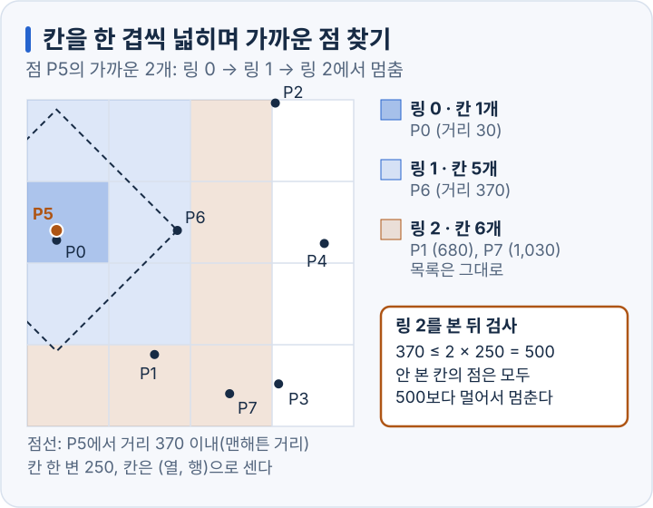
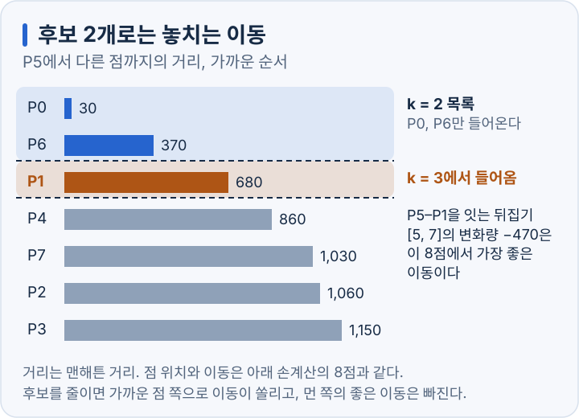
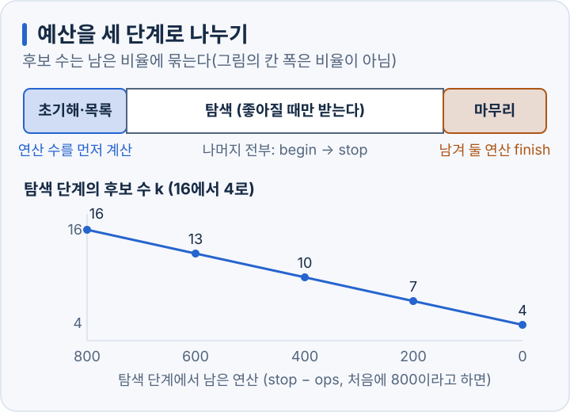
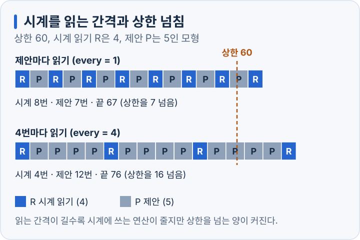

# 원리: 연산 수 예산, 후보 목록, 놓치는 이동, 시간 배분

[근방 설계와 차분 평가](https://h.readiz.com/learn/neighborhood-and-delta)에서 이동 하나를 싸게 평가하는 법을 익혔습니다. 입력이 커지면 그다음 문제가 생깁니다. 점 200개의 순서 문제는 근방이 19,900개였지만 10,000개가 되면 49,995,000개이고, 이동 하나가 아무리 싸도 근방을 한 번 훑는 것만으로 예산을 넘습니다. 이 페이지는 (1) 쓸 수 있는 방법을 연산 수로 먼저 세어 고르는 절차, (2) 근방을 "가까운 후보"로 줄이는 두 가지 방법(이웃 목록, 좌표 칸), (3) 줄여서 놓치는 이동과 그것을 재는 방법, (4) 정해진 예산을 단계로 나누고 시계를 읽는 방법을 두 가지 유형으로 손으로 따라갑니다. 코드는 [구현](implementation.md), 실험 결과는 [실험과 점검](practice.md)에 있습니다.

## 언제 쓰고 언제 쓰지 않는가

| 상황 | 판단 |
| --- | --- |
| 근방을 한 번 훑는 연산이 예산의 상당 부분이거나 넘는다 | 후보를 줄인다. 줄이지 않으면 첫 훑기도 끝나지 않는다 |
| 근방 전체를 여러 번 훑어도 예산 안이다(점 200개 순서 문제는 19,900개 × 5 ≈ 10⁵) | 줄이지 않는다. 전수가 더 간단하고 놓치는 이동이 없다 |
| 점수가 이동의 좋고 나쁨을 가까움·싼 정도로 예측한다(가까운 점 사이의 간선, 추가 비용이 싼 기계) | 후보 목록이 맞다 |
| 이동의 효과가 항목 사이의 순위와 무관하다 | 후보 목록이 무작위 이동과 다르지 않다. 다른 기준을 찾거나 줄이지 않는다 |
| 후보 목록을 만드는 연산이 예산의 큰 부분이다 | 예산표로 먼저 확인한다. 전수로 만들면 예산을 넘을 수 있고 칸 탐색이 필요하다 |
| 항목이 아주 적다 | 칸이 전수보다 비쌀 수 있다(아래 8점 손계산은 전수 88, 칸 186). 어느 크기부터 칸이 싸지는지는 재서 정한다(`N = 2,000`에서는 칸 185,261 대 전수 4,328,963) |
| 예산이 후보 근방의 지역 최적에 닿을 만큼 넉넉하다 | 예산을 더 쓰는 것이 아니라 다른 수단이 필요하다([언덕 오르기와 담금질](https://h.readiz.com/learn/hill-climbing-and-annealing)) |
| 시계를 매 반복 읽고 있다 | 한 번의 제안이 몇 연산인지 세어 N번마다 읽는다 |

선수 지식은 [복잡도와 입력 크기 감각](https://h.readiz.com/learn/complexity-input-size)의 "시간 제한을 연산 횟수로 바꾸기"와 [근방 설계와 차분 평가](https://h.readiz.com/learn/neighborhood-and-delta)의 이동·차분입니다. 이 강의는 차분 유도를 다시 다루지 않으며, 온도를 정하는 절차는 [언덕 오르기와 담금질](https://h.readiz.com/learn/hill-climbing-and-annealing), 실험 설계 일반론은 [실험과 튜닝](https://h.readiz.com/learn/experiments-and-tuning)으로 넘깁니다.

## 연습용 문제 틀

이 강의의 수치는 [3번 강의](https://h.readiz.com/learn/neighborhood-and-delta)의 두 틀을 크게 만든 것에서 나옵니다. 난수는 64비트 정수 `x`를 시드로 시작해 `x = x * 6364136223846793005 + 1442695040888963407`로 갱신하고 값은 `(x >> 33) % 범위`입니다. 시드는 1부터 20까지 쓰며 입력 생성과 탐색 난수에 같은 시드를 씁니다.

- **순서 문제(경로):** 점 `N`개가 `0..999`의 정수 좌표에 있고(`x`, `y` 순서로 뽑음) 모든 점을 한 번씩 지나는 순서의 맨해튼 거리 합을 줄입니다(시작점 자유, 돌아오지 않음). `N`은 2,000과 10,000입니다. 시작 해는 점을 칸으로 나눠 뱀처럼 훑는 순서입니다(초기해 만들기의 한 가지이며 자세한 구성은 [구현](implementation.md)).
- **배정 문제(작업):** 작업 `N = 2,000`개를 기계 `M = 200`대에 맡깁니다. 작업마다 길이 `d`(1..100)와 기계별 추가 비용 `c`(0..50)가 있고, 비용은 `(Σ load²) / 100 + Σ c`(나눗셈은 합 전체에 한 번)이며, 기계 한 대에는 `K = 14`개까지입니다. 시작 해는 `i % M`(기계마다 10개).

순차 결정 문제는 쓰지 않습니다. 이 강의의 후보 줄이기는 완성된 해를 조금 바꾸는 이동을 대상으로 하며, 중간 상태를 줄이는 폭은 [빔 서치](https://h.readiz.com/learn/beam-search)의 몫입니다.

## 예산표: 연산 수를 먼저 센다

쓸 수 있는 방법은 구현하기 전에 연산 수로 고릅니다. 틀은 한 줄입니다.

> 준비 연산 + (이동 하나의 평가 연산) × (필요한 평가 횟수) + (적용 횟수) × (적용 하나의 연산) ≤ 연산 상한

절차는 다섯 단계입니다.

1. **입력 상한을 적는다.** 순서 틀은 `N = 10,000`, 배정 틀은 `N = 2,000`, `M = 200`.
2. **이동 하나를 평가하는 연산을 센다.** 점수식의 항 하나를 계산할 때마다 1, 제안 하나에 1입니다. 구간 뒤집기는 간선 4개 이하라 제안 포함 5, 작업 옮기기는 작업 항 2개와 기계 항 4개라 제안 포함 7이 최대입니다.
3. **필요한 평가 횟수를 센다.** 근방 전체를 한 번 훑기: 순서 틀은 `N(N − 1) / 2`, 배정 틀은 `N × (M − 1)`. 후보 `k`개로 훑기: 순서 틀은 항목(위치 × 방향 2) 수 `2N`에 `k`를 곱하고, 배정 틀은 `N × k`.
4. **준비와 적용을 더한다.** 후보 목록을 만드는 연산(한 번), 해를 바꿔 쓰는 연산(수락된 이동 수 × 이동당 쓰기 수), 시계를 읽는 연산을 빼먹지 않습니다.
5. **상한과 비교한다.** 상한은 `제한 시간 × 초당 연산 수 × 안전 계수`입니다. 초당 연산 수는 환경마다 다르므로 상수로 외우지 않고 [자기 환경에서 재서](practice.md) 정합니다. 이 강의의 표는 환경과 무관하게 연산 수로만 말합니다.

아래 표는 순서 틀 `N = 10,000`에서 예산을 연산 12,000,000으로 잡았을 때의 값입니다. 평가 하나는 최대 5연산이라고 놓은 어림이며, 준비 연산은 코드로 센 값입니다.

| 일 | 근거 | 연산 | 예산 12,000,000 대비 |
| --- | --- | ---: | ---: |
| 전체 근방 한 번 훑기 | 평가 49,995,000회 × 5 | 249,975,000 | 2,083.1% |
| 이웃 8개 목록으로 한 번 훑기 | 평가 160,000회 × 5 | 800,000 | 6.7% |
| 이웃 목록 만들기, 전수 | 시드 1 실측 | 102,104,248 | 850.9% |
| 이웃 목록 만들기, 칸 | 중앙값 | 956,324 | 8.0% |

전체 근방을 한 번 훑는 일만으로 예산의 20배가 넘고, 전수로 이웃 목록을 만드는 일도 예산의 8배가 넘습니다. 후보 8개로 줄이고 칸으로 목록을 만들면 목록 만들기가 예산의 8%, 한 번 훑기가 6.7%가 되어 훑기를 여러 번 할 수 있습니다. 같은 일을 배정 틀 `N = 2,000`, `M = 200`, 예산 2,000,000에서 하면 아래와 같습니다. 평가 하나는 최대 7연산입니다.

| 일 | 근거 | 연산 | 예산 2,000,000 대비 |
| --- | --- | ---: | ---: |
| 전체 근방 한 번 훑기 | 평가 398,000회 × 7 | 2,786,000 | 139.3% |
| 싼 기계 4대 목록으로 한 번 훑기 | 평가 8,000회 × 7 | 56,000 | 2.8% |
| 후보 기계 목록 만들기 | 작업 2,000개 × (2 × 200 + 51) | 902,000 | 45.1% |

배정 틀에서는 목록 만들기가 예산의 45%를 먹습니다. 그래도 예산표가 "전체 근방은 한 번도 못 훑는다"를 먼저 알려 주므로 목록은 쓸 이유가 있습니다. 이 어림이 실제 실행과 맞는지는 [실험과 점검](practice.md)의 "예산이 어디에 쓰이는가"에서 봅니다. 예산표가 틀리는 곳은 대개 빼먹은 항(적용 쓰기, 목록 만들기, 시계 읽기)입니다.

## 이웃 목록: 가까운 후보만 본다

점 `u`의 **이웃 목록**은 `u`에서 가까운 순서로 `k`개의 점입니다. 거리가 같으면 번호가 작은 점이 앞섭니다. 순서 문제에서 좋은 이동은 대개 가까운 점끼리 간선을 만드는 이동이라서, 근방 전체 대신 "점 `p[a]`와 그 이웃 `v`를 이웃으로 만드는 구간 뒤집기"만 후보로 삼습니다. 두 점을 이웃으로 만드는 구간은 위치 `lo < hi`에 대해 `[lo+1, hi]`와 `[lo, hi-1]` 둘이어서 후보는 (위치, 방향, 이웃 번호)의 조합입니다. 평가는 [3번 강의](https://h.readiz.com/learn/neighborhood-and-delta)의 경계 간선 차분 그대로입니다.

전수로 만들면 모든 점 쌍의 거리를 보므로 `N(N − 1)`번의 거리 계산이 듭니다. **칸 탐색**은 좌표를 한 변 `cs`의 칸으로 나눠 점마다 가까운 칸부터 한 겹(링)씩 넓혀 가며 봅니다. 점이 든 칸이 링 0, 그 둘레 8칸이 링 1, 그 둘레가 링 2입니다. 링 `r`까지 보았을 때 안 본 칸의 점은 칸 좌표가 `r + 1`칸 이상 떨어져 있어 거리가 `r × cs + 1` 이상입니다. 그래서 `k`번째 거리가 `r × cs` 이하이면 안 본 점은 모두 더 멀어서 멈출 수 있고, 이 목록은 전수로 만든 목록과 정확히 같습니다.

### 손으로 따라가기: 점 8개와 4 × 4 칸

점 8개를 `0..999` 좌표에 놓고 한 변 250인 칸(4 × 4)으로 나눕니다. 칸은 (열, 행)이고 "뱀 위치"는 칸을 한 줄씩 방향을 바꿔 훑어 만든 시작 순서에서의 위치입니다(행 0은 왼쪽에서 오른쪽, 행 1은 오른쪽에서 왼쪽, …). 시작 순서는 `P2, P4, P6, P0, P5, P3, P7, P1`이고 거리 합은 3,180입니다.

| 점 | 좌표 | 칸 | 뱀 위치 |
| --- | --- | --- | ---: |
| P0 | (90, 430) | (0, 1) | 3 |
| P1 | (390, 780) | (1, 3) | 7 |
| P2 | (760, 10) | (3, 0) | 0 |
| P3 | (770, 870) | (3, 3) | 5 |
| P4 | (910, 440) | (3, 1) | 1 |
| P5 | (90, 400) | (0, 1) | 4 |
| P6 | (460, 400) | (1, 1) | 2 |
| P7 | (620, 900) | (2, 3) | 6 |

가까운 3개의 목록은 아래와 같습니다(괄호는 맨해튼 거리). 앞의 2개가 `k = 2`의 목록입니다.

| 점 | 1번째 | 2번째 | 3번째 |
| --- | --- | --- | --- |
| P0 | P5 (30) | P6 (400) | P1 (650) |
| P1 | P7 (350) | P6 (450) | P3 (470) |
| P2 | P4 (580) | P6 (690) | P3 (870) |
| P3 | P7 (180) | P1 (470) | P4 (570) |
| P4 | P6 (490) | P3 (570) | P2 (580) |
| P5 | P0 (30) | P6 (370) | P1 (680) |
| P6 | P5 (370) | P0 (400) | P1 (450) |
| P7 | P3 (180) | P1 (350) | P6 (660) |

P5의 가까운 2개를 칸으로 찾는 과정은 아래와 같습니다. 링마다 새로 보는 칸의 수(지도 밖은 뺌), 그 칸에서 본 점과 거리, 목록, 멈춤 검사입니다.

| 링 | 새로 본 칸 | 본 점 | 목록 | 멈춤 검사 `k번째 거리 ≤ r × 250` |
| ---: | ---: | --- | --- | --- |
| 0 | 1 | P0 (30) | P0 | 목록 1개로 아직 덜 참 |
| 1 | 5 | P6 (370) | P0, P6 | 370 ≤ 250: 아니오 |
| 2 | 6 | P1 (680), P7 (1,030) | P0, P6 | 370 ≤ 500: 예, 멈춤 |

[그림 크게 보기](https://git.readiz.com/h-contest-lesson/lessons/candidate-and-time-budget/lesson-assets/grid-ring.svg)

링 1에서 멈추지 못한 것은 `370 ≤ 250`이 거짓이기 때문입니다. P6이 링 1 안에 있어도 칸 경계 때문에 더 가까운 점이 링 2의 칸에 있을 수 있으므로 한 겹을 더 봅니다. 이 검사를 `(r + 1) × cs`로 쓰면 링 1에서 `370 ≤ 500`으로 멈춥니다. P5는 링 2에 더 가까운 점이 없어서 우연히 같은 목록이 나오지만, 링 2에 더 가까운 점이 있는 점에서는 그 점을 영영 못 보고 목록이 전수와 달라집니다([실험과 점검](practice.md)의 흔한 실수 1).

[칸 탐색 데모: 링을 넓히며 종료 조건 판정하기](https://git.readiz.com/h-contest-lesson/demos/index.html?demo=bucket-search)

이 데모는 가장 가까운 배송 하나를 찾고 링을 넓히기 전에 검사하므로 종료 조건이 `(r − 1) × 칸 크기`로 적혀 있습니다. 이 강의의 코드는 링 `r`을 본 뒤에 검사하므로 같은 조건이 `r × cs`입니다. 데모는 16 × 16 지도에서 센터 재고로 실을 수 있는 배송만 후보로 치는 설정이라 위의 8점과 수치는 다릅니다. 이웃을 `k`개로 넓히면 "가장 가까운 하나의 거리"가 "`k`번째로 가까운 거리"로 바뀔 뿐 같은 논리입니다.

8점에서는 전수가 88연산(거리 계산 56 + 목록 밀기 32)이고 칸이 186연산(칸 방문 + 거리 계산 + 목록 밀기)입니다. 점이 이만큼 적으면 칸이 더 비쌉니다. 칸이 이득이 되는 크기와 칸 한 변의 고르는 법은 [실험과 점검](practice.md)의 표에서 봅니다.

## 후보를 줄이면 놓친다

후보를 줄인다는 것은 근방 안의 이동 중 일부를 영영 평가하지 않는다는 뜻입니다. 위 8점의 시작 순서에서 근방 전체(위치 쌍 28개의 구간 뒤집기)를 평가하면 비용이 줄어드는 이동이 4개 있습니다. 이동이 새로 만드는 간선의 두 점이 서로의 목록에 있는지로 후보인지 가립니다(괄호는 그 간선이 이웃 목록의 몇 번째인지).

| 뒤집을 구간 | 변화량 | 새로 이어지는 간선 | 후보 2개 안 | 후보 3개 안 |
| --- | ---: | --- | --- | --- |
| [5, 7] | −470 | P5–P1 (3번째) | 아니오 | 예 |
| [0, 4] | −280 | P2–P3 (3번째) | 아니오 | 예 |
| [1, 4] | −100 | P2–P5 (목록 밖), P4–P3 (2번째) | 예 | 예 |
| [3, 4] | −60 | P6–P5 (1번째), P0–P3 (목록 밖) | 예 | 예 |

[그림 크게 보기](https://git.readiz.com/h-contest-lesson/lessons/candidate-and-time-budget/lesson-assets/candidate-miss.svg)

후보 2개로는 가장 좋은 이동(−470)과 둘째(−280)를 놓치고 셋째·넷째만 찾습니다. 후보 3개면 넷 모두 후보 안입니다. 이 놓침을 재는 방법은 세 가지입니다.

1. **전체 근방의 최선 이동이 후보 안에 있는가.** 전체 근방의 가장 좋은 변화량과 후보 안의 가장 좋은 변화량이 같은지 비교합니다. 위 예는 −470 대 −100이고 후보 3개에서 같아집니다.
2. **후보 안 최선 개선량 ÷ 전체 최선 개선량.** 위 예의 후보 2개는 100 / 470 ≈ 21%입니다.
3. **후보 근방의 지역 최적에서 전체 근방에 개선 이동이 남아 있는가.** 후보 안에서 더 이상 좋아지지 않는다는 것은 후보 안에서만 참입니다. 전체 근방을 열거할 수 있는 입력에서 확인합니다.

실제 입력에서의 값은 [실험과 점검](practice.md)에 있습니다. 이 재기는 후보 목록이 어떻게 나빠졌는지 알려 주지, 후보를 얼마로 할지는 정해 주지 않습니다. 후보 수는 아래처럼 같은 예산에서 비교해 정합니다.

### 배정 틀: 작업 6개, 기계 4대, 상한 2

작업의 길이와 추가 비용은 아래와 같고 시작 해는 `as = [0, 1, 2, 3, 0, 1]`입니다. 후보 기계 목록은 추가 비용이 싼 순서(같으면 기계 번호 순)로 3대까지 적었고 앞의 2대가 `k = 2`의 목록입니다.

| 작업 | 길이 | 추가 비용 `c[i][0..3]` | 후보 기계 목록 |
| ---: | ---: | --- | --- |
| 0 | 70 | 10, 10, 10, 40 | 0, 1, 2 |
| 1 | 30 | 10, 30, 30, 40 | 0, 1, 2 |
| 2 | 40 | 0, 30, 0, 0 | 0, 2, 3 |
| 3 | 30 | 0, 0, 40, 20 | 0, 1, 3 |
| 4 | 80 | 10, 30, 20, 30 | 0, 2, 1 |
| 5 | 60 | 40, 30, 20, 40 | 2, 1, 0 |

부하는 기계 0이 `70 + 80 = 150`, 기계 1이 `30 + 60 = 90`, 기계 2가 40, 기계 3이 30이고 `Σ load² = 33100`, `⌊33100 / 100⌋ = 331`입니다. 작업 항의 합은 `10 + 30 + 0 + 20 + 10 + 30 = 100`이므로 비용은 431입니다. 기계 0과 1은 이미 2개라 가득 차서(상한 2) 받을 수 있는 기계는 2와 3뿐이고, 가능한 이동은 10개입니다.

| 이동 | 변화량 | 목록 순위 | 후보 2개 안 | 후보 3개 안 |
| --- | ---: | --- | --- | --- |
| 작업 0 → 기계 2 | −56 | 3번째 | 아니오 | 예 |
| 작업 4 → 기계 3 | −44 | 목록 밖 | 아니오 | 아니오 |
| 작업 0 → 기계 3 | −40 | 목록 밖 | 아니오 | 아니오 |
| 작업 4 → 기계 2 | −38 | 2번째 | 예 | 예 |
| 작업 1 → 기계 2 | −12 | 3번째 | 아니오 | 예 |
| 작업 1 → 기계 3 | −8 | 목록 밖 | 아니오 | 아니오 |
| 작업 5 → 기계 2 | +2 | 1번째 | 예 | 예 |
| 작업 5 → 기계 3 | +10 | 목록 밖 | 아니오 | 아니오 |
| 작업 2 → 기계 3 | +24 | 3번째 | 아니오 | 예 |
| 작업 3 → 기계 2 | +44 | 목록 밖 | 아니오 | 아니오 |

가장 좋은 이동(−56)은 후보 2개에 없습니다. 작업 0의 추가 비용이 기계 0, 1, 2에서 모두 10이라 비용 순서의 셋째가 번호 때문에 잘렸기 때문입니다. 후보 2개가 찾는 개선 이동은 −38 하나뿐이고, 후보 3개는 −56, −38, −12 셋을 찾습니다. 두 번째로 좋은 −44는 후보 3개로도 목록 밖입니다. 이 비용에서 목록은 부하를 보지 않고 추가 비용만 보므로, 부하 쪽 항 때문에 좋아지는 이동은 목록이 알아채지 못합니다.

## 시간 예산: 단계로 나누고 남은 비율에 묶는다

예산(연산 상한 `limit`)은 세 단계로 나눕니다.

- **초기해와 후보 목록:** 연산 수를 미리 계산할 수 있습니다(위 예산표의 준비 항). 상한에서 먼저 뺍니다.
- **탐색:** 좋아질 때만 받는 반복. 나머지 예산 전부를 씁니다.
- **마무리:** 연산 수가 정해진 한 번의 훑기(모든 항목의 앞쪽 후보를 한 번씩). 탐색이 상한 앞에서 멈추도록 `finish`만큼 먼저 남겨 둡니다.

탐색 중에 바꾸고 싶은 값(후보 수, 부수는 크기, 온도)은 **남은 비율**에 묶으면 한 줄로 표현됩니다. 탐색이 시작할 때의 남은 연산을 `total`, 지금 남은 연산을 `rem`이라 하면 `값 = lo + (hi − lo) × rem / total`(정수 연산)입니다. 후보 수를 16에서 4로 줄이는 계획과 4에서 16으로 늘리는 계획에서 `total = 800`일 때의 값은 아래와 같습니다.

| 남은 연산 | 16 → 4 | 4 → 16 |
| ---: | ---: | ---: |
| 800 | 16 | 4 |
| 600 | 13 | 7 |
| 400 | 10 | 10 |
| 200 | 7 | 13 |
| 0 | 4 | 16 |

[그림 크게 보기](https://git.readiz.com/h-contest-lesson/lessons/candidate-and-time-budget/lesson-assets/stage-budget.svg)

온도를 이 방식으로 줄이는 구체적인 값(시작·끝 온도, 일정)은 [언덕 오르기와 담금질](https://h.readiz.com/learn/hill-climbing-and-annealing)에서 다룹니다. 이 강의는 "값을 남은 비율에 묶는다"는 틀과 그것이 올바른 방향인지 검사하는 방법([구현](implementation.md)의 검사 4)만 다룹니다.

## 시계를 읽는 비용

연산 수로 예산을 세워도 실제 제출은 시간으로 끊깁니다. 시계는 읽는 데도 비용이 듭니다. 매 반복 읽으면 시계에 쓰는 연산이 제안 하나보다 클 수 있고, 너무 드물게 읽으면 상한을 넘겨 끝납니다. 제안 한 번이 5, 시계 한 번 읽기가 4, 상한이 60인 모형에서 따라가 봅니다.

[그림 크게 보기](https://git.readiz.com/h-contest-lesson/lessons/candidate-and-time-budget/lesson-assets/clock-interval.svg)

| 읽기 간격 | 제안 | 시계 읽기 | 끝난 연산 | 상한 60 넘은 양 |
| ---: | ---: | ---: | ---: | ---: |
| 1 | 7 | 8 | 67 | 7 |
| 4 | 12 | 4 | 76 | 16 |

간격을 4로 하면 같은 예산에서 제안이 7번에서 12번으로 늘지만 상한을 넘는 양이 7에서 16으로 커집니다. 넘침의 상한은 `간격 × (제안 한 번이 쓸 수 있는 가장 큰 연산)`입니다. 구간 뒤집기처럼 이동 하나의 적용 비용이 구간 길이에 비례하면 이 최댓값이 커서 간격이 작을 때도 넘침이 두드러질 수 있습니다. 실측에서는 넘침의 최댓값이 `간격 × 제안 한 번의 평균 연산`에 가까웠습니다([실험과 점검](practice.md)의 표). 간격은 시계가 차지하는 비중이 작아지면서 넘침이 허용 안에 들어오도록 정합니다.

## 반복 횟수와 품질

예산을 2배로 늘릴 때 품질이 얼마나 좋아지는지는 문제와 후보에 따라 다르고, 일반 법칙으로 쓰지 않습니다. 이 강의의 두 틀에서는 처음 몇 번의 2배에서 대부분이 줄고, 후보 근방의 지역 최적에 닿으면 그 뒤의 2배는 변화가 없습니다([실험과 점검](practice.md)의 교환 곡선). 지역 최적에 닿은 뒤의 예산은 같은 근방을 더 오래 돌려서는 쓸모가 없고, 후보를 넓히거나 다른 수단으로 넘어가야 쓸모가 생깁니다.
