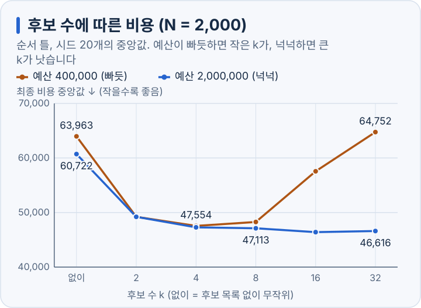
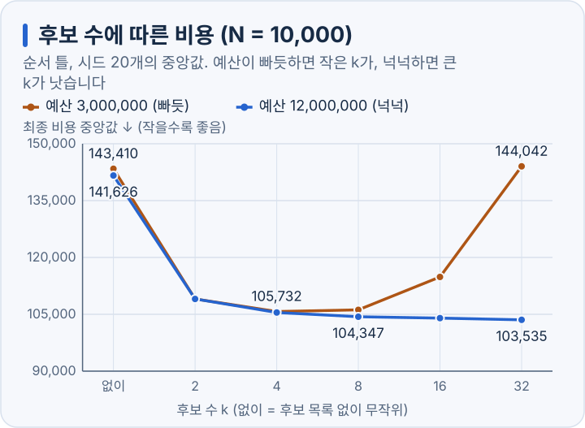
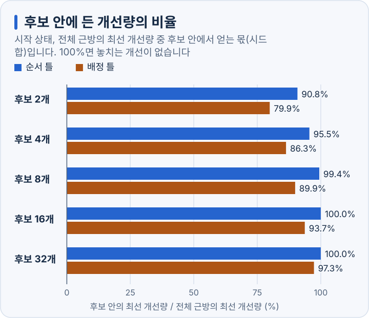
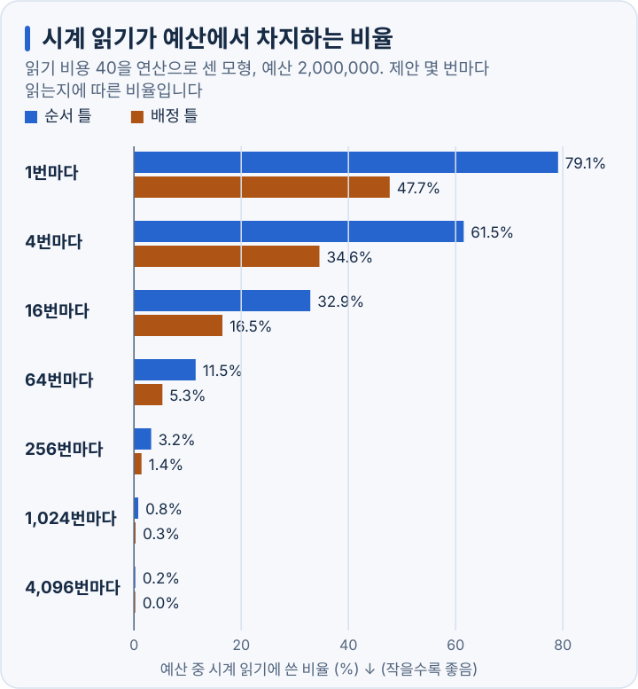

# 실험과 점검: 목록 크기, 놓치는 이동, 단계 배분, 시계

[구현](implementation.md)의 코드를 연습용 문제 틀(순서 `N = 2,000`·`10,000`, 배정 `N = 2,000, M = 200, K = 14`, 정의는 [원리](idea.md))에서 시드 1~20으로 돌린 결과입니다. 모든 표는 `scripts/check_candidate_and_time_budget.py`가 다시 계산해 `lesson-assets/measurements.json`과 이 본문에 대조합니다. 이 강의는 시간(ms)을 싣지 않으며, 표의 수치는 모두 연산 횟수와 비용입니다.

## 측정 방법

- **연산 수:** 제안 한 번에 1, 점수식의 항 하나에 1, 해 배열의 원소 쓰기에 1(순서 틀은 `p`와 `pos`를 함께)입니다. 후보 목록 만들기는 예산에 **포함**하고 시작 비용을 구하는 계산은 보고용이라 뺍니다.

:::hint 칸·목록 만들기의 연산 세기
칸 정렬은 점마다 2와 칸마다 1, 칸 방문 1, 후보 거리 계산 1, 후보 목록의 원소를 밀 때마다 1입니다.
:::
- **예산:** 순서 틀 `N = 2,000`은 400,000(빠듯)과 2,000,000(넉넉), `N = 10,000`은 3,000,000(빠듯)과 12,000,000(넉넉), 배정 틀은 2,000,000입니다. 탐색은 모두 "좋아질 때만 받는" 방식이고 온도나 재시작은 없습니다.
- **요약:** 표의 비용은 시드 20개의 최종 비용 중 10번째로 작은 값(이하 중앙값)입니다. 두 설정의 비교는 같은 시드끼리 짝지어 "앞이 나은 시드 / 뒤가 나은 시드"를 셉니다.
- **판정:** 한쪽이 20개 중 15개 이상에서 나으면(부호 검정의 양쪽 유의확률 0.041) 차이가 있다고 쓰고, 아니면 "결정 못 함"이라고 씁니다. 이 판정은 이 입력 가족(위 정의의 난수 입력)과 이 예산에 한정됩니다.
- **시계 모형:** 시계를 한 번 읽는 비용은 연산 40개로 가정한 모형입니다. 실제 값은 환경마다 다르며 아래 "자기 환경에서 재는 방법"으로 정합니다.

## 예산이 어디에 쓰이는가

[예산표](idea.md)의 어림이 맞는지 봅니다. 후보 8개(배정 틀은 4개)로 넉넉한 예산을 다 쓴 실행의 연산을 세 종류로 나눈 중앙값입니다. 열마다 중앙값이라 합이 총 연산과 조금 다를 수 있습니다.

| 틀 | 후보 수 | 총 연산 | 목록·초기해 | 제안과 항 계산 | 원소 쓰기 | 제안 한 번당 연산 |
| --- | ---: | ---: | ---: | ---: | ---: | ---: |
| 순서 틀 N = 2,000 | 8 | 2,000,002 | 192,350 | 1,729,117 | 74,756 | 4.05 |
| 순서 틀 N = 10,000 | 8 | 12,000,002 | 991,508 | 9,772,426 | 1,232,616 | 4.05 |
| 배정 틀 N = 2,000 | 4 | 2,000,002 | 902,000 | 1,095,697 | 2,303 | 5.74 |

- 순서 틀 `N = 10,000`에서는 목록·초기해가 8.3%, 원소 쓰기가 10.3%를 차지합니다. 평가만 세면 제안 한 번당 4.05연산(예산표의 상한 5보다 작은 것은 이미 이웃이어서 평가 없이 걸러지는 제안이 있기 때문으로 보입니다)이라, 쓰기를 빼먹으면 예산을 1할 넘게 잘못 셉니다.
- 배정 틀은 후보 목록이 총 연산의 45.1%입니다. 제안 한 번당 5.74연산(상한 7)이고 원소 쓰기는 거의 없습니다.

### 이웃 목록을 만드는 연산

후보 8개의 목록을 전수로 만들 때와 칸으로 만들 때의 연산입니다(목록 만들기만, 칸 나누기와 초기해는 뺌). `N = 2,000`은 시드 20개의 중앙값이고 `N = 10,000`의 전수는 시드 1 한 번만 쟀습니다.

| 점 수 | 칸 한 변(칸 수) | 전수 | 칸 탐색 |
| ---: | --- | ---: | ---: |
| 2,000 | 31 (33 × 33) | 4,328,963 | 185,261 |
| 10,000 | 14 (72 × 72) | 102,104,248 | 956,324 |

`N = 2,000`의 전수 목록은 연산 4,328,963으로 넉넉한 예산 2,000,000의 2.2배라서, 목록을 전수로 만들면 탐색을 시작하기 전에 예산이 끝납니다. 같은 조건에서 시드 20개를 돌려도 비용이 시작 비용 그대로입니다.

| 설정 | 비용 | 기준(칸으로 만든 목록, 후보 8개)보다 나은 / 못한 시드 | 판정 | 제안 수 | 목록 연산 |
| --- | ---: | ---: | --- | ---: | ---: |
| 8, 전수로 만든 목록 | 64,752 | 0 / 20 | 더 나쁨 | 0 | 4,336,052 |

:::hint 칸 한 변과 목록 만들기 연산
칸 한 변은 목록 만들기 연산을 정합니다. `N = 10,000`, 후보 8개에서 한 변을 바꿔 시드 20개의 중앙값을 본 값입니다(칸 나누기와 초기해 포함). 칸이 너무 작으면 빈 칸을 훑는 데 연산이 늘고, 너무 크면 한 칸 안의 점이 늘어 전수에 가까워집니다.

| 칸 한 변 | 칸 수 | 칸당 평균 점 수 | 목록·초기해 연산 |
| ---: | --- | ---: | ---: |
| 5 | 200 × 200 | 0.2 | 1,354,648 |
| 10 | 100 × 100 | 1.0 | 891,191 |
| 14 | 72 × 72 | 1.9 | 991,508 |
| 30 | 34 × 34 | 8.7 | 1,227,394 |
| 60 | 17 × 17 | 34.6 | 3,655,521 |
| 125 | 8 × 8 | 156.2 | 12,870,388 |
| 250 | 4 × 4 | 625.0 | 40,439,278 |

한 변 10~14(칸당 점 1~2개)가 가장 쌌습니다. 한 변을 1,000으로 하면 칸이 하나가 되어 전수와 같아집니다(위 `N = 10,000`의 전수 102,104,248). 이 최솟값의 위치는 이 입력의 점 밀도에서 잰 것이며, 점이 한쪽에 몰린 입력에서는 칸당 점 수가 크게 달라져 이 표를 옮길 수 없습니다.
:::

## 후보 수별 같은 예산 비교

후보 수 `k`(이웃 목록의 길이, 배정 틀은 후보 기계 수)를 바꿔 같은 연산 예산에서 비교합니다. "목록 없이"는 후보 없이 무작위 이동을 고르는 방식입니다. 기준은 `k = 8`이고 목록 만들기는 칸 탐색이며 예산에 포함됩니다.

순서 틀 `N = 2,000`, 예산 400,000(빠듯):

| 후보 수 | 비용 | 기준보다 나은 / 못한 시드 | 판정 | 제안 수 | 목록 연산 |
| --- | ---: | ---: | --- | ---: | ---: |
| 목록 없이 | 63,963 | 0 / 20 | 더 나쁨 | 78,424 | 7,089 |
| 2 | 49,209 | 1 / 19 | 더 나쁨 | 107,186 | 68,315 |
| 4 | 47,554 | 20 / 0 | 더 좋음 | 64,984 | 109,627 |
| 8 | 48,268 | - | 기준 | 35,692 | 192,350 |
| 16 | 57,565 | 0 / 20 | 더 나쁨 | 6,974 | 350,860 |
| 32 | 64,752 | 0 / 20 | 더 나쁨 | 0 | 776,045 |

순서 틀 `N = 2,000`, 예산 2,000,000(넉넉):

| 후보 수 | 비용 | 기준보다 나은 / 못한 시드 | 판정 | 제안 수 | 목록 연산 |
| --- | ---: | ---: | --- | ---: | ---: |
| 목록 없이 | 60,722 | 0 / 20 | 더 나쁨 | 397,324 | 7,089 |
| 2 | 49,209 | 0 / 20 | 더 나쁨 | 748,154 | 68,315 |
| 4 | 47,286 | 6 / 14 | 결정 못 함 | 538,604 | 109,627 |
| 8 | 47,113 | - | 기준 | 426,326 | 192,350 |
| 16 | 46,407 | 17 / 3 | 더 좋음 | 347,690 | 350,860 |
| 32 | 46,616 | 16 / 4 | 더 좋음 | 239,151 | 776,045 |



[그림 크게 보기](https://git.readiz.com/h-contest-lesson/lessons/candidate-and-time-budget/lesson-assets/k-vs-cost-2000.svg)

순서 틀 `N = 10,000`, 예산 3,000,000(빠듯):

| 후보 수 | 비용 | 기준보다 나은 / 못한 시드 | 판정 | 제안 수 | 목록 연산 |
| --- | ---: | ---: | --- | ---: | ---: |
| 목록 없이 | 143,410 | 0 / 20 | 더 나쁨 | 592,485 | 35,184 |
| 2 | 109,059 | 0 / 20 | 더 나쁨 | 655,823 | 344,557 |
| 4 | 105,732 | 15 / 5 | 더 좋음 | 388,177 | 545,250 |
| 8 | 106,174 | - | 기준 | 231,830 | 991,508 |
| 16 | 114,852 | 0 / 20 | 더 나쁨 | 116,715 | 1,785,203 |
| 32 | 144,042 | 0 / 20 | 더 나쁨 | 0 | 4,000,780 |

순서 틀 `N = 10,000`, 예산 12,000,000(넉넉):

| 후보 수 | 비용 | 기준보다 나은 / 못한 시드 | 판정 | 제안 수 | 목록 연산 |
| --- | ---: | ---: | --- | ---: | ---: |
| 목록 없이 | 141,626 | 0 / 20 | 더 나쁨 | 2,389,616 | 35,184 |
| 2 | 109,059 | 0 / 20 | 더 나쁨 | 4,230,065 | 344,557 |
| 4 | 105,482 | 0 / 20 | 더 나쁨 | 3,051,440 | 545,250 |
| 8 | 104,347 | - | 기준 | 2,407,720 | 991,508 |
| 16 | 104,001 | 15 / 5 | 더 좋음 | 1,978,372 | 1,785,203 |
| 32 | 103,535 | 18 / 2 | 더 좋음 | 1,395,216 | 4,000,780 |



[그림 크게 보기](https://git.readiz.com/h-contest-lesson/lessons/candidate-and-time-budget/lesson-assets/k-vs-cost-10000.svg)

배정 틀 `N = 2,000`, 예산 2,000,000:

| 후보 수 | 비용 | 기준보다 나은 / 못한 시드 | 판정 | 제안 수 | 목록 연산 |
| --- | ---: | ---: | --- | ---: | ---: |
| 목록 없이 | 530,225 | 0 / 20 | 더 나쁨 | 294,731 | 0 |
| 2 | 523,800 | 1 / 19 | 더 나쁨 | 240,970 | 902,000 |
| 4 | 521,866 | 19 / 1 | 더 좋음 | 190,585 | 902,000 |
| 8 | 522,149 | - | 기준 | 176,884 | 902,000 |
| 16 | 524,121 | 1 / 19 | 더 나쁨 | 170,016 | 902,000 |
| 32 | 525,487 | 0 / 20 | 더 나쁨 | 165,161 | 902,000 |

- **목록 없이는 모든 설정에서 졌습니다.** 순서 틀 네 설정과 배정 틀에서 기준(`k = 8`)보다 나은 시드가 0개였습니다. 제안 수는 비슷한데도(`N = 10,000`, 예산 12,000,000에서 2,389,616개와 `k = 8`의 2,407,720개) 비용이 시작 비용에서 거의 줄지 않습니다. 근방이 큰 문제에서 후보 없이 무작위로 고르면 제안이 좋아지는 이동에 닿지 못합니다.
- **너무 작은 목록도 졌습니다.** `k = 2`는 순서 틀 네 설정에서 모두 기준보다 나쁜 쪽으로 판정되었습니다(1 / 19, 0 / 20, 0 / 20, 0 / 20). 후보가 모자라 좋은 이동을 못 찾는 것이며 이 놓침은 아래 "놓치는 이동"에서 잽니다.
- **가장 좋은 `k`는 예산에 따라 달랐습니다.** 예산이 빠듯하면(`N = 2,000`의 400,000, `N = 10,000`의 3,000,000) `k = 4`가 `k = 8`보다 좋았고(20 / 0, 15 / 5) `k = 16`은 0 / 20으로 졌습니다. `k = 32`는 목록 만들기(776,045, 4,000,780)가 예산보다 커서 탐색을 시작도 못 했습니다. 예산이 넉넉하면 순위가 뒤집혀 `k = 16`과 `k = 32`가 `k = 8`보다 좋았고(17 / 3, 16 / 4와 15 / 5, 18 / 2) `k = 4`는 `N = 2,000`에서 결정 못 함(6 / 14), `N = 10,000`에서 더 나쁨(0 / 20)이었습니다.
- **경험 법칙과 비교:** 이웃 목록은 8개 안팎에서 시작하는 것이 경험 법칙으로 알려져 있습니다. 이 실험은 예산이 빠듯할 때는 4~8이 맞았다는 점에서 지지하고, 예산이 넉넉하면 16~32가 더 좋았다는 점에서 지지하지 않습니다. 후보 수는 고정 상수로 두지 말고 예산과 함께 정합니다.
- **배정 틀:** `k = 4`가 `k = 8`보다 19 / 1로 좋았고 `k = 2`, `16`, `32`는 `k = 8`보다 나빴습니다. 좋은 후보 수가 틀마다 다릅니다.

배정 틀은 후보 기계 목록을 만드는 연산이 902,000이라 예산이 작으면 목록 자체가 부담입니다. 예산 1,000,000에서 목록이 예산의 90%인데도 목록 없이 무작위 기계를 고르는 방식을 이겼는지 봅니다(`k = 4`와 비교, 나은 / 못한 시드).

| 연산 예산 | 목록 없이 | 후보 기계 4대 | 목록이 나은 / 못한 시드 | 판정 |
| ---: | ---: | ---: | ---: | --- |
| 1,000,000 | 531,194 | 523,417 | 20 / 0 | 더 좋음 |
| 2,000,000 | 530,225 | 521,866 | 20 / 0 | 더 좋음 |

두 예산 모두 목록이 20개 시드 전부에서 더 좋았습니다. 이 틀에서는 후보 없이 무작위 기계를 고르는 방식의 개선이 너무 느려서, 예산의 대부분을 목록에 써도 목록이 이겼습니다. 다른 입력에서는 순위가 달라질 수 있으므로 예산표로 목록 만들기의 비중을 먼저 확인합니다.

## 놓치는 이동

후보를 줄여서 놓치는 이동을 잽니다(`N = 2,000`의 순서 틀, 후보 목록을 32개로 만들어 앞쪽 `k`개를 후보로 봄). 두 상태에서 근방 전체를 열거합니다. "시작"은 초기해이고 "후보 8개의 지역 최적"은 `k = 8`로 한 번 훑어도 개선이 없을 때까지 돌린 해입니다. 같은 이동 가족 전체(구간 뒤집기 2,000 × 1,999 / 2개)에서 가장 좋은 변화량을 구하고 후보 안의 가장 좋은 변화량과 비교합니다. "최선이 후보 안"은 두 값이 같은 시드의 수(개선 이동이 있는 시드 가운데), "개선량 비율"은 후보 안 최선 개선량의 합을 전체 최선 개선량의 합으로 나눈 값입니다.

| 상태 | 후보 수 | 최선 이동이 후보 안(시드) | 개선량 비율 |
| --- | ---: | ---: | ---: |
| 시작 | 2 | 11 / 20 | 90.8% |
| 시작 | 4 | 15 / 20 | 95.5% |
| 시작 | 8 | 19 / 20 | 99.4% |
| 시작 | 16 | 20 / 20 | 100.0% |
| 시작 | 32 | 20 / 20 | 100.0% |
| 후보 8개의 지역 최적 | 16 | 17 / 19 | 96.6% |
| 후보 8개의 지역 최적 | 32 | 19 / 19 | 100.0% |

후보 8개의 지역 최적에서는 `k ≤ 8` 후보 안에 개선 이동이 하나도 없는 것이 정의라 표에서 뺐습니다. 아래 표는 전체 근방의 개선 이동 수(중앙값)와 그중 후보 8개 안의 수입니다.

| 상태 | 전체 근방의 개선 이동 수 | 그중 후보 8개 안 | 개선 이동이 있는 시드 |
| --- | ---: | ---: | ---: |
| 시작 | 1,213 | 1,157 | 20 / 20 |
| 후보 8개의 지역 최적 | 3 | 0 | 19 / 20 |

- 시작 상태에서 최선 이동이 후보 `k = 2` 안에 있는 시드는 20개 중 11개, `k = 8`은 19개, `k = 16`부터 20개 모두입니다. 개선 이동 수는 중앙값 1,213개이고 후보 8개 안에는 1,157개입니다. 개선 이동 대부분이 후보 안에 있지만 "최선"은 후보 수가 작을수록 놓칩니다.
- 후보 8개의 지역 최적에 닿은 해에서도 20개 시드 중 19개에 전체 근방의 개선 이동이 남아 있었고 중앙값은 3개였습니다. "후보 안에서 더 나아지지 않는다"는 근방 전체의 지역 최적이 아닙니다.

배정 틀 `N = 2,000`(후보 기계 목록 32대까지, 전체 근방은 모든 작업의 가능한 옮기기)입니다.

| 상태 | 후보 수 | 최선 이동이 후보 안(시드) | 개선량 비율 |
| --- | ---: | ---: | ---: |
| 시작 | 2 | 1 / 20 | 79.9% |
| 시작 | 4 | 1 / 20 | 86.3% |
| 시작 | 8 | 2 / 20 | 89.9% |
| 시작 | 16 | 7 / 20 | 93.7% |
| 시작 | 32 | 9 / 20 | 97.3% |
| 후보 8개의 지역 최적 | 16 | 5 / 5 | 100.0% |
| 후보 8개의 지역 최적 | 32 | 5 / 5 | 100.0% |

| 상태 | 전체 근방의 개선 이동 수 | 그중 후보 8개 안 | 개선 이동이 있는 시드 |
| --- | ---: | ---: | ---: |
| 시작 | 140,437 | 7,500 | 20 / 20 |
| 후보 8개의 지역 최적 | 0 | 0 | 5 / 20 |



[그림 크게 보기](https://git.readiz.com/h-contest-lesson/lessons/candidate-and-time-budget/lesson-assets/miss-share.svg)

배정 틀의 싼 기계 목록은 최선 이동을 자주 놓칩니다. 시작 상태에서 최선 이동이 후보 안에 있는 시드가 `k = 2`와 `k = 4`에서 20개 중 1개씩이고, `k = 32`도 9개뿐입니다. 개선량 비율은 `k = 4`에서 86.3%로 높은 편이어서, 최선 이동을 놓쳐도 후보 안의 다음 이동이 비슷한 개선을 줍니다. 한편 후보 8개의 지역 최적에서는 20개 시드 중 5개에만 개선 이동이 남아 있었고 그 5개에서 `k = 16`과 `k = 32`는 최선 이동을 모두 포함했습니다. 앞의 비용 비교에서 `k = 4`가 `k = 8`보다 좋았던 이유는 이 실험으로는 설명하지 못했습니다.

## 단계 배분과 남은 비율

예산 2,000,000에서 단계를 나누거나 후보 수를 남은 비율로 바꾸는 계획을 비교합니다. 모든 계획이 같은 후보 목록(16개, 칸 탐색)을 쓰므로 목록 연산은 같고, 계획마다 탐색 단계에서 쓰는 후보 수와 마무리만 다릅니다. "마무리 10%"는 예산의 10%(200,000)를 남겨 두었다가 모든 항목의 앞쪽 16개 후보를 한 번 훑는 단계입니다. 기준은 `고정 8`이고, 오른쪽 두 열은 `고정 16`과 비교한 값입니다.

순서 틀 `N = 2,000`:

| 계획 | 비용 | 고정 8보다 나은 / 못한 시드 | 판정 | 고정 16보다 나은 / 못한 시드 | 판정 |
| --- | ---: | ---: | --- | ---: | --- |
| 고정 8 | 47,113 | - | 기준 | 3 / 17 | 더 나쁨 |
| 고정 16 | 46,407 | 17 / 3 | 더 좋음 | - | 기준 |
| 넓게 시작 16 → 4 | 46,438 | 14 / 6 | 결정 못 함 | 8 / 12 | 결정 못 함 |
| 좁게 시작 4 → 16 | 46,566 | 16 / 4 | 더 좋음 | 8 / 12 | 결정 못 함 |
| 고정 8 + 마무리 10% | 46,991 | 17 / 0 | 더 좋음 | 4 / 16 | 더 나쁨 |

배정 틀 `N = 2,000`:

| 계획 | 비용 | 고정 8보다 나은 / 못한 시드 | 판정 | 고정 16보다 나은 / 못한 시드 | 판정 |
| --- | ---: | ---: | --- | ---: | --- |
| 고정 8 | 522,149 | - | 기준 | 19 / 1 | 더 좋음 |
| 고정 16 | 524,121 | 1 / 19 | 더 나쁨 | - | 기준 |
| 넓게 시작 16 → 4 | 523,790 | 1 / 19 | 더 나쁨 | 13 / 7 | 결정 못 함 |
| 좁게 시작 4 → 16 | 523,030 | 14 / 6 | 결정 못 함 | 20 / 0 | 더 좋음 |
| 고정 8 + 마무리 10% | 522,147 | 7 / 1 | 결정 못 함 | 19 / 1 | 더 좋음 |

- 순서 틀에서 `고정 16`이 `고정 8`보다 좋았습니다(17 / 3). 마무리 단계를 붙인 `고정 8 + 마무리 10%`도 `고정 8`보다 좋았지만(17 / 0) `고정 16`보다는 나빴습니다(4 / 16). 마무리의 이득은 후보를 16개로 훑은 데서 오는 것으로 보이며, 처음부터 16으로 고정하는 것을 넘지 못했습니다.
- 후보 수를 남은 비율로 바꾸는 두 계획(`16 → 4`, `4 → 16`)은 `고정 16`과 결정 못 함(8 / 12 두 개)이었습니다. 이 실험은 후보 수를 시간에 따라 바꾸는 것이 알맞은 후보 수로 고정하는 것보다 낫다는 근거를 주지 않습니다. 비슷하다는 것만 말할 수 있습니다.
- 배정 틀에서는 `고정 16`과 `16 → 4`가 `고정 8`보다 나빴고(1 / 19) `4 → 16`과 마무리를 붙인 계획은 `고정 8`과 결정 못 함(14 / 6, 7 / 1)이었습니다. 후보 수가 큰 쪽이 나쁜 틀에서는 후보를 넓게 시작하는 계획이 이득이 없습니다.

따라서 이 강의가 남기는 것은 "단계 배분이 이긴다"가 아니라 "단계 배분의 틀(마무리 예산을 먼저 빼고, 값을 남은 비율에 묶고, 방향을 검사한다)과 그것을 같은 시드로 짝지어 비교하는 방법"입니다. 이 입력에서 계획의 차이보다 후보 수 자체의 영향이 더 컸습니다.

## 예산과 품질

후보 8개(배정 틀 4개)로 예산을 2배씩 늘렸을 때 비용의 중앙값입니다. 세 번째 열은 직전 예산보다 줄어든 비용(중앙값 사이의 차)입니다.

순서 틀 `N = 2,000`:

| 연산 예산 | 비용 | 직전보다 줄어든 비용 |
| ---: | ---: | ---: |
| 250,000 | 55,110 | - |
| 500,000 | 47,456 | 7,654 |
| 1,000,000 | 47,113 | 343 |
| 2,000,000 | 47,113 | 0 |
| 4,000,000 | 47,113 | 0 |
| 8,000,000 | 47,113 | 0 |

순서 틀 `N = 10,000`:

| 연산 예산 | 비용 | 직전보다 줄어든 비용 |
| ---: | ---: | ---: |
| 1,500,000 | 122,476 | - |
| 3,000,000 | 106,174 | 16,302 |
| 6,000,000 | 104,347 | 1,827 |
| 12,000,000 | 104,347 | 0 |
| 24,000,000 | 104,347 | 0 |

배정 틀 `N = 2,000`:

| 연산 예산 | 비용 | 직전보다 줄어든 비용 |
| ---: | ---: | ---: |
| 1,000,000 | 523,417 | - |
| 2,000,000 | 521,866 | 1,551 |
| 4,000,000 | 521,866 | 0 |
| 8,000,000 | 521,866 | 0 |

두 순서 틀에서 줄어든 비용은 2배마다 급격히 작아져서 `N = 10,000`은 16,302, 1,827, 0으로, `N = 2,000`은 7,654, 343, 0으로 내려갔고 그 뒤로는 바뀌지 않았습니다. 중앙값이 같아진 것은 후보 8개의 근방에서 더 내려갈 곳이 없다는 뜻으로 보이며(앞의 "놓치는 이동"의 후보 8개 지역 최적), 곡선이 천천히 평평해진 것이 아니라 지역 최적에서 끊긴 것으로 보입니다. 배정 틀도 2,000,000에서 멈췄습니다.

이 모양은 이 입력 가족의 후보 8개 근방에서의 관찰이며 일반 법칙이 아닙니다. 지역 최적에 닿은 뒤의 예산은 후보를 넓히는 일(앞의 목록 크기 표에서 넉넉한 예산일수록 큰 `k`가 좋았던 것)이나 다른 수단([언덕 오르기와 담금질](https://h.readiz.com/learn/hill-climbing-and-annealing), [크게 부수고 다시 짓기](https://h.readiz.com/learn/destroy-and-repair))에 써야 쓸모가 있습니다.

## 시계를 읽는 간격

시계를 한 번 읽는 비용을 연산 40개로 가정한 모형에서, 읽는 간격(제안 몇 번마다 읽는가)을 바꿔 예산 2,000,000을 돌린 결과입니다. "시계 비중"은 시계 읽기에 쓴 연산이 예산에서 차지하는 비율, "상한 넘은 양"은 끝난 뒤 `ops − limit`의 시드 20개 중 최댓값입니다.

순서 틀 `N = 2,000`, 후보 8개:

| 읽기 간격 | 시계 읽은 횟수 | 시계 비중 | 제안 수 | 비용 | 상한 넘은 양 |
| ---: | ---: | ---: | ---: | ---: | ---: |
| 1 | 39,554 | 79.1% | 39,553 | 48,090 | 41 |
| 4 | 30,792 | 61.5% | 123,164 | 47,113 | 59 |
| 16 | 16,483 | 32.9% | 263,712 | 47,113 | 100 |
| 64 | 5,774 | 11.5% | 369,472 | 47,113 | 288 |
| 256 | 1,605 | 3.2% | 410,624 | 47,113 | 959 |
| 1,024 | 414 | 0.8% | 422,912 | 47,113 | 4,008 |
| 4,096 | 105 | 0.2% | 425,984 | 47,113 | 16,575 |

배정 틀 `N = 2,000`, 후보 기계 4개:

| 읽기 간격 | 시계 읽은 횟수 | 시계 비중 | 제안 수 | 비용 | 상한 넘은 양 |
| ---: | ---: | ---: | ---: | ---: | ---: |
| 1 | 23,853 | 47.7% | 23,852 | 522,437 | 39 |
| 4 | 17,323 | 34.6% | 69,288 | 521,868 | 67 |
| 16 | 8,288 | 16.5% | 132,592 | 521,866 | 120 |
| 64 | 2,687 | 5.3% | 171,904 | 521,866 | 401 |
| 256 | 726 | 1.4% | 185,600 | 521,866 | 1,524 |
| 1,024 | 186 | 0.3% | 189,440 | 521,866 | 5,489 |
| 4,096 | 48 | 0.0% | 192,512 | 521,866 | 23,887 |



[그림 크게 보기](https://git.readiz.com/h-contest-lesson/lessons/candidate-and-time-budget/lesson-assets/clock-share.svg)

- 매 제안 읽으면 시계가 예산의 79.1%(순서 틀)와 47.7%(배정 틀)를 먹어 제안 수가 39,553과 23,852로 줄고 비용이 나빠졌습니다. 간격을 64로 하면 시계 비중이 11.5%와 5.3%가 되고 256에서 3.2%와 1.4%, 1,024에서 0.8%와 0.3%가 됩니다.
- 비용은 순서 틀에서 간격 1에서만 나빴고(48,090, 나머지 47,113), 배정 틀에서 간격 1과 4에서만 나빴습니다(522,437, 521,868, 나머지 521,866). 이 예산은 후보 근방의 지역 최적에 닿을 만큼 넉넉해서 제안 수가 줄어도 같은 곳에 닿기 때문이며, 더 빠듯한 예산에서는 제안 수의 차이가 비용으로 이어질 수 있습니다.
- 상한 넘은 양은 간격에 거의 비례해 커졌습니다(순서 틀 4,096에서 16,575, 배정 틀 23,887). 최댓값을 간격으로 나누면 4.0과 5.8로 제안 한 번의 평균 연산(4.05, 5.74)에 가깝습니다. 최악의 경우는 간격 × 제안 한 번의 최대 연산이며, 구간 뒤집기는 최대가 구간 길이만큼 커서 간격이 작을 때 두드러집니다.
- 간격을 고를 때는 두 식을 모두 봅니다. 시계 비중 ≈ `읽기 비용 / (간격 × 제안당 연산 + 읽기 비용)`이 목표(예: 2% 이하)보다 작아야 하고, 넘침 ≈ `간격 × 제안당 연산`이 허용 안에 들어와야 합니다. 이 모형에서 읽기 비용 40, 제안당 연산 4.05, 목표 2%이면 간격은 약 494 이상이고, 256과 1,024 사이에서 고릅니다.

## 자기 환경에서 재는 방법

> **코드 환경: 일반 C++17.** 이 페이지의 아래 프로그램만 표준 헤더(`<chrono>`, `<cstdio>`)를 씁니다. 위의 제출용 블록 5개(`tb-frame`, `tb-route`, `tb-assign`, `tb-gen`, `tb-run`) 뒤에 이어 붙여 컴파일합니다. `#include`는 파일 맨 위로 옮겨도 됩니다.

이 강의의 표는 연산 수라서 환경과 무관하지만, 연산 하나가 몇 ns인지는 기기와 컴파일러에 따라 다릅니다. 제한 시간을 연산 상한으로 바꾸려면 세 값을 자기 환경에서 재야 합니다.

1. **연산 하나의 시간:** 실제로 쓸 틀을 연산 수 예산으로 돌려 걸린 시간을 `ops`로 나눕니다(제출 환경과 같은 최적화 옵션으로).
2. **시계 한 번 읽는 시간:** 시계 읽기를 많이 반복해 평균을 냅니다. 연산 하나의 시간으로 나누면 `clockCost`(연산 몇 개 분량)가 됩니다.
3. **연산 상한:** `제한 시간 × (연산 하나의 시간)⁻¹ × 안전 계수`. 안전 계수는 채점 환경이 이 환경과 다를 수 있어서 둡니다.

```cpp snippet=tb-timing
#include <chrono>
#include <cstdio>

long long nowNs() {
    return std::chrono::duration_cast<std::chrono::nanoseconds>(std::chrono::steady_clock::now().time_since_epoch()).count();
}

// climbPlan의 시계 버전: 연산 수 대신 시각으로 멈추고, 후보 수를 정하는 남은 비율도 시각으로 계산한다.
// 마무리 단계가 없는 가장 짧은 형태이며, 바뀐 곳은 시계를 읽는 줄과 멈추는 줄 둘뿐이다.
template <class P>
long long climbTimed(P& p, hc::Random& rng, long long cost, long long endNs, int every, int kFirst, int kLast) {
    const long long begin = nowNs();
    int k = kFirst, since = every;
    while (true) {
        if (++since >= every) {
            since = 0; ++p.reads;
            const long long now = nowNs();                  // 시계는 여기서만 읽는다
            if (now >= endNs) break;
            k = byRemaining(kFirst, kLast, endNs - now, endNs - begin);
        }
        ++p.ops; ++p.props;
        Move mv;
        if (!proposeCand(p, rng, k, mv)) continue;
        const long long d = p.delta(mv);
        if (d < 0) { p.apply(mv); cost += d; }
    }
    return cost;
}

int main() {
    // 1) 연산 하나가 걸리는 시간: 실제로 쓸 틀(여기서는 N = 2000, 목록 8개)을 연산 수 예산으로 돌려 잰다.
    Plan plan;
    plan.limit = 3000000; plan.finish = 0; plan.every = 64; plan.clockCost = 0; plan.kFirst = plan.kLast = 8; plan.kFinish = 0;
    const long long t0 = nowNs();
    runRoute(1, 2000, 8, true, plan);
    const long long t1 = nowNs();
    const double nsPerOp = (double)(t1 - t0) / (double)route.ops;

    // 2) 시계를 한 번 읽는 데 드는 시간
    long long sink = 0;
    const long long t2 = nowNs();
    for (int i = 0; i < 100000; ++i) sink += nowNs() & 1;
    const long long t3 = nowNs();
    const double nsPerRead = (double)(t3 - t2) / 100000.0;

    // 3) 시간 제한 T ms를 연산 수 예산으로 바꾼다. 안전 계수 0.8은 이 환경과 채점 환경의 차이를 위한 여유다.
    const double limitMs = 2000.0, safety = 0.8;
    printf("연산 하나: %.2f ns\n", nsPerOp);
    printf("시계 한 번 읽기: %.1f ns (연산 %.1f개 분량, 확인값 %lld)\n", nsPerRead, nsPerRead / nsPerOp, sink & 1);
    printf("시간 제한 %.0f ms, 안전 계수 %.1f: 연산 예산 %lld\n", limitMs, safety, (long long)(limitMs * 1e6 * safety / nsPerOp));

    // 4) 시계 버전으로 50 ms 돌린다.
    genRoute(route, 1, 2000);
    route.buildCells(defaultSide(2000)); route.initSnake(); route.buildNbGrid(8);
    const long long saved = route.ops;
    const long long start = route.fullCost();
    route.ops = saved; route.props = route.reads = 0;
    hc::Random rng; rng.reset(1);
    const long long end = climbTimed(route, rng, start, nowNs() + 50000000LL, 64, 8, 8);
    printf("시계 버전 50 ms: 제안 %lld번, 시계 %lld번 읽음, 비용 %lld → %lld\n", route.props, route.reads, start, end);
    return 0;
}
```

출력은 기기마다 다릅니다. 이 강의는 그 값을 싣지 않으며, 검사 스크립트는 이 프로그램이 컴파일되고 실행되어 세 줄의 보정값을 내는지만 확인합니다. 시계 버전 루프 `climbTimed`는 `climbPlan`에서 시계를 읽는 줄과 멈추는 줄 둘만 바꾼 것입니다. 시계의 해상도가 거칠면 최소 간격을 늘리고, 시계 읽기가 막힐 수 있는 환경(시스템 호출이 느린 환경)이면 읽기 비용을 이 프로그램으로 다시 잽니다.

## 흔한 실수와 잡는 검사

아래 실수 가운데 1~3은 본문 코드에 직접 넣어 보고 검사가 잡는지 확인했습니다(`scripts/check_candidate_and_time_budget.py`가 매번 다시 수행). 이 검사들은 결과 개수를 비교하지 않고 "잡혔는가"만 봅니다.

1. **칸 탐색의 종료 조건을 한 겹 일찍 끊음.** `k`번째 거리가 `r * cs` 이하일 때 멈춰야 하는데 `(r + 1) * cs`로 쓰면 링 `r + 1`에 있는 더 가까운 점을 영영 못 봅니다. 탐색은 계속 돌아가고 점수만 조금 나빠집니다. 칸으로 만든 목록을 전수 목록과 점마다 비교하는 검사가 20개 시드에서 모두 잡았습니다. 올바른 코드는 20개 시드와 `N = 10,000`의 시드 1에서 전수 목록과 같았습니다.
2. **후보 이동을 적용하고 `pos`를 갱신하지 않음.** `p`만 바꾸고 위치 역배열을 두면 다음 후보 이동이 낡은 위치로 구간을 계산해 의도하지 않은 이동이 됩니다. 이동은 유효하므로 점수는 맞게 계산되고 탐색 품질만 조용히 나빠집니다. 불변식 `valid()`(순열이고 `pos`가 `p`의 역)를 탐색 뒤에 확인하는 검사가 20개 시드에서 모두 잡았습니다.
3. **남은 비율의 방향이 반대.** 후보 수를 16에서 4로 줄이려는데 `남은 연산` 대신 `지난 연산`을 넘기면 4에서 16으로 늘어납니다. 이동을 만들지 않는 가짜 문제에 루프를 돌려 초반과 종반에 요청된 가장 큰 후보 수를 재면 올바른 코드는 15와 4(초반 5%와 종반 5%), 반대로 쓴 코드는 4와 15입니다.
4. **후보 근방의 지역 최적을 전체 근방의 지역 최적으로 착각.** 후보 안에서 개선이 없다는 것을 "더 이상 좋아질 수 없다"고 보고합니다. 앞의 "놓치는 이동"에서 후보 8개의 지역 최적에도 순서 틀 20개 시드 중 19개에 개선 이동이 남아 있었습니다. 전체 근방을 열거할 수 있는 입력(점 수백 개, 위 표는 2,000개)에서 확인하거나, 지역 최적을 말할 때는 "후보 `k`개 근방의"라고 붙입니다.
5. **예산표에서 항을 빼먹음.** 목록 만들기(`N = 2,000`에서 전수는 예산의 2.2배), 원소 쓰기(`N = 10,000`에서 예산의 10.3%), 시계 읽기(매 제안 읽으면 예산의 79.1%)가 흔한 빠진 항입니다. 계수기를 단계별(목록, 평가, 쓰기, 시계)로 나눠 출력하고 합이 총 연산과 같은지, 예산표의 예측과 같은지 봅니다.

## 다른 문제에 옮길 때 점검 목록

1. 입력 상한에서 근방 전체를 한 번 훑는 연산 수와 이동 하나의 평가·적용 연산(최악 포함)을 셌는가? 예산과 비교해 줄여야 하는지 정했는가? 적용이 구간 길이에 비례하지 않는가?
2. 후보를 줄이는 기준(가까움, 싼 비용)이 좋은 이동을 예측한다는 근거를 작은 입력의 전수에서 확인했는가?
3. 후보 목록을 만드는 연산이 예산의 몇 %인가? 칸·정렬로 만든 목록을 전수로 만든 목록과 대조했는가?
4. 후보 수를 빠듯한 예산과 넉넉한 예산, 두 곳 이상에서 비교했는가? 순위가 바뀌는가?
5. 후보 근방의 지역 최적에서 전체 근방에 개선 이동이 남았는가? 놓치는 정도를 세 가지 재기 중 하나로 쟀는가?
6. 초기해·목록과 마무리의 연산을 미리 계산해 상한에서 먼저 뺐는가? 남은 비율에 묶은 값의 방향을 가짜 문제로 검사했는가?
7. 시계 읽기 간격을 시계 비중과 상한 넘침 두 쪽에서 정했는가? 초당 연산 수와 시계 읽기 비용을 자기 환경에서 쟀는가?
8. 설정 비교는 같은 시드끼리 짝지어 하고 승패 수가 갈리지 않으면 "결정 못 함"으로 두었는가? ([실험과 튜닝](https://h.readiz.com/learn/experiments-and-tuning)에서 이어집니다.)

## 적용 사례

이 강의의 틀이 이 사이트의 문제에서 쓰인 곳입니다. 각 강의는 해당 문제 하나를 끝까지 푸는 방식이라 이 강의와 설명의 순서가 다릅니다.

- [물류 상품 배송 1(COUPANG1)](https://h.readiz.com/learn/large-input-search): 입력 상한에서 연산 수를 먼저 세는 예산표, 좌표 칸으로 가장 가까운 후보를 링으로 넓혀 찾기와 종료 조건의 오답, 남은 시간의 배분.
- [Sqrt Decomposition](https://h.readiz.com/learn/sqrt-decomposition): 칸으로 나눠 질의를 줄이는 발상이 휴리스틱 풀이에서 쓰이는 곳.
- [복잡도와 입력 크기 감각](https://h.readiz.com/learn/complexity-input-size): 시간 제한을 연산 횟수로 바꾸는 거친 기준. 이 강의의 예산표는 그 기준 위에서 이동 단위로 세는 방법입니다.

온도를 남은 비율에 묶는 구체적인 값은 [언덕 오르기와 담금질](https://h.readiz.com/learn/hill-climbing-and-annealing), 더 큰 이동으로 지역 최적을 벗어나는 방법은 [크게 부수고 다시 짓기](https://h.readiz.com/learn/destroy-and-repair), 이 강의가 쓴 짝지은 비교와 "결정 못 함"의 일반론은 [실험과 튜닝](https://h.readiz.com/learn/experiments-and-tuning)으로 이어집니다.

## 로컬 연습

1. 구현 페이지의 `Route`로 후보 `k = 8`, 예산 400,000과 2,000,000을 시드 1~20에서 돌려 이 페이지의 값과 맞춥니다.
2. 칸 탐색의 종료 조건을 `(r + 1) * cs`로 바꿔 `buildNbGrid`가 만드는 목록이 전수 목록과 어느 점에서 처음 달라지는지 찾습니다.
3. 칸 한 변을 5에서 250까지 바꿔 `N = 10,000`의 목록 연산을 재고 표의 값과 맞춥니다. 점을 한 구석에 몰아 뽑은 입력(예: 좌표를 `0..199`로 제한)에서는 최소가 어디로 옮겨 가는지 기록합니다.
4. 후보 수 `k`를 4, 8, 16으로 두고 예산을 1,000,000, 2,000,000, 4,000,000으로 바꿔 어느 `k`가 이기는지 짝지은 비교로 판정합니다.
5. `climbTimed`로 `every`를 바꿔 가며 자기 환경에서 시계 비중과 상한 넘침을 재고, 이 페이지의 모형 표와 모양을 비교합니다.

확인 기준: 칸 목록이 전수 목록과 같고, `valid()`가 참이며, 두 시계 간격에서 `ops − limit`이 간격 × 제안당 최대 연산 이하이고, 표의 모든 비교에 시드 수와 판정(더 좋음·더 나쁨·결정 못 함)이 붙어 있어야 합니다.
