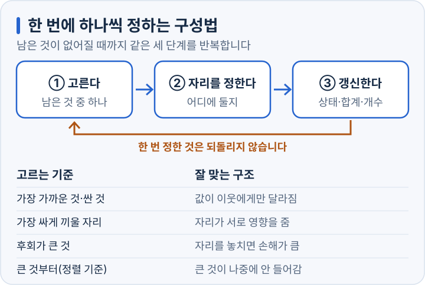
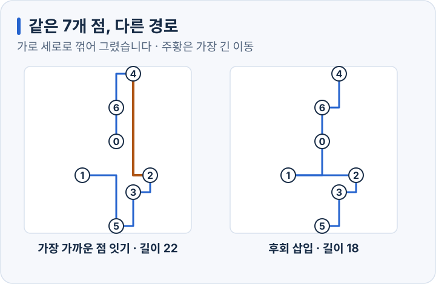
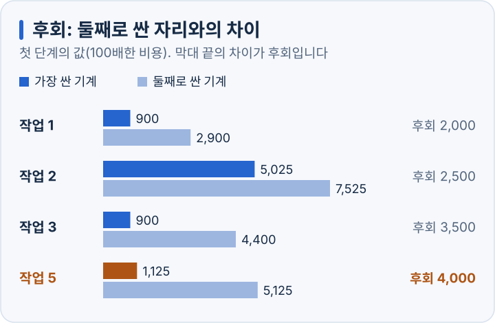

# 원리와 손으로 따라가는 예

## 구성법이 푸는 상황

해가 "항목 여러 개를 어딘가에 놓은 결과"인 문제를 생각합니다. 점을 어떤 순서로 지날지(순서), 작업을 어느 기계에 맡길지(배정)가 그렇습니다. 가능한 해가 너무 많아 모두 볼 수 없지만, 항목을 하나씩 놓아 가면 매 단계의 선택이 작아지고 끝까지 가면 유효한 해가 하나 나옵니다.

구성법의 결과는 최적이라는 보장이 없으므로 개선 탐색의 출발점이나 비교 기준선으로 씁니다. 최적이 되는 조건의 증명은 [그리디 알고리즘](https://h.readiz.com/learn/greedy)에 있고, 이 강의는 증명이 없는 경우를 다룹니다.

## 공통 틀

모든 구성법은 같은 세 단계를 반복합니다.

1. **고른다**: 아직 놓지 않은 것 가운데 이번에 놓을 항목을 정합니다.
2. **자리를 정한다**: 그 항목을 어디에 놓을지 정합니다. 경로라면 끼울 위치, 배정이라면 기계입니다.
3. **갱신한다**: 해와 보조 값(경로 길이, 기계별 부하와 개수, 놓은 항목 표시)을 고칩니다.

한 번 놓은 항목은 되돌리지 않습니다. 다시 놓는 일은 구성 뒤의 개선 탐색이 맡습니다.

그림의 아래 줄은 뒤의 표에서 설명하는 선택 기준과 잘 맞는 구조입니다.

[그림 크게 보기](https://git.readiz.com/h-contest-lesson/lessons/construction-heuristics/lesson-assets/construction-loop.svg)

### 항목마다 자리와 비용을 한 번 요약한다

이 강의의 코드는 1단계와 2단계를 한 함수로 묶습니다. 남은 항목마다 **가장 싼 자리**와 그 비용(`best`), **두 번째로 싼 자리의 비용**(`second`)을 계산해 두고, 그 목록에서 기준에 따라 항목 하나를 고릅니다. (항목, 자리) 하나의 비용을 한 번 계산하는 일을 **평가 한 번**이라 하고, 아래 표와 실험의 평가 횟수는 이 횟수입니다. 자리는 항목마다 이미 정해져 있으므로, 기준을 바꾸는 일은 "목록에서 무엇을 먼저 고르는가"를 바꾸는 일이 됩니다.

## 선택 기준의 종류와 잘 맞는 구조

| 기준 | 먼저 고르는 것 | 잘 맞는 구조 | 약한 구조 | 평가 횟수 |
| --- | --- | --- | --- | --- |
| 가장 가까운 것·싼 것 | `best`가 가장 작은 항목 | 놓을 자리가 끝 하나뿐이거나 앞 선택이 뒤에 영향을 거의 주지 않는 구조 | 마지막에 남은 항목이 흩어져 큰 손해가 한꺼번에 나옴 | 항목 수에 비례 |
| 가장 싸게 끼울 자리 | 모든 (항목, 자리) 쌍 중 가장 싼 쌍 | 이미 놓은 항목 사이에 끼울 수 있는 구조 | 자리 평가가 비싼 구조 | 항목 × 자리 |
| 후회 | `second - best`가 가장 큰 항목 | 자리별 비용 차이가 크고, 자리가 차서 놓치면 손해가 큰 구조 | 자리끼리 거의 같은 비용인 구조 | 위와 같음 |
| 큰 것부터(정렬 기준) | 크기·무게 같은 항목 값이 가장 큰 항목 | 큰 것을 늦게 놓으면 자리가 없거나 균형이 깨지는 구조 | 크기가 결과와 무관한 구조 | 정렬 한 번 |

후회는 "지금 이 항목을 놓지 않으면 다음에 더 비싼 자리로 가야 하는 손해"를 뜻합니다. 항목의 가장 싼 자리가 다른 항목에게 차지당하면 그 항목은 두 번째 자리로 갑니다. 그 차이가 큰 항목을 먼저 놓는 것이 후회 기준입니다. 가장 먼 점 삽입은 큰 것부터의 한 형태로, 항목의 크기를 "이미 놓은 점들 중 가장 가까운 점까지의 거리"로 두고 이 값이 가장 큰 점을 먼저 가장 싼 자리에 끼웁니다.

표의 둘째 행 기준을 순서 틀에서는 **가장 싼 삽입**, 배정 틀에서는 **가장 싼 (작업, 기계) 쌍부터**라고 부릅니다.

## 손으로 따라가기 1: 순서 틀, 점 7개

점 7개가 아래 좌표에 있고, 모든 점을 한 번씩 지나는 열린 경로의 길이(이웃한 점 사이 맨해튼 거리의 합)를 줄이는 문제입니다. 구성법은 모두 점 0에서 시작하고, 동률이면 번호가 작은 점과 자리 번호가 작은 쪽을 먼저 고릅니다.

| 점 | 0 | 1 | 2 | 3 | 4 | 5 | 6 |
| --- | --- | --- | --- | --- | --- | --- | --- |
| (x, y) | (5, 5) | (3, 3) | (7, 3) | (6, 2) | (6, 9) | (5, 0) | (5, 7) |

**가장 가까운 점 잇기(NN)**는 경로의 끝에서 가장 가까운 남은 점을 끝에 붙입니다.

| 단계 | 지금 끝 | 남은 점까지의 거리(점: 거리) | 고른 점 |
| ---: | --- | --- | --- |
| 1 | 점 0 | 1: 4, 2: 4, 3: 4, 4: 5, 5: 5, 6: 2 | 점 6 |
| 2 | 점 6 | 1: 6, 2: 6, 3: 6, 4: 3, 5: 7 | 점 4 |
| 3 | 점 4 | 1: 9, 2: 7, 3: 7, 5: 10 | 점 2 |
| 4 | 점 2 | 1: 4, 3: 2, 5: 5 | 점 3 |
| 5 | 점 3 | 1: 4, 5: 3 | 점 5 |
| 6 | 점 5 | 1: 5 | 점 1 |

경로는 `0 → 6 → 4 → 2 → 3 → 5 → 1`이고 길이는 2 + 3 + 7 + 2 + 3 + 5 = 22입니다. 3단계에서 점 2와 3이 거리 7로 같아 번호가 작은 2를 골랐고, 남은 점이 아래쪽에 몰려 있어 7칸을 한 번에 건넜습니다.

**가장 싼 삽입**은 경로의 어느 자리에든 끼울 수 있습니다. 점 `p`를 `a`와 `b` 사이에 끼울 때 늘어나는 길이는 `거리(a, p) + 거리(p, b) - 거리(a, b)`이고, 맨 앞이나 맨 뒤에는 이웃 하나와의 거리입니다. 늘어나는 길이가 가장 작은 (점, 자리) 쌍을 고릅니다. 자리 번호는 "그 자리 앞"을 뜻합니다.

:::hint 경로에 점이 하나뿐일 때
자리 0(앞)과 자리 1(뒤)의 비용이 같으므로 번호가 작은 0을 씁니다. 아래 표의 1단계가 이 경우입니다.
:::

| 단계 | 끼우기 전 경로 | 고른 점 | 자리 | 늘어난 길이 | 끼운 뒤 경로 |
| ---: | --- | --- | ---: | ---: | --- |
| 1 | 0 | 점 6 | 0 | 2 | 6 0 |
| 2 | 6 0 | 점 4 | 0 | 3 | 4 6 0 |
| 3 | 4 6 0 | 점 1 | 3 | 4 | 4 6 0 1 |
| 4 | 4 6 0 1 | 점 2 | 3 | 4 | 4 6 0 2 1 |
| 5 | 4 6 0 2 1 | 점 3 | 3 | 2 | 4 6 0 3 2 1 |
| 6 | 4 6 0 3 2 1 | 점 5 | 3 | 4 | 4 6 0 5 3 2 1 |

3단계에서 점 1, 2, 3의 비용이 모두 4로 같아 번호가 작은 1을 골랐습니다. **후회 삽입**은 같은 3단계에서 점마다 가장 싼 자리와 두 번째로 싼 자리의 비용 차를 봅니다.

| 남은 점 | 가장 싼 자리 | 가장 싼 비용 | 두 번째로 싼 비용 | 후회 |
| --- | ---: | ---: | ---: | ---: |
| 점 1 | 3 | 4 | 8 | 4 |
| 점 2 | 3 | 4 | 7 | 3 |
| 점 3 | 3 | 4 | 7 | 3 |
| 점 5 | 3 | 5 | 10 | 5 |

후회가 가장 큰 점 5(후회 5)를 자리 3에 먼저 끼웁니다. 점 5가 가장 싼 자리를 놓치면 5만큼 더 늘어나기 때문입니다. 남은 단계도 같은 방식으로 계산하면 아래 결과가 됩니다.

| 구성법 | 경로 | 길이 |
| --- | --- | ---: |
| 가장 가까운 점 잇기 | 0 → 6 → 4 → 2 → 3 → 5 → 1 | 22 |
| 가장 싼 삽입 | 4 → 6 → 0 → 5 → 3 → 2 → 1 | 19 |
| 가장 먼 점 삽입 | 4 → 6 → 0 → 3 → 2 → 1 → 5 | 20 |
| 후회 삽입 | 4 → 6 → 0 → 1 → 2 → 3 → 5 | 18 |

7! = 5,040개 순열을 모두 계산한 최단 길이는 18이므로 후회 삽입이 최적과 같습니다. 한 예로 후회가 항상 최적이라고 말할 수는 없으며, 200개 점으로 키운 비교는 [실험 페이지](practice.md)에 있습니다. 아래 그림에서 왼쪽 경로의 주황색 긴 이동(4번 점에서 2번 점)이 NN이 남긴 손해이고, 오른쪽 경로에는 그런 이동이 없습니다.

[그림 크게 보기](https://git.readiz.com/h-contest-lesson/lessons/construction-heuristics/lesson-assets/hand-path.svg)

[선택 기준에 따라 경로를 한 점씩 만들기](https://git.readiz.com/h-contest-lesson/demos/index.html?demo=construction-steps)

## 손으로 따라가기 2: 배정 틀, 작업 6개

작업 6개를 기계 2대에 맡기고 한 기계에는 3개까지만 맡길 수 있습니다(`K = 3`이라 6개를 놓으면 빈 자리가 없습니다). 비용은 `(기계별 부하의 제곱 합) / 100 + (추가 비용의 합)`이고 합에 대해 정수 나눗셈을 한 번 합니다. 부하는 기계에 맡긴 작업 길이의 합입니다.

| 작업 | 길이 d | 추가 비용 c[기계 0] | 추가 비용 c[기계 1] |
| ---: | ---: | ---: | ---: |
| 0 | 10 | 10 | 10 |
| 1 | 20 | 5 | 25 |
| 2 | 55 | 20 | 45 |
| 3 | 20 | 40 | 5 |
| 4 | 10 | 35 | 35 |
| 5 | 25 | 5 | 45 |

기계 `m`의 부하가 `L`일 때 작업 `j`를 더하면 부하 제곱이 `(L + d)² - L² = (2L + d) × d`만큼 늘어납니다. 구성 중에는 정수로 비교하려고 이 값에 `100 × c`를 더한 **100배 값**을 씁니다. 첫 단계는 부하가 0이라 `d² + 100 × c`입니다.

| 작업 | 길이 | 기계 0에 둘 때(100배) | 기계 1에 둘 때(100배) | 가장 싼 값 | 두 값의 차(후회) |
| ---: | ---: | ---: | ---: | ---: | ---: |
| 0 | 10 | 1,100 | 1,100 | 1,100 | 0 |
| 1 | 20 | 900 | 2,900 | 900 | 2,000 |
| 2 | 55 | 5,025 | 7,525 | 5,025 | 2,500 |
| 3 | 20 | 4,400 | 900 | 900 | 3,500 |
| 4 | 10 | 3,600 | 3,600 | 3,600 | 0 |
| 5 | 25 | 1,125 | 5,125 | 1,125 | 4,000 |

아래 그림은 이 표의 작업 1, 2, 3, 5를 막대로 그린 것입니다. 막대 끝의 차이가 후회이고, 차이가 가장 큰 작업 5가 먼저 뽑힙니다.

[그림 크게 보기](https://git.readiz.com/h-contest-lesson/lessons/construction-heuristics/lesson-assets/regret-gap.svg)

"가장 싼 (작업, 기계) 쌍"은 작업 1의 900(동률인 작업 3의 900보다 번호가 작음)부터 고르고, "큰 것부터"는 길이 55인 작업 2부터, 후회 기준은 차이가 가장 큰 작업 5(4,000)부터 고릅니다. "번호 순서대로"는 작업 0, 1, 2, … 순으로 각각 그때 가장 싼 기계에 놓은 기준선입니다. 완성된 해는 아래와 같습니다.

| 기준 | 작업 0~5의 기계 | 부하 (기계 0 / 1) | 부하² 합 / 100 | 추가 비용 합 | 점수 ↓ |
| --- | --- | --- | ---: | ---: | ---: |
| 번호 순서대로 | 0 0 1 1 0 1 | 40 / 100 | 116 | 145 | 261 |
| 큰 것부터 | 1 1 0 1 0 0 | 90 / 50 | 106 | 100 | 206 |
| 가장 싼 쌍부터 | 0 0 1 1 1 0 | 55 / 85 | 102 | 105 | 207 |
| 후회가 큰 작업부터 | 1 0 0 1 1 0 | 100 / 40 | 116 | 80 | 196 |

6개를 2대에 3개씩 나누는 모든 경우(20가지)를 계산한 최솟값은 196이라 후회 기준이 최적과 같습니다. 가장 싼 쌍부터는 길이 55인 작업 2를 마지막으로 미뤄, 기계 0이 이미 차서 기계 1에만 놓을 수밖에 없었습니다(부하 85). 후회 기준은 작업 2를 3단계에 놓아 이 일을 피합니다. 아래 6단계 추적에서 확인할 수 있습니다.

| 단계 | 부하 (기계 0 / 1) | 담은 개수 (0 / 1) | 남은 작업의 후회 | 고른 것 |
| ---: | --- | --- | --- | --- |
| 1 | 0 / 0 | 0 / 0 | 0: 0, 1: 2000, 2: 2500, 3: 3500, 4: 0, 5: 4000 | 작업 5 → 기계 0 |
| 2 | 25 / 0 | 1 / 0 | 0: 500, 1: 1000, 2: 250, 3: 4500, 4: 500 | 작업 3 → 기계 1 |
| 3 | 25 / 20 | 1 / 1 | 0: 100, 1: 1800, 2: 1950, 4: 100 | 작업 2 → 기계 0 |
| 4 | 80 / 20 | 2 / 1 | 0: 1200, 1: 400, 4: 1200 | 작업 0 → 기계 1 |
| 5 | 80 / 30 | 2 / 2 | 1: 0, 4: 1000 | 작업 4 → 기계 1 |
| 6 | 80 / 40 | 2 / 3 | 1: ∞ | 작업 1 → 기계 0 |

6단계의 작업 1은 기계 1이 3개로 차서 열린 기계가 하나뿐입니다. 이때 두 번째 값이 없으므로 `second`를 매우 큰 값으로 두고(코드에서는 `BIG`) 후회를 `∞`로 취급합니다.

후회 기준이 큰 입력에서도 앞서는지는 [실험 페이지](practice.md)의 20개 시드에서 확인합니다.

## 유효성 제약을 지키는 방법

구성법은 **후보를 만드는 단계에서** 제약을 지켜 유효하지 않은 해를 만들지 않습니다. 배정 틀에서는 이미 `K`개가 찬 기계를 항목의 자리 후보에서 뺍니다. 이렇게 하면 실제로 놓는 (항목, 자리)는 항상 허용된 쌍이라서 구성이 끝난 해가 유효합니다. 일단 놓고 나중에 고치면 어느 기계에서 몇 개를 뺄지 다시 찾아야 하고, 그 수리가 이미 놓은 것들을 건드립니다.

한 가지 조건이 더 필요합니다. 남은 항목 수가 남은 빈 자리 수보다 많아지면 막다른 길이 됩니다. 이 강의의 배정 틀은 `N ≤ M × K`일 때 매 단계가 빈 자리를 하나만 줄이므로 막다른 길이 생기지 않습니다.

:::hint 조건이 더 붙으면
금지된 (항목, 자리) 쌍처럼 조건이 더 붙으면 같은 보장이 사라지고, 이때는 앞날을 한두 단계 더 보거나 구성 뒤에 수리해야 합니다. 이 강의는 그 경우를 다루지 않습니다.
:::

## 무작위화와 여러 번 만들기

결정적 구성법은 입력 하나에 해 하나만 줍니다. 해를 달라지게 해 여러 개 만들면 그중 가장 좋은 것을 고를 수 있고, 이 강의는 두 방법을 씁니다.

- **첫 항목 바꾸기**: 경로의 첫 점을 무작위로 정합니다. 기준은 그대로이고 출발만 다릅니다.
- **기준 흔들기**: 정해진 확률(코드의 `percent`)로 기준에서 앞선 `width`개 중 하나를 무작위로 고릅니다. 흔들지 않는 단계는 기준 그대로입니다. 실험에서는 `width`를 3으로 씁니다.

만든 횟수를 `R`이라 하면 평가 횟수는 대략 `R`배입니다. 같은 평가 횟수로 더 좋은 기준을 한 번 쓰는 편이 나은지는 측정해서 정합니다. 두 방법의 차이가 입력마다 뒤집히면 "결정 못 함"으로 둡니다(판정 규칙은 [실험 페이지](practice.md)의 설정).

## 구성법과 뒤에 붙는 개선

개선이 약하면 초기해의 격차가 그대로 남습니다. 이 강의는 가장 단순한 개선(순서 틀은 인접한 두 점 교환, 배정 틀은 작업 하나 옮기기)만 붙여 구성법을 비교하며, 더 강한 개선에서도 같은 순위인지는 재지 않습니다.

:::hint 더 강한 개선은
더 나은 이동은 [근방 설계와 차분 평가](https://h.readiz.com/learn/neighborhood-and-delta), 개선 탐색은 [언덕 오르기와 담금질](https://h.readiz.com/learn/hill-climbing-and-annealing)에서 다룹니다.
:::

## 언제 쓰고 언제 쓰지 않는가

| 상황 | 판단 |
| --- | --- |
| 유효한 해를 먼저 확보해야 하고 개선 탐색이 뒤에 붙음 | 쓴다. 구성법으로 초기해를 만든다. |
| 항목 하나를 놓는 비용 변화를 쉽게 계산할 수 있음 | 쓴다. 기준을 바꿔 가며 비교한다. |
| 놓는 순서가 해의 질을 크게 좌우함 | 정렬 기준·후회 같은 기준을 비교한다. 번호 순서는 기준선으로만 쓴다. |
| 항목끼리 강하게 얽혀 한 항목의 비용이 다른 항목의 위치에 따라 크게 바뀜 | 구성법 하나로 부족하다. 구성 뒤에 개선이나 부수고 다시 짓기를 붙인다. |
| 한 번 놓은 것을 바꾸지 않으면 유효한 해가 아예 없을 수 있음 | 구성법만으로는 위험하다. 막다른 길의 처리를 먼저 설계한다. |
| 구성을 한 번 하는 비용이 입력 상한에서 시간 안에 안 들어감 | 후보를 줄이는 방법을 먼저 쓴다. [후보 줄이기와 시간 예산](https://h.readiz.com/learn/candidate-and-time-budget)을 본다. |
| 문제가 시간 순서로 정보가 드러나는 순차 결정 | 미래를 보는 탐색이 필요할 수 있다. [빔 서치와 평가 함수](https://h.readiz.com/learn/beam-search)를 본다. |
