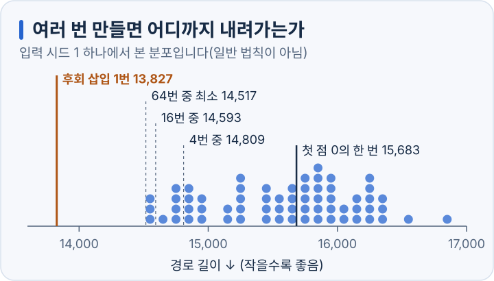

# 실험, 흔한 실수, 옮겨 쓰기

## 실험 설정

- 입력: 순서 틀 `N = 200`(좌표 `0..999`)과 배정 틀 `N = 120, M = 8, K = 18`, 입력 시드 1~20 각각. 생성 규칙은 [코드 틀](implementation.md)에 있습니다.
- 난수: 흔들거나 첫 점을 바꾸는 실험의 solver 시드는 `7 × 입력 시드 + 1`(`hc::Random`)이고, 아래 그림의 64번은 solver 시드 8입니다. 흔들지 않는 구성법은 난수를 쓰지 않습니다.
- 크기: 시간(ms)은 재지 않고 **평가 횟수**로 말합니다. 평가 한 번은 비용 변화를 한 번 계산하는 일이며 구성에서는 (항목, 자리) 쌍, 개선에서는 이동 후보입니다.
- 비교: 시드 20개에서 같은 입력끼리 짝지어 비교하고 값은 중앙값(가운데 두 값의 평균)으로 적습니다. 한쪽이 20개 중 15개 이상에서 앞서면 "앞섬", 뒤지는 시드가 15개 이상이면 "뒤짐", 그 사이는 **결정 못 함**입니다. 15개라는 기준은 경험 법칙이고, 시드 20개로 시드 흔들림을 가려내는 가장 거친 방법입니다.
- 수치 대조: 이 페이지의 표는 `scripts/check_construction_heuristics.py`가 같은 코드를 다시 돌려 얻은 값이며 `lesson-assets/measurements.json`에 입력 시드별 원본이 있습니다. 결정적 구성법의 해는 별도로 짠 Python 구현과 같은 해인지도 대조합니다.

## 구성 기준 비교

### 순서 틀

| 구성법 | 구성 직후 ↓ | 단순 개선 뒤 ↓ | 개선이 줄인 비율 | 평가 횟수 (구성 / 개선) | NN보다 앞선 시드 (직후 / 개선 뒤) |
| --- | ---: | ---: | ---: | ---: | ---: |
| 번호 순서 | 131,664 | 100,592 | 23.6% | 0 / 995 | 0 / 0 |
| 정렬 기준: 세로 띠 8개 | 16,396 | 15,691.5 | 4.9% | 0 / 597 | 5 / 13 |
| 가장 가까운 점 잇기(NN) | 16,051 | 15,925.5 | 1.0% | 19,900 / 597 | 기준 |
| 가장 싼 삽입 | 15,366.5 | 15,247.5 | 1.3% | 1,353,200 / 398 | 16 / 17 |
| 가장 먼 점 삽입 | 14,766.5 | 14,704 | 0.2% | 2,686,500 / 398 | 20 / 20 |
| 후회 삽입 | 14,302.5 | 14,272.5 | 0.2% | 1,353,200 / 398 | 20 / 20 |

구성 직후의 순서는 후회 삽입(14,302.5), 가장 먼 점 삽입(14,766.5), 가장 싼 삽입(15,366.5), NN(16,051)입니다. 후회와 가장 먼 점 삽입은 20개 시드 모두에서 NN보다 짧았고 가장 싼 삽입은 16개 시드에서 짧았습니다. 평가 횟수는 NN이 19,900, 삽입 세 가지가 1,353,200 이상으로 약 68배 이상입니다. 후회는 가장 싼 삽입과 같은 1,353,200번이며 두 번째로 싼 값을 같이 기록할 뿐 평가를 더 하지 않습니다.

번호 순서는 점이 임의로 놓여 있어 무작위 순서와 같습니다. 인접 교환 개선이 23.6%를 줄였지만 100,592로 구성법의 6배가 넘게 남습니다. 정렬 기준(세로 띠 8개)은 평가 횟수 0으로 16,396을 만들어 NN과 비슷한 수준입니다. NN보다 앞선 시드는 구성 직후 5개, 개선 뒤 13개라서 개선 뒤에는 "결정 못 함"입니다. 띠 수에는 민감합니다.

| 띠 수 | 2 | 4 | 6 | 8 | 10 | 12 | 16 | 24 |
| --- | ---: | ---: | ---: | ---: | ---: | ---: | ---: | ---: |
| 비용 중앙값 ↓ | 35,396 | 21,230 | 16,909 | 16,396 | 16,637 | 17,322 | 19,374 | 24,478.5 |

2개는 8개의 2배가 넘고 24개는 1.5배에 가까워 나빠지며 6~10개는 서로 비슷합니다(8개가 가장 낮지만 6·10개와의 차이를 이 실험으로 가르지는 않았습니다). 정렬 기준은 평가 횟수가 없는 대신 기준의 매개변수를 직접 골라야 합니다.

초기해가 개선에 주는 영향은 "개선이 줄인 비율" 열에서 읽을 수 있습니다. 초기해가 나쁠수록 개선이 많이 줄이고(23.6%), 좋을수록 거의 줄이지 못합니다(후회 삽입 0.2%). 이 개선은 인접 교환뿐이라 약해서, 구성 직후의 순위가 개선 뒤에도 거의 그대로 남았습니다. 후회 삽입과 NN의 차이는 직후 1,748.5에서 개선 뒤 1,653으로만 줄었습니다. 더 강한 개선에서 격차가 얼마나 줄어드는지는 이 실험이 재지 않았습니다.

### 배정 틀

| 구성법 | 구성 직후 ↓ | 단순 개선 뒤 ↓ | 개선이 줄인 비율 | 평가 횟수 (구성 / 개선) | 번호 순서보다 앞선 시드 (직후 / 개선 뒤) |
| --- | ---: | ---: | ---: | ---: | ---: |
| 번호 순서대로, 가장 싼 기계 | 49,914.5 | 49,709 | 0.3% | 58,080 / 3,312 | 기준 |
| 작은 것부터, 가장 싼 기계 | 49,878 | 49,767 | 0.2% | 58,080 / 4,029 | 9 / 7 |
| 큰 것부터, 가장 싼 기계 | 49,353 | 49,295 | 0.1% | 58,080 / 2,835 | 20 / 20 |
| 가장 싼 (작업, 기계) 쌍부터 | 49,414 | 49,339.5 | 0.1% | 58,080 / 2,520 | 20 / 20 |
| 후회가 큰 작업부터 | 49,079.5 | 49,077 | 0.0% | 58,080 / 1,133 | 20 / 20 |

세 가지 기준(큰 것부터, 가장 싼 쌍부터, 후회)이 모두 번호 순서보다 20개 시드 모두에서 낮았고, 구성 직후 후회가 49,079.5로 가장 낮았습니다. 작은 것부터는 번호 순서와 구별되지 않았습니다(앞선 시드가 직후 9개, 개선 뒤 7개). 같은 정렬 기준이어도 방향에 따라 결과가 갈립니다. 평가 횟수는 구성법마다 58,080으로 같습니다. 모든 기준이 매 단계에서 남은 작업 × 기계를 전부 보기 때문입니다. 개선 평가는 후회로 만든 해에서 1,133번으로 가장 적어서, 출발점이 좋으면 개선이 바로 끝났습니다.

개선이 줄인 비율은 모든 기준에서 0.3% 이하입니다. 이 틀에서는 구성법의 차이가 곧 최종 차이였습니다. 다만 격차 자체가 작아서(번호 순서와 후회가 약 1.7%) 이 크기가 의미 있는지는 문제의 점수 구조에 따라 다릅니다.

### 개수 제한이 빠듯해지면

| 기준 (중앙값 ↓) | K = 18 | K = 16 | K = 15 (빈 자리 없음) |
| --- | ---: | ---: | ---: |
| 번호 순서대로 | 49,914.5 | 49,947.5 | 50,503.5 |
| 큰 것부터 | 49,353 | 49,369 | 49,426 |
| 가장 싼 쌍부터 | 49,414 | 49,431.5 | 49,780.5 |
| 후회가 큰 작업부터 | 49,079.5 | 49,080.5 | 49,128.5 |

`K = 15`는 `N = M × K`라 빈 자리가 없습니다. 이때도 네 기준 모두 유효한 해를 만들었고(후보를 만드는 단계에서 가득 찬 기계를 빼므로), 번호 순서대로가 가장 많이 나빠졌습니다(+589). 후회 기준은 +49만 올랐습니다. 이 틀과 크기에서 측정한 결과이며 다른 비용 구조에서의 차이는 재지 않았습니다.

## 무작위화와 여러 번 만들기

### 순서 틀

| 방법 | 만든 횟수 | 비용 중앙값 ↓ | 평가 횟수 | 후회 삽입 1번보다 앞선 / 뒤진 시드 | 판정 |
| --- | ---: | ---: | ---: | ---: | --- |
| NN, 첫 점 0 | 1 | 16,051 | 19,900 | 0 / 20 | 뒤짐 |
| NN, 첫 점 무작위, 가장 좋은 것 | 4 | 15,534 | 79,600 | 0 / 20 | 뒤짐 |
| NN, 첫 점 무작위, 가장 좋은 것 | 16 | 15,312.5 | 318,400 | 0 / 20 | 뒤짐 |
| NN, 첫 점 무작위, 가장 좋은 것 | 64 | 15,124.5 | 1,273,600 | 1 / 19 | 뒤짐 |
| NN, 첫 점 무작위, 10% 흔들기, 가장 좋은 것 | 64 | 15,646.5 | 1,273,600 | 0 / 20 | 뒤짐 |
| 후회 삽입 | 1 | 14,302.5 | 1,353,200 | 기준 | - |
| 후회 삽입, 첫 점 무작위, 25% 흔들기, 가장 좋은 것 | 5 | 13,981 | 6,766,000 | 19 / 1 | 앞섬 |

NN을 첫 점만 바꿔 가며 만들면 횟수가 늘수록 낮아지지만 점점 둔해집니다(1번 16,051, 4번 15,534, 16번 15,312.5, 64번 15,124.5). 64번의 평가 횟수 1,273,600은 후회 삽입 한 번(1,353,200)과 비슷한데도 20개 중 19개에서 후회 삽입 한 번이 더 짧았습니다. 이 틀과 크기에서는 같은 평가 횟수를 첫 점 바꾸기보다 기준을 바꾸는 데 쓰는 편이 낫습니다. 기준을 흔드는 쪽은 NN에서 오히려 나빴습니다(같은 64번, 흔들지 않을 때 15,124.5, 10% 흔들 때 15,646.5). 이유는 이 실험으로 가르지 못했습니다. 한 번 둘째 후보를 고르면 뒤의 모든 선택이 달라지는 구조라 흔들림이 쌓이기 때문일 수 있다는 것이 해석입니다.

후회 삽입에 25% 흔들기와 첫 점 무작위를 붙여 5번 만들면 20개 중 19개에서 후회 한 번보다 짧았습니다(13,981 대 14,302.5). 대신 평가 횟수가 6,766,000으로 5배입니다. 이 이득이 5배의 평가 횟수 값어치가 있는지는 이 강의가 가르지 않습니다. 시간 예산이 남을 때의 선택지입니다.

[그림 크게 보기](https://git.readiz.com/h-contest-lesson/lessons/construction-heuristics/lesson-assets/restart-spread.svg)

그림은 입력 시드 1 하나의 분포입니다. 64번을 만들어도 가장 낮은 값이 후회 삽입 한 번보다 높다는 것을 보일 뿐 일반 법칙을 보이는 것은 아닙니다. 표의 20개 시드가 같은 방향이라는 점이 근거입니다.

### 배정 틀

| 방법 | 만든 횟수 | 비용 중앙값 ↓ | 평가 횟수 | 비교 대상보다 앞선 / 뒤진 시드 | 판정 |
| --- | ---: | ---: | ---: | ---: | --- |
| 후회 기준 | 1 | 49,079.5 | 58,080 | 기준 | - |
| 후회 기준, 흔들지 않고 반복 | 20 | 49,079.5 | 1,161,600 | 0 / 0 (후회 1번) | 결정 못 함 |
| 후회 기준, 25% 흔들기 | 20 | 49,051 | 1,161,546.5 | 14 / 6 (후회 1번) | 결정 못 함 |
| 큰 것부터 | 1 | 49,353 | 58,080 | 0 / 20 (후회 1번) | 뒤짐 |
| 큰 것부터, 25% 흔들기 | 20 | 49,289 | 1,161,600 | 20 / 0 (큰 것부터 1번) | 앞섬 |
| 가장 싼 쌍부터 | 1 | 49,414 | 58,080 | 0 / 20 (후회 1번) | 뒤짐 |
| 가장 싼 쌍부터, 25% 흔들기 | 20 | 49,388.5 | 1,161,600 | 18 / 2 (가장 싼 쌍 1번) | 앞섬 |

흔들지 않고 같은 기준을 20번 만들면 같은 해가 20개입니다(입력 시드 1에서 20번의 서로 다른 비용 개수는 1개, 흔들면 16개). 평가 횟수만 20배가 됩니다. 후회 기준을 25% 흔들며 20번 만든 결과는 후회 한 번과 구별되지 않았습니다(앞선 시드 14개, 뒤진 시드 6개라 "결정 못 함"). 큰 것부터와 가장 싼 쌍부터는 흔들면 자기 기준 한 번보다 나아졌지만(20개, 18개) 후회 한 번에는 미치지 못했습니다(49,289, 49,388.5 대 49,079.5). 구성 기준이 이미 이 틀에서 좋은 해를 주면 여러 번 만들기의 이득이 작습니다.

### 결정하지 못한 비교

- 순서 틀: 정렬 기준(띠 8개)과 NN의 개선 뒤 순서(앞선 시드 13개).
- 배정 틀: 작은 것부터와 번호 순서(앞선 시드 9개, 7개), 후회 기준 흔들기 20번과 후회 한 번(14개 대 6개).
- 시드를 늘리거나 입력 크기를 바꾸면 달라질 수 있습니다. 이 강의는 시드 20개, 두 크기만 확인했습니다.

## 흔한 실수

| 실수 | 증상 | 잡는 검사 |
| --- | --- | --- |
| 가득 찬 기계를 후보에서 빼지 않음 | 개수 제한을 넘긴 무효 해 | 구성이 끝난 해를 독립 코드로 검사: 모든 항목이 한 번씩, 기계별 개수 ≤ `K` |
| 일부 자리(맨 앞 자리 등)를 후보에서 빠뜨림 | 해는 유효하지만 가장 싼 자리가 아님. 점수만 조금 나빠져 눈에 띄지 않음 | 작은 입력에서 항목마다 모든 자리에 실제로 끼워 본 길이 증가와 `best`, `second`를 비교 |
| 여러 번 만들며 점수만 갱신하고 가장 좋은 해는 복사하지 않음 | 반환한 점수와 반환한 해의 실제 점수가 다름 | 돌려받은 해의 점수를 다시 계산해 반환값과 대조 |
| 흔들지 않고 반복 | 같은 해를 `R`번 만들어 평가 횟수만 `R`배 | 만든 해의 서로 다른 비용 개수를 센다. 1이면 흔들림이 없다 |

검사 스크립트는 처음 세 실수를 코드에 실제로 넣어 같은 검사로 걸리는지 확인합니다. 가득 찬 기계를 빼는 줄을 지우면 `K = 15`에서 검사가 실패하고, 맨 앞 자리를 빠뜨리면 모든 자리를 끼워 본 값과 달라져 실패하며, 해 복사를 지우면 반환값과 다시 계산한 점수가 달라져 실패합니다. 네 번째는 위 표의 20번 반복 행(비용 같음, 평가 횟수 20배)에서 드러납니다.

## 다른 문제에 옮길 때

1. 해를 "항목을 하나씩 자리에 놓는 일"로 쓸 수 있는가? 항목, 자리, 갱신할 상태는 각각 무엇인가?
2. 항목을 자리에 놓을 때 비용 변화를 O(1)에 가깝게 계산할 수 있는가? 상한에서 (항목 × 자리) 평가 횟수는 얼마인가?
3. 놓은 항목 사이에 끼울 수 있는가, 끝에만 붙이는가? 앞 선택이 뒤 선택에 얼마나 영향을 주는가?
4. 유효성 제약이 무엇이고 후보를 만드는 단계에서 어떻게 거르는가? 남은 항목 수가 남은 자리 수를 넘는 막다른 길이 가능한가?
5. 놓지 않으면 손해가 큰 항목(자리 비용 차이가 큰 항목, 큰 항목)이 있는가? 그렇다면 후회나 정렬 기준을 시험했는가?
6. 동률 규칙과 난수 시드가 정해져 있어 같은 입력에서 같은 해가 나오는가?
7. 흔들거나 여러 번 만들 때 평가 횟수 몇 배를 쓰며, 같은 평가 횟수의 더 좋은 기준과 비교했는가?
8. 초기해를 바꿀 때 뒤에 붙는 개선의 결과를 같은 시드로 비교했는가? 개선이 약하면 초기해의 차이가 그대로 남는다는 점을 감안했는가?

## 적용 사례

이 사이트의 문제별 강의는 이 강의의 틀을 특정 문제에 붙인 사례입니다. 본문 수치는 이 문제들의 채점 결과와 무관합니다.

- [배송 순서 개선](https://h.readiz.com/learn/heuristic-case-studies/ordering-route-improvement): ORDERING에서 번호 순서와 가장 가까운 점 잇기를 초기해로 쓰고 2-opt로 개선합니다. 순서 틀의 구성 기준 비교에 해당합니다.
- [배정 문제의 지역 탐색과 SA](https://h.readiz.com/learn/assignment-local-search): SCHEDULX의 탐욕 초기해와 개선을 다룹니다.
- [택시 배정](https://h.readiz.com/learn/assignment-with-routes): TAXIASSIGN에서 담당 기사와 끼울 위치를 함께 고르는 결합 탐욕 초기해를 만듭니다. 항목마다 자리를 요약하는 틀과 같습니다.
- [격자 배치 문제](https://h.readiz.com/learn/placement-search): LANDINGX에서 first-fit과 정렬 탐욕으로 유효한 초기해를 만들고 destroy/repair로 개선합니다.
- [입력이 클 때](https://h.readiz.com/learn/large-input-search): COUPANG1에서 후보를 줄여 운행 단위로 구성하는 방법을 다룹니다.
