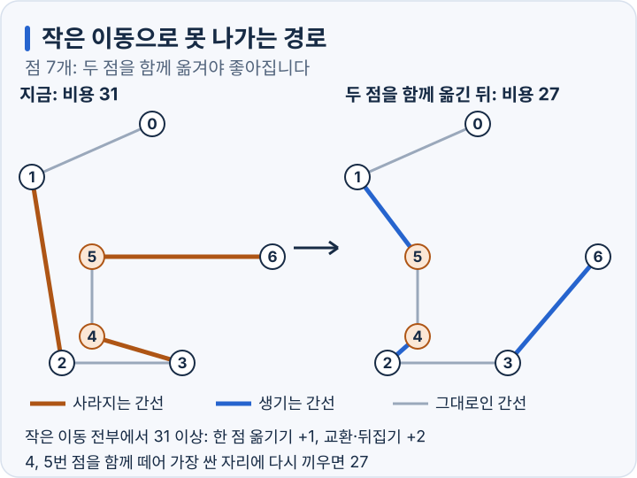
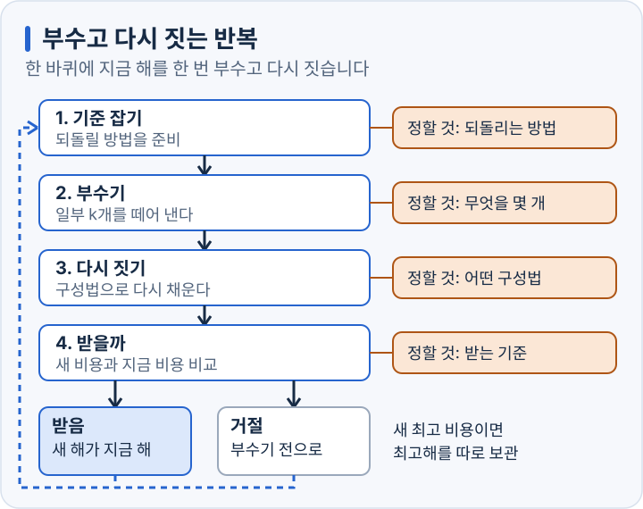
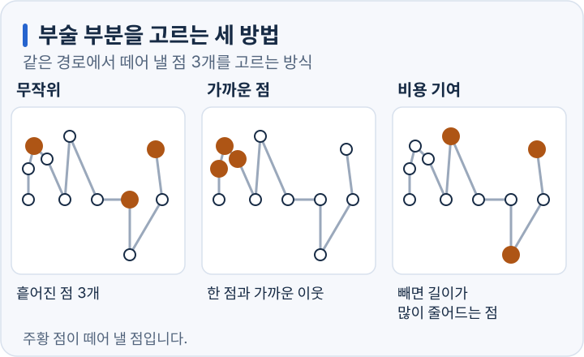
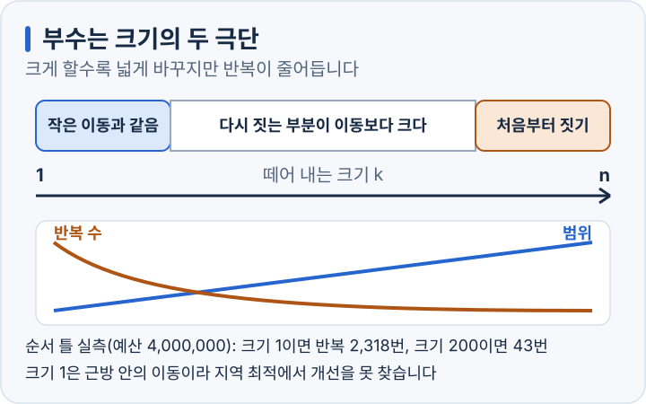

# 원리: 크게 부수고 다시 짓기와 손으로 따라가는 예

[근방 설계와 차분 평가](https://h.readiz.com/learn/neighborhood-and-delta)의 이동은 해의 한두 군데만 바꿉니다. 이런 작은 이동을 계속 적용하면 해는 "좋아지는 이동이 하나도 없는" 곳(지역 최적)에 닿고, 거기서는 같은 이동을 더 돌려도 아무것도 달라지지 않습니다. 이 강의는 그 지점에서 해의 일부를 크게 떼어 내고(부수기) 구성법으로 다시 채워(다시 짓기) 한 번에 여러 군데를 바꾸는 방법을 다룹니다. 이 페이지는 작은 이동이 막히는 구조를 손으로 따라가고, 반복의 틀과 그 안에서 정해야 할 다섯 가지(무엇을 떼어 낼지, 얼마나 크게, 어떻게 채울지, 받을지, 어떻게 되돌릴지)를 설명합니다. 코드는 [구현](implementation.md), 실험 결과는 [실험과 점검](practice.md)에 있습니다.

## 언제 쓰고 언제 쓰지 않는가

| 상황 | 판단 |
| --- | --- |
| 작은 이동으로 이미 지역 최적 근처까지 왔고, 해의 일부를 떼어 내도 규칙을 지키며 다시 채울 수 있다 | 쓴다. 작은 이동으로 막힌 뒤의 다음 단계다 |
| 아직 해가 나쁘고 작은 이동 하나의 평가가 매우 싸다(차분 O(1)) | 작은 이동을 먼저 쓴다. 처음부터 부수고 다시 짓기만 쓰면 반복 하나가 비싸서 같은 예산에서 뒤진다([실험](practice.md)의 예산 비교) |
| 다시 채우는 구성법이 없다(빈칸을 규칙대로 채우는 방법이 문제에 없다) | 쓸 수 없다. 이동을 키우거나 구성법부터 만든다([초기해 만들기](https://h.readiz.com/learn/construction-heuristics)) |
| 항목이 모두 얽혀 있어 일부를 떼어 내면 나머지가 의미를 잃는다(앞에서부터 하나씩 정하는 문제) | 해를 조금 바꾸는 방법이 아니다. 중간 상태를 다루는 [빔 서치](https://h.readiz.com/learn/beam-search)가 맞다 |
| 작은 이동의 지역 최적이 이미 좋은 해라서 남은 여지가 작다 | 이득이 작다. 이 강의의 배정 틀에서는 비용의 0.1% 안쪽이다([실험](practice.md)) |
| 나쁜 해도 받아들여 돌아다닐지가 쟁점이다 | 받는 기준과 온도는 [언덕 오르기와 담금질](https://h.readiz.com/learn/hill-climbing-and-annealing)의 주제다. 이 강의는 받는 기준이 결과에 주는 영향만 잰다 |

선수 지식은 [문제를 상태·행동·점수로 옮기기](https://h.readiz.com/learn/problem-modeling)의 상태 표현과 점수 계산, [초기해 만들기](https://h.readiz.com/learn/construction-heuristics)의 구성법(가장 싼 자리, 후회), [근방 설계와 차분 평가](https://h.readiz.com/learn/neighborhood-and-delta)의 이동과 지역 최적입니다. 이 강의는 구성법과 이동을 다시 설명하지 않고 필요한 최소한의 코드만 다시 싣습니다. 후보를 가까운 것으로 줄여 다시 짓기를 싸게 만드는 방법은 [후보 줄이기와 시간 예산](https://h.readiz.com/learn/candidate-and-time-budget)으로 넘깁니다.

## 연습용 문제 틀

이 강의의 모든 수치는 아래 두 가지 연습용 입력에서 나옵니다. 이 사이트의 어떤 문제의 채점 결과에도 의존하지 않습니다. 난수는 64비트 정수 `x`를 시드로 시작해 `x = x * 6364136223846793005 + 1442695040888963407`(64비트 곱셈·덧셈의 순환)로 갱신하고, 값은 `(x >> 33) % 범위`입니다. 시드는 1부터 20까지 쓰며, 같은 시드를 입력 생성과 탐색 난수에 함께 씁니다. 설정을 고르는 데 쓰지 않은 시드 21부터 40까지는 마지막에 한 번 확인합니다.

- **순서 문제(경로):** 점 `N = 200`개가 `0..999`의 정수 좌표에 있습니다. 점마다 `x`, `y` 순서로 뽑습니다. 모든 점을 한 번씩 지나는 순서를 정하며(시작점 자유, 돌아오지 않음) 비용은 이웃한 점 사이 맨해튼 거리의 합이고 작을수록 좋습니다. 시작 해는 번호 순서 `0, 1, …, N−1`입니다.
- **배정 문제(작업):** 작업 `N = 120`개, 기계 `M = 8`대입니다. 작업마다 길이 `d[i] = 1 + (0..99)`를 뽑고 이어서 기계별 추가 비용 `c[i][0..M−1]`(각 `0..50`)을 뽑습니다. 모든 작업을 정확히 한 기계에 맡기며 기계 한 대에는 `K = 18`개까지만 맡길 수 있습니다(넘으면 무효). 비용은 `(Σ load[j]²) / 100 + Σ c[i][as[i]]`이며 `load[j]`는 기계 `j`가 맡은 작업 길이의 합, 나눗셈은 합 전체에 한 번의 정수 나눗셈입니다. 작을수록 좋습니다. 시작 해는 `as[i] = i % M`입니다.

순차 결정 문제(격자 수집)는 쓰지 않습니다. 앞에서부터 하나씩 정하는 구조에는 "완성된 해의 일부를 떼어 낸다"는 동작이 없기 때문입니다.

## 작은 이동으로 못 나가는 구조

작은 이동(한 점 교환·옮기기·구간 뒤집기, 한 작업 옮기기·맞바꾸기)은 한 번에 한두 항목만 바꿉니다. 좋은 해로 가는 길이 "두 항목 이상을 동시에 바꿔야만 나아지는" 구조이면, 한 항목만 바꾼 중간 해가 지금 해보다 나쁘므로 "좋아질 때만 받는" 탐색은 첫걸음을 내딛지 못합니다. 아래 두 손계산은 모든 작은 이동을 열거해 그 구조를 보인 뒤 부수고 다시 짓기가 같은 해에서 어떻게 나아가는지 따라갑니다.

### 순서 틀: 점 7개

점은 `P0 (4,9)`, `P1 (0,7)`, `P2 (1,0)`, `P3 (5,0)`, `P4 (2,1)`, `P5 (2,4)`, `P6 (8,4)`이고 순서는 `0, 1, 2, 3, 4, 5, 6`입니다. 간선 비용은 6, 8, 4, 4, 3, 6이고 합계는 31입니다(예: `P1–P2`는 `|0−1| + |7−0| = 8`). 이 경로에서 가능한 작은 이동을 전부 적용해 비용을 다시 계산한 결과입니다.

| 이동 | 이동의 수 | 개선하는 이동 | 가장 좋은 변화량 |
| --- | ---: | ---: | ---: |
| 두 점 교환 | 21 | 0 | +2 |
| 한 점 옮기기 | 42 | 0 | +1 |
| 구간 뒤집기 | 21 | 0 | +2 |

구간 뒤집기의 `[0, 6]`(전체)은 경로를 거꾸로 읽을 뿐 같은 경로라서 변화량 0이고 위 표의 "가장 좋은 변화량"에서 제외했습니다. 나머지 이동은 모두 비용이 늘어나므로 이 경로는 세 이동 어느 것으로도 개선되지 않는 지역 최적입니다. 그런데 `P4`와 `P5`는 서로 가까이 있고 둘 다 `P3`와 `P6` 사이에 끼어 있어서, 둘을 함께 `P1`과 `P2` 사이로 옮기면 훨씬 짧아집니다. 하나씩 옮기면 어떻게 되는지 보겠습니다.

| 한 점만 옮기면 | 경로 | 비용 | 변화량 |
| --- | --- | ---: | ---: |
| P4만 자리 2로 | 0 1 4 2 3 5 6 | 33 | +2 |
| P5만 자리 2로 | 0 1 5 2 3 4 6 | 33 | +2 |

한 점만 옮기면 비용이 31에서 33으로 올라갑니다. 옮기지 않은 점이 `P3`와 `P6` 사이에서 여전히 먼 길을 돌게 하기 때문입니다. 이어서 남은 점을 마저 옮기면 27이 되지만, 첫걸음이 나빠지므로 "좋아질 때만 받는" 탐색은 그 첫걸음을 받지 않습니다.



[그림 크게 보기](https://git.readiz.com/h-contest-lesson/lessons/destroy-and-repair/lesson-assets/stuck-and-rebuild.svg)

부수고 다시 짓는 방식은 `P4`와 `P5`(위치 4, 5의 연속한 두 점)를 함께 떼어 냅니다. 남은 경로는 `0 1 2 3 6`(비용 25)입니다. 떼어 낸 점을 떼어 낸 순서대로, 각각 가장 싼 자리에 다시 끼웁니다. 자리 `s`는 `s`번째 점 앞이며 `s`가 길이와 같으면 맨 끝입니다. 자리의 비용은 그 자리에 끼웠을 때 늘어나는 길이입니다(예: `P4`를 자리 2에 끼우면 `P1–P4`(8) + `P4–P2`(2) − `P1–P2`(8) = 2).

| 단계 | 경로 | 비용 | 자리별로 늘어나는 길이 | 고른 자리 |
| --- | --- | ---: | --- | ---: |
| 떼어 낸 뒤 | 0 1 2 3 6 | 25 | | |
| P4를 끼움 | 0 1 4 2 3 6 | 27 | 10, 12, 2, 2, 6, 9 | 2 |
| P5를 끼움 | 0 1 5 4 2 3 6 | 27 | 7, 6, 0, 6, 8, 6, 6 | 2 |

`P4`의 자리 2와 3은 늘어나는 길이가 2로 같고, 같으면 앞의 자리(2)를 고릅니다. 새 경로 `0 1 5 4 2 3 6`의 비용은 27이고 31보다 4가 줄었습니다. 점 7개의 모든 순서 5,040개를 훑어 구한 최소 비용도 27이라서 이 경로는 최적입니다. 이 예는 부수고 다시 짓기가 한 번에 두 점을 함께 바꿔 작은 이동 사이의 언덕을 넘는다는 점을 보이며, 다시 짓는 규칙이 가장 싼 자리여서 이 경우에는 한 번에 최적에 닿았습니다. 항상 이렇게 되지는 않습니다.

### 배정 틀: 작업 6개, 기계 3대, 한 대에 2개

작업 길이 `d`와 추가 비용 `c`는 아래와 같고, 상한 `K = 2`라서 기계 3대가 모두 가득 차 있습니다. 시작 해는 `as = [1, 1, 2, 0, 0, 2]`입니다.

| 작업 | 길이 | `c[i][0]` | `c[i][1]` | `c[i][2]` | 맡은 기계 |
| ---: | ---: | ---: | ---: | ---: | ---: |
| 0 | 28 | 26 | 29 | 23 | 1 |
| 1 | 24 | 21 | 27 | 27 | 1 |
| 2 | 12 | 3 | 15 | 18 | 2 |
| 3 | 18 | 4 | 20 | 16 | 0 |
| 4 | 31 | 1 | 25 | 13 | 0 |
| 5 | 60 | 25 | 4 | 1 | 2 |

부하는 기계 0이 `18 + 31 = 49`, 기계 1이 `28 + 24 = 52`, 기계 2가 `12 + 60 = 72`입니다. 부하 제곱의 합은 `2401 + 2704 + 5184 = 10289`이고 `10289 / 100 = 102`(소수는 버림), 추가 비용의 합은 `29 + 27 + 18 + 4 + 1 + 1 = 80`이라서 비용은 `102 + 80 = 182`입니다. 이 해에서 가능한 작은 이동을 전부 열거한 결과입니다.

| 이동 | 이동의 수 | 개선하는 이동 | 가장 좋은 변화량 |
| --- | ---: | ---: | ---: |
| 한 작업 옮기기 | 0 | 0 | - |
| 두 작업 맞바꾸기 | 12 | 0 | +1 |

모든 기계가 가득 차서 옮기기는 받아 줄 기계가 없고(`N = M × K`일 때의 [연결성](https://h.readiz.com/learn/neighborhood-and-delta)), 맞바꾸기 12개는 모두 비용을 올립니다. 그런데 기계 1과 기계 2의 작업 묶음을 통째로 바꾸면 달라집니다. 부하 52와 72가 서로 자리를 바꿀 뿐이라 부하 제곱의 합(10289)은 그대로이고, 추가 비용의 합만 `80`에서 `74`로 줄어 비용이 176이 됩니다. 이 변화는 두 작업 맞바꾸기 하나로는 만들 수 없고 두 번 맞바꿔야 합니다(작업 0 ↔ 2, 작업 1 ↔ 5). 첫 번째 맞바꿈만 한 해의 비용은 185로, 부하가 36과 88로 어긋나 182보다 올라갑니다.

부수고 다시 짓기는 기계 1과 기계 2의 작업 4개(작업 0, 1, 2, 5)를 모두 떼어 내 다시 놓습니다. 이때 다시 짓는 규칙이 결과를 가릅니다. 먼저 떼어 낸 순서대로 각 작업을 가장 싼 기계에 놓으면(여유가 있는 기계만) 작업 0 → 기계 2, 작업 1 → 기계 1, 작업 2 → 기계 1, 작업 5 → 기계 2가 되어 비용이 185입니다. 부하가 36과 88로 갈려 부하 제곱의 합이 11441(114)로 늘고 추가 비용은 71이므로 182보다 나쁘고, 이 시도는 거절되어 해는 부수기 전으로 돌아갑니다.

| 차례 | 놓는 곳 |
| ---: | --- |
| 1 | 작업 0 → 기계 2 |
| 2 | 작업 1 → 기계 1 |
| 3 | 작업 2 → 기계 1 |
| 4 | 작업 5 → 기계 2 |

[초기해 만들기](https://h.readiz.com/learn/construction-heuristics)의 후회 기준으로 다시 놓으면 결과가 달라집니다. 후회는 "가장 싼 기계에 놓지 못하고 두 번째로 싼 기계에 놓을 때 늘어나는 비용"이고, 후회가 큰 작업부터 먼저 놓습니다. 비교 값은 부하 제곱의 증가와 추가 비용의 100배를 더한 정수(작업 `j`를 기계 `y`에 놓으면 `(2 × load[y] + d[j]) × d[j] + 100 × c[j][y]`)입니다. 첫 차례에서 네 작업의 후회는 600, 0, 300, 300이라 작업 0이 가장 크고, 작업 0은 기계 2에 놓입니다(비교 값 3084 대 3684). 이후 차례마다 부하가 바뀌므로 후회를 다시 계산합니다.

| 차례 | 작업 0의 후회 | 작업 1 | 작업 2 | 작업 5 | 고른 것 |
| ---: | ---: | ---: | ---: | ---: | --- |
| 1 | 600 | 0 | 300 | 300 | 작업 0 → 기계 2 |
| 2 | - | 1344 | 972 | 3060 | 작업 5 → 기계 1 |
| 3 | - | 1536 | 468 | - | 작업 1 → 기계 2 |
| 4 | - | - | 후보 1개 | - | 작업 2 → 기계 1 |

결과는 `as = [2, 2, 1, 0, 0, 1]`, 비용 176이고 182보다 좋아 받습니다. 4차례에서는 기계 2가 이미 가득 차 작업 2가 갈 곳이 기계 1뿐이라 두 번째로 싼 자리가 없습니다. 코드는 두 번째 자리가 없으면 그 비용을 아주 큰 값으로 두어 후회가 매우 큰 것으로 취급합니다(표의 "후보 1개"). 같은 부수기에서도 다시 짓는 규칙에 따라 거절될 수도 받을 수도 있다는 점이 아래 [다시 짓는 구성법](#다시-짓는-구성법)의 주제입니다.

## 반복의 틀

부수고 다시 짓는 반복은 한 바퀴가 아래 다섯 줄입니다.

```text
기준 잡기      되돌릴 방법을 준비한다
부수기         해의 일부 k개를 떼어 낸다
다시 짓기      떼어 낸 것을 구성법으로 다시 놓는다
받을까         새 비용을 지금 비용과 비교한다
확정 또는 되돌리기
```



[그림 크게 보기](https://git.readiz.com/h-contest-lesson/lessons/destroy-and-repair/lesson-assets/destroy-repair-loop.svg)

단계마다 문제가 바뀌어도 정해야 할 것이 있습니다. 아래 다섯 절이 차례로 다룹니다.

| 정할 것 | 선택지 | 이 강의의 코드 |
| --- | --- | --- |
| 무엇을 떼어 낼지 | 무작위, 서로 가까운 것(연속 구간 포함), 비용 기여가 큰 것, 한 묶음(기계 단위) | `Cfg::destroy` |
| 몇 개를 떼어 낼지 | 1(작은 이동)에서 전체(처음부터 짓기)까지 | `Cfg::size` |
| 어떻게 다시 채울지 | 가장 싼 자리, 후회가 큰 것부터 | `Cfg::repair` |
| 새 해를 받을지 | 좋아질 때만, 같아도 받기, 담금질식 | `Cfg::accept`, `Cfg::t0` |
| 어떻게 되돌릴지 | 복사, 바꾼 것만 기록, 새 배열에 짓기 | `mark`, `rollback` |

## 부술 부분 고르기

아래 그림은 같은 경로에서 세 방법이 점 3개를 고르는 모습입니다.



[그림 크게 보기](https://git.readiz.com/h-contest-lesson/lessons/destroy-and-repair/lesson-assets/destroy-kinds.svg)

| 방법 | 떼어 내는 것 | 해석: 이런 상황에 맞는다 |
| --- | --- | --- |
| 무작위 | 같은 확률로 `k`개 | 어디에 개선 여지가 있는지 모를 때의 기본. 비용이 들지 않고 어떤 부분이든 고를 수 있어 근방이 연결된다 |
| 서로 가까운 것 | 한 항목과 그에 가까운 `k − 1`개. 순서 문제의 연속 구간도 이 종류다 | 가까운 항목끼리 서로의 자리를 두고 다투는 구조. 함께 떼어 내야 서로 자리를 바꿔 앉을 수 있다 |
| 비용 기여가 큰 것 | 빼면 비용이 많이 줄어드는 항목 | 비용이 몇몇 항목에 몰려 있을 때. 큰 것만 반복해서 고르지 않도록 무작위성을 섞어야 한다 |
| 한 묶음 | 기계 한 대의 작업 전부처럼 구조가 정한 묶음 | 점수식이 묶음 단위(기계 항)로 짜여 있어 묶음 안의 배치를 통째로 바꿔야 할 때 |

"해석"이라고 적은 것은 상황에 대한 추론이며, 실제로 어느 방법이 이기는지는 문제 구조에 따라 다릅니다. 이 연습용 입력에서의 실측은 [실험과 점검](practice.md)에 있습니다. 서로 영향을 주는 항목을 함께 떼어 낸다는 방향은 경험 법칙으로 알려져 있고, 실험은 순서 틀에서는 이를 지지하고 배정 틀의 기계 단위에서는 지지하지 않았습니다.

[Destroy/Repair: 제거하고 다시 채워 점수 비교하기](https://git.readiz.com/h-contest-lesson/demos/index.html?demo=destroy-repair)

이 데모는 10칸 띠에 광고를 놓는 배치에서 일부를 제거하고 정해진 순서로 가장 왼쪽의 빈 구간에 다시 채운 뒤 점수를 비교합니다. 점수가 가치의 합이어서 클수록 좋은 점이 이 강의의 비용(작을수록 좋음)과 반대이지만, 일부를 떼어 낸 뒤 다시 채워 좋아졌는지 보고 받거나 되돌리는 반복은 같습니다.

## 다시 짓는 구성법

다시 짓는 규칙은 [초기해 만들기](https://h.readiz.com/learn/construction-heuristics)의 구성법을 그대로 씁니다. 부분 해가 이미 있다는 점만 다릅니다. 떼어 낸 항목이 `pool`에 있고, 아래 두 규칙이 `pool`이 빌 때까지 하나씩 놓습니다.

- **가장 싼 자리(떼어 낸 순서대로):** 다음 항목의 모든 자리를 평가해 가장 싼 자리에 놓습니다. 한 번 놓는 데 자리 수만큼의 평가가 들고, 항목 `k`개면 자리 수의 `k`배입니다.
- **후회가 큰 것부터:** 남은 항목마다 가장 싼 자리와 두 번째로 싼 자리의 비용 차이(후회)를 구하고, 후회가 가장 큰 항목을 먼저 놓습니다. 매번 남은 항목을 모두 평가하므로 평가 수가 `k`의 제곱에 비례합니다.

후회 기준은 평가가 `k`배 더 들지만 나중에 자리가 없어질 항목을 먼저 놓아서 위의 배정 예처럼 더 좋은 배치를 만들 수 있습니다. 같은 예산에서 어느 쪽이 이기는지는 문제마다 다르고, 이 연습용 입력에서는 순서 틀과 배정 틀이 서로 다른 쪽을 골랐습니다([실험과 점검](practice.md)). 다시 놓을 때 규칙(기계의 여유 등)을 확인하는 일이 빠지면 무효한 해가 만들어집니다. 떼어 낸 만큼 빈자리가 생기므로 놓을 자리는 항상 있습니다.

[승객을 옮길 자리와 교환 비교하기](https://git.readiz.com/h-contest-lesson/demos/index.html?demo=route-insertion)

이 데모는 기사 2명이 승객 4명을 태우는 예시에서 승객 한 명을 다른 기사 경로의 어느 자리에 끼울지 자리마다 늘어나는 비용을 비교합니다. 점수가 두 기사 부하의 최댓값이라 이 강의의 합과 다르지만, 자리마다 늘어나는 비용을 비교해 싼 자리를 고르는 구조는 가장 싼 자리 규칙과 같습니다.

## 새 해를 받는 기준

다시 지은 해의 비용 `now`와 지금 해의 비용 `cur`를 비교해 받을지 정합니다. 세 가지를 비교합니다.

- **좋아질 때만 받기:** `now < cur`일 때만 받습니다. 지금 해가 최고해와 항상 같아서 최고해를 따로 보관할 필요가 없습니다. 지역 최적에서 같은 비용의 다른 해로는 옮기지 못합니다.
- **같아도 받기:** `now ≤ cur`이면 받습니다. 비용이 같은 다른 해(평평한 구간)로 옮겨 다닐 수 있습니다. 다시 지은 해가 부수기 전과 같은 해일 때도 받습니다.
- **담금질식:** 나빠졌을 때(`Δ = now − cur > 0`)도 확률 `exp(−Δ / T)`로 받습니다. `T`는 온도이고 높을수록 나쁜 해를 잘 받습니다. 예를 들어 `Δ = 25`, `T = 50`이면 `x = Δ / T = 0.5`이고 받을 확률은 `exp(−0.5) = 0.6065`입니다. 이 확률의 식은 담금질에서 알려진 식(Metropolis 기준)입니다. 이 강의의 코드는 온도를 시작 온도 `t0`에서 남은 예산에 비례해 0으로 내립니다. 온도의 범위를 정하는 방법은 [언덕 오르기와 담금질](https://h.readiz.com/learn/hill-climbing-and-annealing)에서 다룹니다.

나쁜 해를 받으면 지금 해가 최고해보다 나빠질 수 있으므로 **최고해를 따로 보관**합니다. `exp`는 표준 수학 함수 없이 구현해야 하고, 부동소수점에 기대면 환경마다 결과가 달라질 수 있어 이 강의는 정수 고정 소수점으로 근사합니다([구현](implementation.md)의 `expNeg16`). 받는 기준이 결과에 주는 영향은 [실험과 점검](practice.md)에서 잽니다.

## 부수는 크기

한 번에 떼어 내는 항목 수 `k`는 두 극단 사이에서 고릅니다. `k = 1`이면 한 항목을 가장 싼 자리에 다시 놓는 것이라 한 점 옮기기 같은 작은 이동의 근방 안에 있습니다. 따라서 작은 이동의 지역 최적에서는 개선을 찾지 못합니다([실험](practice.md)에서 300번 시도해 0번). `k = N`이면 해 전체를 떼어 내고 처음부터 다시 짓는 것이라 구성법을 한 번 더 돌리는 일과 같습니다.



[그림 크게 보기](https://git.readiz.com/h-contest-lesson/lessons/destroy-and-repair/lesson-assets/size-spectrum.svg)

크기가 커지면 한 번에 바꿀 수 있는 범위가 넓어지지만, 다시 놓는 평가의 수가 크기에 비례해 늘어 같은 예산에서 돌릴 수 있는 반복이 줄어듭니다. 그래서 가장 좋은 크기는 둘 사이 어딘가에 있고, 어디인지는 문제와 예산에 따라 달라 실측으로 정합니다. 경험 법칙으로는 "전체의 몇 퍼센트에서 시작한다"는 식이 있고, 이 연습용 입력의 실험은 그 방향을 지지합니다([실험](practice.md)의 크기 표).

## 되돌리는 방법

받지 않기로 하면 부수기 전의 해로 돌려놓아야 합니다. 방법은 셋이고, 해가 바뀌는 칸의 수와 표현에 따라 맞는 쪽이 다릅니다.

| 방식 | 반복마다 드는 쓰기 | 거절했을 때의 쓰기 | 잘 맞는 상황 |
| --- | --- | --- | --- |
| 복사 | 해 전체 | 해 전체 | 해가 작거나, 어디가 바뀔지 미리 알기 어렵거나, 가장 단순하게 쓰고 싶을 때 |
| 바꾼 것만 기록 | 바뀐 칸 수 | 바뀐 칸 수 | 해가 크고 바뀌는 칸이 적을 때(배정 틀: 떼어 낸 작업) |
| 새 배열에 짓기 | 부분 해를 만드는 쓰기(어차피 필요) | 0 | 부분 해를 어차피 새로 만드는 표현(순서 틀의 배열) |

복사는 어떤 표현에서도 맞지만 `N`이 크고 거절이 많으면 쓰기가 반복마다 `N`번 듭니다. 기록은 바뀐 칸만 되돌려 싸지만 기록을 빠뜨리면 되돌린 뒤의 해가 달라지므로 검사가 필요합니다. 새 배열에 짓는 방식은 부분 해를 만들 때 이미 전체를 새 배열에 쓰므로 거절의 비용이 0입니다. 이 강의는 순서 틀에 새 배열에 짓기를, 배정 틀에 복사와 기록 둘을 구현하고 같은 반복에서 쓰는 연산을 [실험](practice.md)에서 비교합니다.

최고해를 보관하는 일(`saveBest`)은 되돌리기와 다릅니다. 되돌리기는 이번 반복을 취소하는 것이고, 최고해 보관은 나쁜 해를 받는 설정에서 지금까지의 최선을 잃지 않기 위한 것입니다.
