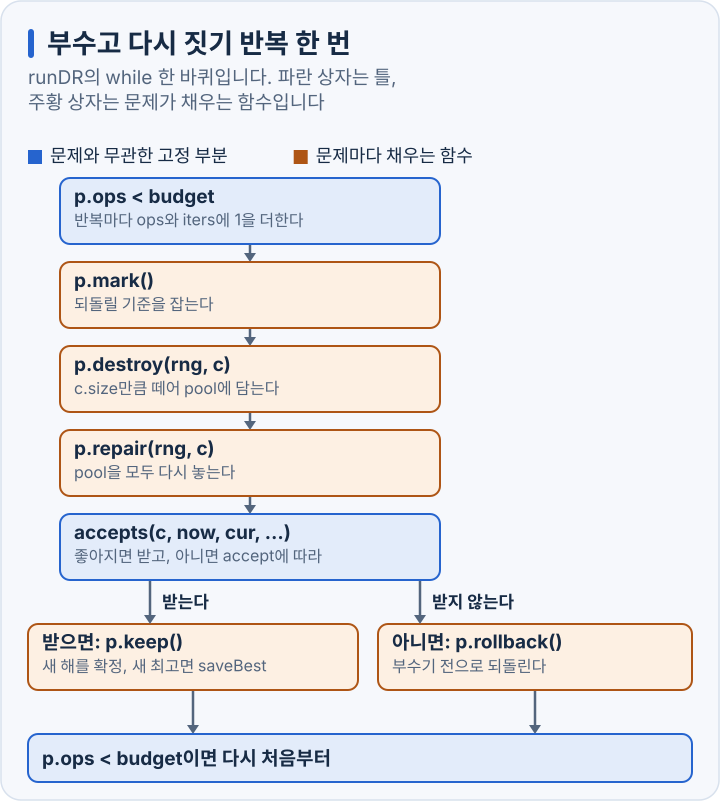

# 구현: 부수기·다시 짓기 틀과 두 문제 유형

[원리와 손계산](idea.md)의 반복을 코드로 옮깁니다. 코드는 두 부분으로 나눕니다. 문제와 상관없이 그대로 쓰는 부분(반복, 받는 기준, 검사)과 문제마다 채우는 부분(해의 표현, 떼어 내는 방법, 다시 놓는 방법, 되돌리는 방법)입니다. 채우는 쪽은 같은 이름의 함수를 두기 때문에 문제가 바뀌어도 반복과 검사는 한 글자도 고치지 않습니다. 두 문제 유형(순서 틀·배정 틀)은 [원리의 연습용 문제 틀](idea.md#연습용-문제-틀)에 정의한 것입니다.

> **코드 환경: h-contest 제출용 코드.** 표준 헤더·STL·동적 할당 없이 고정 배열로 씁니다. 공통 블록 `array`, `random`([공통 라이브러리](https://h.readiz.com/learn/cpp-common-library))을 먼저 붙이고, 이 페이지의 `dr-frame`, `dr-route`, `dr-assign`, `dr-run`을 이 순서로 이어 붙이면 한 번역 단위로 컴파일됩니다. 이 강의의 코드는 입출력이 없는 라이브러리 형태이며, 실제 문제에 쓸 때는 문제의 입력으로 `Route`나 `Assign`의 배열을 채우는 부분만 바꿉니다. 이동·차분·구성법은 앞 강의([근방 설계와 차분 평가](https://h.readiz.com/learn/neighborhood-and-delta), [초기해 만들기](https://h.readiz.com/learn/construction-heuristics))에서 다뤘으므로 비교에 필요한 최소한만 다시 실었습니다.

## 문제와 무관한 부분: 반복, 받는 기준, 검사

반복 `runDR`가 문제에 요구하는 것은 아래 멤버입니다. 채우는 쪽(`P`)이 이 멤버를 가져야 하고, 그 밖의 것은 알 필요가 없습니다.

| 멤버 | 하는 일 | 지켜야 할 점 |
| --- | --- | --- |
| `mark()` | 되돌릴 기준을 잡는다 | 복사든 기록이든 `rollback()`이 이 시점으로 돌려놓을 수 있어야 한다 |
| `destroy(rng, cfg)` | `cfg.destroy` 방식으로 `cfg.size`만큼 떼어 내 `pool`에 담는다 | 떼어 낸 것은 해에서 완전히 빠지고, 남은 것은 유효하다 |
| `repair(rng, cfg)` | `pool`을 모두 다시 놓는다 | 규칙(기계의 여유 등)을 지키고, 비용 추적값을 함께 고친다 |
| `cost()` | 지금 들고 있는 해의 비용(추적한 값) | `fullCost()`와 같아야 한다 |
| `keep()` / `rollback()` | 새 해를 확정 / 부수기 전으로 되돌림 | 되돌린 뒤 해·캐시·비용이 `mark()` 때와 같아야 한다 |
| `saveBest()` | 지금 해를 최고해로 따로 보관 | 이후 현재 해가 바뀌어도 변하지 않는다 |
| `smallStep(rng)` | 비교용 작은 이동 하나(좋아질 때만 적용) | 근방 설계 강의의 이동을 최소한만 다시 싣는다 |
| `fullCost()`, `valid()` | 검사용. 처음부터 다시 계산 | 탐색 중에는 부르지 않는다 |
| `ops, writes, iters, accepted` | 계수기 | 연산 수의 정의는 아래 |

**연산 수의 정의**는 [근방 설계와 차분 평가](https://h.readiz.com/learn/neighborhood-and-delta)와 같습니다. 반복(제안) 한 번에 1, 점수식의 항 하나를 계산할 때마다 1(순서 틀은 거리 한 번, 배정 틀은 작업 항 또는 기계 항 하나), 해 배열의 원소를 쓸 때마다 1입니다. 비교와 난수 생성, 캐시 갱신은 세지 않습니다. 부수는 크기가 달라도 같은 예산이 되도록 시간 대신 이 연산 수로 예산을 잡습니다.

`Cfg`는 한 번의 실행을 정하는 값 다섯 개(부수기 종류, 크기, 다시 짓기, 받는 기준, 시작 온도)입니다. `destroy`의 번호와 `size`의 단위는 문제가 정합니다(순서 틀은 점 수, 배정 틀은 작업 수이거나 기계 수).

`accepts`는 새 해를 받을지를 정합니다. 좋아지면 언제나 받고, 같으면 `accept`가 1 이상일 때 받고, 나빠졌을 때는 `accept == 2`(담금질식)에서만 확률 `exp(−Δ/T)`로 받습니다. `Δ`는 나빠진 만큼, `T`는 온도이며 시작 온도 `t0`에서 남은 예산에 비례해 0으로 줄입니다. 온도를 정하는 방법은 [언덕 오르기와 담금질](https://h.readiz.com/learn/hill-climbing-and-annealing)에서 다루고, 여기서는 `t0`를 몇 개만 시험합니다.

:::hint 정수로 exp를 근사하는 expNeg16
확률 계산에는 `exp`가 필요하지만 표준 수학 함수는 쓰지 않습니다. `expNeg16`는 `exp(−x)`에 65,536을 곱한 값을 정수만으로 구합니다. 극한 `(1 − x/n)^n → e^(−x)`를 `n = 1024`로 쓰고, 1024제곱을 제곱 10번으로 계산합니다. 소수점 아래 30비트의 고정 소수점으로 계산하며 부동소수점이 없어 컴파일러·플랫폼이 달라도 같은 값이 나옵니다. 근사의 오차는 `x`가 클수록 커지므로 `x ≥ 16`이면 0으로 둡니다. 정확한 값과 근사 값의 비교는 아래 표와 같습니다.

| x | 정확한 값 exp(−x) | 정수 근사 값 |
| ---: | ---: | ---: |
| 0.25 | 0.7788 | 0.7788 |
| 0.5 | 0.6065 | 0.6064 |
| 1 | 0.3679 | 0.3677 |
| 2 | 0.1353 | 0.1351 |
| 4 | 0.0183 | 0.0182 |
| 8 | 0.0003 | 0.0003 |
:::



[그림 크게 보기](https://git.readiz.com/h-contest-lesson/lessons/destroy-and-repair/lesson-assets/iteration-flow.svg)

```cpp snippet=dr-frame
// [0, bound) 안의 값. 상위 비트를 쓴다(근방 설계 강의의 pick과 같다).
int pick(hc::Random& rng, int bound) { return (int)(((unsigned long long)rng.next() * (unsigned)bound) >> 32); }

const long long BIG = 1000000000000LL;     // "자리가 없음"을 뜻하는 비용

// 한 번의 실행을 정하는 값. 문제마다 destroy의 번호와 size의 단위(점 수, 작업 수, 기계 수)를 따로 정한다.
struct Cfg {
    int destroy;   // 부수기 종류: 문제가 번호를 정한다
    int size;      // 한 번에 떼어 내는 크기
    int repair;    // 다시 짓기: 0 = 떼어 낸 순서대로 가장 싼 자리, 1 = 후회가 큰 것부터
    int accept;    // 받는 기준: 0 = 좋아질 때만, 1 = 같아도 받기, 2 = 담금질식
    int t0;        // accept == 2일 때의 시작 온도(비용 단위). 예산이 줄면 0까지 선형으로 내린다
};

// exp(-num/den) * 65536 의 정수 근사. 표준 수학 함수 없이 (1 - x/1024)^1024 를 제곱 10번으로 구한다(x = num/den).
// 소수점 이하 30비트의 고정 소수점이며, x >= 16이면 0으로 둔다(그때 값은 1.2e-7 미만).
// 부동소수점을 쓰지 않아 어느 환경에서나 같은 값이 나온다.
int expNeg16(long long num, long long den) {
    if (num <= 0) return 65536;
    if (den <= 0 || num >= 16 * den) return 0;
    long long r = (1LL << 30) - (num << 20) / den;       // 1 - x/1024 를 2^30배로
    for (int i = 0; i < 10; ++i) r = (r * r) >> 30;
    return (int)(r >> 14);
}

// 새 해를 받을지. now는 다시 지은 해의 비용, cur는 지금 해의 비용(작을수록 좋음).
bool accepts(const Cfg& c, long long now, long long cur, long long left, long long budget, hc::Random& rng) {
    if (now < cur) return true;                     // 좋아지면 언제나 받는다
    if (c.accept == 0) return false;
    if (now == cur) return true;                    // 같아도 받기(accept 1, 2)
    if (c.accept == 1) return false;
    // 담금질식: 나빠진 만큼 Δ = now - cur를 확률 exp(-Δ/T)로 받는다. T = t0 * (남은 예산 / 전체 예산).
    return pick(rng, 65536) < expNeg16((now - cur) * budget, (long long)c.t0 * left);
}

// 문제와 무관한 반복. P가 채울 것: mark, destroy, repair, cost, keep, rollback, saveBest와 계수기 ops, iters, accepted.
// 반환값은 지금까지의 최고 비용이고, 그 해는 P가 saveBest로 따로 보관한다.
template <class P>
long long runDR(P& p, hc::Random& rng, const Cfg& c, long long budget) {
    long long cur = p.cost(), best = cur;
    p.saveBest();
    while (p.ops < budget) {
        ++p.ops; ++p.iters;                         // 반복 한 번의 기본 비용 1
        p.mark();                                   // 되돌릴 기준을 잡는다
        p.destroy(rng, c);                          // 부수기
        p.repair(rng, c);                           // 다시 짓기
        const long long now = p.cost();
        if (accepts(c, now, cur, budget - p.ops, budget, rng)) {
            p.keep(); ++p.accepted; cur = now;
            if (cur < best) { best = cur; p.saveBest(); }
        } else {
            p.rollback();
        }
    }
    return best;
}

// 비교용: 작은 이동(근방 설계 강의)만 쓰는 탐색. smallStep은 이동 하나를 제안해 좋아질 때만 적용한다.
template <class P>
long long runSmall(P& p, hc::Random& rng, long long budget) {
    while (p.ops < budget) { ++p.ops; p.smallStep(rng); }
    return p.cost();
}

// 검사: 반복마다 추적한 비용이 처음부터 다시 계산한 값과 같은지, 해가 유효한지, 되돌린 뒤 비용이 부수기 전과 같은지 본다.
// 처음 어긋난 반복의 번호(1부터)를 돌려주고, 모두 맞으면 0을 돌려준다.
template <class P>
int checkDR(P& p, hc::Random& rng, const Cfg& c, int iters) {
    for (int t = 1; t <= iters; ++t) {
        const long long before = p.fullCost();
        p.mark(); p.destroy(rng, c); p.repair(rng, c);
        if (!p.valid() || p.fullCost() != p.cost()) return t;
        if (pick(rng, 2)) { p.keep(); if (!p.valid() || p.fullCost() != p.cost()) return t; }
        else { p.rollback(); if (!p.valid() || p.fullCost() != before || p.cost() != before) return t; }
    }
    return 0;
}
```

`runDR`은 위 그림의 반복을 돌리며 새 최고 비용이 나올 때만 `saveBest()`를 부릅니다. 나쁜 해를 받을 수 있으면(`accept == 2`) 현재 해가 최고해와 다를 수 있기 때문입니다. `runSmall`은 비교용으로 작은 이동 하나씩만 제안하고, `checkDR`은 코드 주석의 세 가지(추적 비용, 유효성, 되돌린 뒤 비용)를 반복마다 봅니다.

## 순서 틀 채우기: `Route`

해는 방문 순서이고 항은 이웃한 두 점 사이의 거리입니다. 부수기는 네 가지입니다.

| `destroy` | 떼어 내는 것 | 부수는 데 드는 항 계산 |
| --- | --- | --- |
| 0 무작위 | 점 `size`개를 같은 확률로 | 없음 |
| 1 연속 구간 | 경로에서 이어진 `size`개 | 없음 |
| 2 가까운 점 | 무작위 점 하나와 거기서 가까운 점들(맨해튼 거리, 같으면 번호 순) | `n` |
| 3 비용 기여 | 점을 빼면 줄어드는 길이가 큰 점. 무작위 위치 4개 중 가장 큰 것을 `size`번 | `12 × size` |

비용 기여로 고를 때 큰 것부터 차례로 뽑지 않고 무작위 4개 중 가장 큰 것을 고르는 이유는, 거절된 뒤 같은 해에서 같은 부분을 다시 떼어 내지 않기 위해서입니다([실험과 점검](practice.md)의 흔한 실수 4번).

되돌리기는 **새 배열에 짓기**입니다. 확정된 해 `buf[c]`는 건드리지 않고, 남은 점을 `buf[1 − c]`에 이어 붙인 부분 해에 떼어 낸 점을 하나씩 끼웁니다. 받으면 배열 번호 `c`만 바꾸고(`keep`), 거절하면 아무것도 하지 않습니다(`rollback`). 별도의 저장과 복원이 없습니다. 다시 놓을 때의 자리 비용은 [근방 설계와 차분 평가](https://h.readiz.com/learn/neighborhood-and-delta)의 삽입 비용과 같고, 두 구성법(`cfg.repair`)은 [초기해 만들기](https://h.readiz.com/learn/construction-heuristics)의 규칙을 그대로 씁니다. `0`은 떼어 낸 순서대로 각 점의 가장 싼 자리에, `1`은 매번 후회(두 번째로 싼 자리의 비용 − 가장 싼 자리의 비용)가 큰 점부터 놓습니다.

```cpp snippet=dr-route
const int RN = 200;                      // 점 수의 상한
// 순서 틀. 부수기 종류(Cfg::destroy): 0 무작위 점, 1 연속 구간, 2 한 점에서 가까운 점들, 3 비용 기여가 큰 점(토너먼트).
// size는 떼어 내는 점의 수다. 되돌리기는 "새 배열에 짓기": 부분 해를 다른 배열에 만들고, 받을 때만 그 배열을 새 해로 삼는다.
struct Route {
    int n, px[RN], py[RN];
    int buf[2][RN];                      // 두 배열: buf[c]가 확정된 해, buf[h]가 지금 만지는 해(h == c이거나 다른 쪽)
    int m[2];                            // 각 배열에 들어 있는 점의 수
    long long L[2];                      // 각 배열의 경로 길이(추적하는 값)
    int c, h;
    int ids[RN];                         // 무작위로 뽑기 위한 순열(부분 셔플로 계속 재사용한다)
    int pool[RN], np;                    // 떼어 낸 점들(다시 놓을 차례 순서)
    int bestSol[RN];
    long long ops, writes, iters, accepted;

    void init() {
        hc::iota(buf[0], n); hc::iota(ids, n);
        c = h = 0; m[0] = n; np = 0;
        ops = writes = iters = accepted = 0;
        L[0] = pathLength(buf[0], n);
    }
    void wrote(int k) { ops += k; writes += k; }                  // 해 배열에 k개를 썼다
    int dist(int u, int v) {                                      // 항 하나: 두 점 사이 거리(계수 1)
        if (u < 0 || v < 0) return 0;
        ++ops;
        const int dx = px[u] - px[v], dy = py[u] - py[v];
        return (dx < 0 ? -dx : dx) + (dy < 0 ? -dy : dy);
    }
    long long pathLength(const int* a, int len) {
        long long s = 0;
        for (int i = 0; i + 1 < len; ++i) s += dist(a[i], a[i + 1]);
        return s;
    }
    long long cost() { return L[h]; }
    long long fullCost() {               // 검사용: 지금 만지는 배열의 길이를 처음부터
        long long s = 0;
        for (int i = 0; i + 1 < m[h]; ++i) {
            const int u = buf[h][i], v = buf[h][i + 1];
            s += (px[u] > px[v] ? px[u] - px[v] : px[v] - px[u]) + (py[u] > py[v] ? py[u] - py[v] : py[v] - py[u]);
        }
        return s;
    }
    bool valid() {
        if (m[h] != n) return false;
        static bool seen[RN];
        hc::fill(seen, RN, false);
        for (int i = 0; i < n; ++i) {
            const int v = buf[h][i];
            if (v < 0 || v >= n || seen[v]) return false;
            seen[v] = true;
        }
        return true;
    }

    // ---- 되돌리기 기준: 새 배열에 지으므로 기준을 따로 저장하지 않는다
    void mark() { h = c; }
    void keep() { c = h; }
    void rollback() { h = c; }
    void saveBest() { for (int i = 0; i < n; ++i) bestSol[i] = buf[c][i]; wrote(n); }

    // ---- 부수기: 확정된 해 buf[c]에서 점 size개를 골라 pool에 담고, 나머지를 buf[1 - c]에 이어 붙인다
    long long gain(const int* a, int i) {         // 위치 i의 점을 빼면 줄어드는 길이 = 비용 기여
        const int x = a[i], pv = i > 0 ? a[i - 1] : -1, nx = i + 1 < n ? a[i + 1] : -1;
        return dist(pv, x) + dist(x, nx) - dist(pv, nx);
    }
    void destroy(hc::Random& rng, const Cfg& cfg) {
        static bool gone[RN];
        const int* src = buf[c];
        const int k = cfg.size < n ? cfg.size : n;
        hc::fill(gone, RN, false);
        np = 0;
        if (cfg.destroy == 0) {                                   // 무작위
            for (int r = 0; r < k; ++r) {
                const int j = r + pick(rng, n - r);
                hc::swap(ids[r], ids[j]);
                pool[np++] = ids[r]; gone[ids[r]] = true;
            }
        } else if (cfg.destroy == 1) {                            // 연속 구간
            const int a = pick(rng, n - k + 1);
            for (int i = a; i < a + k; ++i) { pool[np++] = src[i]; gone[src[i]] = true; }
        } else if (cfg.destroy == 2) {                            // 한 점에서 가까운 k개
            static int d[RN];
            const int s = pick(rng, n);
            for (int x = 0; x < n; ++x) d[x] = dist(s, x);
            for (int r = 0; r < k; ++r) {
                int bx = -1;
                for (int x = 0; x < n; ++x) if (!gone[x] && (bx < 0 || d[x] < d[bx])) bx = x;
                pool[np++] = bx; gone[bx] = true;
            }
        } else {                                                  // 비용 기여가 큰 점: 무작위 위치 4개 중 기여가 가장 큰 것을 k번
            for (int r = 0; r < k; ++r) {
                int bi = -1; long long bg = -BIG;
                for (int t = 0; t < 4; ++t) {
                    const int i = pick(rng, n);
                    if (gone[src[i]]) continue;
                    const long long g = gain(src, i);
                    if (g > bg) { bg = g; bi = i; }
                }
                if (bi < 0) { bi = pick(rng, n); while (gone[src[bi]]) bi = (bi + 1) % n; }
                pool[np++] = src[bi]; gone[src[bi]] = true;
            }
        }
        h = 1 - c;
        int len = 0;
        for (int i = 0; i < n; ++i) if (!gone[src[i]]) buf[h][len++] = src[i];
        wrote(len);
        m[h] = len;
        L[h] = pathLength(buf[h], len);
    }

    // ---- 다시 짓기: pool의 점을 가장 싼 자리에 끼운다. 자리 s는 buf[h][s] 앞(s == m[h]이면 맨 끝)
    long long slotCost(int x, int s) {
        const int* a = buf[h]; const int len = m[h];
        if (len == 0) return 0;
        if (s == 0) return dist(x, a[0]);
        if (s == len) return dist(a[len - 1], x);
        return dist(a[s - 1], x) + dist(x, a[s]) - dist(a[s - 1], a[s]);
    }
    void insertAt(int x, int s, long long d) {
        int* a = buf[h];
        for (int i = m[h]; i > s; --i) a[i] = a[i - 1];
        a[s] = x; ++m[h]; L[h] += d;
        wrote(m[h] - s);
    }
    void scan(int x, long long& best, long long& second, int& slot) {   // x의 모든 자리의 비용에서 가장 싼 것과 두 번째
        best = second = BIG; slot = 0;
        for (int s = 0; s <= m[h]; ++s) {
            const long long v = slotCost(x, s);
            if (v < best) { second = best; best = v; slot = s; }
            else if (v < second) second = v;
        }
    }
    void repair(hc::Random&, const Cfg& cfg) {
        while (np > 0) {
            int pi = 0, slot = 0; long long b = 0, s2 = 0;
            if (cfg.repair == 0) {                                // 떼어 낸 순서대로
                scan(pool[0], b, s2, slot);
            } else {                                              // 후회(두 번째로 싼 자리 - 가장 싼 자리)가 큰 점부터
                long long bestRegret = -1, bb = 0;
                for (int j = 0; j < np; ++j) {
                    long long bj, sj; int tj;
                    scan(pool[j], bj, sj, tj);
                    const long long regret = sj - bj;
                    if (regret > bestRegret || (regret == bestRegret && bj < bb)) { bestRegret = regret; bb = bj; pi = j; slot = tj; b = bj; }
                }
            }
            insertAt(pool[pi], slot, b);
            for (int j = pi; j + 1 < np; ++j) pool[j] = pool[j + 1];
            --np;
        }
    }

    // ---- 비교용 작은 이동: 구간 뒤집기와 한 점 옮기기(근방 설계 강의), 좋아질 때만 적용
    int at(int k) { return (k < 0 || k >= n) ? -1 : buf[c][k]; }
    void smallStep(hc::Random& rng) {
        int* p = buf[c];
        const int mode = pick(rng, 2);
        int a = pick(rng, n), b = pick(rng, n);
        if (a == b) return;
        long long d;
        if (mode == 0) {                                          // 구간 [a, b] 뒤집기
            if (a > b) hc::swap(a, b);
            d = dist(at(a - 1), p[b]) + dist(p[a], at(b + 1)) - dist(at(a - 1), p[a]) - dist(p[b], at(b + 1));
            if (d >= 0) return;
            for (int i = a, j = b; i < j; ++i, --j) hc::swap(p[i], p[j]);
            wrote(b - a + 1);
        } else {                                                  // a 위치의 점을 빼 b 위치로 끼운다
            const int x = p[a];
            long long rem = dist(at(a - 1), x) + dist(x, at(a + 1)), add = dist(at(a - 1), at(a + 1));
            if (a < b) { rem += dist(p[b], at(b + 1)); add += dist(p[b], x) + dist(x, at(b + 1)); }
            else       { rem += dist(at(b - 1), p[b]); add += dist(at(b - 1), x) + dist(x, p[b]); }
            d = add - rem;
            if (d >= 0) return;
            if (a < b) for (int k = a; k < b; ++k) p[k] = p[k + 1];
            else       for (int k = a; k > b; --k) p[k] = p[k - 1];
            p[b] = x;
            wrote((a < b ? b - a : a - b) + 1);
        }
        L[c] += d;
    }
};
```

`smallStep`은 구간 뒤집기와 한 점 옮기기를 차분으로 평가해 좋아질 때만 적용하는 비교용 이동입니다. 부수기의 `size`가 1이고 가장 싼 자리에 놓으면 한 점 옮기기와 같은 근방이라는 점이 [원리](idea.md)와 [실험](practice.md)에서 쓰입니다.

## 배정 틀 채우기: `Assign`

해는 작업별 기계이고 점수식은 `(Σ load²) / 100 + Σ c`입니다. 부수기는 세 가지입니다.

| `destroy` | 떼어 내는 것 | 부수는 데 드는 항 계산 |
| --- | --- | --- |
| 0 무작위 | 작업 `size`개를 같은 확률로 | 없음 |
| 1 기계 단위 | 무작위로 고른 기계 `size`대에 맡긴 작업 전부(`size`는 기계 수) | 없음 |
| 2 비용 기여 | 작업을 빼면 줄어드는 비용(추가 비용과 부하 제곱의 감소)이 큰 작업. 무작위 4개 중 가장 큰 것을 `size`번 | `8 × size` |

다시 놓을 때는 기계의 여유(`cnt < k`, 여기서 `k`는 기계 한 대의 상한 `K`이고 떼어 내는 수가 아닙니다)를 확인합니다. 떼어 낸 작업이 `pool`에 있는 동안 기계에는 그만큼의 빈자리가 생기므로 놓을 자리는 항상 있습니다. 비교 값은 [원리](idea.md)의 배정 손계산처럼 부하 제곱의 증가와 추가 비용의 100배를 더한 정수입니다.

되돌리기는 `useLog`로 두 가지를 고릅니다. `0`은 부수기 전의 해와 캐시(`load`, `cnt`, `sq`, `csum`)를 통째로 복사해 두었다가 거절하면 복원하고, `1`은 떼어 낸 작업과 옛 기계의 쌍만 기록해 두었다가 거절하면 그 작업들을 옛 기계로 돌려놓습니다. 바뀌는 칸이 `size`개뿐이므로 기록 쪽은 복사보다 훨씬 적게 씁니다. 두 방식의 비용은 [실험과 점검](practice.md)에서 같은 반복에 대해 세어 비교합니다.

```cpp snippet=dr-assign
const int AN = 120, AM = 8;              // 작업 수와 기계 수의 상한
// 배정 틀. 부수기 종류(Cfg::destroy): 0 무작위 작업, 1 기계 몇 대의 작업 전부(size가 기계 수), 2 비용 기여가 큰 작업(토너먼트).
// 되돌리기는 useLog로 고른다: 0 = 부수기 전 상태를 통째로 복사해 두었다가 복원, 1 = 떼어 낸 작업의 옛 기계만 기록해 되돌린다.
struct Assign {
    int n, m, k;                         // 작업 수, 기계 수, 기계 한 대의 작업 수 상한
    int d[AN], c[AN][AM];                // 길이, 추가 비용
    int as[AN];                          // as[i] = 작업 i를 맡은 기계. 떼어 낸 작업은 -1
    int load[AM], cnt[AM];               // 캐시: 기계별 부하 합, 작업 수
    long long sq, csum;                  // 캐시: 부하 제곱의 합, 추가 비용의 합
    int useLog;
    int sAs[AN], sLoad[AM], sCnt[AM]; long long sSq, sCsum;     // 복사 방식의 저장본
    int logJob[AN], logOld[AN], nlog;                           // 기록 방식: (떼어 낸 작업, 옛 기계)
    int ids[AN];                         // 무작위로 뽑기 위한 순열
    int pool[AN], np;                    // 떼어 낸 작업들(다시 놓을 차례 순서)
    int bestSol[AN];
    long long ops, writes, iters, accepted;

    void init() {                        // 라운드 로빈 배정(ceil(n / m) <= k여야 유효)
        for (int i = 0; i < n; ++i) as[i] = i % m;
        hc::iota(ids, n);
        build(); np = 0; nlog = 0;
        ops = writes = iters = accepted = 0;
    }
    void build() {                       // 배정에서 캐시를 만든다
        for (int j = 0; j < m; ++j) load[j] = cnt[j] = 0;
        csum = 0;
        for (int i = 0; i < n; ++i) if (as[i] >= 0) { load[as[i]] += d[i]; ++cnt[as[i]]; csum += c[i][as[i]]; }
        sq = 0;
        for (int j = 0; j < m; ++j) sq += (long long)load[j] * load[j];
    }
    void wrote(int w) { ops += w; writes += w; }
    long long cost() { return sq / 100 + csum; }
    long long fullCost() {               // 검사용: 처음부터. 떼어 낸 작업이 남아 있으면 계산하지 않는다
        long long L[AM], s = 0, q = 0;
        for (int j = 0; j < m; ++j) L[j] = 0;
        for (int i = 0; i < n; ++i) { L[as[i]] += d[i]; s += c[i][as[i]]; }
        for (int j = 0; j < m; ++j) q += L[j] * L[j];
        return q / 100 + s;
    }
    bool valid() {
        int count[AM];
        for (int j = 0; j < m; ++j) count[j] = 0;
        for (int i = 0; i < n; ++i) {
            if (as[i] < 0 || as[i] >= m) return false;
            if (++count[as[i]] > k) return false;
        }
        return true;
    }

    // ---- 작업 하나를 기계에서 빼고(unplace) 놓는다(place). 캐시를 함께 고친다
    void unplace(int i) {
        const int x = as[i];
        sq -= (long long)load[x] * load[x];
        load[x] -= d[i]; --cnt[x]; csum -= c[i][x];
        sq += (long long)load[x] * load[x];
        as[i] = -1; wrote(1);
    }
    void place(int i, int y) {
        sq -= (long long)load[y] * load[y];
        load[y] += d[i]; ++cnt[y]; csum += c[i][y];
        sq += (long long)load[y] * load[y];
        as[i] = y; wrote(1);
    }

    // ---- 되돌리기 기준
    void mark() {
        nlog = 0;
        if (useLog) return;
        for (int i = 0; i < n; ++i) sAs[i] = as[i];
        for (int j = 0; j < m; ++j) { sLoad[j] = load[j]; sCnt[j] = cnt[j]; }
        sSq = sq; sCsum = csum;
        wrote(n + 2 * m + 2);
    }
    void keep() {}
    void rollback() {
        if (useLog) {                                              // 기록을 거꾸로: 떼어 낸 작업을 옛 기계로
            for (int t = nlog - 1; t >= 0; --t) {
                const int i = logJob[t];
                if (as[i] >= 0) unplace(i);                        // 아직 다시 놓지 않은 작업은 이미 빠져 있다
                place(i, logOld[t]);
            }
            return;
        }
        for (int i = 0; i < n; ++i) as[i] = sAs[i];
        for (int j = 0; j < m; ++j) { load[j] = sLoad[j]; cnt[j] = sCnt[j]; }
        sq = sSq; csum = sCsum;
        wrote(n + 2 * m + 2);
    }
    void saveBest() { for (int i = 0; i < n; ++i) bestSol[i] = as[i]; wrote(n); }

    // ---- 부수기
    void take(int i) {                                             // 작업 i를 떼어 pool에 담는다
        logJob[nlog] = i; logOld[nlog] = as[i]; ++nlog;
        unplace(i); pool[np++] = i;
    }
    void destroy(hc::Random& rng, const Cfg& cfg) {
        np = 0; nlog = 0;
        if (cfg.destroy == 1) {                                    // 기계 size대를 골라 그 기계의 작업을 전부
            static int mids[AM];
            hc::iota(mids, m);
            const int r = cfg.size < m ? cfg.size : m;
            for (int t = 0; t < r; ++t) {
                const int j = t + pick(rng, m - t);
                hc::swap(mids[t], mids[j]);
            }
            bool pickM[AM];
            hc::fill(pickM, AM, false);
            for (int t = 0; t < r; ++t) pickM[mids[t]] = true;
            for (int i = 0; i < n; ++i) if (pickM[as[i]]) take(i);
            return;
        }
        const int kk = cfg.size < n ? cfg.size : n;
        if (cfg.destroy == 0) {                                    // 무작위 작업
            for (int t = 0; t < kk; ++t) {
                const int j = t + pick(rng, n - t);
                hc::swap(ids[t], ids[j]);
                take(ids[t]);
            }
        } else {                                                   // 비용 기여가 큰 작업: 무작위 4개 중 기여가 가장 큰 것을 kk번
            for (int t = 0; t < kk; ++t) {
                int bj = -1; long long bg = -BIG;
                for (int s = 0; s < 4; ++s) {
                    const int i = pick(rng, n);
                    if (as[i] < 0) continue;
                    const long long g = removalGain(i);
                    if (g > bg) { bg = g; bj = i; }
                }
                if (bj < 0) { bj = pick(rng, n); while (as[bj] < 0) bj = (bj + 1) % n; }
                take(bj);
            }
        }
    }
    long long removalGain(int i) {                                 // 작업 i를 빼면 줄어드는 비용(100배): 추가 비용과 부하 제곱의 감소
        ops += 2;
        const int x = as[i];
        return 100LL * c[i][x] + (long long)(2 * load[x] - d[i]) * d[i];
    }

    // ---- 다시 짓기: 작업을 가장 싼 기계에 놓는다. 비교 값은 100배 정수 (부하 제곱의 증가 + 100 * 추가 비용)
    long long addCost(int i, int j) {
        ops += 3;
        return (long long)(2 * load[j] + d[i]) * d[i] + 100LL * c[i][j];
    }
    void scan(int i, long long& best, long long& second, int& slot) {
        best = second = BIG; slot = -1;
        for (int j = 0; j < m; ++j) {
            if (cnt[j] >= k) continue;                             // 가득 찬 기계는 후보에서 뺀다
            const long long v = addCost(i, j);
            if (v < best) { second = best; best = v; slot = j; }
            else if (v < second) second = v;
        }
    }
    void repair(hc::Random&, const Cfg& cfg) {
        while (np > 0) {
            int pi = 0, slot = -1; long long b = 0, s2 = 0;
            if (cfg.repair == 0) {
                scan(pool[0], b, s2, slot);
            } else {
                long long bestRegret = -1, bb = 0;
                for (int t = 0; t < np; ++t) {
                    long long bt, st; int jt;
                    scan(pool[t], bt, st, jt);
                    const long long regret = st - bt;
                    if (regret > bestRegret || (regret == bestRegret && bt < bb)) { bestRegret = regret; bb = bt; pi = t; slot = jt; }
                }
            }
            place(pool[pi], slot);
            for (int t = pi; t + 1 < np; ++t) pool[t] = pool[t + 1];
            --np;
        }
    }

    // ---- 비교용 작은 이동: 한 작업 옮기기와 두 작업 맞바꾸기(근방 설계 강의), 좋아질 때만 적용
    void smallStep(hc::Random& rng) {
        const int mode = pick(rng, 2), i = pick(rng, n);
        const long long before = sq / 100;
        if (mode == 0) {
            const int y = pick(rng, m), x = as[i];
            if (y == x || cnt[y] >= k) return;
            ops += 6;
            const long long dS = (long long)(load[x] - d[i]) * (load[x] - d[i]) + (long long)(load[y] + d[i]) * (load[y] + d[i])
                               - (long long)load[x] * load[x] - (long long)load[y] * load[y];
            if ((sq + dS) / 100 - before + c[i][y] - c[i][x] >= 0) return;
            unplace(i); place(i, y);
        } else {
            const int j = pick(rng, n), x = as[i], y = as[j];
            if (x == y) return;
            ops += 8;
            const int dd = d[j] - d[i];
            const long long dS = (long long)(load[x] + dd) * (load[x] + dd) + (long long)(load[y] - dd) * (load[y] - dd)
                               - (long long)load[x] * load[x] - (long long)load[y] * load[y];
            if ((sq + dS) / 100 - before + c[i][y] + c[j][x] - c[i][x] - c[j][y] >= 0) return;
            unplace(i); unplace(j); place(i, y); place(j, x);
        }
    }
};
```

## 입력 생성과 실행

입력은 [원리 페이지](idea.md)의 연습용 문제 틀 규칙대로 시드 하나에서 만듭니다. 생성용 난수 `Gen`은 64비트 선형 합동 생성기이고 탐색용 `hc::Random`과 따로 둡니다. 실행 함수는 같은 시드를 입력 시드와 탐색 시드로 함께 쓰고, 시작 비용 계산은 예산에 넣지 않으려고 계수기를 0으로 되돌립니다. `smallBudget`만큼은 작은 이동만 쓰고 이어서 전체 예산까지 부수고 다시 짓기를 돌립니다. `smallBudget`이 0이면 부수고 다시 짓기만, `budget`과 같으면 작은 이동만 씁니다.

```cpp snippet=dr-run
struct Gen {                             // 입력 생성용 64비트 난수. 탐색용 hc::Random과 따로 둔다.
    unsigned long long x;
    void reset(unsigned long long seed) { x = seed; }
    int next(int range) {                // [0, range)
        x = x * 6364136223846793005ULL + 1442695040888963407ULL;
        return (int)((x >> 33) % (unsigned long long)range);
    }
};

void genRoute(Route& r, unsigned long long seed, int n) {
    Gen g; g.reset(seed);
    r.n = n;
    for (int i = 0; i < n; ++i) { r.px[i] = g.next(1000); r.py[i] = g.next(1000); }
    r.init();
}

void genAssign(Assign& a, unsigned long long seed, int n, int m, int k, int useLog) {
    Gen g; g.reset(seed);
    a.n = n; a.m = m; a.k = k; a.useLog = useLog;
    for (int i = 0; i < n; ++i) {
        a.d[i] = 1 + g.next(100);
        for (int j = 0; j < m; ++j) a.c[i][j] = g.next(51);
    }
    a.init();
}

static Route route;
static Assign assign;

// 같은 시드를 입력 시드와 탐색 시드로 함께 쓴다. smallBudget만큼은 작은 이동만 쓰고(0이면 쓰지 않음),
// 이어서 전체 예산 budget까지 부수고 다시 짓기를 돌린다(budget == smallBudget이면 작은 이동만). 반환값은 최고 비용.
long long runRoute(unsigned long long seed, const Cfg& cfg, long long smallBudget, long long budget) {
    genRoute(route, seed, 200);
    hc::Random rng; rng.reset((unsigned)seed);
    route.ops = 0;                                    // 시작 비용 계산은 예산에 넣지 않는다
    long long best = runSmall(route, rng, smallBudget);
    if (budget > smallBudget) best = runDR(route, rng, cfg, budget);
    else route.saveBest();
    return best;
}

long long runAssign(unsigned long long seed, const Cfg& cfg, int useLog, long long smallBudget, long long budget) {
    genAssign(assign, seed, 120, 8, 18, useLog);
    hc::Random rng; rng.reset((unsigned)seed);
    assign.ops = 0;
    long long best = runSmall(assign, rng, smallBudget);
    if (budget > smallBudget) best = runDR(assign, rng, cfg, budget);
    else assign.saveBest();
    return best;
}
```

[실험과 점검](practice.md)의 표는 모두 이 두 실행 함수로 시드 1~20을 돌린 값입니다.

## 검사 틀을 쓰는 법

`checkDR`은 아래 세 가지 입력에서 부수기 종류·다시 짓기 구성법·받는 기준·되돌리기 방식을 바꿔 가며 부릅니다.

1. 기본 크기에서 모든 조합. 반복마다 추적한 비용과 처음부터 다시 계산한 값, 유효성, 되돌린 뒤의 비용을 확인합니다. 작은 크기(1)와 큰 크기(전부 떼어 내기)도 한 번씩 포함합니다.
2. 꽉 찬 입력. `Assign`에서 `n = m × k`인 입력(작업 24개, 기계 8대, 상한 3)은 모든 기계가 가득 차 있어, 여유 확인을 빼먹은 다시 짓기가 첫 반복에서 걸립니다.
3. 받는 기준이 나쁜 해를 받는 설정. 최고해를 따로 보관했는지, 반환한 최고 비용이 받아들인 해들의 최솟값과 같은지 확인합니다(`accept == 2`에서만 현재 해와 최고해가 달라질 수 있습니다).

통과의 기준은 `checkDR`이 `0`을 돌려주는 것입니다. 그 밖에 복사 방식과 기록 방식이 같은 반복을 거쳐 같은 해에 닿는지(고정 반복 수)와 `size = 1`이 근방 안의 이동과 같은지를 [실험과 점검](practice.md)에서 확인합니다.

## 코드를 다른 문제에 옮길 때 바뀌는 곳

| 부분 | 순서 틀 | 배정 틀 | 새 문제에서 |
| --- | --- | --- | --- |
| 해 | 두 배열 `buf` | `as[]` | 해를 담는 배열(들) |
| 부수기 종류 | 무작위, 연속 구간, 가까운 점, 비용 기여 | 무작위, 기계 단위, 비용 기여 | 서로 관련된 것을 묶는 기준 |
| 다시 짓기 | 가장 싼 자리, 후회 | 가장 싼 기계, 후회 | 초기해 만들기의 구성법. 여유·규칙 확인 포함 |
| 캐시 | 길이 `L` | `load`, `cnt`, `sq`, `csum` | `repair`가 O(1)로 비용을 갱신하게 할 합계 |
| 되돌리기 | 새 배열에 짓기 | 복사 또는 기록 | 해가 바뀌는 칸의 수에 따라 |
| `fullCost`·`valid` | 처음부터 | 처음부터 | 검사용으로 `repair`와 별도로 작성 |
| `runDR`·`accepts`·`checkDR`·`pick` | 그대로 | 그대로 | 그대로 |
