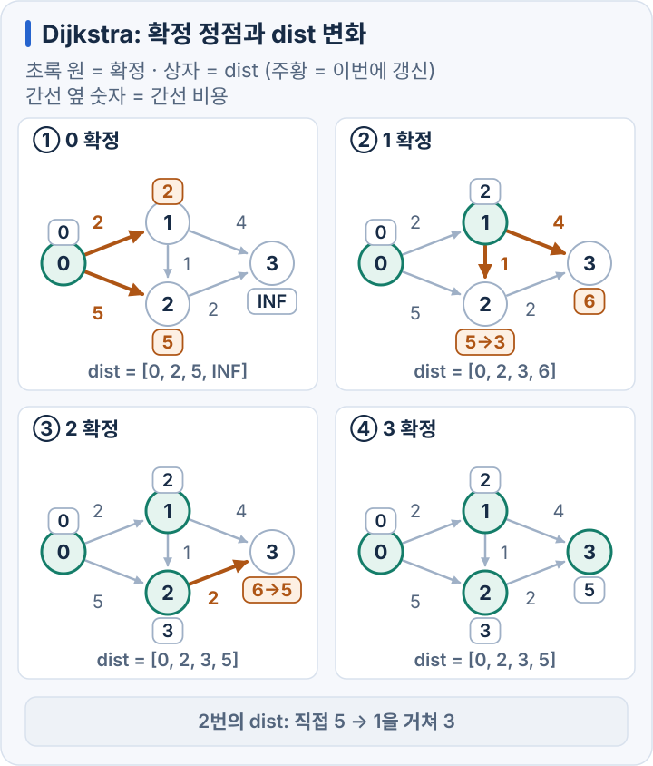
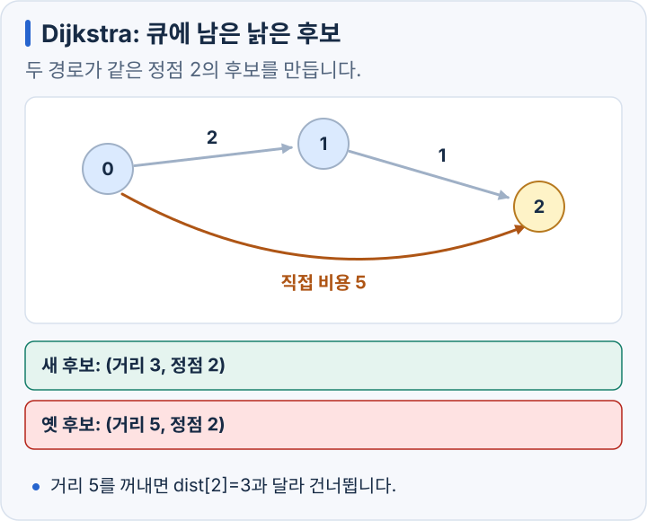

# Dijkstra 최단거리

Dijkstra 알고리즘은 **간선 가중치가 음수가 없는 그래프**에서, 한 시작 정점으로부터 다른 모든 정점까지의 최단거리를 구하는 알고리즘입니다. 한국어로는 보통 **다익스트라 알고리즘**이라고 부릅니다.

가장 대표적인 문제는 다음 형태입니다.

```text
정점과 가중치가 있는 간선이 주어진다.
시작 정점 s에서 각 정점 v까지의 최단거리 dist[v]를 구한다.
모든 간선의 가중치는 0 이상이다.
```

모든 경로를 직접 나열하면 경우의 수가 너무 많습니다. Dijkstra는 "지금까지 알려진 거리 중 가장 작은 정점은 이제 확정해도 된다"는 성질을 이용해 필요한 후보만 확장합니다.

## 최단거리 배열

`dist[v]`는 시작점에서 정점 `v`까지 현재까지 발견한 가장 짧은 거리입니다.

처음에는 시작점만 거리가 `0`이고, 나머지는 아직 모른다는 뜻으로 충분히 큰 값 `INF`를 넣습니다.

알고리즘이 진행되면서 더 짧은 경로를 발견하면 `dist` 값을 줄입니다. 이 작업을 보통 **relax**라고 부릅니다.

```text
u까지의 거리 + 간선 (u -> v)의 비용이
현재 dist[v]보다 작으면 dist[v]를 갱신한다.
```

## 가장 가까운 후보부터 본다

Dijkstra의 핵심 선택은 단순합니다.

```text
아직 확정하지 않은 정점 중 dist 값이 가장 작은 정점을 고른다.
```

이 정점을 `u`라고 합시다. 모든 간선 가중치가 0 이상이면, 아직 확정하지 않은 다른 정점을 거쳐 다시 `u`로 오는 경로가 더 짧아질 수 없습니다. 다른 후보들의 현재 거리도 `dist[u]` 이상이고, 거기에 0 이상의 간선을 더해도 `dist[u]`보다 작아질 수 없기 때문입니다.

그래서 `u`의 거리는 최단거리로 확정할 수 있습니다. 그다음 `u`에서 나가는 간선을 보며 이웃 정점의 거리를 갱신합니다.

## 작은 예시

다음 그래프에서 `0`번 정점에서 시작한다고 해봅시다.

```text
0 --2--> 1 --1--> 2
0 --5--> 2 --2--> 3
1 --4--> 3
```

초기 상태는 아래와 같습니다.

| 단계 | 확정 정점 | dist |
| --- | --- | --- |
| 시작 | 없음 | `[0, INF, INF, INF]` |
| 0 확정 | 0 | `[0, 2, 5, INF]` |
| 1 확정 | 0, 1 | `[0, 2, 3, 6]` |
| 2 확정 | 0, 1, 2 | `[0, 2, 3, 5]` |
| 3 확정 | 0, 1, 2, 3 | `[0, 2, 3, 5]` |

`2`번 정점의 처음 거리는 `0 -> 2`로 가는 `5`였습니다. 하지만 `1`을 확정한 뒤 `0 -> 1 -> 2` 경로를 발견하면서 `3`으로 줄어듭니다.



[그림 크게 보기](https://git.readiz.com/h-contest-lesson/lessons/dijkstra/lesson-assets/relax-steps.svg)

초록 원이 확정된 정점이고, 주황색 상자가 그 단계에서 갱신된 dist입니다. 주황 화살표는 그 단계에서 확정 정점이 완화한 간선입니다.

## 우선순위 큐 구현

[Dijkstra: 거리 갱신과 낡은 후보 건너뛰기](https://git.readiz.com/h-contest-lesson/demos/index.html?demo=dijkstra)

우선순위 큐의 후보와 현재 최단거리 배열을 나란히 비교해 보세요. 더 짧은 경로를 찾은 뒤에도 큐에 남아 있는 이전 후보를 꺼내면, 거리 불일치를 확인하고 확장하지 않습니다.

매번 아직 확정하지 않은 모든 정점을 훑어 최솟값을 찾으면 `O(V^2)`입니다. 간선이 많지 않은 그래프에서는 우선순위 큐를 써서 더 빠르게 구현합니다.

공통 `min-heap` 블록은 `(key, id)` 쌍에서 `key`가 가장 작은 항목부터 꺼냅니다. 거리를 `key`, 정점 번호를 `id`로 넣으면 따로 비교 함수를 붙이지 않아도 최소 힙처럼 쓸 수 있습니다. 아래 코드는 방향 그래프이며, 무방향 간선이면 양쪽 인접 리스트에 모두 추가합니다.

> **코드 환경: h-contest 제출용 코드.** [공통 코드](https://h.readiz.com/learn/cpp-common-library)의 `min-heap` 블록을 먼저 붙입니다. 표준 헤더·STL·동적 할당 없이 고정 배열로 구현하며, 아래 두 블록을 이어서 사용합니다.

그래프는 `head`/`next` 배열 인접 리스트(간선 번호로 연결, [BFS/DFS 강의](https://h.readiz.com/learn/bfs-dfs-grid)와 같은 형태에 `cost`를 더함)입니다. 상한은 이 강의 연습의 입력 상한인 정점 `MAX_V = 200000`, 간선 `MAX_E = 400000`이며, 실제 문제에서는 제한에 맞춰 바꿉니다. 큰 `Graph`와 힙은 전역으로 두고, TC마다 `graph.init(n)`을 호출합니다. 힙은 `dijkstra` 안에서 비웁니다.

```cpp
const int MAX_V = 200000; // 정점 수 상한
const int MAX_E = 400000; // 방향 간선 수 상한
const long long INF = 4000000000000000000LL;

struct Graph {
    int head[MAX_V];
    int next[MAX_E];
    int to[MAX_E];
    long long cost[MAX_E];
    int edgeCount;

    void init(int n) { // 전제: 0 <= n <= MAX_V
        for (int i = 0; i < n; ++i) head[i] = -1;
        edgeCount = 0;
    }
    bool addEdge(int u, int v, long long c) { // 간선이 가득 차면 false
        if (edgeCount == MAX_E) return false;
        to[edgeCount] = v;
        cost[edgeCount] = c;
        next[edgeCount] = head[u];
        head[u] = edgeCount++;
        return true;
    }
};
```

힙에는 거리가 **줄어든 순간마다** 항목이 하나 들어갑니다. 음수 없는 가중치에서는 정점이 한 번만 확장되므로 간선마다 많아야 한 번 완화되어, 시작점을 합쳐도 `MAX_E + 1`칸이면 충분합니다. 힙이 가득 차서 `push`가 실패하면 입력 전제(음수 없는 가중치)가 깨진 것이므로 `false`를 반환합니다. `dist[0..n)`은 함수가 채우며, `0 <= start < n <= MAX_V`가 아니면 `false`입니다.

```cpp
hc::MinHeap<MAX_E + 1> heap;

bool dijkstra(const Graph& graph, int n, int start, long long dist[]) {
    if (n < 0 || n > MAX_V || start < 0 || start >= n) return false;
    for (int i = 0; i < n; ++i) dist[i] = INF;
    heap.clear();

    dist[start] = 0;
    heap.push(0, start);

    hc::HeapItem top;
    while (heap.pop(top)) {
        long long currentDist = top.key;
        int u = top.id;

        if (currentDist != dist[u]) {
            continue;
        }

        for (int e = graph.head[u]; e != -1; e = graph.next[e]) {
            int v = graph.to[e];
            long long nextDist = currentDist + graph.cost[e];
            if (nextDist < dist[v]) {
                dist[v] = nextDist;
                if (!heap.push(nextDist, v)) return false;
            }
        }
    }

    return true;
}
```

`currentDist != dist[u]`인 항목을 건너뛰는 부분이 중요합니다. 같은 정점의 거리가 여러 번 줄어들면 우선순위 큐 안에 오래된 후보가 남을 수 있습니다. 큐에서 꺼냈을 때 현재 `dist`와 다르면 이미 더 좋은 경로가 발견된 것이므로 버립니다.



[그림 크게 보기](https://git.readiz.com/h-contest-lesson/lessons/dijkstra/lesson-assets/concept-trace.svg)

## 왜 음수 간선이 있으면 안 될까

Dijkstra는 가장 가까운 후보를 꺼내는 순간 그 거리를 확정합니다. 이 말은 "나중에 돌아오는 경로가 이 값을 더 줄일 수 없다"는 뜻입니다.

음수 간선이 있으면 이 전제가 깨집니다.

```text
0 -> 1 비용 2
0 -> 2 비용 5
2 -> 1 비용 -10
```

시작점이 `0`이면 처음에는 `dist[1] = 2`, `dist[2] = 5`입니다. Dijkstra는 `1`을 먼저 확정하려고 합니다. 하지만 실제로는 `0 -> 2 -> 1` 경로의 비용이 `-5`입니다. 나중에 더 짧아지는 길이 존재하므로, 확정 선택이 안전하지 않습니다.

다만 **위 코드 전체를 이 예시에 실행하면 `dist[1]`에 `-5`가 남습니다.** 방문한 정점을 막는 배열이 없어서 `1(거리 2) → 2(거리 5) → 1(거리 -5)` 순서로 다시 꺼내기 때문입니다. 이 예시는 현재 코드의 오답 예시가 아니라, 한 번 꺼낸 거리를 확정할 수 없다는 반례입니다. 목표가 `1`이라고 첫 pop에서 종료하면 `2`를 반환하여 틀립니다.

재삽입을 허용하면 음수 사이클이 없는 입력에서도 같은 정점을 여러 번 처리할 수 있어 아래의 Dijkstra 시간 보장과 힙 용량 계산이 사라집니다. 도달 가능한 음수 사이클이 있으면 거리 감소가 반복되어 종료도 보장되지 않습니다. 음수 간선이 있는 문제에는 Bellman-Ford를, DAG라면 위상 순서에 따른 완화를 사용합니다. 재삽입 구현과 확정 구현의 차이는 [Princeton의 Shortest Paths Q&A](https://algs4.cs.princeton.edu/44sp/)에서도 다룹니다.

## 시간 복잡도

우선순위 큐 구현의 시간 복잡도는 보통 아래처럼 봅니다.

```text
O((V + E) log V)
```

- `V`: 정점 수
- `E`: 간선 수

위 구현은 오래된 항목을 남기므로 힙 크기는 `O(E)`, 시간은 `O(V + E log(E + 1))`입니다. 단순 그래프에서는 `E <= V²`여서 위의 `log V` 표기로 쓸 수 있습니다. 입력이 아주 조밀해서 `E`가 `V^2`에 가까우면 단순 `O(V^2)` 구현이 더 편할 때도 있지만, 일반적인 문제에서는 우선순위 큐 구현을 기본으로 씁니다.

## 출발점이나 도착점이 여러 개인 경우

가장 가까운 출발점까지의 거리가 필요하면 모든 출발점의 거리를 0으로 두고 처음부터 힙에 함께 넣습니다. 이후 반복문은 같습니다. 힙 용량에는 출발점 수를 더합니다.

모든 간선 비용이 비음수라는 전제에서, 목표 하나의 거리만 필요하면 오래된 후보를 거르는 검사 뒤에 `u == target`인지 확인하고 종료할 수 있습니다. 목표를 힙에 **넣은 순간**에는 아직 더 짧은 경로가 나타날 수 있으므로 종료하면 안 됩니다.

거리 합은 `long long`으로 계산합니다. `INF`는 가능한 실제 거리보다 크고 간선 비용을 더해도 정수 범위를 넘지 않도록 잡습니다.

## 경로 복원

거리뿐 아니라 실제 최단 경로도 필요하면, 거리를 갱신할 때 이전 정점을 저장합니다.

`parent`를 -1로 초기화하고, `dist[v]`를 줄이는 분기에서 `parent[v] = u`를 함께 기록합니다.

목표 정점 `target`에서 `parent`를 따라 시작점까지 거슬러 올라간 뒤 뒤집으면 경로가 됩니다.

`path`는 `n`칸 이상의 배열이고, 함수는 경로의 정점 수를 반환합니다. 정점이 한 번만 나오는 경로이므로 길이는 `n`을 넘지 않습니다.

```cpp
int restorePath(int target, const int parent[], int path[]) {
    int length = 0;
    for (int v = target; v != -1; v = parent[v]) {
        path[length++] = v;
    }
    for (int i = 0, j = length - 1; i < j; ++i, --j) {
        int temp = path[i];
        path[i] = path[j];
        path[j] = temp;
    }
    return length;
}
```

단, `dist[target] == INF`라면 시작점에서 도달할 수 없는 정점입니다. 이 경우에는 경로 복원을 하지 않거나 빈 경로(길이 0)로 처리합니다.

## 더 단순한 큐로 충분한 경우

모든 간선 비용이 1이면 [BFS](https://h.readiz.com/learn/bfs-dfs-grid), 0과 1만 있으면 [0-1 BFS](https://h.readiz.com/learn/zero-one-bfs)로 처리할 수 있습니다. 거리 순서를 유지하는 데 일반적인 최소 힙까지 필요하지 않기 때문입니다.

## 로컬 연습: 비음수 방향 그래프의 거리

시작점에서 각 정점까지의 최소 비용을 구하세요. 평행 간선과 비용 0인 간선도 허용합니다.

**입력:** N M S 뒤 M줄의 u v w. 1 <= N <= 200000, 0 <= M <= 400000, 0 <= w <= 10^9, 정점은 0-based입니다.

**출력:** 정점 번호순 최소 비용을 한 줄에 출력하고 도달 불가 정점은 -1로 표시합니다.

### 예시

```text exercise=dijkstra role=input
5 6 0
0 1 4
0 2 1
2 1 2
1 3 1
2 3 7
0 1 5
```

```text exercise=dijkstra role=output
0 3 1 4 -1
```

**확인 방법:** 0→2→1→3은 비용 4입니다. 작은 입력은 Bellman-Ford와 대조합니다. 큐에서 꺼낸 오래된 거리 후보를 건너뛰고, 모든 거리와 누적 비용은 long long으로 계산합니다. 이 강의의 제출용 코드는 고정 인접 리스트와 공통 최소 힙을 사용하며, 성공한 완화마다 push할 공간(`MAX_E + 1`)을 확보합니다.

## 휴리스틱 풀이에서 쓰는 곳

Dijkstra는 이동 비용이 서로 다른 상태 그래프에서 거리 전처리를 만들 때 씁니다. 휴리스틱에서는 후보 사이의 실제 이동 비용을 구한 뒤 그 값을 평가 함수에 넣어 순서를 정하는 경우가 많습니다. 상태에 방향이나 적재량 같은 정보를 포함해 정점을 늘려 두면 비용이 달라지는 규칙도 간선 가중치로 표현할 수 있습니다.

- [로봇 청소기](/practice/ROBOTCLEAN): 집은 `64 x 64`, 이동 10, 회전 15(왼쪽·오른쪽·180도 모두 한 번에 15), 스캔 20입니다. 벽에 막혀도 `move`는 10을 씁니다. 정점을 (칸, 방향)으로 잡으면 4096 x 4 = 16384개이고, 이동 간선 10과 회전 간선 15로 알려진 지도 위의 최소 비용 경로를 구할 수 있습니다. 같은 칸이라도 바라보는 방향에 따라 다음 비용이 달라지기 때문입니다.
- [화물 도로 복구](/practice/FRIEGHTFIX): 도시 1000개, 도로 3000개입니다. 도로를 지나는 비용은 `10 + repairNum * 트럭 무게`이고 트럭 무게는 `10 + 화물 무게`입니다. 화물이 정해지면 도로마다 필요한 복구량이 정해지므로, 화물을 싣고 가는 구간은 그 무게에 맞춘 가중치로 Dijkstra를 돌릴 수 있습니다. 도로를 지나면 상태가 줄어들어 가중치가 바뀌므로, 거리 전처리를 어느 시점에 다시 할지 정해야 합니다.
