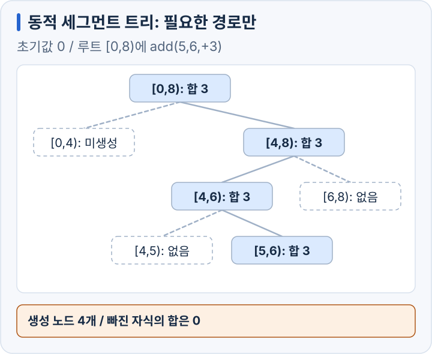

# Dynamic Segment Tree

Dynamic Segment Tree는 좌표 범위가 매우 크지만 실제로 접근하는 지점이나 구간이 적을 때 필요한 node만 만드는 Segment Tree입니다. 좌표 압축이 어렵거나 온라인으로 새로운 좌표가 계속 등장하는 문제에서 유용합니다.

## 문제 신호

| 문제 표현 | Dynamic Segment Tree 관점 |
| --- | --- |
| 좌표가 `10^9` 또는 `10^18`까지 크다 | array tree 불가 |
| 업데이트/질의 수는 상대적으로 작다 | touched node만 생성 |
| 온라인으로 좌표가 들어온다 | 사전 좌표 압축 어려움 |
| 구간 update와 구간 sum/min query | lazy node 필요 |
| 대부분 구간은 기본값 0이다 | sparse structure |

좌표를 모두 미리 알고 있고 정렬해도 의미가 보존된다면 좌표 압축이 더 단순합니다. Dynamic Segment Tree는 압축이 불편하거나 구간 전체 길이가 의미 있을 때 선택합니다.

## 기본 구조



[그림 크게 보기](https://git.readiz.com/h-contest-lesson/lessons/dynamic-segment-tree/lesson-assets/structure-trace.svg)

점 하나의 갱신에서는 그 점으로 내려가는 경로만 만듭니다. 그림은 초기값이 0이고 기존 lazy가 없는 경우입니다. 구간 갱신 뒤 lazy를 내리는 질의에서는 양쪽 자식이 새로 생길 수 있습니다.

일반 Segment Tree는 `4N` 배열을 잡지만, Dynamic Segment Tree는 node pool을 두고 child index를 필요할 때 만듭니다. h-contest 제출 코드에서는 이 pool을 고정 크기 배열과 사용한 개수(`used`)로 두고, 새 node가 필요하면 `pool[used]`를 꺼내 `used`를 하나 늘립니다. 인덱스 0은 "자식 없음"을 뜻하는 빈 node입니다.

```text
node {
  left child index
  right child index
  aggregate
  lazy
}
```

아래 구현의 모든 구간은 정수 좌표의 half-open `[left, right)`입니다. 루트는 `left < right`, 질의와 갱신은 루트 내부의 `left <= right` 범위입니다. 중간점은 `left + (right - left) / 2`로 계산하며, 구간 길이와 `길이 × 증가량`이 `long long` 범위에 들어와야 합니다.

## Range Add / Range Sum 구현

아래 구현은 모든 원소의 초기값이 0인 구간에 덧셈과 합 질의를 처리합니다. 생성하지 않은 자식의 합도 0으로 봅니다.

> **코드 환경: h-contest 제출용 코드.** 표준 헤더·STL·동적 할당 없이 고정 크기 node pool로 구현하므로 앞에 붙일 [공통 코드](https://h.readiz.com/learn/cpp-common-library) 블록이 없습니다.

pool 크기는 `MAX_NODES = 2 + MAX_OPS × 4 × MAX_HEIGHT`로 잡습니다. `MAX_OPS`는 `add`와 `sum` 호출 수의 합(이 사이트 연습은 `Q <= 20000`), `MAX_HEIGHT`는 루트 길이 `C`에 대해 `2^MAX_HEIGHT >= C`인 값(`C = 10^12`이면 40)이며, 둘 다 문제의 제한에 맞춰 바꿉니다. 호출 하나는 높이마다 일부만 겹치는 node를 최대 2개 거치고, 각각이 자식 둘을 새로 만들 수 있기 때문에 새 node는 많아야 `4 × 높이`개입니다. 앞의 2는 빈 node 0번과 루트입니다.

`pool`은 정적 배열이라 이전 TC의 값이 남습니다. 큰 `DynamicSegmentTree`는 전역으로 선언하고, TC가 시작될 때마다 `init(left, right)`를 부릅니다. `init`은 `used = 2`로 되돌리고 루트만 비우며, `newNode`가 꺼내는 node는 그때마다 0으로 채워서 지난 TC가 쓴 칸이 남아도 읽히지 않습니다. 이 상수로 `pool`은 약 320만 칸(칸당 24바이트, 약 77MB)이 되며, 메모리 제한이 작으면 연산 수와 높이를 실제 제한에 맞춰 줄입니다.

```cpp
const int MAX_OPS = 20000;   // add와 sum 호출 수의 합 상한
const int MAX_HEIGHT = 40;   // 2^MAX_HEIGHT >= 루트 구간의 길이
const int MAX_NODES = 2 + MAX_OPS * 4 * MAX_HEIGHT;

struct Node {
    int leftChild;
    int rightChild;
    long long sum;
    long long lazy;
};

struct DynamicSegmentTree {
    Node pool[MAX_NODES];
    int used; // 지금까지 꺼낸 node 수(0번과 루트 포함)
    long long rootLeft;
    long long rootRight;

    bool init(long long left, long long right) { // left < right가 아니면 false
        if (left >= right) return false;
        rootLeft = left;
        rootRight = right;
        used = 2;
        pool[0] = Node{0, 0, 0, 0};
        pool[1] = Node{0, 0, 0, 0};
        return true;
    }

    int newNode() {
        pool[used] = Node{0, 0, 0, 0};
        return used++;
    }

    void apply(int node, long long left, long long right, long long value) {
        pool[node].sum += (right - left) * value;
        pool[node].lazy += value;
    }

    void push(int node, long long left, long long right) {
        if (pool[node].lazy == 0 || right - left <= 1) {
            return;
        }
        long long mid = left + (right - left) / 2;
        if (pool[node].leftChild == 0) {
            pool[node].leftChild = newNode();
        }
        if (pool[node].rightChild == 0) {
            pool[node].rightChild = newNode();
        }
        long long value = pool[node].lazy;
        apply(pool[node].leftChild, left, mid, value);
        apply(pool[node].rightChild, mid, right, value);
        pool[node].lazy = 0;
    }

    long long childSum(int child) const {
        return child == 0 ? 0 : pool[child].sum;
    }

    void pull(int node) {
        pool[node].sum = childSum(pool[node].leftChild) + childSum(pool[node].rightChild);
    }

    void rangeAdd(int node, long long left, long long right, long long ql, long long qr, long long value) {
        if (qr <= left || right <= ql) {
            return;
        }
        if (ql <= left && right <= qr) {
            apply(node, left, right, value);
            return;
        }
        push(node, left, right);
        long long mid = left + (right - left) / 2;
        if (ql < mid) {
            if (pool[node].leftChild == 0) {
                pool[node].leftChild = newNode();
            }
            rangeAdd(pool[node].leftChild, left, mid, ql, qr, value);
        }
        if (mid < qr) {
            if (pool[node].rightChild == 0) {
                pool[node].rightChild = newNode();
            }
            rangeAdd(pool[node].rightChild, mid, right, ql, qr, value);
        }
        pull(node);
    }

    long long rangeSum(int node, long long left, long long right, long long ql, long long qr) {
        if (node == 0 || qr <= left || right <= ql) {
            return 0;
        }
        if (ql <= left && right <= qr) {
            return pool[node].sum;
        }
        push(node, left, right);
        long long mid = left + (right - left) / 2;
        return rangeSum(pool[node].leftChild, left, mid, ql, qr)
             + rangeSum(pool[node].rightChild, mid, right, ql, qr);
    }

    void add(long long left, long long right, long long value) {
        rangeAdd(1, rootLeft, rootRight, left, right, value);
    }

    long long sum(long long left, long long right) {
        return rangeSum(1, rootLeft, rootRight, left, right);
    }
};

DynamicSegmentTree dynamicTree;
```

루트 범위는 문제 조건보다 한 칸 넓은 half-open 범위로 잡습니다. 예를 들어 좌표가 `0 <= x <= 1e9`이면 `[0, 1000000001)`처럼 둡니다.

## 좌표 압축과 비교

| 조건 | 좌표 압축 | Dynamic Segment Tree |
| --- | --- | --- |
| 모든 좌표를 미리 알 수 있음 | 좋음 | 가능하지만 과함 |
| 구간 길이가 답에 직접 영향 | endpoint 보강 필요 | 자연스러움 |
| 온라인 좌표 등장 | 어려움 | 좋음 |
| 메모리 예측 | `O(K)` | `O(Q log C)` |
| 구현 난도 | 낮음 | 중간 |

좌표 압축에서는 구간 길이를 잃기 쉽습니다. 구간 합집합 길이처럼 실제 좌표 간격이 중요하면 compression interval을 별도로 관리해야 합니다.

## 메모리 계산

구간 update 하나가 깊이 `log C`만큼 node를 만들고, segment tree interval decomposition 때문에 여러 경로에 닿을 수 있습니다.

```text
node count = O(number_of_operations * log coordinate_range)
```

좌표 범위가 `2^60`이어도 깊이는 60입니다. 위 구현은 질의에서도 `push`가 자식을 만들 수 있으므로, 메모리를 계산할 때 업데이트와 질의 수를 모두 포함합니다. 고정 pool에서는 이 계산이 곧 배열 크기이므로 `MAX_NODES = 2 + (add와 sum 호출 수) × 4 × 높이`로 정하고, 호출 수나 좌표 범위가 늘면 함께 키웁니다.

## 시간 복잡도

| 작업 | 복잡도 |
| --- | --- |
| point update/query | `O(log C)` |
| range update/query | `O(log C)` |
| 생성 node 수 | touched interval 수에 비례 |
| 전체 메모리 | 보통 `O(Q log C)` |

## 로컬 연습: 큰 좌표의 구간 덧셈과 합

정수 좌표 0..10^12-1의 값은 처음에 모두 0입니다. A l r delta는 [l,r)에 delta를 더하고, S l r은 그 구간의 합을 묻습니다.

**입력:** Q 뒤 Q개 연산. 0 <= Q <= 20000, 0 <= l <= r <= 10^12, |delta| <= 100입니다. 합과 lazy는 long long으로 계산합니다.

**출력:** S 연산마다 합을 출력합니다.

### 예시

```text exercise=dynamic-segment-tree role=input
6
A 0 10 2
S 0 1
A 5 8 -1
S 4 9
S 9 10
S 5 5
```

```text exercise=dynamic-segment-tree role=output
2
7
2
0
```

**확인 방법:** 좌표 상한을 20으로 줄이면 실제 배열의 원소별 갱신·합산과 비교할 수 있습니다. 빈 구간, 전체 구간 갱신 뒤 작은 부분 질의, 같은 구간의 더하기·빼기를 검사합니다. 큰 상한에서는 10^12개의 배열을 만들지 말고 생성한 노드 수와 메모리를 함께 기록합니다.

## 휴리스틱 풀이에서 쓰는 곳

휴리스틱 대회에서 동적 세그먼트 트리는 드물게 씁니다. 값 범위는 크지만 실제 갱신은 적은 경우에 쓰는 도구인데, 확인한 문제에서는 다른 방법이 먼저 맞습니다. [검수 게이트 예약](/practice/INSPECTION)은 시각이 최대 1,000,000,000이지만 요청이 최대 5000개라 좌표 압축으로 줄일 수 있고, [택시 호출 지도](/practice/TAXICALL)는 `mapSize`가 최대 1,000,000,000이지만 호출 거리 크기의 격자 칸으로 나누는 방식이 더 단순합니다.

좌표 압축이나 버킷으로 범위를 줄일 수 없고, 온라인으로 구간 질의가 이어질 때 이 강의를 검토합니다.
