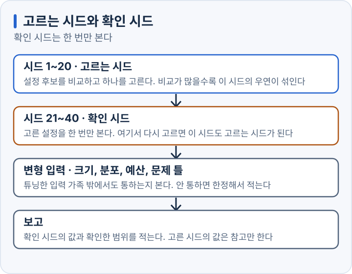
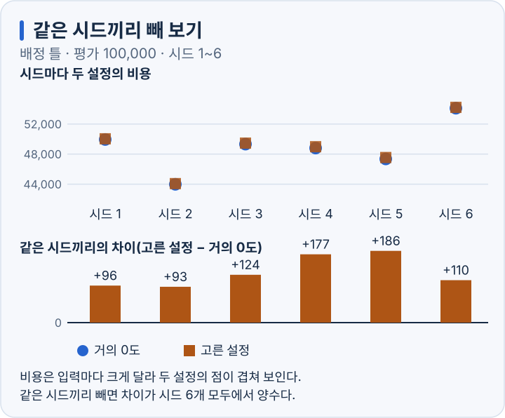
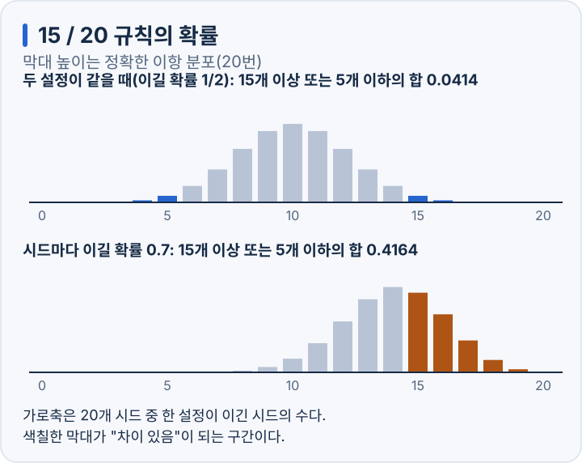
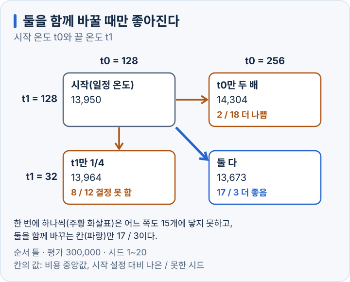

# 원리: 짝지은 비교, 판정 규칙의 근거, 튜닝 절차

앞의 여덟 강의는 설정을 비교할 때 모두 같은 규칙을 썼습니다. 시드 20개에서 같은 시드끼리 짝지어 비교하고, 한쪽이 15개 이상 나으면 차이가 있다고 하며, 아니면 "결정 못 함"이라고 적는 규칙입니다. 이 페이지는 그 규칙이 왜 그렇게 정해졌는지, 어떤 확률로 틀리는지, 어디까지만 믿을 수 있는지를 다룹니다. 손으로 따라가는 예는 시드 6개의 비교이고, 수치는 [구현](implementation.md)의 코드와 [실험과 점검](practice.md)이 재현합니다.

이 강의가 다루는 것은 **점수 비교 실험**입니다. 답이 맞는지 확인하는 정답 검증과 스트레스 테스트는 [Testing과 Stress Test](https://h.readiz.com/learn/testing-and-stress)가 다룹니다. 거기서는 틀린 입력 하나가 증거이지만, 여기서는 점수가 입력과 난수에 따라 흔들리므로 "이 설정이 저 설정보다 낫다"가 우연일 수 있다는 점이 문제입니다. 통계 검정 이론과 신뢰구간 공식의 정식 전개는 이 강의의 범위 밖이며, 필요한 결과만 정확한 값으로 씁니다.

## 언제 쓰고 언제 쓰지 않는가

| 상황 | 선택 |
| --- | --- |
| 점수가 입력과 탐색 난수에 따라 흔들리고, 입력을 여러 개 만들 수 있다 | 같은 입력·같은 시드 20개 이상에서 짝지은 비교. 시드마다 설정을 모두 돌린다 |
| 탐색에 난수가 없고 입력이 하나뿐이다 | 한 번 재면 된다. 다만 그 입력에서의 결과이며 다른 입력으로의 일반화는 따로 확인한다 |
| 차이가 입력 흔들림보다 훨씬 크다(점수가 몇 배) | 시드 몇 개로도 방향은 보이지만 승패 수를 함께 적는다 |
| 설정 후보가 여러 개이고 그중 좋은 것을 고른다 | 고르는 시드와 확인하는 시드를 나누고, 확인 시드에서 한 번 더 본다 |
| 알고리즘이 맞는지 확인하고 싶다 | 이 강의가 아니라 [Testing과 Stress Test](https://h.readiz.com/learn/testing-and-stress)의 정답 대조 |
| 연산 시간이나 메모리를 비교하고 싶다 | 연산 횟수로 바꿔 세는 방법은 [후보 줄이기와 시간 예산](https://h.readiz.com/learn/candidate-and-time-budget) |
| 시드를 늘려도 같은 승패가 나온다 | 차이가 실제일 가능성이 높다. 그래도 크기(중앙값 차이)를 함께 적는다 |

## 이 강의의 실험 대상과 시드 규칙

예시는 [연습용 문제 틀](https://h.readiz.com/learn/problem-modeling)의 두 가지입니다. 순서 문제는 점 `N = 200`개가 `0..999` 정수 좌표에 있고 모든 점을 한 번씩 지나는 경로의 맨해튼 거리 합이 비용이며, 배정 문제는 작업 `N = 120`개를 기계 `M = 8`대에 기계당 `K = 18`개까지 맡겨 `Σ load² / 100 + Σ 추가 비용`을 줄이는 문제입니다. 입력을 만드는 난수는 `x = x * 6364136223846793005 + 1442695040888963407`(64비트)이고 값은 `(x >> 33) % 범위`입니다. 탐색에 쓰는 난수는 이와 따로 둔 `hc::Random`입니다. 문제 정의는 [근방 설계와 차분 평가](https://h.readiz.com/learn/neighborhood-and-delta)에 있습니다.

실험 대상은 [언덕 오르기와 담금질](https://h.readiz.com/learn/hill-climbing-and-annealing)의 담금질을 이 강의가 튜닝할 수 있게 줄인 것입니다. 튜닝하는 값은 시작 온도 `t0`, 끝 온도 `t1`(비용의 1/8 단위), 순서 틀에서 "한 점 옮기기"를 제안하는 비율 `ins`입니다. 순서 틀의 평가 횟수는 300,000, 배정 틀은 100,000입니다. 시드는 용도로 나눕니다.

- **고르는 시드:** 입력과 탐색 난수가 모두 시드 1~20입니다. 설정을 비교하고 고르는 데 씁니다.
- **확인 시드:** 시드 21~40입니다. 설정을 고른 뒤에 한 번만 봅니다.
- **변형 입력:** 점 100개와 400개, 점이 8개 뭉치에 모인 분포, 다른 예산, 배정 틀입니다. 튜닝한 입력 가족을 벗어나서도 그 설정이 통하는지 봅니다.

[그림 크게 보기](https://git.readiz.com/h-contest-lesson/lessons/experiments-and-tuning/lesson-assets/holdout-split.svg)

## 무엇을 재는가

점수 하나로 "좋다"를 말하기 전에 어떤 양을 재는지 정합니다. 같은 탐색이라도 아래 네 가지는 서로 다른 질문에 답합니다.

| 재는 것 | 답하는 질문 | 함정 |
| --- | --- | --- |
| 최종 점수(예산 고정) | 이 예산에서 어느 설정이 더 좋은 해를 내는가 | 예산이 바뀌면 순위가 바뀔 수 있다 |
| 같은 평가 횟수의 점수 | 비용이 다른 설정끼리 공정하게 비교한다 | 평가 한 번의 비용이 다르면 횟수가 같아도 일이 다르다. 시간으로 잴 때는 연산 수로 바꿔 센다 |
| 예산을 늘릴 때의 곡선 | 예산이 커지면 어느 설정이 앞서는가 | 한 예산의 순위를 곡선 전체의 순위로 읽지 않는다 |
| 실패율·무효율 | 평균이 좋아도 목표에 못 미치는 시드나 무효 제안이 얼마나 되는가 | 중앙값만 보면 나쁜 꼬리를 놓친다 |

실제 값은 [실험과 점검](practice.md)의 첫 절에서 순서 틀의 예산별 곡선과 목표 미달 시드 수, 배정 틀의 무효 제안 비율로 봅니다.

## 같은 입력, 여러 시드, 짝지은 비교

탐색에 난수가 있으면 같은 설정을 같은 입력에서 다시 돌려도 점수가 다릅니다. 또 입력이 바뀌면 점수의 수준 자체가 달라집니다. 설정 둘을 비교하려는데 이 두 흔들림이 섞이면 설정의 차이가 묻힙니다. 해법은 비교를 **같은 입력, 같은 시드끼리** 하는 것입니다. 시드 `s`에서 설정 A와 B를 모두 돌려 `A(s)`와 `B(s)`를 견주면, 입력이 어렵고 쉬운 차이는 두 값에 똑같이 들어가 지워집니다.

아래 그림은 배정 틀에서 "거의 0도"(온도를 거의 0으로 둬 좋아지는 이동만 받는 설정, 정의는 [실험과 점검](practice.md))와 고른 설정 `t0 = 256, t1 = 32`를 시드 6개에서 비교한 것입니다. 점의 위치는 입력마다 크게 달라 두 설정이 겹쳐 보이지만, 같은 시드끼리 빼면 차이의 부호가 모두 같습니다. 비용은 작을수록 좋으므로 이 비교에서는 고른 설정이 더 나쁜 쪽이고, 요점은 방향이 한결같다는 것입니다.

[그림 크게 보기](https://git.readiz.com/h-contest-lesson/lessons/experiments-and-tuning/lesson-assets/paired-vs-unpaired.svg)

절차는 네 단계입니다.

1. 시드 목록을 정하고 두 설정이 같은 목록을 쓴다. 입력 지문(입력을 요약한 값)이 같은 시드끼리 같은지 확인한다.
2. 시드마다 두 설정의 점수를 구한다.
3. 시드마다 어느 쪽이 나은지 가려 "A가 나은 시드 / B가 나은 시드 / 같은 시드"를 센다.
4. 이긴 쪽이 기준(20개 중 15개) 이상이면 "차이 있음", 아니면 "결정 못 함"이라고 적는다.

[같은 입력에서 A와 B의 차이를 쌓기](https://git.readiz.com/h-contest-lesson/demos/index.html?demo=paired-compare)

입력별 차이를 하나씩 쌓아 가며 평균과 구간이 변하는 데모입니다.

:::hint 데모와 이 강의 판정의 차이
이 강의의 판정은 부호(어느 쪽이 나은지)만 세는 규칙이고, 데모는 점수가 클수록 좋은 점수의 평균 차이와 근사 구간을 씁니다. 둘 다 "같은 입력끼리의 차이"를 본다는 점은 같습니다.
:::

### 손으로 따라가는 예: 시드 6개

순서 틀에서 일정 온도 설정(`t0 = t1 = 128`)과 고른 설정(`t0 = 256, t1 = 32`)을 시드 1~6에서 비교한 비용입니다(작을수록 좋음). 차이는 일정 온도 − 고른 설정이므로 양수면 고른 설정이 낫습니다.

<!-- check:table hand -->
| 시드 | 일정 온도 | 고른 설정 | 차이 | 나은 쪽 |
| ---: | ---: | ---: | ---: | --- |
| 1 | 13,893 | 13,620 | +273 | 고른 설정 |
| 2 | 13,825 | 13,673 | +152 | 고른 설정 |
| 3 | 13,771 | 13,567 | +204 | 고른 설정 |
| 4 | 14,134 | 14,376 | -242 | 일정 온도 |
| 5 | 13,861 | 13,672 | +189 | 고른 설정 |
| 6 | 13,810 | 13,601 | +209 | 고른 설정 |

고른 설정이 6개 중 5개 시드에서 낫습니다. 이것이 우연일 확률을 손으로 셉니다. 두 설정이 같다면 시드마다 이길 확률이 1/2이므로 6번 중 `k`번 이기는 경우의 수는 파스칼 삼각형의 `n = 6` 줄 `1, 6, 15, 20, 15, 6, 1`의 `k`번째 수입니다. 5번 이상 이기는 경우는 `6 + 1 = 7`가지, 전체는 `2^6 = 64`가지이므로 한쪽 확률이 `7 / 64`이고 어느 쪽이든 5번 이상 이길 확률은 `14 / 64`(약 0.22)입니다. 한도 0.05를 넘으므로 시드 6개의 5승 1패는 "결정 못 함"입니다. 6승 0패였다면 `2 / 64`(약 0.031)로 한도 안입니다. 시드 6개로는 전부 이겨야 차이가 있다고 할 수 있고, 20개로 늘리면 아래처럼 15개 이상이 기준입니다.

## 15 / 20 규칙이 우연히 나올 확률

두 설정이 **실제로 같다**고 가정합니다. 시드마다 어느 쪽이 나을지는 동전 던지기이고(같은 시드가 없다면 이길 확률 1/2), 20개 중 `k`개 이상 이기는 경우의 수는 `Σ C(20, j)`(`j = k..20`)입니다. 아래 확률은 모두 이 정수를 `2^20 = 1,048,576`으로 나눈 분수의 소수점 4자리 반올림입니다.

<!-- check:table tails -->
| 이긴 시드 수 `k` | 경우의 수 | 한쪽 확률 | 어느 쪽이든 `k` 이상 |
| ---: | ---: | ---: | ---: |
| 12 | 263,950 | 0.2517 | 0.5034 |
| 13 | 137,980 | 0.1316 | 0.2632 |
| 14 | 60,460 | 0.0577 | 0.1153 |
| 15 | 21,700 | 0.0207 | 0.0414 |
| 16 | 6,196 | 0.0059 | 0.0118 |
| 17 | 1,351 | 0.0013 | 0.0026 |
| 18 | 211 | 0.0002 | 0.0004 |

15개 이상이면 한쪽 0.0207, 양쪽 합 0.0414입니다(정확한 분수는 `21,700 / 1,048,576`와 두 배인 `5,425 / 131,072`). 같은 두 설정을 비교해도 24번에 한 번꼴(0.0414)로 "차이 있음"이 나온다는 뜻입니다. 14개 이상이면 0.1153으로 크게 올라가므로 15가 "우연으로 보기 어려운" 가장 느슨한 선입니다.

[그림 크게 보기](https://git.readiz.com/h-contest-lesson/lessons/experiments-and-tuning/lesson-assets/binomial-wins.svg)

### 시드 수에 따른 기준

같은 한도(0.05)를 지키는 기준은 시드 수 `n`마다 다릅니다. `n`이 커져도 기준의 비율(필요한 승 / `n`)은 천천히만 내려갑니다. 아래는 `needWins(n, 20)`의 값이고, 시드 수가 정해져 있다면 이 표로 기준을 새로 잡습니다.

<!-- check:table need -->
| 유효한 시드 수 `n` | 필요한 승 | 양쪽 확률 |
| ---: | ---: | ---: |
| 9 | 8 | 0.0391 |
| 10 | 9 | 0.0215 |
| 15 | 12 | 0.0352 |
| 18 | 14 | 0.0309 |
| 19 | 15 | 0.0192 |
| 20 | 15 | 0.0414 |
| 25 | 18 | 0.0433 |
| 30 | 21 | 0.0428 |
| 40 | 27 | 0.0385 |

### 같은 시드가 있을 때

비교에서 두 설정의 점수가 같은 시드는 어느 쪽에도 세지 않습니다. 이 강의의 규칙은 같은 시드가 있어도 기준을 15로 그대로 둡니다. 그러면 유효한 시드가 줄어든 만큼 규칙이 더 엄격해집니다. `n = 18`(같은 시드 2개)에서는 14개 이상이면 정확한 양쪽 확률이 0.0309로 한도 안인데도 이 강의의 규칙은 "결정 못 함"이라고 합니다. 같은 시드가 시드마다 확률 `t`로 나온다면, 실제로 같은 두 설정에서 규칙이 "차이 있음"을 내는 확률은 아래와 같습니다(정확한 분수 계산).

<!-- check:table ties -->
| 같은 시드가 나올 확률 `t` | 같은 설정에서 "차이 있음"이 나올 확률 |
| ---: | ---: |
| 0 | 0.0414 |
| 1/10 | 0.0129 |
| 1/4 | 0.0015 |
| 1/2 | 0.0000 |

같은 점수가 많은 문제(탐색이 같은 지역 최적에 닿는 경우)에서는 규칙이 우연을 더 잘 거르지만, 진짜 차이도 더 못 잡습니다.

### 진짜 차이가 있을 때 잡는 확률

반대로 설정 하나가 실제로 낫다고 합시다. 시드마다 이길 확률이 `p`일 때 20개 중 어느 한쪽이 15개 이상 이기는(규칙이 차이를 잡는) 확률은 아래와 같습니다.

<!-- check:table power -->
| 시드마다 이길 확률 `p` | 차이를 잡을 확률 |
| ---: | ---: |
| 3/5 | 0.1272 |
| 7/10 | 0.4164 |
| 4/5 | 0.8042 |
| 9/10 | 0.9887 |

시드마다 이길 확률이 0.6~0.7인 차이는 20개 시드로 놓칠 때가 많습니다. 그래서 "결정 못 함"은 "같다"가 아니라 "이 시드 수로는 가리지 못했다"입니다. 앞 강의들은 이 뜻으로 썼습니다. 시드를 늘리면 기준의 비율이 내려가므로(표의 `n = 40`은 27개) 작은 차이도 잡힙니다. 다만 고른 시드와 확인 시드를 합쳐 40개로 판정할 때는 고른 시드에서 이미 고른 설정이라는 점을 함께 적습니다.

### 이 규칙이 보지 않는 것

- **차이의 크기:** 15 / 5는 방향이 일관된다는 뜻이지 개선폭이 크다는 뜻이 아닙니다. 승패 수와 함께 중앙값이나 차이의 사분위를 적습니다.
- **시드의 대표성:** 시드 20개가 비교하려는 입력 가족을 대표한다는 가정입니다. 다른 크기·분포에서는 따로 확인합니다.
- **시드 사이의 독립:** 시드가 서로 독립이라고 가정합니다. 입력 일부를 공유하는 시드로는 이 확률이 성립하지 않습니다.

:::hint 크기까지 보고 싶을 때: 평균과 표준오차 구간
입력별 차이 `d_i`(양수가 후보가 나은 방향)의 평균과 표준오차 `sample_std(d_i) / sqrt(n)`으로 `mean ± 2 × stderr` 구간을 거칠게 만들어 볼 수 있습니다. 구간이 0을 포함하지 않으면 그 방향의 근거이고, 0을 포함하면 이 비교만으로는 우열을 정하지 않습니다. 독립 표본이 충분하고 분포가 극단적이지 않다는 가정 위의 근사이므로, 표본이 적거나 이상치가 있거나 후보를 여러 번 골랐다면 쓰지 않습니다. 평가할 입력 수와 방법은 결과를 보기 전에 정합니다.
:::

## 비교가 여럿일 때와 hold-out

비교를 한 번 할 때 우연히 "차이 있음"이 나올 확률이 `α = 0.0414`라면, 같은 시드로 비교를 `m`번 하면 적어도 한 번 우연히 나올 확률은 `1 − (1 − α)^m`입니다(비교끼리 독립이라고 보았을 때의 값이며, 같은 시드를 공유하는 비교는 독립이 아니라서 거친 근사입니다). 아래는 `α = 5,425 / 131,072`로 정확히 계산한 값입니다. 오른쪽 두 열은 비교 `m`번 전체의 한도를 0.05로 지키려고 한 번의 한도를 `0.05 / m`로 낮췄을 때(`den = 20m`) 필요한 승입니다.

<!-- check:table multi -->
| 비교 수 `m` | 우연히 하나라도 "차이 있음" | 엄한 기준에서 필요한 승 | 그때 한 번의 양쪽 확률 |
| ---: | ---: | ---: | ---: |
| 1 | 0.0414 | 15 / 20 | 0.0414 |
| 2 | 0.0811 | 16 / 20 | 0.0118 |
| 5 | 0.1905 | 17 / 20 | 0.0026 |
| 10 | 0.3447 | 17 / 20 | 0.0026 |
| 20 | 0.5706 | 18 / 20 | 0.0004 |
| 40 | 0.8156 | 18 / 20 | 0.0004 |
| 46 | 0.8569 | 18 / 20 | 0.0004 |

한 표에서 설정을 20개 비교하면 같은 설정끼리라도 57%의 확률로 "차이 있음"이 하나 이상 나옵니다. 대처는 둘입니다.

1. **기준을 엄하게:** 비교 수에 맞춰 위 표의 기준을 씁니다. 가장 단순하고 보수적인 방법이며(비교 수로 한도를 나누는 방식), 진짜 차이도 더 못 잡습니다.
2. **hold-out:** 설정을 고른 시드와 확인하는 시드를 나눕니다. 고른 시드에서 가장 좋았던 설정이 확인 시드에서도 좋은지 한 번만 봅니다. 고르는 과정이 고른 시드의 우연한 좋은 결과를 함께 골라내므로, 고른 설정의 성적은 확인 시드에서 줄어드는 경향이 있습니다([실험과 점검](practice.md)에서 한 설정의 경우를 측정). 확인 시드로 설정을 다시 고르기 시작하면 그 시드도 고르는 시드가 되므로, 확인은 마지막에 한 번만 합니다.

앞 강의들도 같은 장치를 썼습니다. 예를 들어 [언덕 오르기와 담금질](https://h.readiz.com/learn/hill-climbing-and-annealing)은 배정 틀의 "담금질이 재시작보다 나쁨"(5 / 15)을 시드 101~120에서 다시 해 결정 못 함(8 / 11)으로 바꿨습니다. 다른 강의의 사례는 [실험과 점검](practice.md)의 표에 모았습니다.

## 흔들림의 크기

같은 설정을 같은 입력에서 탐색 시드만 바꿔 20번 돌린 점수의 퍼짐이 **탐색 난수의 흔들림**입니다. 입력까지 바꿔 20번 돌린 퍼짐은 **입력 난이도의 흔들림**과 탐색 난수의 흔들림이 섞인 값입니다. 퍼짐은 중앙값과 사분위로 적습니다. 시드 20개에서 중앙값은 10번째, 아래 사분위는 5번째, 위 사분위는 15번째로 작은 값입니다(`n`개라면 `(n+1)/2`, `(n+3)/4`, `(3n+1)/4`번째). 평균과 표준편차는 극단값 하나에 흔들리므로 쓰지 않습니다. 두 설정의 차이가 사분위 폭 안이면 시드 20개로는 가려지지 않을 가능성이 높습니다. 실제 퍼짐은 [실험과 점검](practice.md)의 표에서 설정 차이와 나란히 봅니다.

## 매개변수를 한 번에 하나씩

튜닝은 정한 설정에서 시작해 매개변수 하나를 바꾼 후보를 같은 시드로 짝지어 비교하고, 기준을 넘으면 옮기는 걸음을 되풀이합니다. 구현은 [`stepOnce`](implementation.md)입니다. 이 방법은 단순하고 어느 매개변수가 효과가 있었는지 남기지만 함정이 셋 있습니다.

- **상호작용:** 한 매개변수의 효과가 다른 매개변수의 값에 달려 있으면, 하나씩 바꾸는 걸음은 두 개를 함께 바꿀 때만 좋아지는 설정에 닿지 못합니다. 담금질에서 시작 온도를 올리는 효과는 끝 온도가 높은 채로는 나쁘지만 끝 온도가 낮아지면 좋아질 수 있습니다. 이 강의의 실제 예가 [실험과 점검](practice.md)에 있습니다.
- **기준의 선택:** 엄한 기준(15 / 20)은 잡음에는 안 속지만 작은 개선이 이어진 길을 못 지나 현재에서 멈추기 쉽습니다. 느슨한 기준("이긴 시드가 더 많으면")은 잡음에 이끌려 같은 값 주변을 돌 수 있습니다.
- **고른 시드에 대한 적응:** 걸음마다 고르는 시드를 쓰므로 비교 횟수가 많아질수록 앞 절의 문제가 커집니다. 끝난 설정은 확인 시드에서 따로 평가합니다.

[그림 크게 보기](https://git.readiz.com/h-contest-lesson/lessons/experiments-and-tuning/lesson-assets/interaction-grid.svg)

### 격자 탐색과 무작위 탐색

후보를 격자 모양으로 훑는 방법은 매개변수 하나가 중요하고 나머지는 덜 중요할 때, 같은 값을 반복해서 시험합니다. 3 × 3 격자 9개는 중요한 매개변수의 값을 3가지만 보지만, 같은 9번을 무작위로 뽑으면 중요한 매개변수의 값을 최대 9가지 봅니다. 그래서 "같은 실험 횟수에서는 무작위 탐색이 낫다"는 경험 법칙이 널리 알려져 있습니다. 이 강의의 실험이 그것을 지지하는지는 [실험과 점검](practice.md)의 같은 실험 횟수 비교에서 봅니다.

## 과적합 피하기

고른 시드에서 가장 좋았던 설정은 그 시드에 맞춘 설정입니다. 튜닝이 끝나면 고르는 데 쓰지 않은 것을 바꿔 확인합니다. 같은 입력 가족의 확인 시드에서 성적이 얼마나 줄었는지, 다른 크기(온도처럼 비용의 단위에 묶인 값은 특히)와 다른 분포(점이 몰려 있는 등), 다른 예산과 다른 문제 틀(배정 틀)에서도 통하는지 봅니다. 확인에서 이기지 못했다면 그 설정은 튜닝한 입력 가족에 한정해 쓴다고 적습니다. 실제 확인은 [실험과 점검](practice.md)에 있습니다.

## 실험 기록 형식

기록은 나중에 다른 사람이(또는 자신이) 같은 수치를 다시 만들 수 있게 남깁니다. 한 줄이 한 비교이고 설정, 시드, 결과, 판정이 빠지지 않아야 합니다.

| 칸 | 내용 |
| --- | --- |
| 설정 | 매개변수 전부와 예산, 입력 가족(크기·분포), 코드 버전 |
| 시드 | 시드 목록의 범위, 입력 시드와 탐색 시드의 관계, 용도(고르는 시드/확인 시드) |
| 결과 | 설정마다 중앙값·사분위, 짝지은 비교의 승 / 패 / 같음 |
| 판정 | 기준(예: 15 / 20, 비교 수에 맞춘 기준)과 "차이 있음/결정 못 함" |
| 원본 | 시드마다 점수와 입력 지문. 이 강의는 `lesson-assets/measurements.json` |

한 비교 기록의 모양은 [실험과 점검](practice.md)에서 실제 값으로 봅니다.
