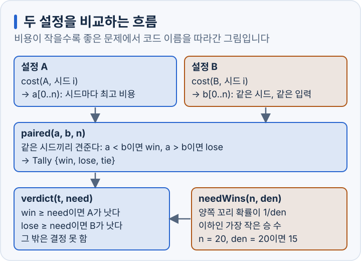
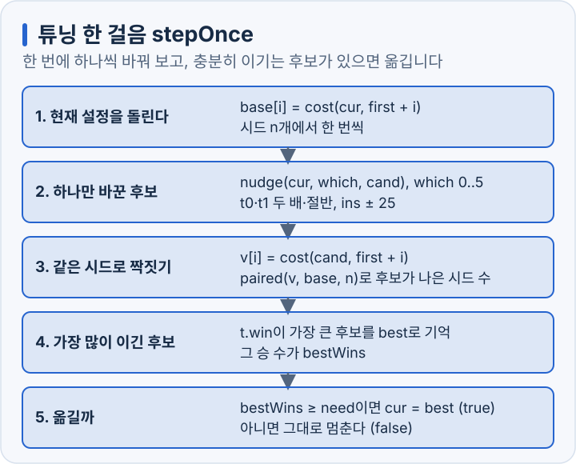

# 구현: 비교·튜닝 틀과 두 문제 유형

[원리](idea.md)의 절차를 코드로 옮깁니다. 코드는 두 부분으로 나눕니다. 문제와 무관한 부분(통계 도구, 튜닝 걸음, 무작위 탐색의 뽑기)과 문제마다 채우는 부분(해의 표현, 이동의 제안·차분·적용, 입력 생성)입니다. 비교와 튜닝 쪽이 문제에 요구하는 것은 **`cost(설정, 시드)` 하나**입니다. 설정과 시드를 받아 한 번 탐색하고 최종 비용을 돌려주는 함수이며, 문제가 바뀌어도 통계 도구와 튜닝 걸음은 한 글자도 고치지 않습니다. 두 가지 문제 유형(순서·배정)은 [연습용 문제 틀](idea.md)에 정의한 것입니다.

> **코드 환경: h-contest 제출용 코드.** 표준 헤더·STL·동적 할당 없이 고정 배열로 씁니다. 공통 블록 `array`, `random`([공통 라이브러리](https://h.readiz.com/learn/cpp-common-library))을 먼저 붙이고, 이 페이지의 `et-stats`, `et-frame`, `et-route`, `et-assign`, `et-gen`, `et-run`, `et-tune`를 이 순서로 이어 붙이면 한 번역 단위로 컴파일됩니다. 입출력이 없는 라이브러리 형태입니다. 실수 자료형(`double`, `float`)과 수학 함수는 한 군데도 쓰지 않으므로 어느 컴파일러에서나 같은 값이 나옵니다.

실험 대상은 앞 강의의 탐색입니다. [근방 설계와 차분 평가](https://h.readiz.com/learn/neighborhood-and-delta)의 `Route`·`Assign`(이 강의가 쓰는 이동만 남김)과 [언덕 오르기와 담금질](https://h.readiz.com/learn/hill-climbing-and-annealing)의 수락 확률 표·온도 일정·담금질을 이 강의가 튜닝할 수 있는 최소한만 다시 싣습니다. 그 코드의 원리는 다시 설명하지 않습니다.

## 문제와 무관한 부분 1: 통계 도구

도구가 하는 일은 네 가지입니다.

- **순위 값:** 시드 `n`개의 점수에서 오름차순으로 `r`번째 값을 읽습니다. 중앙값은 `(n+1)/2`번째(20개면 10번째), 아래 사분위는 `(n+3)/4`번째(5번째), 위 사분위는 `(3n+1)/4`번째(15번째)입니다. 사분위의 정의는 하나가 아니므로 이 강의는 이 순위를 씁니다.
- **짝지은 비교:** 같은 시드끼리 `a[i]`와 `b[i]`를 견줘 `a`가 나은 시드, `b`가 나은 시드, 같은 시드를 셉니다. 비용은 작을수록 좋습니다. 점수가 클수록 좋은 문제는 이 한 줄의 부등호가 뒤집히므로, 비교 방향이 문제마다 다르다는 점이 가장 흔한 실수 중 하나입니다([실험과 점검](practice.md)).
- **이항 꼬리:** 두 설정이 실제로 같을 때 시드마다 이길 확률은 1/2입니다. `n`번 중 `k`번 이상 이기는 경우의 수 `tailCount(n, k)`를 파스칼의 삼각형으로 정수로 셉니다. 확률은 이 수를 `2^n`으로 나눈 값이라 분수로 정확하며 플랫폼에 따라 달라지지 않습니다.
- **판정 기준:** `needWins(n, den)`은 양쪽 꼬리의 확률 `2 · tail / 2^n`이 `1/den` 이하가 되는 가장 작은 `k`입니다. `den = 20`(한도 0.05)이면 `n = 20`에서 15가 나옵니다. 비교를 `m`번 하면 `den = 20 · m`으로 엄하게 합니다.



[그림 크게 보기](https://git.readiz.com/h-contest-lesson/lessons/experiments-and-tuning/lesson-assets/compare-flow.svg)

```cpp snippet=et-stats
const int MAXS = 64;                     // 한 번에 다루는 시드 수의 상한

// 순위 값. v의 n개 중 오름차순으로 r번째(1부터)로 작은 값을 돌려준다. v는 바꾸지 않는다.
long long rankValue(const long long* v, int n, int r) {
    long long s[MAXS];
    for (int i = 0; i < n; ++i) {        // 삽입 정렬
        int j = i;
        while (j > 0 && s[j - 1] > v[i]) { s[j] = s[j - 1]; --j; }
        s[j] = v[i];
    }
    return s[r - 1];
}
long long medianOf(const long long* v, int n) { return rankValue(v, n, (n + 1) / 2); }       // 20개면 10번째
long long q1Of(const long long* v, int n) { return rankValue(v, n, (n + 3) / 4); }            // 20개면 5번째
long long q3Of(const long long* v, int n) { return rankValue(v, n, (3 * n + 1) / 4); }        // 20개면 15번째

// 짝지은 비교. 같은 시드끼리 a[i]와 b[i]를 비교한다. 비용은 작을수록 좋다.
struct Tally { int win, lose, tie; };    // a가 나은 시드, b가 나은 시드, 같은 시드
Tally paired(const long long* a, const long long* b, int n) {
    Tally t = {0, 0, 0};
    for (int i = 0; i < n; ++i) {
        if (a[i] < b[i]) ++t.win; else if (a[i] > b[i]) ++t.lose; else ++t.tie;
    }
    return t;
}

// 두 설정이 실제로 같을 때(시드마다 이길 확률이 1/2) n번 중 k번 이상 이기는 경우의 수. 확률은 이 수를 2^n으로 나눈 값이다.
unsigned long long tailCount(int n, int k) {
    unsigned long long row[MAXS + 1];    // 파스칼의 삼각형 한 줄: row[j] = C(n, j)
    for (int j = 0; j <= n; ++j) row[j] = 0;
    row[0] = 1;
    for (int i = 1; i <= n; ++i)
        for (int j = i; j >= 1; --j) row[j] += row[j - 1];
    unsigned long long s = 0;
    for (int j = k; j <= n; ++j) s += row[j];
    return s;
}

// "차이 있음"이 되려면 한쪽이 몇 번 이겨야 하는가. 양쪽 꼬리의 확률 2 * tail / 2^n이 1 / den 이하인 가장 작은 k(없으면 n + 1).
// den = 20이면 한도 0.05이고 n = 20에서 k = 15다. 비교를 m번 하면 den = 20 * m으로 엄하게 한다.
int needWins(int n, long long den) {
    for (int k = n / 2 + 1; k <= n; ++k)
        if (2 * tailCount(n, k) * (unsigned long long)den <= (1ULL << n)) return k;
    return n + 1;
}

// 판정: 1 앞(a)이 낫다, -1 뒤(b)가 낫다, 0 결정 못 함. 같은 시드는 어느 쪽에도 세지 않는다.
int verdict(const Tally& t, int need) {
    if (t.win >= need) return 1;
    if (t.lose >= need) return -1;
    return 0;
}

// 두 비교가 같은 입력을 썼는가. 입력 지문은 같은 시드끼리 같아야 한다.
bool samePrints(const unsigned long long* pa, const unsigned long long* pb, int n) {
    for (int i = 0; i < n; ++i) if (pa[i] != pb[i]) return false;
    return true;
}
// 설정을 고른 시드 [firstA, firstA + nA)와 확인하는 시드 [firstB, firstB + nB)가 겹치지 않는가.
bool disjoint(int firstA, int nA, int firstB, int nB) {
    return firstA + nA <= firstB || firstB + nB <= firstA;
}
```

`verdict`는 같은 시드를 어느 쪽에도 세지 않습니다. 같은 시드가 많으면 같은 기준 `need`로도 판정이 더 어려워지며, 이 점은 [원리](idea.md)의 동점 표에서 정확한 값으로 봅니다. `samePrints`와 `disjoint`는 점수를 비교하기 전의 점검입니다. 앞은 두 설정이 같은 입력을 썼는지(입력 지문이 같은 시드끼리 같은지), 뒤는 설정을 고른 시드와 확인하는 시드가 겹치지 않는지를 봅니다.

## 실험 대상: 담금질

4번 강의의 담금질을 튜닝 대상으로 줄여 다시 씁니다. 설정 `Cfg`는 이 강의가 튜닝하는 값 세 개입니다. 시작 온도 `t0`, 끝 온도 `t1`(비용의 1/8 단위 정수), 순서 틀에서 "한 점 옮기기"를 제안하는 비율 `ins`(%, 나머지는 구간 뒤집기)입니다. 4번 강의의 코드와 다른 점은 세 가지입니다.

- 평가 횟수의 단위가 제안 한 번입니다(같은 위치를 두 번 뽑는 등 무효 제안도 셉니다). 한 제안은 차분으로 계산하므로 입력 크기와 상관없이 거의 같은 일을 합니다.
- 온도를 수락률이 아니라 비용 단위로 직접 받습니다. 설정 두 개를 같은 비용 단위에서 비교하려는 것이며, 입력의 규모가 바뀌면 온도도 다시 정해야 합니다.
- 이 강의는 점수만 비교하므로 최고해는 보관하지 않고 최고 비용만 돌려줍니다. 해가 필요한 코드는 4번 강의의 `save`·`loadBest`를 붙입니다.

```cpp snippet=et-frame
struct Move { int kind, a, b, old; };

// [0, bound) 안의 값. 상위 비트를 쓴다(3번 강의의 pick과 같다).
int pick(hc::Random& rng, int bound) { return (int)(((unsigned long long)rng.next() * (unsigned)bound) >> 32); }

// 나쁜 이동을 받는 확률 exp(-d / T)를 정수로 계산한다(4번 강의와 같은 표). 온도는 TS가 비용 1이다.
const long long TS = 65536;
const int XS = 64, XMAX = 20 * XS, ONE = 1 << 30;
int accTab[XMAX + 1];
void buildAcc() {
    const long long R = 1057095000;      // round(ONE * exp(-1/64))
    accTab[0] = ONE;
    for (int q = 1; q <= XMAX; ++q) accTab[q] = (int)(((long long)accTab[q - 1] * R) >> 30);
}
bool acceptWorse(long long d, long long t, hc::Random& rng) {
    const long long q = d * XS * TS / t;
    const int r = (int)(rng.next() >> 2);
    return q < XMAX && r < accTab[q];
}

// 탐색 설정. 이 강의가 튜닝하는 값은 이 세 개다.
//   t0, t1: 시작·끝 온도(비용의 1/8 단위 정수), ins: 순서 틀에서 "옮기기"를 제안하는 비율(%)(나머지는 뒤집기)
struct Cfg { int t0, t1, ins; };

// 온도 일정: 평가 수에 따라 t0에서 t1까지 지수로 내린다(3.125%씩 줄이며 구간을 센 뒤 예산을 똑같이 나눈다).
struct Schedule {
    long long cur, budget;
    int stage, stages;
    void init(long long a, long long b, long long B) {
        cur = a; budget = B; stage = stages = 0;
        for (long long t = a; t > b && (t >> 5) > 0; t -= t >> 5) ++stages;
    }
    long long at(long long used) {
        const long long s = used * stages / budget;
        while (stage < s) { cur -= cur >> 5; ++stage; }
        return cur;
    }
};

// 담금질. 문제 쪽 P가 propose·delta·apply를 채운다. 반환값은 지금까지의 최고 비용이다(점수만 비교하므로 해는 보관하지 않는다).
template <class P>
long long anneal(P& p, hc::Random& rng, long long cost, long long budget, const Cfg& cfg) {
    const long long a = (long long)cfg.t0 * TS / 8, b = (long long)cfg.t1 * TS / 8;
    Schedule sc; sc.init(a, b > 0 ? b : 1, budget);
    long long best = cost;
    for (long long e = 0; e < budget; ++e) {
        const long long t = sc.at(e);
        Move mv;
        if (!p.propose(rng, mv, cfg)) continue;
        const long long d = p.delta(mv);
        if (d > 0 && !acceptWorse(d, t, rng)) continue;
        p.apply(mv); cost += d;
        if (cost < best) best = cost;
    }
    return best;
}
```

## 문제마다 채우는 부분: `Route`와 `Assign`

`propose`는 설정을 받는 점만 4번 강의와 다릅니다. 순서 틀은 `cfg.ins`로 옮기기와 뒤집기의 비율을 정합니다. 두 수를 뽑는 줄은 변수 선언으로 하나씩 나눠 뽑습니다. 함수 인자 안에서 난수를 두 번 이상 뽑으면 컴파일러마다 평가 순서가 달라 같은 시드의 결과가 달라질 수 있기 때문입니다. 배정 틀은 받는 기계가 가득 차서 무효인 제안의 수 `blocked`를 세어 [실험과 점검](practice.md)의 무효율에 씁니다.

```cpp snippet=et-route
const int RN = 400;                      // 점 수의 상한
struct Route {
    int n, px[RN], py[RN], p[RN];        // 점 좌표, p[k] = k번째로 지나는 점
    void init() { hc::iota(p, n); }
    int at(int k) { return (k < 0 || k >= n) ? -1 : p[k]; }
    long long w(int u, int v) {          // 항 하나: 점 u, v 사이의 거리. 경계(-1)에는 항이 없다.
        if (u < 0 || v < 0) return 0;
        const int dx = px[u] - px[v], dy = py[u] - py[v];
        return (dx < 0 ? -dx : dx) + (dy < 0 ? -dy : dy);
    }
    long long fullCost() {
        long long s = 0;
        for (int k = 0; k + 1 < n; ++k) s += w(p[k], p[k + 1]);
        return s;
    }

    // 이동: kind 1은 a 위치의 점을 빼 b 위치로 끼우기, kind 2는 구간 [a, b] 뒤집기(3번 강의와 같다).
    bool propose(hc::Random& rng, Move& mv, const Cfg& cfg) {
        int a = pick(rng, n), b = pick(rng, n);
        const bool insert = pick(rng, 100) < cfg.ins;
        if (a == b) return false;
        if (!insert && a > b) hc::swap(a, b);
        mv.kind = insert ? 1 : 2; mv.a = a; mv.b = b; mv.old = 0;
        return true;
    }
    long long delta(const Move& mv) {
        const int a = mv.a, b = mv.b;
        if (mv.kind == 2)
            return w(at(a - 1), p[b]) + w(p[a], at(b + 1)) - w(at(a - 1), p[a]) - w(p[b], at(b + 1));
        const int x = p[a];
        long long rem = w(at(a - 1), x) + w(x, at(a + 1)), add = w(at(a - 1), at(a + 1));
        if (a < b) { rem += w(p[b], at(b + 1)); add += w(p[b], x) + w(x, at(b + 1)); }
        else       { rem += w(at(b - 1), p[b]); add += w(at(b - 1), x) + w(x, p[b]); }
        return add - rem;
    }
    void moveItem(int from, int to) {
        const int x = p[from];
        if (from < to) for (int k = from; k < to; ++k) p[k] = p[k + 1];
        else           for (int k = from; k > to; --k) p[k] = p[k - 1];
        p[to] = x;
    }
    void apply(const Move& mv) {
        if (mv.kind == 1) { moveItem(mv.a, mv.b); return; }
        for (int i = mv.a, j = mv.b; i < j; ++i, --j) hc::swap(p[i], p[j]);
    }
};
```

```cpp snippet=et-assign
const int AN = 120, AM = 8;              // 작업 수와 기계 수의 상한
struct Assign {
    int n, m, k;                         // 작업 수, 기계 수, 기계 한 대의 작업 수 상한
    int d[AN], c[AN][AM], as[AN];        // 길이, 추가 비용, 배정
    int load[AM], cnt[AM];               // 캐시: 기계별 부하 합, 작업 수
    long long sq;                        // 캐시: 부하 제곱의 합
    long long props, blocked;            // 제안 수, 그중 받는 기계가 가득 차서 무효인 수

    void init() {                        // 라운드 로빈
        for (int i = 0; i < n; ++i) as[i] = i % m;
        for (int j = 0; j < m; ++j) load[j] = cnt[j] = 0;
        for (int i = 0; i < n; ++i) { load[as[i]] += d[i]; ++cnt[as[i]]; }
        sq = 0;
        for (int j = 0; j < m; ++j) sq += (long long)load[j] * load[j];
        props = blocked = 0;
    }
    long long fullCost() {
        long long L[AM], s = 0, sumSq = 0;
        for (int j = 0; j < m; ++j) L[j] = 0;
        for (int i = 0; i < n; ++i) { L[as[i]] += d[i]; s += c[i][as[i]]; }
        for (int j = 0; j < m; ++j) sumSq += L[j] * L[j];
        return sumSq / 100 + s;
    }

    // 이동: kind 0은 작업 a를 기계 b로 옮기기(받는 쪽이 가득 차면 무효), kind 1은 서로 다른 기계의 작업 a, b 맞바꾸기. 반반 제안한다.
    bool propose(hc::Random& rng, Move& mv, const Cfg&) {
        ++props;
        const int i = pick(rng, n);
        if (pick(rng, 2) == 0) {
            const int to = pick(rng, m);
            if (to == as[i]) return false;
            if (cnt[to] >= k) { ++blocked; return false; }
            mv.kind = 0; mv.a = i; mv.b = to; mv.old = as[i];
        } else {
            const int j = pick(rng, n);
            if (as[i] == as[j]) return false;
            mv.kind = 1; mv.a = i; mv.b = j; mv.old = 0;
        }
        return true;
    }
    long long delta(const Move& mv) {
        const int i = mv.a, x = as[i];
        long long dc, dS;
        if (mv.kind == 0) {
            const int y = mv.b;
            dc = c[i][y] - c[i][x];
            const long long lx = load[x] - d[i], ly = load[y] + d[i];
            dS = lx * lx + ly * ly - (long long)load[x] * load[x] - (long long)load[y] * load[y];
        } else {
            const int j = mv.b, y = as[j], dd = d[j] - d[i];
            dc = c[i][y] + c[j][x] - c[i][x] - c[j][y];
            const long long lx = load[x] + dd, ly = load[y] - dd;
            dS = lx * lx + ly * ly - (long long)load[x] * load[x] - (long long)load[y] * load[y];
        }
        return (sq + dS) / 100 - sq / 100 + dc;
    }
    void place(int i, int y) {
        const int x = as[i];
        sq -= (long long)load[x] * load[x] + (long long)load[y] * load[y];
        load[x] -= d[i]; load[y] += d[i];
        sq += (long long)load[x] * load[x] + (long long)load[y] * load[y];
        --cnt[x]; ++cnt[y]; as[i] = y;
    }
    void apply(const Move& mv) {
        if (mv.kind == 0) place(mv.a, mv.b);
        else { const int x = as[mv.a], y = as[mv.b]; place(mv.a, y); place(mv.b, x); }
    }
};
```

## 입력 생성과 한 번의 실행

입력은 [원리](idea.md)의 연습용 문제 틀 규칙대로 시드 하나에서 만듭니다. 순서 틀에는 입력 가족을 바꿔 보는 `family`가 있습니다. 0은 연습용 문제 틀이고 1은 점이 뭉치 8개에 모인 변형입니다. 변형은 "튜닝한 입력 가족과 다른 분포에서 확인"하는 데만 씁니다. `runRoute`와 `runAssign`은 **입력 시드와 탐색 시드를 따로** 받습니다. 연습용 틀에서는 둘이 같지만, 같은 입력에서 탐색 시드만 바꾸는 실험(흔들림 재기)에 필요합니다. 실행이 끝나면 `lastPrint`에 쓴 입력의 지문이 남습니다.

```cpp snippet=et-gen
struct Gen {                             // 입력 생성용 64비트 난수. 탐색용 hc::Random과 따로 둔다.
    unsigned long long x;
    void reset(unsigned long long seed) { x = seed; }
    int next(int range) {                // [0, range)
        x = x * 6364136223846793005ULL + 1442695040888963407ULL;
        return (int)((x >> 33) % (unsigned long long)range);
    }
};

// 순서 문제의 입력. family 0은 연습용 문제 틀(좌표 0..999 균등), family 1은 점이 8개 뭉치에 모인 변형이다.
// 변형은 뭉치 중심 8개를 먼저 뽑고, 점마다 뭉치 하나를 고른 뒤 중심에서 -50..50 떨어진 곳(좌표 0..999로 자른다)에 둔다.
int clampXY(int v) { return v < 0 ? 0 : (v > 999 ? 999 : v); }
void genRoute(Route& r, unsigned long long seed, int n, int family) {
    Gen g; g.reset(seed);
    r.n = n;
    int cx[8], cy[8];
    if (family == 1) for (int i = 0; i < 8; ++i) { cx[i] = g.next(1000); cy[i] = g.next(1000); }
    for (int i = 0; i < n; ++i) {
        if (family == 0) { r.px[i] = g.next(1000); r.py[i] = g.next(1000); }
        else {
            const int c = g.next(8);
            r.px[i] = clampXY(cx[c] + g.next(101) - 50);
            r.py[i] = clampXY(cy[c] + g.next(101) - 50);
        }
    }
    r.init();
}

void genAssign(Assign& a, unsigned long long seed, int n, int m, int k) {
    Gen g; g.reset(seed);
    a.n = n; a.m = m; a.k = k;
    for (int i = 0; i < n; ++i) {
        a.d[i] = 1 + g.next(100);
        for (int j = 0; j < m; ++j) a.c[i][j] = g.next(51);
    }
    a.init();
}
```

```cpp snippet=et-run
static Route route;
static Assign assign;

// 입력 지문: 입력 배열을 한 줄로 요약한 값. 짝지은 비교에서 두 설정이 같은 입력을 썼는지 확인하는 데 쓴다.
unsigned long long fingerprint(const int* v, int n, unsigned long long h) {
    for (int i = 0; i < n; ++i) { h ^= (unsigned long long)(unsigned)v[i]; h *= 1099511628211ULL; }
    return h;
}
unsigned long long lastPrint;            // 마지막 실행이 쓴 입력의 지문

// 한 번의 실행. 입력 시드와 탐색 시드를 따로 받는다(연습용 틀에서는 둘이 같다). 반환값은 최고 비용이다.
long long runRoute(const Cfg& cfg, unsigned long long inputSeed, unsigned searchSeed, int n, int family, long long budget) {
    genRoute(route, inputSeed, n, family);
    lastPrint = fingerprint(route.py, n, fingerprint(route.px, n, 1469598103934665603ULL));
    hc::Random rng; rng.reset(searchSeed);
    buildAcc();
    return anneal(route, rng, route.fullCost(), budget, cfg);
}
long long runAssign(const Cfg& cfg, unsigned long long inputSeed, unsigned searchSeed, long long budget) {
    genAssign(assign, inputSeed, 120, 8, 18);
    unsigned long long h = fingerprint(assign.d, 120, 1469598103934665603ULL);
    for (int i = 0; i < 120; ++i) h = fingerprint(assign.c[i], 8, h);
    lastPrint = h;
    hc::Random rng; rng.reset(searchSeed);
    buildAcc();
    return anneal(assign, rng, assign.fullCost(), budget, cfg);
}
```

## 문제와 무관한 부분 2: 튜닝 걸음과 무작위 탐색

`stepOnce`가 한 번에 하나씩 튜닝하는 한 걸음입니다. 현재 설정에서 매개변수 하나만 바꾼 후보(최대 6개)를 모두 같은 시드로 돌려 현재 설정과 짝지어 비교하고, 이긴 시드가 가장 많은 후보가 `need`개 이상 이기면 옮깁니다. `need = 15`가 [원리](idea.md)의 판정 규칙이고, `need = 11`은 "이긴 시드가 더 많으면 옮긴다"는 느슨한 규칙입니다. 둘의 차이는 [실험과 점검](practice.md)에서 봅니다.

격자 탐색과 무작위 탐색은 같은 후보 공간 `t0 = 64 << i`, `t1 = 4 << j`(`i`, `j`는 0..6, `t1 ≤ t0`인 46점)에서 합니다. 무작위 탐색은 `drawWithoutRepeat`로 46점에서 `k`개를 겹치지 않게 뽑습니다.



[그림 크게 보기](https://git.readiz.com/h-contest-lesson/lessons/experiments-and-tuning/lesson-assets/step-once.svg)

```cpp snippet=et-tune
// 한 번에 하나만 바꾼 후보. which 0..5: t0 두 배, t0 절반, t1 두 배, t1 절반, ins + 25, ins - 25. 범위 밖이면 false.
bool nudge(const Cfg& c, int which, Cfg& out) {
    out = c;
    if (which == 0) out.t0 = c.t0 * 2;
    else if (which == 1) out.t0 = c.t0 / 2;
    else if (which == 2) out.t1 = c.t1 * 2;
    else if (which == 3) out.t1 = c.t1 / 2;
    else if (which == 4) out.ins = c.ins + 25;
    else out.ins = c.ins - 25;
    return out.t0 >= 1 && out.t1 >= 1 && out.t1 <= out.t0 && out.ins >= 0 && out.ins <= 100;
}

// 한 번에 하나씩 튜닝하는 한 걸음. 후보마다 같은 시드 first..first+n-1에서 현재 설정과 짝지어 비교하고,
// 이긴 시드가 가장 많은 후보가 need개 이상 이기면 cur를 그 후보로 옮긴다. cost(cfg, seed)가 한 번의 실행이다.
// bestWins에는 가장 많이 이긴 후보의 이긴 시드 수를 돌려준다. 옮겼으면 true.
template <class F>
bool stepOnce(F cost, Cfg& cur, int first, int n, int need, int& bestWins) {
    long long base[MAXS];
    for (int i = 0; i < n; ++i) base[i] = cost(cur, first + i);
    Cfg best = cur;
    bestWins = -1;
    for (int which = 0; which < 6; ++which) {
        Cfg cand;
        if (!nudge(cur, which, cand)) continue;
        long long v[MAXS];
        for (int i = 0; i < n; ++i) v[i] = cost(cand, first + i);
        const Tally t = paired(v, base, n);          // 후보가 나은 시드를 센다
        if (t.win > bestWins) { bestWins = t.win; best = cand; }
    }
    if (bestWins >= need) { cur = best; return true; }
    return false;
}

// 무작위 탐색의 후보: 격자의 점 idx(0..G*G-1)를 t0 = 64 << (idx / G), t1 = 4 << (idx % G)로 읽는다(t1 > t0인 점은 쓰지 않는다).
// n개 점 중 k개를 겹치지 않게 뽑는다(앞에서부터 섞는 방법).
const int G = 7;
bool latticeCfg(int idx, Cfg& c) {
    c.t0 = 64 << (idx / G); c.t1 = 4 << (idx % G); c.ins = 0;
    return c.t1 <= c.t0;
}
int validLattice(int* ids) {             // 쓸 수 있는 격자 점의 번호를 ids에 담고 개수를 돌려준다
    int cnt = 0;
    for (int i = 0; i < G * G; ++i) { Cfg c; if (latticeCfg(i, c)) ids[cnt++] = i; }
    return cnt;
}
void drawWithoutRepeat(hc::Random& rng, int* ids, int n, int k) {   // ids[0..k)가 뽑힌 k개가 된다
    for (int i = 0; i < k; ++i) {
        const int j = i + pick(rng, n - i);
        hc::swap(ids[i], ids[j]);
    }
}
```

`cost`는 템플릿 인자라서 함수 포인터나 람다 어느 쪽이든 넘길 수 있습니다. 순서 틀에서는 `[&](const Cfg& c, int s) { return runRoute(c, s, s, 200, 0, 300000); }`처럼 입력 시드와 탐색 시드를 같게 두고 넘깁니다.

## 검사 틀을 쓰는 법

검사는 세 가지입니다.

1. **통계 도구의 정확성:** `tailCount(n, k)`를 `n = 1..40`의 모든 `k`에서 파이썬의 `math.comb`로, `needWins`를 여러 `den`에서 분수 계산으로 대조합니다. `paired`와 순위 값은 무작위 배열로 대조합니다.
2. **탐색의 정확성:** 본문의 `anneal` 한 번의 모든 제안에서 `delta`가 이동 전후의 전체 재계산 차이와 같은지, 해가 계속 유효한지 확인하고, 같은 시드·같은 순서로 도는 파이썬 독립 구현과 최고 비용을 대조합니다. 짧은 실행은 파이썬이 정수 연산으로 같은 값을 냅니다.
3. **실수 주입:** 비교 방향을 뒤집거나 이항 꼬리의 경계를 한 칸 밀거나 입력 지문 비교의 범위를 줄이는 변형을 본문 코드에 넣어 known-answer 검사가 잡는지 확인합니다. 시드 목록이 같은지(`samePrints`), 고른 시드와 확인 시드가 겹치지 않는지(`disjoint`)는 실험을 돌리기 전에 항상 실행합니다.

## 코드를 다른 문제에 옮길 때 바뀌는 곳

| 부분 | 순서 틀 | 배정 틀 | 새 문제에서 |
| --- | --- | --- | --- |
| 해와 점수 | `Route` | `Assign` | 해 배열과 `fullCost` |
| 설정 `Cfg` | `t0`, `t1`, `ins` | `t0`, `t1`(`ins` 안 씀) | 튜닝할 매개변수 하나하나. 범위를 `nudge`에 적는다 |
| 이동 제안 | 뒤집기·옮기기 | 옮기기·맞바꾸기 | `propose(rng, mv, cfg)` |
| 입력 생성과 지문 | `genRoute`, `fingerprint` | `genAssign` | 시드 하나에서 입력 전체를 만들고 지문을 남긴다 |
| `cost(설정, 시드)` | `runRoute` | `runAssign` | 한 번의 실행. 입력 시드와 탐색 시드를 따로 받는다 |
| 비교 방향 | 작을수록 좋음 | 작을수록 좋음 | 점수가 클수록 좋으면 `paired`의 부등호를 뒤집는다 |
| 통계 도구·튜닝 걸음·무작위 뽑기 | 그대로 | 그대로 | 그대로 |
