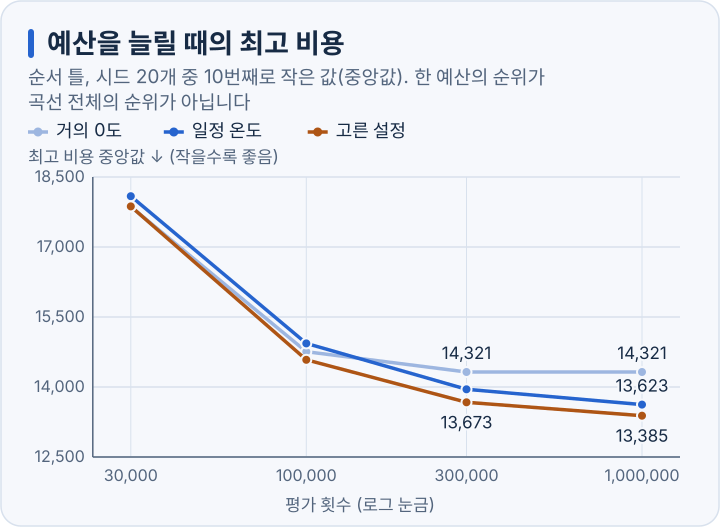
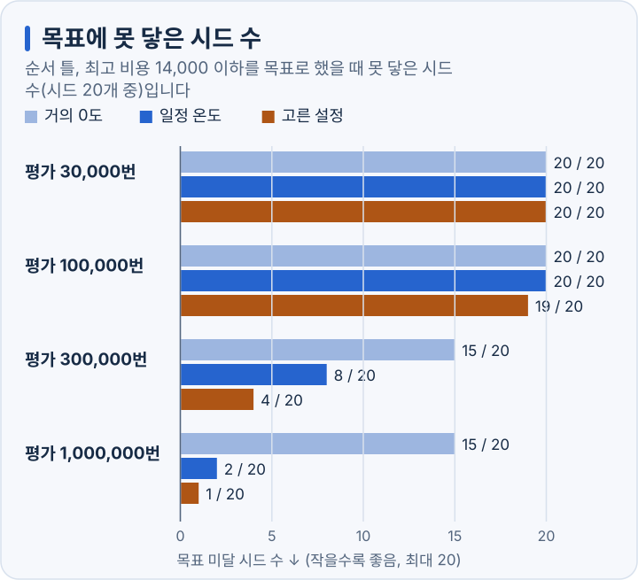
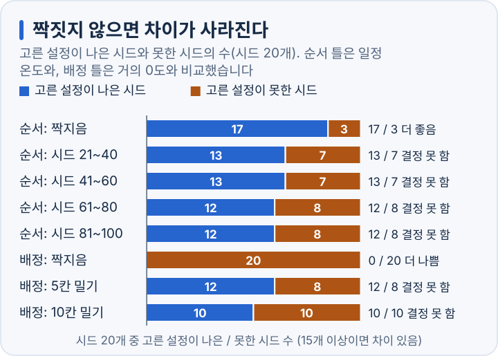
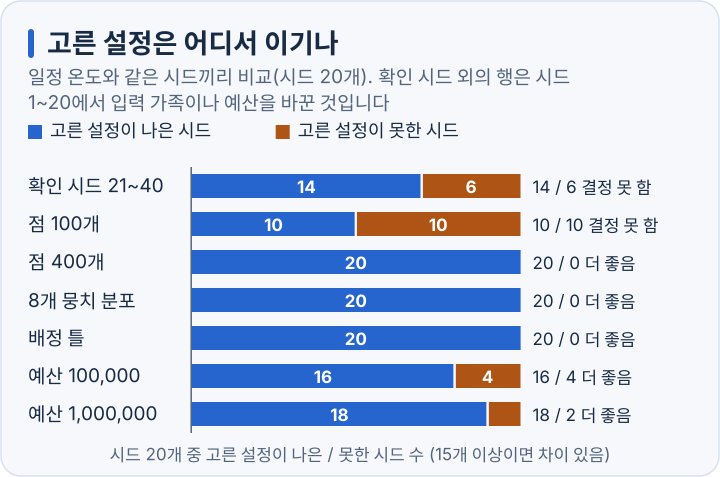
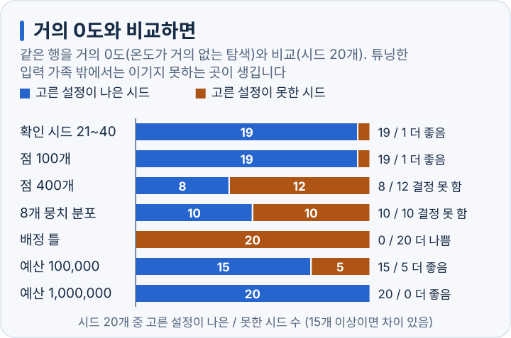

# 실험과 점검: 비교, 튜닝, 흔한 실수

[구현](implementation.md)의 코드를 연습용 문제 틀(순서 `N = 200`, 배정 `N = 120, M = 8, K = 18`, 정의는 [원리](idea.md))에서 돌린 결과입니다. 모든 표는 `scripts/check_experiments_and_tuning.py`가 다시 계산해 `lesson-assets/measurements.json`과 이 본문에 대조합니다. 대조에 쓰는 정수·분수 계산과 난수는 플랫폼에 따라 달라지지 않습니다.

## 실측

측정 방법은 다음과 같습니다.

- **설정 세 개:** "거의 0도"는 `t0 = t1 = 1`(온도가 비용의 1/8)이라 좋아지는 이동만 받는 언덕 오르기에 가깝습니다. "일정 온도"는 `t0 = t1 = 128`(비용 16), "고른 설정"은 `t0 = 256, t1 = 32`(비용 32에서 4로)입니다. 세 설정은 `ins = 0`(구간 뒤집기만)입니다. 표의 괄호는 `(t0, t1)`입니다.
- **평가 횟수:** 시간(ms)을 싣지 않고 평가 횟수(제안 한 번)로 말합니다. 순서 틀 300,000, 배정 틀 100,000이 기본이고 곡선에서만 바꿉니다.
- **요약:** 표의 값은 시드 20개의 최고 비용 중 10번째로 작은 값(중앙값)입니다. 사분위는 5번째와 15번째 값입니다. 시드 1~20은 입력과 탐색 난수에 함께 쓰는 고르는 시드, 21~40은 확인 시드입니다.
- **판정:** 두 설정은 같은 시드끼리 짝지어 "앞이 나은 시드 / 뒤가 나은 시드"를 세고, 한쪽이 20개 중 15개 이상이면(양쪽 확률 0.0414) 차이가 있다고, 아니면 "결정 못 함"이라고 씁니다. 판정은 이 입력 가족과 이 예산에 한정됩니다.

### 무엇을 재는가: 곡선, 실패율, 무효율

순서 틀에서 세 설정을 예산 네 가지로 돌린 최고 비용의 중앙값입니다. 마지막 두 열은 고른 설정의 사분위와 "거의 0도"와의 짝지은 비교(고른 설정이 나은 시드 / 못한 시드)입니다.

<!-- check:table curve -->
| 평가 횟수 | 거의 0도 | 일정 온도 | 고른 설정 | 고른 설정의 사분위 | 고른 설정 대 거의 0도 |
| ---: | ---: | ---: | ---: | ---: | --- |
| 30,000 | 17,863 | 18,088 | 17,869 | 17,574 – 18,142 | 10 / 10 결정 못 함 |
| 100,000 | 14,757 | 14,935 | 14,582 | 14,534 – 14,764 | 15 / 5 더 좋음 |
| 300,000 | 14,321 | 13,950 | 13,673 | 13,581 – 13,970 | 18 / 2 더 좋음 |
| 1,000,000 | 14,321 | 13,623 | 13,385 | 13,235 – 13,597 | 20 / 0 더 좋음 |

[그림 크게 보기](https://git.readiz.com/h-contest-lesson/lessons/experiments-and-tuning/lesson-assets/budget-curve.svg)

- 예산 하나의 순위가 곡선 전체의 순위가 아닙니다. 30,000에서는 고른 설정이 거의 0도와 결정 못 함이고, 예산이 늘수록 고른 설정이 앞섭니다. 1,000,000에서는 20개 시드 모두에서 낫습니다.
- "거의 0도"는 300,000과 1,000,000의 중앙값이 같습니다(14,321). 좋아지는 이동만 받는 탐색은 지역 최적에서 멈추고, 예산을 더 줘도 내려가지 못한다는 뜻입니다([언덕 오르기와 담금질](https://h.readiz.com/learn/hill-climbing-and-annealing)의 결과와 같은 방향입니다). 담금질한 두 설정은 예산에 따라 계속 내려갑니다.

목표를 비용 14,000 이하로 두고 그 목표에 못 닿은 시드의 수입니다.

<!-- check:table fail -->
| 평가 횟수 | 거의 0도 | 일정 온도 | 고른 설정 |
| ---: | ---: | ---: | ---: |
| 30,000 | 20 / 20 | 20 / 20 | 20 / 20 |
| 100,000 | 20 / 20 | 20 / 20 | 19 / 20 |
| 300,000 | 15 / 20 | 8 / 20 | 4 / 20 |
| 1,000,000 | 15 / 20 | 2 / 20 | 1 / 20 |

[그림 크게 보기](https://git.readiz.com/h-contest-lesson/lessons/experiments-and-tuning/lesson-assets/tail-miss.svg)

300,000에서 중앙값은 모두 14,000 근처(14,321 / 13,950 / 13,673)지만 목표 미달 시드 수는 15, 8, 4개로 갈립니다. 중앙값은 중간의 값이고 목표 미달은 나쁜 꼬리를 셉니다. 어느 쪽을 보느냐는 문제가 정합니다(평균 점수인지, 기준 미달이 큰 벌점인지).

배정 틀에서는 점수 대신 **무효율**을 봅니다. 옮기기 제안 중 받는 기계가 가득 차서 무효인 제안이 전체 제안에서 차지하는 비율입니다(탐색 전체의 합). 같은 표에 두 설정의 비용(Q1 – 중앙값 – Q3)을 적습니다.

<!-- check:table assign-metrics -->
| 평가 횟수 | 설정 | 비용 | 무효 제안 비율 |
| ---: | --- | ---: | ---: |
| 10,000 | 거의 0도 (1, 1) | 42,707 – 44,079 – 49,455 | 2.7% |
| 100,000 | 거의 0도 (1, 1) | 42,622 – 43,982 – 49,329 | 2.6% |
| 10,000 | 고른 설정 (256, 32) | 42,922 – 44,309 – 49,734 | 2.8% |
| 100,000 | 고른 설정 (256, 32) | 42,763 – 44,123 – 49,453 | 3.0% |

무효 제안은 3% 안팎이고 설정과 예산에 따라 거의 달라지지 않습니다. 이 비율이 급히 올라가는 문제라면 제안 단계에서 무효를 줄이는 이동을 설계해야 한다는 신호입니다([근방 설계와 차분 평가](https://h.readiz.com/learn/neighborhood-and-delta)). 비용 열의 사분위 폭(42,707에서 49,455)은 이 표에서 가장 크게 눈에 띕니다. 입력마다 비용 수준이 이만큼 다르다는 뜻이고, 다음 절의 짝지은 비교가 필요한 이유입니다.

### 짝지은 비교와 짝짓지 않은 비교

순서 틀에서 일정 온도와 고른 설정(평가 300,000)을 비교합니다. "짝지음"은 같은 시드(같은 입력)끼리, "짝짓지 않음"은 고른 설정을 다른 입력 시드에서 돌려 시드 `i`의 일정 온도와 시드 `i + 20`의 고른 설정을 견줍니다.

<!-- check:table pairing -->
| 비교 방식 | 구성 | 고른 설정이 나은 시드 / 못한 시드 | 판정 |
| --- | --- | ---: | --- |
| 같은 입력끼리(짝지음) | 시드 1~20 대 시드 1~20 | 17 / 3 | 더 좋음 |
| 다른 입력끼리(짝짓지 않음) | 고른 설정은 시드 21~40 | 13 / 7 | 결정 못 함 |
| 다른 입력끼리(짝짓지 않음) | 고른 설정은 시드 41~60 | 13 / 7 | 결정 못 함 |
| 다른 입력끼리(짝짓지 않음) | 고른 설정은 시드 61~80 | 12 / 8 | 결정 못 함 |
| 다른 입력끼리(짝짓지 않음) | 고른 설정은 시드 81~100 | 12 / 8 | 결정 못 함 |

짝지으면 17 / 3으로 차이를 잡지만, 입력을 어긋나게 하면 13 / 7, 12 / 8처럼 결정하지 못합니다. 설정이 실제로 같을 때는 짝짓지 않아도 우연히 "차이 있음"이 나올 확률이 같은 0.0414입니다. 짝짓지 않으면 틀리게 잡는 것이 아니라 진짜 차이를 못 잡습니다. 배정 틀은 입력 난이도의 영향이 더 커서 이 효과가 극단적으로 나타납니다(거의 0도와 고른 설정, 평가 100,000, 같은 시드 20개에서 입력을 5칸, 10칸 밀어 짝지음).

<!-- check:table pairing-assign -->
| 비교 방식 | 고른 설정이 나은 시드 / 못한 시드 | 판정 |
| --- | ---: | --- |
| 같은 입력끼리(짝지음) | 0 / 20 | 더 나쁨 |
| 입력을 5칸 밀어서(짝짓지 않음) | 12 / 8 | 결정 못 함 |
| 입력을 10칸 밀어서(짝짓지 않음) | 10 / 10 | 결정 못 함 |

[그림 크게 보기](https://git.readiz.com/h-contest-lesson/lessons/experiments-and-tuning/lesson-assets/pairing-wins.svg)

배정 틀에서 고른 설정은 20개 시드 모두에서 거의 0도보다 나쁩니다. 짝지음에서 한 번도 이기지 못한 차이가 입력을 밀면 12 / 8, 10 / 10의 결정 못 함으로 사라집니다. 같은 시드끼리 두 설정의 차이(고른 설정 − 거의 0도)는 사분위가 96 – 120 – 156으로 아주 좁은데, 입력마다 비용이 42,622에서 49,329까지 퍼지기 때문입니다.

흔들림의 원천별 크기를 순서 틀에서 비교합니다.

<!-- check:table spread -->
| 흔들림의 원천 | 아래 사분위 | 중앙값 | 위 사분위 |
| --- | ---: | ---: | ---: |
| 입력 20개(시드 1~20)에서 고른 설정의 비용 | 13,581 | 13,673 | 13,970 |
| 입력 시드 1 하나에서 탐색 시드 20개 | 13,238 | 13,368 | 13,500 |
| 입력 시드 2 하나에서 탐색 시드 20개 | 13,608 | 13,712 | 13,810 |
| 입력 시드 3 하나에서 탐색 시드 20개 | 13,442 | 13,581 | 13,716 |
| 같은 시드끼리 두 설정의 차이(일정 온도 − 고른 설정) | 29 | 204 | 360 |

- 같은 입력에서 탐색 시드만 바꿔도 사분위 폭이 202에서 274입니다. 입력을 바꾼 폭(389)과 같은 자리수입니다.
- 같은 시드끼리 두 설정의 차이는 중앙값 204이고 사분위가 29에서 360입니다. 이 폭이 0을 걸치지 않아 한쪽으로 일관되게 기운다는 뜻이며, 승패 수(17 / 3)와 일치합니다.
- 한 입력에서 한 번 돌린 점수 차이로는 시드 한 개의 추첨일 뿐입니다. 위 표에서 탐색 시드 20개의 사분위 폭만큼은 늘 흔들린다고 보고 읽습니다.

### 같은 설정끼리의 우연한 차이

고른 설정과 같은 설정이지만 탐색 난수만 다른 복제 40개를 만들어 각각 기준(탐색 시드 = 입력 시드인 원래 실행)과 시드 1~20에서 짝지어 비교했습니다. 실제 차이는 없으므로 "차이 있음"이 나오면 모두 우연입니다. 정확한 기댓값은 비교 40번 × 0.0414 = 1.66이고, 하나 이상 나올 확률이 0.8156입니다.

<!-- check:table salt -->
| 복제 번호 | 시드 1~20 (복제가 나은 시드 / 못한 시드) | 확인 시드 21~40 |
| ---: | ---: | ---: |
| 38 | 5 / 15 | 10 / 9 |

40개 중 1개(복제 38)가 5 / 15로 기준을 넘었습니다(15개 이상 못한 시드). 그 복제가 기준보다 "더 나쁨"이라는 결론은 우연이며, 같은 복제를 확인 시드에서 보면 10 / 9의 결정 못 함입니다. 승 수의 범위는 5에서 14입니다. 이 실험 하나로 확률이 확인되는 것은 아니지만(기대 1.66에 대해 1이 나옴), 고른 시드에서 "차이 있음"이 나와도 확인 시드로 한 번 더 보는 이유를 보여 줍니다.

### 설정을 고른 시드와 확인 시드

`t0`(64에서 4096까지 2배씩 7가지)와 `t1`(4에서 256까지 2배씩 7가지)의 격자에서 `t1 ≤ t0`인 46개 설정을 모두 일정 온도와 비교합니다(시드 1~20). 15 / 20 규칙으로 "더 좋음"이 나온 설정이 시드 21~40에서도 나오는지 봅니다.

<!-- check:table lattice -->
| 기준 | 시드 1~20에서 일정 온도보다 더 좋음 | 그중 시드 21~40에서도 더 좋음 |
| --- | ---: | ---: |
| 15 / 20 규칙(15개 이상) | 3 | 2 |
| 비교 46개에 맞춘 엄한 기준(18개 이상) | 0 | 0 |

46개 중 고른 시드의 중앙값이 가장 낮은 설정이 `(256, 32)`이고, 이것이 이 강의의 "고른 설정"입니다. 15 / 20 규칙에서는 46개 중 3개가 "더 좋음"이었고 2개가 확인에서도 유지되었습니다. 비교가 46개일 때 한 번의 한도를 낮춘 기준(18개 이상)을 쓰면 고른 시드에서도 하나도 "더 좋음"이 나오지 않습니다. 느슨한 기준은 우연한 것을 섞고, 엄한 기준은 진짜 차이도 놓칩니다. 둘 사이의 선택이 비교 수와 실패 비용에 달려 있습니다.

고른 시드에서 중앙값이 가장 낮은 다섯 설정과 확인 시드의 값입니다. 마지막 열은 46개 중 확인 시드 순위입니다.

<!-- check:table top -->
| 고른 시드 순위 | `t0` | `t1` | 시드 1~20 | 시드 21~40 | 확인 시드 순위 |
| ---: | ---: | ---: | ---: | ---: | ---: |
| 1 | 256 | 32 | 13,673 | 13,842 | 6 |
| 2 | 512 | 32 | 13,784 | 13,879 | 7 |
| 3 | 1024 | 8 | 13,818 | 13,922 | 10 |
| 4 | 256 | 64 | 13,849 | 13,822 | 4 |
| 5 | 1024 | 64 | 13,852 | 14,056 | 25 |

- 고른 시드에서 가장 좋았던 `(256, 32)`는 13,673이지만 확인 시드에서 13,842로 올랐고 순위도 6위입니다. 일정 온도(13,950에서 14,005)는 55 올랐고 고른 설정은 169 올랐습니다. 고른 설정의 성적이 확인에서 줄어드는 것은 설정을 고르는 과정에 고른 시드의 우연이 섞이기 때문입니다.
- 확인 시드에서 가장 좋은 설정은 `(1024, 16)`이고 13,741이지만 고른 시드에서는 13,889였습니다. 확인 시드에서 이 설정을 고르면 이번에는 확인 시드가 고르는 시드가 됩니다.
- 그래도 일정 온도보다 나은 방향은 유지됩니다. 고른 설정은 확인에서 14 / 6이었고, 고른 시드와 확인 시드를 합친 40개에서는 31 / 9입니다(40개의 기준은 27개). 이 합친 결과는 고른 시드를 포함하므로 처음 고른 설정에 한정해 읽습니다.

### 상호작용과 한 번에 하나씩

일정 온도(`128, 128`)에서 시작 온도만 두 배, 끝 온도만 1/4, 둘 다 바꾼 설정의 비교입니다. 오른쪽 끝 열은 고른 시드와 확인 시드를 합친 40개의 승 / 패입니다.

<!-- check:table interaction -->
| 설정 | `t0` | `t1` | 시드 1~20 | 일정 온도보다 나은 / 못한 | 시드 21~40 | 일정 온도보다 나은 / 못한 | 40개 합계 |
| --- | ---: | ---: | ---: | --- | ---: | --- | ---: |
| 시작(일정 온도) | 128 | 128 | 13,950 | - | 14,005 | - | - |
| `t0`만 두 배 | 256 | 128 | 14,304 | 2 / 18 더 나쁨 | 14,240 | 5 / 15 더 나쁨 | 7 / 33 |
| `t1`만 1/4 | 128 | 32 | 13,964 | 8 / 12 결정 못 함 | 13,960 | 12 / 8 결정 못 함 | 20 / 20 |
| 둘 다(`t0` 두 배, `t1` 1/4) | 256 | 32 | 13,673 | 17 / 3 더 좋음 | 13,842 | 14 / 6 결정 못 함 | 31 / 9 |

- `t0`만 두 배로 올리면 시드 1~20에서 2 / 18로 나빠집니다. 끝 온도가 높은 채로 시작이 뜨거워지면 식을 시간이 부족한 것으로 읽힙니다(이 강의는 원인을 가르지 않았습니다).
- `t1`만 1/4로 내리면 8 / 12로 결정 못 함이고 확인에서도 12 / 8입니다.
- 둘 다 바꾸면 17 / 3으로 더 좋음이고 확인에서 14 / 6(15에 한 걸음 모자람)입니다. 합친 40개로 31 / 9입니다.

엄한 기준의 한 번에 하나씩 걸음은 이 설정에 닿지 못합니다. 아래는 시작 설정에서 후보를 모두 한 번에 하나씩 바꾸거나 둘을 함께 바꿔 일정 온도와 비교한 결과입니다.

<!-- check:table steps -->
| `t0` | `t1` | `ins` | 시드 1~20 | 시드 21~40 |
| ---: | ---: | ---: | --- | --- |
| 256 | 128 | 0 | 2 / 18 더 나쁨 | 5 / 15 더 나쁨 |
| 64 | 64 | 0 | 11 / 9 결정 못 함 | 13 / 7 결정 못 함 |
| 128 | 64 | 0 | 11 / 9 결정 못 함 | 15 / 5 더 좋음 |
| 128 | 128 | 25 | 9 / 11 결정 못 함 | 12 / 8 결정 못 함 |
| 128 | 32 | 0 | 8 / 12 결정 못 함 | 12 / 8 결정 못 함 |
| 512 | 128 | 0 | 1 / 19 더 나쁨 | 0 / 20 더 나쁨 |
| 256 | 64 | 0 | 13 / 7 결정 못 함 | 15 / 5 더 좋음 |
| 256 | 32 | 0 | 17 / 3 더 좋음 | 14 / 6 결정 못 함 |
| 256 | 16 | 0 | 13 / 7 결정 못 함 | 12 / 7 결정 못 함 |
| 512 | 32 | 0 | 13 / 7 결정 못 함 | 16 / 4 더 좋음 |
| 512 | 16 | 0 | 15 / 5 더 좋음 | 16 / 4 더 좋음 |

`stepOnce`로 한 번에 하나씩 가는 튜닝을 시작 설정에서 돌려 걸음마다 가장 많이 이긴 후보와 그 승 수를 기록했습니다. 기준을 15 / 20으로 두면 후보 4개 중 가장 많이 이긴 것이 11 / 20이라 첫 걸음에서 멈춥니다. 기준을 "이긴 시드가 더 많으면"(11 / 20)으로 느슨하게 하면 아래 길을 걷습니다(최대 8걸음에서 끊음).

<!-- check:table path11 -->
| 걸음 | 현재 `t0` / `t1` / `ins` | 가장 많이 이긴 후보의 승 | 결과 | 옮긴 곳 |
| ---: | --- | ---: | --- | --- |
| 1 | 128 / 128 / 0 | 11 / 20 | 옮김 | 128 / 64 / 0 |
| 2 | 128 / 64 / 0 | 16 / 20 | 옮김 | 256 / 64 / 0 |
| 3 | 256 / 64 / 0 | 12 / 20 | 옮김 | 256 / 64 / 25 |
| 4 | 256 / 64 / 25 | 12 / 20 | 옮김 | 256 / 32 / 25 |
| 5 | 256 / 32 / 25 | 11 / 20 | 옮김 | 256 / 32 / 50 |
| 6 | 256 / 32 / 50 | 12 / 20 | 옮김 | 256 / 16 / 50 |
| 7 | 256 / 16 / 50 | 14 / 20 | 옮김 | 256 / 8 / 50 |
| 8 | 256 / 8 / 50 | 12 / 20 | 옮김 | 256 / 8 / 25 |

두 규칙이 끝난 설정을 시작 설정과 비교합니다(괄호는 시작 설정보다 나은 / 못한 시드).

<!-- check:table paths -->
| 기준 | 걸음 수 | 끝난 설정 `t0` / `t1` / `ins` | 시드 1~20 중앙값 | 시드 21~40 중앙값 |
| --- | ---: | --- | --- | --- |
| 15 / 20 | 1 | 128 / 128 / 0 | 13,950 (0 / 0 결정 못 함) | 14,005 (0 / 0 결정 못 함) |
| 11 / 20 | 8 | 256 / 8 / 25 | 13,773 (15 / 5 더 좋음) | 13,805 (16 / 4 더 좋음) |

- 엄한 기준은 시작 설정에서 한 걸음도 못 갑니다. 이 설정에서 한 번에 하나씩 바꾼 후보는 어느 것도 15개를 넘지 못합니다.
- 느슨한 기준은 첫 걸음을 11 / 20이라는 잡음 수준의 근거로 옮겼습니다. 둘째 걸음에서 `t0`를 두 배로 올리는 것은 16 / 20으로 이겼습니다. 시작 설정에서는 2 / 18로 나빴던 같은 걸음이 `t1`을 먼저 반으로 내린 뒤에는 좋아진 것입니다. 한 매개변수의 효과가 다른 매개변수의 값에 달린 상호작용이며, 걸음의 순서에 따라 길이 갈린다는 점이 이 길의 특징입니다.
- 이 길은 이후 걸음(`ins` 올리기 등)을 11~16 / 20의 근거로 8걸음 끝까지 걸었고 스스로 멈추지 않았습니다. 끝난 설정은 확인 시드에서도 시작 설정보다 낫지만(16 / 4), 이 결과가 그 길 자체의 좋음을 보증하지는 않습니다. 걸음마다 쓴 근거가 잡음이어서, 다른 시드에서 같은 길을 걷는지는 따로 확인하지 않았습니다.
- 결국 한 번에 하나씩의 튜닝은 시작점과 걸음의 크기에 달려 있습니다. 후보를 두 개씩 함께 바꾸는 걸음이나 격자를 한 번 훑어 시작점을 정하는 방법이 이를 보완합니다.

### 격자 대 무작위

같은 후보 46개 중에서 실험을 9번 하는 두 방법입니다. 격자는 `t0 ∈ {128, 512, 2048}` × `t1 ∈ {8, 32, 128}`의 9개(모두 `t1 ≤ t0`입니다)이고, 무작위는 46개에서 겹치지 않게 9개를 뽑아 고른 시드의 중앙값이 가장 낮은 것을 고릅니다. 무작위는 시드가 다른 40번을 반복했습니다.

<!-- check:table grid -->
| 방법 | 실험 횟수 | 고른 설정 `t0` / `t1` | 시드 1~20 | 시드 21~40 |
| --- | ---: | --- | ---: | ---: |
| 격자 3 × 3 | 9 | 512 / 32 | 13,784 | 13,879 |
| 무작위 9개(40번 반복의 중앙값) | 9 | 반복마다 다름 | 13,849 | 13,879 |

무작위가 고른 설정의 확인 시드 값(중앙값 13,879)은 격자가 고른 설정과 같습니다. 격자보다 확인 시드에서 낫게 고른 반복이 16번, 못하게 고른 반복이 16번, 같은 값이 8번이라 어느 쪽이 낫다고 가릴 수 없습니다. 무작위 9개는 `t1`의 서로 다른 값을 중앙값 6가지 시험해 격자의 3가지보다 넓게 봤지만, 이 입력에서는 성능 차이로 나타나지 않았습니다. "같은 실험 횟수에서 무작위 탐색이 낫다"는 경험 법칙을 이 실험은 지지하지 않습니다. 이 강의는 원인을 가르지 않았고, 다른 후보 공간에서는 달라질 수 있습니다.

### 다른 크기·분포·예산·문제 틀에서 다시 확인

고른 설정을 시드 1~20의 입력 가족 밖에서 일정 온도, 거의 0도와 비교합니다(확인 시드 21~40은 첫 행). 나머지는 시드 1~20에서 입력 가족이나 예산을 바꾼 것입니다. 점 400개와 뭉친 분포는 평가 300,000, 점 100개도 같은 예산입니다.

<!-- check:table transfer -->
| 입력 | 일정 온도 | 고른 설정 | 거의 0도 | 고른 설정 대 일정 온도 | 고른 설정 대 거의 0도 |
| --- | ---: | ---: | ---: | --- | --- |
| 확인 시드 21~40 (같은 입력 가족) | 14,005 | 13,842 | 14,342 | 14 / 6 결정 못 함 | 19 / 1 더 좋음 |
| 점 100개 | 9,519 | 9,517 | 10,029 | 10 / 10 결정 못 함 | 19 / 1 더 좋음 |
| 점 400개 | 22,590 | 21,452 | 21,463 | 20 / 0 더 좋음 | 8 / 12 결정 못 함 |
| 점이 8개 뭉치에 모인 분포 | 6,840 | 5,371 | 5,335 | 20 / 0 더 좋음 | 10 / 10 결정 못 함 |
| 배정 틀 (예산 100,000) | 44,752 | 44,123 | 43,982 | 20 / 0 더 좋음 | 0 / 20 더 나쁨 |
| 예산 100,000 | 14,935 | 14,582 | 14,757 | 16 / 4 더 좋음 | 15 / 5 더 좋음 |
| 예산 1,000,000 | 13,623 | 13,385 | 14,321 | 18 / 2 더 좋음 | 20 / 0 더 좋음 |

[그림 크게 보기](https://git.readiz.com/h-contest-lesson/lessons/experiments-and-tuning/lesson-assets/transfer-wins.svg)

- 일정 온도보다는 점 400개, 뭉친 분포, 배정 틀, 예산 100,000과 1,000,000에서 고른 설정이 낫습니다. 확인 시드(14 / 6)와 점 100개(10 / 10)에서는 결정 못 함입니다.
- 거의 0도(온도가 거의 없는 탐색)와 비교하면 같은 입력 가족과 점 100개, 예산 100,000과 1,000,000에서는 고른 설정이 낫지만, 점 400개와 뭉친 분포는 결정 못 함이고 배정 틀은 20개 시드 모두에서 고른 설정이 나쁩니다(0 / 20). 온도를 비용 단위로 정했기 때문에 배정 틀(비용 변화가 순서 틀과 다릅니다)이나 입력의 규모가 바뀌면 같은 온도가 맞지 않습니다. 일정 온도와의 비교만 하고 멈췄다면 놓쳤을 결과입니다.
- 이 설정은 "튜닝한 입력 가족에서 일정 온도보다 낫다"까지만 주장할 수 있고 "담금질이 언덕 오르기보다 낫다"는 일반 법칙으로는 쓸 수 없습니다.

[그림 크게 보기](https://git.readiz.com/h-contest-lesson/lessons/experiments-and-tuning/lesson-assets/transfer-wins-hot.svg)

## 앞 강의가 쓴 판정과 선택

이 표는 앞 강의의 실제 기록을 이 강의의 관점으로 다시 읽은 것입니다.

| 강의 | 실제로 한 것 | 이 강의의 관점 |
| --- | --- | --- |
| [언덕 오르기와 담금질](https://h.readiz.com/learn/hill-climbing-and-annealing) | 온도 범위를 바꾼 표에서 25%의 15 / 3 같은 결과가 나왔고, 비교가 여러 개라 우연일 수 있다고 적었다. 주요 비교는 시드 101~120에서 다시 했다. 기본값(10%)은 시드 1~20을 먼저 본 뒤 골랐다고 밝혔다 | 한 표의 비교 수와 hold-out. 시드 1~20에서 5 / 15이던 비교가 8 / 11로 바뀐 것은 확인 시드의 역할이다 |
| [빔 서치와 평가 함수](https://h.readiz.com/learn/beam-search) | 폭을 두 배 안팎으로 키운 일곱 구간 중 "더 좋음"은 추정 없음의 두 구간과 가까운 값의 합의 한 구간뿐이고 중앙값도 오르내렸다 | 예산을 늘릴 때의 곡선이 단조롭지 않을 수 있다. 결정 못 함 구간이 많은 곡선은 곡선 전체의 모양을 말하지 않는다 |
| [크게 부수고 다시 짓기](https://h.readiz.com/learn/destroy-and-repair) | 기본 설정을 고르는 데 쓰지 않은 시드 21~40에서 작은 이동만과 혼합을 다시 비교했다 | 고르는 시드와 확인 시드의 분리 |
| [후보 줄이기와 시간 예산](https://h.readiz.com/learn/candidate-and-time-budget) | 후보 수 `k`의 최선이 예산에 따라 달랐다 | 한 예산의 순위를 일반화하지 않는다 |
| [정보가 부분적일 때 결정하기](https://h.readiz.com/learn/partial-information) | "결정 못 함은 같다는 뜻이 아니다"며 재계획 주기를 줄이는 선택을 손실이 결정되지 않은 선택으로 적었다 | 결정 못 함의 읽는 법 |

## 흔한 실수와 잡는 검사

아래 실수 가운데 코드로 일으킬 수 있는 것은 본문 코드에 직접 넣어 known-answer 검사가 잡는지 확인했습니다(`scripts/check_experiments_and_tuning.py`가 매번 수행). 코드 변형은 어느 것도 배열 밖을 읽지 않으므로 "잡힘"만 기록합니다.

1. **짝지은 비교가 짝이 어긋남(입력 지문 불일치).** 한 설정은 시드 `i`, 다른 설정은 시드 `i + 20` 입력으로 돌리면 위 첫 표처럼 차이가 13 / 7로 묻힙니다. 값은 정상적으로 나오므로 점수만 봐서는 모릅니다. 잡는 검사는 `samePrints`입니다. 실행마다 `lastPrint`(입력 지문)를 남기고 같은 시드끼리 같은지 봅니다. 코드 변형(`samePrints`가 마지막 시드를 건너뜀)은 마지막 한 시드만 다른 지문에서 놓쳐 known-answer 검사에서 잡힙니다.
2. **비교 방향이 뒤집힘.** 비용이 작을수록 좋은 문제의 `a[i] < b[i]`를 점수가 클수록 좋은 문제에 그대로 쓰면 앞뒤가 바뀐 결론이 나옵니다. 잡는 검사는 승·패·같음이 서로 다르게 나오는 작은 배열(승 1, 패 2, 같음 1)의 known-answer입니다. 코드 변형(부등호 뒤집기)은 이 검사에서 잡힙니다.
3. **고른 시드에서 확인.** 설정을 고른 시드에서 "더 좋음"이 나왔다고 보고하면, 위 표처럼 확인 시드에서 성적이 줄거나(13,673에서 13,842) 우연이 섞입니다. 잡는 검사는 `disjoint`입니다. 고른 시드와 확인 시드의 범위가 겹치지 않는지 실험 전에 확인하고, 확인 시드의 값을 보고합니다. 코드 변형(경계를 한 칸 느슨하게)은 맞닿은 범위를 겹치지 않는다고 잘못 답해 잡힙니다.
4. **비교 수를 세지 않음.** 설정 46개를 한 표에서 비교하고 "더 좋음"이 나온 것을 보고하면 우연이 섞일 확률이 (비교가 독립이라는 근사로) 0.8569입니다. 잡는 검사는 `needWins(20, 20 * m)`로 비교 수에 맞춘 기준(46개면 18 / 20)을 쓰는 것이고, 양쪽 꼬리와 `tailCount`가 맞는지는 `math.comb`와의 대조(`n = 1..40`의 모든 `k`)로 봅니다. 코드 변형(양쪽 확률의 두 배 빠짐, 꼬리의 경계 한 칸)은 known-answer 검사에서 잡힙니다.

## 다른 문제에 옮길 때 점검 목록

1. 무엇을 재는가? 최종 점수, 같은 평가 횟수의 점수, 예산 곡선, 실패율이나 무효율 중 문제의 채점 방식에 맞는 것을 정했는가?
2. 비교 방향이 맞는가(작을수록 좋은지 클수록 좋은지)? 같은 시드가 같은 입력을 만드는지 입력 지문으로 확인했는가?
3. 입력 시드와 탐색 시드를 따로 다룰 수 있는가? 흔들림을 입력 난이도와 탐색 난수로 나눠 사분위로 적었는가?
4. 시드 수가 몇 개이고 그 시드 수에서 한도 안의 기준이 몇 개인가(`needWins`)? 같은 시드가 많아 기준이 더 엄격해지지 않는가?
5. 설정을 고른 시드와 확인 시드를 나눴고 겹치지 않는가? 확인 시드는 한 번만 봤는가?
6. 한 표에서 비교를 몇 번 했는가? 비교 수에 맞춰 기준을 엄하게 했거나 확인 시드에서 다시 봤는가?
7. 튜닝이 매개변수를 한 번에 하나씩 바꿨다면 상호작용을 의심했는가? 두 개를 함께 바꾸는 후보나 격자로 시작점을 확인했는가?
8. 튜닝한 입력 가족 밖(크기, 분포, 예산, 문제 틀)에서 다시 확인했는가? 확인에서 이기지 못한 것을 "이 입력 가족에 한정"으로 적었는가?
9. 기록에 설정·시드·결과·판정과 원본(시드별 점수, 입력 지문)을 남겼는가?

## 적용 사례

이 강의의 비교 방식이 이 사이트의 문제별 강의에서 쓰인 곳입니다. 해당 강의들은 문제 하나를 끝까지 푸는 방식이라 시드 수와 판정 규칙이 강의마다 다릅니다. 시드 수가 이 강의의 20개보다 적을 때는 [원리](idea.md)의 시드 수 표로 기준을 다시 잡아 읽습니다. 예를 들어 시드가 9개이면 9개 중 8개 이상이 이겨야 양쪽 확률이 0.0391로 한도 안이고, 같은 값이 있으면 유효한 시드가 더 줄어듭니다.

- [배정 문제의 지역 탐색과 SA(SCHEDULX)](https://h.readiz.com/learn/assignment-local-search): 온도 구간별 수락률을 solver seed 9개의 중앙값으로 비교했습니다.
- [배정과 경로가 결합된 문제(TAXIASSIGN)](https://h.readiz.com/learn/assignment-with-routes): 배정만·경로만·번갈아·결합 방식을 같은 TC 5개와 solver seed 9개로 비교했습니다.
- [격자 배치 문제(LANDINGX)](https://h.readiz.com/learn/placement-search): 같은 후보 검사 수에서 방식과 예산을 solver seed 9개로 비교했습니다.
- [입력이 클 때(COUPANG1)](https://h.readiz.com/learn/large-input-search): 설정마다 5번 돌려 가며 중앙값을 쟀습니다.
- [보이는 만큼만 아는 문제(ROBOTCLEAN)](https://h.readiz.com/learn/explore-unknown-map): 튜닝에 쓰지 않은 직접 만든 홀드아웃 지도 10개를 따로 두었습니다.

정답 일치 검증은 [Testing과 Stress Test](https://h.readiz.com/learn/testing-and-stress)로, 시간 재기와 예산 배분은 [후보 줄이기와 시간 예산](https://h.readiz.com/learn/candidate-and-time-budget)으로 이어집니다.

## 로컬 연습

1. `stepOnce`를 `need = 15`와 `need = 11`로 시작 설정 `(256, 128, 0)`에서 돌려 걸음마다 가장 많이 이긴 후보와 끝난 설정을 시드 21~40으로 확인합니다.
2. `runRoute`로 고른 설정과 일정 온도를 시드 41~60에서 짝지어 비교하고, 입력을 한 칸 밀어(시드 `i`와 `i + 1`) 짝짓지 않았을 때 판정이 어떻게 바뀌는지 기록합니다.
3. 같은 설정의 복제를 탐색 시드 offset만 바꿔 20개 만들고, 기준(탐색 시드 = 입력 시드)과 짝지어 "차이 있음"이 몇 개 나오는지 센 뒤 기대값(`20 × 0.0414`)과 비교합니다.
4. 순서 틀의 `ins`를 0, 25, 50으로 바꿔 `(256, 32)`에서 비교하고, `ins`가 `t0`, `t1`과 상호작용하는지 `stepOnce`와 격자로 각각 조사합니다.
5. `runRoute`의 `family`를 1로 바꿔 뭉친 분포에서 `t0`, `t1`의 격자를 다시 훑고 고른 설정이 순서 틀의 고른 설정과 같은지 확인 시드로 판정합니다.

확인 기준: `samePrints`가 모든 비교에서 참이고, 고르는 시드와 확인 시드가 `disjoint`이고, 표의 모든 비교에 시드 수와 판정(더 좋음·더 나쁨·결정 못 함)이 붙어 있어야 합니다.
