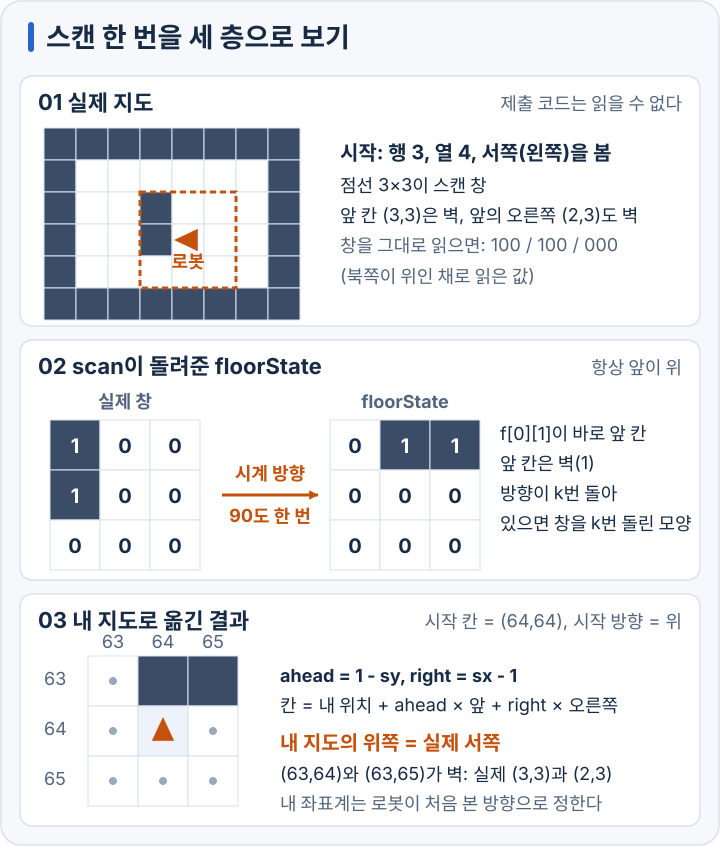
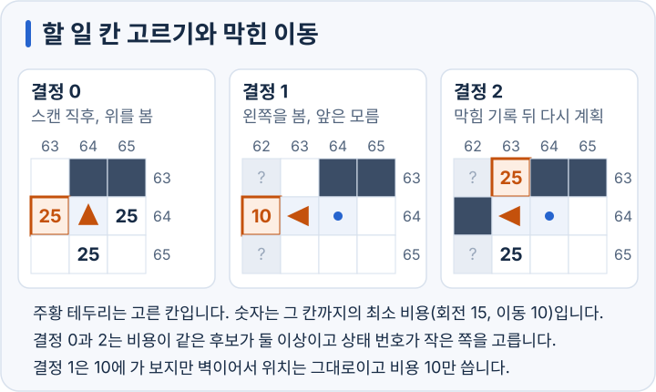

# 보이는 만큼만 아는 문제: 지도를 그려 가며 청소하기

[ROBOTCLEAN](/practice/ROBOTCLEAN)은 64×64 집의 모든 빈 칸을 밟아야 하는 문제인데, 로봇은 **지도도 자기 위치도 모릅니다.** [광산 탐사](https://h.readiz.com/learn/observe-and-act)는 지도가 인자로 주어졌고 채점기 안의 상태만 따라 그리면 됐지만, 여기서는 지도 자체를 `scan`과 `move`의 결과로 **조금씩 알아 가야** 합니다. 이 강의는 (1) 호출 결과를 내 지도와 자세로 옮기는 좌표 변환을 만들고, (2) 가장 단순한 유효 풀이에서 (3) BFS, (4) (칸, 방향) 최단 비용으로 키우며, 각 단계의 비용이 어디서 줄어드는지 실측합니다. 코드는 모두 h-contest 제출용입니다. 표준 헤더와 STL을 쓰지 않고 [공통 라이브러리](https://h.readiz.com/learn/cpp-common-library)의 `queue`, `min-heap` 블록만 씁니다.

## 문제 계약을 상태로 옮기기

문제 설명과 공개 채점기 `main.cpp`의 규칙을 함께 읽어 정리했습니다. 채점기는 규칙 확인에만 읽었고 풀이는 공개 API와 이 표만 씁니다.

| 항목 | 계약 |
| --- | --- |
| 호출 순서 | TC마다 `init()`이 한 번, 그 TC의 subtask 10개마다 `cleanHouse()`가 한 번 호출됩니다. TC 10개, 모두 `cleanHouse()` 100번 |
| 지도와 시작 | `64 × 64`, 바깥 한 겹은 벽입니다. subtask마다 시작 칸(빈 칸)과 방향이 새로 정해지고, 시작 칸은 이미 청소된 칸입니다. 공개 입력 10개는 빈 칸이 3247~3587개이고 모두 한 덩어리로 이어져 있습니다. |
| `scan` | 비용 20. `3 × 3`을 `floorState`에 채웁니다. `0` 빈 칸, `1` 벽. **로봇이 보는 방향이 항상 위**가 되도록 회전되어 있고 `[1][1]`이 내 칸입니다. |
| `move` | 비용 10(성공·실패 같음). 앞 칸이 빈 칸이면 이동하고 `1`, 벽이면 제자리에서 `0`을 돌려줍니다. |
| `turn` | 비용 15. `1` 왼쪽 90도, `2` 180도, `3` 오른쪽 90도. 이 밖의 값은 방향을 바꾸지 않고 비용만 씁니다. 채점기의 방향은 `0` 위, `1` 왼쪽, `2` 아래, `3` 오른쪽이고 `turn(k)`는 방향에 `k`를 더합니다(mod 4). |
| 점수 | 한 TC의 모든 행동 비용 합입니다. **낮을수록 좋고** 10개 TC의 합이 총점입니다. 통과 기준은 6500000(`cleanHouse` 한 번에 평균 65000) |
| 종료와 무효 | `cleanHouse()`가 끝났을 때 안쪽 빈 칸에 안 밟은 칸이 있으면 그 TC는 점수 1000000000이고 채점이 거기서 멈춥니다. 호출이 무효가 되는 경우는 없습니다. |
| 피드백 | `scan` 값과 `move`의 반환값이 전부입니다. 내 위치, 방향, 청소 여부는 읽을 수 없습니다. |

점수에는 하한이 있습니다. 모든 빈 칸을 한 번씩은 밟아야 하므로 `cleanHouse` 하나에 이동 `빈 칸 수 − 1`번, 곧 공개 입력 전체에서 이동만으로 **3403100**입니다. 스캔과 회전과 재방문과 막힘이 이 위에 얹힙니다.

## 세 층의 상태와 좌표 변환



[그림 크게 보기](https://git.readiz.com/h-contest-lesson/lessons/explore-unknown-map/lesson-assets/three-layers.svg)

| 층 | 아는 것 | 코드 | 갱신하는 때 |
| --- | --- | --- | --- |
| 실제 지도와 실제 자세 | 채점기만 | 없음 | 읽을 수 없습니다 |
| 내 지도 | 내 호출 결과로 확인한 칸 | `R.cell`(`UNK` 모름, `FREE`, `WALL`), `R.seen`(밟은 칸) | `scan`이 돌아왔을 때, `move`가 돌아왔을 때 |
| 내 자세 추정 | 내가 센 행동의 결과 | `R.y`, `R.x`, `R.dir` | `move`가 `1`일 때만 위치, `turn`을 부를 때 방향 |

**좌표계.** 시작 위치와 방향을 모르므로 시작 칸을 배열 한가운데 `(C, C)`, 시작 방향을 `0`(위)으로 **내가 정합니다.** 내 지도는 실제 지도를 돌리고 옮긴 모양이고, 로봇은 자기 좌표계 안에서만 일관되면 됩니다. 배열 크기는 문제의 상한에서 셉니다. 빈 칸은 안쪽 62칸 안에 있으므로 시작 칸에서 한 방향으로 최대 61칸 떨어지고, `scan`은 거기서 벽을 한 칸 더 보므로 `C ± 62`까지만 씁니다. `S = 128`, `C = 64`이면 `2..126`이라 배열 안에 들어갑니다. 지도 크기의 상한을 모르는 문제라면 이 계산부터 못 합니다.

**관측 되돌리기.** `floorState[sy][sx]`는 바로 앞이 `[0][1]`이므로 `ahead = 1 − sy`, `right = sx − 1`입니다. 칸은 `내 위치 + ahead × 앞 벡터 + right × 오른쪽 벡터`이고, 방향 `d`의 오른쪽은 `(d + 3) % 4`입니다. 그림의 예(시작 `(3,4)`, 서쪽을 봄)가 이 값입니다. 이 변환은 아래 코드의 `doScan`에 있고, 검사 스크립트는 모든 호출 직후에 내 지도와 자세가 실제와 같은지 확인합니다.

| 상태 | 언제 비우는가 | 이유 |
| --- | --- | --- |
| `R`(내 지도, `seen`, 자세) | `cleanHouse` 시작(`reset`) | subtask마다 시작 칸과 방향이 달라 **좌표계가 다릅니다.** 지난 지도는 다른 좌표계의 값입니다. |
| `init()`에서 `R`을 비우기 | 충분하지 않음 | `init()`은 TC에 한 번이라 두 번째 subtask부터는 지난 지도가 남습니다. |
| `T`(내가 센 호출 수와 비용) | `init()` | TC 합계를 보려는 기록입니다. subtask마다 지우면 합계가 사라집니다. |
| 계획용 배열 | 계획마다 `++markNow` | 배열 전체를 지우지 않고 번호가 같은 칸만 유효로 봅니다. |

> **코드 환경: h-contest 제출용.** 아래 블록들을 이 순서로 `user.cpp`에 붙입니다. `queue`나 `min-heap` 블록이 필요한 정책에서는 이 블록 앞에 둡니다. 스캔·이동·회전은 모두 이 블록의 `doScan`, `step`, `face`만 부릅니다.

```cpp snippet=rc-state
extern void scan(int floorState[3][3]);
extern int move(void);
extern void turn(int mCommand);

namespace rc {
const int S = 128, C = 64;         // 내 지도의 한 변, 시작 칸의 좌표
const int DY[4] = {-1, 0, 1, 0};
const int DX[4] = {0, -1, 0, 1};   // 0 시작 방향, 1 그 왼쪽, 2 뒤, 3 오른쪽. turn(k)은 방향에 k를 더한다
const int UNK = 0, FREE = 1, WALL = 2;

struct Robot {
    int y, x, dir;               // 내 지도에서 추정한 위치와 방향
    unsigned char cell[S][S];    // 내 지도: UNK, FREE, WALL
    bool seen[S][S];             // 밟아서 청소한 칸
};
struct Tally { long long cost; int scans, moves, bumps, turns; };

const int SCAN_MIN = 6;          // 3 x 3 안에 모르는 칸이 이만큼 이상이면 스캔한다 (0이면 매번, 9면 안 한다)

Robot R;
Tally T;                         // 이번 TC에서 내가 쓴 호출 수와 비용
int path[S * S];                 // 계획이 만든 이동 방향열

void reset() {                   // 새 실행(subtask)의 시작: 지난 지도는 좌표계가 달라 쓸 수 없다
    for (int y = 0; y < S; ++y) for (int x = 0; x < S; ++x) { R.cell[y][x] = UNK; R.seen[y][x] = false; }
    R.y = C; R.x = C; R.dir = 0;
    R.cell[C][C] = FREE; R.seen[C][C] = true;
}

void doScan() {
    int f[3][3];
    scan(f);
    T.cost += 20; ++T.scans;
    int fy = DY[R.dir], fx = DX[R.dir];                    // 앞쪽 단위 벡터
    int ry = DY[(R.dir + 3) % 4], rx = DX[(R.dir + 3) % 4]; // 오른쪽 단위 벡터
    for (int sy = 0; sy < 3; ++sy) for (int sx = 0; sx < 3; ++sx) {
        int ahead = 1 - sy, right = sx - 1;                // f[0][1]이 바로 앞 칸
        R.cell[R.y + ahead * fy + right * ry][R.x + ahead * fx + right * rx] = f[sy][sx] ? WALL : FREE;
    }
}

void face(int d) {
    int k = (d - R.dir + 4) % 4;   // 필요한 turn 명령과 같은 수
    if (k == 0) return;
    turn(k);
    T.cost += 15; ++T.turns;
    R.dir = d;
}

// d 방향으로 한 칸. 0 막힘, 1 이미 밟은 칸으로 이동, 2 새 칸으로 이동
int step(int d) {
    face(d);
    T.cost += 10;
    int ny = R.y + DY[d], nx = R.x + DX[d];
    if (!move()) { R.cell[ny][nx] = WALL; ++T.bumps; return 0; }   // 막히면 위치는 그대로
    ++T.moves;
    R.y = ny; R.x = nx; R.cell[ny][nx] = FREE;
    if (R.seen[ny][nx]) return 1;
    R.seen[ny][nx] = true;
    return 2;
}

int unknownAround() {            // 3 x 3 안에서 아직 모르는 칸 수
    int n = 0;
    for (int dy = -1; dy <= 1; ++dy) for (int dx = -1; dx <= 1; ++dx) n += R.cell[R.y + dy][R.x + dx] == UNK;
    return n;
}

// 계획한 방향열을 걷는다. 막히면 거기서 멈추고 호출한 쪽이 다시 계획한다
void walk(int n) {
    for (int i = 0; i < n; ++i) {
        int r = step(path[i]);
        if (r == 0) return;
        if (r == 2 && unknownAround() >= SCAN_MIN) doScan();
    }
}

void init() { T.cost = 0; T.scans = T.moves = T.bumps = T.turns = 0; }
}

void init() { rc::init(); }
```

`step`은 호출 결과로 내 자세를 바꾸는 **유일한** 곳입니다. `move`가 `0`이면 위치를 그대로 두고 앞 칸만 벽으로 적습니다. `unknownAround`는 지금 칸 둘레 `3 × 3`에서 모르는 칸 수이고, `SCAN_MIN`은 "이만큼 이상 모르면 스캔한다"는 기준입니다.

## 0단계: 유효한 기준선 (DFS)

가장 단순한 유효 규칙은 DFS입니다. 새 칸에 도착하면 스캔하고, 안 밟은 빈 칸이 이웃에 있으면 고정 순서로 가고, 없으면 온 길로 한 칸 되돌아갑니다. 스캔으로 이웃을 모두 알고 있어서 막힐 일이 없고, 연결된 모든 칸을 밟는 것이 보장됩니다.

```cpp snippet=rc-baseline
namespace rc {
int back[S * S];   // 지나온 길을 거꾸로 되돌아갈 방향들
}

void cleanHouse() {
    using namespace rc;
    reset();
    doScan();
    int top = 0;
    for (;;) {
        int go = -1;
        for (int d = 0; d < 4 && go < 0; ++d)       // 고정 순서: 아직 안 밟은 빈 칸
            if (R.cell[R.y + DY[d]][R.x + DX[d]] == FREE && !R.seen[R.y + DY[d]][R.x + DX[d]]) go = d;
        if (go >= 0) {
            back[top++] = (go + 2) % 4;
            step(go);
            doScan();                                  // 새 칸마다 스캔
        } else if (top > 0) {
            step(back[--top]);                         // 갈 곳이 없으면 한 칸 되돌아간다
        } else break;
    }
}
```

비용은 15411250이고 통과 기준 6500000의 두 배가 넘습니다. 스캔이 340410번(비용의 6808200)이고, 되돌아가는 이동이 이동의 절반입니다. 유효하지만 점수를 따질 수준은 아닙니다.

## 정책 1: 가장 가까운 할 일 칸으로 BFS

정책은 "다음에 어디를 밟을까"를 매번 다시 정하는 것입니다. **할 일 칸**은 안 밟은 칸 중 벽이 아닌 칸이고, 아는 빈 칸과 **아직 모르는 칸**을 함께 셉니다. 모르는 칸은 낙관적으로 빈 칸으로 보고, 가 보았는데 벽이면(`move`가 `0`) 그 칸을 벽으로 적고 다시 계획합니다. 밟은 칸 위로만 걷고, 처음 만난 안 밟은 이웃이 가장 가까운 할 일 칸입니다. 같은 거리에서는 지금 보는 방향부터 보므로 직진이 먼저 잡힙니다.

> **코드 환경: h-contest 제출용.** `queue` 블록(용량 `S × S`)과 `rc-state` 뒤에 붙입니다. 큐는 `plan()` 시작에서 비우고, 칸마다 한 번만 넣으므로 용량은 칸 수입니다.

```cpp snippet=rc-bfs
namespace rc {
hc::Queue<S * S> Q;
int mark[S][S], markNow, enter[S][S];

// 밟은 칸 위로만 걸어 가장 가까운 "할 일 칸"까지의 방향열을 path에 담고 길이를 돌려준다. 없으면 0
int plan() {
    ++markNow; Q.clear();
    mark[R.y][R.x] = markNow; Q.push(R.y * S + R.x);
    int cur;
    while (Q.pop(cur)) {
        int y = cur / S, x = cur % S;
        for (int k = 0; k < 4; ++k) {
            int d = (R.dir + k) % 4;                  // 같은 거리면 지금 보는 방향부터
            int ny = y + DY[d], nx = x + DX[d];
            if (R.cell[ny][nx] == WALL || mark[ny][nx] == markNow) continue;
            mark[ny][nx] = markNow; enter[ny][nx] = d;
            if (!R.seen[ny][nx]) {                    // 처음 만난 안 밟은 칸이 가장 가깝다
                int n = 0, tmp[S * S];
                for (int cy = ny, cx = nx; cy != R.y || cx != R.x; ) {
                    int e = enter[cy][cx];
                    tmp[n++] = e; cy -= DY[e]; cx -= DX[e];
                }
                for (int i = 0; i < n; ++i) path[i] = tmp[n - 1 - i];
                return n;
            }
            Q.push(ny * S + nx);
        }
    }
    return 0;
}
}

void cleanHouse() {
    using namespace rc;
    reset();
    if (unknownAround() >= SCAN_MIN) doScan();
    for (int n; (n = plan()) > 0; ) walk(n);
}
```

**스캔은 언제 하는가.** `SCAN_MIN 0`이면 새 칸마다 스캔하는 "매 걸음" 방식이고, `1`은 모르는 칸이 하나라도 있을 때만 하는 "필요할 때" 방식입니다. 스캔 20은 이동 두 번 값이라, 스캔으로 알게 되는 칸이 어차피 빈 칸이면 밟을 때 알게 되는 것과 같습니다. 스캔이 이기는 때는 벽을 미리 알아 **헛걸음(막힘 10)과 회전**을 피할 때뿐입니다. `SCAN_MIN`은 그 손익분기를 "모르는 칸 몇 개부터"로 바꾼 값이고, 정답은 실측으로 찾습니다.

## 정책 2: 회전을 포함한 (칸, 방향) 최단 비용

정책 1은 걸음 수만 세지만 같은 칸도 어느 쪽을 보고 있느냐에 따라 다음 비용이 다릅니다(이동 10, 회전 15). 정점을 (칸, 방향)으로 잡으면 이동 간선 10과 회전 간선 15가 있는 그래프이고, [Dijkstra](https://h.readiz.com/learn/dijkstra)로 가장 싼 할 일 칸을 구합니다. 첫 번째로 꺼낸 안 밟은 칸이 가장 쌉니다. 회전 15는 `TURN_W`, 모르는 칸에 들어갈 때 더하는 비용은 `UNK_PEN`(헛걸음의 기대 손실)이며, 둘 다 계획에서만 쓰는 값입니다.

> **코드 환경: h-contest 제출용.** `min-heap` 블록과 `rc-state` 뒤에 붙입니다. 힙에 넣는 횟수는 상태 수 × 간선 4개 이하이고, 상태는 (밟은 칸 3844개 이하 + 그 이웃 3844개 이하) × 4방향이라 약 123000이므로 `1 << 18`이면 충분합니다. 검사는 가장 큰 경우에서 동시에 남은 항목이 362개임을 확인합니다.

```cpp snippet=rc-dijkstra
namespace rc {
const int TURN_W = 15;           // 계획에서 회전 한 번의 비용 (실제는 15)
const int UNK_PEN = 0;           // 모르는 칸에 들어갈 때 더하는 비용 (벽이면 헛걸음이라서)

hc::MinHeap<1 << 18> H;
int mark[S * S * 4], dist[S * S * 4], from[S * S * 4], markNow;

inline int id(int y, int x, int d) { return (y * S + x) * 4 + d; }

void relax(int a, int b, int nd) {
    if (mark[b] == markNow && dist[b] <= nd) return;
    mark[b] = markNow; dist[b] = nd; from[b] = a;
    H.push(nd, b);
}

// (칸, 방향) 상태의 최단 비용으로 가장 싼 "할 일 칸"까지의 방향열을 path에 담는다. 길이를 돌려주고, 없으면 0
int plan() {
    ++markNow; H.clear();
    int s0 = id(R.y, R.x, R.dir);
    mark[s0] = markNow; dist[s0] = 0; from[s0] = -1;
    H.push(0, s0);
    hc::HeapItem top;
    while (H.pop(top)) {
        int s = top.id;
        if (top.key > dist[s]) continue;               // 낡은 항목
        int d = s % 4, c = s / 4, y = c / S, x = c % S;
        if (!R.seen[y][x]) {                           // 처음 꺼낸 할 일 칸이 가장 싸다
            int n = 0, tmp[S * S];
            for (int t = s; from[t] >= 0; t = from[t])
                if (t / 4 != from[t] / 4) tmp[n++] = t % 4;   // 칸이 바뀐 상태만 이동
            for (int i = 0; i < n; ++i) path[i] = tmp[n - 1 - i];
            return n;
        }
        for (int k = 1; k < 4; ++k) relax(s, c * 4 + (d + k) % 4, dist[s] + TURN_W);
        int ny = y + DY[d], nx = x + DX[d];
        if (R.cell[ny][nx] != WALL) relax(s, id(ny, nx, d), dist[s] + 10 + (R.cell[ny][nx] == UNK ? UNK_PEN : 0));
    }
    return 0;
}
}

void cleanHouse() {
    using namespace rc;
    reset();
    if (unknownAround() >= SCAN_MIN) doScan();
    for (int n; (n = plan()) > 0; ) walk(n);
}
```

계획이 돌려주는 비용은 실제로 쓰는 비용과 같습니다. 막히지 않으면 `step`이 쓰는 회전 15와 이동 10이 계획의 합과 같고, 검사 스크립트가 (칸, 방향) 최단 비용을 별도 Dijkstra(Python)로 구해 같은지 확인합니다. 정책 1의 BFS도 별도 BFS와 걸음 수를 대조합니다. 스캔은 **정보 이득 대 비용**의 판단입니다. 지금 칸에서 스캔하면 모르는 칸 `u`개를 알게 되고, 안 하면 그 칸을 직접 밟아 알아야 합니다. `u ≥ SCAN_MIN`이면 스캔하는 규칙이 이 비교를 가장 싸게 흉내 낸 것입니다.

## 손계산: 스캔, 이동, 막힘을 실제 값으로



[그림 크게 보기](https://git.readiz.com/h-contest-lesson/lessons/explore-unknown-map/lesson-assets/frontier-choice.svg)

실제 지도는 다음과 같고(`#` 벽, `.` 빈 칸) 시작은 행 3, 열 4, 서쪽을 보는 방향입니다. 정책 2(`SCAN_MIN 6`)입니다.

```text
########   행 0
#......#   행 1
#..#...#   행 2
#..#...#   행 3   시작 (3,4), 서쪽
#......#   행 4
########   행 5
```

| 순서 | 호출 | 채점기에서 일어난 일 (실제 좌표) | 내 자세 `(y,x) 방향` | 내 지도 변화 |
| --- | --- | --- | --- | --- |
| 1 | `scan` | 창 `100/100/000`을 시계 방향으로 한 번 돌려 `011000000` | (64, 64) 0 | 63행 `. # #`, 64행 `. 나 .`, 65행 `. . .` |
| 2 | `turn(1)` | 서쪽에서 왼쪽으로 돌아 남쪽 | (64, 64) 1 | 방향만 |
| 3 | `move` → `1` | (3,4)에서 (4,4)로 | (64, 63) 1 | (64,63)을 밟음 |
| 4 | `move` → `0` | (5,4)는 벽이라 제자리 | (64, 63) 1 | (64,62)를 벽으로 적음 |
| 5 | `turn(3)` | 남쪽에서 오른쪽으로 돌아 서쪽 | (64, 63) 0 | 방향만 |
| 6 | `move` → `1` | (4,4)에서 (4,3)으로 | (63, 63) 0 | (63,63)을 밟음 |

세 번의 결정을 따라가면 다음과 같습니다.

1. **결정 0.** 스캔 직후 앞 `(63,64)`는 벽입니다. 안 밟은 이웃 세 곳 `(64,63)`, `(64,65)`, `(65,64)`가 모두 **회전 15 + 이동 10 = 25**로 같습니다. 힙은 키가 같으면 상태 번호가 작은 쪽을 꺼내므로 `(64,63)`입니다. 도착하면 `(64,63)` 둘레 `3 × 3`의 모르는 칸은 `(64,62)` 열의 3개라서 `SCAN_MIN 6`보다 작아 스캔하지 않습니다. 비용은 `scan 20 + 25 = 45`입니다.
2. **결정 1.** 왼쪽 앞 `(64,62)`는 모르는 칸이지만 회전 없이 10이라 가장 쌉니다. 가 보니 벽이어서 위치는 그대로이고 **비용 10만** 들었습니다. 이 칸이 벽으로 기록되었습니다.
3. **결정 2.** 앞이 벽이므로 `(63,63)`과 `(65,63)`이 모두 25이고 번호가 작은 `(63,63)`을 고릅니다. 도착한 내 `(63,63)`은 실제 `(4,3)`입니다. 시작에서 내 좌표로 위로 1칸, 왼쪽으로 1칸이고 내 위는 실제 서쪽, 내 왼쪽은 실제 남쪽이기 때문입니다.

이 지도를 끝까지 돌리면 결정 31번, 스캔 4번, 이동 34번, 막힘 10번, 회전 19번으로 비용 **805**입니다(`80 + 340 + 100 + 285`). 위 값은 모두 `scripts/check_explore_unknown_map.py`가 제출 코드를 이 지도에서 돌려 다시 계산하고, 스캔 결과는 창을 따로 돌려 만든 값과, 각 결정의 비용은 별도 Dijkstra와 대조합니다. 같은 비용의 후보가 여럿일 때 번호로 고르는 것은 임의의 규칙이라 점수에 영향을 주지만, 어느 쪽이 낫다고 말할 근거는 없습니다.

## 실측: 단계별 점수와 비용 구성

측정일 2026-11-19, Apple M1, macOS, Apple clang 17(`-std=c++17 -O2`)입니다. 공개 채점기 `main.cpp`를 복사해 출력 줄만 더한 로컬 사본으로 측정했고, 채점 로직과 입력은 그대로입니다. 점수는 같은 입력에서 항상 같고 시간은 채점기 전체(100번 실행)의 ms이며, 단계 표의 시간은 5번 실행의 중앙값, 아래 파라미터 표는 1회 측정이라 잡음이 있습니다. 내 비용은 내 코드가 호출마다 쌓은 값이고 채점기 점수와 같아야 합니다. 원본은 [measurements.json](lesson-assets/measurements.json)입니다.

| 단계 | 점수 합 | 내 비용 합 | 스캔 | 이동 | 막힘 | 회전 | 시간 ms |
| --- | --- | --- | --- | --- | --- | --- | --- |
| 기준선 DFS | 15411250 | 15411250 | 340410 | 680620 | 0 | 119790 | 10 |
| 정책 1 SCAN_MIN 0 | 11398810 | 11398810 | 340410 | 391903 | 0 | 44772 | 18 |
| 정책 1 SCAN_MIN 1 | 8960750 | 8960750 | 218507 | 391903 | 0 | 44772 | 18 |
| 정책 1 SCAN_MIN 6 | 5871635 | 5871635 | 27214 | 413749 | 16874 | 68075 | 19 |
| 정책 2 SCAN_MIN 1 | 8934475 | 8934475 | 216477 | 401368 | 0 | 39417 | 248 |
| 정책 2 SCAN_MIN 6 | 5847540 | 5847540 | 28068 | 419609 | 17077 | 61288 | 290 |

모든 단계에서 내 비용 합이 채점기 점수와 같습니다. 통과 기준 6500000을 넘는 것은 `SCAN_MIN 6`인 두 정책입니다. 줄어드는 곳을 순서대로 보면 다음과 같습니다.

- **되돌아가기 없애기(DFS에서 BFS로).** 이동이 680620에서 391903로 줄고 점수는 15411250에서 11398810로 내려갑니다.
- **필요할 때만 스캔하기.** 모르는 칸이 있을 때만 스캔(`SCAN_MIN 1`)하면 스캔이 340410번에서 218507번으로 줄어 8960750입니다.
- **스캔을 크게 줄이기.** `SCAN_MIN 6`은 스캔 27214번, 막힘 16874번이고 5871635입니다. 스캔 비용은 줄고 막힘과 회전은 늘지만 스캔이 줄어든 몫이 훨씬 큽니다.
- **BFS에서 Dijkstra로.** 같은 스캔 기준에서 점수 차이는 아래 표의 비교에서 봅니다.

비용 구성입니다. 정책 2(`SCAN_MIN 6`)를 공식 입력과 아래 홀드아웃 지도에서 같은 방식으로 나눕니다.

| 입력 | 스캔 20 | 이동 10 | 막힘 10 | 회전 15 | 합 | 이동만의 하한 |
| --- | --- | --- | --- | --- | --- | --- |
| 공식 입력 | 561360 | 4196090 | 170770 | 919320 | 5847540 | 3403100 |
| 홀드아웃 지도 | 536920 | 4001310 | 276280 | 1348830 | 6163340 | 2925000 |

이동과 막힘이 대부분이라 남은 개선 여지는 재방문과 회전에 있습니다. 공식 입력에서 이동은 하한보다 79299번 많습니다.

### 파라미터를 하나씩 바꾸기

기본값은 `SCAN_MIN 6`, `TURN_W 15`, `UNK_PEN 0`, 정책 2입니다. 한 번에 하나만 바꿉니다.

| 바꾼 값 | 점수 합 | 스캔 | 이동 | 막힘 | 회전 |
| --- | --- | --- | --- | --- | --- |
| SCAN_MIN 0 | 11413135 | 340410 | 401368 | 0 | 39417 |
| SCAN_MIN 1 | 8934475 | 216477 | 401368 | 0 | 39417 |
| SCAN_MIN 2 | 7849280 | 161482 | 402117 | 246 | 39734 |
| SCAN_MIN 3 | 7170820 | 126127 | 403150 | 1345 | 40222 |
| SCAN_MIN 4 | 6209985 | 62590 | 410446 | 9348 | 50683 |
| SCAN_MIN 5 | 6025790 | 42739 | 413619 | 14676 | 59204 |
| SCAN_MIN 6 | 5847540 | 28068 | 419609 | 17077 | 61288 |
| SCAN_MIN 7 | 5969445 | 26744 | 427878 | 19799 | 63853 |
| SCAN_MIN 8 | 7390140 | 100 | 474116 | 65267 | 132954 |
| SCAN_MIN 9 | 7391610 | 0 | 474290 | 65380 | 132994 |

| 바꾼 값 | 점수 합 | 스캔 | 이동 | 막힘 | 회전 |
| --- | --- | --- | --- | --- | --- |
| TURN_W 0 | 6676490 | 11829 | 400660 | 48121 | 130140 |
| TURN_W 5 | 5763665 | 27499 | 408479 | 15937 | 64635 |
| TURN_W 10 | 5773525 | 27386 | 410139 | 16473 | 63979 |
| TURN_W 15 | 5847540 | 28068 | 419609 | 17077 | 61288 |
| TURN_W 20 | 5860950 | 28060 | 421580 | 17390 | 60670 |
| TURN_W 30 | 5888165 | 28025 | 427928 | 17492 | 58231 |
| UNK_PEN 0 | 5847540 | 28068 | 419609 | 17077 | 61288 |
| UNK_PEN 5 | 5857725 | 28248 | 420494 | 16831 | 61301 |
| UNK_PEN 10 | 5903375 | 28513 | 424142 | 16651 | 61679 |
| UNK_PEN 20 | 9068725 | 32803 | 497771 | 29988 | 209005 |

- `SCAN_MIN`은 6에서 가장 낮고, 5와 7 모두 6보다 높으며 8, 9에서는 스캔을 거의 안 하는 대신 막힘 65267번 이상과 회전이 늘어 점수가 7390140 이상으로 오릅니다. 스캔을 아예 안 해도(`SCAN_MIN 9`) 기준선의 절반 아래입니다.
- `TURN_W 0`(회전 비용을 계획에서 무시)은 회전이 130140번으로 두 배가 되어 6676490입니다. 회전 비용을 반영하는 것이 효과가 있습니다.
- `UNK_PEN`을 `20`으로 크게 주면 이동과 회전이 함께 늘어 9068725까지 오릅니다. 0~10은 점수 차이가 아주 작습니다. 이유는 이 측정으로 확정하지 않습니다.

### 차이가 편차보다 큰지 확인하기

같은 TC 10개에서 두 설정의 TC별 비용 차이(앞 − 뒤)의 평균, 표준오차, 평균 ± 2 × 표준오차 구간입니다. 구간이 0을 포함하면 우열을 정하지 않습니다. 방법은 [실험 비교와 평가](https://h.readiz.com/learn/testing-and-stress/experiment-evaluation)를 따릅니다. 마지막 열은 앞 설정이 더 큰(나쁜) TC의 수입니다.

| 비교(앞 − 뒤) | 평균 | 표준오차 | 하한 | 상한 | 나쁜 TC 수 |
| --- | --- | --- | --- | --- | --- |
| DFS − 정책 1 (SCAN_MIN 1) | 645050 | 6498 | 632054 | 658046 | 10 |
| 정책 1 − 정책 2 (SCAN_MIN 6) | 2410 | 4674 | -6939 | 11758 | 7 |
| SCAN_MIN 6 − 5 | -17825 | 1307 | -20439 | -15211 | 0 |
| SCAN_MIN 6 − 7 | -12190 | 2378 | -16947 | -7434 | 0 |
| TURN_W 15 − 5 | 8388 | 1805 | 4777 | 11998 | 9 |
| UNK_PEN 10 − 0 | 5584 | 2175 | 1233 | 9934 | 9 |
| 홀드아웃 정책 1 − 정책 2 (SCAN_MIN 6) | -4557 | 4855 | -14267 | 5153 | 5 |
| 홀드아웃 SCAN_MIN 6 − 3 | -95020 | 21052 | -137125 | -52916 | 2 |
| 홀드아웃 TURN_W 15 − 5 | 5923 | 2947 | 29 | 11817 | 7 |
| 정책 1 − 정책 2 (SCAN_MIN 1) | 2628 | 2855 | -3083 | 8338 | 6 |

- **`SCAN_MIN 6`이 5, 7보다 낫습니다.** 구간이 0 밖이고 10개 중 어느 TC에서도 나쁘지 않습니다.
- **BFS와 Dijkstra는 가릴 수 없습니다.** `SCAN_MIN 6`과 `1` 모두 구간이 0을 포함하고 앞 설정이 나쁜 TC 수도 5~7개로 갈립니다. 정책 1의 "지금 보는 방향부터"가 이미 직진을 선호하는 것이 한 이유일 수 있지만 이 측정으로 확인하지는 않았습니다. 정책 2의 계획 시간은 정책 1의 약 15배(19 ms 대 290 ms)이니 이 입력에서는 정책 1로도 충분합니다.
- **`TURN_W 5`가 실제 비용 15보다 낫게 나옵니다.** 공식 입력에서는 구간이 0 밖이지만 홀드아웃에서는 하한이 29로 0에 닿을 만큼 얕습니다. 방향은 같고 크기는 점수의 1% 안팎이라 "실제 비용을 계획에 쓰면 된다"는 결론을 뒤집지 않습니다. 이유는 이 측정으로 설명하지 않습니다.

### 튜닝에 쓰지 않은 지도에서 확인하기

위 파라미터는 공식 입력 10개에서 골랐습니다. 직접 만든 지도 10개(방 3, 블록 3, 1칸 폭 미로 2, 동굴 2)를 같은 채점기로 돌립니다. 생성 규칙과 시드는 검사 스크립트의 `holdout_maps`에 있고, 채점기는 지도마다 시작 위치를 따로 정합니다. 빈 칸은 1932~3575개입니다.

| 단계 | 점수 합 | 내 비용 합 | 스캔 | 이동 | 막힘 | 회전 | 시간 ms |
| --- | --- | --- | --- | --- | --- | --- | --- |
| 기준선 DFS | 13720250 | 13720250 | 292600 | 585000 | 0 | 134550 | 10 |
| 정책 1 SCAN_MIN 0 | 10530020 | 10530020 | 292600 | 364605 | 0 | 68798 | 22 |
| 정책 1 SCAN_MIN 1 | 8716520 | 8716520 | 201925 | 364605 | 0 | 68798 | 22 |
| 정책 1 SCAN_MIN 6 | 6117770 | 6117770 | 26137 | 386021 | 27043 | 97626 | 21 |
| 정책 2 SCAN_MIN 1 | 8638470 | 8638470 | 198100 | 375007 | 0 | 61760 | 241 |
| 정책 2 SCAN_MIN 6 | 6163340 | 6163340 | 26846 | 400131 | 27628 | 89922 | 281 |

| 홀드아웃에서 바꾼 값 | 점수 합 | 스캔 | 이동 | 막힘 | 회전 |
| --- | --- | --- | --- | --- | --- |
| SCAN_MIN 0 | 10528470 | 292600 | 375007 | 0 | 61760 |
| SCAN_MIN 1 | 8638470 | 198100 | 375007 | 0 | 61760 |
| SCAN_MIN 2 | 7673780 | 148620 | 376079 | 462 | 62398 |
| SCAN_MIN 3 | 7113545 | 117249 | 378116 | 2652 | 64059 |
| SCAN_MIN 4 | 6281895 | 57732 | 388144 | 14453 | 73419 |
| SCAN_MIN 5 | 6220435 | 41229 | 395005 | 20199 | 82921 |
| SCAN_MIN 6 | 6163340 | 26846 | 400131 | 27628 | 89922 |
| SCAN_MIN 7 | 6400590 | 24174 | 406601 | 35083 | 100018 |
| SCAN_MIN 8 | 7881660 | 100 | 447204 | 85837 | 169950 |
| SCAN_MIN 9 | 7891220 | 0 | 447649 | 86020 | 170302 |
| TURN_W 5 | 6104110 | 26366 | 387230 | 27442 | 95338 |
| TURN_W 15 | 6163340 | 26846 | 400131 | 27628 | 89922 |

단계 순서는 같습니다. 기준선이 가장 크고 스캔을 줄일수록 내려갑니다. 정책 1과 2의 차이는 위 표에서 구간이 0을 포함합니다. `SCAN_MIN`은 홀드아웃에서도 6이 가장 낮고 3보다 낮다는 구간이 0 밖입니다. 미로가 섞여 막힘이 늘었지만 순서는 달라지지 않았습니다. 이 10개도 숨은 채점 입력의 대표가 아니므로 "6이 좋다"는 이 두 입력 묶음 안의 관측입니다.

## 실패 사례를 재현하고 잡는다

정책 2 코드에서 한 줄씩 고친 네 변형을 공개 채점기에서 돌렸습니다.

| 변형 | 채점기 결과 | 내 검사의 첫 불일치 |
| --- | --- | --- |
| 관측을 회전하지 않고 기록 | 1000000000 | `MISMATCH map cell my(61,61) true(4,6) mine=1 at move` |
| 막혀도 위치를 갱신 | 비정상 종료 | `MISMATCH pose at scan: mine (4,3,2) true (3,3,2)` |
| 이전 실행의 지도가 남음 | 1000000000 | `MISMATCH map cell my(62,61) true(1,2) mine=1 at end` |
| 회전 부호를 반대로 셈 | 1000000000 | `MISMATCH pose at move: mine (3,3,3) true (3,3,1)` |

채점기는 TC 1에서 청소하지 못한 칸이 있다고만 알려 줍니다(`1000000000`). 왜 어긋났는지는 모릅니다. 검사 스크립트는 **채점 규칙을 따로 구현한 기준 채점기**(스캔은 창을 직접 돌려 만듭니다)에서 `scan`, `move`, `turn`을 부를 때마다 "내 자세와 내 지도의 아는 칸이 실제와 같은지"를 확인합니다. 첫 불일치가 마지막 열이고 네 변형이 모두 잡힙니다. 첫째는 관측을 회전하지 않아 지도가 어긋나고, 둘째는 막힌 이동 뒤에도 위치를 바꾸어 다음 호출에서 자세가 어긋나며(채점기에서는 배열 밖을 읽어 비정상 종료했습니다), 셋째는 이전 실행의 지도가 남아 두 번째 실행부터 어긋나고, 넷째는 회전 부호를 반대로 세어 방향이 어긋납니다. 올바른 코드는 같은 지도와 시작을 연달아 두 번 돌렸을 때 두 비용이 같은지도 함께 봅니다. 이런 **"내 상태 대 실제 상태" 대조**는 점수가 좋아 보여도 상태가 틀린 코드를 잡는 가장 싼 방법입니다.

검사 스크립트가 보장하는 범위는 다음과 같습니다.

- 본문 코드 블록의 헤더 없는 조합과 컴파일, 기준 채점기에서 무작위 작은 지도 70개와 그 연속 반복 10번(크기 5~24, 장애물 0~40%)으로 모든 호출 직후 내 지도와 자세가 실제와 같음, 모든 빈 칸을 밟음, 내 비용이 기준 채점기 비용과 같음(ASan/UBSan)
- 계획 함수가 무작위 지식 상태 400개에서 별도 구현의 최단 걸음 수(BFS)와 (칸, 방향) 최소 비용(Dijkstra)과 같음
- 손계산 표의 스캔 값, 결정별 비용과 총비용, 힙 용량 계산, 위 실패 변형 검출, 이 문서의 표와 `measurements.json`의 일치
- `--judge /path/to/ROBOTCLEAN/main.cpp`를 주면 채점기를 다시 돌려 단계별 점수를 저장값과 대조합니다(`sample_input.txt`는 같은 폴더).

보장하지 않는 것은 숨은 채점 입력에서의 점수, 그리고 이 문서가 설명한 이유가 실제 원인이라는 것입니다.

## 연습: ROBOTCLEAN

[ROBOTCLEAN](/practice/ROBOTCLEAN)에서 순서대로 합니다.

1. `rc-state`와 기준선(DFS)을 제출해 모든 TC가 유효한지 확인합니다. 제출 화면의 점수가 표의 15411250과 같으면 좌표 변환과 상태 갱신이 맞습니다. 로컬에서는 호출마다 내 자세를 기록해 두었다가 채점기 사본의 로봇 자세와 대조해 보세요.
2. 정책 1을 붙이고 `SCAN_MIN`을 0, 1, 6으로 바꾸며 표와 맞는지 봅니다. `reset`의 지도 초기화를 지운 변형이 TC 1에서 바로 실패하는 것을 확인합니다.
3. 정책 2로 바꾸고 `TURN_W`, `UNK_PEN`, `SCAN_MIN`을 한 번에 하나씩 바꿉니다. 점수 합만 보지 말고 스캔, 이동, 막힘, 회전을 나눠 기록하고, 직접 만든 지도에서 순서가 유지되는지, 차이가 TC 편차보다 큰지 확인합니다. 목표는 통과 기준 6500000입니다.

**MINEEXPLORE와의 차이.** [광산 탐사](https://h.readiz.com/learn/observe-and-act)는 지도를 모두 알고 있었고 숨은 것은 채점기 상태(방문, 날짜)여서, 내 기록을 채점기 규칙대로 갱신하는 일이 핵심이었습니다. ROBOTCLEAN은 **지도 자체와 내 자세가 숨겨져 있어** 기록이 두 겹입니다. 호출 결과로 내 지도를 만들고(회전된 관측을 되돌려 기록), 그 지도 위에서 내 자세를 직접 세어야 합니다. 그래서 틀리면 점수가 나빠지는 것이 아니라 **지도 전체가 조용히 어긋나고**, 막힌 이동처럼 "성공했다고 믿은" 호출 하나가 이후의 모든 좌표를 틀리게 합니다. 이 때문에 검사의 중심이 "점수 대조"에서 "내 상태와 실제 상태 대조"로 옮겨 갑니다. 이동 비용과 회전 비용이 다르다는 점은 [Dijkstra 강의](https://h.readiz.com/learn/dijkstra)의 (칸, 방향) 상태가 그대로 쓰입니다.

두 정책은 한 번에 목표 하나만 보는 탐욕입니다. 첫 목표를 고르기 전에 다음 목표까지 함께 평가하거나, 같은 TC의 subtask가 같은 지도를 쓴다는 점을 이용해 위치를 추정하는 방법은 이 강의의 범위 밖입니다.
