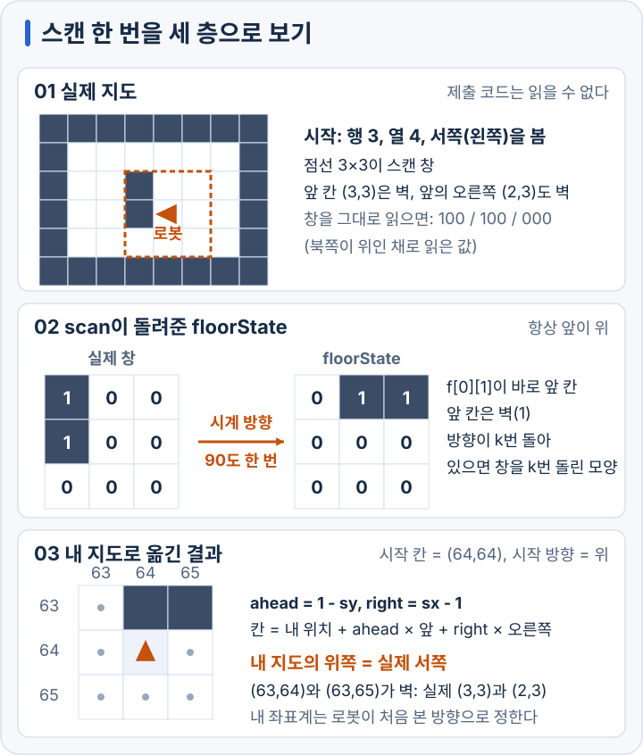

# 보이는 만큼만 아는 문제: 문제 계약과 기준선

ROBOTCLEAN의 계약과 비용, 실제 지도·로봇이 아는 값·내 지도의 세 층과 좌표 변환, DFS 기준선까지 만듭니다. 전체 흐름은 [강의 개요](../lesson.md)에 있습니다.

## 문제 계약을 상태로 옮기기

문제 설명과 공개 채점기 `main.cpp`의 규칙을 함께 읽어 정리했습니다. 채점기는 규칙 확인에만 읽었고 풀이는 공개 API와 이 표만 씁니다.

| 항목 | 계약 |
| --- | --- |
| 호출 순서 | TC마다 `init()`이 한 번, 그 TC의 subtask 10개마다 `cleanHouse()`가 한 번 호출됩니다. TC 10개, 모두 `cleanHouse()` 100번 |
| 지도와 시작 | `64 × 64`, 바깥 한 겹은 벽입니다. subtask마다 시작 칸(빈 칸)과 방향이 새로 정해지고, 시작 칸은 이미 청소된 칸입니다. 공개 입력 10개는 빈 칸이 3247~3587개이고 모두 한 덩어리로 이어져 있습니다. |
| `scan` | 비용 20. `3 × 3`을 `floorState`에 채웁니다. `0` 빈 칸, `1` 벽. **로봇이 보는 방향이 항상 위**가 되도록 회전되어 있고 `[1][1]`이 내 칸입니다. |
| `move` | 비용 10(성공·실패 같음). 앞 칸이 빈 칸이면 이동하고 `1`, 벽이면 제자리에서 `0`을 돌려줍니다. |
| `turn` | 비용 15. `1` 왼쪽 90도, `2` 180도, `3` 오른쪽 90도. 이 밖의 값은 방향을 바꾸지 않고 비용만 씁니다. 채점기의 방향은 `0` 위, `1` 왼쪽, `2` 아래, `3` 오른쪽이고 `turn(k)`는 방향에 `k`를 더합니다(mod 4). |
| 점수 | 한 TC의 모든 행동 비용 합입니다. **낮을수록 좋고** 10개 TC의 합이 총점입니다. 통과 기준은 6500000(`cleanHouse` 한 번에 평균 65000) |
| 종료와 무효 | `cleanHouse()`가 끝났을 때 안쪽 빈 칸에 안 밟은 칸이 있으면 그 TC는 점수 1000000000이고 채점이 거기서 멈춥니다. 호출이 무효가 되는 경우는 없습니다. |
| 피드백 | `scan` 값과 `move`의 반환값이 전부입니다. 내 위치, 방향, 청소 여부는 읽을 수 없습니다. |

점수에는 하한이 있습니다. 모든 빈 칸을 한 번씩은 밟아야 하므로 `cleanHouse` 하나에 이동 `빈 칸 수 − 1`번, 곧 공개 입력 전체에서 이동 비용만 **3403100**입니다. 스캔과 회전과 재방문과 막힘이 이 위에 얹힙니다.

## 세 층의 상태와 좌표 변환



[그림 크게 보기](https://git.readiz.com/h-contest-lesson/lessons/explore-unknown-map/lesson-assets/three-layers.svg)

그림 가운데의 `floorState`는 실제 창을 시계 방향으로 한 번 돌린 모양이고, 오른쪽 내 지도는 시작 칸과 시작 방향을 기준으로 다시 놓은 것입니다. 층마다 무엇을 아는지는 아래 표에 있습니다.

| 층 | 아는 것 | 코드 | 갱신하는 때 |
| --- | --- | --- | --- |
| 실제 지도와 실제 자세 | 채점기만 | 없음 | 읽을 수 없습니다 |
| 내 지도 | 내 호출 결과로 확인한 칸 | `R.cell`(`UNK` 모름, `FREE`, `WALL`), `R.seen`(밟은 칸) | `scan`이 돌아왔을 때, `move`가 돌아왔을 때 |
| 내 자세 추정 | 내가 센 행동의 결과 | `R.y`, `R.x`, `R.dir` | `move`가 `1`일 때만 위치, `turn`을 부를 때 방향 |

**좌표계.** 시작 위치와 방향을 모르므로 시작 칸을 배열 한가운데 `(C, C)`, 시작 방향을 `0`(위)으로 **내가 정합니다.** 내 지도는 실제 지도를 돌리고 옮긴 모양이고, 로봇은 자기 좌표계 안에서만 일관되면 됩니다. 배열 크기는 문제의 상한에서 셉니다.

:::hint 배열 크기 128과 시작 칸 64를 고른 이유
빈 칸은 안쪽 62칸 안에 있으므로 시작 칸에서 한 방향으로 최대 61칸 떨어지고, `scan`은 거기서 벽을 한 칸 더 보므로 `C ± 62`까지만 씁니다. `S = 128`, `C = 64`이면 `2..126`이라 배열 안에 들어갑니다. 지도 크기의 상한을 모르는 문제라면 이 계산부터 못 합니다.
:::

**관측 되돌리기.** `floorState[sy][sx]`는 바로 앞이 `[0][1]`이므로 `ahead = 1 − sy`, `right = sx − 1`입니다. 칸은 `내 위치 + ahead × 앞 벡터 + right × 오른쪽 벡터`이고, 방향 `d`의 오른쪽은 `(d + 3) % 4`입니다. 그림의 예(시작 `(3,4)`, 서쪽을 봄)로 확인할 수 있습니다. 이 변환은 아래 코드의 `doScan`에 있고, 검사 스크립트는 모든 호출 직후에 내 지도와 자세가 실제와 같은지 확인합니다.

| 상태 | 언제 비우는가 | 이유 |
| --- | --- | --- |
| `R`(내 지도, `seen`, 자세) | `cleanHouse` 시작(`reset`) | subtask마다 시작 칸과 방향이 달라 **좌표계가 다릅니다.** 지난 지도는 다른 좌표계의 값입니다. |
| `init()`에서 `R`을 비우기 | 충분하지 않음 | `init()`은 TC에 한 번이라 두 번째 subtask부터는 지난 지도가 남습니다. |
| `T`(내가 센 호출 수와 비용) | `init()` | TC 합계를 보려는 기록입니다. subtask마다 지우면 합계가 사라집니다. |
| 계획용 배열 | 계획마다 `++markNow` | 배열 전체를 지우지 않고 번호가 같은 칸만 유효로 봅니다. |

> **코드 환경: h-contest 제출용.** 아래 블록들을 이 순서로 `user.cpp`에 붙입니다. `queue`나 `min-heap` 블록이 필요한 정책에서는 이 블록 앞에 둡니다. 스캔·이동·회전은 모두 이 블록의 `doScan`, `step`, `face`만 부릅니다.

```cpp snippet=rc-state
extern void scan(int floorState[3][3]);
extern int move(void);
extern void turn(int mCommand);

namespace rc {
const int S = 128, C = 64;         // 내 지도의 한 변, 시작 칸의 좌표
const int DY[4] = {-1, 0, 1, 0};
const int DX[4] = {0, -1, 0, 1};   // 0 시작 방향, 1 그 왼쪽, 2 뒤, 3 오른쪽. turn(k)은 방향에 k를 더한다
const int UNK = 0, FREE = 1, WALL = 2;

struct Robot {
    int y, x, dir;               // 내 지도에서 추정한 위치와 방향
    unsigned char cell[S][S];    // 내 지도: UNK, FREE, WALL
    bool seen[S][S];             // 밟아서 청소한 칸
};
struct Tally { long long cost; int scans, moves, bumps, turns; };

const int SCAN_MIN = 6;          // 3 x 3 안에 모르는 칸이 이만큼 이상이면 스캔한다 (0이면 매번, 9면 안 한다)

Robot R;
Tally T;                         // 이번 TC에서 내가 쓴 호출 수와 비용
int path[S * S];                 // 계획이 만든 이동 방향열

void reset() {                   // 새 실행(subtask)의 시작: 지난 지도는 좌표계가 달라 쓸 수 없다
    for (int y = 0; y < S; ++y) for (int x = 0; x < S; ++x) { R.cell[y][x] = UNK; R.seen[y][x] = false; }
    R.y = C; R.x = C; R.dir = 0;
    R.cell[C][C] = FREE; R.seen[C][C] = true;
}

void doScan() {
    int f[3][3];
    scan(f);
    T.cost += 20; ++T.scans;
    int fy = DY[R.dir], fx = DX[R.dir];                    // 앞쪽 단위 벡터
    int ry = DY[(R.dir + 3) % 4], rx = DX[(R.dir + 3) % 4]; // 오른쪽 단위 벡터
    for (int sy = 0; sy < 3; ++sy) for (int sx = 0; sx < 3; ++sx) {
        int ahead = 1 - sy, right = sx - 1;                // f[0][1]이 바로 앞 칸
        R.cell[R.y + ahead * fy + right * ry][R.x + ahead * fx + right * rx] = f[sy][sx] ? WALL : FREE;
    }
}

void face(int d) {
    int k = (d - R.dir + 4) % 4;   // 필요한 turn 명령과 같은 수
    if (k == 0) return;
    turn(k);
    T.cost += 15; ++T.turns;
    R.dir = d;
}

// d 방향으로 한 칸. 0 막힘, 1 이미 밟은 칸으로 이동, 2 새 칸으로 이동
int step(int d) {
    face(d);
    T.cost += 10;
    int ny = R.y + DY[d], nx = R.x + DX[d];
    if (!move()) { R.cell[ny][nx] = WALL; ++T.bumps; return 0; }   // 막히면 위치는 그대로
    ++T.moves;
    R.y = ny; R.x = nx; R.cell[ny][nx] = FREE;
    if (R.seen[ny][nx]) return 1;
    R.seen[ny][nx] = true;
    return 2;
}

int unknownAround() {            // 3 x 3 안에서 아직 모르는 칸 수
    int n = 0;
    for (int dy = -1; dy <= 1; ++dy) for (int dx = -1; dx <= 1; ++dx) n += R.cell[R.y + dy][R.x + dx] == UNK;
    return n;
}

// 계획한 방향열을 걷는다. 막히면 거기서 멈추고 호출한 쪽이 다시 계획한다
void walk(int n) {
    for (int i = 0; i < n; ++i) {
        int r = step(path[i]);
        if (r == 0) return;
        if (r == 2 && unknownAround() >= SCAN_MIN) doScan();
    }
}

void init() { T.cost = 0; T.scans = T.moves = T.bumps = T.turns = 0; }
}

void init() { rc::init(); }
```

`step`은 호출 결과로 내 자세를 바꾸는 **유일한** 곳입니다. `move`가 `0`이면 위치를 그대로 두고 앞 칸만 벽으로 적습니다. `unknownAround`는 지금 칸 둘레 `3 × 3`에서 모르는 칸 수이고, `SCAN_MIN`은 "이만큼 이상 모르면 스캔한다"는 기준입니다.

## 유효한 기준선: DFS

가장 단순한 유효 규칙은 DFS입니다. 새 칸에 도착하면 스캔하고, 안 밟은 빈 칸이 이웃에 있으면 고정 순서로 가고, 없으면 온 길로 한 칸 되돌아갑니다. 스캔으로 이웃을 모두 알고 있어서 막힐 일이 없고, 연결된 모든 칸을 밟는 것이 보장됩니다.

```cpp snippet=rc-baseline
namespace rc {
int back[S * S];   // 지나온 길을 거꾸로 되돌아갈 방향들
}

void cleanHouse() {
    using namespace rc;
    reset();
    doScan();
    int top = 0;
    for (;;) {
        int go = -1;
        for (int d = 0; d < 4 && go < 0; ++d)       // 고정 순서: 아직 안 밟은 빈 칸
            if (R.cell[R.y + DY[d]][R.x + DX[d]] == FREE && !R.seen[R.y + DY[d]][R.x + DX[d]]) go = d;
        if (go >= 0) {
            back[top++] = (go + 2) % 4;
            step(go);
            doScan();                                  // 새 칸마다 스캔
        } else if (top > 0) {
            step(back[--top]);                         // 갈 곳이 없으면 한 칸 되돌아간다
        } else break;
    }
}
```

비용은 15411250이고 통과 기준 6500000의 두 배가 넘습니다. 스캔이 340410번이라 그 비용만 6808200이고, 이동의 절반은 되돌아가는 이동입니다. 유효하지만 점수를 따질 수준은 아닙니다.
