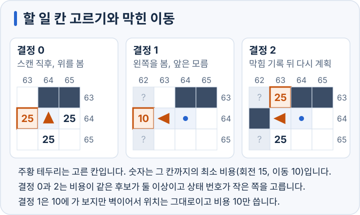

# 보이는 만큼만 아는 문제: 풀이

가장 가까운 할 일 칸으로 가는 BFS 정책 1, 회전을 포함한 (칸, 방향) 최단 비용 정책 2, 두 정책의 결정을 실제 값으로 따라가는 손계산을 다룹니다. 앞 단계는 [문제 계약과 기준선](contract-and-baseline.md)입니다.

## 정책 1: 가장 가까운 할 일 칸으로 BFS

정책은 "다음에 어디를 밟을까"를 매번 다시 정하는 것입니다. **할 일 칸**은 안 밟은 칸 중 벽이 아닌 칸이고, 아는 빈 칸과 **아직 모르는 칸**을 함께 셉니다. 모르는 칸은 낙관적으로 빈 칸으로 보고, 가 보았는데 벽이면(`move`가 `0`) 그 칸을 벽으로 적고 다시 계획합니다. 계획은 이미 밟은 칸(확실히 빈 칸) 위로만 걷고, 처음 만난 안 밟은 이웃이 가장 가까운 할 일 칸입니다. 같은 거리에서는 지금 보는 방향부터 보므로 직진이 먼저 잡힙니다.

> **코드 환경: h-contest 제출용.** `queue` 블록(용량 `S × S`)과 `rc-state` 뒤에 붙입니다. 큐는 `plan()` 시작에서 비우고, 칸마다 한 번만 넣으므로 용량은 칸 수입니다.

```cpp snippet=rc-bfs
namespace rc {
hc::Queue<S * S> Q;
int mark[S][S], markNow, enter[S][S];

// 밟은 칸 위로만 걸어 가장 가까운 "할 일 칸"까지의 방향열을 path에 담고 길이를 돌려준다. 없으면 0
int plan() {
    ++markNow; Q.clear();
    mark[R.y][R.x] = markNow; Q.push(R.y * S + R.x);
    int cur;
    while (Q.pop(cur)) {
        int y = cur / S, x = cur % S;
        for (int k = 0; k < 4; ++k) {
            int d = (R.dir + k) % 4;                  // 같은 거리면 지금 보는 방향부터
            int ny = y + DY[d], nx = x + DX[d];
            if (R.cell[ny][nx] == WALL || mark[ny][nx] == markNow) continue;
            mark[ny][nx] = markNow; enter[ny][nx] = d;
            if (!R.seen[ny][nx]) {                    // 처음 만난 안 밟은 칸이 가장 가깝다
                int n = 0, tmp[S * S];
                for (int cy = ny, cx = nx; cy != R.y || cx != R.x; ) {
                    int e = enter[cy][cx];
                    tmp[n++] = e; cy -= DY[e]; cx -= DX[e];
                }
                for (int i = 0; i < n; ++i) path[i] = tmp[n - 1 - i];
                return n;
            }
            Q.push(ny * S + nx);
        }
    }
    return 0;
}
}

void cleanHouse() {
    using namespace rc;
    reset();
    if (unknownAround() >= SCAN_MIN) doScan();
    for (int n; (n = plan()) > 0; ) walk(n);
}
```

**스캔은 언제 하는가.** `SCAN_MIN 0`이면 새 칸마다 스캔하는 "매 걸음" 방식이고, `1`은 모르는 칸이 하나라도 있을 때만 하는 "필요할 때" 방식입니다. 스캔 20은 이동 두 번 값입니다. 스캔으로 알게 된 칸이 어차피 빈 칸이라면 그냥 밟으면서 알아도 같으므로, 스캔이 이기는 때는 벽을 미리 알아 **헛걸음(막힘 10)과 회전**을 피할 때뿐입니다. 지금 칸에서 스캔하면 모르는 칸 `u`개를 알게 되고, 안 하면 그 칸을 직접 밟아 알아야 합니다. `SCAN_MIN`은 이 손익분기를 "`u ≥ SCAN_MIN`이면 스캔"으로 단순하게 바꾼 값이고, 정답은 실측으로 찾습니다.

## 정책 2: 회전을 포함한 (칸, 방향) 최단 비용

정책 1은 걸음 수만 세지만 같은 칸도 어느 쪽을 보고 있느냐에 따라 다음 비용이 다릅니다(이동 10, 회전 15). 정점을 (칸, 방향)으로 잡으면 이동 간선 10과 회전 간선 15가 있는 그래프이고, [Dijkstra](https://h.readiz.com/learn/dijkstra)로 가장 싼 할 일 칸을 구합니다. 첫 번째로 꺼낸 안 밟은 칸이 가장 쌉니다. 회전 15는 `TURN_W`, 모르는 칸에 들어갈 때 더하는 비용은 `UNK_PEN`(헛걸음의 기대 손실)이며, 둘 다 계획에서만 쓰는 값입니다.

> **코드 환경: h-contest 제출용.** `min-heap` 블록과 `rc-state` 뒤에 붙입니다. 힙 용량 `1 << 18`이 넘치지 않는 이유는 아래 접은 계산에 있습니다.

:::hint 힙 용량 계산
상태는 (밟은 칸 3844개 이하 + 그 이웃 3844개 이하) × 4방향 = 30752개 이하이고 상태마다 들어오는 간선이 4개라 힙에 넣는 횟수는 123008번 이하입니다. 그러니 `1 << 18`이면 넘치지 않습니다. 검사는 밟은 칸이 가장 많은 경우에서 동시에 남은 항목이 362개임도 확인합니다.
:::

```cpp snippet=rc-dijkstra
namespace rc {
const int TURN_W = 15;           // 계획에서 회전 한 번의 비용 (실제는 15)
const int UNK_PEN = 0;           // 모르는 칸에 들어갈 때 더하는 비용 (벽이면 헛걸음이라서)

hc::MinHeap<1 << 18> H;
int mark[S * S * 4], dist[S * S * 4], from[S * S * 4], markNow;

inline int id(int y, int x, int d) { return (y * S + x) * 4 + d; }

void relax(int a, int b, int nd) {
    if (mark[b] == markNow && dist[b] <= nd) return;
    mark[b] = markNow; dist[b] = nd; from[b] = a;
    H.push(nd, b);
}

// (칸, 방향) 상태의 최단 비용으로 가장 싼 "할 일 칸"까지의 방향열을 path에 담는다. 길이를 돌려주고, 없으면 0
int plan() {
    ++markNow; H.clear();
    int s0 = id(R.y, R.x, R.dir);
    mark[s0] = markNow; dist[s0] = 0; from[s0] = -1;
    H.push(0, s0);
    hc::HeapItem top;
    while (H.pop(top)) {
        int s = top.id;
        if (top.key > dist[s]) continue;               // 낡은 항목
        int d = s % 4, c = s / 4, y = c / S, x = c % S;
        if (!R.seen[y][x]) {                           // 처음 꺼낸 할 일 칸이 가장 싸다
            int n = 0, tmp[S * S];
            for (int t = s; from[t] >= 0; t = from[t])
                if (t / 4 != from[t] / 4) tmp[n++] = t % 4;   // 칸이 바뀐 상태만 이동
            for (int i = 0; i < n; ++i) path[i] = tmp[n - 1 - i];
            return n;
        }
        for (int k = 1; k < 4; ++k) relax(s, c * 4 + (d + k) % 4, dist[s] + TURN_W);
        int ny = y + DY[d], nx = x + DX[d];
        if (R.cell[ny][nx] != WALL) relax(s, id(ny, nx, d), dist[s] + 10 + (R.cell[ny][nx] == UNK ? UNK_PEN : 0));
    }
    return 0;
}
}

void cleanHouse() {
    using namespace rc;
    reset();
    if (unknownAround() >= SCAN_MIN) doScan();
    for (int n; (n = plan()) > 0; ) walk(n);
}
```

계획이 돌려주는 비용은 실제로 쓰는 비용과 같습니다. 막히지 않으면 `step`이 쓰는 회전 15와 이동 10이 계획의 합과 같고, 검사 스크립트가 (칸, 방향) 최단 비용을 별도 Dijkstra(Python)로 구해 같은지 확인합니다. 정책 1의 BFS도 별도 BFS와 걸음 수를 대조합니다.

## 손계산: 스캔, 이동, 막힘을 실제 값으로



[그림 크게 보기](https://git.readiz.com/h-contest-lesson/lessons/explore-unknown-map/lesson-assets/frontier-choice.svg)

실제 지도는 다음과 같고(`#` 벽, `.` 빈 칸) 시작은 행 3, 열 4, 서쪽을 보는 방향입니다. 정책 2(`SCAN_MIN 6`)입니다.

```text
########   행 0
#......#   행 1
#..#...#   행 2
#..#...#   행 3   시작 (3,4), 서쪽
#......#   행 4
########   행 5
```

| 순서 | 호출 | 채점기에서 일어난 일 (실제 좌표) | 내 자세 `(y,x) 방향` | 내 지도 변화 |
| --- | --- | --- | --- | --- |
| 1 | `scan` | 창 `100/100/000`을 시계 방향으로 한 번 돌려 `011000000` | (64, 64) 0 | 63행 `. # #`, 64행 `. 나 .`, 65행 `. . .` |
| 2 | `turn(1)` | 서쪽에서 왼쪽으로 돌아 남쪽 | (64, 64) 1 | 방향만 |
| 3 | `move` → `1` | (3,4)에서 (4,4)로 | (64, 63) 1 | (64,63)을 밟음 |
| 4 | `move` → `0` | (5,4)는 벽이라 제자리 | (64, 63) 1 | (64,62)를 벽으로 적음 |
| 5 | `turn(3)` | 남쪽에서 오른쪽으로 돌아 서쪽 | (64, 63) 0 | 방향만 |
| 6 | `move` → `1` | (4,4)에서 (4,3)으로 | (63, 63) 0 | (63,63)을 밟음 |

세 번의 결정을 따라가면 다음과 같습니다.

1. **결정 0.** 스캔 직후 앞 `(63,64)`는 벽입니다. 안 밟은 이웃 세 곳 `(64,63)`, `(64,65)`, `(65,64)`가 모두 **회전 15 + 이동 10 = 25**로 같습니다. 힙은 키가 같으면 상태 번호가 작은 쪽을 꺼내므로 `(64,63)`입니다. 도착하면 `(64,63)` 둘레 `3 × 3`의 모르는 칸은 `(64,62)` 열의 3개라서 `SCAN_MIN 6`보다 작아 스캔하지 않습니다. 비용은 `scan 20 + 25 = 45`입니다.
2. **결정 1.** 왼쪽 앞 `(64,62)`는 모르는 칸이지만 회전 없이 10이라 가장 쌉니다. 가 보니 벽이어서 위치는 그대로이고 **비용 10만** 들었습니다. 이 칸이 벽으로 기록되었습니다.
3. **결정 2.** 앞이 벽이므로 `(63,63)`과 `(65,63)`이 모두 25이고 번호가 작은 `(63,63)`을 고릅니다. 도착한 내 `(63,63)`은 실제 `(4,3)`입니다. 시작에서 내 좌표로 위로 1칸, 왼쪽으로 1칸이고 내 위는 실제 서쪽, 내 왼쪽은 실제 남쪽이기 때문입니다.

이 지도를 끝까지 돌리면 결정 31번, 스캔 4번, 이동 34번, 막힘 10번, 회전 19번으로 비용 **805**입니다(`80 + 340 + 100 + 285`). 위 값은 모두 `scripts/check_explore_unknown_map.py`가 제출 코드를 이 지도에서 돌려 다시 계산하고, 스캔 결과는 창을 따로 돌려 만든 값과, 각 결정의 비용은 별도 Dijkstra와 대조합니다. 같은 비용의 후보가 여럿일 때 번호로 고르는 것은 임의의 규칙이라 점수에 영향을 주지만, 어느 쪽이 낫다고 말할 근거는 없습니다.
