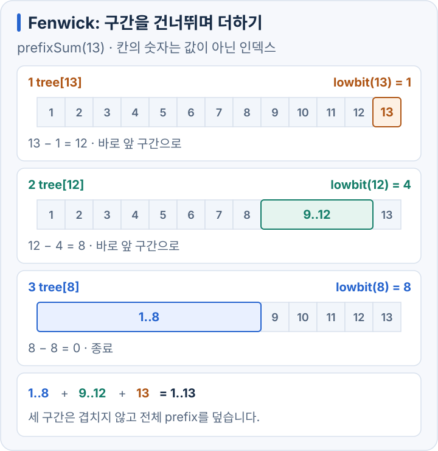
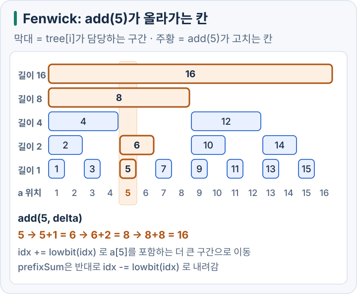

# Fenwick Tree

Fenwick Tree는 배열의 **prefix 합**을 빠르게 관리하는 자료구조입니다. Binary Indexed Tree, 줄여서 BIT라고도 부릅니다.

가장 대표적인 문제는 다음 형태입니다.

```text
배열 a가 있다.
1. a[idx]에 값을 더한다.
2. 구간 [l, r]의 합을 빠르게 구한다.
```

누적합 배열만 있으면 구간 합은 `O(1)`이지만, 중간 값이 바뀔 때 누적합을 다시 고치는 데 `O(n)`이 걸립니다. Fenwick Tree는 값을 바꾸는 작업과 합을 묻는 작업을 모두 `O(log n)`에 처리합니다.

Segment Tree보다 할 수 있는 일은 좁지만, 구간 합처럼 prefix로 표현되는 문제에서는 코드가 짧고 빠릅니다.

## prefix 합으로 생각하기

구간 합은 prefix 합 두 개로 바꿀 수 있습니다.

```text
sum(l, r) = prefixSum(r) - prefixSum(l - 1)
```

그래서 Fenwick Tree는 `prefixSum(x)`를 빠르게 구하는 데 집중합니다. 각 칸은 배열의 한 구간 합을 저장하고, 여러 칸을 더해 원하는 prefix를 만듭니다.

Fenwick Tree는 보통 1-indexed로 구현합니다. 입력이 0-indexed라면 함수에 넣기 전에 `idx + 1`로 바꾸거나, wrapper에서 처리하면 됩니다.

## lowbit

Fenwick Tree의 핵심은 가장 낮은 1비트만 남기는 `lowbit(x) = x & -x`입니다.

`lowbit(x)`는 `x`의 이진수에서 가장 낮은 1비트가 나타내는 값을 반환합니다.

| x | 이진수 | lowbit(x) |
| --- | --- | --- |
| 1 | `0001` | 1 |
| 2 | `0010` | 2 |
| 3 | `0011` | 1 |
| 4 | `0100` | 4 |
| 6 | `0110` | 2 |
| 8 | `1000` | 8 |

Fenwick Tree의 `tree[i]`는 길이가 `lowbit(i)`인 구간의 합을 저장합니다. 정확히는 다음 구간입니다.

```text
tree[i] = a[i - lowbit(i) + 1] + ... + a[i]
```

예를 들어 `tree[8]`은 `lowbit(8) = 8`이므로 `a[1]`부터 `a[8]`까지의 합을 담고, `tree[6]`은 `lowbit(6) = 2`이므로 `a[5] + a[6]`을 담습니다.

## prefixSum



[그림 크게 보기](https://git.readiz.com/h-contest-lesson/lessons/fenwick-tree/lesson-assets/concept-trace.svg)

`prefixSum(idx)`는 `a[1] + ... + a[idx]`를 구합니다. 현재 위치의 구간을 더한 뒤, 그 구간 바로 앞 위치로 이동합니다.

예를 들어 `prefixSum(13)`은 다음 칸들을 더합니다.

```text
13 -> 12 -> 8 -> 0
```

`tree[13]`은 마지막 1개, `tree[12]`는 그 앞 4개, `tree[8]`은 그 앞 8개를 담당합니다. 합치면 1부터 13까지의 합이 됩니다.

## add

`a[idx]`에 `delta`를 더할 때는 `idx`를 포함하는 Fenwick Tree 칸들을 모두 고쳐야 합니다.

`prefixSum`이 아래쪽으로 내려간다면, `add`는 위쪽으로 올라갑니다. `idx += lowbit(idx)`를 반복하면 현재 원소를 포함하는 더 큰 구간으로 이동합니다. `idx = 0`에서는 `lowbit(0) = 0`이라 루프가 끝나지 않으므로, `add`에는 1 이상의 인덱스만 넘깁니다.



[그림 크게 보기](https://git.readiz.com/h-contest-lesson/lessons/fenwick-tree/lesson-assets/add-path.svg)

막대의 길이가 `lowbit(i)`이고 오른쪽 끝이 `i`입니다. 주황색 막대 네 개가 `a[5]`를 포함하는 칸 전부이며, `prefixSum(13)`이 내려가는 경로는 위의 그림에서 봅니다.

## 전체 구현

아래 구현은 1-indexed Fenwick Tree입니다. `add`에는 `1..n`, `prefixSum`에는 `0..n`, `rangeSum`에는 `1 <= l <= r <= n`을 전달합니다. 원소별 `add`로 초기화하므로 빌드는 `O(n log n)`, 이후 갱신과 질의는 `O(log n)`입니다.

> **코드 환경: h-contest 제출용 코드.** 표준 헤더·STL·동적 할당 없이 고정 배열로 구현하므로 앞에 붙일 [공통 코드](https://h.readiz.com/learn/cpp-common-library) 블록이 없습니다.

원소 수 상한 `MAX_N = 200000`은 이 사이트 연습의 입력 상한이며, 실제 문제에서는 제한에 맞춰 바꿉니다. `tree`는 정적 배열이라 이전 TC의 값이 남습니다. 큰 `FenwickTree`는 전역으로 선언하고, TC가 시작될 때마다 `init(n)`이나 `build`로 사용할 `[0, n]`을 0으로 비웁니다.

```cpp
const int MAX_N = 200000; // 원소 수 상한

struct FenwickTree {
    int n;
    long long tree[MAX_N + 1];

    bool init(int size) { // 0 <= size <= MAX_N이 아니면 false
        if (size < 0 || size > MAX_N) return false;
        n = size;
        for (int i = 0; i <= n; ++i) tree[i] = 0;
        return true;
    }

    bool build(const long long values[], int size) {
        if (!init(size)) return false;
        for (int i = 0; i < n; ++i) {
            add(i + 1, values[i]);
        }
        return true;
    }

    void add(int idx, long long delta) {
        while (idx <= n) {
            tree[idx] += delta;
            idx += idx & -idx;
        }
    }

    long long prefixSum(int idx) const {
        long long result = 0;
        while (idx > 0) {
            result += tree[idx];
            idx -= idx & -idx;
        }
        return result;
    }

    long long rangeSum(int l, int r) const {
        return prefixSum(r) - prefixSum(l - 1);
    }

    void setValue(int idx, long long oldValue, long long newValue) {
        add(idx, newValue - oldValue);
    }
};

FenwickTree fenwick;
```

`setValue`처럼 값을 대입하는 연산을 만들 때는 기존 값을 알아야 합니다. Fenwick Tree 자체는 "얼마를 더할지"를 받는 구조이므로, 원본 배열을 따로 들고 있으면 더 편합니다.

## lower_bound

모든 값이 음수가 아니면, Fenwick Tree로 "prefix 합이 처음으로 target 이상이 되는 위치"도 찾을 수 있습니다.

위 `FenwickTree` 뒤에 다음 함수를 둡니다. `target <= 0`은 1, 전체 합보다 큰 target은 `n + 1`을 반환합니다. 값별 빈도를 저장했다면 `lowerBound(fenwick, k)`로 k번째 원소의 값 인덱스를 찾을 수 있습니다.

```cpp
int lowerBound(const FenwickTree& f, long long target) {
    if (target <= 0) return 1;
    if (target > f.prefixSum(f.n)) return f.n + 1;

    int idx = 0;
    int bit = 1;
    while (bit <= f.n / 2) bit <<= 1;

    for (; bit > 0; bit >>= 1) {
        int next = idx + bit;
        if (next <= f.n && f.tree[next] < target) {
            idx = next;
            target -= f.tree[next];
        }
    }
    return idx + 1;
}
```

이 함수는 Fenwick Tree 위에서 이진 탐색을 하는 느낌입니다. 왼쪽부터 구간을 크게 붙여 보면서 target에 아직 못 미치면 그 구간을 통째로 건너뜁니다.

주의할 점은 값이 음수일 수 있으면 prefix 합이 단조 증가하지 않는다는 것입니다. 그 경우에는 이 방식으로 lower_bound를 할 수 없습니다.

## 로컬 연습: 점 덧셈과 구간 합

배열의 점 덧셈과 닫힌 구간 합을 처리하세요. 이 연습은 본문의 Fenwick 구현과 같은 1-based 인덱스를 사용합니다.

**입력:** N Q, N개 초기 값, Q개 연산. A i delta는 점 덧셈, S l r은 [l,r] 합입니다. 1 <= N <= 200000, 0 <= Q <= 200000, |초기 값|,|delta| <= 10^9, 1 <= l <= r <= N입니다.

**출력:** S 연산의 답을 한 줄씩 출력합니다.

### 예시

```text exercise=fenwick-tree role=input
5 5
1 2 3 4 5
S 1 5
A 3 -5
S 2 4
A 1 10
S 1 1
```

```text exercise=fenwick-tree role=output
15
4
11
```

**확인 방법:** 작은 배열을 직접 갱신·합산하는 기준 풀이와 비교합니다. i=1, i=N, l=r, 음수 갱신을 검사합니다. 실제 Fenwick 내부 함수에 index 0을 넣으면 lowbit 진행이 멈추므로 wrapper에서 경계를 맞춥니다.

## 휴리스틱 풀이에서 쓰는 곳

Fenwick Tree는 값이 계속 바뀌는 상태에서 접두 구간의 합이나 개수를 반복해서 물을 때 씁니다. 고정된 값이면 누적합이 더 단순하고, 갱신과 질의가 모두 많을 때 Fenwick이 필요합니다. 휴리스틱에서는 해가 바뀔 때마다 일부 값을 고치며 점수나 개수를 즉시 읽는 구조에서 후보가 됩니다.

- [창고 구역 장부](/practice/SHELFLOG): `n`이 최대 200,000이고 `addStock`과 `totalStock`의 총 호출이 220,000 이하입니다. 구간에 더하고 구간 합을 구하는 이 문제는 Fenwick 두 개로 해결할 수 있는 정석적인 사례입니다.
- [우주선 착륙](/practice/LANDINGX): `1000 x 1000` 지도에 우주선을 놓을 때 겹침을 확인해야 하지만, 우주선의 변은 최대 5라서 후보 하나당 25칸 이하를 직접 확인하면 됩니다. Fenwick이 필요한지는 후보 하나를 확인하는 비용이 실제로 병목인지 측정한 뒤 정합니다.
