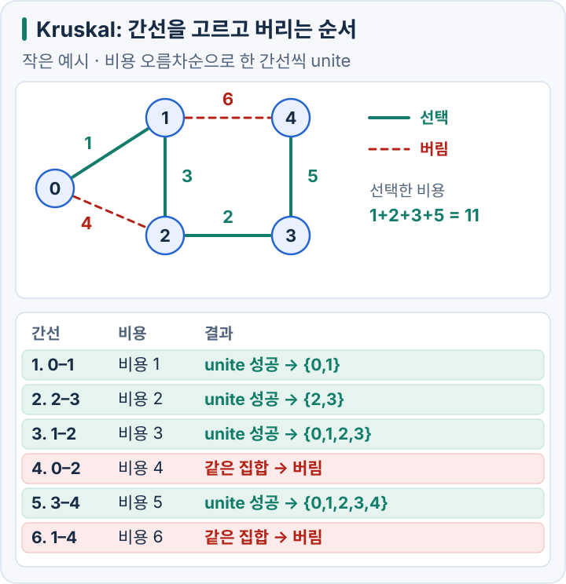

# 그래프와 트리 기본 성질: 최소 신장 트리

## 최소 신장 트리

최소 신장 트리(MST, Minimum Spanning Tree)는 가중치가 있는 무방향 연결 그래프에서 모든 정점을 연결하면서 간선 비용 합이 최소인 트리입니다.

MST를 생각할 때 조건을 분리하면 실수가 줄어듭니다.

```text
1. 모든 정점이 연결되어야 한다.
2. 사이클은 필요 없다. 정점 n개를 잇는 트리는 간선 n - 1개다.
3. 비용 합이 최소여야 한다.
```

대표 알고리즘은 Kruskal과 Prim입니다.

| 알고리즘 | 핵심 아이디어 | 잘 맞는 표현 |
| --- | --- | --- |
| Kruskal | 간선을 비용 오름차순으로 보며, 사이클을 만들지 않으면 선택 | 간선 리스트 + Union-Find |
| Prim | 현재 연결된 정점 집합에서 바깥으로 나가는 가장 싼 간선을 선택 | 인접 리스트 + 우선순위 큐 |

아래 코드는 [Union-Find 강의](https://h.readiz.com/learn/union-find)의 `DSU`를 사용합니다. `unite`가 성공한 간선만 비용에 더합니다.

> **코드 환경: h-contest 제출용 코드.** [공통 코드](https://h.readiz.com/learn/cpp-common-library)의 `array`(`DSU`가 쓰는 `hc::swap`)와 `sort` 블록, 그리고 Union-Find 강의 "전체 구현"의 `DSU` 코드(`MAX_N = 200000` 포함)를 먼저 붙입니다. 표준 헤더·STL·동적 할당 없이 고정 배열로 구현합니다.

간선은 `Edge` 배열에 담아 공통 `sort` 블록의 `hc::stableSort`로 비용순 정렬합니다. 정렬용 작업 배열 `edgeTemp`는 간선 배열과 같은 크기로 따로 둡니다. 간선 상한 `MAX_EDGES = 400000`은 이 사이트 그래프 연습의 입력 상한과 같은 값이며, 실제 문제에서는 제한에 맞춰 바꿉니다. `edges[0..m)`는 정렬되어 순서가 바뀝니다. `DSU`는 전역으로 두고 호출마다 `init(n)`으로 사용할 `[0, n)`만 초기화합니다. 정점 번호는 `[0, n)`이어야 합니다.

```cpp
const int MAX_EDGES = 400000; // 무방향 간선 수 상한

struct Edge {
    int u;
    int v;
    long long cost;
};

Edge edgeTemp[MAX_EDGES];
DSU dsu;

// 반환값은 연결 가능 여부, total은 성공 시 MST 비용.
// 1 <= n <= MAX_N, 0 <= m <= MAX_EDGES가 아니면 false.
bool kruskal(int n, Edge edges[], int m, long long& total) {
    if (n < 1 || n > MAX_N || m < 0 || m > MAX_EDGES) return false;
    hc::stableSort(edges, edgeTemp, m, [](const Edge& a, const Edge& b) {
        return a.cost < b.cost;
    });

    dsu.init(n);
    total = 0;
    int used = 0;

    for (int i = 0; i < m; ++i) {
        if (!dsu.unite(edges[i].u, edges[i].v)) continue;
        total += edges[i].cost;
        used++;
    }

    if (used != n - 1) {
        return false; // 모든 정점을 연결할 수 없음
    }
    return true;
}
```

왜 가장 싼 간선부터 봐도 될까요? 핵심은 절단 성질입니다.

```text
어떤 정점 집합 S와 나머지를 가르는 절단을 생각한다.
그 절단을 건너는 간선 중 가장 싼 간선은 MST에 넣어도 안전하다.
```

Kruskal은 비용이 작은 간선부터 보면서, 이미 같은 컴포넌트 안의 간선은 사이클을 만들기 때문에 버립니다. 서로 다른 컴포넌트를 잇는 간선은 그 순간 두 컴포넌트를 가르는 절단의 싼 후보로 볼 수 있어 안전하게 선택합니다.



[그림 크게 보기](https://git.readiz.com/h-contest-lesson/lessons/graph-tree-basics/lesson-assets/kruskal-steps.svg)

본문 설명을 따라가기 위한 작은 예시입니다. 초록 행은 `unite`가 성공해 비용에 더한 간선, 빨간 행은 같은 집합이라 버린 간선입니다.

선택한 간선이 `n - 1`개보다 적으면 입력이 연결되지 않은 것입니다. 비용 합은 `long long`으로 계산합니다. MST는 전체 연결 비용을 최소화하며, 두 정점 사이의 경로가 최단거리라는 보장은 없습니다.
