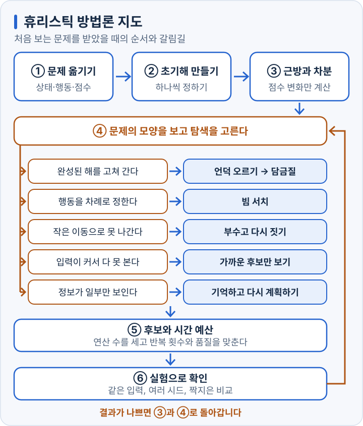

# 휴리스틱 방법론 지도

이 강의 묶음이 가르치는 것은 특정 문제의 풀이가 아니라, 처음 보는 휴리스틱 문제를 받았을 때 쓰는 기법과 그 기법을 고르고 확인하는 판단 기준입니다. 휴리스틱 문제는 최적해를 증명하기 어렵고 제한 시간 안에 좋은 해를 내면 되므로, 어떤 기법이 이 문제에 맞는지를 문제의 모양에서 읽는 일이 먼저입니다. 이 쪽은 그 흐름을 한 장으로 보여 주고, 단계마다 어느 강의를 읽을지 연결하는 지도입니다.

읽는 순서는 아래 "처음 보는 문제를 받았을 때의 흐름"의 번호와 같습니다. 방법론 강의 9개는 각각 허브와 원리 쪽, 코드 틀 쪽, 실험 쪽으로 이루어져 있고, 설명은 문제와 무관한 연습용 틀로 합니다. 이미 아는 단계는 건너뛰고 필요한 강의만 읽어도 됩니다. 실제 문제에 적용한 예는 이 쪽의 표와 [적용 사례 모음](https://h.readiz.com/learn/heuristic-case-studies)에 있습니다.

[그림 크게 보기](https://git.readiz.com/h-contest-lesson/lessons/heuristic/lesson-assets/method-map.svg)

## 처음 보는 문제를 받았을 때의 흐름

1. **문제를 상태·행동·점수로 옮깁니다.** [문제를 상태·행동·점수로 옮기기](https://h.readiz.com/learn/problem-modeling): 무효한 답은 점수를 받지 못하므로, 계약에서 상태와 무효 조건을 먼저 뽑고 어떤 입력에서도 유효한 기준선을 만들어 둡니다.
2. **초기해를 만듭니다.** [초기해 만들기](https://h.readiz.com/learn/construction-heuristics): 한 번에 하나씩 정하는 틀은 같고, 문제의 구조(자리가 하나뿐인지, 끼울 자리가 여럿인지)에 맞춰 선택 기준을 고릅니다.
3. **근방과 차분을 정합니다.** [근방 설계와 차분 평가](https://h.readiz.com/learn/neighborhood-and-delta): 이동이 건드리는 항만 다시 계산하고, 새로 만든 차분은 전체 재계산과 대조해 확인합니다.
4. **탐색을 고릅니다.** 문제의 모양에 따라 아래 표에서 고릅니다. 개선 탐색은 [언덕 오르기와 담금질](https://h.readiz.com/learn/hill-climbing-and-annealing), 순차 결정은 [빔 서치와 평가 함수](https://h.readiz.com/learn/beam-search), 작은 이동으로 못 나갈 때는 [크게 부수고 다시 짓기](https://h.readiz.com/learn/destroy-and-repair)입니다. 정보가 일부만 보이면 [정보가 부분적일 때 결정하기](https://h.readiz.com/learn/partial-information)를 먼저 봅니다.
5. **후보와 시간 예산을 맞춥니다.** [후보 줄이기와 시간 예산](https://h.readiz.com/learn/candidate-and-time-budget): 근방을 한 번 훑는 연산 수를 입력 상한에서 세어 보고, 예산에 비해 크면 가까운 후보만 봅니다.
6. **실험으로 확인합니다.** [실험과 튜닝](https://h.readiz.com/learn/experiments-and-tuning): 같은 입력과 여러 시드로 짝지어 비교하고, 차이가 흔들림 안이면 이겼다고 하지 않습니다.

결과가 기대보다 나쁘면 6단계의 기록으로 원인을 찾아 3단계(이동이 막혀 있는가)나 4단계(탐색이 맞는가)로 돌아갑니다. 탐색을 바꾸기 전에 1단계의 점수 계산이 채점과 맞는지를 먼저 다시 확인합니다.

## 탐색 방법 고르기

| 문제의 모양 | 먼저 쓸 기법 | 방법론 강의 | 적용 사례 |
| --- | --- | --- | --- |
| 완성된 해를 조금씩 고쳐 간다 | 초기해 → 근방과 차분 → 언덕 오르기, 지역 최적에서 막히면 담금질 | [근방 설계와 차분 평가](https://h.readiz.com/learn/neighborhood-and-delta), [언덕 오르기와 담금질](https://h.readiz.com/learn/hill-climbing-and-annealing) | [배송 순서 개선](https://h.readiz.com/learn/heuristic-case-studies/ordering-route-improvement)과 [초기해와 지역 탐색](https://h.readiz.com/learn/heuristic-case-studies/search-strategies)(ORDERING), [배정 문제의 지역 탐색과 SA](https://h.readiz.com/learn/assignment-local-search)(SCHEDULX), [택시 배정](https://h.readiz.com/learn/assignment-with-routes)(TAXIASSIGN), [특수한 점수식 읽기](https://h.readiz.com/learn/reading-the-score)(ENTROPY2D) |
| 행동을 차례로 정하고 중간 상태를 점수로 비교할 수 있다 | 빔 서치, 폭은 연산 예산에서 정함 | [빔 서치와 평가 함수](https://h.readiz.com/learn/beam-search) | [31일 설치 일정 Beam Search](https://h.readiz.com/learn/heuristic-case-studies/aircontech-beam-search)(AIRCONTECH) |
| 작은 이동으로는 빠져나오지 못하는 구조 | 일부를 떼어 내고 구성법으로 다시 채우기 | [크게 부수고 다시 짓기](https://h.readiz.com/learn/destroy-and-repair) | [광고판 도시 배치](https://h.readiz.com/learn/heuristic-case-studies/placement-and-repair)(BILLCITY), [격자 배치 문제](https://h.readiz.com/learn/placement-search)(LANDINGX) |
| 입력이 커서 근방을 다 볼 수 없다 | 가까운 후보만 보고 단계별로 시간을 나눔 | [후보 줄이기와 시간 예산](https://h.readiz.com/learn/candidate-and-time-budget) | [입력이 클 때](https://h.readiz.com/learn/large-input-search)(COUPANG1) |
| 정보가 일부만 보이거나 하나씩 도착한다 | 관측을 기억해 추정 위에서 계획하고, 되돌릴 수 없으면 앞날의 추정에 집중 | [정보가 부분적일 때 결정하기](https://h.readiz.com/learn/partial-information) | [채점기 상태를 따라 그리며 행동하기](https://h.readiz.com/learn/observe-and-act)(MINEEXPLORE), [보이는 만큼만 아는 문제](https://h.readiz.com/learn/explore-unknown-map)(ROBOTCLEAN), [열어 본 상자를 기억해 쌓고 정렬하기](https://h.readiz.com/learn/remember-and-sort)(DRONESORT) |

표의 적용 사례는 문제 하나를 끝까지 따라가므로 해당 문제의 계약과 채점기의 값이 그대로 나옵니다. 한 문제에 두 기법이 함께 쓰이는 경우가 많아서(예를 들어 개선 탐색의 초기해에는 구성법이, 큰 입력에는 후보 줄이기가) 표의 행은 먼저 쓸 기법을 가리킬 뿐 하나만 쓰라는 뜻이 아닙니다.

모양이 어느 행인지 모르겠으면 다음 질문으로 가립니다.

- 답을 완성된 형태로 이미 하나 가지고 있는가, 행동을 하나씩 정해서 답을 만들어 가는가.
- 이동 하나가 점수의 일부 항만 바꾸는가, 전체를 다시 계산해야 하는가.
- 근방을 한 번 훑는 연산 수가 예산에 비해 큰가.
- 입력 전체를 처음부터 아는가, 행동하면서 알게 되는가.
- 무효한 답이 점수 0으로 끝나는가, 아니면 벌점으로 이어지는가.

처음 두 질문은 행 1과 2를, 세 번째는 행 4를, 네 번째는 행 5를 가립니다. 마지막 질문은 3단계에서 무효한 이동을 제안 단계에서 거를지 정하는 데 쓰입니다.

## 공통 원칙

- **내 점수 계산을 채점과 맞춥니다.** 탐색이 올리는 값이 채점의 값과 다르면 점수가 올라도 개선이 아닙니다. [문제를 상태·행동·점수로 옮기기](https://h.readiz.com/learn/problem-modeling).
- **차분은 전체 재계산과 대조합니다.** 빠른 계산이 틀리면 탐색은 조용히 나빠집니다. [근방 설계와 차분 평가](https://h.readiz.com/learn/neighborhood-and-delta)와 [Testing과 Stress Test](https://h.readiz.com/learn/testing-and-stress).
- **시드 여러 개로 짝지어 비교하고, 못 가리면 "결정 못 함"이라고 씁니다.** 한 번의 측정으로 방법의 우열을 말하지 않습니다. [실험과 튜닝](https://h.readiz.com/learn/experiments-and-tuning).
- **공통 코드 블록을 씁니다.** 정렬·난수·큐·힙·배열 복사는 직접 다시 쓰지 않고 [공통 코드](https://h.readiz.com/learn/cpp-common-library)의 블록을 가져와 문제별 배열 상한만 맞춥니다.

## 본문

이 쪽에는 하위 쪽이 없습니다. 아래 순서로 강의를 읽으면 표의 기법이 모두 나옵니다.

1. [문제를 상태·행동·점수로 옮기기](https://h.readiz.com/learn/problem-modeling)
2. [초기해 만들기: 탐욕·삽입·무작위화](https://h.readiz.com/learn/construction-heuristics)
3. [근방 설계와 차분 평가](https://h.readiz.com/learn/neighborhood-and-delta)
4. [언덕 오르기와 담금질](https://h.readiz.com/learn/hill-climbing-and-annealing)
5. [빔 서치와 평가 함수](https://h.readiz.com/learn/beam-search)
6. [크게 부수고 다시 짓기](https://h.readiz.com/learn/destroy-and-repair)
7. [후보 줄이기와 시간 예산](https://h.readiz.com/learn/candidate-and-time-budget)
8. [정보가 부분적일 때 결정하기](https://h.readiz.com/learn/partial-information)
9. [실험과 튜닝](https://h.readiz.com/learn/experiments-and-tuning)

이어서 [적용 사례 모음](https://h.readiz.com/learn/heuristic-case-studies)에서 배송 순서·SA·배치·일정 빔의 적용 예를 따라갈 수 있습니다.
