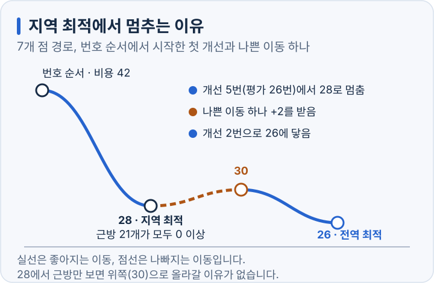
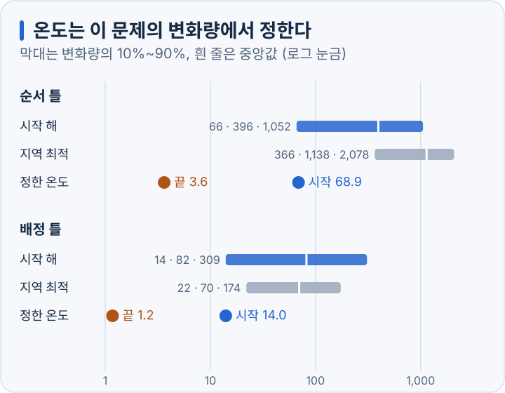
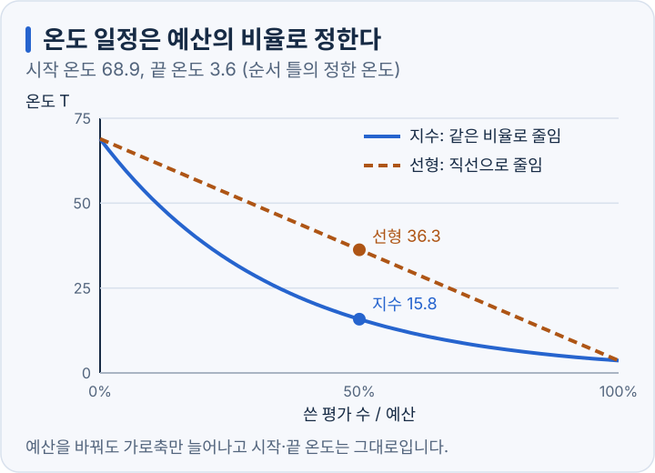
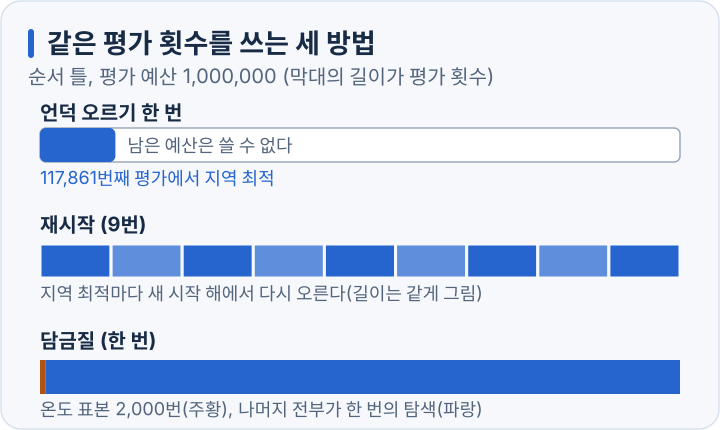

# 원리: 지역 최적, 나쁜 이동을 받는 확률, 온도

해 하나와 그것을 조금 바꾸는 이동이 있을 때 "이번 이동을 받을 것인가"를 정하는 규칙이 탐색의 성격을 정합니다. 좋아지는 이동만 받으면 언덕 오르기이고, 나빠지는 이동도 확률적으로 받으면 담금질입니다. 이 페이지는 두 규칙을 순서 문제와 배정 문제 두 유형의 작은 예로 따라가고, 담금질의 매개변수인 온도를 이 문제에서 나오는 변화량에서 정하는 절차까지 다룹니다. 코드는 [구현](implementation.md), 실험 결과는 [실험과 점검](practice.md)에 있습니다.

이동과 차분(점수 변화량 계산)은 [근방 설계와 차분 평가](https://h.readiz.com/learn/neighborhood-and-delta)의 것을 그대로 씁니다. 이동을 어떻게 설계하는지, 초기해를 어떻게 만드는지는 그 강의와 [초기해 만들기](https://h.readiz.com/learn/construction-heuristics)에서 다룹니다. 이 강의의 시작 해는 3번 강의와 같습니다(순서 틀은 번호 순서, 배정 틀은 라운드 로빈). 한 번에 하나씩 매개변수를 바꾸는 튜닝 절차는 [실험과 튜닝](https://h.readiz.com/learn/experiments-and-tuning)으로 넘기고, 여기서는 온도를 정하는 절차만 다룹니다.

## 언제 쓰고 언제 쓰지 않는가

| 상황 | 판단 |
| --- | --- |
| 이동·차분이 있고 평가 횟수 예산이 지역 최적에 닿는 비용(근방을 몇 바퀴 훑는 횟수)보다 크지 않다 | 언덕 오르기만 쓴다. 순서 틀에서 평가 100,000번이면 담금질이 언덕 오르기보다 20개 시드 중 15개에서 나빴다 |
| 예산이 지역 최적에 닿는 비용의 수 배 이상이고, 지역 최적의 비용이 아쉽다 | 담금질. 순서 틀에서 평가 300,000번 이상이면 20개 시드 모두 언덕 오르기 재시작보다 좋았다 |
| 지역 최적에서 더 좋은 해까지 나쁜 이동 한두 개를 지나면 된다 | 나쁜 이동을 받는 담금질, 또는 무작위 시작 해에서 다시 오르는 재시작 |
| 같은 예산에서 언덕 오르기와 담금질의 차이를 모르겠다 | 언덕 오르기 + 재시작이 가장 간단한 기준선이다. 담금질의 이득은 같은 평가 횟수·여러 시드로 재 본 뒤에 쓴다. 배정 틀에서는 담금질이 재시작보다 낫다고 결정하지 못했다 |
| 작은 이동으로는 닿을 수 없는 구조(여러 군데를 한꺼번에 고쳐야 한다) | 이동을 키운다. [크게 부수고 다시 짓기](https://h.readiz.com/learn/destroy-and-repair) |
| 이동·차분이 없다(해를 앞에서부터 하나씩 정한다) | 이 강의의 대상이 아니다. [빔 서치](https://h.readiz.com/learn/beam-search) |

## 연습용 문제 틀

이 강의의 모든 수치는 3번 강의와 같은 두 가지 연습용 입력에서 나옵니다. 어떤 사이트 문제의 채점 결과에도 의존하지 않습니다. 난수는 64비트 정수 `x`를 시드로 시작해 `x = x * 6364136223846793005 + 1442695040888963407`로 갱신하고, 값은 `(x >> 33) % 범위`입니다.

- **순서 문제(경로):** 점 `N = 200`개가 `0..999` 정수 좌표에 있고(점마다 `x`, `y` 순서로 뽑음) 모든 점을 한 번씩 지나는 순서를 정합니다(시작점 자유, 돌아오지 않음). 비용은 이웃한 점 사이 맨해튼 거리의 합이고 작을수록 좋습니다. 시작 해는 번호 순서이고, 이동은 구간 뒤집기 하나(근방의 크기 19,900)입니다.
- **배정 문제(작업):** 작업 `N = 120`개, 기계 `M = 8`대, 작업마다 길이 `d[i] = 1 + (0..99)`와 기계별 추가 비용 `c[i][0..M−1]`(각 `0..50`)을 이 순서로 뽑습니다. 기계 한 대는 작업을 `K = 18`개까지만 맡을 수 있습니다. 비용은 `(Σ load[j]²) / 100 + Σ c[i][as[i]]`(합 전체에 한 번 정수 나눗셈)이고 작을수록 좋습니다. 시작 해는 라운드 로빈이고, 이동은 작업 옮기기와 두 작업 맞바꾸기입니다.

이 강의의 모든 비교는 입력 시드 1~20에서 같은 시드끼리 짝지어 합니다. 같은 시드를 입력 생성과 탐색 난수에 함께 씁니다. 표의 값은 시드 20개의 결과 중 10번째로 작은 값(중앙값의 아래쪽)이고, 한쪽이 20개 중 15개 이상에서 나으면 차이가 있다고 쓰며 아니면 "결정 못 함"이라고 씁니다. 시간(ms) 대신 **평가 횟수**(이동 하나의 변화량을 계산한 횟수)로 비용을 셉니다. 3번 강의의 차분을 쓰므로 평가 한 번이 O(1)이고, 이동을 적용하는 비용은 세지 않습니다.

## 언덕 오르기: 첫 개선과 최고 개선

**언덕 오르기**는 이동을 하나 고르고, 점수가 좋아지면 받고 아니면 버리는 일을 반복합니다. 이동을 고르는 방식이 둘입니다.

- **첫 개선:** 근방의 이동을 차례로 보다가 좋아지는 이동을 만나는 즉시 적용합니다. 근방 `M`개를 한 바퀴 돌도록 좋아지는 이동이 없으면 멈춥니다.
- **최고 개선:** 근방 `M`개를 모두 평가해 가장 많이 좋아지는 이동 하나를 적용합니다. 좋아지는 이동이 없으면 멈춥니다.

좋아지는 이동이 많은 동안은 첫 개선의 한 걸음이 `M`보다 훨씬 적은 평가로 끝나고, 최고 개선의 한 걸음은 항상 평가 `M`번입니다. 대신 최고 개선은 한 걸음에 가장 많이 내려갑니다. 어느 쪽이 더 좋은 지역 최적에 닿는지는 문제와 시작 해에 달려 있고, 한 번의 실행으로 알 수 없습니다.

[3번 강의](https://h.readiz.com/learn/neighborhood-and-delta)의 7개 점 `P0 (1,1)`, `P1 (8,2)`, `P2 (2,4)`, `P3 (7,5)`, `P4 (3,8)`, `P5 (9,7)`, `P6 (5,9)`에서 번호 순서(비용 42)로 시작해 이동을 구간 뒤집기 `[a, b]` 하나로 두고 두 방식을 따라가 봅니다. 위치 쌍은 `a < b` 21개입니다. 이동은 `(a, b)`를 `a`를 바깥 루프, `b`를 안쪽 루프로 번호 순서(`(0, 1), (0, 2), …`)로 봅니다.

첫 개선은 이동 `(0, 1)`부터 차례로 보면서 좋아지는 것을 바로 받습니다.

| 걸음 | 받은 이동 | 변화량 | 비용 | 순서 |
| --- | --- | ---: | ---: | --- |
| 1 | (0, 1) | -4 | 38 | 1 0 2 3 4 5 6 |
| 2 | (0, 2) | -2 | 36 | 2 0 1 3 4 5 6 |
| 3 | (0, 3) | -2 | 34 | 3 1 0 2 4 5 6 |
| 4 | (0, 4) | -3 | 31 | 4 2 0 1 3 5 6 |
| 5 | (0, 5) | -3 | 28 | 5 3 1 0 2 4 6 |

다섯 걸음 뒤 한 바퀴를 돌도록 좋아지는 이동이 없어 멈춥니다. 비용 28, 변화량을 계산한 횟수는 26번입니다.

최고 개선은 매 걸음 21개를 모두 평가해 가장 많이 줄이는 이동을 받습니다.

| 걸음 | 받은 이동 | 변화량 | 비용 | 순서 |
| --- | --- | ---: | ---: | --- |
| 1 | (1, 2) | -6 | 36 | 0 2 1 3 4 5 6 |
| 2 | (4, 5) | -6 | 30 | 0 2 1 3 5 4 6 |
| 3 | (5, 6) | -1 | 29 | 0 2 1 3 5 6 4 |
| 4 | (2, 6) | -3 | 26 | 0 2 4 6 5 3 1 |

네 걸음 뒤 멈춥니다. 비용 26, 평가는 21 × 5번 = 105번입니다(마지막 걸음 뒤 좋아지는 이동이 없다는 확인에도 21번). 이 점 7개에서는 최고 개선이 더 좋은 곳(26)에 닿았고 평가는 약 4배(26번 대 105번) 들었습니다. 이것은 한 입력의 결과입니다. 시드 20개의 기본 크기 입력에서의 비교는 [실험과 점검](practice.md)의 '첫 개선과 최고 개선'에 있습니다.

## 지역 최적: 왜 멈추는가

**지역 최적**은 근방의 이동 어느 것을 적용해도 비용이 좋아지지 않는 해입니다. 언덕 오르기는 지역 최적에서 반드시 멈춥니다. 앞의 첫 개선이 닿은 해 `L = (5, 3, 1, 0, 2, 4, 6)`(비용 28)의 구간 뒤집기 21개를 모두 평가한 변화량입니다(행이 `a`, 열이 `b`).

| a＼b | 1 | 2 | 3 | 4 | 5 | 6 |
| --- | ---: | ---: | ---: | ---: | ---: | ---: |
| 0 | +2 | +6 | +6 | +2 | +3 | 0 |
| 1 |  | +4 | +12 | +8 | +6 | +2 |
| 2 |  |  | +10 | +8 | +10 | +2 |
| 3 |  |  |  | +4 | +12 | +2 |
| 4 |  |  |  |  | +10 | +8 |
| 5 |  |  |  |  |  | +3 |

음수가 없으므로 `L`에서 언덕 오르기는 멈춥니다(0인 이동 `(0, 6)`은 경로 전체를 뒤집는 이동이라 비용이 같고, 받지 않습니다). 그런데 7개 점의 최적은 26입니다(순서 5040개를 모두 세어 확인). `L`에서 나빠지는 이동 하나를 받은 뒤 다시 좋아지는 이동만 따라가면 어디로 가는지를 21개 이동마다 적은 표입니다(각 이동을 적용하고 첫 개선으로 내려간 끝의 비용).

| a＼b | 1 | 2 | 3 | 4 | 5 | 6 |
| --- | ---: | ---: | ---: | ---: | ---: | ---: |
| 0 | 28 | 28 | 28 | 28 | 28 | 28 |
| 1 |  | 28 | 28 | 26 | 26 | 26 |
| 2 |  |  | 26 | 32 | 26 | 26 |
| 3 |  |  |  | 26 | 26 | 26 |
| 4 |  |  |  |  | 29 | 29 |
| 5 |  |  |  |  |  | 29 |

21개 중 9개가 26에 닿고, 8개는 28로 돌아오고, 3개는 29, 1개는 32입니다. 예를 들어 `(1, 6)`은 `+2`로 비용 30을 받은 뒤 좋아지는 이동 두 번으로 26에 닿습니다.

| 걸음 | 받은 이동 | 변화량 | 비용 | 순서 |
| --- | --- | ---: | ---: | --- |
| 1 | (0, 4) | -2 | 28 | 0 2 4 6 5 1 3 |
| 2 | (5, 6) | -2 | 26 | 0 2 4 6 5 3 1 |



[그림 크게 보기](https://git.readiz.com/h-contest-lesson/lessons/hill-climbing-and-annealing/lesson-assets/local-optimum.svg)

지역 최적에서 언덕 오르기가 멈추는 이유는 "근방만 본다"는 데 있습니다. 더 좋은 해로 가는 길이 지금보다 나쁜 해를 한 번 지나야 하면 길이 보이지 않습니다. 해결은 두 가지입니다. 근방의 정의를 넓히거나(3번 강의, 6번 강의), 나쁜 이동도 가끔 받습니다(이 강의). 또는 시작 해를 바꿔 다시 오릅니다(재시작).

[열린 경로 2-opt: 구간과 경계 비용 비교하기](https://git.readiz.com/h-contest-lesson/demos/index.html?demo=two-opt)

구간을 바꿔 가며 경계 간선의 비용 변화만 비교해 보세요. 이 데모는 5~6개 점의 작은 경로에서 첫 점이 고정되어 있어 위 표의 수치와 다릅니다.

## 나쁜 이동을 받는다: 담금질

**담금질**(simulated annealing)은 언덕 오르기에서 한 가지만 바꿉니다. 비용이 `Δ > 0`만큼 나빠지는 이동도 확률로 받습니다.

```text
받을 확률 = exp(-Δ / T)    (Δ > 0, T는 온도, T > 0)
Δ ≤ 0이면 항상 받는다
```

식에서 `Δ`와 `T`는 같은 단위(비용)이고 확률은 둘의 비 `x = Δ / T`에만 달려 있습니다. `x`가 클수록 확률이 작고, `x`에 대한 값은 다음과 같습니다.

| x = Δ / T | 받을 확률 |
| ---: | ---: |
| 0.1 | 0.905 |
| 0.25 | 0.779 |
| 0.5 | 0.607 |
| 1 | 0.368 |
| 2 | 0.135 |
| 3 | 0.050 |
| 5 | 0.007 |

- **Δ가 T보다 작은 이동은 거의 받습니다.** `Δ = 0.1 T`면 90%, `Δ = T`면 37%입니다.
- **Δ가 T의 몇 배면 거의 안 받습니다.** `Δ = 5 T`면 0.7%입니다. 큰 손해는 높은 온도에서도 드뭅니다.
- **T를 절반으로 하면 확률이 제곱이 됩니다.** `exp(-2x) = exp(-x)²`이므로 `x = 1`이 `x = 2`가 되어 0.368이 0.135가 됩니다.
- **T가 매우 크면 모든 이동을 받고(무작위 걷기), T가 0에 가까우면 좋아지는 이동만 받습니다(언덕 오르기).** 담금질은 높은 T에서 시작해 T를 줄여 가며 두 극단 사이를 지납니다.
- **비용의 단위를 바꾸면 T도 같은 비율로 바뀝니다.** 점수에 100을 곱하면 같은 동작을 위해 T에도 100을 곱해야 하므로, T를 상수로 박아 두면 문제가 바뀔 때 어긋납니다(아래 '온도를 정하는 법').

[SA: 온도·나쁜 이동·최선해 보존 실험하기](https://git.readiz.com/h-contest-lesson/demos/index.html?demo=annealing)

온도와 비용 증가량을 바꿔 가며 받을 확률과 current / best의 움직임을 보세요. 이 데모는 매 시도마다 온도를 0.88배로 줄이고 제안 패턴과 난수를 고정한 작은 예제라서, 이 강의의 지수·선형 일정과 정수 표 판정, 평가 횟수 예산과는 다릅니다.

### 손으로 따라가기: 온도 3에서 10번의 평가

`L`(비용 28)에서 온도를 `T = 3`으로 고정하고 시드 417의 난수로 무작위 이동을 10번 평가합니다. 판정은 [구현](implementation.md)의 정수 표를 씁니다. `q = ⌊64 Δ / T⌋`로 표의 칸을 찾고 `표의 값 / 2^30`이 받을 확률이며, 난수 `r / 2^30`이 그보다 작으면 받습니다(아래는 소수 셋째 자리까지).

| 평가 | 이동 | 변화량 | Δ/T | q | 받을 확률 | 난수 | 판정 | 현재 | 최고 |
| --- | --- | ---: | ---: | ---: | ---: | ---: | --- | ---: | ---: |
| 1 | (0, 2) | +6 | 2.00 | 128 | 0.135 | 0.104 | 받음 | 34 | 28 |
| 2 | (2, 6) | +2 | 0.67 | 42 | 0.519 | 0.793 | 거절 | 34 | 28 |
| 3 | (1, 6) | +6 | 2.00 | 128 | 0.135 | 0.150 | 거절 | 34 | 28 |
| 4 | (3, 6) | -8 | - | - | - | - | 받음 | 26 | 26 |
| 5 | (1, 3) | +10 | 3.33 | 213 | 0.036 | 0.374 | 거절 | 26 | 26 |
| 6 | (0, 1) | +2 | 0.67 | 42 | 0.519 | 0.696 | 거절 | 26 | 26 |
| 7 | (5, 6) | +4 | 1.33 | 85 | 0.265 | 0.629 | 거절 | 26 | 26 |
| 8 | (4, 5) | +10 | 3.33 | 213 | 0.036 | 0.505 | 거절 | 26 | 26 |
| 9 | (2, 4) | +8 | 2.67 | 170 | 0.070 | 0.934 | 거절 | 26 | 26 |
| 10 | (1, 5) | +10 | 3.33 | 213 | 0.036 | 0.765 | 거절 | 26 | 26 |

이 표는 7개 점으로 `Route`를 채우고 시작 해를 `L`로 둔 뒤 [구현](implementation.md)의 `anneal`을 예산 10, 시작 온도 = 끝 온도 = 3, `rng.reset(417)`로 돌릴 때 지나가는 열과 같습니다(검사 스크립트가 이 실행의 결과와 대조합니다).

첫 평가에서 `+6`을 13.5%의 확률로 받아(난수 0.104) 비용이 34가 되었고, 네 번째 평가의 `-8`로 26에 닿았습니다. 현재 해가 34인 동안에도 `최고`는 28이었고, 26에 닿는 순간 최고도 26이 됩니다. 이 표는 시드 하나의 한 번의 실행입니다. 같은 설정에서 첫 평가의 `+6`을 받을 확률은 13.5%이므로 다른 시드에서는 첫 이동을 거절해 28에 머물 수 있습니다. 단계 4의 `-8`은 변화량이 0 이하라 난수를 쓰지 않습니다.

## 온도를 정하는 법

온도를 "1000 정도" 같은 상수로 정하면 문제가 바뀔 때 어긋납니다. 식의 `x = Δ / T`가 중요하므로 온도는 **그 문제에서 실제로 나오는 변화량의 크기**에서 정합니다. 이 강의의 두 연습용 문제에서 시작 해와 지역 최적(첫 개선이 닿은 해)에서 무작위 이동 2,000개의 변화량을 재어 나쁜 이동(`Δ > 0`)만 모은 분포입니다.

| 틀 | 해 | 나쁜 이동 수(2,000개 중) | Δ 10% | Δ 50% | Δ 90% |
| --- | --- | ---: | ---: | ---: | ---: |
| 순서 틀 | 시작 해 | 903 | 66 | 396 | 1,052 |
| 순서 틀 | 지역 최적 | 1,999 | 366 | 1,138 | 2,078 |
| 배정 틀 | 시작 해 | 1,160 | 14 | 82 | 309 |
| 배정 틀 | 지역 최적 | 2,000 | 22 | 70 | 174 |

(시드 20개의 각 열 중앙값입니다.) 두 가지가 보입니다. 문제마다 변화량의 크기가 다릅니다(중앙값 396 대 82). 같은 문제에서도 시작 해와 지역 최적의 분포가 다릅니다(지역 최적에서는 무작위 이동이 거의 모두 나쁩니다).

절차는 세 단계입니다.

1. **표본을 잰다.** 시작 해에서 무작위 이동 `n`개(여기서는 2,000개)의 변화량을 해를 바꾸지 않고 계산해 나쁜 것만 모읍니다. 이 평가도 예산에서 뺍니다.
2. **시작 온도를 맞춘다.** 표본의 나쁜 이동 중 평균 몇 %를 받는지(**수락률**)가 목표 `r0`가 되는 가장 낮은 온도를 찾습니다. 수락률은 온도에 따라 늘기만 하므로 이분 탐색으로 찾습니다.
3. **끝 온도를 맞춘다.** 같은 표본에서 목표 수락률 `r1`(아주 작음)이 되는 온도를 찾습니다. 끝에서는 가장 작은 변화량의 이동만 가끔 받는 정도가 되어야 합니다.



[그림 크게 보기](https://git.readiz.com/h-contest-lesson/lessons/hill-climbing-and-annealing/lesson-assets/temperature-from-deltas.svg)

기본값은 `r0 = 10%`, `r1 = 0.5%`이고 정한 온도(시드 20개의 중앙값)는 다음과 같습니다. 시작 온도가 순서 틀 68.9, 배정 틀 14.0으로 약 5배 다르고, 끝 온도도 3.6과 1.2입니다.

| 틀 | 시작 온도 | 끝 온도 |
| --- | ---: | ---: |
| 순서 틀 | 68.9 | 3.6 |
| 배정 틀 | 14.0 | 1.2 |

앞의 7개 점에서 `L`의 나쁜 이동 20개의 변화량(`2, 6, 6, 2, 3, 4, 12, 8, 6, 2, 10, 8, 10, 2, 4, 12, 2, 10, 8, 3`)이 표본이라 하고 온도별 평균 수락률을 정수 표로 계산한 값입니다. 수락률 10%는 온도 약 1.6, 30%는 약 3.9에 해당합니다.

| 온도 | 평균 수락률 |
| ---: | ---: |
| 1 | 4.1% |
| 2 | 13.9% |
| 3 | 23.1% |
| 4 | 30.7% |
| 6 | 43.0% |
| 10 | 58.5% |

"시작 수락률을 수십 %로 잡는다"는 흔한 경험 법칙입니다. 이 강의의 실험은 3%~50% 범위를 비교했고([실험과 점검](practice.md)의 '온도 범위'), 순서 틀에서는 10%와 3%·30%의 차이를 결정하지 못했으며 50%는 10%보다 나빴습니다. 배정 틀에서는 3%가 10%보다 나았습니다. 지지한다고도 부정한다고도 하기 어려운 결과이므로, 정한 온도를 로그(구간별 수락률)로 확인하고 문제에서 한 번 흔들어 보는 정도로 씁니다.

표본은 시작 해에서 잰 것이라 실제 탐색 중의 수락률과 다릅니다. 해가 좋아지면 나쁜 이동의 변화량이 커지므로(순서 틀에서 396 → 1,138) 같은 온도의 수락률이 시작 표본의 값보다 빨리 떨어집니다. 그래서 탐색 중 예산의 10분의 1마다 "나쁜 이동 몇 번 중 몇 번을 받았는가"를 세어 두고(`Trace`), 온도가 의도한 곳에 있는지 확인합니다. 실측은 [실험과 점검](practice.md)에 있습니다.

## 온도 일정과 남은 예산

온도를 시작 `t0`에서 끝 `t1`까지 어떻게 내릴지가 **일정**입니다. 일정은 쓴 평가 수 `used`와 예산 `budget`의 비율로 정해 **남은 예산에 묶습니다.**

- **지수 일정:** `T = t0 × (t1 / t0)^(used / budget)`. 같은 비율로 줄입니다. 낮은 온도에서 오래 머뭅니다. 이 강의의 구현은 지수 대신 "구간마다 1/32씩 줄이는 정수 계산"으로 같은 모양을 얻습니다([구현](implementation.md)).
- **선형 일정:** `T = t0 − (t0 − t1) × used / budget`. 직선으로 줄입니다. 높은 온도에서 오래 머뭅니다.



[그림 크게 보기](https://git.readiz.com/h-contest-lesson/lessons/hill-climbing-and-annealing/lesson-assets/schedule-shapes.svg)

그림의 곡선은 연속으로 그린 것이고, 구현은 구간마다 계단으로 줄입니다. 예산에 묶는 이유는 두 가지입니다. 예산을 늘리거나 줄여도 시작·끝 온도와 모양이 그대로이므로 다른 설정과 같은 조건으로 비교할 수 있습니다. 그리고 탐색이 끝나는 순간 온도가 `t1`이므로, "끝났는데 아직 뜨겁다"가 일어나지 않습니다. 이동 수가 아니라 "몇 번째 이동인가"에 고정한 온도(예: 100,000번째 평가에 `t1`이 되도록 맞춘 일정)를 예산 1,000,000에 그대로 쓰면 100,000번째 이후 온도가 거의 0이 되어 언덕 오르기가 됩니다([실험과 점검](practice.md)의 흔한 실수).

## 재시작과의 비교

**재시작**은 언덕 오르기가 지역 최적에 닿으면 새 시작 해(무작위)에서 다시 오르는 일을 예산이 끝날 때까지 반복해 가장 좋은 해를 고르는 방법입니다. 공정한 비교는 **같은 평가 횟수**입니다. 언덕 오르기 한 번은 지역 최적에 닿으면 멈추고 예산이 남아도 쓰지 못합니다. 재시작은 그 남는 예산으로 새로 오릅니다. 담금질은 예산 전체를 한 번의 탐색에 씁니다.



[그림 크게 보기](https://git.readiz.com/h-contest-lesson/lessons/hill-climbing-and-annealing/lesson-assets/budget-split.svg)

재시작은 한 번의 언덕 오르기가 닿는 지역 최적들 가운데 가장 좋은 것을 고르는 방법이고, 담금질은 한 번에 오래 걸으며 지역 최적을 넘기를 기대하는 방법입니다. 담금질은 시작·끝 온도가 맞아야 합니다. 어느 쪽이 나은지는 예산에 따라 갈립니다. 순서 틀에서 평가 100,000번이면 언덕 오르기 한 번이 담금질보다 나았고, 300,000번 이상이면 담금질이 재시작보다 20개 시드 모두에서 나았습니다. 같은 순서 틀의 평가 1,000,000번에서 재시작(9번 시작)은 언덕 오르기 한 번보다 20개 중 17개에서 나았습니다(표는 [실험과 점검](practice.md)).

## 지금까지의 최고해를 따로 보관한다

담금질은 나쁜 이동을 받으므로 **현재 해(current)가 지금까지 가장 좋은 해(best)가 아닐 수 있습니다.** 끝났을 때 돌려주는 해가 current이면 중간에 지나간 더 좋은 해를 버립니다. 그래서 best의 비용과 그 해를 따로 둡니다. 위의 손계산에서도 평가 1~3 동안 현재는 34, 최고는 28이었습니다.

best를 매번 복사하면 해 배열 길이(`N`)만큼 걸립니다. current가 best일 때 나쁜 이동을 받는 바로 그 순간에만 복사해(`atBest`) 복사 횟수를 "best를 떠난 횟수"로 줄입니다. 좋아지는 이동은 best를 갱신하기만 하고 복사하지 않습니다. 끝났을 때 current가 best이면 그대로 두고, 아니면 보관본을 되돌립니다.

## 표준 수학 함수 없이 구현하기

`exp`는 플랫폼마다 마지막 비트가 다를 수 있습니다. 확률을 `double`로 계산해 난수와 비교하면 경계 근처의 판정이 플랫폼마다 달라져 같은 시드의 탐색이 갈라질 수 있습니다. 그래서 이 강의는 표와 정수 비교로 판정합니다.

- `x = Δ / T`를 1/64 단위로 내림해 정수 `q`로 만들고, 시작할 때 만들어 둔 표 `accTab[q] = 2^30 × exp(-q/64)`를 찾습니다. 표는 `exp(-1/64)`에 `2^30`을 곱해 반올림한 상수 하나만 미리 계산해 두고, 곱셈과 시프트로 이어 만듭니다.
- 난수는 `hc::Random`의 32비트 값 중 위 30비트를 쓰고 `r < accTab[q]`로 판정합니다. 모두 정수 연산입니다.
- 내림 때문에 받을 확률이 참값보다 최대 `exp(1/64)`배(약 1.6%) 큽니다. 표의 값은 참값과 절대 오차 1 × 10⁻⁷ 이내(측정한 최대는 3.4 × 10⁻⁸)이고, `x ≥ 20`은 거절합니다.

정확도 확인은 [실험과 점검](practice.md)에 있습니다.
