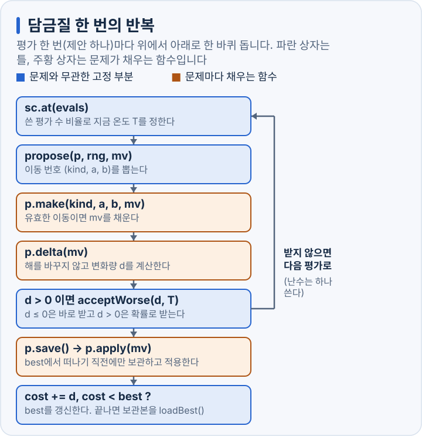

# 구현: 탐색 틀과 두 문제 유형

[원리와 손계산](idea.md)의 절차를 코드로 옮깁니다. 코드는 두 부분으로 나눕니다. 문제와 상관없이 그대로 쓰는 부분(이동 번호 매기기, 언덕 오르기 두 방식, 수락 판정, 온도 일정, 담금질, 재시작, 온도 정하기, 실행기)과, 문제마다 채우는 부분(해의 표현, 이동의 유효성·차분·적용·되돌리기, 해 보관)입니다. 채우는 부분에는 같은 이름의 함수를 두기 때문에 문제가 바뀌어도 탐색 틀은 한 글자도 고치지 않습니다. 두 가지 문제 유형(순서·배정)은 [연습용 문제 틀](idea.md)에 정의한 것입니다.

> **코드 환경: h-contest 제출용 코드.** 표준 헤더·STL·동적 할당 없이 고정 배열로 씁니다. 공통 블록 `array`, `random`([공통 라이브러리](https://h.readiz.com/learn/cpp-common-library))을 먼저 붙이고, 이 페이지의 `ha-hill`, `ha-accept`, `ha-anneal`, `ha-temp`, `ha-route`, `ha-assign`, `ha-gen`, `ha-run`을 이 순서로 이어 붙이면 한 번역 단위로 컴파일됩니다. 입출력이 없는 라이브러리 형태이며, 실제 문제에 쓸 때는 `Route`나 `Assign`의 배열을 문제의 입력으로 채우는 부분만 바꿉니다. 실수 자료형(`double`, `float`)과 수학 함수는 한 군데도 쓰지 않습니다.

[근방 설계와 차분 평가](https://h.readiz.com/learn/neighborhood-and-delta)의 이동과 차분은 다시 설명하지 않습니다. 이 강의의 `Route`와 `Assign`은 그 강의의 코드에서 이 강의가 쓰는 이동(순서 틀은 구간 뒤집기만, 배정 틀은 옮기기와 맞바꾸기)만 남기고, 탐색 틀이 요구하는 멤버(이동 번호 매기기, 해 보관, 무작위 시작 해)를 더한 것입니다.

## 문제마다 채우는 부분

탐색 틀은 문제 쪽 구조체 `P`에 아래 멤버가 있다고 가정합니다. 3번 강의의 `delta`·`apply`·`undo`·`fullCost`·`valid`는 같은 뜻입니다.

| 멤버 | 하는 일 | 지켜야 할 점 |
| --- | --- | --- |
| `int kinds()`, `int sizeA(kind)`, `int sizeB(kind)` | 이동의 종류 수와 종류마다 두 인자의 범위 | 이동 번호는 `(kind, a, b)`의 곱 공간이다 |
| `bool make(kind, a, b, Move& mv)` | 그 번호가 이 해에서 유효한 이동이면 `mv`를 채우고 `true` | 유효하지 않은 번호(구간의 앞뒤가 뒤집힌 것, 받는 기계가 가득 찬 것, 변화가 없는 것)는 `false` |
| `long long delta(mv)` | 해를 바꾸지 않고 비용 변화량을 계산한다 | 3번 강의의 차분과 같다 |
| `void apply(mv)`, `void undo(mv)` | 해와 캐시를 바꾸고 되돌린다 | 캐시도 함께 |
| `long long fullCost()`, `bool valid()` | 캐시 없이 처음부터 비용과 유효성을 계산한다 | 검사와 시작 비용용 |
| `void save()`, `void loadBest()` | 지금 해를 보관하고, 보관한 해를 되돌린다 | 해 배열 전체와 캐시를 함께 |
| `void randomStart(rng)` | 유효한 무작위 시작 해를 만든다 | 재시작에만 쓴다 |

## 문제와 무관한 부분 1: 이동 번호와 언덕 오르기

이동을 `(kind, a, b)` 세 수로 번호 매기고, 같은 `make`를 두 가지로 씁니다. 번호를 차례로 훑으면 근방을 빠짐없이 열거하고(`nthMove`), 번호를 무작위로 뽑으면 무작위 이동 하나가 됩니다(`propose`). 열거가 있어야 "근방을 다 보았는데 좋아지는 이동이 없다"는 지역 최적을 확인할 수 있습니다. `propose`는 유효한 이동을 만날 때까지 번호를 다시 뽑으므로, 이 강의의 평가 횟수는 "변화량을 계산한 횟수"입니다(유효하지 않은 번호는 세지 않습니다).

(`Move.old`는 `undo`용 이전 값입니다.) 두 언덕 오르기는 모두 "좋아지는 이동(변화량 < 0)만 받는다"입니다. 같은 비용으로 가는 이동(변화량 = 0)은 받지 않습니다. 변화량 0을 받으면 한 바퀴가 끝나지 않을 수 있습니다. [원리 페이지](idea.md)의 7점 예에서 경로 전체를 뒤집는 이동은 변화량이 0이라, 받으면 같은 두 해를 오가기만 합니다.

```cpp snippet=ha-hill
struct Move { int kind, a, b, old; };

// [0, bound) 안의 값. 상위 비트를 쓴다(근방 설계 강의의 pick과 같다).
int pick(hc::Random& rng, int bound) { return (int)(((unsigned long long)rng.next() * (unsigned)bound) >> 32); }

// 근방의 이동은 (kind, a, b) 세 수로 번호를 매긴다. 문제가 kinds(), sizeA(kind), sizeB(kind), make()를 채운다.
// make는 그 번호가 이 해에서 유효한 이동이면 mv를 채우고 true를 돌려준다. 같은 make가 전수 열거와 무작위 제안에 모두 쓰인다.
template <class P>
long long moveCount(P& p) {
    long long total = 0;
    for (int k = 0; k < p.kinds(); ++k) total += (long long)p.sizeA(k) * p.sizeB(k);
    return total;
}
template <class P>
bool nthMove(P& p, long long idx, Move& mv) {              // 번호 idx(0 <= idx < moveCount)의 이동
    for (int k = 0; k < p.kinds(); ++k) {
        const long long cells = (long long)p.sizeA(k) * p.sizeB(k);
        if (idx < cells) return p.make(k, (int)(idx / p.sizeB(k)), (int)(idx % p.sizeB(k)), mv);
        idx -= cells;
    }
    return false;
}
template <class P>
bool propose(P& p, hc::Random& rng, Move& mv) {            // 무작위로 번호를 뽑아 유효한 이동을 만날 때까지 반복한다(최대 64번)
    for (int t = 0; t < 64; ++t) {
        const int k = pick(rng, p.kinds());
        const int a = pick(rng, p.sizeA(k)), b = pick(rng, p.sizeB(k));
        if (p.make(k, a, b, mv)) return true;
    }
    return false;                                          // 유효한 이동이 거의 없는 해
}

// 첫 개선: 번호 순서로 이동을 보다가 좋아지는 이동(변화량 < 0)을 만나는 즉시 적용하고, 멈춘 자리에서 이어서 본다.
// 한 바퀴를 도는 동안 개선이 없으면 지역 최적이다(optimum = true). evals는 변화량을 계산한 횟수이고 budget에 닿으면 멈춘다.
template <class P>
long long climbFirst(P& p, long long cost, long long budget, long long& evals, bool& optimum) {
    const long long total = moveCount(p);
    long long idx = 0, quiet = 0;                          // quiet: 마지막 개선 뒤 개선 없이 지나간 번호의 수
    optimum = false;
    while (evals < budget) {
        Move mv;
        if (nthMove(p, idx, mv)) {
            ++evals;
            const long long d = p.delta(mv);
            if (d < 0) { p.apply(mv); cost += d; quiet = -1; }
        }
        ++quiet;
        if (++idx == total) idx = 0;
        if (quiet >= total) { optimum = true; break; }
    }
    return cost;
}

// 최고 개선: 근방 전체의 변화량을 보고 가장 많이 좋아지는 이동 하나를 적용한다. 좋아지는 이동이 없으면 지역 최적이다.
template <class P>
long long climbBest(P& p, long long cost, long long budget, long long& evals, bool& optimum) {
    const long long total = moveCount(p);
    optimum = false;
    while (evals < budget) {
        Move best = {0, 0, 0, 0}, mv;
        long long bestD = 0;
        bool complete = true;                              // 근방 전체를 다 보았는가
        for (long long idx = 0; idx < total; ++idx) {
            if (evals >= budget) { complete = false; break; }
            if (!nthMove(p, idx, mv)) continue;
            ++evals;
            const long long d = p.delta(mv);
            if (d < bestD) { bestD = d; best = mv; }
        }
        if (bestD == 0) { optimum = complete; break; }
        p.apply(best); cost += bestD;
    }
    return cost;
}
```

`optimum`은 `climbFirst`에서 "한 바퀴를 도는 동안 개선이 없었다"는 확인이고, `climbBest`에서는 "근방 전체를 보았는데 좋아지는 이동이 없었다"는 확인입니다. 예산이 먼저 끝나면 `false`입니다.

## 문제와 무관한 부분 2: 수락 판정

나쁜 이동(변화량 `d > 0`)을 온도 `T`에서 확률 `exp(-d / T)`로 받습니다. 표준 수학 함수를 쓰지 않고 정수만으로 구현하는 방법은 이렇습니다.

- 온도를 정수로 둡니다. `TS = 65536`을 비용 1로 보는 고정소수점입니다(온도 `T`는 `T * TS`로 들고 다닙니다).
- `x = d / T`를 1/64 단위로 내림해 정수 `q = floor(64 d / T)`로 만들고, 표 `accTab[q] = 2^30 × exp(-q/64)`를 찾습니다. `x`를 내림하므로 받는 확률이 참값보다 최대 `exp(1/64)`배(약 1.6%) 큽니다.
- 표는 시작할 때 한 번 만듭니다. `exp(-1/64)`에 `2^30`을 곱해 반올림한 상수 `R` 하나만 미리 계산해 두고, `accTab[q] = accTab[q-1] × R / 2^30`을 정수로 되풀이합니다. 정수 연산뿐이므로 플랫폼과 컴파일러가 달라도 표의 값이 같고, 같은 난수에서 탐색이 같은 길을 갑니다.
- 난수 `r`은 32비트 난수의 위 30비트(`next() >> 2`)이고, `r < accTab[q]`이면 받습니다. `x ≥ 20`이면 확률이 `2.1 × 10^-9` 미만이라 받지 않습니다.
- 받든 안 받든 난수를 하나 씁니다. 그래야 온도를 바꿔도 이후의 난수 열이 어긋나지 않아 같은 시드로 설정만 바꾼 비교가 됩니다.

```cpp snippet=ha-accept
// 나쁜 이동을 받는 확률 exp(-d / T)를 표준 수학 함수 없이 정수로 계산한다.
// 온도는 정수이고 TS가 비용 1이다. x = d / T를 1/64 단위로 내림해 표를 찾는다.
const long long TS = 65536;
const int XS = 64;                       // x의 단위: 1/64
const int XMAX = 20 * XS;                // x >= 20이면 확률이 2.1e-9 미만이라 거절한다
const int ONE = 1 << 30;                 // 확률 1.0
int accTab[XMAX + 1];                    // accTab[q] = ONE * exp(-q / 64)

void buildAcc() {                        // 시작할 때 한 번 부른다
    const long long R = 1057095000;      // round(ONE * exp(-1/64)): 이 상수 하나만 미리 계산해 둔다
    accTab[0] = ONE;
    for (int q = 1; q <= XMAX; ++q) accTab[q] = (int)(((long long)accTab[q - 1] * R) >> 30);
}

// 손해 d > 0을 온도 t에서 받을지. 받든 안 받든 난수를 하나 쓴다.
bool acceptWorse(long long d, long long t, hc::Random& rng) {
    const long long q = d * XS * TS / t;                 // floor(64 * d / T)
    const int r = (int)(rng.next() >> 2);                // [0, 2^30)
    return q < XMAX && r < accTab[q];
}
```

## 문제와 무관한 부분 3: 온도 일정, 담금질, 재시작

**일정(`Schedule`)** 은 온도를 쓴 평가 수 `used`와 예산 `budget`의 비율로 정합니다. 예산을 바꿔도 시작과 끝 온도가 그대로이고 그 사이를 같은 모양으로 지나갑니다. 지수 일정은 3.125%(= 1/32)씩 줄여 가며 `t1` 이하가 될 때까지의 횟수 `stages`를 센 다음, 예산을 `stages`개 구간으로 똑같이 나눕니다. 한 구간이 끝날 때마다 `cur -= cur >> 5`입니다. 선형 일정은 `t0`에서 `t1`까지 직선입니다.

**담금질(`anneal`)** 은 현재 해와 지금까지의 최고해를 따로 다룹니다. 최고해를 매번 복사하면 해 배열 길이만큼 걸리므로, 현재 해가 최고해인 채로 나쁜 이동을 받는 바로 그 순간에만 `save()`합니다(`atBest`). 끝났을 때 최고해가 보관본이면 `loadBest()`로 돌려놓습니다. `Trace`는 예산을 10등분한 구간마다 나쁜 이동을 몇 번 제안했고 몇 번 받았는지 세는 로그입니다.

**재시작(`restarts`)** 은 무작위 시작 해에서 첫 개선 언덕 오르기를 지역 최적까지 돌리고, 예산이 남으면 새 시작 해에서 반복해 가장 좋은 해를 보관합니다.

그림은 `anneal` 반복문의 한 바퀴입니다(파랑이 틀, 주황이 문제가 채우는 함수).



[그림 크게 보기](https://git.readiz.com/h-contest-lesson/lessons/hill-climbing-and-annealing/lesson-assets/anneal-step.svg)

```cpp snippet=ha-anneal
// 온도 일정. 온도는 쓴 평가 수 used와 예산 budget의 비율로 정한다(남은 예산에 묶는다).
// 지수: 구간마다 3.125%(= 1/32)씩 줄여 t1 이하가 될 때까지의 구간 수를 세고, 예산을 그 구간 수로 똑같이 나눈다.
// 선형: t0에서 t1까지 직선으로 내린다.
struct Schedule {
    long long t0, t1, budget, cur;
    int shape, stage, stages;            // shape 0 지수, 1 선형
    void init(long long a, long long b, long long B, int s) {
        t0 = a; t1 = b; budget = B; cur = a; shape = s; stage = stages = 0;
        for (long long t = a; t > b && (t >> 5) > 0; t -= t >> 5) ++stages;
    }
    long long at(long long used) {       // 평가를 used번 쓴 시점의 온도
        if (shape == 1) return t0 - (t0 - t1) * used / budget;
        const long long s = used * stages / budget;
        while (stage < s) { cur -= cur >> 5; ++stage; }
        return cur;
    }
};

// 담금질. 나빠진 현재 해(current)와 지금까지의 최고해(best)를 따로 다룬다. current가 best인 상태를 떠나기 직전에만
// save()로 해를 보관하고, 끝났을 때 best가 보관본이면 loadBest()로 돌려놓는다. 반환값은 best의 비용이고,
// last는 끝난 시점의 current 비용이다.
// tr는 예산을 10등분한 구간마다 나쁜 이동을 몇 번 제안했고 몇 번 받았는지 센다(온도가 맞는지 보는 로그).
struct Trace { long long up[10], taken[10]; };
template <class P>
long long anneal(P& p, hc::Random& rng, long long cost, long long budget, Schedule& sc, long long& evals, long long& last, Trace& tr) {
    long long best = cost;
    bool atBest = true;                                    // 지금 해가 best와 비용이 같고 아직 보관하지 않았다
    for (int i = 0; i < 10; ++i) tr.up[i] = tr.taken[i] = 0;
    while (evals < budget) {
        const long long t = sc.at(evals);
        const int slot = (int)(evals * 10 / budget);
        ++evals;                                           // 제안 한 번이 평가 한 번이다
        Move mv;
        if (!propose(p, rng, mv)) continue;
        const long long d = p.delta(mv);
        if (d > 0) {
            ++tr.up[slot];
            if (!acceptWorse(d, t, rng)) continue;         // d <= 0은 항상 받는다
            ++tr.taken[slot];
        }
        if (d > 0 && atBest) { p.save(); atBest = false; }
        p.apply(mv); cost += d;
        if (cost < best) { best = cost; atBest = true; }
    }
    last = cost;
    if (!atBest) p.loadBest();
    return best;
}

// 재시작: 무작위 시작 해에서 첫 개선 언덕 오르기를 지역 최적까지 돌리고, 예산이 남으면 새 시작 해에서 반복한다.
// 가장 좋은 해를 보관한다. runs는 시작한 횟수다. 첫 시작은 p에 들어 있는 해다.
template <class P>
long long restarts(P& p, hc::Random& rng, long long budget, long long& evals, int& runs) {
    long long best = -1;
    runs = 0;
    while (evals < budget) {
        if (runs > 0) p.randomStart(rng);
        bool optimum;
        const long long cost = climbFirst(p, p.fullCost(), budget, evals, optimum);
        ++runs;
        if (best < 0 || cost < best) { best = cost; p.save(); }
    }
    p.loadBest();
    return best;
}
```

## 문제와 무관한 부분 4: 온도 정하기

해를 바꾸지 않고 무작위 이동의 변화량을 재서 나쁜 것(양수)만 모읍니다(`sampleUphill`). 이 표본에서 "나쁜 이동을 평균 몇 % 받는가"는 온도가 오를수록 늘기만 하므로, 목표 수락률이 되는 온도를 이분 탐색으로 찾습니다(`tempForRate`). 수락률은 1000분율(`permille`)의 정수로 받습니다.

```cpp snippet=ha-temp
// 온도를 이 문제의 변화량에서 정한다. 해를 바꾸지 않고 무작위 이동 n개의 변화량을 재서 양수(나빠지는 이동)만 ups[]에 담는다.
const int UPS = 4096;
long long ups[UPS];
template <class P>
int sampleUphill(P& p, hc::Random& rng, int n, long long& evals) {
    int cnt = 0;
    for (int done = 0; done < n; ++done) {
        ++evals;
        Move mv;
        if (!propose(p, rng, mv)) continue;
        const long long d = p.delta(mv);
        if (d > 0 && cnt < UPS) ups[cnt++] = d;
    }
    return cnt;
}

// 온도 t에서 표본의 나쁜 이동을 평균 몇 % 받는가(ONE이 100%).
long long meanAccept(const long long* d, int cnt, long long t) {
    long long sum = 0;
    for (int i = 0; i < cnt; ++i) {
        const long long q = d[i] * XS * TS / t;
        if (q < XMAX) sum += accTab[q];
    }
    return sum / cnt;
}
// 평균 수락률이 permille / 1000이 되는 가장 낮은 온도. 수락률은 온도에 따라 늘기만 하므로 이분 탐색한다.
// 표본에 나쁜 이동이 없으면(cnt == 0) 온도를 1로 둔다.
long long tempForRate(const long long* d, int cnt, int permille) {
    if (cnt == 0) return TS;
    const long long want = (long long)ONE / 1000 * permille;
    long long lo = 1, hi = 1LL << 40;                      // hi에서는 수락률이 거의 100%다
    while (lo < hi) {
        const long long mid = (lo + hi) / 2;
        if (meanAccept(d, cnt, mid) >= want) hi = mid; else lo = mid + 1;
    }
    return lo;
}
```

## 순서 틀 채우기: `Route`

해는 방문 순서 `p[]`입니다. 이동은 구간 뒤집기 하나(`kind 0`, 위치 `a < b`)이고, 차분은 3번 강의와 같이 경계 간선 둘입니다. 번호 공간은 `n × n`이고 그중 `a < b`인 `n(n−1)/2`개가 유효한 이동입니다(`n = 200`이면 19,900개).

```cpp snippet=ha-route
const int RN = 200;                      // 점 수의 상한
struct Route {
    int n, px[RN], py[RN], p[RN], bestP[RN];   // 점 좌표, p[k] = k번째로 지나는 점, bestP = 보관한 최고해

    void init() { hc::iota(p, n); }
    int at(int k) { return (k < 0 || k >= n) ? -1 : p[k]; }
    long long w(int u, int v) {          // 항 하나: 점 u, v 사이의 거리. 경계(-1)에는 항이 없다.
        if (u < 0 || v < 0) return 0;
        const int dx = px[u] - px[v], dy = py[u] - py[v];
        return (dx < 0 ? -dx : dx) + (dy < 0 ? -dy : dy);
    }
    long long fullCost() {
        long long s = 0;
        for (int k = 0; k + 1 < n; ++k) s += w(p[k], p[k + 1]);
        return s;
    }
    bool valid() {
        static bool seen[RN];
        hc::fill(seen, RN, false);
        for (int k = 0; k < n; ++k) {
            if (p[k] < 0 || p[k] >= n || seen[p[k]]) return false;
            seen[p[k]] = true;
        }
        return true;
    }

    // 이동은 구간 뒤집기 하나: kind 0, 위치 a < b. 근방의 크기는 n(n-1)/2.
    int kinds() { return 1; }
    int sizeA(int) { return n; }
    int sizeB(int) { return n; }
    bool make(int kind, int a, int b, Move& mv) {
        if (a >= b) return false;
        mv.kind = kind; mv.a = a; mv.b = b; mv.old = 0;
        return true;
    }
    long long delta(const Move& mv) {    // 경계 간선 둘만 바뀐다(이웃 강의의 차분과 같다)
        const int a = mv.a, b = mv.b;
        return w(at(a - 1), p[b]) + w(p[a], at(b + 1)) - w(at(a - 1), p[a]) - w(p[b], at(b + 1));
    }
    void apply(const Move& mv) { for (int i = mv.a, j = mv.b; i < j; ++i, --j) hc::swap(p[i], p[j]); }
    void undo(const Move& mv) { apply(mv); }

    void save() { hc::copy(bestP, p, n); }
    void loadBest() { hc::copy(p, bestP, n); }
    void randomStart(hc::Random& rng) { hc::iota(p, n); rng.shuffle(p, n); }
};
```

## 배정 틀 채우기: `Assign`

해는 작업별 기계 `as[]`이고, 이동은 작업 옮기기(`kind 0`, 작업 `a`를 기계 `b`로)와 맞바꾸기(`kind 1`, 서로 다른 기계의 작업 `a < b`)입니다. 받는 기계가 가득 차면 옮기기를 만들지 않습니다(`make`가 `false`). `randomStart`는 기계마다 `K`개를 넘지 않게 무작위로 배정합니다.

```cpp snippet=ha-assign
const int AN = 120, AM = 8;              // 작업 수와 기계 수의 상한
struct Assign {
    int n, m, k;                         // 작업 수, 기계 수, 기계 한 대의 작업 수 상한
    int d[AN], c[AN][AM], as[AN], bestAs[AN];   // 길이, 추가 비용, 배정, 보관한 최고해
    int load[AM], cnt[AM];               // 캐시: 기계별 부하 합, 작업 수
    long long sq;                        // 캐시: 부하 제곱의 합

    void build() {                       // 배정에서 캐시를 만든다
        for (int j = 0; j < m; ++j) load[j] = cnt[j] = 0;
        for (int i = 0; i < n; ++i) { load[as[i]] += d[i]; ++cnt[as[i]]; }
        sq = 0;
        for (int j = 0; j < m; ++j) sq += (long long)load[j] * load[j];
    }
    void init() { for (int i = 0; i < n; ++i) as[i] = i % m; build(); }     // 라운드 로빈
    long long fullCost() {
        long long L[AM], s = 0, sumSq = 0;
        for (int j = 0; j < m; ++j) L[j] = 0;
        for (int i = 0; i < n; ++i) { L[as[i]] += d[i]; s += c[i][as[i]]; }
        for (int j = 0; j < m; ++j) sumSq += L[j] * L[j];
        return sumSq / 100 + s;                                             // 나눗셈은 합 전체에 한 번
    }
    bool valid() {
        int count[AM];
        for (int j = 0; j < m; ++j) count[j] = 0;
        for (int i = 0; i < n; ++i) {
            if (as[i] < 0 || as[i] >= m) return false;
            if (++count[as[i]] > k) return false;
        }
        return true;
    }

    // 이동 둘: kind 0은 작업 a를 기계 b로 옮기기, kind 1은 서로 다른 기계의 작업 a < b 맞바꾸기.
    int kinds() { return 2; }
    int sizeA(int) { return n; }
    int sizeB(int kind) { return kind == 0 ? m : n; }
    bool make(int kind, int a, int b, Move& mv) {
        if (kind == 0) { if (b == as[a] || cnt[b] >= k) return false; }      // 받는 쪽이 가득 차면 무효
        else if (a >= b || as[a] == as[b]) return false;                     // 같은 기계끼리 바꾸면 변화가 없다
        mv.kind = kind; mv.a = a; mv.b = b; mv.old = kind == 0 ? as[a] : 0;
        return true;
    }
    long long delta(const Move& mv) {    // 이웃 강의의 차분과 같다
        const int i = mv.a, x = as[i];
        long long dc, dS;
        if (mv.kind == 0) {
            const int y = mv.b;
            dc = c[i][y] - c[i][x];
            const long long lx = load[x] - d[i], ly = load[y] + d[i];
            dS = lx * lx + ly * ly - (long long)load[x] * load[x] - (long long)load[y] * load[y];
        } else {
            const int j = mv.b, y = as[j], dd = d[j] - d[i];
            dc = c[i][y] + c[j][x] - c[i][x] - c[j][y];
            const long long lx = load[x] + dd, ly = load[y] - dd;
            dS = lx * lx + ly * ly - (long long)load[x] * load[x] - (long long)load[y] * load[y];
        }
        return (sq + dS) / 100 - sq / 100 + dc;                              // 합 전체의 내림 차이
    }
    void place(int i, int y) {                                               // 작업 i를 기계 y로 옮기고 캐시를 고친다
        const int x = as[i];
        sq -= (long long)load[x] * load[x] + (long long)load[y] * load[y];
        load[x] -= d[i]; load[y] += d[i];
        sq += (long long)load[x] * load[x] + (long long)load[y] * load[y];
        --cnt[x]; ++cnt[y]; as[i] = y;
    }
    void apply(const Move& mv) {
        if (mv.kind == 0) place(mv.a, mv.b);
        else { const int x = as[mv.a], y = as[mv.b]; place(mv.a, y); place(mv.b, x); }
    }
    void undo(const Move& mv) {
        if (mv.kind == 0) place(mv.a, mv.old);
        else apply(mv);
    }

    void save() { hc::copy(bestAs, as, n); }
    void loadBest() { hc::copy(as, bestAs, n); build(); }
    void randomStart(hc::Random& rng) {  // 기계마다 k개를 넘지 않게 무작위로 배정한다
        for (int j = 0; j < m; ++j) cnt[j] = 0;
        for (int i = 0; i < n; ++i) {
            int j = pick(rng, m);
            while (cnt[j] >= k) j = pick(rng, m);
            as[i] = j; ++cnt[j];
        }
        build();
    }
};
```

## 입력 생성과 실행

입력은 [원리 페이지](idea.md)의 연습용 문제 틀 규칙대로 시드 하나에서 만듭니다. 생성용 난수 `Gen`은 64비트 선형 합동 생성기이고 탐색용 `hc::Random`과 따로 둡니다.

```cpp snippet=ha-gen
struct Gen {                             // 입력 생성용 64비트 난수. 탐색용 hc::Random과 따로 둔다.
    unsigned long long x;
    void reset(unsigned long long seed) { x = seed; }
    int next(int range) {                // [0, range)
        x = x * 6364136223846793005ULL + 1442695040888963407ULL;
        return (int)((x >> 33) % (unsigned long long)range);
    }
};

void genRoute(Route& r, unsigned long long seed, int n) {
    Gen g; g.reset(seed);
    r.n = n;
    for (int i = 0; i < n; ++i) { r.px[i] = g.next(1000); r.py[i] = g.next(1000); }
    r.init();
}

void genAssign(Assign& a, unsigned long long seed, int n, int m, int k) {
    Gen g; g.reset(seed);
    a.n = n; a.m = m; a.k = k;
    for (int i = 0; i < n; ++i) {
        a.d[i] = 1 + g.next(100);
        for (int j = 0; j < m; ++j) a.c[i][j] = g.next(51);
    }
    a.init();
}
```

실행기 `solve`는 방법(첫 개선·최고 개선·재시작·담금질) 하나를 골라 같은 평가 횟수 예산 안에서 돌립니다. 담금질은 먼저 표본 2000개로 온도를 정하고(이 2000번의 평가도 예산에 넣습니다), 그 온도로 `anneal`을 돌립니다. `Plan`의 `pct0`, `pct1`은 정해진 온도에 곱하는 비율(%)로, 온도를 일부러 어긋나게 해 보는 실험에 씁니다. 시작 비용과 재시작의 `fullCost` 호출은 평가 횟수에 넣지 않습니다.

:::hint 전체 비용 계산을 평가에 넣지 않는 이유
`fullCost`는 한 번에 간선 199개(배정 틀은 항 128개)를 계산하고, 재시작은 예산 안에서 많아야 수십 번이라 예산의 1%에 못 미칩니다.
:::

```cpp snippet=ha-run
static Route route;
static Assign assign;

// 방법: 0 첫 개선, 1 최고 개선, 2 재시작, 3 담금질.
// 담금질 설정: 시작·끝 온도를 표본에서 나쁜 이동의 평균 수락률(1000분율) r0, r1로 정하고, pct0, pct1은 정한 온도에 곱하는 비율(%, 100이면 그대로),
// shape는 일정(0 지수, 1 선형)이다.
struct Plan { int r0, r1, pct0, pct1, shape; };
struct Stat { long long evals, t0, t1, last; int runs; bool optimum; Trace tr; };

// 문제와 무관한 실행기. 시작 해의 비용을 구하고 방법을 골라 돌린다. 반환값은 최종 비용이고, p에는 그 해가 들어 있다.
// 시작 비용 계산(fullCost)과 재시작의 fullCost는 평가 횟수에 넣지 않는다.
template <class P>
long long solve(P& p, unsigned seed, int method, long long budget, const Plan& pl, Stat& st) {
    buildAcc();
    hc::Random rng; rng.reset(seed);
    st.evals = st.t0 = st.t1 = st.last = 0; st.runs = 0; st.optimum = false;
    const long long start = p.fullCost();
    if (method == 0) return climbFirst(p, start, budget, st.evals, st.optimum);
    if (method == 1) return climbBest(p, start, budget, st.evals, st.optimum);
    if (method == 2) return restarts(p, rng, budget, st.evals, st.runs);
    const int cnt = sampleUphill(p, rng, 2000, st.evals);           // 표본 2000개도 예산에 넣는다
    st.t0 = tempForRate(ups, cnt, pl.r0) * pl.pct0 / 100;
    st.t1 = tempForRate(ups, cnt, pl.r1) * pl.pct1 / 100;
    if (st.t1 < 1) st.t1 = 1;
    if (st.t1 > st.t0) st.t1 = st.t0;
    Schedule sc; sc.init(st.t0, st.t1, budget, pl.shape);
    return anneal(p, rng, start, budget, sc, st.evals, st.last, st.tr);
}

// 순서 문제: 시드 seed의 입력(점 200개)에서 시작 해는 번호 순서.
long long solveRoute(unsigned long long seed, int method, long long budget, const Plan& pl, Stat& st) {
    genRoute(route, seed, 200);
    return solve(route, (unsigned)seed, method, budget, pl, st);
}
// 배정 문제: 입력은 작업 120개, 기계 8대, 기계당 18개. 시작 해는 라운드 로빈.
long long solveAssign(unsigned long long seed, int method, long long budget, const Plan& pl, Stat& st) {
    genAssign(assign, seed, 120, 8, 18);
    return solve(assign, (unsigned)seed, method, budget, pl, st);
}
```

[실험과 점검](practice.md)의 표는 모두 `solveRoute`와 `solveAssign`으로 시드 1~20을 돌린 값입니다. 기본 설정은 `Plan{100, 5, 100, 100, 0}`, 곧 시작 수락률 10%, 끝 수락률 0.5%, 온도는 정한 그대로, 지수 일정입니다.

## 검사 틀을 쓰는 법

이 강의의 검사는 세 가지입니다.

1. **차분과 전체 재계산**: 3번 강의의 `checkDelta`에서 `p.propose(rng, mv)`를 이 페이지의 `propose(p, rng, mv)`로 바꿔 그대로 씁니다. 이 강의의 검사 스크립트는 작은 입력에서 모든 이동(순서 틀 6,720개, 배정 틀 5,785개)의 `delta`를 이동을 적용한 해의 전체 재계산 차이와 대조하고, 이동 번호 공간이 유효한 이동을 정확히 덮는지도 열거한 이동 수와 맞춰 봅니다.
2. **지역 최적 확인**: `climbFirst`나 `climbBest`가 `optimum = true`로 끝났다면, 끝난 해에서 모든 이동을 하나씩 적용해 전체 재계산 비용을 구해 좋아지는 이동이 하나도 없는지 확인합니다. `optimum`을 믿지 않고 독립적으로 세어 봅니다.
3. **담금질의 최고해**: `anneal`이 돌려준 비용이 `loadBest()` 뒤 해의 전체 재계산 비용과 같은지, 현재 해를 매번 통째로 복사해 최고해를 추적하는 느린 참조 구현과 같은 비용을 내는지 확인합니다. 수락 판정은 `acceptWorse`를 수십만 번 불러 받은 횟수가 표의 확률(`exp(-x)`)과 맞는지 봅니다. 이 검사들이 잡는 실수는 [실험과 점검](practice.md)의 '흔한 실수'에 있습니다.

## 코드를 다른 문제에 옮길 때 바뀌는 곳

| 부분 | 순서 틀 | 배정 틀 | 새 문제에서 |
| --- | --- | --- | --- |
| 해와 캐시 | `p[]` | `as[]`, `load`, `cnt`, `sq` | 해를 담는 배열과 `delta`가 쓰는 합계 |
| 이동 번호 | 위치 쌍 하나 | 옮기기·맞바꾸기 | `kinds`, `sizeA`, `sizeB`, `make` |
| `delta`·`apply`·`undo` | 경계 간선 | 건드리는 항 | [3번 강의](https://h.readiz.com/learn/neighborhood-and-delta)의 절차로 유도 |
| 해 보관 | `bestP[]` | `bestAs[]`와 캐시 다시 만들기 | 해 배열 전체를 복사하고 캐시를 다시 만든다 |
| 무작위 시작 | 순열 섞기 | 상한을 지키는 무작위 배정 | 유효한 무작위 해 |
| 언덕 오르기·수락 판정·일정·담금질·재시작·온도 정하기 | 그대로 | 그대로 | 그대로 |
