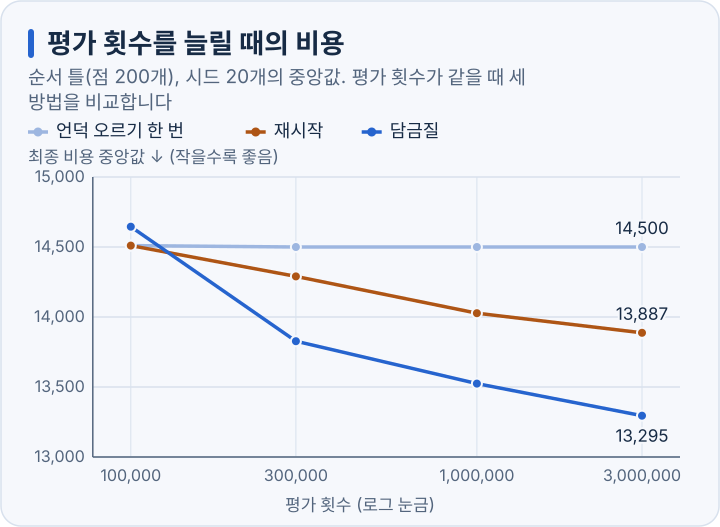
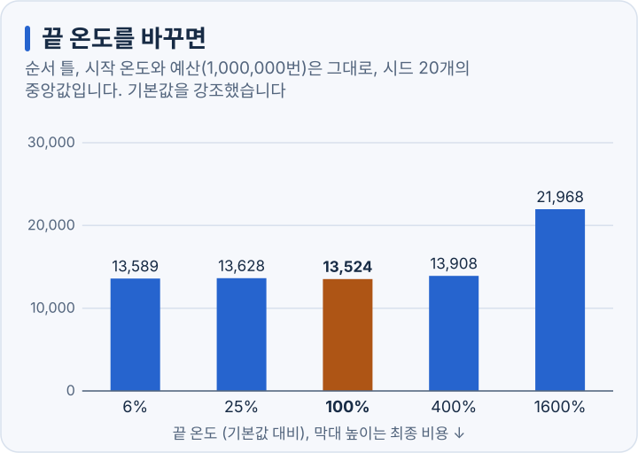
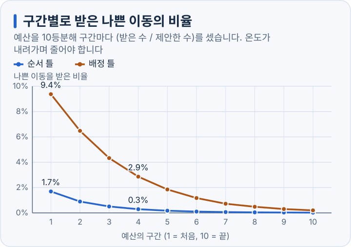

# 실험과 점검: 평가 횟수, 온도, 재시작, 흔한 실수

[구현](implementation.md)의 코드를 연습용 문제 틀(순서 `N = 200`, 배정 `N = 120, M = 8, K = 18`, 정의는 [원리](idea.md))에서 돌린 결과입니다. 모든 표는 `scripts/check_hill_climbing_and_annealing.py`가 다시 계산해 `lesson-assets/measurements.json`과 이 본문에 대조합니다.

## 측정 방법

- **평가 횟수:** 시간(ms) 대신 이동 하나의 변화량을 계산한 횟수를 셉니다. 담금질이 온도를 정하려고 재는 표본 2,000번도 예산에 넣습니다. 시작 비용과 재시작의 `fullCost` 호출은 세지 않습니다. 이동을 적용하는 비용도 세지 않는데, 순서 틀의 구간 뒤집기는 적용이 구간 길이에 비례하므로 실제 시간은 평가 횟수와 같지 않습니다(이 강의는 시간을 재지 않았습니다).
- **요약:** 표의 값은 시드 20개의 최종 비용 중 10번째로 작은 값입니다. 두 설정의 비교는 같은 시드끼리 짝지어 "앞이 나은 시드 / 뒤가 나은 시드"를 세고, 한쪽이 15개 이상이면 차이가 있다고, 아니면 "결정 못 함"이라고 씁니다. 한 표에 비교가 여럿이면 우연히 15개에 닿은 것이 섞일 수 있습니다.
- **기본 설정:** 시작 수락률 10%, 끝 수락률 0.5%, 지수 일정(`Plan{100, 5, 100, 100, 0}`). 이 값은 시드 1~20에서 몇 가지를 먼저 본 뒤 고른 것이므로 시드 1~20의 표는 낙관적일 수 있습니다. 그래서 주요 비교는 쓰지 않은 입력 시드 101~120에서 한 번 더 합니다.
- **예산:** 순서 틀 100,000, 300,000, 1,000,000, 3,000,000. 배정 틀 20,000, 100,000, 400,000. 근방의 크기는 순서 틀이 19,900, 배정 틀의 시작 해에서 이동 7,140개(옮기기 840 + 맞바꾸기 6,300)입니다.

## 첫 개선과 최고 개선

지역 최적에 닿을 때까지(예산을 넉넉히 두고) 돌린 값입니다. "적용한 이동"은 해를 실제로 바꾼 걸음의 수입니다.

| 틀 | 방식 | 평가 횟수 | 적용한 이동 | 지역 최적의 비용 | 최고 개선보다 나은 / 못한 시드 |
| --- | --- | ---: | ---: | ---: | --- |
| 순서 틀 | 첫 개선 | 117,861 | 707 | 14,500 | 7 / 13 결정 못 함 |
| 순서 틀 | 최고 개선 | 4,477,500 | 224 | 14,307 | 기준 |
| 배정 틀 | 첫 개선 | 32,304 | 224 | 43,965 | 10 / 10 결정 못 함 |
| 배정 틀 | 최고 개선 | 542,516 | 75 | 44,016 | 기준 |

- 모든 실행(시드 20개 × 두 틀 × 두 방식)이 `optimum = true`로 끝났고, 끝난 해에서 모든 이동을 적용해 전체 재계산한 비용으로 좋아지는 이동이 하나도 없음을 따로 확인했습니다.
- 최고 개선은 걸음 수가 적지만(707 대 224) 평가는 순서 틀에서 약 38배, 배정 틀에서 약 17배 들었습니다. 지역 최적의 비용은 두 틀 모두 차이를 결정하지 못했으므로, 이 입력 가족에서 최고 개선의 평가 비용을 정당화하는 이득은 보이지 않았습니다. 7개 점 손계산에서는 최고 개선이 더 좋았습니다([원리](idea.md)). 한 입력의 결과를 일반 법칙으로 쓰지 않습니다.
- 지역 최적의 비용이 평가 예산의 한계를 정합니다. 순서 틀의 언덕 오르기는 평가 약 12만 번이면 끝나고 그 뒤로는 더 내려가지 못합니다.

## 같은 평가 횟수에서: 언덕 오르기, 재시작, 담금질

세 방법을 같은 평가 횟수 예산에서 돌립니다. "한 번"은 입력의 시작 해에서 첫 개선 언덕 오르기를 한 번만 돌린 것이고(지역 최적에 닿으면 멈추며, 예산이 먼저 끝나면 거기서 끊깁니다), "재시작"은 지역 최적마다 새 무작위 시작 해에서 다시 오르며 괄호는 시작한 횟수의 중앙값이고, 담금질은 기본 설정입니다. 비교 열은 담금질이 나은 시드 / 못한 시드입니다.

순서 틀입니다.

| 평가 횟수 | 언덕 오르기 한 번 | 재시작 | 담금질 | 담금질 대 재시작 | 담금질 대 한 번 |
| ---: | ---: | ---: | ---: | --- | --- |
| 100,000 | 14,510 | 14,510 (1번) | 14,645 | 5 / 15 더 나쁨 | 5 / 15 더 나쁨 |
| 300,000 | 14,500 | 14,290 (3번) | 13,827 | 20 / 0 더 좋음 | 20 / 0 더 좋음 |
| 1,000,000 | 14,500 | 14,027 (9번) | 13,524 | 20 / 0 더 좋음 | 20 / 0 더 좋음 |
| 3,000,000 | 14,500 | 13,887 (25번) | 13,295 | 20 / 0 더 좋음 | 20 / 0 더 좋음 |

[그림 크게 보기](https://git.readiz.com/h-contest-lesson/lessons/hill-climbing-and-annealing/lesson-assets/budget-curve.svg)

배정 틀입니다.

| 평가 횟수 | 언덕 오르기 한 번 | 재시작 | 담금질 | 담금질 대 재시작 | 담금질 대 한 번 |
| ---: | ---: | ---: | ---: | --- | --- |
| 20,000 | 44,000 | 44,000 (1번) | 44,097 | 1 / 19 더 나쁨 | 1 / 19 더 나쁨 |
| 100,000 | 43,965 | 43,965 (3번) | 43,984 | 5 / 15 더 나쁨 | 11 / 9 결정 못 함 |
| 400,000 | 43,965 | 43,965 (12번) | 43,967 | 9 / 8 결정 못 함 | 17 / 2 더 좋음 |

재시작이 언덕 오르기 한 번보다 나은 시드 / 못한 시드입니다(같은 시드끼리).

| 틀 | 평가 횟수 | 재시작 대 한 번 |
| --- | ---: | --- |
| 순서 틀 | 100,000 | 0 / 0 결정 못 함 |
| 순서 틀 | 300,000 | 13 / 0 결정 못 함 |
| 순서 틀 | 1,000,000 | 17 / 0 더 좋음 |
| 순서 틀 | 3,000,000 | 18 / 0 더 좋음 |
| 배정 틀 | 20,000 | 0 / 0 결정 못 함 |
| 배정 틀 | 100,000 | 11 / 0 결정 못 함 |
| 배정 틀 | 400,000 | 15 / 0 더 좋음 |

- **순서 틀:** 예산이 지역 최적에 닿는 비용(약 12만 번)과 비슷한 100,000에서는 언덕 오르기 한 번이 지역 최적에 닿기 전에 끊기는 시드도 있었고, 담금질은 15개 시드에서 나빴습니다. 300,000 이상에서는 20개 시드 모두 담금질이 재시작과 언덕 오르기 한 번보다 좋았고, 예산이 늘수록 담금질(13,827 → 13,524 → 13,295)과 재시작(14,290 → 14,027 → 13,887) 모두 내려갑니다. 재시작은 시작 횟수가 3번에서 25번으로 늘어도 담금질의 값에 닿지 못했습니다. 언덕 오르기 한 번은 예산이 늘어도 14,500에서 멈춥니다.
- **배정 틀:** 담금질이 낫다고 결정하지 못했습니다. 평가 20,000에서는 언덕 오르기(한 번과 재시작이 같은 값)가 담금질보다 19개 시드에서 나았고, 100,000에서는 담금질이 재시작보다 15개 시드에서 나빴으며, 400,000에서는 재시작과 결정 못 함(9 / 8)입니다. 언덕 오르기 한 번(43,965)과 재시작(43,965)의 중앙값이 같은 것은 이 입력 가족에서 지역 최적 대부분이 비슷한 비용이라는 뜻일 수 있으나 이 강의는 원인을 가르지 않았습니다.
- **재시작 대 한 번:** 순서 틀에서 재시작은 예산 1,000,000부터 한 번보다 나았고(17 / 0), 배정 틀은 400,000에서 나았습니다(15 / 0, 중앙값은 같음).

시드 1~20과 겹치지 않는 입력 시드 101~120에서 주요 비교를 다시 한 결과입니다. 순서 틀은 평가 1,000,000, 배정 틀은 100,000입니다.

| 평가 횟수 | 언덕 오르기 한 번 | 재시작 | 담금질 | 담금질 대 재시작 | 담금질 대 한 번 |
| ---: | ---: | ---: | ---: | --- | --- |
| 1,000,000 | 14,439 | 14,183 (9번) | 13,491 | 20 / 0 더 좋음 | 20 / 0 더 좋음 |
| 100,000 | 47,341 | 47,332 (3번) | 47,362 | 8 / 11 결정 못 함 | 10 / 9 결정 못 함 |

순서 틀의 결과는 그대로 재현되었습니다. 배정 틀에서 시드 1~20의 "담금질이 재시작보다 나쁨"(5 / 15)은 시드 101~120에서 결정 못 함(8 / 11)이 되었으므로, 배정 틀에서는 두 방법의 차이를 결정하지 못한 것으로 읽습니다. 시드 101~120의 비용이 47,000대인 것은 입력이 달라서이며 짝지은 비교에는 영향이 없습니다.

## 일정: 지수와 선형

같은 시작·끝 온도로 일정만 바꿉니다(순서 틀 평가 1,000,000, 배정 틀 100,000). 비교 열은 선형이 지수보다 나은 시드 / 못한 시드입니다.

| 틀 | 평가 횟수 | 지수 | 선형 | 선형 대 지수 |
| --- | ---: | ---: | ---: | --- |
| 순서 틀 | 1,000,000 | 13,524 | 13,592 | 9 / 11 결정 못 함 |
| 배정 틀 | 100,000 | 43,984 | 44,037 | 0 / 20 더 나쁨 |

순서 틀에서는 지수와 선형의 차이를 결정하지 못했고, 배정 틀에서는 선형이 20개 시드 모두에서 나빴습니다. 지수 일정이 낮은 온도에서 더 오래 머무는 것과 방향이 맞지만, 이 강의는 원인을 가르지 않았습니다. "지수가 선형보다 낫다"는 경험 법칙을 이 실험이 두 틀 중 한 틀에서만 지지합니다.

## 온도 범위

[원리](idea.md)의 절차가 정한 온도를 기준(100%)으로, 시작 온도만 곱하거나 끝 온도만 곱한 값입니다(순서 틀 평가 1,000,000, 배정 틀 100,000). 비교는 기본 설정(100%)보다 나은 시드 / 못한 시드입니다.

시작 온도를 곱합니다.

| 시작 온도 × | 순서 틀 비용 | 기본보다 나은 / 못한 | 배정 틀 비용 | 기본보다 나은 / 못한 |
| --- | ---: | --- | ---: | --- |
| 6% | 13,943 | 2 / 18 더 나쁨 | 43,985 | 12 / 8 결정 못 함 |
| 25% | 13,641 | 11 / 9 결정 못 함 | 43,992 | 15 / 3 더 좋음 |
| 100% (기본) | 13,524 | 기준 | 43,984 | 기준 |
| 400% | 13,578 | 6 / 14 결정 못 함 | 44,003 | 5 / 15 더 나쁨 |
| 1600% | 13,670 | 3 / 17 더 나쁨 | 44,012 | 3 / 17 더 나쁨 |

끝 온도를 곱합니다.

| 끝 온도 × | 순서 틀 비용 | 기본보다 나은 / 못한 | 배정 틀 비용 | 기본보다 나은 / 못한 |
| --- | ---: | --- | ---: | --- |
| 6% | 13,589 | 6 / 14 결정 못 함 | 43,951 | 17 / 3 더 좋음 |
| 25% | 13,628 | 11 / 9 결정 못 함 | 43,950 | 13 / 6 결정 못 함 |
| 100% (기본) | 13,524 | 기준 | 43,984 | 기준 |
| 400% | 13,908 | 2 / 18 더 나쁨 | 44,120 | 0 / 20 더 나쁨 |
| 1600% | 21,968 | 0 / 20 더 나쁨 | 44,660 | 0 / 20 더 나쁨 |

[그림 크게 보기](https://git.readiz.com/h-contest-lesson/lessons/hill-climbing-and-annealing/lesson-assets/end-temperature.svg)

시작 수락률 목표(온도 대신 절차의 입력)를 바꿉니다.

| 시작 수락률 | 순서 틀 비용 | 기본보다 나은 / 못한 | 배정 틀 비용 | 기본보다 나은 / 못한 |
| --- | ---: | --- | ---: | --- |
| 3% | 13,687 | 6 / 14 결정 못 함 | 43,966 | 15 / 5 더 좋음 |
| 10% (기본) | 13,524 | 기준 | 43,984 | 기준 |
| 30% | 13,568 | 6 / 14 결정 못 함 | 43,994 | 5 / 14 결정 못 함 |
| 50% | 13,628 | 5 / 15 더 나쁨 | 43,977 | 3 / 17 더 나쁨 |

- **끝 온도가 높은 쪽이 가장 위험합니다.** 400%와 1600%는 두 틀 모두 18개 이상의 시드에서 나빴고, 1600%의 순서 틀은 비용이 21,968로 언덕 오르기 한 번(14,500)보다 훨씬 나쁩니다. 끝에서도 뜨거운 채로 끝나기 때문입니다. 끝 온도를 낮추는 쪽(6%, 25%)은 순서 틀에서 결정하지 못했고 배정 틀에서 6%가 더 좋았습니다.
- **시작 온도는 순서 틀에서 6%(2 / 18)와 1600%(3 / 17)가 나빴고**, 25%~400%의 차이는 결정하지 못했습니다. 즉 기본값의 4분의 1에서 4배까지는 이 입력에서 둔감했습니다. 배정 틀에서는 25%가 더 좋고 400% 이상이 나빴으므로 낮은 쪽으로 기울지만, 한 표에 비교가 여러 개라 25%의 15 / 3이 우연일 수 있고 순서 틀에서는 같은 방향의 결정이 나오지 않았습니다.
- **시작 수락률** 3%~50%에서 순서 틀은 50%만 나빴고, 배정 틀은 3%가 더 좋고 50%가 나빴습니다. 경험 법칙 "시작 수락률을 수십 %로"는 이 실험에서 지지되지 않았습니다. 낮은 수락률(3%~10%)이 같거나 나았고 50%는 나빴습니다. 이 기본값(10%)은 시드 1~20을 먼저 본 뒤 고른 것입니다.

탐색 중에 나쁜 이동을 실제로 받은 비율을 예산의 10분의 1마다 센 값(`Trace`, 시드 20개를 합한 값)입니다. 기본 설정입니다.

| 틀 | 1 | 2 | 3 | 4 | 5 | 6 | 7 | 8 | 9 | 10 |
| --- | ---: | ---: | ---: | ---: | ---: | ---: | ---: | ---: | ---: | ---: |
| 순서 틀 | 1.7% | 0.9% | 0.5% | 0.3% | 0.2% | 0.1% | 0.1% | 0.0% | 0.0% | 0.0% |
| 배정 틀 | 9.4% | 6.5% | 4.3% | 2.9% | 1.8% | 1.2% | 0.7% | 0.5% | 0.3% | 0.2% |

[그림 크게 보기](https://git.readiz.com/h-contest-lesson/lessons/hill-climbing-and-annealing/lesson-assets/acceptance-rate.svg)

시작 해의 표본으로 정한 시작 수락률(10%)보다 실제 첫 구간의 수락률이 낮고(순서 틀 1.7%, 배정 틀 9.4%), 끝에서는 0에 가깝습니다. 이유를 이 강의는 가르지 않았지만, 변화량이 시작 해에서 지역 최적으로 가며 커지는 것(원리 페이지의 순서 틀 중앙값 396 → 1,138)과 방향이 맞습니다. 이 로그는 "온도가 의도한 곳에 있는가"를 확인하는 도구입니다. 첫 구간이 표본의 수락률과 크게 다르면 표본을 정한 시점의 해와 탐색 중의 해가 다르다는 신호입니다.

## 최고해를 보관하는 이유

기본 설정에서 끝났을 때 current가 best보다 나쁜 시드는 순서 틀 20개 중 16개, 배정 틀 12개이고 차이의 중앙값은 각각 10, 1입니다. 끝 온도를 올리면 이 차이가 커집니다(끝 온도 ×, 순서 틀 평가 1,000,000 · 배정 틀 100,000).

| 끝 온도 × | 순서 틀: current가 나쁜 시드 | current − best 중앙값 | 배정 틀: current가 나쁜 시드 | current − best 중앙값 |
| --- | ---: | ---: | ---: | ---: |
| 6% | 1 / 20 | 0 | 0 / 20 | 0 |
| 25% | 9 / 20 | 0 | 3 / 20 | 0 |
| 100% (기본) | 16 / 20 | 10 | 12 / 20 | 1 |
| 400% | 20 / 20 | 188 | 20 / 20 | 52 |
| 1600% | 20 / 20 | 2,681 | 20 / 20 | 344 |

끝 온도 1600%에서는 끝났을 때의 current를 돌려주면 순서 틀에서 중앙값 2,681(비용 약 22,000 중), 배정 틀에서 344만큼 best를 버립니다. 기본 설정에서도 대부분의 시드가 끝에서 best에서 벗어나 있습니다. best를 따로 두는 것은 안전장치이고, 비용이 거의 들지 않습니다(복사는 best를 떠날 때만).

## 수락 판정의 정확도

정수 표(`accTab`)가 `exp(-x)`를 얼마나 따라가고 `acceptWorse`가 표의 확률대로 받는지 봅니다. `Δ / T`마다 같은 난수열(시드 12345)에서 `acceptWorse`를 200,000번 부른 결과입니다.

| Δ / T | 표의 확률 | 참값 exp(−Δ/T) | 200,000번 중 받은 횟수 |
| ---: | ---: | ---: | ---: |
| 0.01 | 1.000 | 0.990 | 200,000 |
| 0.25 | 0.779 | 0.779 | 155,952 |
| 0.5 | 0.607 | 0.607 | 121,406 |
| 1 | 0.368 | 0.368 | 73,374 |
| 2 | 0.135 | 0.135 | 27,040 |
| 3 | 0.050 | 0.050 | 9,884 |
| 5 | 0.007 | 0.007 | 1,234 |

표의 값은 참값(분수 계산으로 구한 `exp(-q/64)`)과 절대 오차 1 × 10⁻⁷ 이내입니다(측정한 최대는 3.4 × 10⁻⁸). `Δ / T = 0.01`은 `q = ⌊0.64⌋ = 0`이라 확률 1로 판정합니다(내림의 영향이 큰 경우입니다). 받은 횟수는 표의 확률에 `200,000`을 곱한 기댓값과 표준편차 5배 이내이고, 이 횟수는 정수 연산뿐이라 어느 플랫폼에서도 같습니다.

## 흔한 실수와 잡는 검사

아래 실수는 모두 본문 코드에 직접 넣어 보고 검사가 잡는지 확인했습니다(`scripts/check_hill_climbing_and_annealing.py`가 매번 다시 수행).

1. **지역 최적 판정을 일찍 끊음.** `climbFirst`가 "한 바퀴"를 다 돌지 않고 중간에서 `optimum = true`를 돌려줍니다(예: 이동 번호 공간의 4분의 1만 훑음). 순서 틀 시드 20개 모두 `optimum = true`를 돌려주지만 19개 시드의 끝난 해에 좋아지는 이동이 남아 있습니다. 검사: 끝난 해에서 모든 이동을 적용해 전체 재계산 비용으로 좋아지는 이동이 0개인지 센다(`optimum`을 믿지 않는다).
2. **같은 비용의 이동을 개선으로 셈.** `d < 0`을 `d <= 0`으로 쓰면 경로 전체를 뒤집는 이동(변화량 0)이 계속 개선으로 잡혀 한 바퀴가 끝나지 않습니다. 순서 틀 시드 20개 모두 평가 3,000,000번까지 `optimum`이 `false`입니다. 검사: 언덕 오르기가 예산 안에 `optimum = true`로 끝나는지.
3. **난수와 표의 단위 불일치.** 표는 30비트(`2^30`)인데 난수를 31비트로 뽑으면(`>> 1`) 받을 확률이 절반으로 줄어 `Δ / T = 1`에서 200,000번 중 기댓값 73,576에 가까운 73,808번 받던 것을 37,067번만 받습니다. 판정이 조용히 틀려 담금질이 더 차갑게 움직입니다. 검사: `Δ / T`가 알려진 값에서 받는 횟수를 세어 `exp(-x)`와 비교한다(이 수치는 위의 '수락 판정의 정확도').
4. **최고해를 돌려주지 않음.** `loadBest()`를 빼면 `anneal`이 돌려준 비용과 해의 실제 비용이 다릅니다. 끝 온도를 높게 둔(300에서 100까지) 순서 틀 실행 20개 모두 반환한 best와 `p`에 남은 해의 전체 재계산 비용이 달랐습니다. 검사: 돌려준 비용을 해의 전체 재계산 비용과 대조하고, 현재 해를 매번 통째로 복사해 최고해를 추적하는 느린 참조 구현과 같은 비용인지 본다.
5. **온도 일정이 예산에 묶이지 않음.** 일정을 `used / budget`이 아니라 고정한 횟수(100,000)에 맞춰 두면 예산을 바꿀 때 끝 온도가 어긋납니다. 시작 250, 끝 3인 일정으로 마지막 평가의 온도를 보면 예산 10,000에서는 165.5(끝 3의 55배, 끝까지 뜨거움), 예산 1,000,000에서는 0.0005(100,000번째 이후 얼어붙음)이고, 같은 순서 틀 입력(평가 1,000,000)의 비용 중앙값이 13,524에서 14,082가 됩니다. 검사: 예산 몇 가지에서 마지막 평가의 온도가 끝 온도 근처인지 본다.

## 다른 문제에 옮길 때 점검 목록

1. 이동과 `delta`가 [3번 강의의 검사](https://h.readiz.com/learn/neighborhood-and-delta)를 통과하는가? 이동 번호를 `(kind, a, b)`로 열거할 수 있고, `make`가 유효하지 않은 번호를 거르는가?
2. 언덕 오르기가 지역 최적에 닿는 데 평가가 몇 번 드는가? 예산은 그 몇 배인가? 예산이 그와 비슷하면 담금질보다 언덕 오르기가 낫다.
3. 지역 최적을 `optimum` 플래그가 아니라 끝난 해에서 모든 이동을 적용해 확인했는가?
4. 나쁜 이동의 변화량 분포를 시작 해에서 쟀는가? 시작·끝 온도를 상수가 아니라 수락률에서 정했는가? 문제 단위(점수에 100을 곱하면)가 바뀌어도 같은 동작인가?
5. 온도 일정이 쓴 평가 수 / 예산에 묶여 있는가? 끝 온도에서 수락률이 거의 0인가(구간별 로그)?
6. current와 best가 따로 있고, 끝났을 때 돌려주는 해의 전체 재계산 비용이 반환한 best와 같은가?
7. 수락 판정이 정수 연산뿐인가? 알려진 `Δ / T`에서 받은 횟수가 `exp(-x)`에 맞는가?
8. 언덕 오르기 한 번, 재시작, 담금질을 같은 평가 횟수로 여러 시드에서 짝지어 비교했는가? 차이가 시드 흔들림 안이면 "결정 못 함"으로 두었는가? ([실험과 튜닝](https://h.readiz.com/learn/experiments-and-tuning)에서 이어집니다.)

## 적용 사례

이 강의의 틀이 이 사이트에서 쓰인 곳입니다. 각 강의는 해당 문제 하나를 끝까지 푸는 방식이라 이 강의와 설명의 순서가 다릅니다.

- [적용 사례: 초기해와 지역 탐색](https://h.readiz.com/learn/heuristic-case-studies/search-strategies): 담금질을 배송 순서 개선(ORDERING) 한 문제에 붙인 판입니다. 그쪽은 `double`과 직접 만든 `exp` 근사를, 이 강의는 정수 표를 씁니다.
- [배정 문제의 지역 탐색과 SA(SCHEDULX)](https://h.readiz.com/learn/assignment-local-search): 평균 부하 항을 더한 에너지, 중앙 손해에서 정하는 시작 온도, 온도 구간별 수락률을 solver seed 9개의 중앙값으로 비교한 사례입니다.
- [배송 순서 개선(ORDERING)](https://h.readiz.com/learn/heuristic-case-studies/ordering-route-improvement): 이 강의의 첫 개선 언덕 오르기(구간 뒤집기 2-opt)가 나오는 곳입니다.

이동을 크게 부수는 방법은 [크게 부수고 다시 짓기](https://h.readiz.com/learn/destroy-and-repair), 후보를 가까운 것으로 줄이는 방법은 [후보 줄이기와 시간 예산](https://h.readiz.com/learn/candidate-and-time-budget)으로 이어집니다.

## 로컬 연습

1. 순서 틀의 시작 수락률을 3%·10%·30%로 바꿔 평가 1,000,000에서 입력 시드 21~40으로 짝지은 비교를 하고, 본문 표의 판정(결정 못 함 · 50%만 나쁨)이 재현되는지 적습니다.
2. 지수 일정의 줄임 비율 1/32(`cur >> 5`)를 1/16, 1/64로 바꿔 같은 시드로 비교하고 "더 좋음·더 나쁨·결정 못 함"을 판정합니다.
3. 배정 틀을 `N = M × K`(작업 24개, 기계 8대, 상한 3)로 바꿔 첫 개선·재시작·담금질을 같은 평가 횟수로 비교합니다. 옮기기가 막히는 입력에서 담금질이 나은지 판정 규칙대로 적습니다.
4. [3번 강의의 연습 2](https://h.readiz.com/learn/neighborhood-and-delta)에서 만든 "연속한 점 3개 떼어 끼우기" 이동을 `make`·`delta`로 추가하고 이 틀의 담금질로 돌려 봅니다.
5. 끝 온도를 일부러 400%로 두고 구간별 수락률 로그와 끝의 current − best를 기록해, 마지막 구간에서도 수락률이 0이 아닌 것을 확인합니다.
6. `accTab`의 해상도를 1/16, 1/256으로 바꿔 '수락 판정의 정확도' 표와 같은 방식으로 받은 횟수를 다시 셉니다.

확인 기준: 변경 뒤 `anneal`이 돌려준 비용이 해의 전체 재계산 비용과 같고, 언덕 오르기의 `optimum = true`가 모든 이동의 전수 확인과 일치하고, 표의 모든 비교에 시드 수와 판정(더 좋음·더 나쁨·결정 못 함)이 붙어 있어야 합니다.
