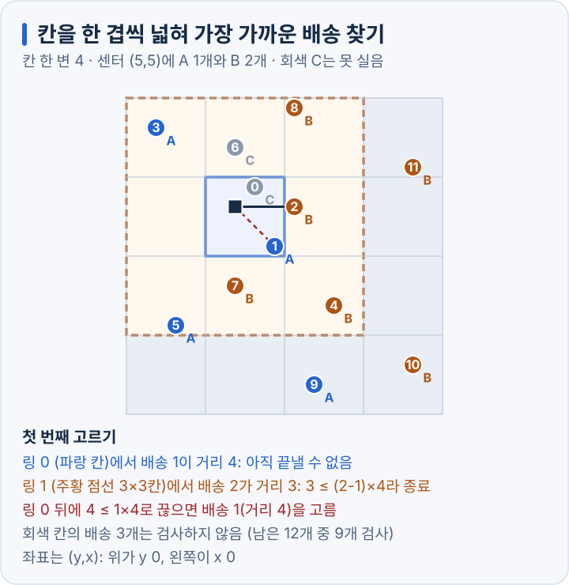
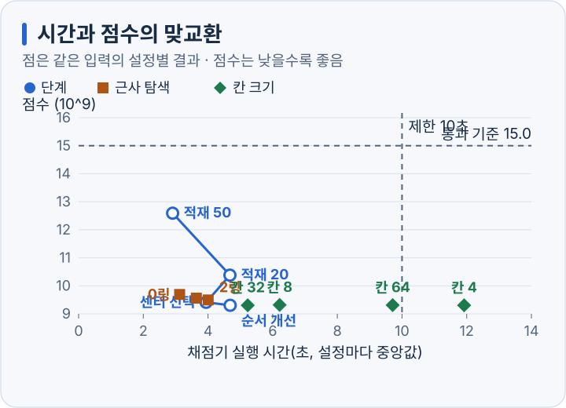

# 입력이 클 때: 공간 칸으로 후보를 줄이고 시간 예산 나누기

[물류 상품 배송 1](/practice/COUPANG1)은 물류센터 1,000곳의 재고와 배송 요청 1,000,000건, 트럭 한 대가 주어지는 문제입니다. 앞의 [택시 배정](https://h.readiz.com/learn/assignment-with-routes)과 [격자 배치](https://h.readiz.com/learn/placement-search)는 후보가 수천~수만 개라서 "남은 것을 전부 훑어 가장 좋은 것을 고른다"를 그대로 써도 TC당 1억 번 안쪽이었습니다. 이 문제에서는 같은 문장이 5.0×10^11번이 됩니다. 이 강의는 상한에서 연산 수를 먼저 계산하고, 후보를 줄이는 자료구조(좌표 칸)를 만들고, 남은 시간을 어디에 쓸지 실측으로 정하는 과정을 따라갑니다.

[복잡도와 입력 크기 감각](https://h.readiz.com/learn/complexity-input-size)과 [휴리스틱 입문](https://h.readiz.com/learn/heuristic)을 읽었다고 가정합니다. 칸으로 나누는 발상은 [Sqrt Decomposition](https://h.readiz.com/learn/sqrt-decomposition)의 "휴리스틱 풀이에서 쓰는 곳"에서 소개한 것이고, 측정은 [실험 비교와 평가](https://h.readiz.com/learn/testing-and-stress/experiment-evaluation)를 따릅니다.

## 문제 계약을 상태로 옮기기

| 항목 | 계약 |
| --- | --- |
| 구현 | `sendCenterList`, `sendDeliveryList`로 입력을 받고, `solve(트럭 시작 좌표)` 안에서 `truckLoading(센터, 상품 배열, 개수)`와 `truckMove(배송 번호)`를 호출 |
| 상한 | 센터 N=1,000, 상품 종류 M=10,000, 배송 K=1,000,000, 좌표는 0 이상 1,000 미만. 센터 한 곳의 상품 줄은 100개 이하, 트럭 적재 50개. 입력은 한 개이고 시간 제한 10초 |
| 점수 | 총 이동 비용. 낮을수록 좋고 15,000,000,000 이하가 통과. 비용 = 맨해튼 거리 × (100 + 싣고 있는 개수 × 10)이고 `truckLoading`과 `truckMove` 모두 이동한다 |
| API·무효 | `truckLoading`은 먼저 이동한 뒤 싣고, 적재 한도를 넘거나 재고 없는 상품이 있으면 0을 돌려준다(이동 비용은 이미 냈다). `truckMove`는 싣지 않은 상품이거나 이미 처리한 배송이면 0이지만 비용은 낸다. 처리하지 못한 배송이 남으면 10^12 |

`sendCenterList`에서 이 채점기의 입력을 직접 센 값입니다. 센터의 상품 줄은 1~100개로 합이 50,690줄(평균 50.7줄)이고, 145개 센터는 같은 상품이 두 줄 이상 나옵니다. 그래서 **재고는 `(센터, 상품)`별로 합쳐** 둡니다. 재고 합 2,553,252은 배송 수의 2.55배지만, 상품별로 재고에서 배송 수를 뺀 값의 최솟값은 0이라서 어떤 상품은 재고를 하나도 남기지 않고 써야 합니다. 한 센터가 가진 상품은 10,000종의 약 0.5%이므로, 센터에서 싣고 나갈 수 있는 배송은 지도 위 배송 200개 중 하나꼴입니다. 이것이 후보 탐색을 어렵게 하는 숫자입니다.

탐색 상태는 **아직 가지 않은 배송의 집합**, 센터별 남은 재고 `stock[c][p]`, 트럭 위치입니다. 상품별 남은 배송 수 `demand[p]`와 센터가 지금 더 실을 수 있는 배송 수의 상한 `mass[c] = Σ min(stock[c][p], demand[p])`는 여기서 다시 계산할 수 있는 보조 값입니다. `mass[c] = 0`이면 그 센터는 더 쓸 곳이 없습니다. 실을 배송을 센터의 재고가 있는 것만 골라 고르는 즉시 재고를 줄이면 모든 상품에서 재고 합이 남은 배송 수 이상이라는 입력의 성질이 끝까지 유지되어, 배송이 남았는데 쓸 센터가 없는 일은 생기지 않습니다.

## 연산 수 예산표

후보 하나를 확인하는 일(좌표 차이와 재고 한 칸 읽기)을 기본 연산 1회로 셉니다. 이 환경에서 단순 반복의 한 번은 0.4ns 안팎이었지만(뒤에서 잰 값), 채점 환경은 다를 수 있어 시간 제한의 절반인 5초에 해당하는 5×10^9 안팎을 상한으로 잡습니다.

| 방법 | 연산 수 | 판단 |
| --- | ---: | --- |
| 배송 순서대로, 그 상품을 가진 센터 목록(평균 5곳)에서 고르기 | 5×10^6 | 충분 |
| 배송마다 센터 1,000곳을 모두 확인 | 10^9 | 가능하지만 목록을 만들면 200배 줄어든다 |
| 고를 때마다 남은 배송 전부를 훑어 가장 가까운 것 찾기 | 5.0×10^11 | 불가능: 검사 하나를 0.45ns로 잰 값으로 약 223초 |
| 배송 쌍의 거리를 모두 계산·저장 | 5×10^11 | 불가능(저장 공간도 없다) |
| 칸으로 가까운 후보만 훑기, 고를 때마다 평균 약 6,379개 | 6.4×10^9 | 가능하나 시간 제한의 절반 가까이 쓴다(측정) |
| 운행 한 번(20곳) 안의 순서 개선, 운행 5만 번 | 약 10^8~10^9 | 여유 |

`truckLoading`과 `truckMove`의 호출 비용도 봅니다. 채점기가 호출마다 싣고 있는 상품 목록을 훑으므로 `truckMove`는 1회에 최대 50번, `truckLoading`은 1회에 개수 × 100번 정도라서, 한 번에 20개씩 싣는 운행 약 5만 번이면 10^8 안쪽입니다. 호출 수 자체는 배송 수 100만이 하한입니다.

## 0단계: 유효한 기준선

배송 번호 순서대로 그 상품을 가진 센터 중 트럭에서 가장 가까운 곳에 가서 **하나만** 싣고 바로 배송합니다. 센터 목록 `listStart/listCenter`와 재고를 같이 쓰므로 위에서 설명할 상태 블록이 필요합니다.

> **코드 환경: h-contest 제출용.** 이 강의의 블록은 `coupang-contract`(문제가 주는 선언), `coupang-state`, `coupang-send`, 그 뒤에 `coupang-baseline` 또는 `coupang-search`, `coupang-trip`, `coupang-entry` 순으로 붙여 제출합니다. 앞의 네 블록이 상태와 입력 처리이고, 뒤쪽은 해법입니다.

```cpp snippet=coupang-baseline
void solve(Coordinates truckCoordinates) {
    ship::prepare();
    int ty = truckCoordinates.y, tx = truckCoordinates.x;
    for (int id = 0; id < ship::deliveryCount; ++id) {
        const ship::Item it = ship::slot[ship::where[id]];  // take()가 칸 안의 자리를 바꾸므로 먼저 복사한다.
        int c = -1, bestDist = 1 << 30;
        for (int t = ship::listStart[it.prod]; t < ship::listStart[it.prod + 1]; ++t) {  // 이 상품을 가진 센터 중 트럭에서 가장 가까운 곳
            const int e = ship::listCenter[t];
            const int d = ship::absInt(ship::cy[e] - ty) + ship::absInt(ship::cx[e] - tx);
            if (ship::stock[e][it.prod] > 0 && d < bestDist) { bestDist = d; c = e; }
        }
        ship::take(id, c);
        int product = it.prod;
        truckLoading(c, &product, 1);
        truckMove(id);
        ty = it.y; tx = it.x;
    }
}
```

점수는 107,926,719,860으로 통과 기준의 7.2배이고 0.1초에 끝납니다. 검사 하나가 가벼워서 시간은 문제가 아니고, 한 번에 하나만 싣는 구조가 점수를 막습니다. 점수를 배송 수와 비용 배율(약 105)로 나누면 배송 하나에 평균 약 1,028의 거리를 달리는 셈입니다.

## 후보를 줄이는 구조: 좌표 칸

운행의 핵심 질의는 하나입니다. "점 `(y, x)`에서 가장 가까운, **센터 `c`가 지금 실을 수 있는** 남은 배송은?" 그리고 고른 배송은 지웁니다.

- **칸**: 좌표를 `CELL × CELL` 칸으로 나누고 칸 안의 배송을 이어서 저장합니다. `CELL = 16`이면 63×63 = 3,969칸이고 칸마다 평균 251개입니다.
- **링 확장**: 질의가 속한 칸(링 0)에서 시작해 한 겹씩(링 r은 칸 거리가 r인 칸들) 넓힙니다. 링 r을 보기 전에 남은 후보는 모두 `(r-1)*CELL + 1` 이상 떨어져 있으므로 지금까지의 최선이 `(r-1)*CELL` 이하이면 멈춥니다.
- **삭제**: 칸 안의 살아 있는 후보를 앞쪽에 두고(`cellLive`), 지울 때 마지막 살아 있는 후보와 자리를 바꾼 뒤 개수만 줄입니다. 지연 삭제(표시만 하고 남김)는 후반으로 갈수록 죽은 후보를 매번 건너뛰어야 하고, 연결 목록은 후보마다 포인터를 따라가야 합니다. 이 방식은 모든 후보가 연속 메모리에 있어 훑기가 빠르고 삭제가 `O(1)`입니다. 대신 후보가 칸 안에서 자리를 옮기므로 번호로 찾는 `where[]`를 함께 고칩니다.

메모리는 `stock`이 1,000×10,000×2바이트 = 20,000,000, 후보 `slot`이 12바이트 × 1,000,000 = 12,000,000, `where`가 4,000,000이고 나머지(칸 배열, 센터 목록, `demand`, `mass`)는 합쳐 1MB 안쪽이라 전체가 약 37MB입니다. 재고를 `int`로 두면 40MB가 되는데 합친 재고도 `unsigned short`에 들어갑니다(한 줄 최대 100, 같은 상품이 최대 100줄).

> **코드 환경: h-contest 제출용 1/4.** 헤더 없이 쓰는 블록입니다. `coupang-contract`는 문제가 주는 `user.cpp` 틀의 구조체·함수 선언과 같고, `loadCenters`·`loadDeliveries`는 입력 구간만 초기화해 같은 프로세스에서 여러 번 불러도 이전 입력이 남지 않습니다. `prepare()`는 두 목록을 받은 뒤 `solve`에서 한 번 부릅니다.

```cpp snippet=coupang-contract
#define ABS(x) ((x) > 0 ? (x) : -(x))

struct Coordinates {
    int y, x;
    Coordinates() { y = x = 0; }
    Coordinates(int _y, int _x) { y = _y; x = _x; }
    int operator-(Coordinates& param) { return ABS(y - param.y) + ABS(x - param.x); }
};

struct Product {
    int id, count;
    Product() { id = count = 0; }
    Product(int _id, int _count) { id = _id; count = _count; }
};

extern int truckMove(int);
extern int truckLoading(int, int[], int);
```

```cpp snippet=coupang-state
namespace ship {
const int N = 1000, M = 10000, K = 1000000;  // 센터, 상품 종류, 배송 요청의 상한
const int CAP = 50;                          // 트럭 적재 상한
const int SIDE = 1000, CELL = 16;            // 좌표 범위, 칸의 한 변
const int G = (SIDE + CELL - 1) / CELL;      // 한 변의 칸 수

struct Item {                // 칸 안에 붙어 있는 후보 하나: 12바이트
    short y, x, prod;
    int id;
};

static int cy[N], cx[N];                          // 센터 좌표
static unsigned short stock[N][M];                // stock[c][p]: 센터 c에 남은 상품 p. 같은 상품이 두 줄이면 합친다.
static int listStart[M + 1], listCenter[N * 100]; // 상품 p를 가진 센터 번호 목록(CSR)
static int demand[M];                             // 상품 p의 남은 배송 수
static int mass[N];                               // sum of min(stock[c][p], demand[p]): 센터 c가 지금 더 실을 수 있는 배송 수의 상한
static Item slot[K];                              // 칸별로 이어 붙인 후보. 칸 안에서는 앞쪽 cellLive개만 남아 있다.
static int where[K];                              // where[id]: slot에서 배송 id의 위치
static int cellStart[G * G + 1], cellLive[G * G]; // 칸의 시작 위치, 남은 후보 수
static int centerCount, typeCount, deliveryCount;

inline int absInt(int v) { return v < 0 ? -v : v; }
inline int minInt(int a, int b) { return a < b ? a : b; }
inline int cellOf(int y, int x) { return (y / CELL) * G + x / CELL; }

void loadCenters(int n, int m, const Coordinates pos[], Product list[][100], const int size[]) {
    centerCount = n; typeCount = m;
    for (int c = 0; c < n; ++c) {
        cy[c] = pos[c].y; cx[c] = pos[c].x;
        for (int p = 0; p < m; ++p) stock[c][p] = 0;
        for (int j = 0; j < size[c]; ++j) stock[c][list[c][j].id] += list[c][j].count;
    }
}

// 칸마다 개수를 세어 시작 위치를 정하고(counting sort) 후보를 칸별로 이어 붙인다.
void loadDeliveries(int cnt, const Coordinates pos[], const int prod[]) {
    deliveryCount = cnt;
    for (int g = 0; g <= G * G; ++g) cellStart[g] = 0;
    for (int g = 0; g < G * G; ++g) cellLive[g] = 0;
    for (int i = 0; i < cnt; ++i) ++cellStart[cellOf(pos[i].y, pos[i].x) + 1];
    for (int g = 0; g < G * G; ++g) cellStart[g + 1] += cellStart[g];
    for (int i = 0; i < cnt; ++i) {
        int g = cellOf(pos[i].y, pos[i].x), w = cellStart[g] + cellLive[g]++;
        slot[w].y = (short)pos[i].y; slot[w].x = (short)pos[i].x; slot[w].prod = (short)prod[i]; slot[w].id = i;
        where[i] = w;
    }
}

// 두 목록을 모두 받은 뒤 한 번 부른다: 상품별 센터 목록, 남은 배송 수, 센터별 mass.
void prepare() {
    for (int p = 0; p <= typeCount; ++p) listStart[p] = 0;
    for (int p = 0; p < typeCount; ++p) demand[p] = 0;
    for (int c = 0; c < centerCount; ++c) mass[c] = 0;
    for (int c = 0; c < centerCount; ++c) for (int p = 0; p < typeCount; ++p) if (stock[c][p]) ++listStart[p + 1];
    for (int p = 0; p < typeCount; ++p) listStart[p + 1] += listStart[p];
    static int filled[M];
    for (int p = 0; p < typeCount; ++p) filled[p] = 0;
    for (int c = 0; c < centerCount; ++c) for (int p = 0; p < typeCount; ++p) if (stock[c][p]) listCenter[listStart[p] + filled[p]++] = c;
    for (int i = 0; i < deliveryCount; ++i) ++demand[slot[where[i]].prod];
    for (int p = 0; p < typeCount; ++p)
        for (int t = listStart[p]; t < listStart[p + 1]; ++t) mass[listCenter[t]] += minInt(stock[listCenter[t]][p], demand[p]);
}

// 센터 c가 배송 id를 맡는다. 칸에서 지우고(마지막 살아 있는 후보와 자리를 바꾼다) 재고, 남은 배송 수, mass를 고친다.
// 전제: 배송 id가 남아 있고 stock[c][상품] > 0
void take(int id, int c) {
    const int w = where[id], g = cellOf(slot[w].y, slot[w].x), last = cellStart[g] + --cellLive[g], p = slot[w].prod;
    Item moved = slot[last]; slot[last] = slot[w]; slot[w] = moved;
    where[slot[w].id] = w; where[slot[last].id] = last;
    for (int t = listStart[p]; t < listStart[p + 1]; ++t) {
        const int e = listCenter[t], s = stock[e][p];
        mass[e] += minInt(s - (e == c), demand[p] - 1) - minInt(s, demand[p]);
    }
    --stock[c][p]; --demand[p];
}
}
```

```cpp snippet=coupang-send
void sendCenterList(int N, int M, Coordinates centerCoordinatesList[], Product centerProductList[][100], int centerProductSize[]) {
    ship::loadCenters(N, M, centerCoordinatesList, centerProductList, centerProductSize);
}

void sendDeliveryList(int K, Coordinates deliveryCoordinatesList[], int deliveryProductList[]) {
    ship::loadDeliveries(K, deliveryCoordinatesList, deliveryProductList);
}
```

`nearest`의 안쪽 반복은 먼저 재고(`stock[c][prod]`)를 보고 실을 수 있는 후보만 거리를 계산합니다. 실을 수 있는 후보가 0.5%뿐이라 대부분은 읽기 한 번으로 끝나고, 센터 `c`의 재고 한 줄(20KB)은 운행 동안 캐시에 남습니다.

> **코드 환경: h-contest 제출용 2/4.** 위 블록 뒤에 붙입니다. `extra`는 근사 탐색의 설정으로, 정확한 탐색은 -1을 씁니다.

```cpp snippet=coupang-search
namespace ship {
// (y, x)에서 가장 가까운, 센터 c가 지금 실을 수 있는 배송의 번호. 없으면 -1.
// 칸을 가운데부터 한 겹(링)씩 넓혀 본다. 링 r을 보기 전에 남은 후보는 모두 (r-1)*CELL+1 이상 떨어져 있으므로
// 지금까지의 최선이 (r-1)*CELL 이하이면 더 볼 필요가 없다. extra >= 0이면 첫 후보가 나온 링에서 extra겹만 더 보고 멈춘다(근사).
int nearest(int y, int x, int c, int extra) {
    const int gy0 = y / CELL, gx0 = x / CELL;
    int best = -1, bestDist = 1 << 30, lastRing = G;
    for (int r = 0; r <= lastRing && r < G; ++r) {
        if (bestDist <= (r - 1) * CELL) break;
        for (int gy = gy0 - r; gy <= gy0 + r; ++gy) {
            if (gy < 0 || gy >= G) continue;
            const int step = (gy == gy0 - r || gy == gy0 + r || r == 0) ? 1 : 2 * r;  // 가운데 행은 양 끝 칸만
            for (int gx = gx0 - r; gx <= gx0 + r; gx += step) {
                if (gx < 0 || gx >= G) continue;
                const int g = gy * G + gx;
                const Item* it = slot + cellStart[g];
                for (int j = 0, n = cellLive[g]; j < n; ++j) {
                    if (stock[c][it[j].prod] == 0) continue;
                    const int d = absInt(it[j].y - y) + absInt(it[j].x - x);
                    if (d < bestDist) { bestDist = d; best = it[j].id; }
                }
            }
        }
        if (best >= 0 && extra >= 0 && lastRing == G) lastRing = r + extra;
    }
    return best;
}
}
```

칸 크기는 한 번에 검사하는 후보 수와 링을 도는 횟수의 균형입니다. 아래는 같은 정확한 탐색(점수는 같은 기록, 구현의 동점 처리 순서만 다릅니다)에서 칸만 바꾼 실측입니다. 후보 검사 수는 칸이 작을수록 줄지만 칸을 도는 비용이 늘어 시간은 16 부근에서 가장 짧았습니다.

<!-- check:cells -->
| 칸 한 변 | 칸 수 | 후보 검사 수 | 점수 | 시간(초) |
| ---: | ---: | ---: | ---: | ---: |
| 4 | 62,500 | 4,955,046,288 | 9,305,312,620 | 11.9 |
| 8 | 15,625 | 5,372,558,366 | 9,318,426,750 | 6.2 |
| 16 | 3,969 | 6,378,723,157 | 9,306,067,620 | 4.7 |
| 32 | 1,024 | 9,618,129,454 | 9,305,700,550 | 5.2 |
| 64 | 256 | 21,897,349,179 | 9,309,675,620 | 9.7 |

## 손계산: 칸 탐색은 전수 탐색과 같은 답을 낸다

16×16 지도를 4×4 칸으로 나눕니다. 센터는 (5,5)에 있고 A를 1개, B를 2개 가집니다. 배송은 0 (5,6) C, 1 (7,7) A, 2 (5,8) B, 3 (1,1) A, 4 (10,10) B, 5 (11,2) A, 6 (2,5) C, 7 (9,5) B, 8 (0,8) B, 9 (14,13) A, 10 (13,14) B, 11 (3,14) B입니다. 센터에서 세 번 가장 가까운 배송을 고릅니다(첫 번째는 센터 위치에서, 이후는 방금 고른 배송에서). 센터가 가진 것은 A 1개와 B 2개뿐이라 C는 늘 건너뛰고, A를 한 번 고르면 A 후보는 모두 못 쓰게 됩니다. 표의 마지막 열은 전수 탐색의 최솟값이고 이 숫자는 검사 스크립트가 독립 구현으로 다시 구해 대조합니다.

<!-- check:hand -->
| 고르기 | 출발점 | 본 링 | 검사한 후보 / 남은 배송 | 고른 배송 | 거리 | 전수 탐색의 최솟값 |
| --- | --- | ---: | ---: | --- | ---: | ---: |
| 1번째 | (5,5) | 2 | 9 / 12 | 배송 2 (5,8) B | 3 | 3 |
| 2번째 | (5,8) | 2 | 7 / 11 | 배송 1 (7,7) A | 3 | 3 |
| 3번째 | (7,7) | 2 | 7 / 10 | 배송 7 (9,5) B | 4 | 4 |



[그림 크게 보기](https://git.readiz.com/h-contest-lesson/lessons/large-input-search/lesson-assets/bucket-walk.svg)

첫 번째 고르기에서 링 0의 칸만 보고 끊으면 배송 1(거리 4)을 고르지만 진짜 최솟값은 배송 2(거리 3)입니다. 종료 조건에서 **한 겹을 일찍 끊은** `best <= r * CELL`이 이 오답을 만들며, 둘째·셋째 고르기는 같은 답이 나옵니다. 세 번 모두 같은 답이 나온 뒤 센터의 `mass`는 3에서 0이 되어 다음 운행에서 이 센터는 후보에서 빠집니다.

## 운행 단위로 풀기

한 번의 **운행**은 센터 한 곳에 가서 최대 `load`개를 싣고, 그 센터에서 시작해 가장 가까운 후보를 이어 붙이며(`build`) 배달합니다. 운행의 비용은 **구간마다 (거리) × (100 + 10 × 그 구간을 달릴 때 싣고 있는 개수)**라서, 짐이 많은 처음 구간을 짧게 만드는 것이 중요합니다.

- 적재 `load`: 많이 실으면 운행 수가 줄지만 단가가 올라가고 배송 간격이 넓어집니다. 실측으로 20 부근이 가장 좋았습니다(표 아래).
- 센터 선택 `chooseCenter`: 트럭에서 센터까지의 거리에 **그 센터의 후보 밀도로 어림한 배송 간격**을 더합니다. 지도에 후보가 `mass[c]`개 있으면 간격은 `√(10^6 / mass[c])` 정도이므로 비용 `거리 + β·√(10^6 / mass[c])`가 가장 작은 센터를 씁니다. 헤더 없이 `sqrt`를 쓸 수 없어 `16·√(10^6 / e)`를 정수로 한 번 표로 만들어 둡니다.
- 순서 개선 `improve`: 운행 하나는 20곳이라 구간 뒤집기(2-opt)와 한 곳 옮기기(or-opt)를 줄어들 때만 적용합니다. 순서를 바꾸면 구간마다 싣고 있는 개수도 바뀌므로 영향을 받는 구간만 `spanCost`로 다시 더합니다.

> **코드 환경: h-contest 제출용 3/4.** `coupang-search` 뒤에 붙입니다. `Trip`은 센터(`s[0]`)와 배달 순서(`s[1..n]`)이고, `build`는 고르는 즉시 `take`로 지웁니다.

```cpp snippet=coupang-trip
namespace ship {
// 센터 한 곳에서 싣고 나가는 한 번의 운행. s[0]은 센터, s[1..n]은 배달 순서다.
struct Stop { int id, prod, y, x; };
struct Trip { int n; Stop s[CAP + 1]; };

// 센터 c에서 출발해 가장 가까운 후보를 이어 붙인다. 고른 후보는 바로 take()로 지우므로 같은 후보를 두 번 고르지 않는다.
void build(Trip& t, int c, int load, int extra) {
    t.n = 0;
    t.s[0].id = -1; t.s[0].prod = -1; t.s[0].y = cy[c]; t.s[0].x = cx[c];
    while (t.n < load) {
        const Stop& from = t.s[t.n];
        const int id = nearest(from.y, from.x, c, extra);
        if (id < 0) break;
        const Item& it = slot[where[id]];
        Stop next = {id, it.prod, it.y, it.x};
        take(id, c);
        t.s[++t.n] = next;
    }
}

// i번째 구간(s[i-1] -> s[i])의 비용: 이 구간을 달릴 때 아직 싣고 있는 상품은 n-i+1개다.
inline int legCost(const Trip& t, int i) {
    return (100 + 10 * (t.n - i + 1)) * (absInt(t.s[i].y - t.s[i - 1].y) + absInt(t.s[i].x - t.s[i - 1].x));
}
inline int spanCost(const Trip& t, int lo, int hi) {  // 구간 lo..hi(끝은 n까지)
    int sum = 0;
    for (int i = lo; i <= hi && i <= t.n; ++i) sum += legCost(t, i);
    return sum;
}

// 배달 순서를 개선한다. 구간 뒤집기(2-opt)와 한 곳 옮기기(or-opt)를 줄어들 때만 적용하고 passes번까지 되풀이한다.
// 모든 이동은 영향을 받는 구간만 다시 계산한다.
void improve(Trip& t, int passes) {
    for (int pass = 0; pass < passes; ++pass) {
        bool better = false;
        for (int i = 1; i <= t.n; ++i) {
            for (int j = i + 1; j <= t.n; ++j) {
                const int before = spanCost(t, i, j + 1);
                for (int a = i, b = j; a < b; ++a, --b) { Stop tmp = t.s[a]; t.s[a] = t.s[b]; t.s[b] = tmp; }
                if (spanCost(t, i, j + 1) < before) { better = true; continue; }
                for (int a = i, b = j; a < b; ++a, --b) { Stop tmp = t.s[a]; t.s[a] = t.s[b]; t.s[b] = tmp; }
            }
        }
        for (int i = 1; i <= t.n; ++i) {
            for (int j = 1; j <= t.n; ++j) {
                if (i == j) continue;
                const int lo = i < j ? i : j, hi = (i < j ? j : i) + 1;
                const int before = spanCost(t, lo, hi);
                const Stop moved = t.s[i];
                if (i < j) for (int k = i; k < j; ++k) t.s[k] = t.s[k + 1];
                else for (int k = i; k > j; --k) t.s[k] = t.s[k - 1];
                t.s[j] = moved;
                if (spanCost(t, lo, hi) < before) { better = true; continue; }
                if (i < j) { for (int k = j; k > i; --k) t.s[k] = t.s[k - 1]; }
                else { for (int k = j; k < i; ++k) t.s[k] = t.s[k + 1]; }
                t.s[i] = moved;
            }
        }
        if (!better) break;
    }
}

// 센터를 고르는 비용 = 트럭에서 센터까지의 거리 + beta * sqrt(1e6 / mass[c]). 뒤의 항은 이 센터의 후보 밀도로 어림한 배송 간격이다.
// sqrt를 헤더 없이 쓰기 위해 16 * sqrt(1e6 / e)를 정수로 한 번 만들어 둔다.
static int spacing[20001];
int isqrt(long long v) {  // floor(sqrt(v)), v <= 2^40
    int lo = 0, hi = 1 << 20;
    while (lo < hi) {
        const int mid = (lo + hi + 1) / 2;
        if ((long long)mid * mid <= v) lo = mid; else hi = mid - 1;
    }
    return lo;
}
void makeSpacing() {
    spacing[0] = 1 << 28;
    for (int e = 1; e <= 20000; ++e) spacing[e] = isqrt(256LL * 1000000 / e);
}

int chooseCenter(int ty, int tx, int beta) {
    int best = -1;
    long long bestKey = 0;
    for (int c = 0; c < centerCount; ++c) {
        if (mass[c] <= 0) continue;
        const long long key = 16LL * (absInt(cy[c] - ty) + absInt(cx[c] - tx)) + (long long)beta * spacing[minInt(mass[c], 20000)];
        if (best < 0 || key < bestKey) { best = c; bestKey = key; }
    }
    return best;
}
}
```

> **코드 환경: h-contest 제출용 4/4.** `coupang-send` 다음 순서의 마지막 블록으로, 위 블록을 모두 붙인 뒤 `solve`를 대신해 사용하는 완성 진입점입니다. 센터 후보는 매번 전체 1,000곳을 보지만(운행당 1,000번) 운행 수가 5만이라 5천만 번입니다.

```cpp snippet=coupang-entry
void solve(Coordinates truckCoordinates) {
    ship::prepare();
    ship::makeSpacing();
    int ty = truckCoordinates.y, tx = truckCoordinates.x;
    for (int left = ship::deliveryCount; left > 0;) {
        const int c = ship::chooseCenter(ty, tx, 25);
        if (c < 0) break;                       // 입력이 올바르면 오지 않는다.
        static ship::Trip trip;
        ship::build(trip, c, 20, -1);
        ship::improve(trip, 3);
        int prods[ship::CAP];
        for (int i = 0; i < trip.n; ++i) prods[i] = trip.s[i + 1].prod;
        truckLoading(c, prods, trip.n);
        for (int i = 1; i <= trip.n; ++i) truckMove(trip.s[i].id);
        ty = trip.s[trip.n].y; tx = trip.s[trip.n].x;
        left -= trip.n;
    }
}
```

## 측정: 단계별, 설정별

아래는 2026-11-18에 공개 채점기의 입력 1개를 그대로 실행한 결과입니다. 환경은 Darwin 26.3 arm64 / Apple clang version 17.0.0 (clang-1700.6.3.2) / -std=c++17 -O2이고 채점기 `main.cpp`의 SHA-256 앞 12자는 `bef002618ed1`입니다. **점수는 난수와 시간을 쓰지 않아 실행마다 같은 값**이고, 시간은 채점기의 입력 생성을 포함한 한 번의 실행 전체를 설정마다 5번(설정을 돌려 가며 측정) 잰 중앙값입니다. 측정 중 시스템 부하 평균은 시작 때 2.8였고, 다른 작업이 동시에 돌 수 있는 개인 맥이라 같은 설정을 5번 돌린 최소~최대가 본문 제출 코드에서 4.7~5.1초였습니다. [실험 비교와 평가](https://h.readiz.com/learn/testing-and-stress/experiment-evaluation)의 원칙대로 한 번의 시간으로 순위를 매기지 않고, 점수 차이가 시간 잡음보다 큰 경우만 결론으로 삼습니다.

<!-- check:stages -->
| 단계 | 점수 ↓ | 통과 기준 대비 | 운행 수 | 시간(초) |
| --- | ---: | ---: | ---: | ---: |
| 번호 순서, 상품을 가진 가까운 센터에서 1개씩 | 107,926,719,860 | 7.20배 | 1,000,000 | 0.1 |
| 가까운 센터에서 50개씩 | 12,592,618,150 | 0.84배 | 20,519 | 2.9 |
| + 적재 20개 | 10,381,303,890 | 0.69배 | 50,487 | 4.7 |
| + 센터 선택에 후보 밀도 반영 | 9,412,006,660 | 0.63배 | 50,436 | 3.9 |
| + 운행 안 순서 개선(최대 3회) | 9,306,067,620 | 0.62배 | 50,442 | 4.7 |

- 기준선은 통과 기준의 7.2배입니다. 운행(센터에서 여러 개 싣기)이 107,926,719,860에서 12,592,618,150로 한 번에 줄이며 통과합니다(-88%).
- 적재를 20으로 줄이면 -17.6%, 센터 선택에 밀도를 반영하면 -9.3%, 운행 안 순서 개선(최대 3회)은 -1.1%입니다. 큰 이득은 구조(운행·적재)에서 오고, 제일 늦게 붙인 지역 개선은 1%대입니다.
- 비용이 쌓이는 곳: 10% 구간마다 누적한 비용을 보면 마지막 10%의 배송이 전체의 25%를 씁니다. 남은 배송이 드물어져 배송 간격이 넓어지기 때문이며, 이 구간이 아직 줄이지 못한 부분입니다. (독립 계산한 비용이 채점기 점수와 일치하는지 측정 때마다 확인했습니다.)
- 본문 제출 코드는 9,306,067,620로 같고 4.7초입니다. 통과 기준 15,000,000,000의 62%이고 시간 제한 10초의 절반 안쪽입니다. 채점 서버가 이 환경의 두 배 느리면 한도에 가까워지므로 제출 전에 `extra`로 줄일 수 있는지 확인합니다.

탐색을 정확하게 하는 데 시간을 쓸지 알아봅니다. 첫 후보가 나온 링에서 `extra`개 링만 더 보고 멈추는 근사는 후보 검사를 줄이지만 점수가 나빠집니다.

<!-- check:extras -->
| 첫 후보 뒤에 더 보는 링 | 후보 검사 수 | 점수 | 점수 변화 | 시간(초) |
| --- | ---: | ---: | ---: | ---: |
| 0링 | 3,322,726,731 | 9,690,535,030 | +4.1% | 3.1 |
| 1링 | 4,478,420,341 | 9,559,267,000 | +2.7% | 3.6 |
| 2링 | 4,832,395,969 | 9,496,733,150 | +2.0% | 4.0 |
| 정확한 종료 조건 | 6,378,723,157 | 9,306,067,620 | - | 4.7 |

설정은 한 번의 좋은 결과로 정하지 않았습니다. 점수가 결정적이므로 같은 입력에서 한 번 실행한 값이 곧 그 설정의 점수이고, 아래는 **한 번에 한 값씩만 바꾼** 비교입니다(나머지는 적재 20, 가중치 25, 개선 3회, 정확한 탐색).

<!-- check:params -->
| 바꾼 값 | 점수 ↓ | 시간(초) |
| --- | ---: | ---: |
| 적재 10개 | 10,598,486,430 | 7.6 |
| 적재 20개 | 9,306,067,620 | 4.7 |
| 적재 30개 | 9,504,889,620 | 4.7 |
| 적재 50개 | 10,762,331,820 | 7.4 |
| 밀도 항 가중치 0 | 10,242,347,070 | 5.5 |
| 밀도 항 가중치 10 | 9,285,607,570 | 4.7 |
| 밀도 항 가중치 25 | 9,306,067,620 | 4.7 |
| 밀도 항 가중치 100 | 9,377,977,200 | 4.7 |
| 순서 개선 반복 0회 | 9,412,006,660 | 3.9 |
| 순서 개선 반복 1회 | 9,317,765,440 | 4.5 |
| 순서 개선 반복 3회 | 9,306,067,620 | 4.7 |
| 순서 개선 반복 10회 | 9,313,973,200 | 4.8 |

- 근사 탐색은 정확한 탐색보다 점수가 +2.0%(2링)~+4.1%(0링) 나쁘고, 시간은 0.7~1.6초 덜 걸립니다. 시간 한도에 닿지 않으면 정확한 탐색을 쓰고, 근사는 한도에 닿을 때 줄이는 손잡이로 남깁니다.
- 순서 개선은 1회에 -1.0%, 3회에 -1.1%이고 10회는 -1.0%입니다. 3회 이후에는 이득이 없고 앞 운행의 끝 위치가 달라져 뒤 운행이 바뀌는 잡음 수준입니다. 적재 50개의 개선은 시간이 7.4초로 크게 늘어, 구간 수의 제곱에 비례하는 개선은 운행이 길어지면 예산을 잡아먹는다는 것도 보여 줍니다.
- 가중치는 0이 가장 나쁘고(+10.1%) 10~100은 +1.0% 안쪽 차이입니다. 이 값은 공개 입력 한 개로 골랐으므로 다른 입력에서의 일반화는 확인하지 못했습니다.
- 시간으로 점수를 살 수 있는 설정은 이번 실측에서 없었습니다. 정확한 탐색 + 순서 개선 3회가 이 환경에서 가장 좋은 점수를 4.7초에 내고, 남는 시간은 채점 서버의 편차를 흡수하는 여유로 둡니다.



[그림 크게 보기](https://git.readiz.com/h-contest-lesson/lessons/large-input-search/lesson-assets/budget-tradeoff.svg)

## 실패 사례 두 가지

아래는 일부러 틀린 **설계 조각**이며 제출 코드가 아닙니다.

**1. 종료 조건을 한 겹 일찍 끊은 링 확장.** `nearest`의 `if (bestDist <= (r - 1) * CELL) break;`를 `if (bestDist <= r * CELL) break;`로 바꿉니다. 컴파일되고 모든 배송을 처리하는 유효한 답을 내지만, 더 가까운 후보를 놓친 경우를 받아들여 점수가 9,332,408,500로 정확한 탐색(9,306,067,620)보다 +0.3% 나쁩니다. 점수만 보면 "그냥 조금 나쁜 풀이"로 보여 놓치기 쉽습니다.

**2. 고른 배송을 칸에서 지우지 않은 `take`.** `last = cellStart[g] + --cellLive[g]`를 `cellStart[g] + cellLive[g] - 1`로 바꿔 개수를 줄이지 않습니다. 같은 배송이 다음 질의에 다시 나와 이미 처리한 배송을 다시 싣고, 다른 배송이 하나 이상 처리되지 않아 채점기는 10^12(패널티)를 줍니다.

두 변형은 같은 검사가 잡습니다. 무작위 작은 입력(센터 1~6, 상품 2~13종, 배송 150개 이하, 좌표 범위 4~1,000)에서 `nearest`가 돌려준 후보의 거리가 **독립적으로 센 전수 탐색의 최솟값**과 같은지, `take` 뒤마다 `stock`·`mass`·`demand`·칸 목록이 처음부터 다시 센 값과 같은지 확인합니다. 칸 크기를 1·5·16·64·1000으로 바꿔도 같습니다. `python3 scripts/check_large_input_search.py`는 본문 코드를 추출해 이 검사와 손계산 표, 운행 비용(독립 계산)과 개선의 비증가, 센터·배송·상품이 몇 개든 모든 배송을 처리하는지(채점기 규칙을 독립 구현한 작은 채점기)를 ASan/UBSan으로 실행하고, 위 두 변형이 검출되는지와 저장한 측정을 본문 표와 대조합니다. `--judge /path/to/COUPANG1/main.cpp --output FILE`을 붙이면 위 측정을 다시 만듭니다(약 20분이 걸립니다). 본문 제출 코드를 ASan/UBSan으로 채점기 입력에 실행하면 같은 점수가 나오고 27초가 걸립니다.

## 연습: COUPANG1

[COUPANG1](/practice/COUPANG1)에서 다음을 직접 해 봅니다.

1. 기준선(`coupang-baseline`)을 제출해 107,926,719,860임을 확인하고, 운행 한 번에 50개씩 싣는 풀이로 12,592,618,150를 만들어 통과합니다.
2. 칸 크기를 4, 16, 64로 바꿔 후보 검사 수와 시간을 기록합니다. 점수가 바뀌지 않으면(동점 순서만 다름) 정확한 탐색이 구현된 것이고, 바뀌면 종료 조건을 의심합니다.
3. 적재, 가중치, 개선 횟수를 바꿀 때는 한 번에 한 값만 바꾸고 시간은 3번 이상의 중앙값으로 비교합니다.
4. 마지막 10%의 배송이 비용의 25%를 씁니다. 이 구간에서 센터를 두 곳 이상 거치는 운행이나 다른 적재 수를 시험해 비용을 줄여 봅니다.
5. 센터 후보 두세 곳의 운행을 만들어 보고 가장 좋은 것을 쓰는 방식은 지운 배송을 되돌리는 코드가 필요합니다. 되돌린 뒤 `stock`·`mass`·칸 목록이 처음과 같은지 먼저 검사하고, 시간 대비 점수 이득을 기록합니다.

확인 기준: 모든 배송이 처리되어 점수가 10^12가 아니고, `truckMove`와 `truckLoading`이 모두 1을 돌려주며, 같은 코드가 항상 같은 점수를 내고, 작은 입력에서 `nearest`가 전수 탐색과 같은 거리를 내야 합니다.
