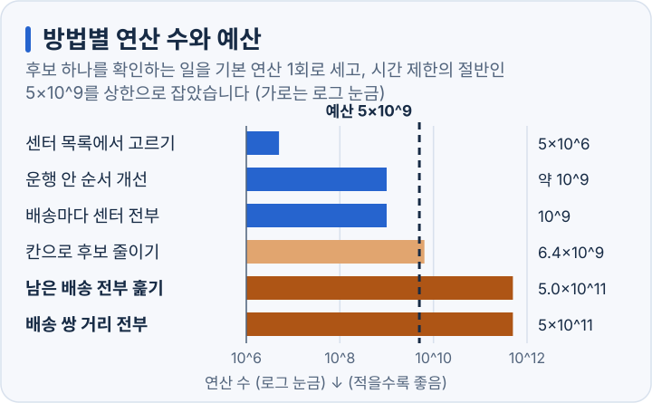

# 입력이 클 때: 문제 계약과 기준선

COUPANG1의 입력 규모와 계약, 상한에서 연산 수를 먼저 계산하는 예산표, 유효하지만 통과하지 못하는 기준선까지 다룹니다. 전체 흐름은 [강의 개요](../lesson.md)에 있습니다.

## 문제 계약을 상태로 옮기기

| 항목 | 계약 |
| --- | --- |
| 구현 | `sendCenterList`, `sendDeliveryList`로 입력을 받고, `solve(트럭 시작 좌표)` 안에서 `truckLoading(센터, 상품 배열, 개수)`와 `truckMove(배송 번호)`를 호출 |
| 상한 | 센터 N=1,000, 상품 종류 M=10,000, 배송 K=1,000,000, 좌표는 0 이상 1,000 미만. 센터 한 곳의 상품 줄은 100개 이하, 트럭 적재 50개. 입력은 한 개이고 시간 제한 10초 |
| 점수 | 총 이동 비용. 낮을수록 좋고 15,000,000,000 이하가 통과. 비용 = 맨해튼 거리 × (100 + 싣고 있는 개수 × 10)이고 `truckLoading`과 `truckMove` 모두 이동한다 |
| API·무효 | `truckLoading`은 먼저 이동한 뒤 싣고, 적재 한도를 넘거나 재고 없는 상품이 있으면 0을 돌려준다(이동 비용은 이미 냈다). `truckMove`는 싣지 않은 상품이거나 이미 처리한 배송이면 0이지만 비용은 낸다. 처리하지 못한 배송이 남으면 10^12 |

`sendCenterList`에서 이 채점기의 입력을 직접 센 값입니다. 센터의 상품 줄은 1~100개로 합이 50,690줄(평균 50.7줄)이고, 145개 센터는 같은 상품이 두 줄 이상 나옵니다. 그래서 **재고는 `(센터, 상품)`별로 합쳐** 둡니다. 재고 합 2,553,252는 배송 수의 2.55배지만, 상품별로 (재고 합 − 배송 수)의 최솟값은 0이라서 어떤 상품은 재고를 하나도 남기지 않고 써야 합니다. 한 센터가 가진 상품은 10,000종의 약 0.5%이므로, 센터에서 싣고 나갈 수 있는 배송은 지도 위 배송 200개 중 하나꼴입니다. 이것이 후보 탐색을 어렵게 하는 숫자입니다.

탐색 상태는 **아직 가지 않은 배송의 집합**, 센터별 남은 재고 `stock[c][p]`, 트럭 위치입니다. 상품별 남은 배송 수 `demand[p]`와 센터가 지금 더 실을 수 있는 배송 수의 상한 `mass[c] = Σ min(stock[c][p], demand[p])`는 여기서 다시 계산할 수 있는 보조 값입니다. `mass[c] = 0`이면 그 센터는 더 쓸 곳이 없습니다. 센터가 재고를 가진 상품의 배송만 고르고 고르는 즉시 재고를 줄이면, 모든 상품에서 "재고 합 ≥ 남은 배송 수"가 끝까지 유지되어 배송이 남았는데 쓸 센터가 없는 일은 생기지 않습니다.

## 연산 수 예산표

후보 하나를 확인하는 일(좌표 차이와 재고 한 칸 읽기)을 기본 연산 1회로 셉니다. 이 환경에서 단순 반복의 한 번은 0.45ns 안팎이었지만(검사 스크립트가 전수 탐색 3억 번을 재서 구한 값), 채점 환경은 다를 수 있어 시간 제한의 절반인 5초에 해당하는 5×10^9 안팎을 상한으로 잡습니다.

| 방법 | 연산 수 | 판단 |
| --- | ---: | --- |
| 배송 순서대로, 그 상품을 가진 센터 목록(평균 5곳)에서 고르기 | 5×10^6 | 충분 |
| 배송마다 센터 1,000곳을 모두 확인 | 10^9 | 가능하지만 목록을 만들면 200배 줄어든다 |
| 고를 때마다 남은 배송 전부를 훑어 가장 가까운 것 찾기 | 5.0×10^11 | 불가능: 검사 하나를 0.45ns로 잰 값으로 약 223초 |
| 배송 쌍의 거리를 모두 계산·저장 | 5×10^11 | 불가능(저장 공간도 없다) |
| 칸으로 가까운 후보만 훑기, 고를 때마다 평균 약 6,379개 | 6.4×10^9 | 가능하나 시간 제한의 절반 가까이 쓴다(측정) |
| 운행 한 번(20곳) 안의 순서 개선, 운행 5만 번 | 약 10^8~10^9 | 여유 |



[그림 크게 보기](https://git.readiz.com/h-contest-lesson/lessons/large-input-search/lesson-assets/ops-budget.svg)

`truckLoading`과 `truckMove`의 호출 비용도 봅니다. 채점기가 호출마다 싣고 있는 상품 목록을 훑으므로 `truckMove`는 1회에 최대 50번, `truckLoading`은 1회에 개수 × 100번 정도라서, 한 번에 20개씩 싣는 운행 약 5만 번이면 합쳐 최대 약 1.5×10^8입니다. 호출 수 자체는 배송 수 100만이 하한입니다.

## 0단계: 유효한 기준선

배송 번호 순서대로 그 상품을 가진 센터 중 트럭에서 가장 가까운 곳에 가서 **하나만** 싣고 바로 배송합니다. 이 블록은 다음 쪽([풀이: 후보를 줄이는 구조](solution.md))에서 설명하는 `ship` 상태(상품별 센터 목록 `listCenter`, 재고 `stock`, 후보 위치 `where`)를 씁니다. 지금은 `ship::take(id, c)`가 "센터 `c`가 배송 `id`를 맡았다"를 기록하는 함수라고만 알면 됩니다.

> **코드 환경: h-contest 제출용.** 이 강의의 모든 블록은 헤더·STL 없이 아래 순서로 붙여 제출합니다. 기준선은 `coupang-contract`, `coupang-state`, `coupang-send`, `coupang-baseline`이고, 최종 풀이는 같은 앞의 세 블록 뒤에 `coupang-search`, `coupang-trip`, `coupang-entry`를 붙입니다(`solve`는 두 풀이 중 하나에만 있습니다).

```cpp snippet=coupang-baseline
void solve(Coordinates truckCoordinates) {
    ship::prepare();
    int ty = truckCoordinates.y, tx = truckCoordinates.x;
    for (int id = 0; id < ship::deliveryCount; ++id) {
        const ship::Item it = ship::slot[ship::where[id]];  // take()가 칸 안의 자리를 바꾸므로 먼저 복사한다.
        int c = -1, bestDist = 1 << 30;
        for (int t = ship::listStart[it.prod]; t < ship::listStart[it.prod + 1]; ++t) {  // 이 상품을 가진 센터 중 트럭에서 가장 가까운 곳
            const int e = ship::listCenter[t];
            const int d = ship::absInt(ship::cy[e] - ty) + ship::absInt(ship::cx[e] - tx);
            if (ship::stock[e][it.prod] > 0 && d < bestDist) { bestDist = d; c = e; }
        }
        ship::take(id, c);
        int product = it.prod;
        truckLoading(c, &product, 1);
        truckMove(id);
        ty = it.y; tx = it.x;
    }
}
```

점수는 107,926,719,860으로 통과 기준의 7.2배이고 0.1초에 끝납니다. 검사 하나가 가벼워서 시간은 문제가 아니고, 한 번에 하나만 싣는 구조가 점수를 막습니다. 점수를 배송 수와 비용 배율(약 105)로 나누면 배송 하나에 평균 약 1,028의 거리를 달리는 셈입니다.
