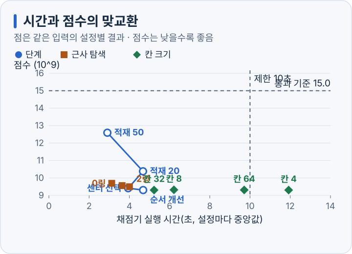

# 입력이 클 때: 실측과 실패 사례

공개 채점기로 단계별과 설정별 점수와 시간을 재고, 칸 크기와 시간·점수 교환을 비교하며, 종료 조건과 재고 갱신을 틀린 실패를 재현합니다. 구현은 [풀이](solution.md)에 있습니다.

## 측정: 단계별, 설정별

아래는 2026-11-18에 공개 채점기의 입력 1개를 그대로 실행한 결과입니다. 환경은 Darwin 26.3 arm64 / Apple clang version 17.0.0 (clang-1700.6.3.2) / -std=c++17 -O2이고 채점기 `main.cpp`의 SHA-256 앞 12자는 `bef002618ed1`입니다. **점수는 난수와 시간을 쓰지 않아 실행마다 같은 값**이고, 시간은 채점기의 입력 생성을 포함한 한 번의 실행 전체를 설정을 한 바퀴씩 돌려 가며 설정마다 5번 잰 중앙값입니다. 측정 시작 때 시스템 부하 평균은 2.8이었고, 다른 작업이 동시에 돌 수 있는 개인 맥이라 본문 제출 코드를 5번 돌린 시간도 4.7~5.1초로 흔들렸습니다. 채점기의 입력은 하나뿐이므로 모든 비교는 같은 입력에서 한 것이고, 다른 입력에서의 일반화는 확인하지 못했습니다. [실험과 튜닝](https://h.readiz.com/learn/experiments-and-tuning)의 원칙대로 한 번의 시간으로 순위를 매기지 않고, 점수 차이가 시간 잡음보다 큰 경우만 결론으로 삼습니다.

<!-- check:stages -->
| 단계 | 점수 ↓ | 통과 기준 대비 | 운행 수 | 시간(초) |
| --- | ---: | ---: | ---: | ---: |
| 번호 순서, 상품을 가진 가까운 센터에서 1개씩 | 107,926,719,860 | 7.20배 | 1,000,000 | 0.1 |
| 가까운 센터에서 50개씩 | 12,592,618,150 | 0.84배 | 20,519 | 2.9 |
| + 적재 20개 | 10,381,303,890 | 0.69배 | 50,487 | 4.7 |
| + 센터 선택에 후보 밀도 반영 | 9,412,006,660 | 0.63배 | 50,436 | 3.9 |
| + 운행 안 순서 개선(최대 3회) | 9,306,067,620 | 0.62배 | 50,442 | 4.7 |

- 기준선은 통과 기준의 7.2배입니다. 센터에서 여러 개를 싣는 운행 구조만으로 107,926,719,860이 12,592,618,150으로 88% 줄어 통과합니다.
- 적재를 20으로 줄이면 -17.6%, 센터 선택에 밀도를 반영하면 -9.3%, 운행 안 순서 개선(최대 3회)은 -1.1%입니다. 큰 이득은 구조(운행·적재)에서 오고, 제일 늦게 붙인 지역 개선은 1%대입니다.
- 비용이 쌓이는 곳: 10% 구간마다 누적한 비용을 보면 마지막 10%의 배송이 전체의 25%를 씁니다. 남은 배송이 드물어져 배송 간격이 넓어지기 때문이며, 이 구간이 아직 줄이지 못한 부분입니다. (독립 계산한 비용이 채점기 점수와 일치하는지 측정 때마다 확인했습니다.)
- 본문 제출 코드는 9,306,067,620로 같고 4.7초입니다. 통과 기준 15,000,000,000의 62%이고 시간 제한 10초의 절반 안쪽입니다. 채점 서버가 이 환경의 두 배 느리면 한도에 가까워지므로 제출 전에 `extra`로 줄일 수 있는지 확인합니다.

탐색을 정확하게 하는 데 시간을 쓸지 알아봅니다. 첫 후보가 나온 링에서 `extra`개 링만 더 보고 멈추는 근사는 후보 검사를 줄이지만 점수가 나빠집니다.

<!-- check:extras -->
| 첫 후보 뒤에 더 보는 링 | 후보 검사 수 | 점수 | 점수 변화 | 시간(초) |
| --- | ---: | ---: | ---: | ---: |
| 0링 | 3,322,726,731 | 9,690,535,030 | +4.1% | 3.1 |
| 1링 | 4,478,420,341 | 9,559,267,000 | +2.7% | 3.6 |
| 2링 | 4,832,395,969 | 9,496,733,150 | +2.0% | 4.0 |
| 정확한 종료 조건 | 6,378,723,157 | 9,306,067,620 | - | 4.7 |

설정은 한 번의 좋은 결과로 정하지 않았습니다. 점수가 결정적이므로 같은 입력에서 한 번 실행한 값이 곧 그 설정의 점수이고, 아래는 **한 번에 한 값씩만 바꾼** 비교입니다(나머지는 적재 20, 가중치 25, 개선 3회, 정확한 탐색).

<!-- check:params -->
| 바꾼 값 | 점수 ↓ | 시간(초) |
| --- | ---: | ---: |
| 적재 10개 | 10,598,486,430 | 7.6 |
| 적재 20개 | 9,306,067,620 | 4.7 |
| 적재 30개 | 9,504,889,620 | 4.7 |
| 적재 50개 | 10,762,331,820 | 7.4 |
| 밀도 항 가중치 0 | 10,242,347,070 | 5.5 |
| 밀도 항 가중치 10 | 9,285,607,570 | 4.7 |
| 밀도 항 가중치 25 | 9,306,067,620 | 4.7 |
| 밀도 항 가중치 100 | 9,377,977,200 | 4.7 |
| 순서 개선 반복 0회 | 9,412,006,660 | 3.9 |
| 순서 개선 반복 1회 | 9,317,765,440 | 4.5 |
| 순서 개선 반복 3회 | 9,306,067,620 | 4.7 |
| 순서 개선 반복 10회 | 9,313,973,200 | 4.8 |

- 근사 탐색은 정확한 탐색보다 점수가 +2.0%(2링)~+4.1%(0링) 나쁘고, 시간은 0.7~1.6초 덜 걸립니다. 시간 한도에 닿지 않으면 정확한 탐색을 쓰고, 근사는 한도에 닿을 때 줄이는 손잡이로 남깁니다.
- 순서 개선은 1회에 -1.0%, 3회에 -1.1%이고 10회는 -1.0%입니다. 3회와 10회의 차이는 0.1% 안쪽이라 3회를 넘는 반복에서는 이득이 보이지 않지만, 이유까지는 이번 실험으로 가리지 못했습니다. 이웃 후보 수가 구간 수의 제곱이라 적재 50개에서는 같은 개선이 시간을 7.4초로 늘립니다. 적재 10개가 7.6초인 것은 운행이 두 배로 늘어 후보 검사가 12.3×10^9로 두 배가 되기 때문입니다.
- 가중치는 0(밀도를 보지 않음)이 가장 나쁘고(+10.1%), 10~100은 +1.0% 안쪽 차이입니다. 10이 25보다 0.2% 좋지만 같은 입력으로 고른 값이라 처음 정한 25를 유지합니다.
- 시간으로 점수를 살 수 있는 설정은 이번 실측에서 없었습니다. 정확한 탐색 + 순서 개선 3회가 이 환경에서 가장 좋은 점수를 4.7초에 내고, 남는 시간은 채점 서버의 편차를 흡수하는 여유로 둡니다.

[그림 크게 보기](https://git.readiz.com/h-contest-lesson/lessons/large-input-search/lesson-assets/budget-tradeoff.svg)

## 실패 사례 두 가지

아래는 일부러 틀린 **설계 조각**이며 제출 코드가 아닙니다.

**1. 종료 조건을 한 겹 일찍 끊은 링 확장.** `nearest`의 `if (bestDist <= (r - 1) * CELL) break;`를 `if (bestDist <= r * CELL) break;`로 바꿉니다. 컴파일되고 모든 배송을 처리하는 유효한 답을 내며, 손계산의 첫 고르기처럼 가끔 더 먼 후보를 고릅니다. 채점기 점수는 9,332,408,500으로 정확한 탐색(9,306,067,620)보다 +0.3%만 나빠 통과 여부나 점수 비교로는 거의 드러나지 않습니다. 이런 오류는 작은 입력에서 전수 탐색과 거리를 대조해야 잡힙니다.

**2. 고른 배송을 칸에서 지우지 않은 `take`.** `last = cellStart[g] + --cellLive[g]`를 `cellStart[g] + cellLive[g] - 1`로 바꿔 개수를 줄이지 않습니다. 이미 처리한 배송이 칸에 살아 남아 다음 질의에 다시 뽑히고, 그 대신 처리되지 않은 배송이 남아 채점기는 10^12(패널티)를 줍니다.

두 변형은 같은 검사가 잡습니다. 무작위 작은 입력(센터 1~6, 상품 2~13종, 배송 150개 이하, 좌표 범위 4~1,000)에서 `nearest`가 돌려준 후보의 거리가 **독립적으로 센 전수 탐색의 최솟값**과 같은지, `take` 뒤마다 `stock`·`mass`·`demand`·칸 목록이 처음부터 다시 센 값과 같은지 확인합니다. 칸 크기를 1·5·16·64·1000으로 바꿔도 같습니다. `python3 scripts/check_large_input_search.py`는 본문 코드를 추출해 이 검사와 손계산 표, 운행 비용(독립 계산)과 개선의 비증가, 센터·배송·상품이 몇 개든 모든 배송을 처리하는지(채점기 규칙을 독립 구현한 작은 채점기)를 ASan/UBSan으로 실행하고, 위 두 변형이 검출되는지와 저장한 측정을 본문 표와 대조합니다. `--judge /path/to/COUPANG1/main.cpp --output FILE`을 붙이면 위 측정을 다시 만듭니다(약 20분이 걸립니다). 본문 제출 코드를 ASan/UBSan으로 채점기 입력에 실행하면 같은 점수가 나오고 27초가 걸립니다.
