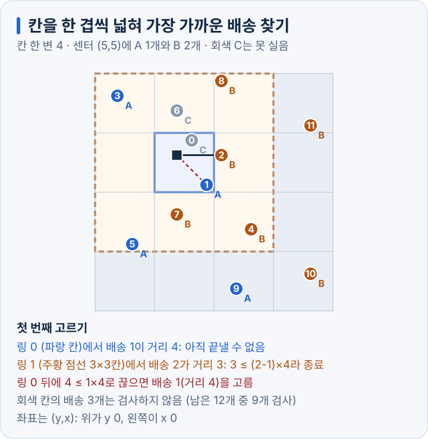

# 입력이 클 때: 풀이

후보를 줄이는 좌표 칸 구조, 칸 탐색이 전수 탐색과 같은 답을 내는 손계산, 운행 단위로 싣고 센터를 고르고 순서를 개선하는 풀이를 구현합니다. 앞 단계는 [문제 계약과 연산 수 예산](contract-and-baseline.md)입니다.

## 후보를 줄이는 구조: 좌표 칸

운행의 핵심 질의는 하나입니다. "점 `(y, x)`에서 가장 가까운, **센터 `c`가 지금 실을 수 있는** 남은 배송은?" 이 질의에 답하는 함수가 `nearest`이고, 고른 배송은 지웁니다(`take`).

- **칸**: 좌표를 `CELL × CELL` 칸으로 나누고 칸 안의 배송을 이어서 저장합니다. `CELL = 16`이면 63×63 = 3,969칸이고 칸마다 평균 약 252개입니다.
- **링 확장**: 질의가 속한 칸(링 0)에서 시작해 한 겹씩(링 r은 칸 거리가 r인 칸들) 넓힙니다. 링 r을 보기 전에 남은 후보는 모두 `(r-1)*CELL + 1` 이상 떨어져 있으므로 지금까지의 최선이 `(r-1)*CELL` 이하이면 멈춥니다.
- **삭제**: 칸 안의 살아 있는 후보를 앞쪽에 두고(`cellLive`), 지울 때 마지막 살아 있는 후보와 자리를 바꾼 뒤 개수만 줄입니다. 모든 후보가 연속 메모리에 있어 훑기에 유리하고 삭제가 `O(1)`입니다. 대신 후보가 칸 안에서 자리를 옮기므로 번호로 찾는 `where[]`를 함께 고칩니다.

:::hint 삭제 방식 비교와 메모리 계산
지연 삭제(표시만 하고 남김)는 후반으로 갈수록 죽은 후보를 매번 건너뛰어야 하고, 연결 목록은 후보마다 포인터를 따라가야 합니다. 이 두 대안과의 속도 차이는 이 강의에서 측정하지 않았습니다.

메모리는(큰 배열의 크기는 검사 스크립트가 `sizeof`로 확인합니다) `stock`이 1,000×10,000×2바이트 = 20,000,000, 후보 `slot`이 12바이트 × 1,000,000 = 12,000,000, `where`가 4,000,000이고 나머지(칸 배열, 센터 목록, `demand`, `mass`)는 합쳐 1MB 안쪽이라 전체가 약 37MB입니다. `stock`을 `int`로 두면 그것만 40MB가 되는데, 합친 재고도 `unsigned short`에 들어갑니다(한 줄 최대 100, 같은 상품이 최대 100줄).
:::

아래 세 블록은 두 풀이가 함께 쓰는 선언과 상태, 입력 처리입니다. `coupang-contract`는 문제가 주는 `user.cpp` 틀의 구조체·함수 선언과 같습니다. `prepare()`는 두 목록을 받은 뒤 `solve`에서 한 번 부릅니다. `loadCenters`·`loadDeliveries`가 쓸 구간을 직접 비우는 것은 검사가 작은 입력을 한 프로세스에서 여러 번 돌리기 때문입니다.

```cpp snippet=coupang-contract
#define ABS(x) ((x) > 0 ? (x) : -(x))

struct Coordinates {
    int y, x;
    Coordinates() { y = x = 0; }
    Coordinates(int _y, int _x) { y = _y; x = _x; }
    int operator-(Coordinates& param) { return ABS(y - param.y) + ABS(x - param.x); }
};

struct Product {
    int id, count;
    Product() { id = count = 0; }
    Product(int _id, int _count) { id = _id; count = _count; }
};

extern int truckMove(int);
extern int truckLoading(int, int[], int);
```

```cpp snippet=coupang-state
namespace ship {
const int N = 1000, M = 10000, K = 1000000;  // 센터, 상품 종류, 배송 요청의 상한
const int CAP = 50;                          // 트럭 적재 상한
const int SIDE = 1000, CELL = 16;            // 좌표 범위, 칸의 한 변
const int G = (SIDE + CELL - 1) / CELL;      // 한 변의 칸 수

struct Item {                // 칸 안에 붙어 있는 후보 하나: 12바이트
    short y, x, prod;
    int id;
};

static int cy[N], cx[N];                          // 센터 좌표
static unsigned short stock[N][M];                // stock[c][p]: 센터 c에 남은 상품 p. 같은 상품이 두 줄이면 합친다.
static int listStart[M + 1], listCenter[N * 100]; // 상품 p를 가진 센터 번호 목록(CSR)
static int demand[M];                             // 상품 p의 남은 배송 수
static int mass[N];                               // sum of min(stock[c][p], demand[p]): 센터 c가 지금 더 실을 수 있는 배송 수의 상한
static Item slot[K];                              // 칸별로 이어 붙인 후보. 칸 안에서는 앞쪽 cellLive개만 남아 있다.
static int where[K];                              // where[id]: slot에서 배송 id의 위치
static int cellStart[G * G + 1], cellLive[G * G]; // 칸의 시작 위치, 남은 후보 수
static int centerCount, typeCount, deliveryCount;

inline int absInt(int v) { return v < 0 ? -v : v; }
inline int minInt(int a, int b) { return a < b ? a : b; }
inline int cellOf(int y, int x) { return (y / CELL) * G + x / CELL; }

void loadCenters(int n, int m, const Coordinates pos[], Product list[][100], const int size[]) {
    centerCount = n; typeCount = m;
    for (int c = 0; c < n; ++c) {
        cy[c] = pos[c].y; cx[c] = pos[c].x;
        for (int p = 0; p < m; ++p) stock[c][p] = 0;
        for (int j = 0; j < size[c]; ++j) stock[c][list[c][j].id] += list[c][j].count;
    }
}

// 칸마다 개수를 세어 시작 위치를 정하고(counting sort) 후보를 칸별로 이어 붙인다.
void loadDeliveries(int cnt, const Coordinates pos[], const int prod[]) {
    deliveryCount = cnt;
    for (int g = 0; g <= G * G; ++g) cellStart[g] = 0;
    for (int g = 0; g < G * G; ++g) cellLive[g] = 0;
    for (int i = 0; i < cnt; ++i) ++cellStart[cellOf(pos[i].y, pos[i].x) + 1];
    for (int g = 0; g < G * G; ++g) cellStart[g + 1] += cellStart[g];
    for (int i = 0; i < cnt; ++i) {
        int g = cellOf(pos[i].y, pos[i].x), w = cellStart[g] + cellLive[g]++;
        slot[w].y = (short)pos[i].y; slot[w].x = (short)pos[i].x; slot[w].prod = (short)prod[i]; slot[w].id = i;
        where[i] = w;
    }
}

// 두 목록을 모두 받은 뒤 한 번 부른다: 상품별 센터 목록, 남은 배송 수, 센터별 mass.
void prepare() {
    for (int p = 0; p <= typeCount; ++p) listStart[p] = 0;
    for (int p = 0; p < typeCount; ++p) demand[p] = 0;
    for (int c = 0; c < centerCount; ++c) mass[c] = 0;
    for (int c = 0; c < centerCount; ++c) for (int p = 0; p < typeCount; ++p) if (stock[c][p]) ++listStart[p + 1];
    for (int p = 0; p < typeCount; ++p) listStart[p + 1] += listStart[p];
    static int filled[M];
    for (int p = 0; p < typeCount; ++p) filled[p] = 0;
    for (int c = 0; c < centerCount; ++c) for (int p = 0; p < typeCount; ++p) if (stock[c][p]) listCenter[listStart[p] + filled[p]++] = c;
    for (int i = 0; i < deliveryCount; ++i) ++demand[slot[where[i]].prod];
    for (int p = 0; p < typeCount; ++p)
        for (int t = listStart[p]; t < listStart[p + 1]; ++t) mass[listCenter[t]] += minInt(stock[listCenter[t]][p], demand[p]);
}

// 센터 c가 배송 id를 맡는다. 칸에서 지우고(마지막 살아 있는 후보와 자리를 바꾼다) 재고, 남은 배송 수, mass를 고친다.
// 전제: 배송 id가 남아 있고 stock[c][상품] > 0
void take(int id, int c) {
    const int w = where[id], g = cellOf(slot[w].y, slot[w].x), last = cellStart[g] + --cellLive[g], p = slot[w].prod;
    Item moved = slot[last]; slot[last] = slot[w]; slot[w] = moved;
    where[slot[w].id] = w; where[slot[last].id] = last;
    for (int t = listStart[p]; t < listStart[p + 1]; ++t) {
        const int e = listCenter[t], s = stock[e][p];
        mass[e] += minInt(s - (e == c), demand[p] - 1) - minInt(s, demand[p]);
    }
    --stock[c][p]; --demand[p];
}
}
```

```cpp snippet=coupang-send
void sendCenterList(int N, int M, Coordinates centerCoordinatesList[], Product centerProductList[][100], int centerProductSize[]) {
    ship::loadCenters(N, M, centerCoordinatesList, centerProductList, centerProductSize);
}

void sendDeliveryList(int K, Coordinates deliveryCoordinatesList[], int deliveryProductList[]) {
    ship::loadDeliveries(K, deliveryCoordinatesList, deliveryProductList);
}
```

아래 `nearest`는 위 링 확장을 그대로 옮긴 것입니다. `extra`는 근사 탐색의 설정이고 정확한 탐색은 -1입니다.

```cpp snippet=coupang-search
namespace ship {
// (y, x)에서 가장 가까운, 센터 c가 지금 실을 수 있는 배송의 번호. 없으면 -1.
// 칸을 가운데부터 한 겹(링)씩 넓혀 본다. 링 r을 보기 전에 남은 후보는 모두 (r-1)*CELL+1 이상 떨어져 있으므로
// 지금까지의 최선이 (r-1)*CELL 이하이면 더 볼 필요가 없다. extra >= 0이면 첫 후보가 나온 링에서 extra겹만 더 보고 멈춘다(근사).
int nearest(int y, int x, int c, int extra) {
    const int gy0 = y / CELL, gx0 = x / CELL;
    int best = -1, bestDist = 1 << 30, lastRing = G;
    for (int r = 0; r <= lastRing && r < G; ++r) {
        if (bestDist <= (r - 1) * CELL) break;
        for (int gy = gy0 - r; gy <= gy0 + r; ++gy) {
            if (gy < 0 || gy >= G) continue;
            const int step = (gy == gy0 - r || gy == gy0 + r || r == 0) ? 1 : 2 * r;  // 가운데 행은 양 끝 칸만
            for (int gx = gx0 - r; gx <= gx0 + r; gx += step) {
                if (gx < 0 || gx >= G) continue;
                const int g = gy * G + gx;
                const Item* it = slot + cellStart[g];
                for (int j = 0, n = cellLive[g]; j < n; ++j) {
                    if (stock[c][it[j].prod] == 0) continue;
                    const int d = absInt(it[j].y - y) + absInt(it[j].x - x);
                    if (d < bestDist) { bestDist = d; best = it[j].id; }
                }
            }
        }
        if (best >= 0 && extra >= 0 && lastRing == G) lastRing = r + extra;
    }
    return best;
}
}
```

`nearest`의 안쪽 반복은 먼저 재고(`stock[c][prod]`)를 보고 실을 수 있는 후보만 거리를 계산합니다. 실을 수 있는 후보가 0.5%뿐이라 대부분은 읽기 한 번으로 끝나고, 센터 `c`의 재고 한 줄(20KB)은 운행 동안 캐시에 남습니다.

칸 크기는 한 번에 검사하는 후보 수와 링을 도는 횟수의 균형입니다. 아래는 같은 정확한 탐색에서 칸만 바꾼 실측입니다. 점수가 조금씩 다른 것은 같은 거리의 후보 중 무엇을 먼저 만나느냐(동점 처리 순서) 때문입니다. 후보 검사 수는 칸이 작을수록 줄지만 칸과 링을 도는 비용이 늘어 시간은 16 부근에서 가장 짧았습니다.

<!-- check:cells -->
| 칸 한 변 | 칸 수 | 후보 검사 수 | 점수 | 시간(초) |
| ---: | ---: | ---: | ---: | ---: |
| 4 | 62,500 | 4,955,046,288 | 9,305,312,620 | 11.9 |
| 8 | 15,625 | 5,372,558,366 | 9,318,426,750 | 6.2 |
| 16 | 3,969 | 6,378,723,157 | 9,306,067,620 | 4.7 |
| 32 | 1,024 | 9,618,129,454 | 9,305,700,550 | 5.2 |
| 64 | 256 | 21,897,349,179 | 9,309,675,620 | 9.7 |

## 손계산: 칸 탐색은 전수 탐색과 같은 답을 낸다

16×16 지도를 4×4 칸으로 나눕니다. 센터는 (5,5)에 있고 A를 1개, B를 2개 가집니다. 배송은 0 (4,6) C, 1 (7,7) A, 2 (5,8) B, 3 (1,1) A, 4 (10,10) B, 5 (11,2) A, 6 (2,5) C, 7 (9,5) B, 8 (0,8) B, 9 (14,9) A, 10 (13,14) B, 11 (3,14) B입니다. 센터에서 세 번 가장 가까운 배송을 고릅니다(첫 번째는 센터 위치에서, 이후는 방금 고른 배송에서). 센터가 가진 것은 A 1개와 B 2개뿐이라 C는 늘 건너뛰고, A를 한 번 고르면 A 후보는 모두 못 쓰게 됩니다. 표의 "본 링"은 본 링의 개수라서 2는 링 0과 링 1을 보았다는 뜻이고, 마지막 열은 검사 스크립트가 독립 구현으로 다시 구해 대조하는 전수 탐색의 최솟값입니다.

<!-- check:hand -->
| 고르기 | 출발점 | 본 링 | 검사한 후보 / 남은 배송 | 고른 배송 | 거리 | 전수 탐색의 최솟값 |
| --- | --- | ---: | ---: | --- | ---: | ---: |
| 1번째 | (5,5) | 2 | 9 / 12 | 배송 2 (5,8) B | 3 | 3 |
| 2번째 | (5,8) | 2 | 7 / 11 | 배송 1 (7,7) A | 3 | 3 |
| 3번째 | (7,7) | 2 | 7 / 10 | 배송 7 (9,5) B | 4 | 4 |



[그림 크게 보기](https://git.readiz.com/h-contest-lesson/lessons/large-input-search/lesson-assets/bucket-walk.svg)

첫 번째 고르기에서 링 0만 보고 멈추면 배송 1(거리 4)을 고르지만 진짜 최솟값은 배송 2(거리 3)입니다. 종료 조건을 `bestDist <= r * CELL`로 쓰면 링 1을 보기 전에 4 ≤ 4로 멈추는 이 오답이 나옵니다(둘째·셋째 고르기에서는 같은 답이 나와 이 오답이 드러나지 않습니다). 세 배송으로 센터의 재고 A 1개와 B 2개가 모두 쓰여 `mass`가 3에서 0이 되고, 이 센터는 아래 `chooseCenter`(센터를 고르는 함수)의 후보에서 빠집니다.

[칸 탐색 데모: 링을 넓히며 종료 조건 판정하기](https://git.readiz.com/h-contest-lesson/demos/index.html?demo=bucket-search)

링 0에서 링 1로 넓히며 후보를 검사하고 종료 조건을 판정하는 과정을 세 번 고르기까지 봅니다. 종료 조건을 한 겹 일찍 끊는 쪽으로 바꾸면 첫 고르기에서 거리 4의 틀린 배송을 고르는 것을 확인해 보세요.

## 운행 단위로 풀기

한 번의 **운행**은 센터 한 곳에 가서 최대 `load`개를 싣고, 그 센터에서 시작해 가장 가까운 후보를 이어 붙이며(`build`) 배달합니다. 운행의 비용은 **구간마다 (거리) × (100 + 10 × 그 구간을 달릴 때 싣고 있는 개수)**라서, 짐이 많은 처음 구간을 짧게 만드는 것이 중요합니다.

- 적재 `load`: 많이 실으면 운행 수가 줄지만 단가가 올라가고 배송 간격이 넓어집니다. 실측으로 20 부근이 가장 좋았습니다([설정별 비교 표](experiments-and-failures.md)).
- 센터 선택 `chooseCenter`: 트럭에서 센터까지의 거리에 **그 센터의 후보 밀도로 어림한 배송 간격**을 더합니다. 센터가 지금 실을 수 있는 배송이 지도(넓이 10^6)에 `mass[c]`개 있으면 간격은 `√(10^6 / mass[c])` 정도이므로, 비용 `거리 + β·√(10^6 / mass[c])`가 가장 작은 센터를 씁니다. 가중치 β는 코드에서 `beta`이고 실측 표에서는 "밀도 항 가중치"입니다. 헤더 없이 `sqrt`를 쓸 수 없어 `16·√(10^6 / e)`를 정수로 한 번 표로 만들어 둡니다.
- 순서 개선 `improve`: 운행 하나는 20곳이라 구간 뒤집기(2-opt)와 한 곳 옮기기(or-opt)를 줄어들 때만 적용합니다. 순서를 바꾸면 구간마다 싣고 있는 개수도 바뀌므로 영향을 받는 구간만 `spanCost`로 다시 더합니다.

`Trip`은 센터(`s[0]`)와 배달 순서(`s[1..n]`)이고, `build`는 고르는 즉시 `take`로 지웁니다.

```cpp snippet=coupang-trip
namespace ship {
// 센터 한 곳에서 싣고 나가는 한 번의 운행. s[0]은 센터, s[1..n]은 배달 순서다.
struct Stop { int id, prod, y, x; };
struct Trip { int n; Stop s[CAP + 1]; };

// 센터 c에서 출발해 가장 가까운 후보를 이어 붙인다. 고른 후보는 바로 take()로 지우므로 같은 후보를 두 번 고르지 않는다.
void build(Trip& t, int c, int load, int extra) {
    t.n = 0;
    t.s[0].id = -1; t.s[0].prod = -1; t.s[0].y = cy[c]; t.s[0].x = cx[c];
    while (t.n < load) {
        const Stop& from = t.s[t.n];
        const int id = nearest(from.y, from.x, c, extra);
        if (id < 0) break;
        const Item& it = slot[where[id]];
        Stop next = {id, it.prod, it.y, it.x};
        take(id, c);
        t.s[++t.n] = next;
    }
}

// i번째 구간(s[i-1] -> s[i])의 비용: 이 구간을 달릴 때 아직 싣고 있는 상품은 n-i+1개다.
inline int legCost(const Trip& t, int i) {
    return (100 + 10 * (t.n - i + 1)) * (absInt(t.s[i].y - t.s[i - 1].y) + absInt(t.s[i].x - t.s[i - 1].x));
}
inline int spanCost(const Trip& t, int lo, int hi) {  // 구간 lo..hi(끝은 n까지)
    int sum = 0;
    for (int i = lo; i <= hi && i <= t.n; ++i) sum += legCost(t, i);
    return sum;
}

// 배달 순서를 개선한다. 구간 뒤집기(2-opt)와 한 곳 옮기기(or-opt)를 줄어들 때만 적용하고 passes번까지 되풀이한다.
// 모든 이동은 영향을 받는 구간만 다시 계산한다.
void improve(Trip& t, int passes) {
    for (int pass = 0; pass < passes; ++pass) {
        bool better = false;
        for (int i = 1; i <= t.n; ++i) {
            for (int j = i + 1; j <= t.n; ++j) {
                const int before = spanCost(t, i, j + 1);
                for (int a = i, b = j; a < b; ++a, --b) { Stop tmp = t.s[a]; t.s[a] = t.s[b]; t.s[b] = tmp; }
                if (spanCost(t, i, j + 1) < before) { better = true; continue; }
                for (int a = i, b = j; a < b; ++a, --b) { Stop tmp = t.s[a]; t.s[a] = t.s[b]; t.s[b] = tmp; }
            }
        }
        for (int i = 1; i <= t.n; ++i) {
            for (int j = 1; j <= t.n; ++j) {
                if (i == j) continue;
                const int lo = i < j ? i : j, hi = (i < j ? j : i) + 1;
                const int before = spanCost(t, lo, hi);
                const Stop moved = t.s[i];
                if (i < j) for (int k = i; k < j; ++k) t.s[k] = t.s[k + 1];
                else for (int k = i; k > j; --k) t.s[k] = t.s[k - 1];
                t.s[j] = moved;
                if (spanCost(t, lo, hi) < before) { better = true; continue; }
                if (i < j) { for (int k = j; k > i; --k) t.s[k] = t.s[k - 1]; }
                else { for (int k = j; k < i; ++k) t.s[k] = t.s[k + 1]; }
                t.s[i] = moved;
            }
        }
        if (!better) break;
    }
}

// 센터를 고르는 비용 = 트럭에서 센터까지의 거리 + beta * sqrt(1e6 / mass[c]). 뒤의 항은 이 센터의 후보 밀도로 어림한 배송 간격이다.
// sqrt를 헤더 없이 쓰기 위해 16 * sqrt(1e6 / e)를 정수로 한 번 만들어 둔다.
static int spacing[20001];
int isqrt(long long v) {  // floor(sqrt(v)), v <= 2^40
    int lo = 0, hi = 1 << 20;
    while (lo < hi) {
        const int mid = (lo + hi + 1) / 2;
        if ((long long)mid * mid <= v) lo = mid; else hi = mid - 1;
    }
    return lo;
}
void makeSpacing() {
    spacing[0] = 1 << 28;
    for (int e = 1; e <= 20000; ++e) spacing[e] = isqrt(256LL * 1000000 / e);
}

int chooseCenter(int ty, int tx, int beta) {
    int best = -1;
    long long bestKey = 0;
    for (int c = 0; c < centerCount; ++c) {
        if (mass[c] <= 0) continue;
        const long long key = 16LL * (absInt(cy[c] - ty) + absInt(cx[c] - tx)) + (long long)beta * spacing[minInt(mass[c], 20000)];
        if (best < 0 || key < bestKey) { best = c; bestKey = key; }
    }
    return best;
}
}
```

아래 `coupang-entry`가 최종 풀이의 `solve`입니다. 코드의 `20`은 적재 `load`, `25`는 가중치 β, `3`은 개선 반복 횟수입니다. `chooseCenter`는 운행마다 센터 1,000곳을 모두 보지만 운행 수가 약 5만이라 5천만 번입니다.

```cpp snippet=coupang-entry
void solve(Coordinates truckCoordinates) {
    ship::prepare();
    ship::makeSpacing();
    int ty = truckCoordinates.y, tx = truckCoordinates.x;
    for (int left = ship::deliveryCount; left > 0;) {
        const int c = ship::chooseCenter(ty, tx, 25);
        if (c < 0) break;                       // 입력이 올바르면 오지 않는다.
        static ship::Trip trip;
        ship::build(trip, c, 20, -1);
        ship::improve(trip, 3);
        int prods[ship::CAP];
        for (int i = 0; i < trip.n; ++i) prods[i] = trip.s[i + 1].prod;
        truckLoading(c, prods, trip.n);
        for (int i = 1; i <= trip.n; ++i) truckMove(trip.s[i].id);
        ty = trip.s[trip.n].y; tx = trip.s[trip.n].x;
        left -= trip.n;
    }
}
```
