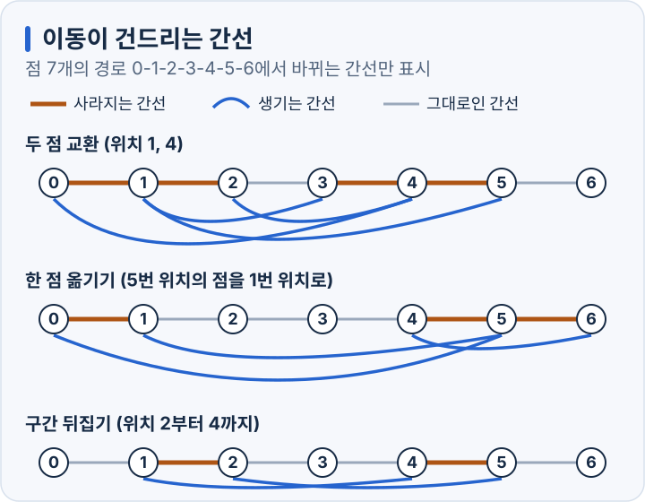
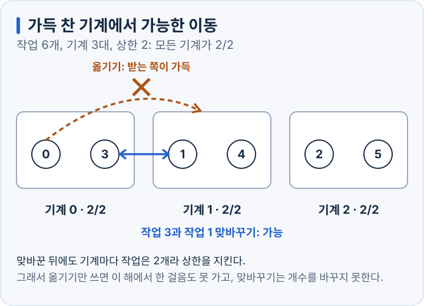
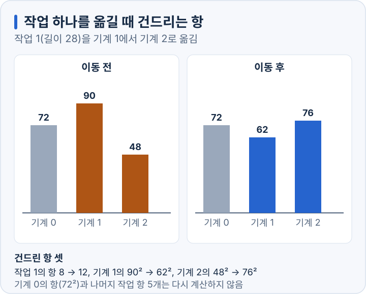
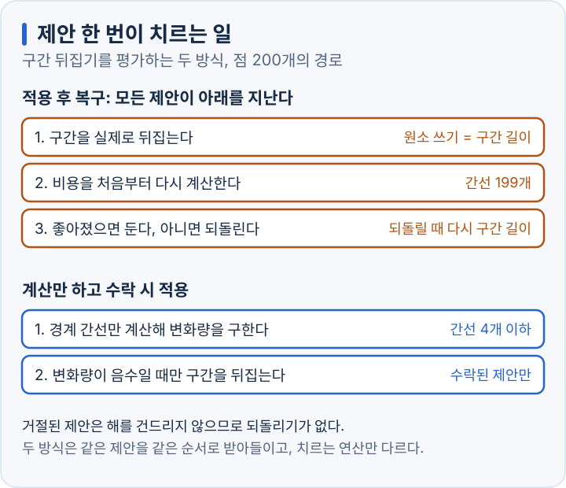

# 원리: 이동·근방·차분과 손으로 따라가는 예

완성된 해 하나를 조금 바꿔 점수가 좋아지는지 보는 탐색(지역 탐색)에는 세 가지 설계가 들어갑니다. 해를 어떻게 바꾸는지(이동), 한 해에서 바꿀 수 있는 해 전체가 어떤 모양인지(근방), 바꾼 뒤의 점수를 얼마나 싸게 알아내는지(차분 평가)입니다. 이 페이지는 세 가지를 순서 문제와 배정 문제 두 유형으로 손으로 따라갑니다. 코드는 [구현](implementation.md), 실험 결과는 [실험과 점검](practice.md)에 있습니다.

## 언제 쓰고 언제 쓰지 않는가

| 상황 | 판단 |
| --- | --- |
| 이미 유효한 해가 있고, 해의 일부만 바꿔도 다시 유효한 해가 되며, 점수가 항의 합으로 쓰인다 | 쓴다. 이동이 건드리는 항만 계산해 이동 한 번을 싸게 평가한다 |
| 점수가 해 전체를 훑어야만 나온다(이동 뒤의 상태를 시뮬레이션해야 한다) | 차분 식을 억지로 유도하지 않는다. 적용하고 평가하고 되돌리는 방식으로 가고, 적용의 비용을 줄이는 데 힘을 쓴다 |
| 해를 앞에서부터 한 번에 하나씩 정하는 문제이고 중간 상태만 의미가 있다 | 해를 조금 바꾸는 이동이 없다. [빔 서치](https://h.readiz.com/learn/beam-search)처럼 중간 상태를 다루는 방법이 맞다 |
| 이동 하나로는 유효한 해에서 유효한 해로 갈 수 없는 구조(한 번에 여러 군데를 같이 고쳐야 한다) | 이동을 키우거나 [크게 부수고 다시 짓기](https://h.readiz.com/learn/destroy-and-repair)로 간다 |
| 입력이 작아 모든 해를 세어도 시간 안에 끝난다 | 전수 탐색이 더 간단하고 최적을 보장한다 |
| 초기해가 없다 | [초기해 만들기](https://h.readiz.com/learn/construction-heuristics)가 먼저다 |
| 나쁜 이동도 받아들일지가 쟁점이다 | [언덕 오르기와 담금질](https://h.readiz.com/learn/hill-climbing-and-annealing)의 주제다. 이 강의의 실험은 "좋아지면 받는다"만 쓴다 |

선수 지식은 [문제를 상태·행동·점수로 옮기기](https://h.readiz.com/learn/problem-modeling)에서 다룬 "상태 표현과 점수 계산"입니다. 이 강의에서 후보를 가까운 것으로 줄이는 자료구조는 다루지 않으며 [후보 줄이기와 시간 예산](https://h.readiz.com/learn/candidate-and-time-budget)으로 넘깁니다.

## 연습용 문제 틀

이 강의의 모든 수치는 아래 두 가지 연습용 입력에서 나옵니다. 이 사이트의 어떤 문제의 채점 결과에도 의존하지 않습니다. 난수는 64비트 정수 `x`를 시드로 시작해 `x = x * 6364136223846793005 + 1442695040888963407`(64비트 곱셈·덧셈의 순환)로 갱신하고, 값은 `(x >> 33) % 범위`입니다. 시드는 1부터 20까지 쓰며, 같은 시드를 입력 생성과 탐색 난수에 함께 씁니다.

- **순서 문제(경로):** 점 `N = 200`개가 `0..999`의 정수 좌표에 있습니다. 점마다 `x`, `y` 순서로 뽑습니다. 모든 점을 한 번씩 지나는 순서를 정하며(시작점 자유, 돌아오지 않음) 비용은 이웃한 점 사이 맨해튼 거리의 합이고 작을수록 좋습니다. 시작 해는 번호 순서 `0, 1, …, N−1`입니다.
- **배정 문제(작업):** 작업 `N = 120`개, 기계 `M = 8`대입니다. 작업마다 길이 `d[i] = 1 + (0..99)`를 뽑고 이어서 기계별 추가 비용 `c[i][0..M−1]`(각 `0..50`)을 뽑습니다. 모든 작업을 정확히 한 기계에 맡기며 기계 한 대에는 `K = 18`개까지만 맡길 수 있습니다(넘으면 무효). 비용은 `(Σ load[j]²) / 100 + Σ c[i][as[i]]`이며 `load[j]`는 기계 `j`가 맡은 작업 길이의 합, 나눗셈은 합 전체에 한 번의 정수 나눗셈입니다. 작을수록 좋습니다. 시작 해는 `as[i] = i % M`입니다(기계마다 15개로 유효).

순차 결정 문제(격자 수집)는 쓰지 않습니다. 해를 앞에서부터 하나씩 정하는 구조에는 "완성된 해를 조금 바꾸는 이동"이 없기 때문입니다.

## 이동과 근방

**이동**은 해 하나를 다른 해 하나로 바꾸는 규칙이고, **근방**은 한 해에 이동 하나를 적용해 얻을 수 있는 해 전체입니다. 이동은 "무엇을 건드리는가"로 구분합니다.

| 유형 | 이동 | 건드리는 것 |
| --- | --- | --- |
| 순서 | 두 점 교환(위치 `a`, `b`의 점을 맞바꿈) | 두 점 둘레의 간선: 사라지는 것 최대 4개, 생기는 것 최대 4개 |
| 순서 | 한 점 옮기기(`a` 위치의 점을 빼 `b` 위치에 끼움) | 사라지는 간선 최대 3개(뺀 자리 둘, 끼운 자리 하나), 생기는 간선 최대 3개 |
| 순서 | 구간 뒤집기(`[a, b]`를 거꾸로) | 경계 간선: 사라지는 것 최대 2개, 생기는 것 최대 2개. 안쪽 간선은 거리가 대칭이라 그대로 |
| 배정 | 한 작업 옮기기(작업 `i`를 기계 `y`로) | 작업 항 하나, 기계 항 둘 |
| 배정 | 두 작업 맞바꾸기(서로 다른 기계의 작업 `i`, `j`) | 작업 항 둘, 기계 항 둘 |

[그림 크게 보기](https://git.readiz.com/h-contest-lesson/lessons/neighborhood-and-delta/lesson-assets/moves-touch.svg)

구간 뒤집기는 이동이 크게 보여도 건드리는 항이 둘뿐입니다. 이동의 "크기"(바뀌는 원소 수)와 평가의 "크기"(건드리는 항 수)가 다르다는 점이 이 강의 전체의 출발점입니다.

[열린 경로 2-opt: 구간과 경계 비용 비교하기](https://git.readiz.com/h-contest-lesson/demos/index.html?demo=two-opt)

구간을 바꿔 가며 뒤집기 전후의 경계 간선만 비교해 보세요. 이 데모는 순서 틀과 점수 규칙이 같고 시작점이 고정된 경로를 쓰므로 위 손계산의 수치와는 다릅니다.

## 근방의 크기와 연결성

근방의 크기는 한 해에서 만들 수 있는 이동의 수입니다. `N = 200`인 순서 틀에서 직접 세면(코드로 모든 이동을 만들어 결과가 다른 순서를 센 값) 아래와 같습니다.

| 이동 | 이동의 수 | 결과가 서로 다른 해의 수 |
| --- | ---: | ---: |
| 두 점 교환 | 19,900 | 19,900 |
| 한 점 옮기기 | 39,800 | 39,601 |
| 구간 뒤집기 | 19,900 | 19,900 |

옮기기는 "`a`에서 빼 `a + 1`에 끼움"과 "`a + 1`에서 빼 `a`에 끼움"이 같은 결과를 내서 인접한 199쌍이 겹칩니다. 이웃한 두 점의 교환(199개)은 두 점 교환과 구간 뒤집기의 부분집합입니다. 배정 틀의 시작 해에서는 옮기기가 840개(작업 120 × 다른 기계 7, 모두 받는 쪽에 여유가 있음), 맞바꾸기가 6,300개(서로 다른 기계의 작업 쌍 `7140 − 8 × 105`)입니다.

근방이 크면 한 번의 이동으로 갈 수 있는 곳이 늘어 지역 최적(근방 어디로 가도 나빠지는 해)이 드물어지지만, 한 번 훑는 비용이 같이 늘어납니다. 크기보다 먼저 확인할 것은 **연결성**입니다. 이동을 반복해 유효한 해 어디에서든 다른 유효한 해 어디로든 갈 수 있으면 근방이 연결되어 있다고 합니다. 연결되어 있지 않으면 시작 해가 정하는 일부 해들 안에 갇혀서 최적해가 그 밖에 있을 때 아무리 오래 돌려도 닿지 못합니다.

작은 입력에서 모든 이동을 따라가 도달하는 해의 수와 가장 먼 해까지 걸리는 이동 수(지름)를 센 값입니다. 점 6개, 모든 순서 720개이며 시작은 번호 순서입니다.

| 이동 | 한 해에서의 이동 수 | 도달하는 순서 | 지름 |
| --- | ---: | ---: | ---: |
| 두 점 교환 | 15 | 720 | 5 |
| 한 점 옮기기 | 30 | 720 | 5 |
| 구간 뒤집기 | 15 | 720 | 5 |
| 이웃한 두 점 교환 | 5 | 720 | 15 |

네 가지 모두 연결되어 있지만 지름이 다릅니다. 이웃한 두 점의 교환은 이동 하나가 순서의 역전 쌍(앞선 점이 뒤에 오는 쌍) 수를 정확히 하나씩 바꾸므로 거꾸로 선 순서까지 가려면 `N(N−1)/2`번이 필요합니다(`N = 6`이면 15, `N = 200`이면 19,900). 나머지 세 가지는 "제자리에 와야 할 점을 한 번에 그 자리로 보내는" 이동을 `N − 1`번 하면 되므로 지름이 `N − 1` 이하입니다(교환은 그 점과 맞바꾸고, 뒤집기는 그 점이 놓일 자리부터 점이 있는 곳까지 뒤집고, 옮기기는 그 점을 끼웁니다).

배정 틀에서는 `K` 제한이 연결성에 들어옵니다. 작업 6개, 기계 3대로 시작을 `as = [0, 1, 2, 0, 1, 2]`로 두고 같은 방식으로 셉니다.

| 상한 `K` | 유효한 배정 | 옮기기만 | 맞바꾸기만 | 둘 다 |
| --- | ---: | ---: | ---: | ---: |
| 2(기계 3대가 모두 가득) | 90 | 시작 해에서 가능한 이동 0개, 도달 1 | 이동 12개, 도달 90 | 도달 90 |
| 3(여유 있음) | 510 | 이동 12개, 도달 510 | 이동 12개, 도달 90 | 도달 510 |

`K = 2`는 `N = M × K`라서 모든 기계가 가득 차 있어 옮기기를 받아 줄 기계가 없습니다. 맞바꾸기는 기계별 작업 수를 바꾸지 못하므로, `K = 3`에서도 맞바꾸기만으로는 작업 수가 `(2, 2, 2)`로 고정된 90개 배정까지만 닿습니다. 그래서 유효성을 깨지 않는 이동만 만드는 방법은 이동별로 다릅니다. 옮기기는 받는 쪽의 여유를 확인하고, 맞바꾸기는 개수가 그대로여서 항상 유효하며, 두 가지를 함께 쓰면 두 약점이 서로 메웁니다.

[그림 크게 보기](https://git.readiz.com/h-contest-lesson/lessons/neighborhood-and-delta/lesson-assets/capacity-blocked.svg)

[이웃을 하나씩 평가해 최대 부하 보기](https://git.readiz.com/h-contest-lesson/demos/index.html?demo=assignment-moves)

배정 틀의 이동(옮기기 5개와 맞바꾸기 6개)을 모두 평가하는 데모입니다. 점수가 최대 부하여서 이 강의의 비용과 다르지만, 근방의 이동을 전부 세어 하나씩 계산한다는 구조는 같습니다.

## 차분 평가를 유도하는 절차

이동 하나를 평가하려고 해 전체의 점수를 다시 계산하면 항 수만큼 걸립니다(순서 틀 199, 배정 틀 128). 이동이 건드리는 항은 대개 몇 개뿐이라, 건드린 항만 다시 계산하면 평가가 입력 크기와 무관해집니다. 이것이 **차분 평가**입니다. 문제가 바뀌어도 아래 세 단계로 유도합니다.

1. **점수식을 항으로 나눈다.** 점수가 어떤 조각의 합인지 적습니다. 순서 틀은 간선 `N − 1`개, 배정 틀은 작업 항 `N`개와 기계 항 `M`개입니다. 합 전체에 걸리는 연산(배정 틀의 `/ 100`)이 있으면 따로 표시합니다.
2. **이동이 건드리는 항을 표시한다.** 이동 전의 해에서 사라지는 항과 이동 후의 해에서 생기는 항을 모두 적습니다. 경계(경로의 끝)와 두 이동 부분이 겹치는 경우(이웃한 교환, 같은 기계)가 빠지기 쉽습니다.
3. **전후 차이만 계산한다.** 변화량은 생기는 항의 합에서 사라지는 항의 합을 뺀 값입니다. 합 전체에 걸린 비선형 연산은 합을 들고 다니다가 전후 값을 따로 계산해 뺍니다.

### 순서 틀: 점 7개

점은 `P0 (1,1)`, `P1 (8,2)`, `P2 (2,4)`, `P3 (7,5)`, `P4 (3,8)`, `P5 (9,7)`, `P6 (5,9)`이고 순서는 `0, 1, 2, 3, 4, 5, 6`입니다. 간선 비용은 8, 8, 6, 7, 7, 6이고 합계는 42입니다(예: `P0–P1`은 `|1−8| + |1−2| = 8`). 아래 각 이동에서 사라지는 간선과 생기는 간선만 적어 변화량을 구하고, 새 순서의 비용을 처음부터 더해 맞는지 확인합니다.

| 이동(위치) | 사라지는 간선 | 생기는 간선 | 변화량 | 새 순서 | 새 비용 |
| --- | --- | --- | ---: | --- | ---: |
| 두 점 교환 `1, 4` | `0–1`=8, `1–2`=8, `3–4`=7, `4–5`=7 (30) | `0–4`=9, `1–3`=4, `1–5`=6, `2–4`=5 (24) | −6 | 0 4 2 3 1 5 6 | 36 |
| 한 점 옮기기 `5 → 1` | `0–1`=8, `4–5`=7, `5–6`=6 (21) | `0–5`=14, `1–5`=6, `4–6`=3 (23) | +2 | 0 5 1 2 3 4 6 | 44 |
| 구간 뒤집기 `[2, 4]` | `1–2`=8, `4–5`=7 (15) | `1–4`=11, `2–5`=10 (21) | +6 | 0 1 4 3 2 5 6 | 48 |
| 구간 뒤집기 `[4, 6]` | `3–4`=7 (7) | `3–6`=6 (6) | −1 | 0 1 2 3 6 5 4 | 41 |
| 이웃한 교환 `2, 3` | `1–2`=8, `3–4`=7 (15) | `1–3`=4, `2–4`=5 (9) | −6 | 0 1 3 2 4 5 6 | 36 |

네 번째 행은 구간이 경로의 끝(위치 6)까지 닿아서 오른쪽 경계 간선이 없고 하나만 바뀝니다. 코드에서는 경계 밖의 점을 `-1`로 두어 항이 `0`이 되게 합니다. 다섯 번째 행은 떨어진 두 점 교환의 식(간선 4개)을 그대로 쓰면 가운데 간선 `2–3`을 이동 전 이웃(`P3`)으로 읽어 변화량이 −18로 나와서 틀립니다. 이웃한 교환은 `P2`와 `P3`의 사이 간선(6)이 양쪽에 그대로 남는 길이 2의 뒤집기이므로 뒤집기의 식(간선 2개)으로 보내야 −6이 됩니다. 이 틀린 값은 [실험과 점검](practice.md)의 첫 번째 실수에서 다시 나옵니다.

### 배정 틀: 작업 6개, 기계 3대, 상한 3

작업 길이는 `d = [53, 28, 41, 19, 62, 7]`, 추가 비용 `c`는 아래와 같고 시작 해는 `as = [0, 1, 2, 0, 1, 2]`입니다.

| 작업 | `c[i][0]` | `c[i][1]` | `c[i][2]` |
| ---: | ---: | ---: | ---: |
| 0 | 12 | 30 | 5 |
| 1 | 20 | 8 | 12 |
| 2 | 40 | 15 | 22 |
| 3 | 3 | 27 | 18 |
| 4 | 25 | 10 | 35 |
| 5 | 14 | 38 | 9 |

시작 해: 부하는 기계 0이 `53 + 19 = 72`, 기계 1이 `28 + 62 = 90`, 기계 2가 `41 + 7 = 48`입니다. 부하 제곱의 합 `S = 5184 + 8100 + 2304 = 15588`, `S / 100 = 155`(소수는 버림). 작업 항의 합은 `12 + 8 + 22 + 3 + 10 + 9 = 64`. 비용 `155 + 64 = 219`입니다.

| 이동 | 건드리는 항 (전 → 후) | `S` | `⌊S/100⌋` | 변화량 | 새 비용 |
| --- | --- | ---: | ---: | ---: | ---: |
| 작업 1을 기계 2로 | 작업 1: 8 → 12, 기계 1: 90² → 62², 기계 2: 48² → 76² | 14804 | 148 | `(148 − 155) + (12 − 8) = −3` | 216 |
| 작업 0과 2 맞바꾸기 | 작업 0: 12 → 5, 작업 2: 22 → 40, 기계 0: 72² → 60², 기계 2: 48² → 60² | 15300 | 153 | `(153 − 155) + (5 − 12) + (40 − 22) = +9` | 228 |
| 작업 0을 기계 2로 | 작업 0: 12 → 5, 기계 0: 72² → 19², 기계 2: 48² → 101² | 18662 | 186 | `(186 − 155) + (5 − 12) = +24` | 243 |

이동 후 비용을 처음부터 다시 계산한 값(216, 228, 243)이 변화량과 같습니다. 나눗셈이 합 전체에 걸려 있다는 표시가 3단계에서 쓰입니다. 항별로 내림하거나(작업 1의 이동은 `⌊62²/100⌋ + ⌊76²/100⌋ − ⌊90²/100⌋ − ⌊48²/100⌋ = −9`가 되어 −5로 틀림) `ΔS / 100`을 내림하면(작업 0의 이동은 `3074 / 100 = 30`이라 23으로 틀림) 값이 달라집니다. 바른 식은 `⌊(S + ΔS) / 100⌋ − ⌊S / 100⌋`입니다.

[그림 크게 보기](https://git.readiz.com/h-contest-lesson/lessons/neighborhood-and-delta/lesson-assets/terms-touched.svg)

## 차분을 믿는 방법: 전체 재계산과 대조

차분 식은 틀려도 컴파일도 실행도 되고, 점수만 조용히 어긋납니다. 그래서 `delta(이동)`와 "이동을 적용한 해의 전체 점수 − 적용 전 해의 전체 점수"가 같은지 무작위 이동으로 대조하는 검사를 문제와 별도로 둡니다. 전체 점수를 계산하는 `fullCost`는 `delta`와 따로, 점수식을 그대로 옮겨 씁니다. 같은 실수를 두 군데에서 반복하지 않게 하는 것이 목적이므로 `fullCost`에는 최적화를 넣지 않습니다. 검사는 아래 세 가지 입력에서 합니다. 대조 검증 일반론은 [Testing과 Stress Test](https://h.readiz.com/learn/testing-and-stress)에 있고, 여기서는 이동 하나에 특화한 틀만 다룹니다.

- 모든 이동을 열거할 수 있는 작은 입력(경계와 인접한 경우를 한 번씩 만남).
- 기본 크기의 무작위 이동(이동을 적용해 가며 서로 다른 해에서 확인).
- 규칙의 한계에 붙은 입력(배정 틀에서 모든 기계가 가득 찬 입력).

이동을 적용했다가 `undo`로 되돌린 뒤 전체 점수가 처음과 같은지, `valid()`가 계속 참인지도 같은 틀에서 확인합니다.

## 이동 한 번의 비용과 적용 방식

평가의 비용과 적용의 비용은 따로 셉니다. 순서 틀의 구간 뒤집기는 평가가 항 4개 이하(O(1))이지만 적용은 구간 길이만큼 원소를 씁니다(O(N)). 교환은 평가도 적용도 O(1)이고, 배정 틀의 옮기기와 맞바꾸기는 둘 다 O(1)입니다. 전체 재계산은 평가가 O(N)입니다. 같은 연산 횟수 예산에서 이 차이는 제안 횟수의 차이로 나타납니다([실험과 점검](practice.md)).

이동을 평가하는 방식은 둘입니다.

- **계산만 하고 수락할 때 적용:** `delta`가 해를 바꾸지 않고 변화량을 계산합니다. 거절된 제안은 해를 건드리지 않으므로 적용 비용이 들지 않습니다. 이동 전의 해와 이동의 인자만으로 변화량을 쓸 수 있을 때 가능합니다.
- **적용한 뒤 평가하고 나쁘면 되돌리기:** 이동을 적용하고 새 해를 평가하고 나쁘면 `undo`합니다. 차분을 유도할 필요가 없지만 거절된 제안도 적용과 복구를 치릅니다. 평가가 적용된 해를 봐야만 나올 때(이동 뒤를 다시 시뮬레이션해야 할 때)에는 이쪽이 유일한 길이고, 이때는 `apply`와 `undo`를 싸게 만드는 것이 탐색 속도를 정합니다.

[그림 크게 보기](https://git.readiz.com/h-contest-lesson/lessons/neighborhood-and-delta/lesson-assets/proposal-cost.svg)

두 방식이 같은 제안을 같은 순서로 받아들인다는 점은 코드로 확인합니다([구현](implementation.md)의 두 루프와 [실험](practice.md)의 궤적 대조). 달라지는 것은 연산 횟수뿐입니다.
