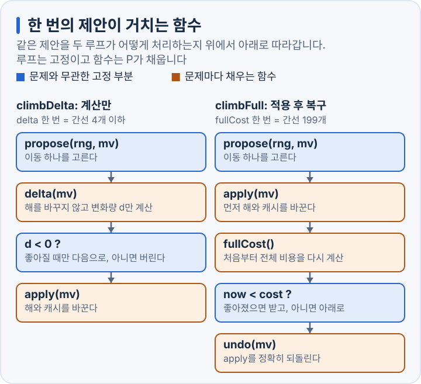

# 구현: 이동·차분·검사 틀과 두 문제 유형

[원리와 손계산](idea.md)의 절차를 코드로 옮깁니다. 코드는 두 부분으로 나눕니다. 문제와 상관없이 그대로 쓰는 부분(탐색 루프, 차분 검사)과, 문제마다 채우는 부분(해의 표현, 점수의 항, 이동의 제안·차분·적용·되돌리기)입니다. 채우는 부분에는 같은 이름의 함수를 두기 때문에, 문제가 바뀌어도 루프와 검사는 한 글자도 고치지 않습니다. 두 가지 문제 유형(순서·배정)은 [연습용 문제 틀](practice.md)에 정의한 것입니다.

> **코드 환경: h-contest 제출용 코드.** 표준 헤더·STL·동적 할당 없이 고정 배열로 씁니다. 공통 블록 `array`, `random`([공통 라이브러리](https://h.readiz.com/learn/cpp-common-library))을 먼저 붙이고, 이 페이지의 `nd-frame`, `nd-route`, `nd-assign`, `nd-gen`, `nd-run`을 이 순서로 이어 붙이면 한 번역 단위로 컴파일됩니다. 이 강의의 코드는 입출력이 없는 라이브러리 형태이며, 실제 문제에 쓸 때는 문제의 입력으로 `Route`나 `Assign`의 배열을 채우는 부분만 바꿉니다.

## 문제와 무관한 부분: 이동 기록과 세 개의 루프

탐색 루프가 문제에 요구하는 것은 한 가지입니다. 채우는 쪽(`P`)이 아래 멤버를 가져야 합니다.

| 멤버 | 하는 일 | 지켜야 할 점 |
| --- | --- | --- |
| `bool propose(rng, mv)` | 이동 하나를 고른다. 규칙을 어기는 이동이면 `false` | 만든 이동은 모두 유효해야 한다 |
| `long long delta(mv)` | 적용하지 않고 비용 변화량만 계산한다 | 해와 캐시를 바꾸지 않는다 |
| `void apply(mv)` | 해와 캐시를 바꾼다 | 캐시(부하 합 등)도 함께 갱신한다 |
| `void undo(mv)` | `apply`를 정확히 되돌린다 | 해와 캐시 모두 원래대로 |
| `long long fullCost()` | 캐시 없이 처음부터 비용을 계산한다 | `delta`와 같은 점수식이어야 한다 |
| `bool valid()` | 유효성을 처음부터 검사한다 | 검사용이며 탐색 중에는 부르지 않는다 |
| `long long ops, writes, props` | 연산 계수기(전체, 그중 해 배열 쓰기, 제안 수) | 실험용. 제출할 때 지워도 동작이 같다 |

이동은 `kind`와 인자 두 개로 적습니다. `old`는 옮기기를 되돌릴 때 필요한 이전 값을 두는 칸입니다.

난수에서 범위 안의 수를 뽑는 `pick`은 `next() % bound`가 아니라 상위 비트를 씁니다. 공통 블록의 LCG(`state * 1664525 + 1013904223`을 2^32로 나눈 나머지)는 낮은 비트의 주기가 짧습니다. 낮은 3비트는 8번마다 같은 순서로 돌아서, `% 200`으로 두 수를 연달아 뽑으면 `(a, b)` 쌍의 일부는 영영 나오지 않습니다. 이 결과는 [실험과 점검](practice.md)의 '흔한 실수와 잡는 검사'에서 쌍의 수로 보입니다.



[그림 크게 보기](https://git.readiz.com/h-contest-lesson/lessons/neighborhood-and-delta/lesson-assets/delta-flow.svg)

```cpp snippet=nd-frame
struct Move { int kind, a, b, old; };

// [0, bound) 안의 값. 상위 비트를 쓴다: LCG는 낮은 비트의 주기가 짧아 `next() % bound`로 연속해 뽑으면 일부 조합이 영영 나오지 않는다.
int pick(hc::Random& rng, int bound) { return (int)(((unsigned long long)rng.next() * (unsigned)bound) >> 32); }

// 계산만 하고, 좋아질 때만 적용한다.
template <class P>
long long climbDelta(P& p, hc::Random& rng, long long cost, long long budget) {
    while (p.ops < budget) {
        ++p.ops; ++p.props;                       // 제안 한 번의 기본 비용 1
        Move mv;
        if (!p.propose(rng, mv)) continue;
        const long long d = p.delta(mv);          // 해는 그대로 둔다
        if (d < 0) { p.apply(mv); cost += d; }
    }
    return cost;
}

// 적용한 뒤 전체를 다시 계산하고, 나빠졌으면 되돌린다.
template <class P>
long long climbFull(P& p, hc::Random& rng, long long cost, long long budget) {
    while (p.ops < budget) {
        ++p.ops; ++p.props;
        Move mv;
        if (!p.propose(rng, mv)) continue;
        p.apply(mv);
        const long long now = p.fullCost();
        if (now < cost) cost = now; else p.undo(mv);
    }
    return cost;
}

// 차분 검사: 무작위 이동 trials개에서 delta가 적용 전후의 전체 재계산 차이와 같은지,
// undo가 비용을 되돌리는지, 해가 계속 유효한지 확인한다. 처음 어긋난 제안의 번호(1부터)를 돌려주고, 모두 맞으면 0을 돌려준다.
template <class P>
int checkDelta(P& p, hc::Random& rng, int trials) {
    for (int t = 1; t <= trials; ++t) {
        Move mv;
        if (!p.propose(rng, mv)) continue;
        const long long before = p.fullCost();
        const long long d = p.delta(mv);
        p.apply(mv);
        if (!p.valid() || p.fullCost() - before != d) return t;
        p.undo(mv);
        if (!p.valid() || p.fullCost() != before) return t;
        if (pick(rng, 2)) p.apply(mv);            // 해를 움직여 가며 여러 해에서 확인한다
    }
    return 0;
}
```

`climbDelta`와 `climbFull`은 같은 일을 다른 방식으로 합니다. 둘 다 "좋아지면 받는다"만 쓰며, 같은 난수에서는 같은 제안을 같은 순서로 받고 거절합니다(이 성질을 [실험과 점검](practice.md)의 '계산만 하기와 적용 후 복구'에서 확인합니다). 차이는 평가와 적용의 비용입니다.

- `climbFull`(적용 후 복구): 이동을 적용하고 전체를 다시 계산해 보고, 나빠졌으면 `undo`로 되돌립니다. `delta`를 유도하지 않아도 되지만, 제안마다 `fullCost`와 적용·복구 비용을 냅니다.
- `climbDelta`(계산만 하고 수락 시 적용): `delta`로 변화를 알아낸 뒤 좋아질 때만 `apply`합니다. 거절된 제안은 해를 건드리지 않아서 `undo`가 필요 없습니다.

선택 기준은 `delta`를 해를 바꾸지 않고 계산할 수 있는가입니다. 이동 전의 해와 이동의 인자만으로 새로 생기고 사라지는 항을 알 수 있으면 `climbDelta`가 맞습니다. 평가가 이동을 적용한 해를 봐야만 나오는 점수(예: 이동 뒤의 일정을 다시 시뮬레이션해야 알 수 있는 점수)라면 적용하고 평가하고 되돌리는 쪽으로 가야 하며, 이때 `apply`와 `undo`가 얼마나 싼지가 탐색 속도를 정합니다. 이 두 방식의 비용 구성은 [실험과 점검](practice.md)의 같은 절에 있습니다.

## 순서 틀 채우기: `Route`

해는 방문 순서 `p[]`이고, 점수의 항은 이웃한 두 점 사이의 거리입니다. 이동은 네 가지입니다(`mask`의 비트로 고릅니다).

- 비트 0 `kind 0`: 두 위치 `a < b`의 점을 맞바꾼다.
- 비트 1 `kind 1`: `a` 위치의 점을 빼 `b` 위치로 끼운다.
- 비트 2 `kind 2`: 구간 `[a, b]`를 뒤집는다.
- 비트 3: 이웃한 두 위치(`b = a + 1`)만 맞바꾼다. 비트 0과 비트 2가 만드는 이동의 부분집합이며, [원리 페이지](idea.md)의 근방 크기와 연결성을 비교하려고 따로 둔 설정입니다.

`delta`는 이동마다 항 몇 개가 바뀌는지를 그대로 적습니다. 경계에는 `-1`을 돌려주는 `at()`을 두어, 경로의 끝에 걸치는 이동에도 `if`가 늘지 않습니다(`w`가 `-1`이 낀 항을 `0`으로 처리합니다). 이웃한 두 점의 교환은 길이 2인 뒤집기와 같으므로 뒤집기 식으로 보냅니다. 떨어진 교환의 식을 그대로 쓰면 가운데 간선을 이동 전 이웃으로 읽어서 틀립니다([실험과 점검](practice.md)의 흔한 실수 첫 번째).

```cpp snippet=nd-route
const int RN = 200;                      // 점 수의 상한
struct Route {
    int n, px[RN], py[RN], p[RN];        // 점 좌표, p[k] = k번째로 지나는 점
    int mask;                            // 쓸 이동: 비트 0 교환, 1 옮기기, 2 뒤집기, 3 인접 교환
    long long ops, writes, props;        // 연산 수(제안 1회, 항 계산 1회, 해 배열 원소 쓰기 1회), 그중 쓰기, 제안 수

    void init() { hc::iota(p, n); ops = writes = props = 0; }
    void wrote(int k) { ops += k; writes += k; }      // 해 배열에 k개 원소를 썼다
    int at(int k) { return (k < 0 || k >= n) ? -1 : p[k]; }
    long long w(int u, int v) {          // 항 하나: 점 u, v 사이의 거리. 경계(-1)에는 항이 없다.
        if (u < 0 || v < 0) return 0;
        ++ops;
        const int dx = px[u] - px[v], dy = py[u] - py[v];
        return (dx < 0 ? -dx : dx) + (dy < 0 ? -dy : dy);
    }
    long long fullCost() {
        long long s = 0;
        for (int k = 0; k + 1 < n; ++k) s += w(p[k], p[k + 1]);
        return s;
    }
    bool valid() {
        static bool seen[RN];
        hc::fill(seen, RN, false);
        for (int k = 0; k < n; ++k) {
            if (p[k] < 0 || p[k] >= n || seen[p[k]]) return false;
            seen[p[k]] = true;
        }
        return true;
    }

    bool propose(hc::Random& rng, Move& mv) {
        int modes[4], c = 0;
        for (int i = 0; i < 4; ++i) if ((mask >> i) & 1) modes[c++] = i;
        const int mode = modes[pick(rng, c)];
        int a = pick(rng, n), b = pick(rng, n);
        if (mode == 3) { if (a + 1 >= n) return false; b = a + 1; }
        else if (a == b) return false;
        else if (mode != 1 && a > b) hc::swap(a, b);       // 옮기기만 방향이 의미를 가진다
        mv.kind = mode == 3 ? 0 : mode; mv.a = a; mv.b = b; mv.old = 0;
        return true;
    }

    long long delta(const Move& mv) {
        const int a = mv.a, b = mv.b;
        if (mv.kind == 2 || (mv.kind == 0 && b == a + 1))   // 구간 뒤집기: 안쪽 간선은 거리가 같아 경계 둘만 바뀐다
            return w(at(a - 1), p[b]) + w(p[a], at(b + 1)) - w(at(a - 1), p[a]) - w(p[b], at(b + 1));
        if (mv.kind == 0) {                                  // 떨어진 두 점 교환: 두 점 둘레의 간선 네 개
            const int u = p[a], v = p[b];
            return w(at(a - 1), v) + w(v, at(a + 1)) + w(at(b - 1), u) + w(u, at(b + 1))
                 - w(at(a - 1), u) - w(u, at(a + 1)) - w(at(b - 1), v) - w(v, at(b + 1));
        }
        const int x = p[a];                                  // 한 점 옮기기: 빼면서 이웃이 이어지고, 들어가며 한 간선이 둘로 갈라진다
        long long rem = w(at(a - 1), x) + w(x, at(a + 1)), add = w(at(a - 1), at(a + 1));
        if (a < b) { rem += w(p[b], at(b + 1)); add += w(p[b], x) + w(x, at(b + 1)); }
        else       { rem += w(at(b - 1), p[b]); add += w(at(b - 1), x) + w(x, p[b]); }
        return add - rem;
    }

    void moveItem(int from, int to) {                        // from 위치의 점을 빼 to 위치로 끼운다
        const int x = p[from];
        if (from < to) for (int k = from; k < to; ++k) p[k] = p[k + 1];
        else           for (int k = from; k > to; --k) p[k] = p[k - 1];
        p[to] = x;
        wrote((from < to ? to - from : from - to) + 1);
    }
    void apply(const Move& mv) {
        if (mv.kind == 1) { moveItem(mv.a, mv.b); return; }
        if (mv.kind == 0 && mv.b != mv.a + 1) { hc::swap(p[mv.a], p[mv.b]); wrote(2); return; }
        for (int i = mv.a, j = mv.b; i < j; ++i, --j) hc::swap(p[i], p[j]);
        wrote(mv.b - mv.a + 1);
    }
    void undo(const Move& mv) {
        if (mv.kind == 1) moveItem(mv.b, mv.a);
        else apply(mv);                                      // 교환과 뒤집기는 같은 이동을 다시 하면 원래대로
    }
};
```

`apply`가 쓰는 원소 수가 `ops`에 들어갑니다. 교환은 2개, 뒤집기는 구간 길이, 옮기기는 이동 거리에 1을 더한 값입니다. `delta`는 이동이 크든 작든 항 4개 이내인 데 비해, 뒤집기와 옮기기를 적용하는 비용은 구간 길이에 비례합니다. 이 차이가 [실험과 점검](practice.md)의 '근방별 실측'에서 드러납니다.

## 배정 틀 채우기: `Assign`

해는 작업별 기계 `as[]`이고, 점수식은 `(Σ load[j]²) / 100 + Σ c[i][as[i]]`입니다. 항은 두 종류입니다. 작업 항 `c[i][as[i]]`는 작업마다 하나, 기계 항 `load[j]²`는 기계마다 하나이며, 나눗셈은 기계 항의 합 전체에 한 번만 적용합니다. 이동은 두 가지입니다.

- 비트 0 `kind 0`: 작업 `a`를 기계 `b`로 옮긴다. 받는 쪽 기계가 가득 차 있으면(`cnt[b] >= k`) 제안하지 않는다.
- 비트 1 `kind 1`: 서로 다른 기계의 작업 `a`, `b`를 맞바꾼다. 기계별 작업 수가 그대로여서 `K`를 항상 지킨다.

기계별 부하 `load[]`, 작업 수 `cnt[]`, 부하 제곱의 합 `sq`는 `delta`와 `apply`가 공유하는 캐시입니다. 캐시가 없으면 `delta`가 부하를 다시 더해야 하므로 O(N)이 됩니다. 반대로 `apply`와 `undo`가 캐시를 빼먹으면 `delta`가 낡은 부하로 계산합니다. 내림은 `(sq + dS) / 100 - sq / 100`처럼 합 전체의 내림 차이로 계산합니다.

```cpp snippet=nd-assign
const int AN = 120, AM = 8;              // 작업 수와 기계 수의 상한
struct Assign {
    int n, m, k;                         // 작업 수, 기계 수, 기계 한 대의 작업 수 상한
    int d[AN], c[AN][AM], as[AN];        // 길이, 추가 비용, 배정(as[i] = 작업 i를 맡은 기계)
    int load[AM], cnt[AM];               // 캐시: 기계별 부하 합, 작업 수
    long long sq;                        // 캐시: 부하 제곱의 합
    int mask;                            // 쓸 이동: 비트 0 옮기기, 1 맞바꾸기
    long long ops, writes, props;

    void init() {                        // 라운드 로빈 배정 (ceil(n / m) <= k여야 유효)
        for (int i = 0; i < n; ++i) as[i] = i % m;
        build(); ops = writes = props = 0;
    }
    void build() {                       // 배정에서 캐시를 만든다
        for (int j = 0; j < m; ++j) load[j] = cnt[j] = 0;
        for (int i = 0; i < n; ++i) { load[as[i]] += d[i]; ++cnt[as[i]]; }
        sq = 0;
        for (int j = 0; j < m; ++j) sq += (long long)load[j] * load[j];
    }
    long long jobTerm(int i, int j) { ++ops; return c[i][j]; }              // 항: 작업 i를 기계 j에 맡기는 추가 비용
    long long loadTerm(long long l) { ++ops; return l * l; }                // 항: 부하가 l인 기계의 제곱
    long long fullCost() {
        long long L[AM], s = 0, sumSq = 0;
        for (int j = 0; j < m; ++j) L[j] = 0;
        for (int i = 0; i < n; ++i) { L[as[i]] += d[i]; s += jobTerm(i, as[i]); }
        for (int j = 0; j < m; ++j) sumSq += loadTerm(L[j]);
        return sumSq / 100 + s;                                             // 나눗셈은 합 전체에 한 번
    }
    bool valid() {
        int count[AM];
        for (int j = 0; j < m; ++j) count[j] = 0;
        for (int i = 0; i < n; ++i) {
            if (as[i] < 0 || as[i] >= m) return false;
            if (++count[as[i]] > k) return false;
        }
        return true;
    }

    bool propose(hc::Random& rng, Move& mv) {
        const int mode = mask == 3 ? pick(rng, 2) : (mask == 2 ? 1 : 0);
        const int i = pick(rng, n);
        if (mode == 0) {
            const int to = pick(rng, m);
            if (to == as[i] || cnt[to] >= k) return false;     // 받는 쪽이 가득 차면 무효: 만들지 않는다
            mv.kind = 0; mv.a = i; mv.b = to; mv.old = as[i];
        } else {
            const int j = pick(rng, n);
            if (as[i] == as[j]) return false;                  // 같은 기계끼리 바꾸면 변화가 없다
            mv.kind = 1; mv.a = i; mv.b = j; mv.old = 0;       // 맞바꾸기는 개수가 그대로라 항상 유효
        }
        return true;
    }

    long long delta(const Move& mv) {
        const int i = mv.a, x = as[i];
        long long dc, dS;
        if (mv.kind == 0) {                                    // 작업 i가 기계 x에서 y로: 항 셋(작업 항 하나, 기계 항 둘)이 바뀐다
            const int y = mv.b;
            dc = jobTerm(i, y) - jobTerm(i, x);
            dS = loadTerm(load[x] - d[i]) + loadTerm(load[y] + d[i]) - loadTerm(load[x]) - loadTerm(load[y]);
        } else {                                               // 작업 i, j를 맞바꿈: 작업 항 둘과 기계 항 둘
            const int j = mv.b, y = as[j], dd = d[j] - d[i];
            dc = jobTerm(i, y) + jobTerm(j, x) - jobTerm(i, x) - jobTerm(j, y);
            dS = loadTerm(load[x] + dd) + loadTerm(load[y] - dd) - loadTerm(load[x]) - loadTerm(load[y]);
        }
        return (sq + dS) / 100 - sq / 100 + dc;                // 합 전체의 내림 차이
    }

    void place(int i, int y) {                                 // 작업 i를 기계 y로 옮기고 캐시를 고친다
        const int x = as[i];
        sq -= (long long)load[x] * load[x] + (long long)load[y] * load[y];
        load[x] -= d[i]; load[y] += d[i];
        sq += (long long)load[x] * load[x] + (long long)load[y] * load[y];
        --cnt[x]; ++cnt[y]; as[i] = y; ++ops; ++writes;
    }
    void apply(const Move& mv) {
        if (mv.kind == 0) place(mv.a, mv.b);
        else { const int x = as[mv.a], y = as[mv.b]; place(mv.a, y); place(mv.b, x); }
    }
    void undo(const Move& mv) {
        if (mv.kind == 0) place(mv.a, mv.old);
        else apply(mv);                                        // 맞바꾸기는 한 번 더 하면 원래대로
    }
};
```

## 입력 생성과 실행

입력은 [원리 페이지](idea.md)의 연습용 문제 틀 규칙대로 시드 하나에서 만듭니다. 생성용 난수 `Gen`은 64비트 선형 합동 생성기이고, 탐색용 `hc::Random`과 따로 둡니다. 실행 함수는 같은 시드를 입력 시드와 탐색 시드로 함께 씁니다. 시작 비용을 구하는 `fullCost` 호출은 예산에 넣지 않으려고 계수기를 0으로 되돌립니다.

```cpp snippet=nd-gen
struct Gen {                             // 입력 생성용 64비트 난수. 탐색용 hc::Random과 따로 둔다.
    unsigned long long x;
    void reset(unsigned long long seed) { x = seed; }
    int next(int range) {                // [0, range)
        x = x * 6364136223846793005ULL + 1442695040888963407ULL;
        return (int)((x >> 33) % (unsigned long long)range);
    }
};

void genRoute(Route& r, unsigned long long seed, int n) {
    Gen g; g.reset(seed);
    r.n = n;
    for (int i = 0; i < n; ++i) { r.px[i] = g.next(1000); r.py[i] = g.next(1000); }
    r.init();
}

void genAssign(Assign& a, unsigned long long seed, int n, int m, int k) {
    Gen g; g.reset(seed);
    a.n = n; a.m = m; a.k = k;
    for (int i = 0; i < n; ++i) {
        a.d[i] = 1 + g.next(100);
        for (int j = 0; j < m; ++j) a.c[i][j] = g.next(51);
    }
    a.init();
}
```

```cpp snippet=nd-run
static Route route;
static Assign assign;

// 순서 문제: 시드 seed의 입력(점 200개)에서 좋아질 때만 받는 탐색을 연산 수 budget까지 돌린다.
// full이 true면 적용 후 전체 재계산, false면 차분. 반환값은 최종 비용.
long long runRoute(unsigned long long seed, int mask, bool full, long long budget) {
    genRoute(route, seed, 200);
    route.mask = mask;
    hc::Random rng; rng.reset((unsigned)seed);
    const long long start = route.fullCost();
    route.ops = 0;                                    // 시작 비용 계산은 예산에 넣지 않는다
    return full ? climbFull(route, rng, start, budget) : climbDelta(route, rng, start, budget);
}

// 배정 문제: 입력은 작업 120개, 기계 8대, 기계당 18개.
long long runAssign(unsigned long long seed, int mask, bool full, long long budget) {
    genAssign(assign, seed, 120, 8, 18);
    assign.mask = mask;
    hc::Random rng; rng.reset((unsigned)seed);
    const long long start = assign.fullCost();
    assign.ops = 0;
    return full ? climbFull(assign, rng, start, budget) : climbDelta(assign, rng, start, budget);
}
```

두 실행 함수는 `mask`와 `full`만 다릅니다. `mask`는 어떤 이동을 쓰는지, `full`은 위의 두 루프 중 무엇을 쓰는지 정합니다. [실험과 점검](practice.md)의 표는 모두 이 두 함수로 시드 1~20을 돌린 값입니다.

## 검사 틀을 쓰는 법

`checkDelta`는 아래 세 가지를 번갈아 넣어 부릅니다.

1. 작은 입력에서 모든 이동. `Route`는 점 8개로 `a`, `b`의 모든 조합을, `Assign`은 작업 7개·기계 3대·상한 3으로 모든 이동과 맞바꾸기를 하나씩 `delta`와 적용 후 전체 재계산의 차이로 대조합니다. 경계와 인접한 경우가 모두 한 번씩 걸립니다.
2. 기본 크기에서 무작위 이동. `checkDelta(route, rng, 3000)`처럼 제안 수를 정해 부릅니다. 작은 입력에서 만나기 어려운 상태를 만나고 `valid()`도 계속 확인합니다.
3. 꽉 찬 입력. `Assign`에서 `n = m * k`인 입력(예: 작업 24개, 기계 8대, 상한 3)은 처음부터 모든 기계가 가득 찹니다. `K` 확인을 빼먹은 제안이 첫 이동에서 걸립니다.

통과의 기준은 `checkDelta`가 `0`을 돌려주는 것입니다. 실패하면 돌려준 번호까지 같은 시드의 난수를 다시 만들어 그 이동의 `delta`와 전체 재계산 값을 출력해 봅니다.

## 코드를 다른 문제에 옮길 때 바뀌는 곳

| 부분 | 순서 틀 | 배정 틀 | 새 문제에서 |
| --- | --- | --- | --- |
| 해 | `p[]` | `as[]` | 해를 담는 배열(들) |
| 항 | 간선 `w(u, v)` | 작업 항, 기계 항 | 점수식을 합으로 쪼갠 조각 |
| 캐시 | 없음 | `load`, `cnt`, `sq` | `delta`가 O(1)이 되도록 들고 다닐 합계 |
| `propose` | 위치 두 개 | 작업·기계 | 규칙을 지키는 이동만 만든다 |
| `delta` | 바뀌는 간선 | 바뀌는 항 | 건드리는 항의 새 값 − 옛 값 |
| `apply`·`undo` | 배열 쓰기 | 한 칸 쓰기와 캐시 | 해와 캐시를 함께 바꿈 |
| `fullCost`·`valid` | 처음부터 | 처음부터 | 검사용으로 `delta`와 별도로 작성 |
| 루프·`checkDelta`·`pick` | 그대로 | 그대로 | 그대로 |
