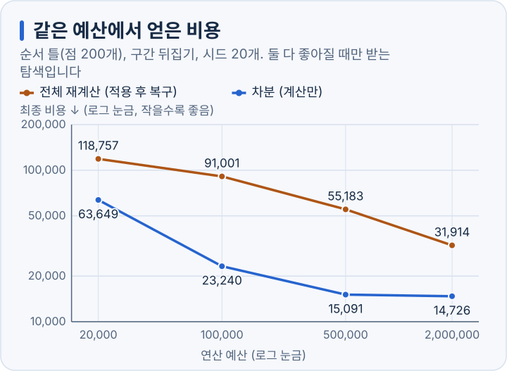
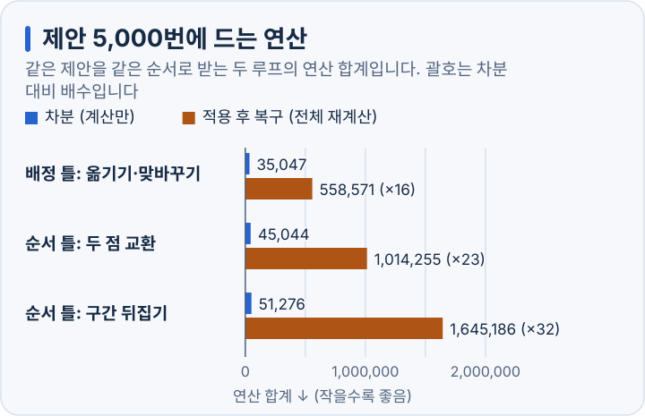
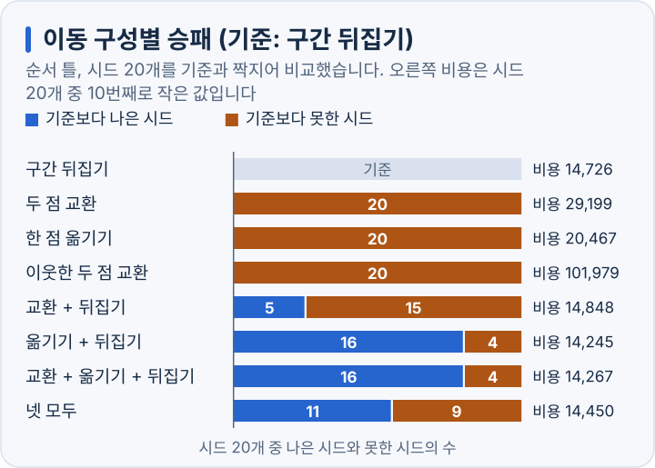

# 실험과 점검: 비용, 근방, 흔한 실수

[구현](implementation.md)의 코드를 연습용 문제 틀(순서 `N = 200`, 배정 `N = 120, M = 8, K = 18`, 정의는 [원리](idea.md))에서 시드 1~20으로 돌린 결과입니다. 모든 표는 `scripts/check_neighborhood_and_delta.py`가 다시 계산해 `lesson-assets/measurements.json`과 이 본문에 대조합니다.

## 실측

측정 방법은 다음과 같습니다.

- **연산 수:** 시간(ms) 대신 센 연산을 씁니다. 제안 한 번에 1, 점수식의 항 하나를 계산할 때마다 1(순서 틀은 간선 하나, 배정 틀은 작업 항 또는 기계 항 하나), 해 배열의 원소를 쓸 때마다 1입니다. 캐시 갱신과 난수 생성은 세지 않습니다. 시작 비용 계산은 예산에 넣지 않습니다.
- **예산:** 탐색은 연산 수가 예산에 닿으면 멈춥니다. 탐색은 모두 "좋아질 때만 받는" 방식이고 온도나 재시작은 없습니다.
- **요약:** 표의 값은 시드 20개의 최종 비용 중 10번째로 작은 값(중앙값의 아래쪽)입니다. 시작 비용의 같은 값은 순서 틀이 131,115, 배정 틀이 47,295입니다. 두 설정의 비교는 같은 시드끼리 짝지어 "앞이 나은 시드 / 뒤가 나은 시드"를 셉니다.
- **판정:** 한쪽이 20개 중 15개 이상에서 나으면(부호 검정의 양쪽 유의확률 0.041) 차이가 있다고 쓰고, 아니면 "결정 못 함"이라고 씁니다. 이 판정은 이 입력 가족(위 정의의 난수 입력)과 이 예산에 한정됩니다.

### 전체 재계산과 차분

같은 연산 예산에서 이동 한 번을 어떻게 평가하느냐의 차이입니다. 순서 틀은 구간 뒤집기만, 배정 틀은 옮기기와 맞바꾸기를 함께 씁니다. 전체 재계산은 적용하고 처음부터 다시 계산한 뒤 나쁘면 되돌리고, 차분은 `delta`로 계산만 하다가 좋아질 때 적용합니다.

순서 틀(비용, 작을수록 좋음)입니다.

| 연산 예산 | 전체 재계산 | 차분 | 차분이 나은 시드 |
| ---: | ---: | ---: | ---: |
| 20,000 | 118,757 | 63,649 | 20 / 20 |
| 100,000 | 91,001 | 23,240 | 20 / 20 |
| 500,000 | 55,183 | 15,091 | 20 / 20 |
| 2,000,000 | 31,914 | 14,726 | 20 / 20 |

[그림 크게 보기](https://git.readiz.com/h-contest-lesson/lessons/neighborhood-and-delta/lesson-assets/budget-curve.svg)

예산 2,000,000에서 처리한 제안 수의 중앙값입니다.

| 연산 예산 | 전체 재계산 | 차분 |
| ---: | ---: | ---: |
| 2,000,000 | 6,070 | 397,253 |

배정 틀입니다.

| 연산 예산 | 전체 재계산 | 차분 | 차분이 나은 시드 |
| ---: | ---: | ---: | ---: |
| 1,000 | 46,907 | 46,079 | 20 / 20 |
| 5,000 | 46,217 | 45,154 | 20 / 20 |
| 20,000 | 46,023 | 44,509 | 20 / 20 |
| 100,000 | 45,041 | 44,067 | 20 / 20 |

예산 100,000에서 처리한 제안 수의 중앙값입니다.

| 연산 예산 | 전체 재계산 | 차분 |
| ---: | ---: | ---: |
| 100,000 | 888 | 14,348 |

두 틀 모두 모든 예산에서 20개 시드 전부가 차분 쪽이 낫습니다. 순서 틀에서는 한 제안당 전체 재계산이 간선 약 199개를 치르고 차분이 4개 이하를 치르므로 같은 예산의 제안 수가 두 자릿수 배 차이(6,070 대 397,253)가 납니다. 차분은 예산 100,000에서 이미 23,240이고, 전체 재계산은 예산 2,000,000에서도 31,914입니다. 배정 틀은 제안 수 차이가 16배(888 대 14,348)지만 시작 비용(47,295)에서 줄일 수 있는 폭이 3천 남짓이라 전체 재계산도 예산 100,000에서 45,041까지 따라옵니다. 이 표는 "예산이 작을수록 평가 비용이 결과를 정한다"를 보이며, 예산이 충분하면 차이가 줄어든다는 점도 보입니다(다만 줄어드는 정도는 문제 크기와 이동 종류에 따라 다르며 이 강의는 두 틀의 한 가지 설정만 쟀습니다).

### 계산만 하기와 적용 후 복구

위 표의 두 방식은 평가 방식뿐 아니라 적용·복구 비용도 다릅니다. 같은 제안 5,000번에서 일이 어디에 들어가는지 나눠 셉니다. 두 루프가 같은 제안을 같은 순서로 받으므로 결과 비용은 매번 같습니다(시드 20개 모두 일치). 이 성질은 따로 시드 1~5에서 순서 틀(세 이동 모두)과 배정 틀의 최종 해 전체가 같은지도 대조했습니다(20번 중 20번 같음).

| 틀과 이동 | 방식 | 제안 | 항 계산 | 원소 쓰기 | 연산 합계 |
| --- | --- | ---: | ---: | ---: | ---: |
| 배정 틀, 옮기기 + 맞바꾸기 | 차분(계산만) | 5,000 | 29,786 | 256 | 35,047 |
| 배정 틀, 옮기기 + 맞바꾸기 | 적용 후 복구(전체 재계산) | 5,000 | 541,056 | 12,601 | 558,571 |
| 순서 틀, 두 점 교환 | 차분(계산만) | 5,000 | 39,406 | 624 | 45,044 |
| 순서 틀, 두 점 교환 | 적용 후 복구(전체 재계산) | 5,000 | 990,025 | 19,286 | 1,014,255 |
| 순서 틀, 구간 뒤집기 | 차분(계산만) | 5,000 | 19,706 | 26,570 | 51,276 |
| 순서 틀, 구간 뒤집기 | 적용 후 복구(전체 재계산) | 5,000 | 990,025 | 649,548 | 1,645,186 |

[그림 크게 보기](https://git.readiz.com/h-contest-lesson/lessons/neighborhood-and-delta/lesson-assets/ops-split.svg)

항 계산은 두 방식의 차이가 크고(전체 재계산은 제안마다 점수식 전체를 다시 계산), 원소 쓰기는 이동이 얼마나 비싸게 적용되는지에 달려 있습니다. 구간 뒤집기는 적용 비용이 구간 길이에 비례해서, 적용 후 복구의 쓰기가 649,548번인 데 비해 차분은 수락된 제안만 적용해 26,570번입니다. 교환은 적용이 원소 두 개라서 쓰기가 두 방식 모두 작습니다(19,286과 624). 연산 합계는 제안 수, 항 계산, 원소 쓰기의 합을 시드마다 구한 값의 중앙값이라 세 열의 중앙값을 더한 값과 조금 다를 수 있습니다.

### 근방별 실측

예산 하나를 정해 두고(순서 틀 2,000,000, 배정 틀 100,000) `delta`로 계산만 하는 방식에서 이동의 구성만 바꿉니다. "나은 시드 / 못한 시드"는 표의 첫 행(기준)과 같은 시드끼리 비교한 값입니다. "지역 최적"은 끝난 해의 근방 모든 이동을 열거해 개선하는 이동이 하나도 없는 시드의 수입니다.

순서 틀(기준은 구간 뒤집기만):

| 이동 | 비용 | 기준보다 나은 / 못한 시드 | 판정 | 지역 최적 |
| --- | ---: | ---: | --- | ---: |
| 구간 뒤집기 | 14,726 | - | 기준 | 20 / 20 |
| 두 점 교환 | 29,199 | 0 / 20 | 더 나쁨 | 11 / 20 |
| 한 점 옮기기 | 20,467 | 0 / 20 | 더 나쁨 | 1 / 20 |
| 이웃한 두 점 교환 | 101,979 | 0 / 20 | 더 나쁨 | 20 / 20 |
| 교환 + 뒤집기 | 14,848 | 5 / 15 | 더 나쁨 | 13 / 20 |
| 옮기기 + 뒤집기 | 14,245 | 16 / 4 | 더 좋음 | 13 / 20 |
| 교환 + 옮기기 + 뒤집기 | 14,267 | 16 / 4 | 더 좋음 | 3 / 20 |
| 넷 모두 | 14,450 | 11 / 9 | 결정 못 함 | 0 / 20 |

[그림 크게 보기](https://git.readiz.com/h-contest-lesson/lessons/neighborhood-and-delta/lesson-assets/neighborhood-seeds.svg)

- 구간 뒤집기만 쓴 20개 시드는 모두 예산 안에 지역 최적에 닿았습니다. 더 큰 예산을 줘도 이 근방에서는 더 내려가지 못합니다.
- 두 점 교환만, 한 점 옮기기만으로는 모든 시드에서 뒤집기만보다 나쁩니다. 두 점 교환만으로 지역 최적에 닿은 11개 시드도 뒤집기만의 결과보다 높은 곳에서 멈췄으므로, 예산이 부족해서가 아니라 근방 자체의 차이입니다.
- 이웃한 두 점 교환만은 연결되어 있지만(원리 페이지의 6점 표에서 모든 순서에 닿음) 지름이 `N(N−1)/2`로 커서 시작(131,115)에서 101,979까지 가다 20개 시드 모두 그 근방의 지역 최적에 멈췄습니다.
- 이동을 섞으면 이동 종류의 조합에 따라 결과가 갈립니다. 옮기기 + 뒤집기와 세 가지 모두는 뒤집기만보다 20개 중 16개 시드에서 낫습니다. 교환 + 뒤집기는 15개 시드에서 나쁘고, 이웃한 교환까지 넷 모두를 넣은 설정은 결정 못 함입니다. 이웃한 교환은 교환과 뒤집기가 이미 만드는 이동의 부분집합이라 근방을 넓히지 못하고 제안만 나눠 갖습니다.
- 옮기기 + 뒤집기와 세 가지 모두의 사이는 비교하지 않았고, 세 가지 모두와 넷 모두는 예산 안에 지역 최적에 닿은 시드가 3개와 0개라 더 큰 예산에서는 순위가 달라질 수 있습니다.

경험 법칙으로 "근방에 이동 종류를 더하면 지역 최적이 낮아진다"고 합니다. 이 실험은 옮기기와 뒤집기의 조합에서는 이를 지지하고, 교환 추가에서는 같은 예산에서 오히려 나빠지는 결과를 줍니다(제안 중 일부가 좋은 이동이 드문 쪽에 쓰이기 때문일 수 있으나 이 강의는 원인을 가르지 않았습니다).

배정 틀(기준은 옮기기 + 맞바꾸기):

| 이동 | 비용 | 기준보다 나은 / 못한 시드 | 판정 | 지역 최적 | 기계별 작업 수가 모두 15 |
| --- | ---: | ---: | --- | ---: | ---: |
| 옮기기 + 맞바꾸기 | 44,067 | - | 기준 | 0 / 20 | 0 / 20 |
| 옮기기만 | 44,911 | 0 / 20 | 더 나쁨 | 20 / 20 | 0 / 20 |
| 맞바꾸기만 | 44,062 | 12 / 8 | 결정 못 함 | 0 / 20 | 20 / 20 |

- 옮기기만 쓰면 20개 시드가 모두 지역 최적에 멈추고 기준보다 나쁩니다. 한 작업이 통째로 움직이는 이동은 부하를 잘게 조정하지 못합니다.
- 맞바꾸기만 쓰면 기계별 작업 수가 시작의 15개로 20개 시드 모두에서 그대로입니다(연결성의 한계). 그런데 기준과의 비용 차이는 결정하지 못했습니다. 이 입력 가족에서는 작업 수를 15로 고정한 해들 안에도 비슷하게 좋은 해가 있다는 뜻이고, 작업 수를 달리해야 좋아지는 입력에서는 다를 수 있습니다. 한 입력 가족의 결과를 일반 법칙으로 쓰지 않습니다.

## 흔한 실수와 잡는 검사

아래 실수는 모두 본문 코드에 직접 넣어 보고 검사가 잡는지 확인했습니다(`scripts/check_neighborhood_and_delta.py`가 매번 다시 수행). "첫 어긋남"은 `checkDelta`가 돌려주는 첫 어긋난 제안의 번호이며 시드 20개의 중앙값입니다.

1. **건드리는 항을 빼먹음(이웃한 교환).** 떨어진 두 점 교환의 식을 이웃한 두 점에도 그대로 씁니다. 가운데 간선을 이동 전 이웃으로 읽어서 [원리](idea.md)의 7점 손계산에서 −6이어야 할 값이 −18이 됩니다. 점 8개에서 모든 이동을 열거하면 26,880개 중 1,680개에서 `delta`가 전체 재계산과 어긋납니다. 무작위 이동으로도 두 점 교환만 쓰는 설정에서 20개 시드 모두 걸리며 첫 어긋남은 점 200개에서 44번째, 점 8개에서 3번째 제안입니다. 항을 빼먹는 실수는 이동의 경계 경우에서 나므로 모든 이동을 열거할 수 있는 작은 입력이 가장 확실합니다.
2. **합 전체에 걸린 비선형 연산을 항별로 나눔(내림).** 배정 틀에서 `⌊(S + ΔS) / 100⌋ − ⌊S / 100⌋`를 `ΔS / 100`으로 쓰면 [원리](idea.md)의 6작업 손계산에서 +24가 23이 되고, 항별 내림은 −3이 −5가 됩니다. 점수식에 내림·최댓값·절댓값이 있으면 그것이 항별로 나뉘는지 합 전체에 걸리는지 먼저 정합니다. 기본 크기 입력의 무작위 이동으로 20개 시드 모두 걸리며 첫 어긋남은 2번째 제안입니다.
3. **이동이 유효성을 깸(받는 쪽 여유 확인 누락).** 옮기기에서 `cnt[to] >= k` 확인을 빼면 기계가 `K`를 넘는 무효한 해가 만들어집니다. 작업 120개 입력에서는 첫 어긋남이 62번째 제안이라 기계가 가득 찰 때까지 기다려야 하지만, 모든 기계가 가득 찬 입력(작업 24개, 기계 8대, 상한 3)에서는 20개 시드 모두 첫 제안(중앙값 1번)에서 걸립니다. 규칙의 한계에 붙은 입력을 따로 두는 이유입니다. 되돌리기가 캐시(`load`, `cnt`, `sq`)를 갱신하지 않는 실수도 같은 검사에서 20개 시드 모두 걸리며 첫 어긋남은 2번째 제안입니다.
4. **제안이 근방 전체를 덮지 못함(난수의 낮은 비트).** `next() % bound`로 두 위치를 연달아 뽑으면 LCG 낮은 비트의 짧은 주기 때문에 `(a, b)` 쌍의 일부만 나옵니다. 구간 뒤집기의 이동 19,900개를 400,000번 제안하면 상위 비트를 쓰는 `pick`은 19,900개를 모두 내지만 `% bound`는 5,000개에서 멈춥니다. `delta`는 맞으므로 `checkDelta`로는 잡히지 않고(20개 시드 모두 통과), 제안을 많이 만들어 서로 다른 이동의 수를 세는 검사로만 잡힙니다. 이 경우 개선 이동이 남아 있어도 영영 제안되지 않아 탐색이 멈춘 것처럼 보입니다. 단순한 `% bound`는 이동의 일부를 영영 제안하지 못할 수 있다는 점은 [공통 라이브러리](https://h.readiz.com/learn/cpp-common-library)의 `random` 블록에도 해당합니다.

## 다른 문제에 옮길 때 점검 목록

1. 점수식을 항의 합으로 나눴는가? 합 전체에 걸리는 연산(내림, 최댓값, 제곱근)이 있는가?
2. 이동마다 사라지는 항과 생기는 항을 모두 적었는가? 경계(경로의 끝, 빈 자리)와 이동 부분이 겹치는 경우(이웃한 자리, 같은 기계)를 따로 확인했는가?
3. 이동이 유효성을 깰 수 있는가? 제안 단계에서 막을지, 항상 유효하도록 이동을 설계할지 정했는가?
4. 이동을 반복하면 유효한 해 어디로든 갈 수 있는가? 이동이 바꾸지 못하는 양(작업 수, 합계, 집합의 크기)은 무엇이고, 이동 하나만 쓰면 갇히는 해가 있는가?
5. 평가의 비용과 적용의 비용은 각각 얼마인가? 적용이 O(N)이면 거절이 많은 구간에서 계산만 하는 방식이 맞는가?
6. `delta`를 해를 바꾸지 않고 쓸 수 있는가? 안 된다면 `undo`가 싸고 완전한가?
7. `fullCost`를 `delta`와 독립으로 점수식에서 그대로 옮겨 썼는가? 작은 입력의 전수, 기본 크기의 무작위, 규칙 한계의 입력을 모두 돌렸는가?
8. 제안 난수가 근방의 이동을 모두 낼 수 있는가? 서로 다른 이동의 수를 세어 봤는가?
9. 설정을 비교할 때 같은 연산 예산, 여러 시드, 같은 시드끼리의 짝지은 비교를 썼는가? 승패 수가 갈리지 않으면 "결정 못 함"으로 두었는가? ([실험과 튜닝](https://h.readiz.com/learn/experiments-and-tuning)에서 이어집니다.)

## 적용 사례

이 강의의 틀이 이 사이트의 문제에서 쓰인 곳입니다. 각 강의는 해당 문제 하나를 끝까지 푸는 방식이라 이 강의와 설명의 순서가 다릅니다.

- [배송 순서 개선(ORDERING)](https://h.readiz.com/learn/heuristic-case-studies/ordering-route-improvement): 열린 경로에서 구간 뒤집기(2-opt)의 경계 간선 차분과 끝점 처리.
- [배정 문제의 지역 탐색과 SA(SCHEDULX)](https://h.readiz.com/learn/assignment-local-search): 작업 옮기기·맞바꾸기와 기계별 부하 `load[]` 유지. 점수가 최댓값이라 합과 달리 최댓값을 다시 구해야 하는 차분입니다.
- [특수한 점수식 읽기(ENTROPY2D)](https://h.readiz.com/learn/reading-the-score): 거리 합이 열·행 경계의 곱으로 갈라지는 성질에서 유도하는 O(1) 차분.
- [배정과 경로가 결합된 문제(TAXIASSIGN)](https://h.readiz.com/learn/assignment-with-routes): 배정과 순서를 함께 바꾸는 이동(옮기며 끼우기, 자리 바꾸기)의 차분.
- [격자 배치 문제(LANDINGX)](https://h.readiz.com/learn/placement-search): 점유 격자의 `put`/`take`로 만드는 적용·되돌리기와 제안 단계의 무효 거절.

대조 검증의 일반론은 [Testing과 Stress Test](https://h.readiz.com/learn/testing-and-stress)에 있고, 이 강의는 이동 한 번의 차분을 대조하는 틀에만 한정했습니다. 나쁜 이동을 받아들이는 규칙은 [언덕 오르기와 담금질](https://h.readiz.com/learn/hill-climbing-and-annealing)로, 후보를 가까운 것으로 줄이는 방법은 [후보 줄이기와 시간 예산](https://h.readiz.com/learn/candidate-and-time-budget)으로 이어집니다.

## 로컬 연습

1. 순서 틀의 "한 점 옮기기" `delta`에서 `a > b` 경우의 `rem` 항을 일부러 빼고, `checkDelta`가 몇 번째 제안에서 잡는지 시드 20개로 기록합니다. 같은 오류를 점 8개 전수 검사는 몇 개 이동에서 잡습니까?
2. 순서 틀에 "연속한 점 3개를 한 덩어리로 떼어 다른 자리에 끼우기" 이동을 추가합니다. 사라지는 간선과 생기는 간선을 표로 적고(이웃한 자리와 경로 끝 포함) `delta`를 유도한 뒤 전수 검사를 통과시킵니다.
3. 배정 틀을 `N = M × K`(예: 작업 24개, 기계 8대, 상한 3)로 바꿔 옮기기만, 맞바꾸기만, 둘 다를 시드 20개로 비교합니다. 이번에는 연결성의 한계가 비용 차이로 나타나는지 판정 규칙대로 적습니다.
4. 순서 틀의 예산을 100,000, 500,000, 2,000,000으로 바꿔 "옮기기 + 뒤집기"와 "세 가지 모두"의 짝지은 비교를 합니다. 본문이 비교하지 않은 이 둘의 순위가 예산에 따라 바뀌는지 기록합니다.
5. `climbDelta`와 `climbFull`을 각각 쓰되 `apply`를 일부러 느리게(예: 구간 뒤집기에 쓸데없는 복사 추가) 만든 뒤, 연산 수를 세어 [계산만 하기와 적용 후 복구](practice.md)의 표가 어떻게 변하는지 확인합니다.

확인 기준: 모든 변경 뒤 `checkDelta`가 세 가지 입력에서 0을 돌려주고, 두 루프의 최종 해가 같고, 표의 모든 비교에 시드 수와 판정(더 좋음·더 나쁨·결정 못 함)이 붙어 있어야 합니다.
