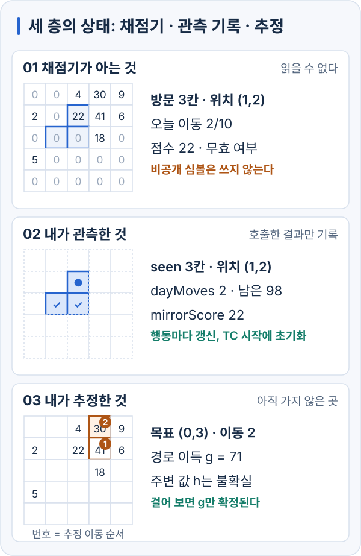

# 채점기 상태를 따라 그리며 행동하기

[광산 탐사](/practice/MINEEXPLORE)는 지도 전체를 `process`의 인자로 줍니다. 그런데도 풀이가 틀리는 이유는 지도가 아니라 **채점기 안의 상태**에 있습니다. 어느 칸을 이미 밟았는지, 오늘 몇 번 움직였는지, 지금 날짜가 며칠인지는 어떤 API로도 물을 수 없고 `move`도 아무 값을 돌려주지 않습니다. 제출 코드가 믿을 수 있는 것은 **내가 호출한 행동의 기록**뿐입니다. 이 강의는 그 기록(관측)을 만들고, 기록을 읽기만 하는 계획 코드와 기록을 바꾸는 행동 코드를 나누어 풀이를 세 단계로 키웁니다.

[그림 크게 보기](https://git.readiz.com/h-contest-lesson/lessons/observe-and-act/lesson-assets/mirror-states.svg)

위 그림의 세 층을 이 강의에서 끝까지 구분합니다. **채점기가 아는 것**은 읽을 수 없고, **내가 관측한 것**은 내 호출 결과로만 갱신하며, **내가 추정한 것**은 걸어 보기 전에는 맞는지 모릅니다. 이어지는 코드는 모두 h-contest 제출용이며 표준 헤더와 STL 없이 [공통 라이브러리](https://h.readiz.com/learn/cpp-common-library)의 `queue` 블록 하나만 씁니다.

## 이 강의에서 다루는 것

- 채점기만 아는 상태와 내 호출 기록(거울)을 나누고, 거울을 한 곳에서만 갱신하는 설계.
- 계획 함수는 읽기만 하고 행동 함수만 거울을 바꾸는 두 단계 정책.
- 이동 비용 대비 이득으로 목표를 고르는 평가식과 파라미터 영향.
- 거울 점수와 채점기 점수의 일치로 실수를 잡고, 예측과 실제 이득을 비교하는 방법.

## 단계별 결과

MINEEXPLORE 공개 TC 10개의 점수 합입니다(클수록 좋고 통과 기준은 120000입니다). 파라미터를 바꾼 표는 [풀이](pages/solution.md)에 있습니다.

<!-- check:hub-summary -->
| 정책 | 점수 합 |
| --- | ---: |
| 기준선 | 46422 |
| 정책 1 | 105823 |
| 정책 2 | 131259 |

## 본문

1. [문제 계약과 기준선](pages/contract-and-baseline.md): 채점기 상태와 내 관측 기록의 구분, 한 곳에서만 갱신하는 거울 코드, 기준선.
2. [풀이: 계획과 행동을 나눈 두 정책](pages/solution.md): BFS 계획 + 행동 정책 1, 이동당 이득 평가식 정책 2와 파라미터 표, 두 정책이 갈라지는 손계산.
3. [실패 사례와 예측 대 실제](pages/experiments-and-failures.md): mirrorScore가 채점기 점수와 어긋나는 세 실수, 평가값 h와 다음 결정의 실제 이득 비교.

## 연습: MINEEXPLORE

[광산 탐사](/practice/MINEEXPLORE)에서 다음을 순서대로 수행합니다.

1. `mine-state`와 기준선을 제출해 모든 TC가 유효한지 확인합니다. 로컬 하네스에서 `mirrorScore`와 채점기 점수가 TC마다 같은지, `refused`가 0인지 확인합니다. 제출 화면의 점수와 표의 기준선 합 46422가 같으면 상태 설계가 맞습니다.
2. `queue`와 BFS 블록을 붙여 정책 1을 만들고, 표의 105823과 맞는지 비교합니다. 일부러 `seen` 초기화를 지워 점수와 거울 점수가 어긋나는 것을 확인합니다.
3. 평가식으로 정책 2를 만들고 `RADIUS`, `WEIGHT`, `COST`를 한 번에 하나씩 바꿉니다. 바꾼 값마다 점수 합과 시간을 기록하고, 채점 입력 10개만으로 정하지 말고 직접 만든 지도에서 점수가 유지되는지도 확인합니다. 통과 기준 120000이 목표입니다.

정책 2는 한 번에 목표 하나만 평가하는 탐욕입니다. 첫 목표를 고르기 전에 그 뒤의 목표까지 몇 개 더 보고 가장 좋은 연결을 남기는 방식이 [AIRCONTECH 빔 탐색](https://h.readiz.com/learn/heuristic/aircontech-beam-search)이며, 거기서도 예측 평가값과 실제 점수를 분리해 기록합니다.
