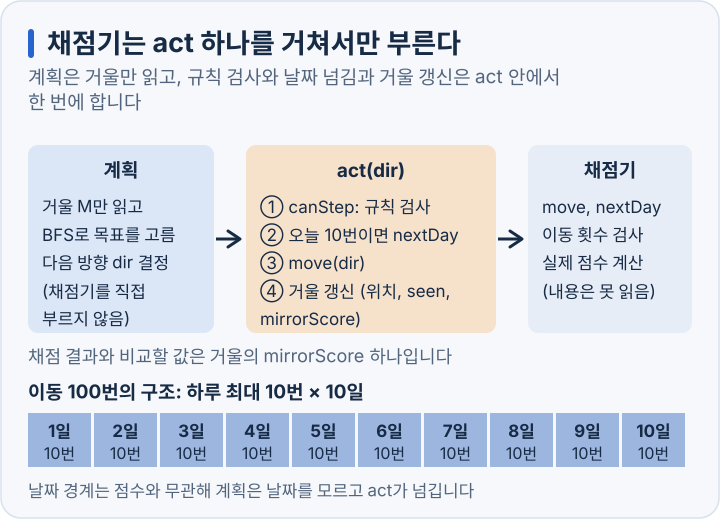

# 채점기 상태를 따라 그리며 행동하기: 문제 계약과 기준선

MINEEXPLORE의 입력·행동 계약과 관측 기록(거울) 상태를 만들고, 거울을 갱신하는 기준선까지 작성합니다. 세 층의 구분은 [강의 개요](../lesson.md)에 있습니다.

## 문제 계약을 상태로 옮기기

| 항목 | 계약 |
| --- | --- |
| 호출 순서 | TC마다 `process(mapInfo, startY, startX)`가 한 번 호출됩니다. 이 호출이 TC 시작 콜백입니다. |
| 행동 API | `move(dir)`: `0` 위, `1` 오른쪽, `2` 아래, `3` 왼쪽으로 한 칸. `nextDay()`: 다음 날로 넘어가 오늘 이동 횟수를 0으로 만듭니다. |
| 규모 | `30 × 30` 지도, 10일, 하루 최대 10번 `move`, TC 10개. 한 TC에서 `move`는 최대 100번이고 `nextDay`는 최대 9번입니다. |
| 점수 | 처음 밟은 칸의 광물 가치 합, 클수록 좋습니다. 시작 칸의 가치는 0이고 다시 밟은 칸은 0점입니다. 10개 TC의 합이 점수이며 문제 설정의 통과 기준은 120000입니다. |
| 무효 행동 | 방향이 `0..3`이 아님, 지도 밖으로 이동, 하루 10번 초과, 10일째에 `nextDay` 호출. 무효가 되면 이후 호출은 모두 무시되고 **그 TC는 0점**입니다. |
| 피드백 | 없습니다. 무효 행동도 예외나 반환값 없이 조용히 0점이 됩니다. |

하루 10번이라는 제한은 하루 안에서만 의미가 있고, 전체로는 `10 × 10 = 100`번 이동이면 충분합니다. 날짜 경계는 어디에 두어도 점수와 무관하므로 계획 코드가 날짜를 몰라도 되게 하고, 행동 코드가 열한 번째 이동 직전에 `nextDay`를 호출하도록 만듭니다. 계획과 행동을 나누는 첫 이유입니다.



[그림 크게 보기](https://git.readiz.com/h-contest-lesson/lessons/observe-and-act/lesson-assets/act-gateway.svg)

## 관측 기록을 한 곳에서만 갱신한다

세 층의 상태를 코드에 옮깁니다. `Mirror`(채점기 상태를 따라 그리는 **거울**)가 내가 관측한 것의 전부이고, `act`가 채점기를 부르는 유일한 통로입니다.

> **코드 환경: h-contest 제출용.** 아래 블록들을 이 순서대로 `user.cpp`에 붙입니다. 이 블록은 `process`를 포함하지 않는 공통 상태입니다.

```cpp snippet=mine-state
#define MAP_SIZE 30

extern void move(int dir);
extern void nextDay(void);

namespace mine {
const int N = MAP_SIZE;
const int DAYS = 10, DAILY = 10;
const int DY[4] = {-1, 0, 1, 0};
const int DX[4] = {0, 1, 0, -1};

struct Mirror {
    int y, x;            // 내가 기록한 현재 위치
    int day, dayMoves;   // 몇 일째인가, 오늘 몇 번 움직였나
    int movesLeft;       // 남은 전체 이동 횟수
    bool seen[N][N];     // 내가 밟은 칸
};

Mirror M;
int (*grid)[MAP_SIZE];   // 전달받은 지도. 읽기만 한다
long long mirrorScore;   // 거울이 계산한 점수
int refused;             // 규칙 위반이라 호출하지 않은 요청 수
void (*hook)(int dist, int gain, int around);   // 로컬 하네스만 연결하는 로그 훅

void resetCase(int mapInfo[][MAP_SIZE], int startY, int startX) {
    grid = mapInfo;
    for (int y = 0; y < N; ++y) for (int x = 0; x < N; ++x) M.seen[y][x] = false;
    M.y = startY; M.x = startX;
    M.seen[startY][startX] = true;
    M.day = 1; M.dayMoves = 0;
    M.movesLeft = DAYS * DAILY;
    mirrorScore = 0; refused = 0;
}

bool canStep(int dir) {
    if (dir < 0 || dir > 3 || M.movesLeft <= 0) return false;
    int ny = M.y + DY[dir], nx = M.x + DX[dir];
    return 0 <= ny && ny < N && 0 <= nx && nx < N;
}

// 채점기 호출은 모두 이 함수를 지난다.
bool act(int dir) {
    if (!canStep(dir)) { ++refused; return false; }
    if (M.dayMoves == DAILY) {          // 오늘 한도를 다 썼으면 먼저 날짜를 넘긴다
        nextDay();
        ++M.day; M.dayMoves = 0;
    }
    move(dir);
    ++M.dayMoves; --M.movesLeft;
    M.y += DY[dir]; M.x += DX[dir];
    if (!M.seen[M.y][M.x]) {
        M.seen[M.y][M.x] = true;
        mirrorScore += grid[M.y][M.x];
    }
    return true;
}
}
```

초기화 시점이 이 설계의 핵심입니다.

| 상태 | 언제 초기화하는가 | 이유 |
| --- | --- | --- |
| `M.seen`, 위치, 날짜, 남은 횟수, `mirrorScore`, `refused` | `process` 시작(`resetCase`)에서 한 번 | TC마다 채점기가 새로 시작합니다. 남겨 두면 이전 TC의 방문 기록이 섞입니다. |
| 위의 같은 값 | **행동마다 지우지 않음** | 행동할 때마다 지우면 방금 밟은 칸을 잊어 같은 칸을 반복 계획합니다. |
| BFS 결과(`R`)와 큐 | 목표를 고를 때마다 | 관측이 바뀌면 낡은 계획입니다. 계획은 매번 다시 계산하며 저장하지 않습니다. |
| `grid` | `resetCase`에서 새 포인터로 | 지도는 읽기 전용 입력입니다. 값을 바꿔 방문 표시로 쓰지 않습니다. |

`act`가 정상 입력에서 거절하는 일은 없어야 하므로, 거절한 요청 수 `refused`를 세어 두고 로컬에서 0인지 확인합니다. [강의 개요](../lesson.md)의 그림 마지막 행에서 보듯 `mirrorScore`는 내가 계산한 점수이고, 채점기의 점수와 같은지 비교하는 것이 이 강의 모든 검사의 출발점입니다.

## 0단계: 유효한 기준선

가장 단순한 규칙 준수 정책은 한 방향으로 걷다가 벽에서 시계 방향으로 꺾는 것입니다. 가치를 전혀 보지 않지만 100번을 모두 유효하게 쓰는지, 날짜 넘김이 맞는지를 먼저 확인할 수 있습니다.

```cpp snippet=mine-baseline
void process(int mapInfo[][MAP_SIZE], int startY, int startX) {
    mine::resetCase(mapInfo, startY, startX);
    int dir = 1;                                  // 오른쪽에서 시작
    while (mine::M.movesLeft > 0) {
        if (!mine::canStep(dir)) { dir = (dir + 1) % 4; continue; }   // 벽이면 시계 방향으로 꺾는다
        mine::act(dir);
    }
}
```

`mine-state` 블록 뒤에 이 블록만 붙이면 완성된 `user.cpp`입니다.
