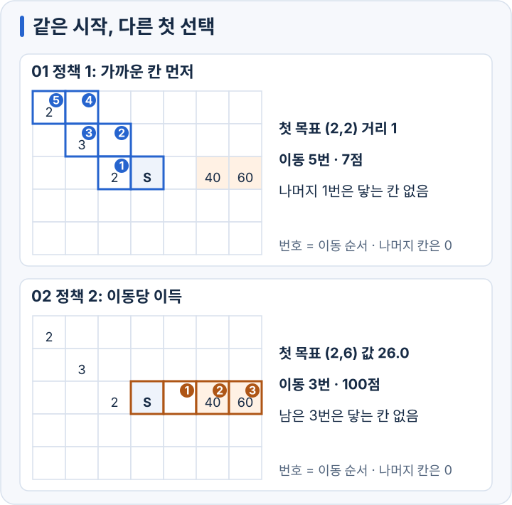

# 채점기 상태를 따라 그리며 행동하기: 풀이

계획과 행동을 나눠 가까운 미확인 칸 정책 1과 이동당 이득 정책 2를 만들고, 두 정책이 갈라지는 순간을 손으로 따라갑니다. 앞 단계는 [문제 계약과 기준선](contract-and-baseline.md)입니다.

## 계획과 행동을 나눈 정책 1: 가까운 미확인 칸

정책은 두 단계를 반복합니다. 먼저 **계획**으로 현재 위치에서 모든 칸까지의 거리와 가는 길의 이득을 구하고, 목표 하나를 고릅니다. 다음에 **행동**으로 그 경로를 `act`로 걷습니다. 계획 함수는 `M`과 `grid`를 읽기만 하고 `act`를 부르지 않습니다.

BFS는 [격자 BFS](https://h.readiz.com/learn/bfs-dfs-grid)와 같지만 칸마다 `gain`을 하나 더 가집니다. 같은 거리로 오는 경로가 여럿이면 아직 밟지 않은 칸의 가치 합이 큰 경로를 남깁니다. BFS는 거리 순서로 칸을 꺼내므로, 한 칸을 꺼낼 때 그 칸으로 들어올 수 있는 이전 칸이 모두 처리되어 `gain`이 확정됩니다. 큐 용량은 칸 수 `N × N = 900`이면 됩니다. 남은 이동 횟수보다 먼 칸은 확장하지 않습니다.

> **코드 환경: h-contest 제출용.** `queue`와 `mine-state` 블록 뒤에 붙입니다. 공통 블록 이름은 `queue`, 용량은 900(누적 push 수), 초기화 시점은 `bfs()` 시작입니다.

```cpp snippet=mine-reach
namespace mine {
struct Reach {
    int dist[N][N];   // 현재 위치에서의 최단 이동 횟수, 닿을 수 없으면 -1
    int gain[N][N];   // 그 거리로 가는 경로 중 아직 안 밟은 칸의 가치 합 최댓값
    int from[N][N];   // 그 경로에서 이 칸에 들어온 방향
};

Reach R;
hc::Queue<N * N> Q;

void bfs() {
    for (int y = 0; y < N; ++y) for (int x = 0; x < N; ++x) R.dist[y][x] = -1;
    Q.clear();
    R.dist[M.y][M.x] = 0; R.gain[M.y][M.x] = 0; R.from[M.y][M.x] = -1;
    Q.push(M.y * N + M.x);
    int cur;
    while (Q.pop(cur)) {
        int y = cur / N, x = cur % N;
        if (R.dist[y][x] == M.movesLeft) continue;      // 남은 횟수 밖은 보지 않는다
        for (int d = 0; d < 4; ++d) {
            int ny = y + DY[d], nx = x + DX[d];
            if (ny < 0 || ny >= N || nx < 0 || nx >= N) continue;
            int g = R.gain[y][x] + (M.seen[ny][nx] ? 0 : grid[ny][nx]);
            if (R.dist[ny][nx] < 0) {
                R.dist[ny][nx] = R.dist[y][x] + 1;
                R.gain[ny][nx] = g; R.from[ny][nx] = d;
                Q.push(ny * N + nx);
            } else if (R.dist[ny][nx] == R.dist[y][x] + 1 && g > R.gain[ny][nx]) {
                R.gain[ny][nx] = g; R.from[ny][nx] = d;   // 같은 거리라면 더 많이 얻는 경로
            }
        }
    }
}
}
```

이제 목표를 고르는 규칙과 경로를 걷는 함수입니다. 정책 1은 값이 있는 미확인 칸 중 가장 가까운 칸을 고릅니다. 정책 2의 평가식은 다음 절에서 설명하며, 여기서는 함께 붙입니다.

```cpp snippet=mine-policy
namespace mine {
const int RADIUS = 3;       // 목표 주변을 보는 맨해튼 반경
const double WEIGHT = 0.1;  // 주변 값 합을 얼마나 믿는가
const double COST = 1.0;    // 목표를 정하는 일에 드는 고정 비용(이동 횟수 단위)

int lastAround;             // 마지막으로 고른 목표의 주변 값 합 (로그용)

// 정책 1: 가장 가까운 미확인 칸. 거리가 같으면 가는 길에 더 얻는 쪽
bool pickNearest(int& ty, int& tx) {
    bool found = false;
    for (int y = 0; y < N; ++y) for (int x = 0; x < N; ++x) {
        int d = R.dist[y][x];
        if (d <= 0 || M.seen[y][x] || grid[y][x] == 0) continue;
        if (!found || d < R.dist[ty][tx] || (d == R.dist[ty][tx] && R.gain[y][x] > R.gain[ty][tx])) {
            found = true; ty = y; tx = x;
        }
    }
    lastAround = 0;
    return found;
}

int around(int ty, int tx) {   // 목표 칸을 뺀, 반경 안의 미확인 가치 합
    int sum = 0;
    for (int y = ty - RADIUS; y <= ty + RADIUS; ++y) for (int x = tx - RADIUS; x <= tx + RADIUS; ++x) {
        int d = (y > ty ? y - ty : ty - y) + (x > tx ? x - tx : tx - x);
        if (d == 0 || d > RADIUS || y < 0 || y >= N || x < 0 || x >= N || M.seen[y][x]) continue;
        sum += grid[y][x];
    }
    return sum;
}

// 정책 2: (가는 길 이득 + WEIGHT × 주변 값) / (이동 횟수 + COST)
double key(int ty, int tx) {
    return (R.gain[ty][tx] + WEIGHT * around(ty, tx)) / (R.dist[ty][tx] + COST);
}

bool pickRatio(int& ty, int& tx) {
    bool found = false;
    double best = 0;
    for (int y = 0; y < N; ++y) for (int x = 0; x < N; ++x) {
        if (R.dist[y][x] <= 0 || M.seen[y][x] || grid[y][x] == 0) continue;
        double k = key(y, x);
        if (!found || k > best) { found = true; best = k; ty = y; tx = x; }
    }
    if (found) lastAround = around(ty, tx);
    return found;
}

void walkTo(int ty, int tx) {
    int dirs[N * N], n = 0;
    for (int y = ty, x = tx; R.dist[y][x] > 0; ) {   // 도착점에서 거꾸로 방향을 모은다
        int d = R.from[y][x];
        dirs[n++] = d;
        y -= DY[d]; x -= DX[d];
    }
    if (hook) hook(R.dist[ty][tx], R.gain[ty][tx], lastAround);
    for (int i = n - 1; i >= 0; --i) act(dirs[i]);
}
}
```

마지막으로 TC 하나를 처리하는 `process`입니다. `POLICY`를 `1`로 두면 정책 1입니다.

```cpp snippet=mine-entry
const int POLICY = 2;   // 1이면 가까운 칸 우선, 2면 평가식

void process(int mapInfo[][MAP_SIZE], int startY, int startX) {
    mine::resetCase(mapInfo, startY, startX);
    while (mine::M.movesLeft > 0) {
        mine::bfs();
        int ty, tx;
        bool found = POLICY == 1 ? mine::pickNearest(ty, tx) : mine::pickRatio(ty, tx);
        if (!found) break;          // 남은 횟수 안에 닿는 가치 있는 칸이 없다
        mine::walkTo(ty, tx);
    }
}
```

한 목표마다 BFS를 새로 하므로 한 TC의 비용은 목표 수 × 900칸이고, 목표는 많아야 100개입니다. 아래 표의 시간이 이를 보여 줍니다.

## 정책 2: 이동 비용 대비 이득을 비교하는 평가식

정책 1은 가장 가까운 칸이 1점짜리여도 그곳으로 갑니다. 정책 2는 모든 후보의 **이동당 이득**을 같은 식으로 비교합니다.

```text
key(t) = (g(t) + WEIGHT × h(t)) / (d(t) + COST)
```

| 항 | 뜻 | 확정 여부 |
| --- | --- | --- |
| `g(t)` | 거울 기준으로 `t`까지 걸으며 새로 얻는 점수 | 확정. 걸으면 정확히 이 값만큼 오릅니다. |
| `d(t)` | `t`까지 이동 횟수 | 확정. 100번이라는 예산을 쓰는 양입니다. |
| `h(t)` | `t`에서 맨해튼 거리 `RADIUS` 이내 미확인 칸의 가치 합(`t` 제외) | **추정.** 거기서 실제로 얻는다는 보장이 없고 `g`의 경로 칸과 겹칠 수도 있습니다. |
| `WEIGHT` | 추정 `h`를 얼마나 믿는가 | 0이면 `h`를 무시합니다. |
| `COST` | 목표 하나를 정하는 고정 비용 | 0이면 거리 1짜리 작은 칸의 비율이 폭주합니다. |

측정은 공개 채점기 `main.cpp`를 복사해 출력 몇 줄만 더한 로컬 사본에 위 코드를 붙여 했습니다. 측정일은 2026-11-18, 환경은 Apple M1·macOS·Apple clang 17(`-std=c++17 -O2`)이며, 점수는 같은 입력에서 항상 같고 시간(ms)은 채점기가 출력한 값입니다. 기준선·정책 1·정책 2의 시간은 9번 실행의 중앙값이고, 아래 파라미터 표의 시간은 1회 측정이라 잡음이 있습니다. 원본은 [measurements.json](../lesson-assets/measurements.json)에 있습니다.

| 정책 | 점수 합 | 거울 점수 합 | 거절 요청 | 시간 ms |
| --- | --- | --- | --- | --- |
| 기준선 | 46422 | 46422 | 0 | 0 |
| 정책 1 | 105823 | 105823 | 0 | 9 |
| 정책 2 | 131259 | 131259 | 0 | 9 |

점수 합이 120000을 넘는 것은 정책 2뿐입니다. 거울 점수 합은 세 정책 모두 채점기 점수와 같고 거절 요청은 0입니다. TC별 점수는 다음과 같습니다.

| 정책 | TC 1 | TC 2 | TC 3 | TC 4 | TC 5 | TC 6 | TC 7 | TC 8 | TC 9 | TC 10 |
| --- | --- | --- | --- | --- | --- | --- | --- | --- | --- | --- |
| 기준선 | 7359 | 4716 | 6111 | 4243 | 5364 | 3659 | 3057 | 3417 | 4053 | 4443 |
| 정책 1 | 12626 | 12380 | 6202 | 9879 | 13162 | 8461 | 13433 | 9932 | 6541 | 13207 |
| 정책 2 | 12931 | 12827 | 11792 | 12822 | 13098 | 12595 | 14517 | 13283 | 12970 | 14424 |

정책 2는 정책 1보다 10개 중 9개 TC에서 높습니다. 정책 1이 낮은 TC 3과 TC 9(6202, 6541)에서 정책 2는 11792와 12970입니다. 반대로 TC 1(12626과 12931)과 TC 5(13162와 13098)는 두 정책이 거의 같습니다. 가까운 곳에 큰 언덕이 있으면 가까운 칸 우선도 충분하다는 뜻입니다.

기본값(`RADIUS 3`, `WEIGHT 0.1`, `COST 1.0`)에서 **파라미터 하나씩만** 바꾼 결과입니다.

| 바꾼 값 | 점수 합 | 거울 점수 합 | 거절 요청 | 시간 ms |
| --- | --- | --- | --- | --- |
| RADIUS 1 | 131886 | 131886 | 0 | 1 |
| RADIUS 2 | 132049 | 132049 | 0 | 2 |
| RADIUS 3 | 131259 | 131259 | 0 | 8 |
| RADIUS 4 | 128789 | 128789 | 0 | 27 |
| RADIUS 5 | 131620 | 131620 | 0 | 50 |
| RADIUS 6 | 128691 | 128691 | 0 | 73 |
| WEIGHT 0.0 | 129734 | 129734 | 0 | 2 |
| WEIGHT 0.05 | 131740 | 131740 | 0 | 3 |
| WEIGHT 0.1 | 131259 | 131259 | 0 | 8 |
| WEIGHT 0.25 | 125514 | 125514 | 0 | 33 |
| WEIGHT 0.5 | 123507 | 123507 | 0 | 19 |
| WEIGHT 1.0 | 118013 | 118013 | 0 | 28 |
| WEIGHT 2.0 | 114557 | 114557 | 0 | 39 |
| COST 0.0 | 124190 | 124190 | 0 | 17 |
| COST 1.0 | 131259 | 131259 | 0 | 8 |
| COST 2.0 | 130971 | 130971 | 0 | 2 |
| COST 4.0 | 129383 | 129383 | 0 | 1 |
| COST 8.0 | 128253 | 128253 | 0 | 1 |
| COST 16.0 | 122967 | 122967 | 0 | 1 |

읽는 방법은 다음과 같습니다.

- `COST`는 1~2에서 가장 높고 0과 16에서 내려갑니다. 분모에 고정값이 없으면 한두 번 이동으로 닿는 작은 칸의 이동당 이득이 부풀어 오릅니다. 반대로 너무 크면 거리 차이가 비율에 덜 반영되어 멀리 있는 큰 칸을 고집합니다.
- `WEIGHT`가 0.25 이상이면 점수가 내려가 2.0에서는 114557입니다. 추정치 `h`가 실제 이득보다 크게 잡히기 때문입니다.
- `WEIGHT 0.0`(주변 값 무시)과 기본값의 TC별 차이를 입력 10개로 보면 평균 152.5, 표준오차 123.5이고 근사 구간 [-94.5, 399.5]가 0을 포함합니다. 주변 항이 도움이 되는지는 이 10개로 확정할 수 없습니다. 큰 `WEIGHT`가 해롭다는 것만 분명합니다.
- `RADIUS`는 1~3에서 점수가 비슷하고 시간만 `1 → 73` ms로 늘어납니다. 큰 반경은 이득 없이 비용만 키웁니다.

이 표는 채점에 쓰이는 같은 10개 입력에서 파라미터를 고른 결과입니다. 새 입력에서도 유지된다는 뜻이 아니므로 [실험 비교와 평가](https://h.readiz.com/learn/testing-and-stress/experiment-evaluation)의 튜닝·검증 입력 분리를 적용해, 아래 [실패 검사](experiments-and-failures.md)의 하네스처럼 직접 만든 지도에서 한 번 더 확인합니다.

## 작은 손계산: 두 정책이 갈라지는 순간

`30 × 30` 지도의 왼쪽 위 일부만 다음과 같고 나머지는 모두 0이라고 하겠습니다. 시작은 `(2,3)`이고 남은 이동은 6번입니다. 좌표는 `(행, 열)`입니다.

| 행＼열 | 0 | 1 | 2 | 3 | 4 | 5 | 6 |
| --- | --- | --- | --- | --- | --- | --- | --- |
| 0 | 2 | 0 | 0 | 0 | 0 | 0 | 0 |
| 1 | 0 | 3 | 0 | 0 | 0 | 0 | 0 |
| 2 | 0 | 0 | 2 | S | 0 | 40 | 60 |



[그림 크게 보기](https://git.readiz.com/h-contest-lesson/lessons/observe-and-act/lesson-assets/two-policies.svg)

정책 1은 거리 1의 `(2,2)`부터 줍고, 다음에 `(2,2)`에서 가장 가까운 `(1,1)`, 그다음 `(0,0)`으로 갑니다. 5번 이동에 `2 + 3 + 2 = 7`점이며 남은 1번으로 닿는 값이 없어 끝납니다.

정책 2는 첫 위치에서 후보마다 키를 계산합니다(`WEIGHT 0.1`, `RADIUS 3`, `COST 1`).

| 후보 | 이동 d | 경로 이득 g | 주변 값 h | 키 |
| --- | --- | --- | --- | --- |
| (2,2) | 1 | 2 | 43 | 3.15 |
| (2,5) | 2 | 40 | 62 | 15.4 |
| (2,6) | 3 | 100 | 40 | 26.0 |
| (1,1) | 3 | 5 | 4 | 1.35 |
| (0,0) | 5 | 7 | 3 | 1.217 |

`(2,6)`의 키는 `(100 + 0.1 × 40) / (3 + 1) = 26.0`입니다. `(2,2)`의 `h = 43`에는 `(1,1)`의 3과 `(2,5)`의 40이 들어가지만 `g`가 2뿐이라 키는 3.15에 머뭅니다. 정책 2는 `(2,6)`으로 3번 이동해 `40 + 60 = 100`점을 얻고, 남은 3번 안에 닿는 값이 없어 끝납니다. 같은 6번 예산에서 정책 1은 7점, 정책 2는 100점입니다.

| 정책 | 목표 순서 | 이동 | 점수 |
| --- | --- | --- | --- |
| 1 | (2,2), (1,1), (0,0) | 5 | 7 |
| 2 | (2,6) | 3 | 100 |

이 표와 위 키 값은 `scripts/check_observe_and_act.py`가 위 제출 코드를 그대로 돌려 다시 계산하고, 손으로 구한 값(`g`, `h`, `d`, 키, 목표 순서, 점수)과 대조합니다. 이 예시는 `h`의 이중 계산도 보여 줍니다. `(2,5)`의 `h = 62`에는 `(2,2)`의 2처럼 다른 방향의 칸이 섞여 있고, `(2,6)`의 `g`에 들어간 40은 `(2,5)`의 `h`에도 들어갑니다. 위 파라미터 표에서 큰 `WEIGHT`가 해로운 이유와 같은 현상입니다.

[두 정책 비교 데모: 가까운 칸 먼저 vs 이동당 이득](https://git.readiz.com/h-contest-lesson/demos/index.html?demo=mirror-policy)

같은 지도와 이동 6번에서 두 정책이 고르는 목표와 경로, 후보별 키 값, 누적 점수 7 대 100, 그리고 거울의 seen이 갱신되는 모습을 단계별로 비교합니다. 이동 예산과 WEIGHT를 바꿔 보세요.
