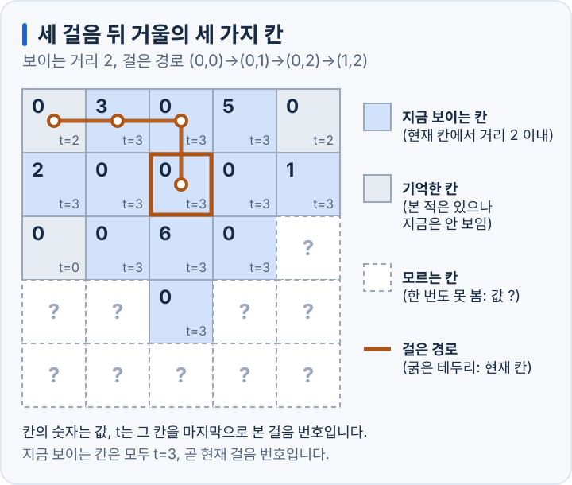
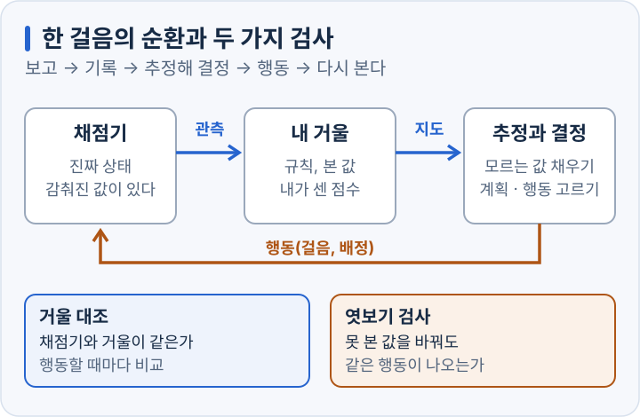
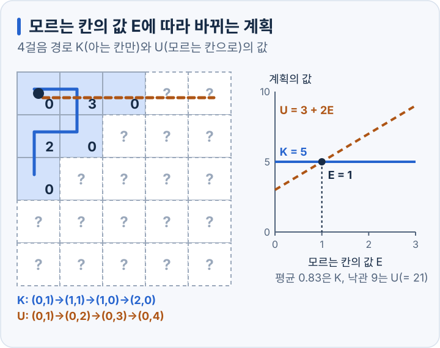
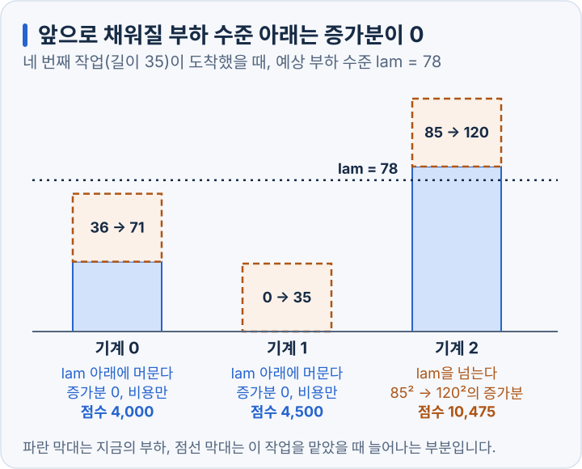

# 원리: 아는 것·기억한 것·모르는 것과 결정

입력 전체가 처음부터 주어지지 않는 문제가 있습니다. 지금 있는 곳 가까이만 보이거나, 작업이 하나씩 도착하고 도착한 순간 결정해야 합니다. 이때의 결정은 세 가지 질문으로 나뉩니다. 무엇을 알고 있는가(규칙, 지금 보이는 것), 무엇을 보고 기억해 두었는가(관측의 기록), 무엇을 아직 모르는가(못 본 값, 앞으로 올 것). 이 페이지는 세 가지를 나누는 표, 관측을 기억하는 자료구조와 그것이 채점기의 실제 상태와 어긋나지 않는지 확인하는 방법, 모르는 값을 추정해 결정하는 방법, 새 관측마다 다시 계획하는 방법, 전체 정보로 푼 결과와 비교해 부분 정보의 비용을 재는 방법을 두 가지 문제 유형으로 손으로 따라갑니다. 코드는 [구현](implementation.md), 실험 결과는 [실험과 점검](practice.md)에 있습니다.

## 언제 쓰고 언제 쓰지 않는가

| 상황 | 판단 |
| --- | --- |
| 입력의 일부만 보이고 나머지는 행동하거나 시간이 지나야 드러난다 | 쓴다. 본 것을 거울에 기억하고 모르는 값은 추정으로 채워 결정한다 |
| 행동이 무엇을 볼지 정한다(움직이면 새로 보인다) | 탐색(모르는 곳을 보러 가기)과 활용(아는 좋은 곳으로 가기)의 균형이 쟁점이고 재계획이 필요하다 |
| 무엇을 볼지 정할 수 없고 도착하는 대로 결정해야 하며 되돌릴 수 없다(온라인) | 탐색할 것이 없다. 앞으로 올 것의 추정과 이미 한 결정의 비용이 쟁점이다. 다시 계획할 결정도 없다 |
| 입력 전체가 처음부터 주어지거나 몇 번의 관측으로 전부 드러난다 | 이 강의가 아니다. 먼저 다 보고 전체 정보 방법([빔 서치](https://h.readiz.com/learn/beam-search) 등)을 쓴다 |
| 모르는 값의 분포를 확률 모델로 세워 최적의 정책을 구하려 한다 | 강화학습·베이즈 최적 정책 같은 정식 이론은 이 강의의 범위 밖이다. 여기서는 평균·낙관·비관 같은 단순한 추정만 쓴다 |
| 설정을 여러 개 비교해 고르는 일 자체가 쟁점이다 | [실험과 튜닝](https://h.readiz.com/learn/experiments-and-tuning)에서 다룬다. 이 강의는 같은 시드끼리의 짝지은 비교만 쓴다 |

선수 지식은 [문제를 상태·행동·점수로 옮기기](https://h.readiz.com/learn/problem-modeling)의 상태 표현과 [빔 서치와 평가 함수](https://h.readiz.com/learn/beam-search)입니다. 빔 서치는 이 강의에서 계획기와 전체 정보 기준선으로 쓰이며 설계는 다시 설명하지 않습니다.

## 연습용 문제 틀

이 강의의 모든 수치는 아래 두 가지 입력에서 나옵니다. 이 사이트의 어떤 문제의 채점 결과에도 의존하지 않습니다. 난수는 64비트 정수 `x`를 시드로 시작해 `x = x * 6364136223846793005 + 1442695040888963407`(64비트 곱셈·덧셈의 순환)로 갱신하고, 값은 `(x >> 33) % 범위`입니다. 시드는 1부터 20까지 쓰며 두 정책에는 난수가 없습니다.

- **격자 수집(부분 정보 변형):** `20 × 20` 격자의 칸마다 값(0..9)이 있고 칸 번호는 행 순서로 `0 .. 399`입니다. 칸마다 행 순서로 `u = next(10)`을 읽어 `u < 6`이면 값 0(0의 비율 60%), 아니면 한 번 더 읽어 값 `1 + next(9)`입니다. 칸 `(0, 0)`(번호 0)에서 시작해 상하좌우로 `T = 60`번 움직이며, 처음 밟는 칸의 값을 얻습니다(시작 칸 포함). 격자 밖으로는 못 나가고 같은 칸을 다시 밟아도 됩니다. 얻은 값의 합이 클수록 좋습니다. 이 변형의 관측 규칙은 다음과 같습니다. 시작 직후와 한 걸음 움직일 때마다 현재 칸에서 맨해튼 거리 2 이내(격자 안, 현재 칸 포함, 최대 13칸)인 칸의 값이 보이고, 그 밖의 칸은 값을 모릅니다. 한 번 본 값은 바뀌지 않습니다.
- **온라인 배정(작업):** 작업 `N = 120`개, 기계 `M = 8`대, 기계 한 대의 상한 `K = 18`개입니다. 입력은 작업 `i = 0, 1, …, 119` 순서로 길이 `d[i] = 1 + next(100)`을 읽고 이어서 기계 `0 .. 7`의 추가 비용 `c[i][0..7] = next(51)`을 읽어 만듭니다. 작업은 번호 순서로 하나씩 도착합니다. 작업 `i`가 도착하면 그 작업의 `d[i]`와 `c[i][*]`가 보이고, 그 순간 기계 하나에 맡겨야 하며 이후에 바꿀 수 없습니다. 아직 도착하지 않은 작업의 길이와 비용은 모릅니다. 기계에 상한을 넘겨 맡기면 무효입니다. 비용은 `(Σ load[j]²) / 100 + Σ c[i][배정]`(나눗셈은 합 전체에 한 번의 정수 나눗셈)이고 작을수록 좋습니다. 같은 시드의 입력은 [근방 설계와 차분 평가](https://h.readiz.com/learn/neighborhood-and-delta)의 배정 틀과 같으며, 거기서는 처음부터 모든 작업을 안다는 점만 다릅니다.

## 아는 것·기억한 것·모르는 것

결정에 쓰는 정보를 세 칸으로 나누어 적는 것이 첫 단계입니다. 칸마다 다루는 방법이 다릅니다.

| 구분 | 격자 수집 | 온라인 배정 | 다루는 방법 |
| --- | --- | --- | --- |
| 아는 것(규칙) | 크기 20 × 20, `T = 60`, 보이는 거리 2, 값은 0..9 | 작업 수 120, 기계 8대, 상한 18, 길이 1..100, 추가 비용 0..50 | 상수로 코드에 적는다 |
| 관측해서 기억한 것 | 본 칸의 값, 마지막으로 본 걸음 번호, 밟은 칸, 내가 센 점수 | 도착한 작업의 길이와 비용, 내 배정, 기계별 부하와 작업 수 | 거울에 기록한다 |
| 아직 모르는 것 | 못 본 칸의 값 | 앞으로 올 작업의 길이와 비용 | 추정으로 채운다 |

"모르는 것"에도 아는 것이 섞여 있습니다. 값이 0..9라는 범위나 지금까지 본 칸의 평균이 그것이며, 이것이 추정의 재료입니다. 규칙에서 틀리게 읽은 것(예: 보이는 거리를 3으로 착각)은 이 표에서 가장 먼저 잡아야 하는 오류입니다.

## 관측을 기억하는 자료구조

보이는 것은 그 걸음에만 채점기가 알려 주므로 쓸 것은 거울에 옮겨 적어야 합니다. 격자 수집에서 거울이 가지는 것은 아래와 같습니다.

- **본 값 `val`과 마지막으로 본 시점 `seenAt`.** `seenAt`이 `-1`이면 한 번도 못 본 칸, 아니면 그 칸을 마지막으로 본 걸음 번호입니다. 값 `0`을 모름의 표시로 쓰지 않는 것이 핵심입니다. 본 0과 못 본 칸이 섞이면 "모르는 곳으로 가 볼까"라는 판단이 사라집니다. 이 강의의 격자는 값이 변하지 않지만, 값이 바뀌는 환경에서는 `seenAt`이 "기억한 값이 얼마나 낡았는가"를 알려 줍니다.
- **밟은 칸 `stepped`.** 처음 밟는 칸만 점수가 되므로 점수 계산과 계획 모두에 필요합니다.
- **내가 센 점수 `got`.** 채점기에 묻지 않고 기억한 값으로 셉니다. 채점기의 점수와 같은지가 거울이 맞는지의 가장 싼 검사입니다.
- **평균의 재료 `nSeen`, `sumSeen`.** 값을 아는 칸의 수와 합이며 처음 본 칸만 더합니다. 걸을 때마다 거리 2 이내가 다시 보이므로 보일 때마다 더하면 걸어 다닌 길 주변의 값으로 치우칩니다.

[그림 크게 보기](https://git.readiz.com/h-contest-lesson/lessons/partial-information/lesson-assets/known-unknown.svg)

온라인 배정의 거울은 기계별 부하 `load`와 작업 수 `cnt`, 도착한 작업 길이의 합 `dSum`, 맡긴 추가 비용의 합 `cSum`입니다. 이 문제에서 모르는 것은 앞으로 올 작업이고, 기억할 관측은 도착한 작업과 내 배정입니다.

이 강의의 격자에는 막힌 칸이 없어서 내 지도 위의 거리를 맨해튼 거리로 구합니다. 막힌 칸을 알게 될 때마다 지도에 적어 가며 최단 거리를 구해야 하는 문제에서는 BFS를 씁니다. [BFS 데모](https://git.readiz.com/h-contest-lesson/demos/index.html?demo=bfs)는 벽이 있는 고정된 지도에서 큐와 방문 표시를 따라가는 예이며, 거울이 쌓이는 모습은 아니고 지도 위 거리 계산의 모양만 보여 줍니다.

## 거울 상태와 어긋남 확인

**거울 상태**는 채점기가 가진 실제 상태를 내 쪽에서 따라 그린 것입니다. 거울이 채점기와 어긋나면 이후의 모든 결정이 틀린 정보 위에서 내려지는데, 어긋남은 대개 조용히 나쁜 점수로만 나타납니다. 확인 방법은 세 가지입니다.

1. **채점기와 대조.** 로컬 모의 채점기가 있으면 행동할 때마다 위치, 점수, 밟은 칸, "보여 준 칸 = 아는 칸", 본 값의 일치를 확인합니다. 실제 채점기는 내부 상태를 읽을 수 없으므로 문제가 응답으로 주는 값(점수, 위치)이 있으면 그것과 대조하고, 나머지는 로컬 모의 채점기에서 잡습니다.
2. **불변식.** 평균 재료의 개수는 아는 칸 수와 같아야 하고, 밟은 칸은 모두 아는 칸이어야 하며, 거울의 점수는 밟은 칸 값의 합이어야 합니다.
3. **엿보기 검사.** 정책이 감춰진 정보를 쓰지 않는지 확인합니다. 한 번도 보여 주지 않은 값을 모두 다른 값으로 바꿔서 돌렸을 때 같은 행동이 나와야 합니다. 로컬 채점기는 전체 입력을 가지고 있어서 정책이 실수로 읽어도 컴파일과 실행이 되고, 점수도 좋게 나옵니다. 대회의 채점기에서는 그 값이 없어서 점수가 달라집니다.

[그림 크게 보기](https://git.readiz.com/h-contest-lesson/lessons/partial-information/lesson-assets/mirror-loop.svg)

[가까운 칸 먼저 vs 이동당 이득 데모](https://git.readiz.com/h-contest-lesson/demos/index.html?demo=mirror-policy)

이 데모는 30 × 30 지도에서 두 정책이 목표를 고르고 거울의 `seen` 표시가 갱신되는 모습을 보여 줍니다. 지도 규칙과 정책이 이 강의의 격자 수집과 다릅니다. 관측이 거울에 쌓여 목표 선택이 바뀌는 순서를 볼 때 쓰세요.

## 모르는 값을 추정하기

계획이나 결정에는 값이 필요하므로, 모르는 값에는 대신 쓸 값을 정해 줍니다. 세 가지가 기본입니다.

| 추정 | 모르는 값을 얼마로 칠하는가 | 어떻게 행동이 달라지는가 |
| --- | --- | --- |
| 비관 | 가능한 최솟값(격자에서는 0) | 아는 것만 보고 움직인다. 아는 값이 모두 바닥나면 모르는 곳으로 갈 이유가 없다 |
| 평균 | 관측한 값의 평균 | 모르는 칸이 보통 정도라고 본다. 아는 좋은 칸이 보통보다 나쁠 때만 모르는 곳으로 간다 |
| 낙관 | 가능한 최댓값(격자에서는 9) | 모르는 곳이 좋을 수 있다고 본다. 모르는 곳으로 가는 경로가 좋아 보인다 |

경험 법칙으로 "모르는 것을 좋게 보면(낙관) 탐색이 늘고, 나쁘게 보면(비관) 활용이 늘어난다"고 합니다. 이 법칙은 추정 값 하나로 탐색과 활용의 균형을 조절한다는 뜻이며, [실험](practice.md)이 이 방향의 행동 차이는 지지하지만 점수가 낙관일수록 오르지는 않는다는 것도 보입니다. 추정은 비교만 가를 수 있으면 되므로 값이 정확할 필요는 없지만, 아는 값과 같은 단위여야 합니다. 모르는 칸을 `9`로 칠하면서 아는 값은 0..9가 아닌 다른 단위로 적으면 비교가 뒤틀립니다.

## 탐색과 활용

**탐색**은 모르는 곳을 보러 가는 것, **활용**은 아는 좋은 곳으로 가는 것입니다. 격자에서는 움직임이 곧 관측이라 둘이 한 행동에 묶입니다. 모르는 곳으로 가면 새 값이 보여 거울이 풍부해지지만 이번 걸음의 점수는 아는 좋은 칸으로 갈 때보다 낮을 수 있습니다. 이 균형을 모르는 칸의 추정값 하나가 정합니다. 추정이 낮으면 아는 칸의 점수가 모르는 곳의 기댓값을 이기고, 높으면 모르는 곳으로 가는 경로가 이깁니다. 아래 손계산에서 이 경계가 `E = 1`로 나옵니다.

온라인 배정에는 탐색이 없습니다. 무엇이 도착할지 정할 수 없고, 앞으로 올 작업은 추정으로만 다룹니다. 이 구분이 판단 기준 하나입니다. 행동이 관측을 바꾸는가가 탐색과 활용을 가릅니다.

## 다시 계획하기

계획은 거울과 추정에서 만들었으므로 새 관측이 들어오면 낡습니다. 모르던 칸이 보여 추정이 사실로 바뀌거나, 평균이 바뀌어 추정값 자체가 달라집니다. 그래서 계획의 앞 몇 걸음만 실행하고 다시 계획합니다. 실행하고 다시 계획하는 걸음 수가 **재계획 주기**이고, 1이면 새로 볼 때마다 계획을 다시 세웁니다. 비용은 계획 한 번의 평가 횟수에 계획 횟수를 곱한 값이므로, 주기를 늘리면 평가가 그만큼 줄고 낡은 계획으로 움직이는 걸음이 늘어납니다. 격자 수집에서는 걸음을 다시 계획할 수 있습니다. 온라인 배정에서는 맡긴 작업을 되돌릴 수 없어서 다시 계획할 것이 없고 결정은 한 번뿐입니다.

## 전체 정보 기준선과 부분 정보의 비용

부분 정보의 점수가 얼마나 낮은지는 같은 입력을 처음부터 다 알고 푼 결과(전체 정보 기준선)와 비교해야 알 수 있습니다. 기준선은 둘입니다.

- **같은 계획기에 진짜 값 지도를 넣은 것.** 부분 정보의 계획과 같은 코드이고 지도만 진짜입니다. 둘의 차이가 정보의 비용입니다.
- **다른 전체 정보 방법.** [빔 서치](https://h.readiz.com/learn/beam-search)의 `Beam`을 진짜 지도에 쓴 값입니다. 이 값과 위의 기준선의 차이는 계획기가 약해서 생기는 몫이며 정보 때문이 아닙니다.

기준선은 최적이 아니라 하나의 방법의 결과이므로 더 좋은 해가 있을 수 있습니다. 상한이 필요하면 문제에서 쉽게 구하는 한계를 따로 씁니다(격자 수집에서는 가장 큰 61개 값의 합, 온라인 배정에서는 부하 항과 추가 비용 항을 따로 줄인 하한). 한계는 대개 느슨해서 남은 여지를 가늠하는 용도로만 씁니다. 정보의 비용을 한 가지 값으로 말할 때는 같은 시드끼리 `기준선 − 부분 정보`를 구해 그 분포를 보고하며, 한 시드의 차이를 일반 법칙처럼 쓰지 않습니다.

## 손으로 따라가기 1: 격자 수집 5 × 5

아래 격자에서 시작 칸은 `(0, 0)`, 보이는 거리는 2, 걸음 수는 `T = 4`입니다. 칸은 `(행, 열)`이고 번호는 행 순서로 `0 .. 24`입니다. 진짜 값(채점기만 압니다)은 다음과 같습니다.

| 행 \ 열 | 0 | 1 | 2 | 3 | 4 |
| ---: | ---: | ---: | ---: | ---: | ---: |
| 0 | 0 | 3 | 0 | 5 | 0 |
| 1 | 2 | 0 | 0 | 0 | 1 |
| 2 | 0 | 0 | 6 | 0 | 0 |
| 3 | 0 | 4 | 0 | 0 | 0 |
| 4 | 7 | 0 | 0 | 2 | 0 |

**첫 관측.** `(0, 0)`에서 거리 2 이내의 칸은 `(0,0)`, `(0,1)`, `(0,2)`, `(1,0)`, `(1,1)`, `(2,0)`의 6칸이고 값은 0, 3, 0, 2, 0, 0입니다. 거울에는 이 6칸의 값이 시점 0으로 기록되고, 나머지 19칸은 모르는 칸입니다. 평균의 재료는 `nSeen = 6`, `sumSeen = 5`이며 평균은 `5 / 6 ≈ 0.83`입니다. 시작 칸을 밟았으므로 점수는 0입니다.

**계획.** 앞 4걸음의 경로는 모두 60개이고, 경로가 처음 밟는 칸마다 그 칸의 값(모르는 칸이면 추정 `E`)을 더한 것이 경로의 값입니다. 다음 두 경로를 비교합니다.

| 경로 | 칸 | 아는 칸의 값 | 모르는 칸 | 경로의 값 |
| --- | --- | ---: | --- | --- |
| K: 아는 칸만 돌기 | `(0,1) → (1,1) → (1,0) → (2,0)` | 3 + 0 + 2 + 0 = 5 | 없음 | 5 |
| U: 오른쪽으로 곧게 | `(0,1) → (0,2) → (0,3) → (0,4)` | 3 + 0 = 3 | `(0,3)`, `(0,4)` 둘 | 3 + 2E |

모르는 칸이 두 개이므로 U의 값은 `3 + 2E`이고 K의 값은 `E`와 무관하게 5입니다. 60개 경로 전부에서 최댓값을 찾으면 아래와 같습니다.

| 추정 | `E` | 경로 K | 경로 U | 60개 중 최댓값 | 고르는 계획 |
| --- | ---: | ---: | ---: | ---: | --- |
| 비관 | 0 | 5 | 3 | 5 | K 계열 |
| 평균 | 0.83 | 5 | 4.66 | 5 | K 계열 |
| 낙관 | 9 | 5 | 21 | 21 | U 계열 |

경계는 `3 + 2E = 5`, 곧 `E = 1`입니다. `E`가 1보다 작으면 아는 칸을 도는 K, 크면 모르는 칸으로 나가는 U가 낫습니다. 평균 0.83은 경계 바로 아래라서 K를 고르고, 낙관 9는 U를 고릅니다. 최댓값을 내는 경로는 하나가 아니라서(K 계열 12개, 낙관의 U 계열 8개) 같은 값을 내는 경로 사이는 동점 규칙이 정합니다.

[그림 크게 보기](https://git.readiz.com/h-contest-lesson/lessons/partial-information/lesson-assets/estimate-paths.svg)

**관측과 거울 갱신.** 오른쪽, 오른쪽, 아래로 세 걸음 걸으면(`(0,1)`, `(0,2)`, `(1,2)`) 새로 보이는 칸이 거울에 더해집니다. 같은 칸이 다시 보이면 시점만 새로 적고 평균 재료에는 더하지 않습니다.

| 걸음 | 위치 | 새로 아는 칸 | 아는 칸 수 `nSeen` | 값의 합 `sumSeen` | 평균 | 점수 |
| ---: | --- | --- | ---: | ---: | ---: | ---: |
| 0 | `(0,0)` | 6칸 | 6 | 5 | 0.83 | 0 |
| 1 | `(0,1)` | `(0,3)`=5, `(1,2)`=0, `(2,1)`=0 | 9 | 10 | 1.11 | 3 |
| 2 | `(0,2)` | `(0,4)`=0, `(1,3)`=0, `(2,2)`=6 | 12 | 16 | 1.33 | 3 |
| 3 | `(1,2)` | `(1,4)`=1, `(2,3)`=0, `(3,2)`=0 | 15 | 17 | 1.13 | 3 |

걸음 1에서 `(0,3)`의 값 5가 보이므로 모르던 칸의 추정이 사실로 바뀌고 평균이 1.11로 올라 경계 `E = 1`을 넘습니다. 새 관측 하나가 계획을 바꿀 수 있다는 것이 재계획의 이유입니다. 걸음 3 뒤의 거울은 위 그림의 모습이고, `(0,0)`은 시점 2, `(2,0)`은 시점 0이 마지막으로 본 시점이라 지금은 안 보이는 기억한 칸입니다.

**평균에 또 더하는 실수.** 걸음마다 보이는 칸을 모두 더하면 걸음 1에서 아는 칸 수가 14, 합이 15가 되고(올바른 값은 9와 10), 걸음 3에서는 35와 46이 됩니다(15와 17). 거울의 아는 칸 수가 실제 아는 칸 수와 다르므로 거울 대조가 걸음 1에서 잡습니다.

## 손으로 따라가기 2: 온라인 배정, 작업 6개·기계 3대·상한 3

작업은 번호 순서로 도착합니다. 길이 `d = [36, 39, 46, 35, 53, 5]`이고 추가 비용 `c`는 아래와 같습니다.

| 작업 | `c[i][0]` | `c[i][1]` | `c[i][2]` |
| ---: | ---: | ---: | ---: |
| 0 | 0 | 42 | 46 |
| 1 | 32 | 50 | 20 |
| 2 | 20 | 26 | 0 |
| 3 | 40 | 45 | 33 |
| 4 | 46 | 19 | 19 |
| 5 | 21 | 1 | 12 |

작업이 도착하면 기계 `q`에 맡길 때의 점수를 `100 × c[i][q] + (부하 제곱의 증가)`로 셉니다. 비교용 점수이고 비용의 `/ 100`과 같은 순서를 줍니다. 앞일을 보지 않는 **탐욕**은 부하 제곱의 증가를 그대로 셉니다. **평균 추정**은 마지막에 기계 하나가 맡을 부하 `lam`을 `(도착한 작업의 길이 합 + 남은 작업 수 × 도착한 작업의 평균 길이) / 3`으로 예상하고, 부하가 `lam` 아래인 부분은 앞으로 채워질 것이라 보고 증가분을 0으로 셉니다(부하를 `max(부하, lam)`으로 올려 제곱합니다). 작업 3에서 `lam = 78`일 때의 모습이 아래 그림입니다.

[그림 크게 보기](https://git.readiz.com/h-contest-lesson/lessons/partial-information/lesson-assets/online-floor.svg)

두 정책의 점수(왼쪽부터 기계 0, 1, 2)와 선택은 아래와 같습니다.

| 작업 | 길이 | 탐욕: 점수 | 탐욕: 선택 | 평균 추정: `lam` | 평균 추정: 점수 | 평균 추정: 선택 |
| ---: | ---: | --- | ---: | ---: | --- | ---: |
| 0 | 36 | 1,296 / 5,496 / 5,896 | 0 | 72 | 0 / 4,200 / 4,600 | 0 |
| 1 | 39 | 7,529 / 6,521 / 3,521 | 2 | 74 | 3,349 / 5,000 / 2,000 | 2 |
| 2 | 46 | 7,428 / 4,716 / 5,704 | 1 | 80 | 2,324 / 2,600 / 825 | 2 |
| 3 | 35 | 7,745 / 8,945 / 7,255 | 2 | 78 | 4,000 / 4,500 / 10,475 | 0 |
| 4 | 53 | 11,225 / 9,585 / 12,553 | 1 | 83 | 13,087 / 1,900 / 13,719 | 1 |
| 5 | 5 | 2,485 / 1,115 / 1,965 | 1 | 71 | 2,835 / 100 / 2,075 | 1 |

탐욕은 매번 지금의 점수가 가장 낮은 기계를 고르고, 최종 부하는 36, 104, 74로 벌어집니다. 비용은 `(36² + 104² + 74²) / 100 + 추가 비용 합 = 175 + 99 = 274`입니다. 평균 추정은 작업 0에서는 세 기계가 모두 `lam` 아래라 추가 비용이 가장 싼 기계 0을 고르고, 작업 3에서는 기계 2가 이미 부하 85로 `lam`(78)을 넘어서 있어 기계 0을 고릅니다. 작업 4에서는 비어 있는 기계 1이 `lam` 아래라 추가 비용만 치릅니다. 최종 부하는 71, 58, 85이고 비용은 `(71² + 58² + 85²) / 100 + 추가 비용 합 = 156 + 80 = 236`입니다.

기준과 비교하면, 모든 배정(상한 3을 지키는 510개)을 세어 구한 최적은 236이라 평균 추정이 최적과 같습니다. 라운드 로빈(`i % 3`)은 282이고, 총 길이를 알고 도착 순서대로 같은 규칙을 쓴 전체 정보 기준선이 236, 긴 작업부터 맡기는 기준선이 240이며(도착 순서를 무시해도 항상 나은 것이 아닙니다), 부하 항과 추가 비용 항을 따로 줄인 하한은 225입니다. 하한은 두 항을 동시에 줄일 수 없어서 달성할 수 없는 값입니다. 작은 입력 하나의 결과이므로 평균 추정이 최적에 닿는다는 일반 법칙은 아니며, 20개 시드의 비교는 [실험과 점검](practice.md)에 있습니다.
