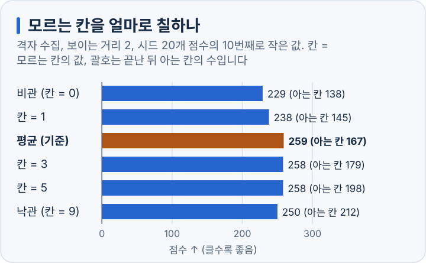
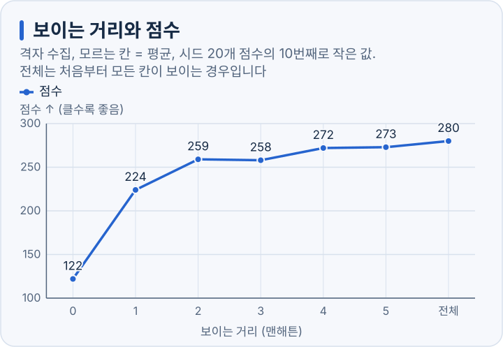
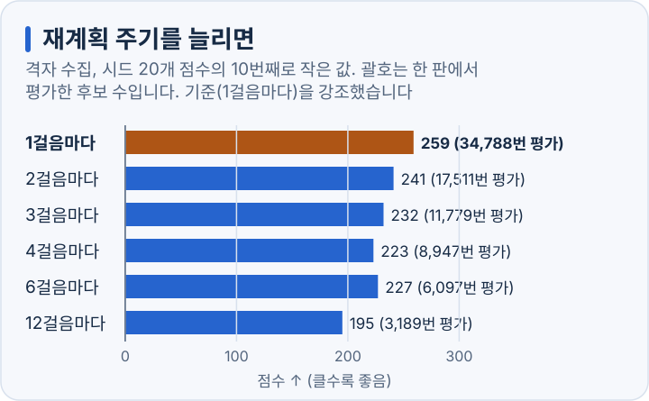
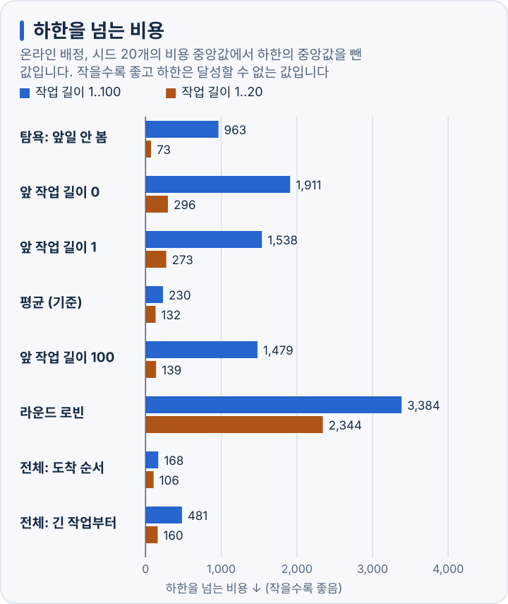

# 실험과 점검: 추정, 보이는 거리, 재계획, 전체 정보와의 차이, 흔한 실수

[구현](implementation.md)의 코드를 연습용 문제 틀(격자 수집 `20 × 20`, `T = 60`, 보이는 거리 2, 온라인 배정 `N = 120, M = 8, K = 18`, 정의는 [원리](idea.md))에서 시드 1~20으로 돌린 결과입니다. 모든 표는 `scripts/check_partial_information.py`가 다시 계산해 본문과 대조합니다.

## 실측

측정 방법은 다음과 같습니다.

- **기본 설정:** 격자 수집은 보이는 거리 2, 모르는 칸의 값 = 아는 칸의 평균, 계획 깊이 12, 재계획 주기 1(걸음마다), 빔 폭 16, 0의 비율 60%입니다. 아래 표는 이 가운데 하나만 바꿉니다.
- **요약:** 표의 값은 시드 20개의 점수 중 10번째로 작은 값(중앙값의 아래쪽)입니다. 두 설정의 비교는 같은 시드끼리 짝지어 "기준보다 나은 시드 / 못한 시드"를 셉니다(격자는 클수록, 온라인 배정은 비용이 작을수록 나은 것입니다).
- **판정:** 한쪽이 20개 중 15개 이상에서 나으면(부호 검정의 양쪽 유의확률 0.041) 차이가 있다고 쓰고, 아니면 "결정 못 함"이라고 씁니다. 이 판정은 이 입력 가족(위 정의의 난수 입력)과 이 설정에 한정되며, "결정 못 함"은 같다는 뜻이 아닙니다.

:::hint 평가 횟수를 세는 방법
시간(ms) 대신 센 연산을 씁니다. 격자의 계획에서는 빔 서치가 후보 하나를 평가할 때마다 1입니다(계획기가 하는 일의 거의 전부입니다). 온라인 배정의 결정은 입력 크기와 무관하게 기계 8대를 한 번 훑는 일이라 세지 않습니다.
:::

### 격자 수집: 모르는 칸을 얼마로 칠할까

보이는 거리 2에서 모르는 칸의 값 가정만 바꿉니다. "아는 칸"은 걸음이 끝난 뒤 값을 알게 된 칸 수의 중앙값이며, 탐색이 얼마나 일어났는지를 보여 줍니다(격자 전체는 400칸).

| 모르는 칸의 값 | 점수 ↑ | 평균보다 나은 / 못한 시드 | 판정 | 끝난 뒤 아는 칸 |
| --- | ---: | ---: | --- | ---: |
| 비관: 모르는 칸 = 0 | 229 | 2 / 18 | 더 나쁨 | 138 |
| 모르는 칸 = 1 | 238 | 4 / 16 | 더 나쁨 | 145 |
| 평균: 아는 칸의 평균 | 259 | - | 기준 | 167 |
| 모르는 칸 = 3 | 258 | 11 / 9 | 결정 못 함 | 179 |
| 모르는 칸 = 5 | 258 | 12 / 8 | 결정 못 함 | 198 |
| 낙관: 모르는 칸 = 9(최댓값) | 250 | 10 / 9 | 결정 못 함 | 212 |

[그림 크게 보기](https://git.readiz.com/h-contest-lesson/lessons/partial-information/lesson-assets/estimate-score.svg)

- 비관(0)과 1은 평균보다 못한 시드가 18개, 16개이고 모두 더 나쁨입니다. 모르는 칸의 값을 낮게 칠하면 아는 값이 바닥난 뒤 계획이 갈 곳을 잃기 때문일 수 있으나 이 강의는 원인을 따로 가르지 않았습니다.
- 3, 5, 9는 평균과 결정 못 함입니다. 낙관(9)에서는 끝난 뒤 아는 칸이 212칸으로 비관(138칸)보다 74칸 많아 탐색이 늘지만 점수는 평균 이상으로 오르지 않았습니다. 경험 법칙("낙관이면 탐색이 늘고 비관이면 활용이 늘어난다")은 탐색량에서는 지지되고 점수에서는 지지되지 않습니다.
- 평균은 값을 따로 정하지 않아도 3, 5, 9와 결정되지 않았습니다. 입력에서 값을 학습하므로 입력 분포가 바뀌어도 값을 다시 정할 필요가 없다는 점이 장점입니다(보이는 거리 1이나 0이 20%인 입력에서는 낙관이 더 높게 나오니 항상 가장 높다는 뜻은 아닙니다).

보이는 거리 1로 줄이면 모르는 칸이 늘어 추정의 영향이 커집니다. 모르는 칸의 값만 바꿔 시드별 비교 없이 중앙값만 적습니다.

| 모르는 칸의 값(보이는 거리 1) | 점수 ↑ | 끝난 뒤 아는 칸 |
| --- | ---: | ---: |
| 비관 | 135 | 75 |
| 평균 | 224 | 122 |
| 낙관 | 232 | 141 |

### 격자 수집: 얼마나 멀리까지 보이는가

모르는 칸의 값 = 평균, 나머지는 기본 설정이고 보이는 거리만 바꿉니다. "전체"는 모든 칸이 처음부터 보이는 경우입니다(같은 계획기가 매 걸음 다시 계획).

| 보이는 거리 | 점수 ↑ | 끝난 뒤 아는 칸 |
| --- | ---: | ---: |
| 0 | 122 | 61 |
| 1 | 224 | 122 |
| 2 | 259 | 167 |
| 3 | 258 | 205 |
| 4 | 272 | 246 |
| 5 | 273 | 286 |
| 전체 | 280 | 400 |

[그림 크게 보기](https://git.readiz.com/h-contest-lesson/lessons/partial-information/lesson-assets/radius-score.svg)

보이는 칸이 늘수록 점수가 오르는 경향이 뚜렷합니다. 거리 0(서 있는 칸만 보임)은 122, 1은 224, 2는 259입니다. 거리 2와 3(258)은 시드별 비교를 하지 않았고 4 이상부터 272, 273, 전체 280으로 올랐습니다. 거리 2와 전체(280)의 중앙값 차이는 21이며, 이 입력에서 시야가 좁아서 잃는 값을 한 가지로 잰 것입니다. 아래 '전체 정보 기준선' 절은 시드별 차이로 같은 값을 다시 잽니다.

### 격자 수집: 재계획 주기

모르는 칸의 값 = 평균, 계획 깊이 12이고 계획에서 몇 걸음을 실행하고 다시 계획할지만 바꿉니다. "평가 횟수"는 한 판(60걸음)에서 평가한 후보 수의 중앙값입니다.

| 주기 | 점수 ↑ | 주기 1보다 나은 / 못한 시드 | 판정 | 계획 횟수 | 평가 횟수 |
| ---: | ---: | ---: | --- | ---: | ---: |
| 1 | 259 | - | 기준 | 60 | 34,788 |
| 2 | 241 | 5 / 14 | 결정 못 함 | 30 | 17,511 |
| 3 | 232 | 5 / 15 | 더 나쁨 | 20 | 11,779 |
| 4 | 223 | 3 / 16 | 더 나쁨 | 15 | 8,947 |
| 6 | 227 | 2 / 18 | 더 나쁨 | 10 | 6,097 |
| 12 | 195 | 0 / 20 | 더 나쁨 | 5 | 3,189 |

[그림 크게 보기](https://git.readiz.com/h-contest-lesson/lessons/partial-information/lesson-assets/period-score.svg)

- 주기가 1(걸음마다)인 기준이 가장 높고, 3 이상은 모두 더 나쁨입니다. 주기 12(깊이만큼 실행하고 다시 계획)는 20개 시드 모두에서 못합니다(195 대 259).
- 평가 횟수는 주기에 거의 반비례합니다(34,788 → 17,511 → … → 3,189). 주기 2는 평가가 절반이지만 결정 못 함이고 5 / 14로 못한 시드가 더 많으므로, 평가가 모자랄 때 주기 2는 손실이 결정되지 않은 선택일 뿐입니다.
- 경험 법칙("새 관측마다 다시 계획하는 편이 낫다")은 이 입력에서 지지됩니다. 같은 입력 가족에서의 결과이며 다른 크기나 관측 규칙에서는 다를 수 있습니다.

### 격자 수집: 계획 깊이와 폭

기본 설정에서 깊이 하나만, 폭 하나만 바꿉니다.

| 깊이 | 점수 ↑ | 깊이 12보다 나은 / 못한 시드 | 판정 | 평가 횟수 |
| ---: | ---: | ---: | --- | ---: |
| 2 | 244 | 7 / 13 | 결정 못 함 | 1,095 |
| 4 | 248 | 9 / 11 | 결정 못 함 | 8,046 |
| 8 | 253 | 8 / 4 | 결정 못 함 | 21,954 |
| 12 | 259 | - | 기준 | 34,788 |
| 20 | 259 | 1 / 0 | 결정 못 함 | 57,514 |

| 빔 폭 | 점수 ↑ | 폭 16보다 나은 / 못한 시드 | 판정 | 평가 횟수 |
| ---: | ---: | ---: | --- | ---: |
| 1 | 250 | 9 / 11 | 결정 못 함 | 2,596 |
| 4 | 261 | 11 / 9 | 결정 못 함 | 9,576 |
| 16 | 259 | - | 기준 | 34,788 |
| 64 | 251 | 6 / 12 | 결정 못 함 | 124,250 |

깊이와 폭은 모두 결정 못 함입니다. 깊이 2(평가 1,095번)가 깊이 12(평가 34,788번)와 결정되지 않았고 폭 1도 폭 16과 결정되지 않았으므로, 이 입력에서 20개 시드로는 계획의 크기에 따른 차이를 가리지 못했고, 차이가 드러난 것은 모르는 칸의 추정과 재계획 주기였습니다. 큰 격자나 긴 `T`에서는 달라질 수 있습니다.

### 전체 정보 기준선과 부분 정보의 비용

기본 설정의 부분 정보와, 같은 입력을 처음부터 다 알고 푼 기준선의 비교입니다. `planFull`은 진짜 값 지도에서 `T`걸음을 한 번에 계획하는 같은 계획기(폭 16)입니다.

| 설정 | 값 |
| --- | ---: |
| 부분 정보(보이는 거리 2, 평균 추정) | 259 |
| 전체 정보 기준선(`planFull`, 폭 16) | 278 |
| 전체 정보 − 부분 정보의 시드별 차이(10번째로 작은 값) | 20 |
| 전체 정보가 더 나은 시드 / 부분 정보가 같거나 나은 시드 | 16 / 4 |

전체 정보가 부분 정보보다 나은 시드가 16개이고 시드별 차이의 중앙값(10번째로 작은 값)이 20이므로, 이 입력에서 보이는 거리 2는 정보를 잃는 설정으로 결정됩니다. 시드별 차이를 한 값으로만 말하면 분포가 가려지므로 시드 수와 함께 적습니다.

기준선이 얼마나 센지는 다른 전체 정보 방법으로 확인합니다. 같은 입력을 [빔 서치](https://h.readiz.com/learn/beam-search)의 `Beam`(합치기 포함)에 진짜 지도로 풀게 한 값입니다(표의 "5번 강의"는 이 빔 서치 강의입니다).

| 전체 정보 방법 | 점수 ↑ |
| --- | ---: |
| 5번 강의의 `Beam`(합치기 포함), 폭 16 | 274 |
| 5번 강의의 `Beam`(합치기 포함), 폭 64 | 285 |
| 5번 강의의 `Beam`(합치기 포함), 폭 256 | 289 |

이 강의의 압축판(폭 16)은 278, 폭 64는 284입니다. 빔 서치 강의의 `Beam`은 폭 256에서 289이므로 기준선보다 더 높은 점수가 있습니다. 부분 정보(259)와 이 값(289)의 차이 30은 정보를 잃은 몫(위의 20)과 계획기의 강도 차이를 합한 값에 가깝고(중앙값끼리라 정확히 더해지지는 않습니다), 하나로 합쳐 정보의 비용이라고 부르지 않습니다. 격자 수집에서 가장 큰 61개 값(한 걸음에 새 칸 하나, 시작 칸 포함)의 합은 중앙값이 476이라 한계로서는 느슨합니다.

### 격자 수집: 입력 밀도가 바뀌면

0인 칸의 비율을 바꾼 입력(20%, 60%, 90%)에서 보이는 거리 2의 비관·평균·낙관과 전체 정보 기준선(폭 16)입니다. 기본 입력은 60%입니다. 시드별 비교는 하지 않았고 중앙값만 적습니다.

| 0인 칸의 비율 | 비관 | 평균 | 낙관 | 전체 정보 기준선 | 가장 큰 61개 값의 합 |
| --- | ---: | ---: | ---: | ---: | ---: |
| 20% | 331 | 379 | 384 | 397 | 526 |
| 60% | 229 | 259 | 250 | 278 | 476 |
| 90% | 37 | 98 | 98 | 110 | 217 |

- 90%(값이 드문 입력)에서 비관이 37로 평균(98)의 절반에도 못 미칩니다. 아는 값이 바닥난 뒤 모르는 곳이 모두 0이라 계획에 목표가 없다는 설명과 맞지만, 이 강의는 원인을 따로 가르지 않았습니다. 평균과 낙관은 98로 같습니다.
- 평균과 전체 정보 기준선의 차이(중앙값의 차이)는 20%에서 18, 60%에서 19, 90%에서 12입니다. 값이 드물수록 기준선에 대한 비율은 커집니다(110 중 12, 397 중 18).
- 평균과 낙관의 순서는 밀도에 따라 바뀝니다(20%에서는 낙관 384 > 평균 379, 60%에서는 평균 259 > 낙관 250, 90%에서는 98로 같음). 시드별 판정을 하지 않았으므로 어느 쪽이 낫다고 쓰지 않습니다.

### 온라인 배정: 앞으로 올 작업을 얼마로 칠할까

앞으로 올 작업의 길이 가정만 바꿉니다(`fut`). 기준은 평균(도착한 작업의 평균 길이)입니다. 입력은 [근방 설계와 차분 평가](https://h.readiz.com/learn/neighborhood-and-delta)의 배정 틀과 같고 시작(라운드 로빈)이 같은 47,295입니다. 하한은 달성할 수 없는 값이라 "더 좋음"이 나와도 정책의 결과가 아닙니다.

작업 길이 1..100(기본):

| 설정 | 비용 ↓ | 평균보다 나은 / 못한 시드 | 판정 |
| --- | ---: | ---: | --- |
| 탐욕: 앞일을 보지 않음 | 44,874 | 0 / 20 | 더 나쁨 |
| 앞으로 올 작업 길이 = 0 | 45,822 | 0 / 20 | 더 나쁨 |
| 앞으로 올 작업 길이 = 1 | 45,449 | 0 / 20 | 더 나쁨 |
| 앞으로 올 작업 길이 = 도착한 작업의 평균 | 44,141 | - | 기준 |
| 앞으로 올 작업 길이 = 100(최댓값) | 45,390 | 1 / 19 | 더 나쁨 |
| 라운드 로빈(아무것도 보지 않음) | 47,295 | 0 / 20 | 더 나쁨 |
| 전체 정보: 총 길이를 알고 도착 순서대로 | 44,079 | 6 / 12 | 결정 못 함 |
| 전체 정보: 총 길이를 알고 긴 작업부터 | 44,392 | 0 / 20 | 더 나쁨 |
| 하한 | 43,911 | 20 / 0 | 더 좋음 |

- 평균 추정(44,141)은 앞일을 보지 않는 탐욕(44,874)보다 20개 시드 모두에서 낮고, 길이를 0, 1, 100으로 가정한 설정보다도 낮습니다(모두 더 나쁨: 0 / 20, 0 / 20, 1 / 19). 총 길이를 알고 도착 순서대로 같은 규칙을 쓴 전체 정보 기준선(44,079)과는 결정 못 함(6 / 12)입니다. 이 입력에서는 앞으로 올 작업을 모르는 비용이 20개 시드로 가릴 수 없을 만큼 작았습니다.
- 긴 작업부터 맡기는 기준선(44,392)은 평균 추정보다 못한 시드가 20개이고, 도착 순서를 무시해 모든 작업을 정렬하는 것이 항상 이득이 아닙니다.

작업 길이 1..20으로 바꾼 입력(변형):

| 설정 | 비용 ↓ | 평균보다 나은 / 못한 시드 | 판정 |
| --- | ---: | ---: | --- |
| 탐욕: 앞일을 보지 않음 | 2,725 | 19 / 1 | 더 좋음 |
| 앞으로 올 작업 길이 = 0 | 2,948 | 0 / 20 | 더 나쁨 |
| 앞으로 올 작업 길이 = 1 | 2,925 | 0 / 20 | 더 나쁨 |
| 앞으로 올 작업 길이 = 도착한 작업의 평균 | 2,784 | - | 기준 |
| 앞으로 올 작업 길이 = 100(최댓값) | 2,791 | 9 / 11 | 결정 못 함 |
| 라운드 로빈(아무것도 보지 않음) | 4,996 | 0 / 20 | 더 나쁨 |
| 전체 정보: 총 길이를 알고 도착 순서대로 | 2,758 | 11 / 7 | 결정 못 함 |
| 전체 정보: 총 길이를 알고 긴 작업부터 | 2,812 | 7 / 13 | 결정 못 함 |
| 하한 | 2,652 | 20 / 0 | 더 좋음 |

[그림 크게 보기](https://git.readiz.com/h-contest-lesson/lessons/partial-information/lesson-assets/online-excess.svg)

변형에서는 순위가 뒤집혔습니다. 탐욕(2,725)이 평균 추정(2,784)보다 낮은 시드가 19개입니다. 길이가 짧으면 부하 항이 작아져 추가 비용의 비중이 커지는 것이 가능한 설명이지만 원인은 가르지 않았습니다. 한 입력 가족에서 낫게 나온 추정을 다른 입력 가족에 그대로 쓰지 않고, 입력 분포가 달라질 가능성이 있으면 변형 입력으로 순위를 다시 확인합니다.

## 흔한 실수와 잡는 검사

아래 실수는 모두 본문 코드에 직접 넣어 보고 검사가 잡는지 확인했습니다(`scripts/check_partial_information.py`가 매번 다시 수행). "거울·지도 대조"는 `firstBad`를 준 `playGrid`, `playOnline`이 거울(과 격자의 추정 지도)이 채점기와 처음 어긋난 걸음에서 잡은 시드 수이고, "엿보기 검사"는 `gridNoPeek`, `onlineNoPeek`이 잡은 시드 수, "무효"는 규칙을 어긴 행동이 나온 시드 수입니다. 점수는 20개 시드의 중앙값입니다(격자는 얻은 값, 배정은 비용).

| 실수 | 거울·지도 대조가 잡은 시드 | 엿보기 검사가 잡은 시드 | 무효 | 점수 |
| --- | ---: | ---: | ---: | ---: |
| 격자: 실수 없음(기준) | 0 / 20 | 0 / 20 | 0 / 20 | 259 |
| 격자: 모르는 칸을 0으로 읽음 | 20 / 20(첫 어긋남 0번째) | 0 / 20 | 0 / 20 | 229 |
| 격자: 다시 보인 칸을 평균에 또 더함 | 20 / 20(첫 어긋남 1번째) | 0 / 20 | 0 / 20 | 259 |
| 격자: 밟은 칸 표시를 빠뜨림 | 20 / 20(첫 어긋남 0번째) | 0 / 20 | 0 / 20 | 18 |
| 격자: 움직인 뒤 보기를 빠뜨림 | 20 / 20(첫 어긋남 1번째) | 0 / 20 | 0 / 20 | 10 |
| 격자: 못 본 칸의 진짜 값을 읽음 | 20 / 20(첫 어긋남 0번째) | 20 / 20 | 0 / 20 | 280 |
| 배정: 실수 없음(기준) | 0 / 20 | 0 / 20 | 0 / 20 | 44,141 |
| 배정: 기계별 작업 수 갱신을 빠뜨림 | 20 / 20(첫 어긋남 1번째) | 0 / 20 | 1 / 20 | 44,141 |
| 배정: 도착한 길이를 두 번 더함 | 20 / 20(첫 어긋남 1번째) | 0 / 20 | 0 / 20 | 47,545 |
| 배정: 앞으로 올 작업의 진짜 총 길이를 읽음 | 0 / 20 | 20 / 20 | 0 / 20 | 44,079 |

1. **모르는 칸을 0으로 읽음.** 추정 지도를 만들면서 `val`을 그대로 읽어 못 본 칸이 0이 됩니다. 점수가 229로 떨어져 비관 설정과 같아지지만, 점수만 보면 "추정이 나쁜 것"인지 "버그"인지 가려지지 않습니다. 추정 지도 대조(`gridMapOk`)가 시작 직후에 잡습니다.
2. **다시 보인 칸을 평균에 또 더함.** 점수는 기준과 같은 259여서 점수로는 알 수 없고, 거울의 아는 칸 수가 실제와 달라서 거울 대조가 첫 걸음에서 잡습니다.
3. **밟은 칸 표시나 보기를 빠뜨림.** 밟은 칸 표시를 빠뜨리면 시작 직후에, 움직인 뒤 보기를 빠뜨리면 첫 걸음에 거울 대조가 잡습니다. 점수는 18과 10으로 크게 떨어지지만 어디가 틀렸는지는 거울 대조가 알려 줍니다.
4. **감춰진 값을 읽음(엿보기).** 못 본 칸의 진짜 값을 추정 대신 읽으면 점수가 오히려 280으로 올라 기준(259)보다 좋아집니다. 전체가 보이는 경우(위 표의 "전체" 280)와 같은 값이며, 대회의 채점기에서는 그 값이 없습니다. 엿보기 검사가 20개 시드 모두에서 잡습니다. 온라인 배정에서 앞으로 올 작업의 진짜 총 길이를 읽으면 비용이 44,079로 전체 정보 기준선과 같아지고, 거울 대조는 하나도 잡지 못하며 엿보기 검사만 20개 시드에서 잡습니다. 로컬 점수가 좋아지는 실수는 점수로는 보이지 않습니다.
5. **기계별 작업 수 갱신을 빠뜨리거나 도착한 길이를 두 번 더함.** 상한이 가득 찬 기계를 알아보지 못해 무효 배정이 나올 수 있지만 20개 시드 중 1개만 무효였고 나머지의 점수는 기준과 같아 놓치기 쉽습니다. 거울 대조는 20개 시드 모두에서 첫 작업에서 잡습니다. 도착한 길이를 두 번 더하는 실수는 평균 추정을 틀리게 해 비용이 47,545로 오르며 같은 검사가 첫 작업에서 잡습니다.

점수로는 안 잡히고 표의 재계획 주기에서 드러나는 실수도 있습니다. 계획을 한 번 세워 끝까지 쓰고(주기 12) 다시 계획하지 않는 경우입니다. 점수가 195로 내려가지만 오류 없이 돌아가므로 거울 대조와 엿보기 검사는 둘 다 통과하고(검사 스크립트가 확인합니다), 주기를 바꿔 가며 재는 비교(위의 재계획 표)로만 알 수 있습니다.

## 다른 문제에 옮길 때 점검 목록

1. 아는 것(규칙)·관측해서 기억한 것·아직 모르는 것을 표로 적었는가? 규칙을 잘못 읽은 곳(보이는 거리, 값의 범위)은 없는가?
2. 거울이 모름과 본 값 0(또는 없음)을 구분해 기록하는가? 평균 같은 파생 값을 처음 본 것만으로 만드는가?
3. 거울을 채점기와 대조할 수 있는가(로컬 모의 채점기, 문제가 응답으로 주는 값)? 매 행동 뒤에 비교하는가?
4. 모르는 값을 무엇으로 칠하는가(최솟값·평균·최댓값)? 아는 값과 같은 단위인가? 추정을 바꾸면 행동이 달라지는지 확인했는가?
5. 행동이 관측을 바꾸는가(탐색이 있는가)? 아니라면 앞으로 올 것의 추정과 되돌릴 수 없는 결정의 비용만 남는다.
6. 새 관측이 계획을 바꾸는가? 재계획 주기를 정하고 평가 횟수의 비용을 셌는가?
7. 같은 입력을 다 아는 기준선(같은 계획기에 진짜 값, 다른 전체 정보 방법, 문제의 한계)과 비교했는가? 차이를 정보의 몫과 계획기의 몫으로 나눴는가?
8. 정책이 감춰진 값을 읽지 않는가? 못 본 값을 바꿔도 같은 행동이 나오는가? 입력 분포(밀도, 길이 범위)를 바꿔 순위가 유지되는지 보았는가?

## 적용 사례

이 강의의 틀이 이 사이트의 문제에서 쓰인 곳입니다. 각 강의는 문제 하나를 끝까지 푸는 방식이라 설명의 순서가 다릅니다.

- [채점기 상태를 따라 그리며 행동하기(MINEEXPLORE)](https://h.readiz.com/learn/observe-and-act): 채점기 상태·관측 기록·추정을 구분하고, 가까운 칸 먼저와 이동당 이득 평가식을 예측 대비 실제 점수로 비교합니다.
- [보이는 만큼만 아는 문제: 지도를 그려 가며 청소하기(ROBOTCLEAN)](https://h.readiz.com/learn/explore-unknown-map): 지도도 자기 위치도 모르는 로봇의 관측 결과를 시작 칸 기준 좌표계의 내 지도와 자세로 옮기고, 모든 호출 뒤 내 지도와 실제를 대조합니다.
- [열어 본 상자를 기억해 쌓고 정렬하기(DRONESORT)](https://h.readiz.com/learn/remember-and-sort): 상자를 열어야만 값이 보이는 문제에서 거울과 계획을 나누고 열어 본 값을 기억해 계획합니다.

빔 서치로 중간 상태를 비교하는 방법은 [빔 서치와 평가 함수](https://h.readiz.com/learn/beam-search), 후보 줄이기는 [후보 줄이기와 시간 예산](https://h.readiz.com/learn/candidate-and-time-budget), 설정 비교와 튜닝은 [실험과 튜닝](https://h.readiz.com/learn/experiments-and-tuning)으로 이어집니다. 모르는 값의 분포를 확률 모델로 세워 최적 정책을 구하는 이론은 이 강의의 범위 밖입니다.

## 로컬 연습

1. `runGrid`로 보이는 거리를 3과 4로 바꿔 평균 추정의 점수를 시드 1~20에서 다시 재고, 보이는 거리 표의 값과 맞춥니다.
2. 격자의 값이 20걸음마다 다시 뽑히도록 `GridJudge`를 바꾸고, `seenAt`이 오래된 칸의 값을 평균 추정으로 되돌리는 규칙을 `buildMap`에 넣습니다. 규칙이 있는 설정과 없는 설정을 시드 20개로 짝지어 판정합니다.
3. 온라인 배정에서 `fut`를 30, 70으로 바꿔 비용을 재고 평균(도착한 작업의 평균)과 짝지어 비교합니다. 작업 길이 1..20 입력에서도 같은 비교를 합니다.
4. `gridMapOk`의 비교에서 모르는 칸의 추정값 부분을 일부러 빼고 `firstBad`가 어디서 잡는지 기록합니다.
5. 온라인 배정에서 작업이 긴 순서(길이 내림차순)로 도착하도록 입력 순서를 바꾸면 탐욕과 평균 추정의 순위가 어떻게 바뀌는지 시드 20개로 판정합니다.

확인 기준: 모든 변경 뒤 `firstBad`가 `-1`, 엿보기 검사가 통과이고, 표의 모든 비교에 시드 수와 판정(더 좋음·더 나쁨·결정 못 함)이 붙어 있어야 합니다.
