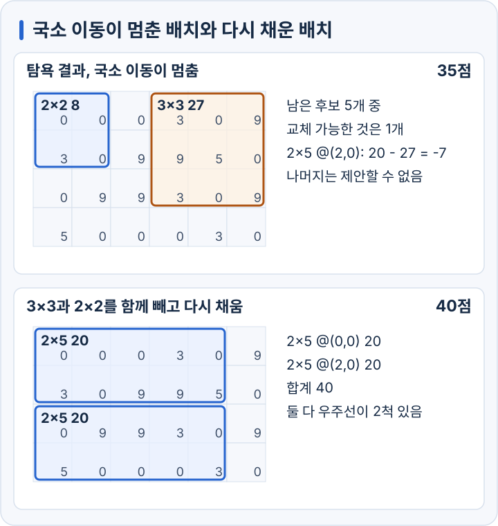
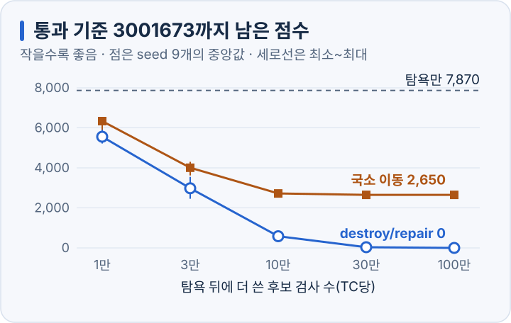

# 격자 배치 문제: 유효한 후보, 국소 이동, destroy/repair 비교

[우주선 착륙](/practice/LANDINGX)은 `1000 x 1000` 고도 지도에 직사각형 우주선 10000척을 놓는 문제입니다. 지도 안에 있어야 하고, 겹치면 안 되고, 네 꼭짓점의 고도 차가 6 이하여야 합니다. [광고판 도시 배치](https://h.readiz.com/learn/heuristic/placement-and-repair)는 destroy/repair를 서술로 다뤘습니다. 이 강의는 한 문제에서 **탐욕, 국소 이동, destroy/repair를 같은 후보 검사 수로 실제 비교**하고, 무효 후보를 어디서 걸러야 하는지 실패를 재현해 확인합니다. [Testing과 Stress Test](https://h.readiz.com/learn/testing-and-stress)와 [초기해와 지역 탐색](https://h.readiz.com/learn/heuristic/search-strategies)을 읽었다고 가정하며, 난수와 정렬은 [공통 코드의 `random`, `sort` 블록](https://h.readiz.com/learn/cpp-common-library)을 먼저 붙여 씁니다.

## 문제 계약을 상태로 옮기기

| 항목 | 계약 |
| --- | --- |
| 구현 | TC마다 `init(map, spaceships)` 한 번, 이어서 `process(row, col, dir)` 한 번. 시간 제한 10초 |
| 입력 | `map[y][x]` 고도(이 강의의 채점기에서는 0~124), 우주선 10000척의 `height`, `width`(2~5) |
| 출력 | 우주선 `i`의 왼쪽 위 `(row[i], col[i])`와 `dir[i]`(0이 아니면 가로·세로 교환). 놓지 않으면 셋 다 -1 |
| 점수 | 놓은 우주선마다 `height * width * min(height, width)`의 합. 클수록 좋고 10개 TC 합 3001673 이상이 통과 |
| 무효 | 지도 밖, 겹침, 네 꼭짓점 고도의 최댓값 - 최솟값 > 6. **하나라도 있으면 그 TC가 실패하고 총점이 0** |

놓지 않아도 되므로 빈 답도 유효하고, 문제는 모두 놓을 수 없다는 점입니다. 고도 조건을 만족하는 직사각형 위치(**후보**)는 TC당 8549~8814개뿐이고 서로 겹칩니다. 겹침을 무시하고 후보를 모두 놓는다고 가정한 점수 상한은 10개 TC 합 3463375로 통과 기준보다 15% 높고, 그 차이가 겹침에서 나옵니다.

**제출할 답은 `row/col/dir`이지만 탐색 상태는 후보 선택 집합**으로 둡니다. 고도·경계 조건은 다른 물체와 무관하니 후보를 미리 모두 만들 수 있고, 같은 크기의 우주선은 바꿔도 점수가 같으니 종류별 개수 한도만 지키다가 제출할 때 번호를 붙입니다. 점유 격자 `owner`, 종류별 선택 수 `have`, 목록 위치 `slot`, `score`는 선택 집합에서 다시 계산할 수 있는 **보조 값**입니다. 탐색에서는 갱신하며 가고, 검사에서는 처음부터 다시 만들어 대조합니다.

## 유효성 검사를 한 함수로

`reason`이 경계(1)·고도 차(2)·겹침(3)을 한 곳에서 판정합니다. 후보를 만들 때는 빈 보드로 불러 1·2만 걸러내고, 탐색 중에는 `canAdd`가 같은 함수에 종류별 한도 하나만 더해 씁니다. 판정을 두 군데에 나눠 쓰면 한쪽만 고쳐 어긋납니다.

무효 후보를 "점수 0인 후보"로 두면 안 됩니다. 이 채점기는 무효 배치 하나가 TC 하나가 아니라 **전체 점수를 0으로** 만들어서, 평가식에서 감점해도 best에 한 번만 섞이면 끝입니다. 그래서 무효는 **제안 단계에서 거절**하고, 거절한 이동은 보드를 건드리지 않습니다. 그러면 current와 best가 항상 유효합니다.

> **코드 환경: h-contest 제출 확장용 1/6.** `land-state`부터 `land-destroy`까지 다섯 블록을 `random`, `sort` 블록 뒤에 순서대로 붙이고, 마지막 `land-entry`가 완성 코드입니다. 후보 상한은 32768, `Board`는 4MB라서 전역·정적 변수로만 둡니다. `build`는 TC마다 `init`에서 한 번, `submit`은 `process` 끝에서 부릅니다.

```cpp snippet=land-state
#define MAP_SIZE (1000)
#define SPACESHIP_SIZE (10000)

struct Spaceship {
    int height;
    int width;
};

namespace land {
const int MAX_CAND = 32768, KINDS = 16;
const int (*heightMap)[MAP_SIZE];
int candCount;
short candRow[MAX_CAND], candCol[MAX_CAND];
unsigned char candH[MAX_CAND], candW[MAX_CAND];  // 회전을 반영해 놓았을 때의 세로·가로
int candWeight[MAX_CAND], candKind[MAX_CAND];    // 종류 = (짧은 변 - 2) * 4 + (긴 변 - 2)
int kindLimit[KINDS];                            // 종류별 우주선 수
int kindOf(int a, int b) { return ((a < b ? a : b) - 2) * 4 + ((a < b ? b : a) - 2); }

template <class F> void eachCell(int c, F f) {  // 후보 c가 덮는 칸을 순회한다.
    for (int y = candRow[c]; y < candRow[c] + candH[c]; ++y)
        for (int x = candCol[c]; x < candCol[c] + candW[c]; ++x) f(y, x);
}

// 제출할 답은 picked[]이고, 나머지는 계산을 빠르게 하는 보조 값이다.
struct Board {
    int owner[MAP_SIZE][MAP_SIZE];  // 점유 격자: 칸을 덮는 선택된 후보 번호, 비었으면 -1
    int have[KINDS];                // 종류별 선택 수
    int picked[MAX_CAND], count;    // 선택된 후보 번호들
    int slot[MAX_CAND];             // 후보 -> picked 안의 위치, 선택 안 했으면 -1
    long long score;
};

void clear(Board& bd) {
    for (int y = 0; y < MAP_SIZE; ++y)
        for (int x = 0; x < MAP_SIZE; ++x) bd.owner[y][x] = -1;
    for (int k = 0; k < KINDS; ++k) bd.have[k] = 0;
    for (int c = 0; c < MAX_CAND; ++c) bd.slot[c] = -1;
    bd.count = 0;
    bd.score = 0;
}

// 유효성은 이 함수 하나로 판정한다. 0: 가능, 1: 지도 밖, 2: 고도 차, 3: 겹침
int reason(const Board& bd, int r, int c, int a, int b) {
    if (r < 0 || c < 0 || r + a > MAP_SIZE || c + b > MAP_SIZE) return 1;
    int v[4] = {heightMap[r][c], heightMap[r][c + b - 1], heightMap[r + a - 1][c], heightMap[r + a - 1][c + b - 1]};
    int lo = v[0], hi = v[0];
    for (int i = 1; i < 4; ++i) { if (v[i] < lo) lo = v[i]; if (v[i] > hi) hi = v[i]; }
    if (hi - lo > 6) return 2;
    for (int y = r; y < r + a; ++y)
        for (int x = c; x < c + b; ++x)
            if (bd.owner[y][x] >= 0) return 3;
    return 0;
}

// 후보 c를 지금 선택해도 되는가: 종류별 우주선이 남아 있고 위의 판정을 통과한다.
bool canAdd(const Board& bd, int c) {
    return bd.have[candKind[c]] < kindLimit[candKind[c]] && reason(bd, candRow[c], candCol[c], candH[c], candW[c]) == 0;
}

// 후보 c와 겹치는 선택 후보의 서로 다른 번호를 out(25칸 이상)에 담고 개수를 돌려준다.
int owners(const Board& bd, int c, int out[]) {
    int n = 0;
    eachCell(c, [&](int y, int x) {
        int o = bd.owner[y][x], i = 0;
        while (o >= 0 && i < n && out[i] != o) ++i;
        if (o >= 0 && i == n) out[n++] = o;
    });
    return n;
}

void put(Board& bd, int c) {  // 전제: canAdd(bd, c)
    eachCell(c, [&](int y, int x) { bd.owner[y][x] = c; });
    ++bd.have[candKind[c]];
    bd.slot[c] = bd.count;
    bd.picked[bd.count++] = c;
    bd.score += candWeight[c];
}

void take(Board& bd, int c) {  // 전제: c가 선택돼 있다. put의 역연산이다.
    eachCell(c, [&](int y, int x) { bd.owner[y][x] = -1; });
    --bd.have[candKind[c]];
    int last = bd.picked[--bd.count];
    bd.picked[bd.slot[c]] = last;
    bd.slot[last] = bd.slot[c];
    bd.slot[c] = -1;
    bd.score -= candWeight[c];
}
}
```

```cpp snippet=land-build
namespace land {
const Spaceship* shipList;
int shipCount;

// 지도와 우주선 목록에서 후보를 모두 만든다. empty는 clear()한 빈 보드이다.
void build(int map[][MAP_SIZE], const Spaceship ships[], int n, const Board& empty) {
    heightMap = map;
    shipList = ships;
    shipCount = n;
    for (int k = 0; k < KINDS; ++k) kindLimit[k] = 0;
    for (int i = 0; i < n; ++i) ++kindLimit[kindOf(ships[i].height, ships[i].width)];
    candCount = 0;
    for (int lo = 2; lo <= 5; ++lo) {
        for (int hi = lo; hi <= 5; ++hi) {
            int k = kindOf(lo, hi);
            for (int turn = 0; turn < (lo == hi ? 1 : 2) && kindLimit[k] > 0; ++turn) {  // 우주선이 없는 종류는 건너뛴다.
                int a = turn == 0 ? lo : hi, b = turn == 0 ? hi : lo;  // 두 번째는 회전한 방향
                for (int r = 0; r + a <= MAP_SIZE; ++r)
                    for (int c = 0; c + b <= MAP_SIZE; ++c) {
                        if (reason(empty, r, c, a, b) != 0 || candCount == MAX_CAND) continue;
                        int id = candCount++;
                        candRow[id] = (short)r; candCol[id] = (short)c;
                        candH[id] = (unsigned char)a; candW[id] = (unsigned char)b;
                        candWeight[id] = a * b * lo;  // 점수 = 세로 * 가로 * 짧은 변
                        candKind[id] = k;
                    }
            }
        }
    }
}

// 선택된 후보를 같은 종류의 우주선에 차례로 배정해 row/col/dir로 옮긴다.
void submit(const Board& bd, int row[], int col[], int dir[]) {
    int cursor[KINDS] = {0};  // 종류별로 다음에 볼 우주선 번호
    for (int i = 0; i < shipCount; ++i) row[i] = col[i] = dir[i] = -1;
    for (int p = 0; p < bd.count; ++p) {
        int c = bd.picked[p], k = candKind[c], s = cursor[k];
        while (kindOf(shipList[s].height, shipList[s].width) != k) ++s;  // canAdd가 개수를 보장한다.
        cursor[k] = s + 1;
        row[s] = candRow[c];
        col[s] = candCol[c];
        dir[s] = (candH[c] == shipList[s].height && candW[c] == shipList[s].width) ? 0 : 1;
    }
}
}
```

## 기준선과 정렬 탐욕

`sweep`은 후보를 키 순으로 한 번 훑으며 들어가면 놓습니다. 키를 후보 번호로 두면 후보를 만든 순서(작은 종류부터, 지도 순서)로 놓는 first-fit 기준선이고, 점수의 음수로 두면 점수 큰 후보부터 놓는 탐욕입니다. 먼저 놓는 쪽이 이기는 구조라서 정렬 기준이 점수를 가릅니다. `evaluations`는 모든 방법이 공유하는 예산 단위(후보 한 개의 검사)입니다.

```cpp snippet=land-greedy
namespace land {
long long evaluations;  // 후보 검사 횟수: 모든 방법이 같은 단위로 예산을 쓴다.

bool tryPut(Board& bd, int c) {
    ++evaluations;
    if (!canAdd(bd, c)) return false;
    put(bd, c);
    return true;
}

// 후보를 key 오름차순으로 한 번 훑으며 들어가는 대로 놓는다. order/temp는 candCount칸 이상.
// key[c] = c이면 후보를 만든 순서(작은 종류부터, 지도 순서)대로 놓는 first-fit 기준선이다.
void sweep(Board& bd, const long long key[], int order[], int temp[]) {
    for (int c = 0; c < candCount; ++c) order[c] = c;
    hc::sortIds(order, temp, candCount, key);
    for (int i = 0; i < candCount; ++i) tryPut(bd, order[i]);
}
}
```

## 국소 이동: 추가와 교체, 차분 평가

이웃은 후보 하나 `x`를 넣는 이동입니다. 겹치는 선택 후보가 없으면 **추가**(점수 `+w[x]`), 하나면 그 후보를 빼고 `x`를 넣는 **교체**(점수 `w[x] - w[drop]`)이고, 둘 이상이면 제안하지 않습니다. 차분은 `owners`가 찾은 겹침만 보면 되므로 후보 하나에 칸 25개 이하입니다. 종류별 한도는 교체되는 후보가 같은 종류인지까지 따져 확인합니다. 적용은 `take`와 `put`이고, `take`는 `put`이 칠한 칸을 그대로 지우는 역연산입니다. 점수가 줄지 않는 이동(같은 점수 포함)만 받는 것이 hill climbing입니다.

```cpp snippet=land-local
namespace land {
// 후보 x를 넣는 이동을 평가한다(board는 바꾸지 않는다). 겹치는 선택 후보가 0개면 추가, 1개면 교체이고
// 2개 이상이면 이 이웃에서는 제안하지 않는다. 가능하면 drop(교체될 후보 또는 -1)과 점수 변화 delta를 채운다.
bool evaluate(const Board& bd, int x, int& drop, long long& delta) {
    ++evaluations;
    int own[25];
    int n = owners(bd, x, own);
    if (n > 1) return false;
    drop = n == 1 ? own[0] : -1;
    int kind = candKind[x];
    if (bd.have[kind] - (drop >= 0 && candKind[drop] == kind ? 1 : 0) >= kindLimit[kind]) return false;  // 종류별 한도
    delta = candWeight[x] - (drop >= 0 ? candWeight[drop] : 0);
    return true;
}

// 점수가 줄지 않는 이동만 받는다. budget만큼 후보를 평가한다.
void hillClimb(Board& bd, hc::Random& rng, long long budget) {
    long long stop = evaluations + budget;
    while (evaluations < stop && candCount > 0) {
        int x = (int)rng.below((unsigned)candCount), drop;
        long long delta;
        if (bd.slot[x] >= 0) ++evaluations;  // 이미 선택한 후보
        else if (evaluate(bd, x, drop, delta) && delta >= 0) {
            if (drop >= 0) take(bd, drop);
            put(bd, x);
        }
    }
}
}
```

## 손계산: 국소 이동이 멈추는 곳

4행 6열 지도(칸의 숫자는 고도)와 우주선 4척(2×5 둘, 2×2 하나, 3×3 하나)입니다. 네 꼭짓점 조건을 만족하는 후보는 7개이고 점수는 2×2 8, 2×5 20, 3×3 27입니다. 점수 큰 후보부터 훑으면 3×3 @(0,3)과 2×2 @(0,0)이 들어가 **35점**입니다. 남은 후보 5개를 모두 평가한 표입니다.

<!-- check:hand -->
| 후보 | 점수 | 겹치는 선택 후보 | 판정 | 점수 변화 |
| --- | ---: | ---: | --- | ---: |
| 3×3 @(0,3) | 27 | - | 선택됨 | - |
| 2×2 @(0,0) | 8 | - | 선택됨 | - |
| 2×2 @(1,2) | 8 | 1 | 거절: 종류 한도 | - |
| 2×2 @(2,3) | 8 | 1 | 거절: 종류 한도 | - |
| 2×5 @(0,0) | 20 | 2 | 제안하지 않음 | - |
| 2×5 @(1,0) | 20 | 2 | 제안하지 않음 | - |
| 2×5 @(2,0) | 20 | 1 | 교체 | -7 |

2×5 @(2,0)만 교체로 평가되고 7점 나빠집니다. 2×2 두 후보는 3×3 하나와만 겹치지만 2×2 우주선이 한 척뿐이라 종류 한도에서 막힙니다. 나머지 2×5 둘은 두 후보와 겹쳐 제안하지 않습니다. 개선도 같은 점수의 이동도 없어서 hill climbing은 여기서 멈춥니다. 후보 7개의 부분집합 128개를 모두 보면 최적은 **40점**(2×5 @(0,0)과 @(2,0))인데, 거기에 가려면 3×3과 2×2를 **함께** 빼야 합니다.



[그림 크게 보기](https://git.readiz.com/h-contest-lesson/lessons/placement-search/lesson-assets/stuck-and-repair.svg)

검사 스크립트가 후보 목록, 위 표, 점수 35와 40을 파이썬으로 따로 다시 계산해 C++ 구현과 대조합니다. 후보 16개 이하의 무작위 작은 입력 29개를 완전탐색 최적값과 비교하면 탐욕이 28개, 국소 이동이 28개, destroy/repair가 29개에서 최적에 닿아 이 크기에서는 세 방법을 가르지 못합니다. 차이는 실제 크기에서 드러납니다.

## destroy/repair: 얼마나, 어떻게

단일 이동으로 못 나가는 곳은 **여러 개를 빼고 다시 채우는** 큰 이동이 넘습니다. 정할 것이 셋 있습니다.

- **무엇을 빼나**: 선택 후보 하나를 중심으로 둘레 `size`칸 안을 모두 빼는 *영역*, 무작위 `k`개, 무작위 세 개 중 점수가 낮은 것을 `k`번 빼는 *낮은 점수* 중 고릅니다.
- **어떻게 채우나**: 뺀 자리와 겹치는 후보만 모아 점수에 **무작위 배율**(1배 ~ 1+`noise`/100배)을 곱한 순서로 탐욕처럼 넣습니다. 배율이 없으면 점수 순서가 그대로여서 방금 뺀 배치가 다시 만들어집니다. 위 손계산에서 영역 여백 2칸, `noise` 0으로 50번 반복해도 35점 그대로이고, `noise` 200으로 seed 1~9를 돌리면 모두 19번 안에 40점이 됩니다.
- **나빠지면**: 점수가 줄었으면 되돌리고, 같은 점수는 받아 평지를 걷습니다. 작업 기록을 거꾸로 뒤집는 `undo`는 바뀐 후보의 칸만 다시 칠해서 destroy/repair 한 반복이 통째로 평균 0.5µs입니다. 보드 전체를 복사해 두었다가 되돌리면 4MB를 저장·복원하는 데만 반복당 217µs가 들어 보드는 복사하지 않습니다. 받는 기준이 "점수가 줄지 않음"이라 current가 곧 best입니다. SA처럼 나빠지는 이동을 받는다면 best의 선택 목록만 복사해 둡니다. 코드의 `collect`는 시작 칸을 16×16 구역으로 묶은 색인에서 영역과 겹치는 후보를 찾고, `size`는 2048 이하여야 합니다.

```cpp snippet=land-destroy
namespace land {
const int BUCKET = 16, BUCKETS = (MAP_SIZE + BUCKET - 1) / BUCKET, POOL_MAX = 2048;
int bucketHead[BUCKETS][BUCKETS], bucketNext[MAX_CAND];  // 후보를 시작 칸의 16x16 구역별로 묶는다.
int stampOf[MAX_CAND], stampNow;

void buildBuckets() {
    for (int i = 0; i < BUCKETS; ++i)
        for (int j = 0; j < BUCKETS; ++j) bucketHead[i][j] = -1;
    for (int c = 0; c < candCount; ++c) {
        int& head = bucketHead[candRow[c] / BUCKET][candCol[c] / BUCKET];
        bucketNext[c] = head;
        head = c;
    }
}

// 칸 범위 [r0,r1] x [c0,c1]와 겹치는 후보를 pool[n..]에 덧붙인다. 같은 stampNow에서는 한 번씩만 넣는다.
int collect(int r0, int c0, int r1, int c1, int pool[], int n) {
    for (int br = (r0 > 4 ? r0 - 4 : 0) / BUCKET; br <= (r1 < MAP_SIZE - 1 ? r1 : MAP_SIZE - 1) / BUCKET; ++br)
        for (int bc = (c0 > 4 ? c0 - 4 : 0) / BUCKET; bc <= (c1 < MAP_SIZE - 1 ? c1 : MAP_SIZE - 1) / BUCKET; ++bc)
            for (int c = bucketHead[br][bc]; c >= 0; c = bucketNext[c]) {
                if (stampOf[c] == stampNow || n == POOL_MAX) continue;
                if (candRow[c] + candH[c] - 1 < r0 || candRow[c] > r1) continue;
                if (candCol[c] + candW[c] - 1 < c0 || candCol[c] > c1) continue;
                stampOf[c] = stampNow;
                pool[n++] = c;
            }
    return n;
}

// 되돌리기 기록: 마지막 작업부터 거꾸로 뒤집으면 직전 상태가 된다. 빼기와 넣기는 각각 POOL_MAX개 이하이다.
struct Op { int cand; bool added; };
Op opLog[2 * POOL_MAX];
int opCount;

void change(Board& bd, int c, bool add) {
    if (add) put(bd, c);
    else take(bd, c);
    opLog[opCount].cand = c;
    opLog[opCount++].added = add;
}

void undo(Board& bd) {
    while (opCount > 0) {
        const Op& op = opLog[--opCount];
        if (op.added) take(bd, op.cand);
        else put(bd, op.cand);
    }
}

enum { REGION, RANDOM_K, LOWEST_K };  // 무엇을 뺄지
struct DestroyParams {
    int mode, size;  // size: REGION은 선택한 후보 둘레의 여백 칸 수, 나머지는 뺄 후보 수 k
    int noise;       // 다시 채울 때 점수에 곱하는 무작위 배율은 1배 ~ 1+noise/100배. 0이면 점수 순서 그대로
};

// destroy/repair 한 번. 나빠지면 되돌린다. 뺀 후보 수를 돌려준다.
int destroyRepair(Board& bd, hc::Random& rng, const DestroyParams& prm) {
    static int pool[POOL_MAX], temp[POOL_MAX];
    static long long key[MAX_CAND];
    if (bd.count == 0) { ++evaluations; return 0; }
    long long before = bd.score;
    int removed = 0, n = 0;
    opCount = 0;
    ++stampNow;
    if (prm.mode == REGION) {  // 무작위 선택 후보를 중심으로 한 영역 안을 전부 뺀다.
        int y = bd.picked[rng.below((unsigned)bd.count)], m = prm.size;
        n = collect(candRow[y] - m, candCol[y] - m, candRow[y] + candH[y] + m - 1, candCol[y] + candW[y] + m - 1, pool, 0);
        for (int i = 0; i < n; ++i)
            if (bd.slot[pool[i]] >= 0) { change(bd, pool[i], false); ++removed; }
    } else {
        for (int t = 0; t < prm.size && t < POOL_MAX && bd.count > 0; ++t, ++removed) {
            int y = bd.picked[rng.below((unsigned)bd.count)];
            for (int s = 0; s < 2 && prm.mode == LOWEST_K; ++s) {  // 셋 중 점수가 가장 낮은 것
                int z = bd.picked[rng.below((unsigned)bd.count)];
                if (candWeight[z] < candWeight[y]) y = z;
            }
            change(bd, y, false);
            n = collect(candRow[y], candCol[y], candRow[y] + candH[y] - 1, candCol[y] + candW[y] - 1, pool, n);
        }
    }
    for (int i = 0; i < n; ++i) {  // 점수 순서에 무작위 배율을 곱해 다시 채운다.
        long long noise = prm.noise == 0 ? 0 : (long long)rng.below((unsigned)prm.noise + 1u);
        key[pool[i]] = -(long long)candWeight[pool[i]] * (100 + noise);
    }
    hc::sortIds(pool, temp, n, key);
    for (int i = 0; i < n; ++i) {
        ++evaluations;
        if (canAdd(bd, pool[i])) change(bd, pool[i], true);
    }
    if (bd.score < before) undo(bd);
    opCount = 0;
    return removed;
}
}
```

> **코드 환경: h-contest 제출용(완성 코드).** 위 다섯 블록 뒤에 붙입니다. TC마다 탐욕 뒤에 후보 검사 100만 회를 쓰고 모든 TC에서 같은 solver seed를 씁니다.

```cpp snippet=land-entry
static land::Board layout;
static int sortOrder[land::MAX_CAND], sortTemp[land::MAX_CAND];
static long long sortKey[land::MAX_CAND];

void init(int map[MAP_SIZE][MAP_SIZE], Spaceship spaceships[]) {
    land::clear(layout);
    land::build(map, spaceships, SPACESHIP_SIZE, layout);
    land::buildBuckets();
}

void process(int row[], int col[], int dir[]) {
    land::evaluations = 0;
    for (int c = 0; c < land::candCount; ++c) sortKey[c] = -(long long)land::candWeight[c];
    land::sweep(layout, sortKey, sortOrder, sortTemp);  // 점수가 큰 후보부터 훑는 탐욕

    hc::Random rng;
    rng.reset(20261118u);
    land::DestroyParams prm = {land::REGION, 8, 200};
    long long stop = land::evaluations + 1000000;  // 탐욕 뒤에 후보 검사 100만 회
    while (land::evaluations < stop) land::destroyRepair(layout, rng, prm);
    land::submit(layout, row, col, dir);
}
```

## 같은 예산으로 비교하기

2026-11-18에 공개 채점기의 TC 10개를 그대로 실행한 결과입니다. 환경은 Darwin 26.3 arm64 / Apple clang version 17.0.0 (clang-1700.6.3.2) / -std=c++17 -O2 -Wno-register이고 채점기 `main.cpp`의 SHA-256 앞 12자는 `9ab8fbdb47a3`입니다(`register` 때문에 `-Wno-register`를 붙입니다). 시간은 TC 생성과 후보 만들기를 포함한 10개 TC 전체의 중앙값(9번 중 첫 번째 제외)이며 다른 작업이 도는 컴퓨터에서 쟀으므로 절대값보다 순서를 봅니다. 국소 이동과 destroy/repair는 점수 큰 순 탐욕 결과에서 시작해 **후보 검사를 같은 1,000,000회** 더 씁니다.

<!-- check:stages -->
| 방식 | 합 ↑ | 통과 기준 3001673과의 차 | 후보 검사(TC당 평균) | 시간(ms) |
| --- | ---: | ---: | ---: | ---: |
| 기준선: 후보 번호 순 first-fit | 2574208 | -427465 | 8665 | 268 |
| 탐욕: 점수 큰 후보부터 | 2993803 | -7870 | 8665 | 269 |
| 국소 이동(hill climbing) | 2999023 | -2650 | 1008665 | 380 |
| destroy/repair(한 영역) | 3001673 | +0 | 1008669 | 1250 |

- 점수 큰 후보부터 훑는 것만으로 first-fit보다 419595점 올랐습니다. 문제 설명의 "작은 것부터"는 이 기준선과 같은 순서입니다. 그 뒤의 두 방법은 통과 기준까지 남은 7870점을 줄이는 싸움입니다.
- 국소 이동이 끝난 배치와 destroy/repair가 만든 배치 모두 전체 후보를 평가해 보면 개선 이동이 TC 10개에서 0개입니다. 한 후보씩 보는 이동은 실제 입력에서도 손계산처럼 **국소 최적**에 갇힙니다.
- 아래 표는 예산을 바꾼 결과로 solver seed 1~9의 중앙값과 범위입니다. 같은 코드를 ASan/UBSan으로 채점기와 함께 실행해도 합이 3001673으로 같았습니다.

<!-- check:budgets -->
| 탐욕 뒤 추가 후보 검사(TC당) | 국소 이동 중앙값 | 최소~최대 | 시간(ms) | destroy/repair 중앙값 | 최소~최대 | 시간(ms) |
| ---: | ---: | ---: | ---: | ---: | ---: | ---: |
| 10,000 | 2995338 | 2995138~2995780 | 269 | 2996114 | 2995765~2996454 | 278 |
| 30,000 | 2997667 | 2997370~2998053 | 271 | 2998692 | 2998122~2999215 | 300 |
| 100,000 | 2998950 | 2998894~2999003 | 281 | 3001090 | 3000899~3001187 | 370 |
| 300,000 | 2999023 | 2999023~2999023 | 306 | 3001636 | 3001573~3001647 | 562 |
| 1,000,000 | 2999023 | 2999023~2999023 | 384 | 3001673 | 3001671~3001673 | 1249 |



[그림 크게 보기](https://git.readiz.com/h-contest-lesson/lessons/placement-search/lesson-assets/budget-curves.svg)

- 1만 회에서는 두 방법의 범위가 겹칩니다(destroy/repair 최소 2995765, 국소 이동 최대 2995780). 이 차이로는 우열을 정하지 않고, 3만 회부터 destroy/repair의 최소가 국소 이동의 최대보다 큽니다.
- 국소 이동은 30만 회부터 seed 9개가 모두 2999023에서 멈춥니다. 개선 이동이 하나도 없으므로 예산 부족이 아니라 **이웃의 한계**입니다.
- destroy/repair는 100만 회에 3001673(seed 9개의 범위 3001671~3001673)에 닿습니다. 통과 기준과 같은 값이지만 최적인지는 확인하지 못했습니다.
- 같은 검사 수라도 destroy/repair는 반복마다 정렬과 구역 조회를 해서 시간이 더 듭니다. 그래도 10만 회의 destroy/repair(370ms, 중앙값 3001090)는 100만 회의 국소 이동(384ms, 2999023)과 시간이 비슷한데 점수가 높아, 같은 **시간**으로 맞춰도 결론이 같습니다.

## destroy 크기와 방식, 다시 채우는 순서

후보 검사 100,000회로 고정하고(방식 차이가 드러나는 지점) 무엇을 얼마나 뺄지를 바꿨습니다. `noise`는 200입니다.

<!-- check:destroy -->
| destroy 방식 | 크기 | 합의 중앙값 ↑ | 최소~최대 | 한 번에 뺀 평균 개수 | 반복 수(중앙값) |
| --- | ---: | ---: | ---: | ---: | ---: |
| 한 영역 | 여백 1칸 | 3001084 | 3000979~3001164 | 1.2 | 673984 |
| 한 영역 | 여백 4칸 | 3001020 | 3000878~3001188 | 2.2 | 379052 |
| 한 영역 | 여백 16칸 | 3001274 | 3001182~3001462 | 11.0 | 75282 |
| 무작위 k개 | k = 1 | 3001105 | 3001016~3001161 | 1.0 | 809356 |
| 무작위 k개 | k = 4 | 3001035 | 3000936~3001114 | 4.0 | 202343 |
| 무작위 k개 | k = 16 | 3000986 | 3000894~3001098 | 16.0 | 50591 |
| 낮은 점수 k개 | k = 2 | 2996922 | 2996427~2997055 | 2.0 | 451342 |
| 낮은 점수 k개 | k = 8 | 2996930 | 2996720~2997183 | 8.0 | 112869 |

- 영역 여백 16칸(한 번에 평균 11.0개 제거)이 중앙값이 가장 높고, 범위가 여백 1칸과 무작위 k 전부와 겹치지 않습니다. 다만 여백 4칸과는 겹치며, 나머지 설정끼리도 범위가 겹쳐 우열을 정하지 않습니다. 더 큰 영역은 시험하지 않았습니다. **하나만 빼도(k = 1)** 뺀 자리에 여러 후보를 다시 넣을 수 있어 국소 이동이 못 하는 이동이 되기 때문입니다.
- 낮은 점수의 후보를 빼는 방식은 2996922~2996930로 같은 예산의 국소 이동(2998950)보다도 낮고 범위도 겹치지 않습니다. 원인을 증명한 것은 아니지만 점수가 낮은 후보는 작은 우주선이어서 빼도 큰 후보가 들어갈 자리가 열리지 않는 것과 일치합니다. 무엇을 빼느냐가 얼마나 빼느냐보다 중요할 수 있습니다.

다시 채울 때의 무작위 배율을 바꾸면 이렇게 갈립니다.

<!-- check:noise -->
| 다시 채울 때의 무작위 배율 | 합의 중앙값 ↑ | 최소~최대 |
| --- | ---: | ---: |
| 없음(점수 순서 그대로) | 2993803 | 2993803~2993803 |
| 1배 ~ 1.3배 | 2999169 | 2998990~2999360 |
| 1배 ~ 2배 | 3000611 | 3000549~3000770 |
| 1배 ~ 3배 | 3001090 | 3000899~3001187 |
| 1배 ~ 5배 | 3001242 | 3001167~3001403 |

배율이 없으면(0) 같은 배치가 되풀이되어 탐욕과 같은 2993803입니다. 1.3배와 2배는 3배보다 낮고 범위도 겹치지 않으며, 5배는 3배와 범위가 겹쳐 우열을 정하지 않습니다. 본문은 3배(`noise` 200)를 씁니다.

[실험 비교와 평가](https://h.readiz.com/learn/testing-and-stress/experiment-evaluation)의 기준대로 차이가 seed 사이의 범위보다 작으면 우열을 정하지 않습니다. 위 설정은 공개 TC 10개로 골랐으므로, 선택에 쓰지 않은 입력에서도 같은 코드를 파라미터 변경 없이 돌렸습니다. 채점기 생성기의 seed를 101~103으로 바꾼 입력과, 고도 범위를 0~109, 0~149로 바꿔 후보 수가 달라진 입력입니다(solver seed 5개).

<!-- check:unseen -->
| 입력 | 기준선 | 점수 큰 순 탐욕 | 국소 이동 중앙값 | 최소~최대 | destroy/repair 중앙값 | 최소~최대 |
| --- | ---: | ---: | ---: | ---: | ---: | ---: |
| 다른 seed 101 | 2579087 | 3003885 | 3007743 | 3007743~3007772 | 3010289 | 3010289~3010289 |
| 다른 seed 102 | 2596589 | 3015511 | 3019943 | 3019943~3019948 | 3022208 | 3022171~3022208 |
| 다른 seed 103 | 2585454 | 3005076 | 3009114 | 3009101~3009121 | 3011412 | 3011412~3011412 |
| 고도 범위 0~109, seed 101 | 3385631 | 3918853 | 3924797 | 3924797~3924822 | 3938967 | 3938900~3939116 |
| 고도 범위 0~149, seed 101 | 1670051 | 1842889 | 1844553 | 1844553~1844553 | 1845190 | 1845190~1845190 |

다섯 입력 모두 후보 번호 순 < 점수 큰 순 < 국소 이동 < destroy/repair 순서가 같고, destroy/repair의 최소가 국소 이동의 최대보다 큽니다. 탐욕 대비 개선은 입력마다 크게 다릅니다. 후보가 많아 서로 더 겹치는 0~109에서 destroy/repair는 +20114(국소 이동은 +5944)이고, 후보가 적은 0~149에서는 +2301(+1664)입니다. 이 입력들은 같은 생성 방식을 바꾼 것일 뿐 숨은 채점 입력의 대표가 아니며, 순서가 같다는 것이 개선 폭이 같다는 뜻은 아닙니다.

## 실패 사례 두 가지

**되돌리기에서 격자를 빠뜨리면.** `undo`가 뺐던 후보를 다시 넣을 때 `put` 대신 `else { ++bd.have[candKind[op.cand]]; bd.slot[op.cand] = bd.count; bd.picked[bd.count++] = op.cand; bd.score += candWeight[op.cand]; }`로 선택 목록과 점수만 복원한 변형입니다. 컴파일되고 점수도 계산되지만 점유 격자에는 그 후보가 없어서 이후 repair가 같은 칸에 다른 후보를 넣고 **겹치는 배치**를 제출합니다. 채점기에서 TC 1이 무효가 되어 총점은 0입니다. 검사 스크립트는 점유 격자를 `picked[]`에서 다시 칠한 격자와 칸마다 대조하고, 되돌린 뒤의 상태가 이전과 같은지를 무작위 입력 100개에서 확인합니다.

**종류별 한도를 빠뜨리면.** `canAdd`에서 한도 검사를 뺀 변형 `return reason(bd, candRow[c], candCol[c], candH[c], candW[c]) == 0;`은 공개 TC에서 **점수가 정상과 똑같이 3001673점**입니다. 우주선 수가 후보 수보다 많아 한도에 걸릴 일이 없기 때문이고, 채점기는 아무것도 알려 주지 않습니다. 우주선이 적은 작은 입력에서는 후보 수가 우주선 수를 넘어 `submit`이 우주선 범위 밖을 읽습니다. 검사 스크립트는 우주선 1~30척, 가로·세로 3~15칸 지도의 무작위 입력 100개(채점기 규칙을 따로 구현한 `judgeVerify`, 완전탐색 최적값 포함)를 ASan/UBSan으로 돌려 두 변형을 모두 실패시킵니다. 정상 점수가 나온다고 검사를 통과한 것이 아니라는 예입니다. `python3 scripts/check_placement_search.py`는 이 검사와 저장된 측정의 표 대조를 하고, `--judge /path/to/LANDINGX/main.cpp --output FILE`을 더하면 위 표의 측정을 다시 만듭니다.

## 연습: LANDINGX

[LANDINGX](/practice/LANDINGX)에서 다음을 직접 해 봅니다.

1. 후보 번호 순 first-fit과 점수 큰 순 탐욕을 제출해 이 강의의 표(2574208, 2993803)와 같은 TC 합이 나오는지 확인합니다.
2. 국소 이동을 붙여 후보 검사 수를 1만, 10만, 100만으로 바꾸며 점수와 시간을 기록하고, 멈춘 배치에서 `evaluate`로 전체 후보를 평가해 개선 이동이 정말 0개인지 확인합니다.
3. destroy/repair의 `size`, `noise`, 제거 방식을 바꿔 solver seed 5개 이상의 중앙값으로 비교합니다. 한 번의 점수로 고르지 않습니다.
4. 새 이웃을 하나 추가합니다(예: 빈 칸이 많은 구역에서 시작하는 영역). 추가 후에도 점유 격자 재구성 대조, 되돌린 뒤의 상태 동일, 제출 직전의 규칙 검사를 먼저 통과시킨 뒤 점수를 비교합니다.

확인 기준: 모든 TC가 유효하고, 같은 seed에서 같은 점수가 나오고, 반환한 `row/col/dir`을 처음부터 다시 검증한 점수가 탐색 중의 `score`와 같아야 합니다. 같은 방법을 서술로 다룬 [광고판 도시 배치](https://h.readiz.com/learn/heuristic/placement-and-repair)와 아래 단계별 데모도 함께 봅니다.

[Destroy/Repair: 제거하고 다시 채워 점수 비교하기](https://git.readiz.com/h-contest-lesson/demos/index.html?demo=destroy-repair)
