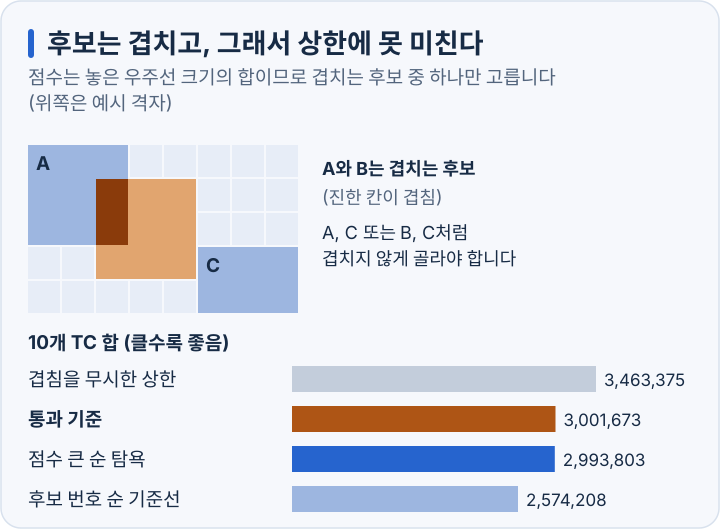

# 격자 배치 문제: 문제 계약과 기준선

LANDINGX의 입력·출력 계약, 후보의 유효성을 한 함수로 검사하는 상태 설계, 후보 번호 순 기준선과 점수 큰 순 탐욕까지 만듭니다. 전체 흐름은 [강의 개요](../lesson.md)에 있습니다.

## 문제 계약을 상태로 옮기기

| 항목 | 계약 |
| --- | --- |
| 구현 | TC마다 `init(map, spaceships)` 한 번, 이어서 `process(row, col, dir)` 한 번. 시간 제한 10초 |
| 입력 | `map[y][x]` 고도(이 강의의 채점기에서는 0~124), 우주선 10000척의 `height`, `width`(2~5) |
| 출력 | 우주선 `i`의 왼쪽 위 `(row[i], col[i])`와 `dir[i]`(0이 아니면 가로·세로 교환). 놓지 않으면 셋 다 -1 |
| 점수 | 놓은 우주선마다 `height * width * min(height, width)`의 합. 클수록 좋고 10개 TC 합 3001673 이상이 통과 |
| 무효 | 지도 밖, 겹침, 네 꼭짓점 고도의 최댓값 - 최솟값 > 6. **하나라도 있으면 그 TC가 실패하고 총점이 0** |

놓지 않아도 되므로 빈 답도 유효하지만, 우주선을 모두 놓을 수는 없습니다. 고도 조건을 만족하는 직사각형 위치(**후보**)는 TC당 8549~8814개뿐이고 서로 겹칩니다. 겹침을 무시하고 후보를 모두 놓는다고 가정한 점수 상한은 10개 TC 합 3463375로 통과 기준보다 15% 높고, 그 차이가 겹침에서 나옵니다.



[그림 크게 보기](https://git.readiz.com/h-contest-lesson/lessons/placement-search/lesson-assets/contract-overlap.svg)

**제출할 답은 `row/col/dir`이지만 탐색 상태는 후보 선택 집합**으로 둡니다. 고도·경계 조건은 다른 물체와 무관하니 후보를 미리 모두 만들 수 있고, 같은 크기의 우주선은 바꿔도 점수가 같으니 종류별 개수 한도만 지키다가 제출할 때 번호를 붙입니다. 점유 격자 `owner`, 종류별 선택 수 `have`, 목록 위치 `slot`, `score`는 선택 집합에서 다시 계산할 수 있는 **보조 값**입니다. 탐색에서는 갱신하며 가고, 검사에서는 처음부터 다시 만들어 대조합니다.

## 유효성 검사를 한 함수로

`reason`이 경계(1)·고도 차(2)·겹침(3)을 한 곳에서 판정합니다. 후보를 만들 때는 빈 보드로 불러 1·2만 걸러내고, 탐색 중에는 `canAdd`가 같은 함수에 종류별 한도 하나만 더해 씁니다. 판정을 두 군데에 나눠 쓰면 한쪽만 고쳐 어긋납니다.

무효 후보를 "점수 0인 후보"로 두면 안 됩니다. 이 채점기는 무효 배치 하나가 TC 하나가 아니라 **전체 점수를 0으로** 만들어서, 평가식에서 감점해도 best에 한 번만 섞이면 끝입니다. 그래서 무효는 **제안 단계에서 거절**하고, 거절한 이동은 보드를 건드리지 않습니다. 그러면 탐색 중인 현재 배치(`current`)와 지금까지 가장 좋은 배치(`best`)가 항상 유효합니다.

> **코드 환경: h-contest 제출 확장용 1/6.** `land-state`부터 `land-destroy`까지 다섯 블록을 `random`, `sort` 블록 뒤에 순서대로 붙이고, 마지막 `land-entry`가 완성 코드입니다. 후보 상한은 32768, `Board`는 4MB라서 전역·정적 변수로만 둡니다. `build`는 TC마다 `init`에서 한 번, `submit`은 `process` 끝에서 부릅니다.

```cpp snippet=land-state
#define MAP_SIZE (1000)
#define SPACESHIP_SIZE (10000)

struct Spaceship {
    int height;
    int width;
};

namespace land {
const int MAX_CAND = 32768, KINDS = 16;
const int (*heightMap)[MAP_SIZE];
int candCount;
short candRow[MAX_CAND], candCol[MAX_CAND];
unsigned char candH[MAX_CAND], candW[MAX_CAND];  // 회전을 반영해 놓았을 때의 세로·가로
int candWeight[MAX_CAND], candKind[MAX_CAND];    // 종류 = (짧은 변 - 2) * 4 + (긴 변 - 2)
int kindLimit[KINDS];                            // 종류별 우주선 수
int kindOf(int a, int b) { return ((a < b ? a : b) - 2) * 4 + ((a < b ? b : a) - 2); }

template <class F> void eachCell(int c, F f) {  // 후보 c가 덮는 칸을 순회한다.
    for (int y = candRow[c]; y < candRow[c] + candH[c]; ++y)
        for (int x = candCol[c]; x < candCol[c] + candW[c]; ++x) f(y, x);
}

// 제출할 답은 picked[]이고, 나머지는 계산을 빠르게 하는 보조 값이다.
struct Board {
    int owner[MAP_SIZE][MAP_SIZE];  // 점유 격자: 칸을 덮는 선택된 후보 번호, 비었으면 -1
    int have[KINDS];                // 종류별 선택 수
    int picked[MAX_CAND], count;    // 선택된 후보 번호들
    int slot[MAX_CAND];             // 후보 -> picked 안의 위치, 선택 안 했으면 -1
    long long score;
};

void clear(Board& bd) {
    for (int y = 0; y < MAP_SIZE; ++y)
        for (int x = 0; x < MAP_SIZE; ++x) bd.owner[y][x] = -1;
    for (int k = 0; k < KINDS; ++k) bd.have[k] = 0;
    for (int c = 0; c < MAX_CAND; ++c) bd.slot[c] = -1;
    bd.count = 0;
    bd.score = 0;
}

// 유효성은 이 함수 하나로 판정한다. 0: 가능, 1: 지도 밖, 2: 고도 차, 3: 겹침
int reason(const Board& bd, int r, int c, int a, int b) {
    if (r < 0 || c < 0 || r + a > MAP_SIZE || c + b > MAP_SIZE) return 1;
    int v[4] = {heightMap[r][c], heightMap[r][c + b - 1], heightMap[r + a - 1][c], heightMap[r + a - 1][c + b - 1]};
    int lo = v[0], hi = v[0];
    for (int i = 1; i < 4; ++i) { if (v[i] < lo) lo = v[i]; if (v[i] > hi) hi = v[i]; }
    if (hi - lo > 6) return 2;
    for (int y = r; y < r + a; ++y)
        for (int x = c; x < c + b; ++x)
            if (bd.owner[y][x] >= 0) return 3;
    return 0;
}

// 후보 c를 지금 선택해도 되는가: 종류별 우주선이 남아 있고 위의 판정을 통과한다.
bool canAdd(const Board& bd, int c) {
    return bd.have[candKind[c]] < kindLimit[candKind[c]] && reason(bd, candRow[c], candCol[c], candH[c], candW[c]) == 0;
}

// 후보 c와 겹치는 선택 후보의 서로 다른 번호를 out(25칸 이상)에 담고 개수를 돌려준다.
int owners(const Board& bd, int c, int out[]) {
    int n = 0;
    eachCell(c, [&](int y, int x) {
        int o = bd.owner[y][x], i = 0;
        while (o >= 0 && i < n && out[i] != o) ++i;
        if (o >= 0 && i == n) out[n++] = o;
    });
    return n;
}

void put(Board& bd, int c) {  // 전제: canAdd(bd, c)
    eachCell(c, [&](int y, int x) { bd.owner[y][x] = c; });
    ++bd.have[candKind[c]];
    bd.slot[c] = bd.count;
    bd.picked[bd.count++] = c;
    bd.score += candWeight[c];
}

void take(Board& bd, int c) {  // 전제: c가 선택돼 있다. put의 역연산이다.
    eachCell(c, [&](int y, int x) { bd.owner[y][x] = -1; });
    --bd.have[candKind[c]];
    int last = bd.picked[--bd.count];
    bd.picked[bd.slot[c]] = last;
    bd.slot[last] = bd.slot[c];
    bd.slot[c] = -1;
    bd.score -= candWeight[c];
}
}
```

```cpp snippet=land-build
namespace land {
const Spaceship* shipList;
int shipCount;

// 지도와 우주선 목록에서 후보를 모두 만든다. empty는 clear()한 빈 보드이다.
void build(int map[][MAP_SIZE], const Spaceship ships[], int n, const Board& empty) {
    heightMap = map;
    shipList = ships;
    shipCount = n;
    for (int k = 0; k < KINDS; ++k) kindLimit[k] = 0;
    for (int i = 0; i < n; ++i) ++kindLimit[kindOf(ships[i].height, ships[i].width)];
    candCount = 0;
    for (int lo = 2; lo <= 5; ++lo) {
        for (int hi = lo; hi <= 5; ++hi) {
            int k = kindOf(lo, hi);
            for (int turn = 0; turn < (lo == hi ? 1 : 2) && kindLimit[k] > 0; ++turn) {  // 우주선이 없는 종류는 건너뛴다.
                int a = turn == 0 ? lo : hi, b = turn == 0 ? hi : lo;  // 두 번째는 회전한 방향
                for (int r = 0; r + a <= MAP_SIZE; ++r)
                    for (int c = 0; c + b <= MAP_SIZE; ++c) {
                        if (reason(empty, r, c, a, b) != 0 || candCount == MAX_CAND) continue;
                        int id = candCount++;
                        candRow[id] = (short)r; candCol[id] = (short)c;
                        candH[id] = (unsigned char)a; candW[id] = (unsigned char)b;
                        candWeight[id] = a * b * lo;  // 점수 = 세로 * 가로 * 짧은 변
                        candKind[id] = k;
                    }
            }
        }
    }
}

// 선택된 후보를 같은 종류의 우주선에 차례로 배정해 row/col/dir로 옮긴다.
void submit(const Board& bd, int row[], int col[], int dir[]) {
    int cursor[KINDS] = {0};  // 종류별로 다음에 볼 우주선 번호
    for (int i = 0; i < shipCount; ++i) row[i] = col[i] = dir[i] = -1;
    for (int p = 0; p < bd.count; ++p) {
        int c = bd.picked[p], k = candKind[c], s = cursor[k];
        while (kindOf(shipList[s].height, shipList[s].width) != k) ++s;  // canAdd가 개수를 보장한다.
        cursor[k] = s + 1;
        row[s] = candRow[c];
        col[s] = candCol[c];
        dir[s] = (candH[c] == shipList[s].height && candW[c] == shipList[s].width) ? 0 : 1;
    }
}
}
```

## 기준선과 정렬 탐욕

`sweep`은 후보를 키 순으로 한 번 훑으며 들어가면 놓습니다. 키를 후보 번호로 두면 후보를 만든 순서(작은 종류부터, 지도 순서)로 놓는 first-fit 기준선이고, 점수의 음수로 두면 점수 큰 후보부터 놓는 탐욕입니다. 먼저 놓는 쪽이 이기는 구조라서 정렬 기준이 점수를 가릅니다. `evaluations`는 모든 방법이 공유하는 예산 단위(후보 한 개의 검사)입니다.

```cpp snippet=land-greedy
namespace land {
long long evaluations;  // 후보 검사 횟수: 모든 방법이 같은 단위로 예산을 쓴다.

bool tryPut(Board& bd, int c) {
    ++evaluations;
    if (!canAdd(bd, c)) return false;
    put(bd, c);
    return true;
}

// 후보를 key 오름차순으로 한 번 훑으며 들어가는 대로 놓는다. order/temp는 candCount칸 이상.
// key[c] = c이면 후보를 만든 순서(작은 종류부터, 지도 순서)대로 놓는 first-fit 기준선이다.
void sweep(Board& bd, const long long key[], int order[], int temp[]) {
    for (int c = 0; c < candCount; ++c) order[c] = c;
    hc::sortIds(order, temp, candCount, key);
    for (int i = 0; i < candCount; ++i) tryPut(bd, order[i]);
}
}
```
