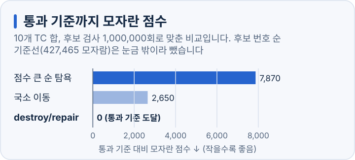
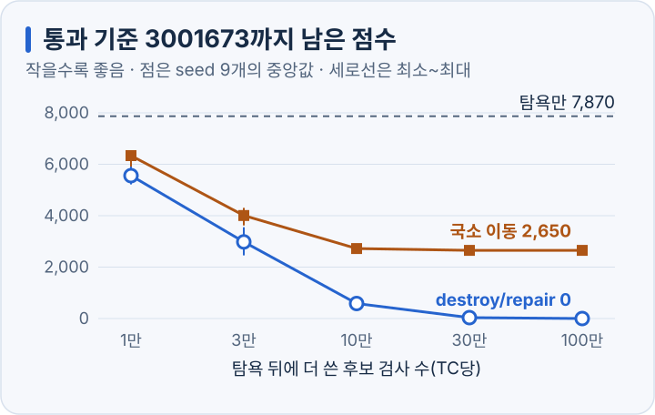
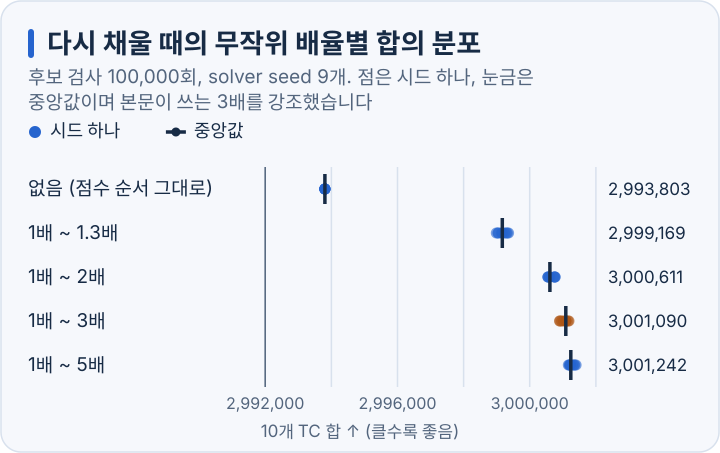

# 격자 배치 문제: 실측과 실패 사례

같은 후보 검사 수로 세 방법을 비교하고, destroy 크기·방식과 다시 채우는 순서를 바꾼 실험, 처음 보는 입력에서의 확인과 무효 후보를 놓친 실패를 다룹니다. 구현은 [풀이](solution.md)에 있습니다.

## 같은 예산으로 비교하기

2026-11-18에 공개 채점기의 TC 10개를 그대로 실행한 결과입니다. 시간은 절대값보다 순서를 봅니다. 국소 이동과 destroy/repair는 점수 큰 순 탐욕 결과에서 시작해 **후보 검사를 같은 1,000,000회** 더 씁니다.

:::hint 측정 조건
환경은 Darwin 26.3 arm64 / Apple clang version 17.0.0 (clang-1700.6.3.2) / -std=c++17 -O2 -Wno-register이고 채점기 `main.cpp`의 SHA-256 앞 12자는 `9ab8fbdb47a3`입니다(`register` 때문에 `-Wno-register`를 붙입니다). 시간은 TC 생성과 후보 만들기를 포함한 10개 TC 전체의 중앙값(9번 중 첫 번째 제외)이며 다른 작업이 도는 컴퓨터에서 쟀습니다.
:::

<!-- check:stages -->
| 방식 | 합 ↑ | 통과 기준 3001673과의 차 | 후보 검사(TC당 평균) | 시간(ms) |
| --- | ---: | ---: | ---: | ---: |
| 기준선: 후보 번호 순 first-fit | 2574208 | -427465 | 8665 | 268 |
| 탐욕: 점수 큰 후보부터 | 2993803 | -7870 | 8665 | 269 |
| 국소 이동(hill climbing) | 2999023 | -2650 | 1008665 | 380 |
| destroy/repair(한 영역) | 3001673 | +0 | 1008669 | 1250 |

[그림 크게 보기](https://git.readiz.com/h-contest-lesson/lessons/placement-search/lesson-assets/stage-gap.svg)

- 점수 큰 후보부터 훑는 것만으로 first-fit보다 419595점 올랐습니다. 문제 설명의 "작은 것부터"는 이 기준선과 같은 순서입니다. 그 뒤의 두 방법은 통과 기준까지 남은 7870점을 줄이는 싸움입니다.
- 국소 이동이 끝난 배치와 destroy/repair가 만든 배치 모두 전체 후보를 평가해 보면 개선 이동이 TC 10개에서 0개입니다. 한 후보씩 보는 이동은 실제 입력에서도 손계산처럼 **국소 최적**에 갇힙니다.

아래 표는 예산을 바꾼 결과로 solver seed 1~9의 중앙값과 범위입니다. 같은 코드를 ASan/UBSan으로 채점기와 함께 실행해도 합이 3001673으로 같았습니다.

<!-- check:budgets -->
| 탐욕 뒤 추가 후보 검사(TC당) | 국소 이동 중앙값 | 최소~최대 | 시간(ms) | destroy/repair 중앙값 | 최소~최대 | 시간(ms) |
| ---: | ---: | ---: | ---: | ---: | ---: | ---: |
| 10,000 | 2995338 | 2995138~2995780 | 269 | 2996114 | 2995765~2996454 | 278 |
| 30,000 | 2997667 | 2997370~2998053 | 271 | 2998692 | 2998122~2999215 | 300 |
| 100,000 | 2998950 | 2998894~2999003 | 281 | 3001090 | 3000899~3001187 | 370 |
| 300,000 | 2999023 | 2999023~2999023 | 306 | 3001636 | 3001573~3001647 | 562 |
| 1,000,000 | 2999023 | 2999023~2999023 | 384 | 3001673 | 3001671~3001673 | 1249 |

[그림 크게 보기](https://git.readiz.com/h-contest-lesson/lessons/placement-search/lesson-assets/budget-curves.svg)

- 1만 회에서는 두 방법의 범위가 겹칩니다(destroy/repair 최소 2995765, 국소 이동 최대 2995780). 이 차이로는 우열을 정하지 않고, 3만 회부터 destroy/repair의 최소가 국소 이동의 최대보다 큽니다.
- 국소 이동은 30만 회부터 seed 9개가 모두 2999023에서 멈춥니다. 개선 이동이 하나도 없으므로 예산 부족이 아니라 **이웃의 한계**입니다.
- destroy/repair는 100만 회에 3001673(seed 9개의 범위 3001671~3001673)에 닿습니다. 통과 기준과 같은 값이지만 최적인지는 확인하지 못했습니다.
- 같은 검사 수라도 destroy/repair는 반복마다 정렬과 구역 조회를 해서 시간이 더 듭니다. 그래도 10만 회의 destroy/repair(370ms, 중앙값 3001090)는 100만 회의 국소 이동(384ms, 2999023)과 시간이 비슷한데 점수가 높아, 같은 **시간**으로 맞춰도 결론이 같습니다.

## destroy 크기와 방식, 다시 채우는 순서

후보 검사 100,000회로 고정하고(방식 차이가 드러나는 지점) 무엇을 얼마나 뺄지를 바꿨습니다. `noise`는 200입니다.

<!-- check:destroy -->
| destroy 방식 | 크기 | 합의 중앙값 ↑ | 최소~최대 | 한 번에 뺀 평균 개수 | 반복 수(중앙값) |
| --- | ---: | ---: | ---: | ---: | ---: |
| 한 영역 | 여백 1칸 | 3001084 | 3000979~3001164 | 1.2 | 673984 |
| 한 영역 | 여백 4칸 | 3001020 | 3000878~3001188 | 2.2 | 379052 |
| 한 영역 | 여백 16칸 | 3001274 | 3001182~3001462 | 11.0 | 75282 |
| 무작위 k개 | k = 1 | 3001105 | 3001016~3001161 | 1.0 | 809356 |
| 무작위 k개 | k = 4 | 3001035 | 3000936~3001114 | 4.0 | 202343 |
| 무작위 k개 | k = 16 | 3000986 | 3000894~3001098 | 16.0 | 50591 |
| 낮은 점수 k개 | k = 2 | 2996922 | 2996427~2997055 | 2.0 | 451342 |
| 낮은 점수 k개 | k = 8 | 2996930 | 2996720~2997183 | 8.0 | 112869 |

[그림 크게 보기](https://git.readiz.com/h-contest-lesson/lessons/placement-search/lesson-assets/destroy-seeds.svg)

- 영역 여백 16칸(한 번에 평균 11.0개 제거)이 중앙값이 가장 높고, 범위가 여백 1칸과 무작위 k 전부와 겹치지 않습니다. 다만 여백 4칸과는 겹치며, 나머지 설정끼리도 범위가 겹쳐 우열을 정하지 않습니다. 더 큰 영역은 시험하지 않았고, 완성 코드가 쓰는 여백 8칸은 이 표에 없는 값입니다(최종 합 3001673은 8칸으로 잰 것입니다). 영역과 무작위 k개 방식이 국소 이동(100,000회에서 2998950)보다 높은 것은, 하나만 빼도(k = 1) 뺀 자리에 여러 후보를 다시 넣을 수 있어 국소 이동이 못 하는 이동이 되기 때문입니다.
- 낮은 점수의 후보를 빼는 방식은 중앙값이 2996922와 2996930으로 같은 예산의 국소 이동(2998950)보다도 낮고 범위도 겹치지 않습니다. 원인을 증명한 것은 아니지만 점수가 낮은 후보는 작은 우주선이어서 빼도 큰 후보가 들어갈 자리가 열리지 않는 것과 일치합니다. 무엇을 빼느냐가 얼마나 빼느냐보다 중요할 수 있습니다.

다시 채울 때의 무작위 배율을 바꾸면 이렇게 갈립니다.

<!-- check:noise -->
| 다시 채울 때의 무작위 배율 | 합의 중앙값 ↑ | 최소~최대 |
| --- | ---: | ---: |
| 없음(점수 순서 그대로) | 2993803 | 2993803~2993803 |
| 1배 ~ 1.3배 | 2999169 | 2998990~2999360 |
| 1배 ~ 2배 | 3000611 | 3000549~3000770 |
| 1배 ~ 3배 | 3001090 | 3000899~3001187 |
| 1배 ~ 5배 | 3001242 | 3001167~3001403 |

[그림 크게 보기](https://git.readiz.com/h-contest-lesson/lessons/placement-search/lesson-assets/noise-seeds.svg)

배율이 없으면(0) 같은 배치가 되풀이되어 탐욕과 같은 2993803입니다. 1.3배와 2배는 3배보다 낮고 범위도 겹치지 않으며, 5배는 3배와 범위가 겹쳐 우열을 정하지 않습니다. 본문은 3배(`noise` 200)를 씁니다.

[실험과 튜닝](https://h.readiz.com/learn/experiments-and-tuning)의 기준대로 차이가 seed 사이의 범위보다 작으면 우열을 정하지 않습니다. 위 설정은 공개 TC 10개로 골랐으므로, 선택에 쓰지 않은 입력에서도 같은 코드를 파라미터 변경 없이 돌렸습니다. 채점기 생성기의 seed를 101~103으로 바꾼 입력과, 고도 범위를 0~109, 0~149로 바꿔 후보 수가 달라진 입력입니다(solver seed 5개).

<!-- check:unseen -->
| 입력 | 기준선 | 점수 큰 순 탐욕 | 국소 이동 중앙값 | 최소~최대 | destroy/repair 중앙값 | 최소~최대 |
| --- | ---: | ---: | ---: | ---: | ---: | ---: |
| 다른 seed 101 | 2579087 | 3003885 | 3007743 | 3007743~3007772 | 3010289 | 3010289~3010289 |
| 다른 seed 102 | 2596589 | 3015511 | 3019943 | 3019943~3019948 | 3022208 | 3022171~3022208 |
| 다른 seed 103 | 2585454 | 3005076 | 3009114 | 3009101~3009121 | 3011412 | 3011412~3011412 |
| 고도 범위 0~109, seed 101 | 3385631 | 3918853 | 3924797 | 3924797~3924822 | 3938967 | 3938900~3939116 |
| 고도 범위 0~149, seed 101 | 1670051 | 1842889 | 1844553 | 1844553~1844553 | 1845190 | 1845190~1845190 |

다섯 입력 모두 후보 번호 순 < 점수 큰 순 < 국소 이동 < destroy/repair 순서가 같고, destroy/repair의 최소가 국소 이동의 최대보다 큽니다. 탐욕 대비 개선은 입력마다 크게 다릅니다. 후보가 많아 서로 더 겹치는 0~109에서 destroy/repair는 +20114(국소 이동은 +5944)이고, 후보가 적은 0~149에서는 +2301(+1664)입니다. 이 입력들은 같은 생성 방식을 바꾼 것일 뿐 숨은 채점 입력의 대표가 아니며, 순서가 같다는 것이 개선 폭이 같다는 뜻은 아닙니다.

## 실패 사례 두 가지

**되돌리기에서 격자를 빠뜨리면.** `undo`가 뺐던 후보를 다시 넣을 때 `put` 대신 `else { ++bd.have[candKind[op.cand]]; bd.slot[op.cand] = bd.count; bd.picked[bd.count++] = op.cand; bd.score += candWeight[op.cand]; }`로 선택 목록과 점수만 복원한 변형입니다. 컴파일되고 점수도 계산되지만 점유 격자에는 그 후보가 없어서 이후 repair가 같은 칸에 다른 후보를 넣고 **겹치는 배치**를 제출합니다. 채점기에서 TC 1이 무효가 되어 총점은 0입니다. 검사 스크립트는 점유 격자를 `picked[]`에서 다시 칠한 격자와 칸마다 대조하고, 되돌린 뒤의 상태가 이전과 같은지를 무작위 입력 100개에서 확인합니다.

**종류별 한도를 빠뜨리면.** `canAdd`에서 한도 검사를 뺀 변형 `return reason(bd, candRow[c], candCol[c], candH[c], candW[c]) == 0;`은 공개 TC에서 **점수가 정상과 똑같이 3001673점**입니다. 우주선 수가 후보 수보다 많아 한도에 걸릴 일이 없기 때문이고, 채점기는 아무것도 알려 주지 않습니다. 우주선이 적은 작은 입력에서는 후보 수가 우주선 수를 넘어 `submit`이 우주선 범위 밖을 읽습니다. 검사 스크립트는 우주선 1~30척, 가로·세로 3~15칸 지도의 무작위 입력 100개(채점기 규칙을 따로 구현한 `judgeVerify`, 완전탐색 최적값 포함)를 ASan/UBSan으로 돌려 두 변형을 모두 실패시킵니다. 정상 점수가 나온다고 검사를 통과한 것이 아니라는 예입니다.

:::hint 검사 스크립트 실행
`python3 scripts/check_placement_search.py`는 이 검사와 저장된 측정의 표 대조를 하고, `--judge /path/to/LANDINGX/main.cpp --output FILE`을 더하면 위 표의 측정을 다시 만듭니다.
:::
