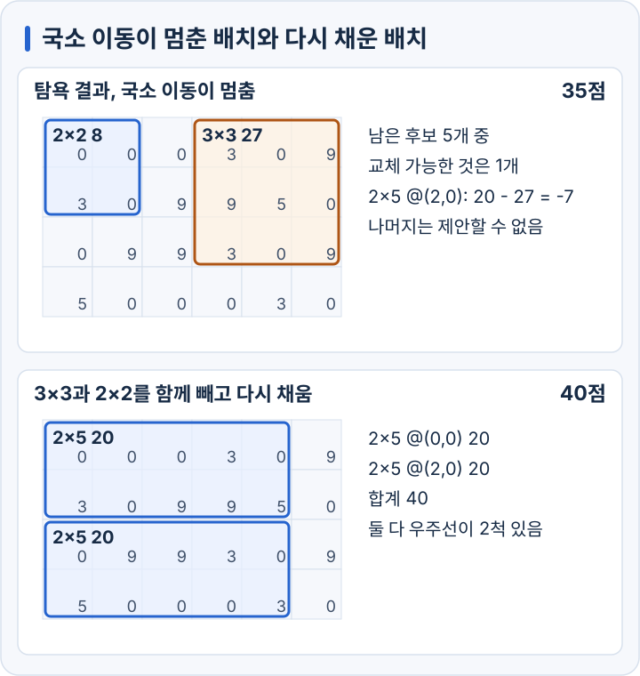

# 격자 배치 문제: 풀이

추가와 교체로 이루어진 국소 이동의 차분 평가, 국소 이동이 멈추는 손계산, 영역을 빼고 무작위 순서로 다시 채우는 destroy/repair와 완성 코드를 다룹니다. 앞 단계는 [문제 계약과 기준선](contract-and-baseline.md)입니다.

## 국소 이동: 추가와 교체, 차분 평가

이웃은 후보 하나 `x`를 넣는 이동입니다. 겹치는 선택 후보가 없으면 **추가**(점수 `+w[x]`), 하나면 그 후보를 빼고 `x`를 넣는 **교체**(점수 `w[x] - w[drop]`)이고, 둘 이상이면 제안하지 않습니다. 차분은 `owners`가 찾은 겹침만 보면 되므로 후보 하나에 칸 25개 이하입니다. 종류별 한도는 교체되는 후보가 같은 종류인지까지 따져 확인합니다. 적용은 `take`와 `put`이고, `take`는 `put`이 칠한 칸을 그대로 지우는 역연산입니다. 점수가 줄지 않는 이동(같은 점수 포함)만 받는 것이 hill climbing입니다.

```cpp snippet=land-local
namespace land {
// 후보 x를 넣는 이동을 평가한다(board는 바꾸지 않는다). 겹치는 선택 후보가 0개면 추가, 1개면 교체이고
// 2개 이상이면 이 이웃에서는 제안하지 않는다. 가능하면 drop(교체될 후보 또는 -1)과 점수 변화 delta를 채운다.
bool evaluate(const Board& bd, int x, int& drop, long long& delta) {
    ++evaluations;
    int own[25];
    int n = owners(bd, x, own);
    if (n > 1) return false;
    drop = n == 1 ? own[0] : -1;
    int kind = candKind[x];
    if (bd.have[kind] - (drop >= 0 && candKind[drop] == kind ? 1 : 0) >= kindLimit[kind]) return false;  // 종류별 한도
    delta = candWeight[x] - (drop >= 0 ? candWeight[drop] : 0);
    return true;
}

// 점수가 줄지 않는 이동만 받는다. budget만큼 후보를 평가한다.
void hillClimb(Board& bd, hc::Random& rng, long long budget) {
    long long stop = evaluations + budget;
    while (evaluations < stop && candCount > 0) {
        int x = (int)rng.below((unsigned)candCount), drop;
        long long delta;
        if (bd.slot[x] >= 0) ++evaluations;  // 이미 선택한 후보
        else if (evaluate(bd, x, drop, delta) && delta >= 0) {
            if (drop >= 0) take(bd, drop);
            put(bd, x);
        }
    }
}
}
```

## 손계산: 국소 이동이 멈추는 곳

4행 6열 지도(칸의 숫자는 고도)와 우주선 4척(2×5 둘, 2×2 하나, 3×3 하나)입니다. 네 꼭짓점 조건을 만족하는 후보는 7개이고 점수는 2×2 8, 2×5 20, 3×3 27입니다. 점수 큰 후보부터 훑으면 3×3 @(0,3)과 2×2 @(0,0)이 들어가 **35점**입니다. 남은 후보 5개를 모두 평가한 표입니다.

<!-- check:hand -->
| 후보 | 점수 | 겹치는 선택 후보 | 판정 | 점수 변화 |
| --- | ---: | ---: | --- | ---: |
| 3×3 @(0,3) | 27 | - | 선택됨 | - |
| 2×2 @(0,0) | 8 | - | 선택됨 | - |
| 2×2 @(1,2) | 8 | 1 | 거절: 종류 한도 | - |
| 2×2 @(2,3) | 8 | 1 | 거절: 종류 한도 | - |
| 2×5 @(0,0) | 20 | 2 | 제안하지 않음 | - |
| 2×5 @(1,0) | 20 | 2 | 제안하지 않음 | - |
| 2×5 @(2,0) | 20 | 1 | 교체 | -7 |

2×5 @(2,0)만 교체로 평가되고 7점 나빠집니다. 2×2 두 후보는 3×3 하나와만 겹치지만 2×2 우주선이 한 척뿐이라 종류 한도에서 막힙니다. 나머지 2×5 둘은 두 후보와 겹쳐 제안하지 않습니다. 개선도 같은 점수의 이동도 없어서 hill climbing은 여기서 멈춥니다. 후보 7개의 부분집합 128개를 모두 보면 최적은 **40점**(2×5 @(0,0)과 @(2,0))인데, 거기에 가려면 3×3과 2×2를 **함께** 빼야 합니다.



[그림 크게 보기](https://git.readiz.com/h-contest-lesson/lessons/placement-search/lesson-assets/stuck-and-repair.svg)

검사 스크립트가 후보 목록, 위 표, 점수 35와 40을 파이썬으로 따로 다시 계산해 C++ 구현과 대조합니다. 후보 16개 이하의 무작위 작은 입력 29개를 완전탐색 최적값과 비교하면 탐욕이 28개, 국소 이동이 28개, destroy/repair가 29개에서 최적에 닿아 이 크기에서는 세 방법을 가르지 못합니다. 차이는 실제 크기에서 드러납니다.

## destroy/repair: 얼마나, 어떻게

단일 이동으로 못 나가는 곳은 **여러 개를 빼고 다시 채우는** 큰 이동이 넘습니다. 정할 것이 셋 있습니다.

- **무엇을 빼나**: 선택 후보 하나를 중심으로 둘레 `size`칸 안을 모두 빼는 *영역*, 무작위 `k`개, 무작위 세 개 중 점수가 낮은 것을 `k`번 빼는 *낮은 점수* 중 고릅니다.
- **어떻게 채우나**: 뺀 자리와 겹치는 후보만 모아 점수에 **무작위 배율**(1배 ~ 1+`noise`/100배)을 곱한 순서로 탐욕처럼 넣습니다. 배율이 없으면 점수 순서가 그대로여서 방금 뺀 배치가 다시 만들어집니다. 위 손계산에서 영역 여백 2칸, `noise` 0으로 50번 반복해도 35점 그대로이고, `noise` 200으로 seed 1~9를 돌리면 모두 19번 안에 40점이 됩니다.
- **나빠지면**: 점수가 줄었으면 되돌리고, 같은 점수는 받아 평지를 걷습니다. 작업 기록을 거꾸로 뒤집는 `undo`는 바뀐 후보의 칸만 다시 칠해서 destroy/repair 한 반복이 통째로 평균 0.5µs입니다. 보드 전체를 복사해 두었다가 되돌리면 4MB를 저장·복원하는 데만 반복당 217µs가 들어 보드는 복사하지 않습니다. 받는 기준이 "점수가 줄지 않음"이라 current가 곧 best입니다. SA처럼 나빠지는 이동을 받는다면 best의 선택 목록만 복사해 둡니다. 코드의 `collect`는 시작 칸을 16×16 구역으로 묶은 색인에서 영역과 겹치는 후보를 찾고, `size`는 2048 이하여야 합니다.

```cpp snippet=land-destroy
namespace land {
const int BUCKET = 16, BUCKETS = (MAP_SIZE + BUCKET - 1) / BUCKET, POOL_MAX = 2048;
int bucketHead[BUCKETS][BUCKETS], bucketNext[MAX_CAND];  // 후보를 시작 칸의 16x16 구역별로 묶는다.
int stampOf[MAX_CAND], stampNow;

void buildBuckets() {
    for (int i = 0; i < BUCKETS; ++i)
        for (int j = 0; j < BUCKETS; ++j) bucketHead[i][j] = -1;
    for (int c = 0; c < candCount; ++c) {
        int& head = bucketHead[candRow[c] / BUCKET][candCol[c] / BUCKET];
        bucketNext[c] = head;
        head = c;
    }
}

// 칸 범위 [r0,r1] x [c0,c1]와 겹치는 후보를 pool[n..]에 덧붙인다. 같은 stampNow에서는 한 번씩만 넣는다.
int collect(int r0, int c0, int r1, int c1, int pool[], int n) {
    for (int br = (r0 > 4 ? r0 - 4 : 0) / BUCKET; br <= (r1 < MAP_SIZE - 1 ? r1 : MAP_SIZE - 1) / BUCKET; ++br)
        for (int bc = (c0 > 4 ? c0 - 4 : 0) / BUCKET; bc <= (c1 < MAP_SIZE - 1 ? c1 : MAP_SIZE - 1) / BUCKET; ++bc)
            for (int c = bucketHead[br][bc]; c >= 0; c = bucketNext[c]) {
                if (stampOf[c] == stampNow || n == POOL_MAX) continue;
                if (candRow[c] + candH[c] - 1 < r0 || candRow[c] > r1) continue;
                if (candCol[c] + candW[c] - 1 < c0 || candCol[c] > c1) continue;
                stampOf[c] = stampNow;
                pool[n++] = c;
            }
    return n;
}

// 되돌리기 기록: 마지막 작업부터 거꾸로 뒤집으면 직전 상태가 된다. 빼기와 넣기는 각각 POOL_MAX개 이하이다.
struct Op { int cand; bool added; };
Op opLog[2 * POOL_MAX];
int opCount;

void change(Board& bd, int c, bool add) {
    if (add) put(bd, c);
    else take(bd, c);
    opLog[opCount].cand = c;
    opLog[opCount++].added = add;
}

void undo(Board& bd) {
    while (opCount > 0) {
        const Op& op = opLog[--opCount];
        if (op.added) take(bd, op.cand);
        else put(bd, op.cand);
    }
}

enum { REGION, RANDOM_K, LOWEST_K };  // 무엇을 뺄지
struct DestroyParams {
    int mode, size;  // size: REGION은 선택한 후보 둘레의 여백 칸 수, 나머지는 뺄 후보 수 k
    int noise;       // 다시 채울 때 점수에 곱하는 무작위 배율은 1배 ~ 1+noise/100배. 0이면 점수 순서 그대로
};

// destroy/repair 한 번. 나빠지면 되돌린다. 뺀 후보 수를 돌려준다.
int destroyRepair(Board& bd, hc::Random& rng, const DestroyParams& prm) {
    static int pool[POOL_MAX], temp[POOL_MAX];
    static long long key[MAX_CAND];
    if (bd.count == 0) { ++evaluations; return 0; }
    long long before = bd.score;
    int removed = 0, n = 0;
    opCount = 0;
    ++stampNow;
    if (prm.mode == REGION) {  // 무작위 선택 후보를 중심으로 한 영역 안을 전부 뺀다.
        int y = bd.picked[rng.below((unsigned)bd.count)], m = prm.size;
        n = collect(candRow[y] - m, candCol[y] - m, candRow[y] + candH[y] + m - 1, candCol[y] + candW[y] + m - 1, pool, 0);
        for (int i = 0; i < n; ++i)
            if (bd.slot[pool[i]] >= 0) { change(bd, pool[i], false); ++removed; }
    } else {
        for (int t = 0; t < prm.size && t < POOL_MAX && bd.count > 0; ++t, ++removed) {
            int y = bd.picked[rng.below((unsigned)bd.count)];
            for (int s = 0; s < 2 && prm.mode == LOWEST_K; ++s) {  // 셋 중 점수가 가장 낮은 것
                int z = bd.picked[rng.below((unsigned)bd.count)];
                if (candWeight[z] < candWeight[y]) y = z;
            }
            change(bd, y, false);
            n = collect(candRow[y], candCol[y], candRow[y] + candH[y] - 1, candCol[y] + candW[y] - 1, pool, n);
        }
    }
    for (int i = 0; i < n; ++i) {  // 점수 순서에 무작위 배율을 곱해 다시 채운다.
        long long noise = prm.noise == 0 ? 0 : (long long)rng.below((unsigned)prm.noise + 1u);
        key[pool[i]] = -(long long)candWeight[pool[i]] * (100 + noise);
    }
    hc::sortIds(pool, temp, n, key);
    for (int i = 0; i < n; ++i) {
        ++evaluations;
        if (canAdd(bd, pool[i])) change(bd, pool[i], true);
    }
    if (bd.score < before) undo(bd);
    opCount = 0;
    return removed;
}
}
```

> **코드 환경: h-contest 제출용(완성 코드).** 위 다섯 블록(앞의 [문제 계약과 기준선](contract-and-baseline.md)부터 이어짐) 뒤에 붙입니다. TC마다 탐욕 뒤에 후보 검사 100만 회를 쓰고 모든 TC에서 같은 solver seed를 씁니다.

```cpp snippet=land-entry
static land::Board layout;
static int sortOrder[land::MAX_CAND], sortTemp[land::MAX_CAND];
static long long sortKey[land::MAX_CAND];

void init(int map[MAP_SIZE][MAP_SIZE], Spaceship spaceships[]) {
    land::clear(layout);
    land::build(map, spaceships, SPACESHIP_SIZE, layout);
    land::buildBuckets();
}

void process(int row[], int col[], int dir[]) {
    land::evaluations = 0;
    for (int c = 0; c < land::candCount; ++c) sortKey[c] = -(long long)land::candWeight[c];
    land::sweep(layout, sortKey, sortOrder, sortTemp);  // 점수가 큰 후보부터 훑는 탐욕

    hc::Random rng;
    rng.reset(20261118u);
    land::DestroyParams prm = {land::REGION, 8, 200};
    long long stop = land::evaluations + 1000000;  // 탐욕 뒤에 후보 검사 100만 회
    while (land::evaluations < stop) land::destroyRepair(layout, rng, prm);
    land::submit(layout, row, col, dir);
}
```
