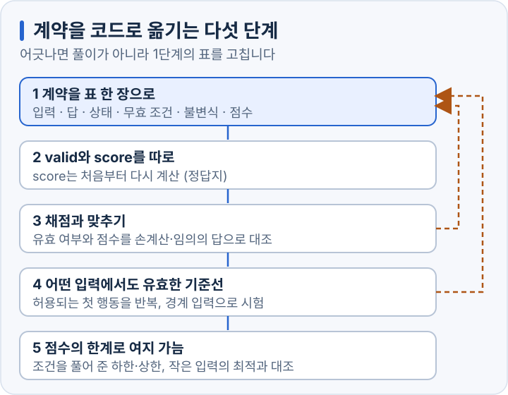
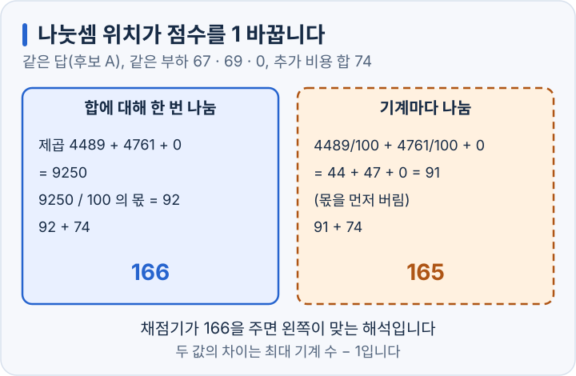
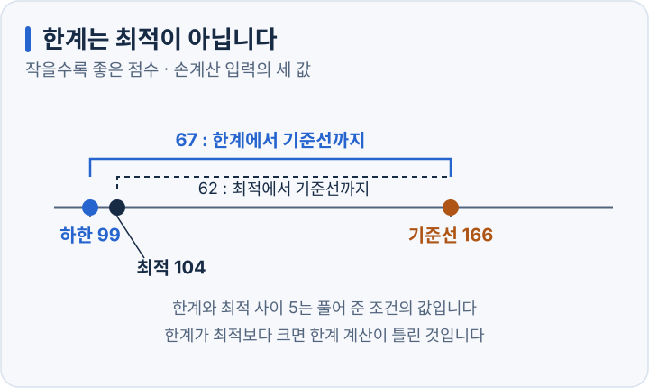
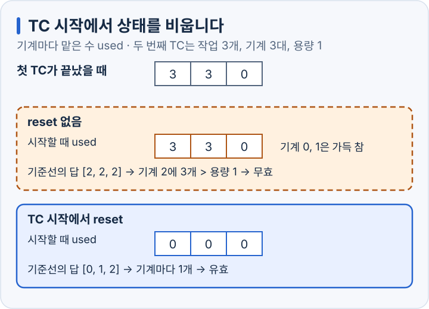

# 문제를 상태·행동·점수로 옮기기: 원리와 손계산

새 문제를 받으면 개선 방법을 고르기 전에 문제 설명을 코드가 계산할 수 있는 모양으로 옮겨야 합니다. 이 쪽은 옮기는 절차를 다섯 단계로 정리하고, 작은 입력 하나를 끝까지 손으로 따라갑니다. 처음 나오는 말은 이렇게 씁니다. **계약**은 문제 설명이 약속하는 입력·출력·규칙·점수입니다. **무효**는 규칙을 어겨 점수를 받을 수 없는 답입니다. **불변식**은 풀이가 행동을 하나씩 더해 가는 동안 항상 참이어야 하는 성질입니다. **기준선**은 어떤 입력에서도 유효한 가장 단순한 답입니다. **한계**는 어떤 유효한 답도 넘지 못하는 점수로, 최소화 문제에서는 하한이고 최대화 문제에서는 상한입니다.

## 연습용 문제 틀

이 강의 묶음은 세 가지 연습용 문제 틀로 설명합니다. 입력은 모두 같은 난수에서 만듭니다. 난수는 64비트 정수 `x`를 `x = x * 6364136223846793005 + 1442695040888963407`로 한 번 갱신한 뒤 `r = x >> 33`을 읽고, 값은 `r % 범위`로 씁니다. 시드는 `x`의 처음 값입니다. 값은 아래 순서대로 읽습니다.

| 틀 | 계약 | 입력을 읽는 순서 |
| --- | --- | --- |
| 순서 | 점 `N`개가 `0..999` 정수 좌표에 있다. 모든 점을 한 번씩 지나는 순서를 정한다(시작점 자유, 돌아오지 않음). 이웃한 점 사이 맨해튼 거리의 합이 작을수록 좋다. | 점마다 `x`, `y` |
| 배정 | 작업 `N`개를 기계 `M`대에 하나씩 맡긴다. 한 기계에는 `K`개까지만 맡길 수 있고 어기면 무효다. 비용은 `(기계별 맡은 길이 합의 제곱을 모두 더한 값) / 100`(정수 나눗셈, 합에 대해 한 번)에 작업별 추가 비용 합을 더한 값이고 작을수록 좋다. | 작업 `i = 0, 1, …`의 순서로, 작업마다 길이 `d[i] = 1 + r % 100`을 뽑고 이어서 추가 비용 `c[i][m] = r % 51`을 기계마다 뽑는다 |
| 격자 수집 | `H × W` 격자의 칸마다 값(0..9, 60%는 0)이 있다. 칸 `(0, 0)`에서 시작해 상하좌우로 `T`번 움직이고 처음 밟는 칸의 값을 얻는다(시작 칸 포함). 격자 밖으로 나가면 무효다. 얻은 값의 합이 클수록 좋다. | 칸마다 행 순서로 `u = r % 10`을 읽어 `u < 6`이면 값 0, 아니면 한 번 더 읽어 값 `1 + r % 9` |

기본 크기는 순서 `N = 200`, 배정 `N = 120, M = 8, K = 18`, 격자 수집 `H = W = 20, T = 60`입니다. 실험은 시드 1부터 10까지 열 개를 씁니다.

## 다섯 단계

[그림 크게 보기](https://git.readiz.com/h-contest-lesson/lessons/problem-modeling/lesson-assets/procedure.svg)

**1. 계약을 표 한 장으로 옮깁니다.** 표의 칸은 입력, 답(행동의 열), 풀이가 쌓는 상태, 무효 조건, 불변식, 점수와 방향입니다. 문제 설명의 문장 하나가 칸 하나가 되어야 하고, 어느 칸에도 들어가지 못한 문장은 아직 읽지 못한 것입니다. 무효 조건은 문장을 한 줄씩 따로 적습니다. "범위 안의 번호"와 "한 기계에 K개 이하"를 한 줄로 묶으면 코드에서 하나를 빼먹습니다.

**2. 유효 판정과 점수를 함수 두 개로 따로 만듭니다.** `valid(입력, 답)`은 무효 조건을 모두 검사하고, `score(입력, 답)`은 `valid`가 참일 때만 불러 점수를 **처음부터 다시 계산**합니다. 효율은 신경 쓰지 않습니다. 이 함수는 풀이 안에서 반복해서 부르려는 것이 아니라 "정답지"입니다. 나중에 점수 변화만 계산하는 빠른 방법을 만들면 이 함수와 같은 값이 나오는지로 확인합니다([근방 설계와 차분 평가](https://h.readiz.com/learn/neighborhood-and-delta)).

**3. 내 함수를 채점과 맞춥니다.** 맞추는 대상은 `valid`와 `score` 둘 다입니다. 손으로 계산한 작은 입력, 채점기가 주는 점수, 임의의 답 여러 개 순으로 넓힙니다. 이 강의의 연습용 틀에서는 검사 스크립트가 따로 구현한 **참조 채점**이 채점기 역할을 합니다. 어긋나는 곳은 대개 점수식의 해석(나눗셈 위치, 시작 칸을 세는지), 경계(`<`와 `<=`), 방향(작을수록 좋은지)입니다. 어긋나면 풀이를 고치지 않고 1단계의 표로 돌아갑니다.

**4. 기준선을 만듭니다.** 기준선은 품질이 아니라 **유효함**만 요구합니다. 만드는 이유는 세 가지입니다. 제출할 수 있는 답이 하나 생기고, 이후의 모든 개선을 비교할 값이 생기며, 기준선이 채점에서도 유효하다는 사실이 `valid`가 맞다는 첫 증거가 됩니다. 만드는 방법은 "지금 상태에서 허용되는 첫 행동을 끝까지 반복한다"입니다. 허용 여부는 `valid`가 쓰는 판정을 그대로 씁니다. 더 좋은 초기해를 만드는 방법은 [초기해 만들기](https://h.readiz.com/learn/construction-heuristics)에서 다룹니다.

**5. 한계로 남은 여지를 가늠합니다.** 조건 하나를 풀어 주면 최소화 문제의 최솟값은 작아집니다. 그래서 조건을 풀어 쉬워진 문제의 최솟값은 원래 문제의 하한입니다. 순서 문제는 "경로여야 한다"를 "점을 모두 잇는 트리면 된다"로 풀어 최소 신장 트리가 하한입니다. 격자 수집은 "이어서 움직인다"를 풀어 `T + 1`개 칸을 아무렇게나 고른다고 보면 큰 값 `T + 1`개의 합이 상한입니다. 기준선과 한계의 차이가 **더 좋아질 수 있는 폭의 위쪽 경계**입니다. 한계는 최적이 아니고 달성할 수 없을 수도 있습니다. 한계가 최적을 넘어서면(최소화에서 한계가 최적보다 크면) 한계 계산이 틀린 것입니다.

## 언제 쓰고 언제 쓰지 않는가

| 상황 | 이 절차 | 이유 |
| --- | --- | --- |
| 처음 보는 문제, 점수식이 두 항 이상 | 다섯 단계 모두 | 항 하나를 빼먹거나 나눗셈 위치를 틀려도 유효한 답이 나와서 눈에 띄지 않습니다. |
| 무효한 답이 점수 0이거나 거절되는 문제 | `valid`를 먼저 만들고 기준선으로 검증 | 점수를 아무리 잘 계산해도 무효이면 쓸 수 없습니다. |
| 한 프로세스에서 TC를 여러 번 푸는 문제 | 아래 "TC 사이에 남기지 않는 상태"까지 적용 | 앞 TC의 상태가 남으면 두 번째 TC부터 틀립니다. |
| 점수를 반복마다 다시 계산하면 느린 탐색 | `score`는 검증과 정답지로만 쓰고 탐색 안에서는 변화량만 계산 | 전체 재계산은 입력 크기에 비례해 반복 횟수를 제한합니다. |
| 점수식이 한 줄이고 무효 조건이 없는 문제 | 표는 머릿속에 두고 `score` 하나와 손계산 한 번 | 절차의 대부분이 비어 있습니다. |
| 한계가 느슨한 문제 | 한계를 목표가 아니라 "여지가 큰가 작은가"를 보는 용도로만 | 한계와 최적 사이의 간격은 입력이 크면 모릅니다. |

## 세 틀에 같은 표 채우기

같은 다섯 단계를 세 틀에 적용하면 표의 내용만 달라집니다.

| 항목 | 순서 | 배정 | 격자 수집 |
| --- | --- | --- | --- |
| 입력 | 점 `N`개의 좌표 | 작업 길이 `d`, 추가 비용 `c`, `M`, `K` | 격자 값 `v`, 시작 칸, `T` |
| 답 | 점 번호의 순열 | 작업마다 기계 번호 | 방향 `T`개 |
| 풀이가 쌓는 상태 | 기준선에는 없음 | 기계마다 맡긴 수 `used[m]` | 기준선에는 없음 |
| 무효 조건 | 번호가 범위 밖, 중복, 누락 | 기계 번호가 범위 밖, 한 기계에 `K + 1`번째 작업 | 방향이 `0..3` 밖, 격자 밖으로 나감 |
| 불변식 | 지금까지 고른 점은 서로 다르다 | 어느 기계도 `K`개 이하이고 작업은 한 기계에만 간다 | 현재 칸은 항상 격자 안이다 |
| 점수와 방향 | 이웃 거리 합, 작을수록 좋음 | `floor(Σ load² / 100) + Σ c`, 작을수록 좋음 | 처음 밟은 칸의 값 합, 클수록 좋음 |
| 기준선 | 번호 순서 | 가득 차지 않은 첫 기계에 맡기기 | 처음 갈 수 있는 방향으로 걷기 |
| 한계 | 최소 신장 트리(하한) | 최소 추가 비용 + 균등 부하(하한) | 닿는 칸 중 큰 값 `T + 1`개(상한) |

## 손으로 따라가기: 작업 6개, 기계 3대, 기계당 3개

배정 틀로 작은 입력 하나를 끝까지 따라갑니다. 작업 길이와 추가 비용은 직접 정한 값이고, `N = 6, M = 3, K = 3`입니다.

| 작업 | 길이 `d` | `c[·][0]` | `c[·][1]` | `c[·][2]` |
| --- | ---: | ---: | ---: | ---: |
| 0 | 31 | 10 | 16 | 19 |
| 1 | 26 | 11 | 29 | 4 |
| 2 | 10 | 10 | 8 | 29 |
| 3 | 35 | 22 | 17 | 2 |
| 4 | 13 | 9 | 21 | 10 |
| 5 | 21 | 9 | 5 | 25 |

1단계의 표를 채웁니다. 입력은 위 표와 `M = 3`, `K = 3`입니다. 답은 기계 번호 6개입니다. 무효 조건은 둘입니다. 기계 번호가 `0..2` 밖이거나, 한 기계에 네 번째 작업이 가면 무효입니다. 불변식은 "어느 기계도 3개 이하"입니다. 점수는 기계별 부하(맡은 길이의 합)의 제곱을 모두 더해 100으로 나눈 몫에 작업별 추가 비용을 더한 값입니다.

2~3단계로 후보 네 개를 판정하고 점수를 냅니다. 후보는 작업 0부터 5까지의 기계 번호입니다.

<!-- check:hand-candidates -->
| 후보 | 부하 (기계 0 / 1 / 2) | 부하 제곱의 합 | `/ 100` | 추가 비용 합 | 점수 |
| --- | --- | ---: | ---: | ---: | ---: |
| A 첫 기계부터 채우기 `0 0 0 1 1 1` | 67 / 69 / 0 | 9250 | 92 | 74 | 166 |
| B 번호 순환 `0 1 2 0 1 2` | 66 / 39 / 31 | 6838 | 68 | 136 | 204 |
| C 손으로 찾은 답 `0 2 1 2 0 1` | 44 / 31 / 61 | 6618 | 66 | 38 | 104 |
| D 기계 0에 4개 `0 0 0 0 1 2` | 102 / 13 / 21 | - | - | - | 무효 |

후보 D는 기계 0에 작업 0, 1, 2, 3이 가서 네 개이므로 `valid`가 거짓이고 점수를 내지 않습니다. 후보 A의 부하는 기계 0이 `31 + 26 + 10 = 67`, 기계 1이 `35 + 13 + 21 = 69`입니다. 제곱은 `4489 + 4761 + 0 = 9250`이고 `9250 / 100`의 몫은 92입니다. 추가 비용은 `10 + 11 + 10 + 17 + 21 + 5 = 74`라서 점수는 `92 + 74 = 166`입니다.

**나눗셈 위치를 틀리면 점수가 어긋납니다.** 기계마다 100으로 나눈 몫을 더하면 `44 + 47 + 0 = 91`이고 점수는 165입니다. 채점기가 166을 준다면 이 차이 1이 "점수식을 잘못 읽었다"는 신호입니다. 몫의 합과 합의 몫은 최대 `M - 1`까지 다르므로, 작은 입력 하나에서 우연히 같다고 안심하면 안 됩니다. 실제로 채점과 같은지는 [실험](practice.md)에서 여러 답으로 확인합니다.

[그림 크게 보기](https://git.readiz.com/h-contest-lesson/lessons/problem-modeling/lesson-assets/two-ways-to-score.svg)

4단계의 기준선은 후보 A입니다. 번호가 가장 작은 아직 가득 차지 않은 기계에 작업을 차례로 맡기므로 작업 0, 1, 2가 기계 0을, 작업 3, 4, 5가 기계 1을 채웁니다. 후보 B도 유효하지만 점수가 204로 더 나쁩니다. 기준선은 유효하기만 하면 되므로 두 후보 중 무엇을 골라도 이 단계는 통과이고, 둘 중 어느 쪽이 더 나은지는 다음 강의의 주제입니다.

5단계의 한계를 계산합니다. 작업별로 가장 싼 기계의 추가 비용은 `10, 4, 8, 2, 9, 5`이고 합은 38입니다. 작업 길이의 합 `D`는 `31 + 26 + 10 + 35 + 13 + 21 = 136`이고, 기계 3대가 똑같이 나누면 제곱합은 `136² / 3`입니다. 정수 나눗셈으로는 `136² / (100 × 3) = 18496 / 300`의 몫 61입니다. 하한은 `38 + 61 = 99`입니다.

[그림 크게 보기](https://git.readiz.com/h-contest-lesson/lessons/problem-modeling/lesson-assets/bounds-gap.svg)

기계 번호 6개의 `3^6 = 729`가지 중 유효한 것은 510가지이고, 점수의 최솟값은 후보 C의 104입니다. 한계 99는 최적 104를 넘지 않으므로 한계 계산과 모순이 없습니다. 기준선에서 한계까지는 `166 - 99 = 67`이라서 더 좋아질 수 있는 폭은 많아야 67이고, 이 입력에서는 최적을 알기 때문에 실제로는 `166 - 104 = 62`입니다. 후보 C의 추가 비용은 38로 한계의 비용 항과 같지만, 부하 항은 66으로 한계의 61에 닿지 못합니다. 부하 136을 세 기계에 정확히 똑같이 나눌 수 없기 때문입니다. 이처럼 한계는 풀어 준 조건 때문에 최적과 간격이 남을 수 있습니다.

## TC 사이에 남기지 않는 상태

채점기가 한 프로세스에서 TC를 연달아 부르면 전역 변수와 `static` 변수는 앞 TC의 값을 가진 채로 다음 TC가 시작합니다. 원칙은 두 가지입니다.

| 상태의 수명 | 비우는 시점 | 예 |
| --- | --- | --- |
| TC 안에서 쌓는 상태 | TC 시작마다 한 번, 이번 TC가 쓰는 크기만큼 | 기계별 맡긴 수, 방문 표시, 지금까지의 최고 점수 |
| 입력에서 한 번 계산한 값 | TC 시작에서 새로 계산 | 거리 표, 값별 개수 |
| 프로세스 전체에서 같은 값 | 비우지 않음 | 방향 상수, 난수 시드 |

이 원칙의 확인은 "TC 여러 개를 이어서 푼 결과가 각 TC를 따로 푼 결과와 같은가"입니다. 후보 A를 만든 뒤 `used`는 `(3, 3, 0)`입니다. 이어서 `N = 3, M = 3, K = 1`인 TC가 오면 `reset`을 부르지 않은 기준선은 기계 0과 1이 가득 찬 줄 알고 세 작업을 모두 기계 2에 맡겨 `[2, 2, 2]`를 냅니다. `K = 1`이므로 무효입니다. `reset`을 부르면 `used`가 `(0, 0, 0)`이라서 `[0, 1, 2]`가 됩니다.

[그림 크게 보기](https://git.readiz.com/h-contest-lesson/lessons/problem-modeling/lesson-assets/case-reset.svg)

배열을 지우는 범위는 상한(`MAXM`)이 아니라 이번 TC의 크기(`c.m`)입니다. 큰 TC 다음에 작은 TC가 올 때는 배열 뒤쪽에 앞 TC의 값이 남아 있으므로, 이번 TC의 크기를 넘어서는 칸은 읽지도 않아야 합니다. 이 쪽의 다섯 단계를 [코드 틀](implementation.md)로 옮깁니다.
