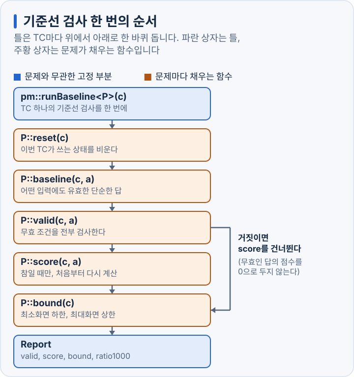

# 문제를 상태·행동·점수로 옮기기: 코드 틀과 세 가지 적용

[앞 쪽](idea.md)의 다섯 단계를 코드로 옮깁니다. 코드는 **문제와 무관한 틀**(`pm`)과 **문제마다 채워 넣는 모델**(`Route`, `Assign`, `Grid`)로 나뉩니다. 틀은 세 문제에서 한 글자도 바뀌지 않고, 모델은 같은 이름의 함수 다섯 개와 자료형 두 개, 방향 상수 하나를 채웁니다.

> **코드 환경: h-contest 제출용 코드.** 표준 헤더·STL·`std::`·동적 할당 없이 고정 배열만 쓰고, [공통 라이브러리](https://h.readiz.com/learn/cpp-common-library)의 블록은 필요하지 않습니다. 아래 코드 블록 네 개를 위에서 아래 순서로 이어 붙이면 `user.cpp` 앞부분 하나가 되고, 헤더 없이 컴파일됩니다. 채점기가 요구하는 진입 함수는 문제마다 다르므로 넣지 않았습니다. 모델 세 개는 서로 독립이라 필요한 것만 남겨도 됩니다.

## 채워 넣는 것과 틀이 하는 일

| 채우는 것 | 계약의 어느 부분에서 옮기는가 | 어떤 입력에서도 지켜야 할 성질 |
| --- | --- | --- |
| `Case`, `Answer` | 입력의 크기와 값, 출력의 형식 | 배열 상한이 입력 상한 이상이고, 답은 이번 TC 크기만큼만 읽고 쓴다 |
| `MINIMIZE` | "작을수록 좋다/클수록 좋다" | 한 번 정하면 `bound`의 방향과 같다 |
| `reset(c)` | 풀이가 TC 안에서 쌓는 상태 | 이번 TC가 쓰는 만큼을 모두 비운다. 쌓는 상태가 없으면 비워 둔다 |
| `valid(c, a)` | 무효 조건 전부 | 답의 어떤 값에도 범위 밖 접근 없이 `true`/`false`를 돌려준다 |
| `score(c, a)` | 점수식 | `valid`가 참일 때만 부른다. 입력과 답만으로 처음부터 다시 계산한다 |
| `baseline(c, a)` | "가장 단순한 규칙 준수 정책" | 계약을 만족하는 입력이면 항상 `valid`가 참인 답을 낸다 |
| `bound(c)` | 점수의 하한(최소화) 또는 상한(최대화) | 어떤 유효한 답의 점수도 넘지 못한다 |

틀의 `evaluate`는 `valid`를 먼저 부르고 참일 때만 `score`를 부릅니다. 무효한 답의 점수를 `0`으로 돌려주면 최소화 문제에서 가장 좋은 점수처럼 보이므로, 점수와 유효 여부를 **같이** 돌려주는 것이 틀의 약속입니다. `agrees`는 내 판정과 점수가 채점기(또는 참조 채점)와 같은지 한 번에 묻고, `runBaseline`은 TC 시작의 `reset`, 기준선 생성, 평가, 한계 계산을 한 번에 합니다.



[그림 크게 보기](https://git.readiz.com/h-contest-lesson/lessons/problem-modeling/lesson-assets/baseline-call-order.svg)

```cpp snippet=pm-frame
namespace pm {
struct Result { bool valid; long long score; };

struct Report {
    bool valid;
    long long score, bound;
    long long ratio1000;   // 한계와의 비 x 1000 (1000이면 한계와 같음). 정의되지 않으면 -1
};

// 모델 P가 채워 넣는 것
//   P::Case, P::Answer       입력과 답의 자료형
//   P::MINIMIZE              작을수록 좋으면 true
//   P::reset(c)              TC 시작에서 풀이가 쌓는 상태를 비운다
//   P::valid(c, a)           답이 규칙을 모두 지키는가
//   P::score(c, a)           valid일 때만 부른다. 입력과 답만으로 처음부터 다시 계산한다
//   P::baseline(c, a)        어떤 입력에서도 유효한 가장 단순한 답
//   P::bound(c)              최소화면 하한, 최대화면 상한
template<class P> Result evaluate(const typename P::Case& c, const typename P::Answer& a) {
    Result r;
    r.valid = P::valid(c, a);
    r.score = r.valid ? P::score(c, a) : 0;
    return r;
}

// 내 판정과 점수가 채점기(또는 참조 채점)와 같은가. 유효 여부도 함께 맞춘다.
template<class P> bool agrees(const typename P::Case& c, const typename P::Answer& a,
                              bool judgeValid, long long judgeScore) {
    Result r = evaluate<P>(c, a);
    return r.valid == judgeValid && (!judgeValid || r.score == judgeScore);
}

// TC 하나의 기준선: 상태를 비우고, 기준선을 만들고, 유효 여부·점수·한계를 돌려준다.
template<class P> Report runBaseline(const typename P::Case& c) {
    typename P::Answer a = typename P::Answer();
    P::reset(c);
    P::baseline(c, a);
    Result r = evaluate<P>(c, a);
    Report rep;
    rep.valid = r.valid;
    rep.score = r.score;
    rep.bound = P::bound(c);
    if (!r.valid) rep.ratio1000 = -1;
    else if (P::MINIMIZE) rep.ratio1000 = rep.bound > 0 ? rep.score * 1000 / rep.bound : -1;
    else rep.ratio1000 = rep.score > 0 ? rep.bound * 1000 / rep.score : -1;
    return rep;
}
}
```

`runBaseline`이 `P::reset(c)`를 먼저 부르는 것이 [TC 초기화 원칙](idea.md)의 코드입니다. 풀이가 TC 사이에 남기는 상태는 모델이 `reset`에 모아 두고, 틀이 TC마다 한 번 부릅니다.

## 순서 모델

점 사이의 맨해튼 거리 합을 최소로 하는 순서입니다. 답은 `0..n-1`의 순열이고, 풀이가 쌓는 상태가 없어 `reset`은 비어 있습니다. `bound`의 Prim은 점마다 "지금까지 만든 트리와의 최단 거리"를 `best`에 두고 한 점씩 트리에 붙입니다. 모든 점을 한 번씩 지나는 경로는 점을 모두 잇는 트리이므로 그 비용은 최소 신장 트리 비용 이상입니다.

```cpp snippet=route-model
struct Route {
    static const bool MINIMIZE = true;
    static const int MAXN = 200;
    struct Case { int n; int x[MAXN], y[MAXN]; };
    struct Answer { int order[MAXN]; };

    static int dist(const Case& c, int i, int j) {
        int dx = c.x[i] - c.x[j], dy = c.y[i] - c.y[j];
        return (dx < 0 ? -dx : dx) + (dy < 0 ? -dy : dy);
    }
    static void reset(const Case&) {}   // 이 문제는 TC 사이에 남는 상태가 없다

    static bool valid(const Case& c, const Answer& a) {   // 0..n-1을 정확히 한 번씩
        bool used[MAXN] = {};
        for (int i = 0; i < c.n; ++i) {
            const int p = a.order[i];
            if (p < 0 || p >= c.n || used[p]) return false;
            used[p] = true;
        }
        return true;
    }
    static long long score(const Case& c, const Answer& a) {   // 이웃한 점 사이 맨해튼 거리의 합
        long long sum = 0;
        for (int i = 0; i + 1 < c.n; ++i) sum += dist(c, a.order[i], a.order[i + 1]);
        return sum;
    }
    static void baseline(const Case& c, Answer& a) {   // 번호 순서
        for (int i = 0; i < c.n; ++i) a.order[i] = i;
    }
    static long long bound(const Case& c) {   // 하한: 최소 신장 트리(Prim). 경로도 점을 모두 잇는 트리다
        int best[MAXN];
        bool inTree[MAXN] = {};
        long long total = 0;
        inTree[0] = true;
        for (int j = 1; j < c.n; ++j) best[j] = dist(c, 0, j);
        for (int step = 1; step < c.n; ++step) {
            int pick = -1;
            for (int j = 1; j < c.n; ++j) if (!inTree[j] && (pick < 0 || best[j] < best[pick])) pick = j;
            inTree[pick] = true;
            total += best[pick];
            for (int j = 1; j < c.n; ++j) {
                if (inTree[j]) continue;
                const int d = dist(c, pick, j);
                if (d < best[j]) best[j] = d;
            }
        }
        return total;
    }
};
```

## 배정 모델

작업을 기계에 맡기는 문제입니다. 풀이가 쌓는 상태 `assignUsed`(기계마다 맡긴 작업 수)가 있어서 `reset`이 실제로 일을 합니다. `valid`와 `score`는 자기 안에서 쓰는 `count`와 `load`를 호출마다 새로 만들기 때문에 TC 사이의 상태와 무관합니다. 점수의 나눗셈은 부하 제곱의 **합에 대해 한 번**입니다. 기계마다 나누면 다른 값이 됩니다.

`bound`의 두 항은 서로 다른 조건을 하나씩 풀어 준 값입니다. 추가 비용은 용량(K개)을 무시하고 작업마다 가장 싼 기계를 고른 합이고, 부하는 부하가 기계 사이에 똑같이 나뉘었다고 본 제곱합입니다. 둘 다 실제 점수보다 클 수 없으므로 합도 그렇습니다. 부하 항의 근거는 코시-슈바르츠 부등식으로 `Σ load² ≥ (Σ load)² / M`이고, 정수 나눗셈은 단조라서 `floor(Σ load² / 100) ≥ floor(D² / (100 M))`가 됩니다(`D`는 작업 길이 합).

```cpp snippet=assign-model
static int assignUsed[8];   // 풀이가 쌓는 상태: 기계마다 이미 맡긴 작업 수

struct Assign {
    static const bool MINIMIZE = true;
    static const int MAXN = 120, MAXM = 8;
    struct Case { int n, m, k; int d[MAXN]; int c[MAXN][MAXM]; };
    struct Answer { int machine[MAXN]; };

    static void reset(const Case& c) {   // 이번 TC가 쓰는 기계만큼 비운다
        for (int m = 0; m < c.m; ++m) assignUsed[m] = 0;
    }
    static bool valid(const Case& c, const Answer& a) {   // 기계 번호 범위, 기계당 k개 이하
        int count[MAXM] = {};
        for (int i = 0; i < c.n; ++i) {
            const int m = a.machine[i];
            if (m < 0 || m >= c.m) return false;
            if (++count[m] > c.k) return false;
        }
        return true;
    }
    static long long score(const Case& c, const Answer& a) {   // (부하 제곱의 합) / 100 + 추가 비용 합
        long long load[MAXM] = {}, extra = 0, squares = 0;
        for (int i = 0; i < c.n; ++i) {
            load[a.machine[i]] += c.d[i];
            extra += c.c[i][a.machine[i]];
        }
        for (int m = 0; m < c.m; ++m) squares += load[m] * load[m];
        return squares / 100 + extra;   // 나눗셈은 합에 대해 한 번만
    }
    static void baseline(const Case& c, Answer& a) {   // 번호가 가장 작은, 아직 가득 차지 않은 기계에 맡긴다
        for (int i = 0; i < c.n; ++i) {
            int m = 0;
            while (m + 1 < c.m && assignUsed[m] >= c.k) ++m;
            a.machine[i] = m;
            ++assignUsed[m];
        }
    }
    static long long bound(const Case& c) {   // 하한: 용량을 무시한 작업별 최소 비용 + 부하를 똑같이 나눈 제곱합
        long long cheapest = 0, total = 0;
        for (int i = 0; i < c.n; ++i) {
            int low = c.c[i][0];
            for (int m = 1; m < c.m; ++m) if (c.c[i][m] < low) low = c.c[i][m];
            cheapest += low;
            total += c.d[i];
        }
        return cheapest + total * total / (100LL * c.m);
    }
};
```

## 격자 수집 모델

시작 칸에서 `T`번 움직여 처음 밟는 칸의 값을 더합니다. 답은 방향 `T`개이고, 무효 조건이 "방향 범위"와 "격자 밖"으로 두 가지입니다. 기준선은 `valid`가 쓰는 판정(`inside`)을 그대로 쓰는 **처음 갈 수 있는 방향** 규칙입니다. 격자가 두 칸 이상이면 어느 칸에서도 갈 수 있는 방향이 하나는 있으므로 항상 유효합니다.

`bound`는 두 가지 사실을 씁니다. `T`번 움직이면 서로 다른 칸은 `T + 1`개 이하이고(시작 칸 포함), 시작 칸에서 맨해튼 거리가 `T`를 넘는 칸은 닿을 수 없습니다. 닿을 수 있는 칸의 값 중 큰 것부터 `T + 1`개를 더한 값이 상한입니다. 값이 0..9라서 정렬 대신 값별 개수 `count`를 씁니다.

```cpp snippet=grid-model
const int GRID_DY[4] = {-1, 0, 1, 0};   // 0 위, 1 오른쪽, 2 아래, 3 왼쪽
const int GRID_DX[4] = {0, 1, 0, -1};

struct Grid {
    static const bool MINIMIZE = false;
    static const int MAXH = 20, MAXW = 20, MAXT = 60;
    struct Case { int h, w, t, sy, sx; int v[MAXH][MAXW]; };
    struct Answer { int dir[MAXT]; };

    static bool inside(const Case& c, int y, int x) { return 0 <= y && y < c.h && 0 <= x && x < c.w; }
    static void reset(const Case&) {}   // 이 기준선은 TC 사이에 남는 상태가 없다

    static bool valid(const Case& c, const Answer& a) {   // t번 모두 방향이 0..3이고 격자 안에 머문다
        int y = c.sy, x = c.sx;
        for (int i = 0; i < c.t; ++i) {
            if (a.dir[i] < 0 || a.dir[i] > 3) return false;
            y += GRID_DY[a.dir[i]];
            x += GRID_DX[a.dir[i]];
            if (!inside(c, y, x)) return false;
        }
        return true;
    }
    static long long score(const Case& c, const Answer& a) {   // 처음 밟은 칸의 값 합, 시작 칸 포함
        bool seen[MAXH][MAXW] = {};
        int y = c.sy, x = c.sx;
        long long sum = c.v[y][x];
        seen[y][x] = true;
        for (int i = 0; i < c.t; ++i) {
            y += GRID_DY[a.dir[i]];
            x += GRID_DX[a.dir[i]];
            if (!seen[y][x]) { seen[y][x] = true; sum += c.v[y][x]; }
        }
        return sum;
    }
    static void baseline(const Case& c, Answer& a) {   // 오른쪽, 아래, 왼쪽, 위 순서로 처음 갈 수 있는 방향
        const int order[4] = {1, 2, 3, 0};
        int y = c.sy, x = c.sx;
        for (int i = 0; i < c.t; ++i) {
            int pick = 0;
            for (int k = 0; k < 4; ++k) {
                if (inside(c, y + GRID_DY[order[k]], x + GRID_DX[order[k]])) { pick = order[k]; break; }
            }
            a.dir[i] = pick;
            if (inside(c, y + GRID_DY[pick], x + GRID_DX[pick])) { y += GRID_DY[pick]; x += GRID_DX[pick]; }
        }
    }
    static long long bound(const Case& c) {   // 상한: t번 움직여 닿는 칸은 t + 1개 이하. 도달 가능한 칸 중 큰 값부터
        int count[10] = {};
        for (int y = 0; y < c.h; ++y) for (int x = 0; x < c.w; ++x) {
            const int dy = y - c.sy, dx = x - c.sx;
            if ((dy < 0 ? -dy : dy) + (dx < 0 ? -dx : dx) <= c.t) ++count[c.v[y][x]];
        }
        long long sum = 0;
        int room = c.t + 1;
        for (int value = 9; value >= 0 && room > 0; --value) {
            const int take = count[value] < room ? count[value] : room;
            sum += (long long)take * value;
            room -= take;
        }
        return sum;
    }
};
```

## 세 모델을 틀로 부르기

채점기가 주는 입력을 `Case`에 옮겨 담은 뒤 `pm::runBaseline<Assign>(c)`처럼 부르면 `Report`가 돌아옵니다. 제출 코드에서는 `report.valid`가 거짓이면 그 기준선을 제출하지 않고, 로컬 하네스에서는 채점기의 점수와 `report.score`를 `agrees`로 맞춥니다. `ratio1000`은 기준선이 한계에서 얼마나 떨어졌는지 보는 값이고, 1000에 가까울수록 더 좋아질 여지가 작습니다.

| 모델 | 틀 호출 | `reset`이 하는 일 | 기준선 | 한계 |
| --- | --- | --- | --- | --- |
| `Route` | `runBaseline<Route>` | 없음 | 번호 순서 | 최소 신장 트리 |
| `Assign` | `runBaseline<Assign>` | `assignUsed[0..m)`를 0으로 | 가득 차지 않은 첫 기계 | 작업별 최소 추가 비용 + 균등 부하 |
| `Grid` | `runBaseline<Grid>` | 없음 | 처음 갈 수 있는 방향 | 닿을 수 있는 칸 중 큰 값 `T + 1`개 |

새 문제를 만나면 이 표의 세 줄을 새로 쓰고 틀은 그대로 둡니다. 다음 쪽 [실험과 실수](practice.md)에서 이 코드가 참조 채점과 같은 값을 내는지, 일부러 틀린 코드가 어디서 잡히는지 확인합니다.
