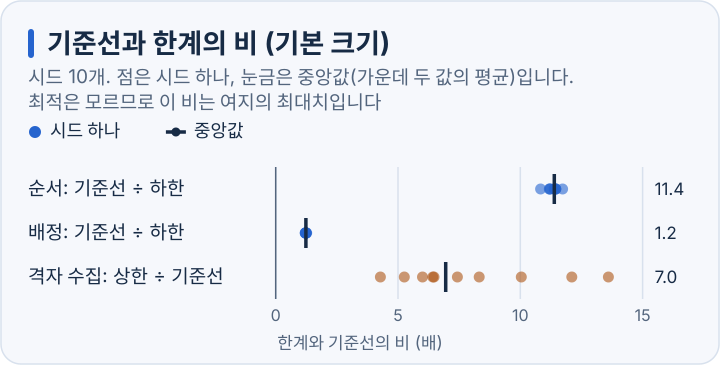
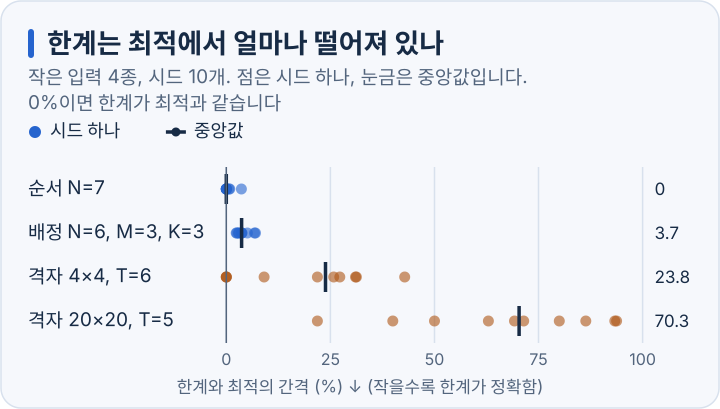
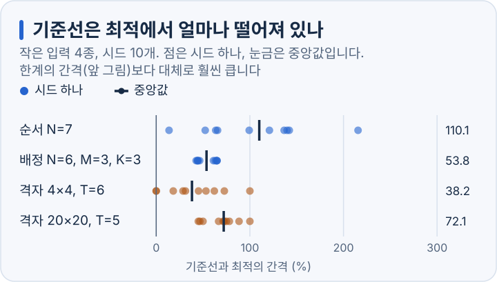

# 문제를 상태·행동·점수로 옮기기: 실험과 실수

[코드 틀](implementation.md)이 참조 채점과 같은 값을 내는지, 기준선이 경계 입력에서도 유효한지, 한계가 최적을 넘지 않는지를 연습용 문제 틀([규칙](idea.md))에서 확인합니다. 수치는 모두 `scripts/check_problem_modeling.py`가 정해진 시드에서 다시 계산해 이 문서의 표와 `lesson-assets/measurements.json`에 대조합니다. 시간은 재지 않고 개수와 점수만 씁니다.

## 실험 1: 기본 크기에서 기준선과 한계

시드 1~10의 기본 크기에서 `runBaseline`이 돌려준 값입니다. 순서·배정의 한계는 하한이고 격자 수집의 한계는 상한입니다. 열 개 모두 기준선이 유효했고 점수는 참조 채점과 같았습니다.

<!-- check:default-baselines -->
| 시드 | 순서 기준선 | 순서 하한 | 배정 기준선 | 배정 하한 | 격자 기준선 | 격자 상한 |
| --- | ---: | ---: | ---: | ---: | ---: | ---: |
| 1 | 132282 | 11279 | 61746 | 49858 | 47 | 472 |
| 2 | 132213 | 11551 | 54573 | 43911 | 65 | 483 |
| 3 | 128705 | 11459 | 59754 | 49247 | 80 | 480 |
| 4 | 136383 | 11964 | 59894 | 48721 | 114 | 488 |
| 5 | 132749 | 11591 | 57293 | 47313 | 38 | 460 |
| 6 | 130940 | 11433 | 65170 | 54048 | 76 | 488 |
| 7 | 129988 | 11622 | 52759 | 42543 | 72 | 466 |
| 8 | 129523 | 11380 | 61702 | 48625 | 35 | 476 |
| 9 | 130727 | 12072 | 53577 | 43414 | 56 | 466 |
| 10 | 132651 | 11841 | 42888 | 34653 | 89 | 468 |

[그림 크게 보기](https://git.readiz.com/h-contest-lesson/lessons/problem-modeling/lesson-assets/baseline-ratio.svg)

기준선과 한계의 비는 순서에서 10.82~11.72배, 배정에서 1.20~1.26배, 격자 수집에서 4.28~13.60배(상한 ÷ 기준선)였습니다([허브](../lesson.md)의 표). 이 비는 "기준선에서 한계까지"가 최대 이만큼이라는 뜻일 뿐, 최적이 어디에 있는지는 말하지 않습니다. 기본 크기에서는 최적을 모르므로 **실제로 더 좋아질 수 있는 폭은 이 실험으로 결정하지 못합니다.**

## 실험 2: 한계가 최적을 넘지 않는가

작은 입력은 답을 전부 세어 최적을 알 수 있습니다. 순서 `N = 7`은 순열 5040개, 배정 `N = 6, M = 3, K = 3`은 기계 번호 729가지, 격자 수집은 `4 × 4, T = 6`(방향 4096가지)과 `20 × 20, T = 5`(1024가지)입니다. 시드 1~10마다 전수 탐색한 최적을 한계·기준선과 비교합니다. 간격은 `|한계 − 최적| / 최적`, `|기준선 − 최적| / 최적`의 백분율입니다.

<!-- check:tiny-bounds -->
| 틀 | 크기 | 한계 ≤ 최적 ≤ 기준선(최대화는 반대)인 시드 | 한계 = 최적인 시드 | 한계와 최적의 간격 (%) | 기준선과 최적의 간격 (%) |
| --- | --- | ---: | ---: | ---: | ---: |
| 순서 | N=7 | 10 / 10 | 6 | 0.0 ~ 3.6 | 13.6 ~ 215.5 |
| 배정 | N=6, M=3, K=3 | 10 / 10 | 0 | 2.3 ~ 7.0 | 42.6 ~ 65.0 |
| 격자 수집 | 4×4, T=6 | 10 / 10 | 3 | 0.0 ~ 42.8 | 0.0 ~ 100.0 |
| 격자 수집 | 20×20, T=5 | 10 / 10 | 0 | 21.8 ~ 93.7 | 45.0 ~ 100.0 |

[그림 크게 보기](https://git.readiz.com/h-contest-lesson/lessons/problem-modeling/lesson-assets/bound-gap-tiny.svg)

[그림 크게 보기](https://git.readiz.com/h-contest-lesson/lessons/problem-modeling/lesson-assets/baseline-gap-tiny.svg)

네 크기 모두 열 시드에서 한계가 최적을 넘은 적이 없었습니다. 한계의 느슨함은 틀마다 달랐습니다. 순서의 하한은 이 크기에서 최적과 최대 3.6% 차이였고, 격자 수집의 상한은 `T`가 작고 격자가 큰 `20 × 20, T = 5`에서 21.8~93.7% 높았습니다. 상한이 이동의 연결을 풀어 주었기 때문이라고 짐작하지만 원인을 나누어 재지는 않았습니다. 이 결과는 이 크기와 시드 10개에 대한 것이고, 기본 크기에서도 같은 간격이라는 뜻이 아닙니다. 한계는 "여지의 위쪽 경계"로만 읽고 목표로 삼지 않습니다.

## 실험 3: 내 점수와 참조 채점

시드 1~10, 시드마다 답 300개를 만들었습니다. 열 개 중 일곱 개는 유효한 임의의 답이고, 세 개는 일부러 망가뜨린 답(중복·한 기계에 `K + 1`개·격자 밖으로 이동, 값 범위 밖)입니다. 참조 채점은 검사 스크립트에 따로 구현했고 유효 여부와 점수를 돌려줍니다. 표는 `agrees`가 거짓이었던 답의 수입니다.

<!-- check:score-match -->
| 점수 구현 | 비교한 답 | 그중 무효인 답 | 참조와 어긋난 답 |
| --- | ---: | ---: | ---: |
| 올바른 점수 함수 (순서) | 3000 | 900 | 0 |
| 올바른 점수 함수 (배정) | 3000 | 900 | 0 |
| 올바른 점수 함수 (격자 수집) | 3000 | 900 | 0 |
| 나눗셈을 기계마다 한 배정 점수 | 3000 | 900 | 2094 |

나눗셈 위치만 바꾼 배정 점수는 유효한 답 2100개 중 2094개에서 어긋났습니다. 손계산 한 개(위 91과 92)는 우연히 같을 수 있지만 임의의 답 수백 개에서는 거의 모두 드러납니다.

## 실험 4: 기준선이 경계 입력에서 유효한가

기준선은 "어떤 입력에서도" 유효해야 하므로 계약이 허용하는 경계 크기로 시험합니다. 순서(`N = 1, 2, 3, 200`)의 번호 순서 기준선은 모두 유효했습니다. 아래 표는 배정과 격자 수집의 우리 기준선과 순진한 기준선(배정은 모든 작업을 기계 0에, 격자 수집은 오른쪽으로만 가고 못 가면 위)입니다.

<!-- check:baseline-shapes -->
| 틀 | 입력 크기 | 우리 기준선 | 순진한 기준선 |
| --- | --- | --- | --- |
| 배정 | N=1, M=1, K=1 | 유효 | 유효 |
| 배정 | N=1, M=8, K=1 | 유효 | 유효 |
| 배정 | N=8, M=8, K=1 | 유효 | 무효 |
| 배정 | N=16, M=8, K=2 | 유효 | 무효 |
| 배정 | N=120, M=8, K=15 | 유효 | 무효 |
| 배정 | N=120, M=8, K=18 | 유효 | 무효 |
| 배정 | N=120, M=2, K=60 | 유효 | 무효 |
| 배정 | N=100, M=1, K=100 | 유효 | 유효 |
| 격자 수집 | 1×2, T=5 | 유효 | 무효 |
| 격자 수집 | 2×1, T=1 | 유효 | 무효 |
| 격자 수집 | 2×2, T=60 | 유효 | 무효 |
| 격자 수집 | 20×20, T=0 | 유효 | 유효 |
| 격자 수집 | 20×20, T=60 | 유효 | 무효 |
| 격자 수집 | 1×20, T=60 | 유효 | 무효 |
| 격자 수집 | 20×1, T=60 | 유효 | 무효 |

순진한 기준선은 계약의 경계(`N = 1`, `M = 1`, `T = 0`)처럼 제약이 걸리지 않는 입력에서만 유효했습니다. 배정의 순진한 기준선은 기본 크기 시드 10개에서도 모두 무효였습니다. 가장 흔한 입력만 시험하면 이 차이가 보이지 않는 경우도 있으므로 최소·최대·용량이 꽉 찬 입력을 목록으로 만들어 둡니다.

## 실험 5: TC를 이어서 풀기

배정 틀의 TC 10개를 크기를 바꿔 가며(`N = 120, 5, 120, 40, 1, 120, 17, 100, 2, 120`) 한 프로세스에서 이어 풀었습니다. 표는 기준선이 유효하고 독립적으로 구현한 참조 기준선과 점수가 같은 TC의 수입니다.

<!-- check:reset-sequence -->
| 구현 | 기준선이 유효한 TC | 참조와 점수가 같은 TC |
| --- | ---: | ---: |
| TC 시작마다 `reset` | 10 | 10 |
| `reset` 본문을 지움 | 1 | 1 |

`reset`을 지우면 첫 TC만 맞았습니다. 첫 TC는 전역 변수가 0으로 시작하기 때문이고, 두 번째부터는 앞 TC가 남긴 값을 읽습니다. 첫 TC만 시험하면 이 실수는 보이지 않습니다.

## 흔한 실수

| 실수 | 증상 | 잡는 검사 | 이 강의의 결과 |
| --- | --- | --- | --- |
| 점수식 해석 오류(나눗셈 위치, 시작 칸 포함 여부) | 내 점수와 채점기 점수가 조금 다르다 | 임의의 답 수백 개에서 `agrees` | 어긋남 2094 / 2100 (실험 3) |
| 기준선이 경계 입력에서 무효 | 일부 TC만 0점이거나 거절된다 | 최소·최대·용량이 꽉 찬 입력 목록으로 `runBaseline` | 순진한 기준선 보통 크기 무효 (실험 4) |
| TC 사이 상태를 비우지 않음 | 두 번째 TC부터 틀린다 | 이어서 푼 결과와 따로 푼 결과 대조, 크기를 바꾼 TC 순서 | 10 중 1만 일치 (실험 5) |
| 한계 계산이 틀려 최적을 넘음 | 기준선이 한계에 거의 닿았다고 착각하고 개선을 포기한다 | 작은 입력의 전수 최적, 독립 구현과 비교 | 아래 표 |

<!-- check:bound-mistakes -->
| 틀린 한계 | 검사 | 결과 |
| --- | --- | --- |
| 배정 하한에서 기계 수로 나누지 않음 | 작은 입력 10개 중 한계가 최적을 넘은 입력 | 10 / 10 |
| 격자 상한에서 `T + 1`개를 `T`개로 셈 | 독립 계산과 다른 입력 300개 중 | 147 / 300 |

## 다른 문제에 옮길 때

1. 문제 설명의 모든 문장이 표의 어느 칸(입력·답·상태·무효·불변식·점수)에 들어갔는가?
2. 무효 조건을 한 줄에 하나씩 적었고, `valid`가 그 줄 수만큼 검사하는가?
3. `score`가 `valid`가 참일 때만 불리고, 입력과 답만으로 처음부터 계산하는가? 점수의 방향(작을수록/클수록)은 한계의 방향과 같은가?
4. 점수와 유효 여부를 손계산 한 개와 임의의 답 여러 개로 채점(또는 참조)과 맞춰 봤는가?
5. 기준선이 계약이 허용하는 최소·최대·꽉 찬 입력 전부에서 유효한가? 허용 여부 판정을 `valid`와 공유하는가?
6. 풀어 준 조건이 무엇이고 그 한계가 정말 어떤 유효한 답도 넘지 못하는가? 작은 입력의 전수 최적으로 확인했는가?
7. 풀이가 TC 안에서 쌓는 상태는 TC 시작에서 이번 크기만큼 비우는가? TC를 이어 푼 결과가 따로 푼 결과와 같은가?
8. 점수를 반복해서 다시 계산해야 하는가? 그렇다면 이 `score`를 정답지로 두고 변화량만 계산하는 방법으로 넘어갑니다([근방 설계와 차분 평가](https://h.readiz.com/learn/neighborhood-and-delta)).

## 적용 사례

이 절차를 실제 문제에 적용한 강의입니다. 각 강의의 수치는 이 강의의 연습용 입력과 무관합니다.

- [채점기 상태를 따라 그리며 행동하기](https://h.readiz.com/learn/observe-and-act): [MINEEXPLORE](/practice/MINEEXPLORE)에서 채점기의 상태를 모르는 채 내 기록(거울)과 점수를 만들고 채점기 점수와 맞춥니다. 3단계와 TC 시작 초기화의 사례입니다.
- [특수한 점수식 읽기](https://h.readiz.com/learn/reading-the-score): [ENTROPY2D](/practice/ENTROPY2D)에서 점수식을 `myScore`로 옮겨 손계산·채점기 점수와 맞추고 하한으로 남은 여지를 봅니다.
- [실전 C++ 제출과 검증](https://h.readiz.com/learn/cpp-contest-basics): [ORDERING](/practice/ORDERING)의 유효한 기준선과 TC 초기화를 다룹니다.
- [배정 문제의 지역 탐색과 SA](https://h.readiz.com/learn/assignment-local-search): [SCHEDULX](/practice/SCHEDULX)에서 배정 상태와 점수 재계산을 정답지로 쓰는 차분 검증으로 이어집니다.
- [격자 배치 문제](https://h.readiz.com/learn/placement-search): [LANDINGX](/practice/LANDINGX)에서 무효 후보 거절을 `valid`로 다룹니다.

## 로컬 연습

1. [허브](../lesson.md)의 연습 네 가지를 차례로 합니다. 시드 1의 값이 이 쪽 표의 첫 줄과 같으면 규칙과 코드가 맞습니다.
2. 배정 모델의 `K`를 `N / M`보다 작게 만든 입력(예: `N = 12, M = 3, K = 3`)에서 기준선이 무효가 되는 것을 확인하고, 계약상 이런 입력이 없다는 가정이 어디에 쓰였는지 설명합니다.
3. 순서 틀에 "돌아오는 경로"(마지막 점에서 첫 점으로 돌아가는 거리 포함) 변형을 만들어 `score`, `baseline`, `bound`에서 바뀌는 줄을 찾습니다. 하한은 어떻게 바뀌어야 하는지 작은 입력의 전수 탐색으로 확인합니다.
4. 자기가 푸는 문제 하나의 계약을 [표](idea.md)로 옮기고 `valid`와 `score`만 먼저 구현해 참조(또는 채점기) 점수와 맞춥니다.
