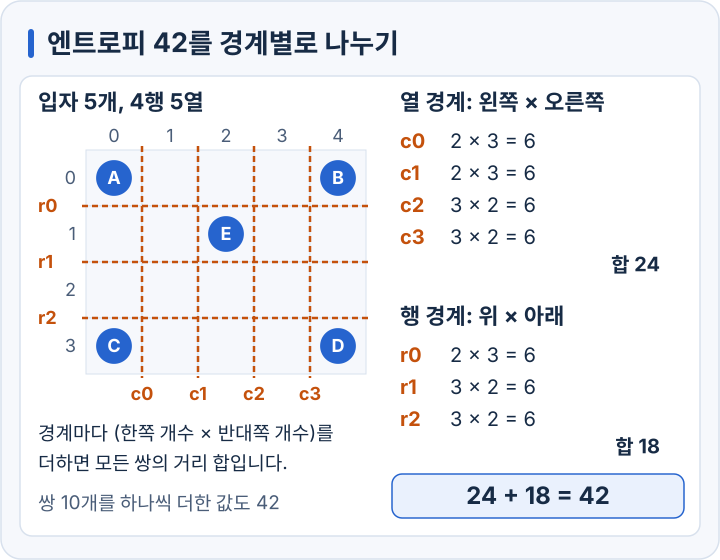
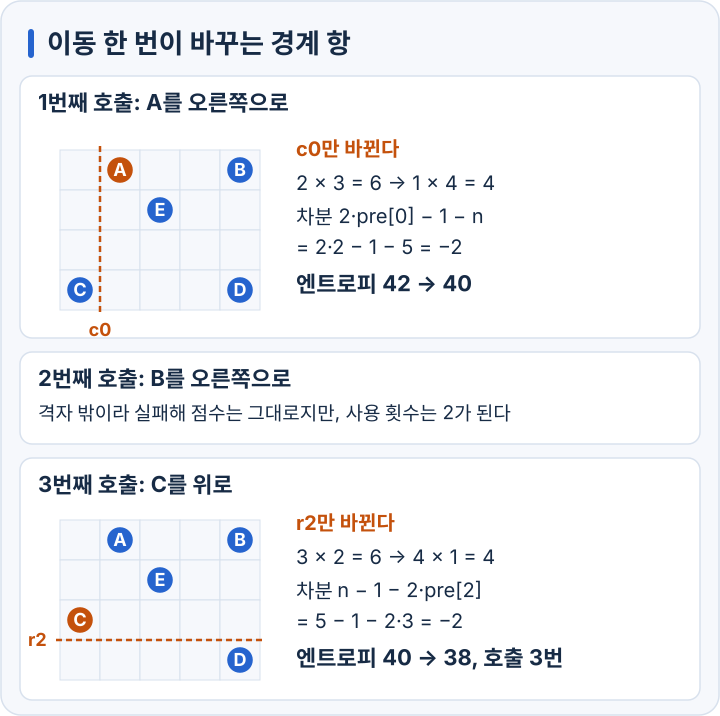

# 특수한 점수식 읽기: 채점식을 손으로 재현하고 성질을 풀이로 옮기기

[ENTROPY2D](/practice/ENTROPY2D)의 문제 설명은 세 줄이고 점수식이 없습니다. 점수는 공개 채점기 `main.cpp`의 `calc_entropy`와 `verify`를 읽어야 알 수 있습니다. 이 강의는 그 식을 **내 코드로 그대로 옮겨 채점기와 대조**하고, 식의 구조(상수 항, 축별 분리, 이동 예산)에서 **이동 한 번의 점수 변화를 O(1)로 구하는 차분식**을 만든 뒤, 탐욕과 국소 개선으로 풀이를 키웁니다. 코드는 모두 h-contest 제출용이며 STL과 표준 헤더, 공통 블록 없이 공개 API와 점수 규칙만 씁니다. 채점기 내부 변수나 TC 생성 방식은 쓰지 않습니다.

## 문제 계약을 상태로 옮기기

이름만 보고 "입자 사이 거리 합을 줄이면 점수"라고 짐작하면 세 군데가 어긋납니다. 점수는 거리 합이 아니라 **줄어든 비율의 제곱**이고, 규칙을 어긴 호출은 TC를 무효로 만들지 않고 **횟수만 쓰며**, 남은 이동 횟수가 **보너스 점수**가 됩니다.

| 항목 | 계약 |
| --- | --- |
| 구현 | TC마다 `process()`를 한 번 부릅니다. 입력 인자는 없고 API로 읽습니다. TC 10개, 시간 제한 10초 |
| 규모 | 높이·너비 각각 80~180, 입자 밀도 30~50%. 공개 TC 10개는 격자 96×89~178×143, 입자 3105~9906개 |
| 읽기 | `getHeight`, `getWidth`, `getParticleCount`, `getMoveLimit`, `getMoveCount`, `getCell(y, x)`(0 빈 칸, 1 입자, -1 격자 밖). 읽기는 횟수에 세지 않습니다. |
| 행동 | `moveParticle(y, x, dir)`: 입자를 한 칸 옮깁니다. `dir` 0 위(y-1), 1 오른쪽(x+1), 2 아래, 3 왼쪽. 성공 1, 실패 0 |
| 예산 | 한도 `H × W × 40`(공개 TC 341760~1084160). 호출마다 사용 횟수가 1 늘고 **실패한 호출도 셉니다.** |
| 점수 | 아래 식. 클수록 좋고 10개 TC 합이 총점입니다. 통과 기준은 1917000 |

| 호출 | 반환 | 사용 횟수 |
| --- | --- | --- |
| 한도에 닿은 뒤의 모든 호출 | 0 | 늘지 않음 |
| 좌표 밖, 입자 없는 칸, 방향이 0~3 밖 | 0 | 늘어남 |
| 목적지가 격자 밖이거나 이미 입자가 있음 | 0 | 늘어남 |
| 그 밖 | 1, 입자 이동 | 늘어남 |

어떤 호출도 TC를 0점으로 만들지 않고 예산만 씁니다. 점수는 `process`가 끝난 뒤 한 번 계산합니다.

```text
E = 모든 입자 쌍(i < j)의 |dy| + |dx| 합        E0는 process 시작 때의 E
점수 = floor(1000000 × (max(0, E0 − E) / E0)²) + floor((한도 − 사용 횟수) / 100)
```

입자는 서로 구별되지 않으므로 상태는 입자 목록 `py, px`, 점유 격자 `occ`, 사용 횟수가 전부입니다. `occ`와 목록은 채점기 상태를 따라 그린 **거울**이며, 한 곳(`act`)에서만 갱신합니다. 행동 전에 `occ`로 막으면 실패 호출로 예산을 쓰지 않습니다. 입자 수는 최대 180×180 = 32400이라 배열 상한이 되고, 초기화는 `process` 시작의 `init`에서 한 번 합니다.

> **코드 환경: h-contest 제출용.** `ent-state`, `ent-score`, `ent-axis`, `ent-act`를 이 순서로 `user.cpp`에 붙이고 마지막에 단계별 `process`를 하나 붙입니다. 2단계 이상은 `ent-greedy`를, 4단계는 `ent-relocate`도 먼저 붙입니다. 5단계는 `ent-greedy`와 `ent-relocate` 없이 `ent-target`, `ent-match`를 이 순서로 붙입니다.

```cpp snippet=ent-state
extern int getHeight();
extern int getWidth();
extern int getParticleCount();
extern long long getMoveLimit();
extern long long getMoveCount();
extern int getCell(int y, int x);
extern int moveParticle(int y, int x, int dir);

namespace ent {
const int MAXHW = 180, MAXN = MAXHW * MAXHW;
const int DY[4] = {-1, 0, 1, 0};
const int DX[4] = {0, 1, 0, -1};

struct World {
    int H, W, n;
    bool occ[MAXHW][MAXHW];          // 내가 기록한 점유
    int py[MAXN], px[MAXN];          // i번 입자의 위치
    int preY[MAXHW], preX[MAXHW];    // preY[r] = 행이 r 이하인 입자 수, preX[c]도 같은 뜻
    long long used, limit;           // 지금까지 부른 횟수(실패 포함), 한도
    long long e0, entropy;           // 시작 엔트로피, 내가 따라가는 현재 엔트로피
    int refused, mismatch;           // 내가 막은 요청 수, 채점기 반환값이 예측과 달랐던 수
};
World G;
long long mirrorScore;
void (*hook)(long long score, long long e0, long long e, long long used, int refused, int mismatch);
}
```

## 채점식을 내 코드로 재현하기

`ent-score`는 채점기의 두 함수를 그대로 따라 쓴 것입니다. 이후 모든 검사는 `myScore`가 채점기 점수와 같다는 데서 출발하므로, 빠른 식은 나중에 만들고 먼저 느려도 문장 그대로 쓴 식을 둡니다.

```cpp snippet=ent-score
namespace ent {
// 채점기 calc_entropy를 그대로 옮긴 O(n^2). 쌍마다 한 번(i < j)이고 누적은 long long이다.
long long entropyPairs() {
    long long e = 0;
    for (int i = 0; i < G.n; ++i)
        for (int j = i + 1; j < G.n; ++j) {
            int dy = G.py[i] - G.py[j]; if (dy < 0) dy = -dy;
            int dx = G.px[i] - G.px[j]; if (dx < 0) dx = -dx;
            e += dy + dx;
        }
    return e;
}

// 채점기 verify를 그대로 옮긴 점수. 나눗셈 두 곳과 형 변환 위치까지 같게 쓴다.
long long myScore(long long e0, long long e, long long used, long long limit) {
    long long improvement = e0 - e;
    if (improvement < 0) improvement = 0;
    double ratio = (double)improvement / (double)e0;
    long long entropyScore = (long long)(1000000.0 * ratio * ratio);
    long long moveBonus = (limit - used) / 100;
    return entropyScore + moveBonus;
}
}
```

옮길 때 어긋나기 쉬운 곳과, 틀리면 어떻게 달라지는지입니다.

| 지점 | 채점기 | 틀리게 쓰면 |
| --- | --- | --- |
| 쌍 | `i < j`로 한 번씩 | 두 번 세면 E가 2배가 되지만 점수는 **그대로**입니다. 비율이라 숨습니다. |
| 누적 자료형 | `long long` | 공개 TC 10개 중 4개(TC 4·5·9·10)의 E0가 2³¹을 넘어서 `int`면 깨집니다. |
| 비율 | `(double)improvement / (double)E0` | 정수 나눗셈이면 항상 0이 됩니다. |
| 소수 버림 | `(long long)(1000000.0 × r × r)` | 반올림이 아니라 버림입니다. |
| 보너스 | `(한도 − 사용) / 100` 정수 나눗셈 | 반올림하면 최대 1점이 다릅니다. 사용 횟수는 **실패 호출 포함**입니다. |
| 음수 | `improvement < 0`이면 0 | E가 늘어난 TC도 엔트로피 점수는 0이고 보너스만 남습니다. |

손으로 계산할 수 있는 TC로 세 값을 맞춥니다. 4행 5열 격자에 입자 5개 `A(0,0) B(0,4) C(3,0) D(3,4) E(1,2)`가 있고 한도는 `4 × 5 × 40 = 800`입니다. 모든 쌍의 거리는 다음과 같습니다.

| 쌍 | AB | AC | AD | AE | BC | BD | BE | CD | CE | DE |
| --- | --- | --- | --- | --- | --- | --- | --- | --- | --- | --- |
| 거리 | 4 | 3 | 7 | 3 | 7 | 3 | 3 | 4 | 4 | 4 |

합 E0 = 42입니다. 호출 세 번을 합니다. A를 오른쪽으로(성공, E = 40), B를 오른쪽으로(격자 밖이라 실패), C를 위로(성공, E = 38). 이 순서가 아래 `process`입니다(채점기에 붙여 돌리는 확인용 코드이며 제출 코드가 아닙니다).

```cpp snippet=ent-hand
extern int moveParticle(int y, int x, int dir);

void process() {
    moveParticle(0, 0, 1);   // (0,0)의 입자를 오른쪽으로: 성공
    moveParticle(0, 4, 1);   // (0,4)의 입자를 오른쪽으로: 격자 밖이라 실패, 횟수는 센다
    moveParticle(3, 0, 0);   // (3,0)의 입자를 위로: 성공
}
```

손계산은 `improvement = 4`, `r = 4/42`, `r²×10⁶ = 9070.29`를 버려 9070, 보너스는 `(800 − 3)/100 = 7.97`을 버려 7이라 **9077**입니다. 두 번째 호출이 실패해도 횟수 3에 들어간다는 점이 핵심입니다. 같은 값을 `myScore(42, 38, 3, 800)`과 채점기가 내야 합니다. 채점기는 `init()`만 이 격자로 바꾼 사본(출력 줄 추가 포함)으로 돌립니다. `scripts/check_reading_the_score.py --judge`가 이 세 값이 모두 9077인지 확인하고, 기본 검사는 점수 계산을 이 강의 코드로 다시 돌려 확인합니다.

[경계 차분 데모: 입자 이동과 점수 계산](https://git.readiz.com/h-contest-lesson/demos/index.html?demo=boundary-delta)

엔트로피를 열·행 경계의 (한쪽 개수 × 반대쪽 개수) 합으로 보고, 입자를 옮길 때 경계 값 하나만 바뀌는 차분식과 전체 재계산을 나란히 비교합니다. 입자와 방향을 바꿔 격자 밖으로 나가는 실패 호출도 시도해 보세요.

## 점수식의 구조: 상수 항, 축별 분리, 경계

점수는 `f(E) + g(사용 횟수)`입니다. `E0`와 한도는 내 행동과 무관한 **상수**이고, 내 행동으로 바뀌는 것은 E와 사용 횟수뿐입니다. 거리 합의 구조가 풀이를 결정합니다.



[그림 크게 보기](https://git.readiz.com/h-contest-lesson/lessons/reading-the-score/lesson-assets/axis-split.svg)

- **축별 분리.** `|dy| + |dx|`의 합은 y만의 합과 x만의 합으로 갈립니다. 입자의 열 분포만 알면 x 몫이, 행 분포만 알면 y 몫이 정해집니다.
- **경계 식.** 두 입자의 열 거리는 둘을 가르는 열 경계의 수입니다. 열 경계 `c`(열 c와 c+1 사이)를 가르는 쌍은 왼쪽 개수 × 오른쪽 개수이므로 `E = Σ pre[c] × (n − pre[c])`를 행과 열에 대해 더합니다. `pre`는 개수의 누적합이라 **O(n²) 대신 O(H + W)**입니다. 위 그림이 이 계산입니다.
- **하한.** 열 하나에는 최대 H개, 행 하나에는 최대 W개 입자가 들어갑니다. 각 축을 따로 가장 모으면(꽉 찬 열을 한쪽부터 채우면) 합이 가장 작습니다. 이 값은 E의 **하한**이고, 작은 경우를 모든 열 개수 조합으로 전수 조사해 식을 검산합니다.
- **상한 없음, 보너스는 선형.** 점수는 감소 비율의 제곱이라 감소가 클수록 한 단위의 가치가 커지고, 보너스는 이동 한 번에 `0.01`점입니다. 이동이 E를 `g`만큼 줄이면 점수는 `2×10⁶ × r × g / E0`(r은 지금의 감소율) 늘어납니다. 이 값이 0.01보다 작아지면 이동은 손해입니다. 공개 TC에서 r을 0.41~0.46으로 두면 이동 한 번에 `g ≥ 0.01 × E0 / (2×10⁶ × r)`가 필요하고, TC 1은 약 8.9, TC 10은 약 65.6입니다. 입자 수가 늘면 E0가 n²로 커지므로 TC마다 문턱이 크게 다릅니다.

```cpp snippet=ent-axis
namespace ent {
// 행·열 개수의 누적합. 입자 하나가 한 칸 움직이면 누적합 한 칸만 바뀐다.
void buildPre() {
    for (int r = 0; r < G.H; ++r) G.preY[r] = 0;
    for (int c = 0; c < G.W; ++c) G.preX[c] = 0;
    for (int i = 0; i < G.n; ++i) { ++G.preY[G.py[i]]; ++G.preX[G.px[i]]; }
    for (int r = 1; r < G.H; ++r) G.preY[r] += G.preY[r - 1];
    for (int c = 1; c < G.W; ++c) G.preX[c] += G.preX[c - 1];
}

// 엔트로피 = 행 경계마다 (위 개수 x 아래 개수)의 합 + 열 경계마다 (왼쪽 x 오른쪽)의 합. O(H + W)
long long entropyAxis() {
    long long e = 0;
    for (int r = 0; r + 1 < G.H; ++r) e += (long long)G.preY[r] * (G.n - G.preY[r]);
    for (int c = 0; c + 1 < G.W; ++c) e += (long long)G.preX[c] * (G.n - G.preX[c]);
    return e;
}

// (y, x)의 입자를 dir로 한 칸 옮길 때 엔트로피 변화량. 음수면 좋아진다. O(1)
long long delta(int y, int x, int dir) {
    long long n = G.n;
    if (dir == 0) return n - 1 - 2LL * (y > 0 ? G.preY[y - 1] : 0);
    if (dir == 1) return 2LL * G.preX[x] - 1 - n;
    if (dir == 2) return 2LL * G.preY[y] - 1 - n;
    return n - 1 - 2LL * (x > 0 ? G.preX[x - 1] : 0);
}
}
```

## 차분식: 이동 한 번의 변화를 O(1)로

입자가 열 x에서 x+1로 가면 열 x 이하의 다른 입자(`pre[x] − 1`개)와는 1 멀어지고, 열 x+1 이상의 입자(`n − pre[x]`개)와는 1 가까워집니다. 변화량은 `2·pre[x] − 1 − n`이고, 경계 식으로 보면 경계 `x`의 값 하나만 `pre·(n − pre)`에서 `(pre−1)(n − pre + 1)`로 바뀐 것입니다. 왼쪽은 `n − 1 − 2·pre[x−1]`이고 위·아래도 같은 모양입니다(`delta`). 이동 뒤에는 누적합도 한 칸만 바뀝니다. 손계산 TC에서 두 방법으로 비교합니다. A를 오른쪽으로 옮기면 차분은 `2·pre[0] − 1 − 5 = −2`이고 전체 재계산도 42 → 40으로 −2입니다. C를 위로 옮기면 차분 `5 − 1 − 2·pre[2] = −2`, 전체 재계산 40 → 38로 같습니다.



[그림 크게 보기](https://git.readiz.com/h-contest-lesson/lessons/reading-the-score/lesson-assets/one-move.svg)

전체 재계산(`entropyPairs`)과의 대조는 하네스가 합니다. 기준 채점기를 따로 만들어 `moveParticle`이 불릴 때마다 거울의 엔트로피와 기준 O(n²) 계산이 같은지 확인하고, 무작위 격자 30개에서 합법 이동 4861개의 `delta`가 이동 전후의 O(n²) 차이와 같은지 봅니다. 아래 `act`가 모든 이동을 지나는 통로입니다.

```cpp snippet=ent-act
namespace ent {
void init() {
    G.H = getHeight(); G.W = getWidth(); G.n = 0;
    for (int y = 0; y < G.H; ++y)
        for (int x = 0; x < G.W; ++x) {
            G.occ[y][x] = getCell(y, x) == 1;
            if (G.occ[y][x]) { G.py[G.n] = y; G.px[G.n] = x; ++G.n; }
        }
    G.used = getMoveCount(); G.limit = getMoveLimit();
    G.refused = G.mismatch = 0;
    buildPre();
    G.entropy = G.e0 = entropyAxis();
}

bool canMove(int y, int x, int dir) {
    if (G.used >= G.limit) return false;
    int ny = y + DY[dir], nx = x + DX[dir];
    return 0 <= ny && ny < G.H && 0 <= nx && nx < G.W && !G.occ[ny][nx];
}

// 채점기를 부르는 유일한 통로. 호출 전에 내 점유 격자로 먼저 거른다.
bool act(int i, int dir) {
    int y = G.py[i], x = G.px[i];
    if (!canMove(y, x, dir)) { ++G.refused; return false; }
    int ok = moveParticle(y, x, dir);
    ++G.used;                                  // 실패해도 채점기는 횟수를 센다
    if (!ok) { ++G.mismatch; return false; }
    G.entropy += delta(y, x, dir);             // 누적합을 바꾸기 전에 계산한다
    if (dir == 0) ++G.preY[y - 1];
    else if (dir == 1) --G.preX[x];
    else if (dir == 2) --G.preY[y];
    else ++G.preX[x - 1];
    G.occ[y][x] = false;
    G.py[i] = y + DY[dir]; G.px[i] = x + DX[dir];
    G.occ[G.py[i]][G.px[i]] = true;
    return true;
}

void finish() {
    mirrorScore = myScore(G.e0, G.entropy, G.used, G.limit);
    if (hook) hook(mirrorScore, G.e0, G.entropy, G.used, G.refused, G.mismatch);
}
}
```

## 단계별 풀이

0단계는 아무것도 하지 않는 기준선입니다. 유효하며 점수는 보너스뿐입니다.

```cpp snippet=ent-baseline
void process() {
    ent::init();      // 아무 행동도 하지 않는다
    ent::finish();
}
```

1단계는 점수식을 모르는 탐욕으로, 모든 입자를 격자 중앙 쪽으로 한 칸씩 밉니다. 막히면 그 입자는 건너뜁니다(`act`가 거절하고 `refused`가 늘어납니다).

```cpp snippet=ent-naive
// 점수식을 쓰지 않는 탐욕: 입자를 격자 중앙 쪽으로 한 칸씩 민다.
void process() {
    ent::init();
    int cy = (ent::G.H - 1) / 2, cx = (ent::G.W - 1) / 2;
    for (bool moved = true; moved && ent::G.used < ent::G.limit; ) {
        moved = false;
        for (int i = 0; i < ent::G.n; ++i) {
            int dy = cy - ent::G.py[i], dx = cx - ent::G.px[i];
            int dir = (dy < 0 ? -dy : dy) >= (dx < 0 ? -dx : dx) ? (dy < 0 ? 0 : 2) : (dx > 0 ? 1 : 3);
            if ((dy || dx) && ent::act(i, dir)) moved = true;
        }
    }
    ent::finish();
}
```

2단계는 차분식을 씁니다. 입자마다 네 방향 중 E를 가장 많이 줄이는 합법 이동을 고르고, 더 줄일 수 없을 때까지 훑습니다. 중앙이 아니라 **입자의 중앙값(누적합)** 이 기준이 되므로 격자 중앙을 몰라도 됩니다. 3단계는 같은 차분으로 이득이 큰 이동부터 합니다. 문턱 `t`를 n에서 시작해 `KEEP/8`배씩 줄이며, 각 문턱에서 더 움직일 수 없을 때까지 훑습니다.

```cpp snippet=ent-greedy
namespace ent {
const int KEEP = 6;            // 큰 이득부터 할 때 문턱을 KEEP/8배씩 줄인다

// i번 입자가 지금 둘 수 있는 이동 중 가장 많이 줄이는 방향. minGain만큼 못 줄이면 -1
int bestDir(int i, long long minGain) {
    int best = -1; long long bestDelta = 0;
    for (int d = 0; d < 4; ++d) {
        if (!canMove(G.py[i], G.px[i], d)) continue;
        long long dl = delta(G.py[i], G.px[i], d);
        if (dl <= -minGain && dl < bestDelta) { bestDelta = dl; best = d; }
    }
    return best;
}

// 입자를 번호 순서로 한 번씩 훑는다. 움직인 입자 수를 돌려준다.
int sweep(long long minGain) {
    int moved = 0;
    for (int i = 0; i < G.n; ++i) {
        int d = bestDir(i, minGain);
        if (d >= 0 && act(i, d)) ++moved;
    }
    return moved;
}

// 문턱 t 이상 줄이는 이동만, 더 못 움직일 때까지 훑는다. t를 n에서 1까지 줄인다.
void thresholdSweeps() {
    for (long long t = G.n; t >= 1 && G.used < G.limit; t = t == 1 ? 0 : (t * KEEP / 8 > 0 ? t * KEEP / 8 : 1))
        while (G.used < G.limit && sweep(t) > 0) {}
}
}
```

2단계의 `process`는 `while (ent::G.used < ent::G.limit && ent::sweep(1) > 0) {}`로 1 이상 줄이는 이동을 모두 허용해 훑는 것이고 3단계는 `ent::thresholdSweeps()`를 부릅니다. 두 `process`는 `init`과 `finish` 사이만 다릅니다.

```cpp snippet=ent-entry-greedy
void process() {
    ent::init();
    while (ent::G.used < ent::G.limit && ent::sweep(1) > 0) {}
    ent::finish();
}
```

```cpp snippet=ent-entry-threshold
void process() {
    ent::init();
    ent::thresholdSweeps();
    ent::finish();
}
```

두 단계는 모두 이동 한도의 26%만 쓰고 멈춥니다. 남은 입자는 E를 줄이는 방향의 칸이 **막혀** 있습니다(작은 격자 검사에서 멈춘 상태에 E를 줄이는 합법 이동이 없음을 확인합니다). 한 칸 이동으로는 닿지 못하지만 빈 칸을 돌아가면 닿는 자리가 있습니다. 그래서 4단계는 입자 하나를 빈 칸만 지나 옮깁니다. a에서 b로 옮길 때의 변화는 각 축의 거리 합 `F`로 O(1)에 구합니다. `Fx[c]`는 모든 입자와 열 c의 열 거리 합이고, `F(c+1) = F(c) + 2·pre[c] − n`으로 누적합에서 만듭니다. 자기 자신과의 거리를 빼면 `ΔE = F(b) − |b − a| − F(a)`입니다. 빈 칸만 지나는 BFS로 후보 칸을 모으고, 이동당 `MINPER` 이상 줄이는 칸 중 가장 많이 줄이는 곳으로 보냅니다. 이 차분식도 전체 재계산과 대조합니다(무작위 3049개).

```cpp snippet=ent-relocate
namespace ent {
const long long MINPER = 10;       // 이동 한 번당 이만큼 이상 줄어야 옮긴다
long long Fx[MAXHW], Fy[MAXHW];    // Fx[c] = 모든 입자와 열 c의 열 거리 합, Fy[r]은 행 버전
int dist[MAXHW][MAXHW], from[MAXHW][MAXHW], que[MAXN];

// F(c + 1) = F(c) + 2 pre[c] - n 으로 누적합에서 만든다.
void buildF() {
    long long sx = 0, sy = 0;
    for (int c = 0; c < G.W; ++c) sx += (long long)c * (G.preX[c] - (c ? G.preX[c - 1] : 0));
    for (int r = 0; r < G.H; ++r) sy += (long long)r * (G.preY[r] - (r ? G.preY[r - 1] : 0));
    Fx[0] = sx; Fy[0] = sy;
    for (int c = 0; c + 1 < G.W; ++c) Fx[c + 1] = Fx[c] + 2LL * G.preX[c] - G.n;
    for (int r = 0; r + 1 < G.H; ++r) Fy[r + 1] = Fy[r] + 2LL * G.preY[r] - G.n;
}

int absv(int v) { return v < 0 ? -v : v; }

// a에서 b로 옮겼을 때 엔트로피 변화량. b의 F에서 자기 자신과의 거리 |b - a|를 뺀다.
long long relocateDelta(int ay, int ax, int by, int bx) {
    return Fx[bx] + Fy[by] - absv(bx - ax) - absv(by - ay) - Fx[ax] - Fy[ay];
}

// i번 입자를 빈 칸만 지나 갈 수 있는 가장 좋은 칸으로 보낸다. 옮겼으면 true
bool relocate(int i) {
    int ay = G.py[i], ax = G.px[i];
    buildF();
    for (int y = 0; y < G.H; ++y) for (int x = 0; x < G.W; ++x) dist[y][x] = -1;
    int head = 0, tail = 0, by = -1, bx = -1;
    long long bestDelta = 0;
    que[tail++] = ay * G.W + ax; dist[ay][ax] = 0;
    while (head < tail) {
        int y = que[head] / G.W, x = que[head] % G.W; ++head;
        for (int d = 0; d < 4; ++d) {
            int ny = y + DY[d], nx = x + DX[d];
            if (ny < 0 || ny >= G.H || nx < 0 || nx >= G.W || G.occ[ny][nx] || dist[ny][nx] >= 0) continue;
            dist[ny][nx] = dist[y][x] + 1; from[ny][nx] = d; que[tail++] = ny * G.W + nx;
            long long dl = relocateDelta(ay, ax, ny, nx);
            if (dl <= -MINPER * dist[ny][nx] && dl < bestDelta) { bestDelta = dl; by = ny; bx = nx; }
        }
    }
    if (by < 0 || G.used + dist[by][bx] > G.limit) return false;
    int dirs[MAXN], k = 0;
    for (int y = by, x = bx; y != ay || x != ax; ) { int d = from[y][x]; dirs[k++] = d; y -= DY[d]; x -= DX[d]; }
    while (k > 0) act(i, dirs[--k]);
    return true;
}

bool hasFreeNeighbor(int i) {
    for (int d = 0; d < 4; ++d) if (canMove(G.py[i], G.px[i], d)) return true;
    return false;
}
}
```

```cpp snippet=ent-entry-final
void process() {
    ent::init();
    ent::thresholdSweeps();
    for (bool moved = true; moved && ent::G.used < ent::G.limit; ) {
        moved = false;
        for (int i = 0; i < ent::G.n; ++i)
            if (ent::hasFreeNeighbor(i) && ent::relocate(i)) moved = true;
    }
    ent::finish();
}
```

4단계가 모자란 점수는 이동 횟수에 있습니다. 한 번의 이동은 열 경계 하나 또는 행 경계 하나만 건너므로, 경계마다 처음과 끝 누적합의 차이만큼은 반드시 건너야 하고 이 합이 **이동 횟수의 하한**입니다. 모든 이동이 경계를 한 방향으로만 건너면 하한에 닿습니다. 4단계는 빈 칸만 지나 입자를 보내서 막히면 돌아가거나 포기하므로 하한에서 멀어집니다. 5단계는 **끝 배치를 먼저 정합니다.** 입자를 a에서 b로 옮기는 변화 `ΔE = F(b) − |b − a| − F(a)`에서 F(행 F와 열 F의 합)가 작은 칸이 좋으므로 F가 작은 n칸을 목표로 잡고, 고른 목표의 F로 키를 다시 만들어 되풀이합니다.

```cpp snippet=ent-target
namespace ent {
int absv(int v) { return v < 0 ? -v : v; }
const int ROUNDS = 8;                    // 목표를 다시 고르는 횟수
bool inR[MAXHW][MAXHW];                  // 목표 배치에 속한 칸. 처음에는 지금 입자가 있는 칸
int cntY[MAXHW], cntX[MAXHW]; long long gy[MAXHW], gx[MAXHW];    // 그 배치의 행별·열별 입자 수와, 행 r·열 c까지의 거리 합 F
// 키 gy[y] + gx[x]가 작은 n칸을 목표로 잡는다. 고른 목표의 F로 키를 다시 만들어 ROUNDS번 반복한다.
void chooseTarget() {
    for (int y = 0; y < G.H; ++y) for (int x = 0; x < G.W; ++x) inR[y][x] = G.occ[y][x];
    for (int round = 0; round < ROUNDS; ++round) {
        for (int k = 0; k < MAXHW; ++k) cntY[k] = cntX[k] = 0;
        for (int y = 0; y < G.H; ++y) for (int x = 0; x < G.W; ++x) if (inR[y][x]) { ++cntY[y]; ++cntX[x]; }
        for (int r = 0; r < G.H; ++r) { gy[r] = 0; for (int k = 0; k < G.H; ++k) gy[r] += (long long)cntY[k] * absv(r - k); }
        for (int c = 0; c < G.W; ++c) { gx[c] = 0; for (int k = 0; k < G.W; ++k) gx[c] += (long long)cntX[k] * absv(c - k); }
        long long lo = 0, hi = (long long)G.n * (G.H + G.W);       // 키가 lo 이하인 칸이 n개 이상인 가장 작은 lo
        while (lo < hi) {
            long long mid = (lo + hi) / 2; int cnt = 0;
            for (int y = 0; y < G.H; ++y) for (int x = 0; x < G.W; ++x) cnt += gy[y] + gx[x] <= mid;
            if (cnt >= G.n) hi = mid; else lo = mid + 1;
        }
        for (int y = 0; y < G.H; ++y) for (int x = 0; x < G.W; ++x) inR[y][x] = gy[y] + gx[x] <= lo;   // 키가 같은 칸이 많으면 n개를 넘을 수 있다
    }
}
}
```

입자는 구별되지 않아 **누가 어느 칸으로 가든 최종 배치만 같으면 점수가 같습니다.** 그래서 목표 안의 빈 칸마다 목표 밖의 입자 하나를 짝지어 보냅니다. 짝은 가까운 쌍부터 맺고(거리 d를 1부터 넓히며 못 채운 빈 칸의 둘레만 훑습니다), 서로 다른 짝의 a와 b는 겹치지 않으므로 맺는 즉시 옮깁니다. 옮길 때는 **직선 경로**를 쓰고 경로 위에 다른 입자가 있어도 됩니다. 입자 다음의 첫 빈 칸까지 뒤에서부터 한 칸씩 밀고, 그 칸의 입자로 b까지 되풀이합니다. 경로 `1 0 1 0`(1이 입자)은 첫째 칸이 한 칸 가서 `0 1 1 0`, 이어 셋째·둘째 칸이 차례로 한 칸 가서 `0 0 1 1`이 됩니다(3번). 경로의 변을 정확히 한 번씩만 건너 비용이 언제나 `|a − b|`이고 돌아가는 일이 없습니다.

```cpp snippet=ent-match
namespace ent {
int who[MAXHW][MAXHW];                   // 칸에 있는 입자의 번호(입자가 있는 칸에서만 유효)
// a의 입자를 빈 칸 b로 보낸 것과 같은 결과를 |a - b|번의 이동으로 만든다. 경로는 직선(세로 먼저)이다.
bool shiftAlong(int ay, int ax, int by, int bx) {
    int cy[2 * MAXHW], cx[2 * MAXHW], cd[2 * MAXHW], L = 0;    // 경로 칸의 좌표와, 칸 i에서 i + 1로 가는 방향
    for (cy[0] = ay, cx[0] = ax; cy[L] != by || cx[L] != bx; ++L) {
        cd[L] = cy[L] != by ? (by > cy[L] ? 2 : 0) : (bx > cx[L] ? 1 : 3);
        cy[L + 1] = cy[L] + DY[cd[L]]; cx[L + 1] = cx[L] + DX[cd[L]];
    }
    if (G.used + L > G.limit) return false;
    for (int s = 0, e = 1; s < L; s = e) {
        for (e = s + 1; G.occ[cy[e]][cx[e]]; ++e) {}           // s 다음의 첫 빈 칸 e (b가 비어 있으므로 L 이하)
        for (int i = e - 1; i >= s; --i) {                     // s..e-1의 입자를 뒤에서부터 한 칸씩 민다
            int p = who[cy[i]][cx[i]];
            if (!act(p, cd[i])) return false;
            who[cy[i + 1]][cx[i + 1]] = p;
        }
    }
    return true;
}

// 거리 d = 1, 2, ...를 차례로 넓히며, 목표 안의 빈 칸마다 마름모 둘레(|dy| + |dx| = d)에서 목표 밖 입자를 찾아 보낸다.
void fillHoles() {
    for (int i = 0; i < G.n; ++i) who[G.py[i]][G.px[i]] = i;
    for (int d = 1; d <= G.H + G.W; ++d)
        for (int hy = 0; hy < G.H; ++hy) for (int hx = 0; hx < G.W; ++hx) {
            if (!inR[hy][hx] || G.occ[hy][hx]) continue;           // 채워진 칸은 occ가 되므로 못 채운 빈 칸만 남는다
            int fy = -1, fx = -1;
            for (int dy = -d; dy <= d && fy < 0; ++dy)
                for (int s = -1; s <= 1 && fy < 0; s += 2) {
                    int y = hy + dy, x = hx + s * (d - absv(dy));   // 목표 밖 입자: 입자가 있고 목표가 아닌 칸
                    if (0 <= y && y < G.H && 0 <= x && x < G.W && G.occ[y][x] && !inR[y][x]) { fy = y; fx = x; }
                }
            if (fy >= 0) shiftAlong(fy, fx, hy, hx);
        }
}
}

void process() {
    ent::init();
    ent::chooseTarget();
    ent::fillHoles();
    ent::finish();
}
```

## 실측: 단계별 점수와 시간

공개 채점기 `main.cpp`를 복사해 출력 몇 줄만 더한 로컬 사본에 위 코드를 붙여 쟀습니다. 측정일 2026-11-19, Apple clang 17(`-std=c++17 -O2`), macOS arm64입니다. 점수는 같은 입력에서 항상 같고 시간은 채점기가 출력한 값(10개 TC 전체)의 9회 중앙값입니다. 0단계의 43ms는 채점기가 쓰는 O(n²) 계산 자체의 비용입니다. 원본은 [entropy2d-benchmark.json](lesson-assets/entropy2d-benchmark.json)이고, 거울 점수는 모든 단계에서 채점기 점수와 같았으며 채점기 반환값과 내 예측이 어긋난 호출은 0번입니다. 통과 기준 1917000에 4단계는 8211점 부족하고, 5단계는 1179점 넘습니다. 시간은 다른 작업과 겹쳐 잡음이 큽니다(5단계 9회는 721~778 ms).

| 단계 | 점수 합 | 시간 ms | 사용한 이동 / 한도 |
| --- | --- | --- | --- |
| 0단계 기준선 | 73687 | 43 | 0 / 7369200 |
| 1단계 중앙으로 밀기 | 609779 | 71 | 1045253 / 7369200 |
| 2단계 차분 탐욕 | 1756585 | 161 | 1897595 / 7369200 |
| 3단계 큰 이득부터 | 1776636 | 279 | 1891384 / 7369200 |
| 4단계 빈 칸 경로 재배치 | 1908789 | 2738 | 2950637 / 7369200 |
| 5단계 목표 배치 짝짓기 | 1918179 | 738 | 2012064 / 7369200 |

| 단계 | TC 1 | TC 2 | TC 3 | TC 4 | TC 5 | TC 6 | TC 7 | TC 8 | TC 9 | TC 10 |
| --- | --- | --- | --- | --- | --- | --- | --- | --- | --- | --- |
| 0단계 기준선 | 5378 | 6042 | 7016 | 8887 | 10181 | 5850 | 6719 | 3417 | 9356 | 10841 |
| 1단계 중앙으로 밀기 | 52371 | 78600 | 84961 | 55237 | 59869 | 53486 | 65418 | 47170 | 57730 | 54937 |
| 2단계 차분 탐욕 | 188013 | 172093 | 173719 | 180736 | 176159 | 185729 | 170105 | 167439 | 176220 | 166372 |
| 3단계 큰 이득부터 | 186979 | 183356 | 186091 | 178011 | 176593 | 183571 | 173878 | 167253 | 174949 | 165955 |
| 4단계 빈 칸 경로 재배치 | 193281 | 207600 | 219758 | 187390 | 186348 | 190765 | 188728 | 173901 | 186469 | 174549 |
| 5단계 목표 배치 짝짓기 | 193642 | 208551 | 221216 | 188430 | 187626 | 191239 | 189597 | 174095 | 187850 | 175933 |

- **0 → 1 → 2단계**는 점수가 크게 오릅니다. 2단계는 방향을 격자 중앙이 아니라 차분이 음수인 쪽으로 정하고, 이동은 가장 많이 줄이는 방향 하나만 합니다.
- **2단계와 3단계**: 이득이 큰 이동부터 해도 TC별 차이의 평균은 2005.1, 표준오차 1729.2, 근사 구간 [-1453.3, 5463.5]로 0을 포함하고 3단계가 높은 TC는 10개 중 4개입니다. 이동 한도의 26%만 쓰므로 예산이 모자라지 않는 이 입력에서는 **이득 순서가 점수를 바꾸지 못한 것으로** 보입니다. 우열을 정하지 않으며, 시간만 1.7배가 됩니다.
- **3단계와 4단계**: 평균 13215.3, 표준오차 2829.8, 구간 [7555.8, 18874.8]이고 10개 TC 모두 4단계가 높습니다. 3단계와 다른 점은 막힌 입자를 빈 칸 경로로 옮기는 것뿐입니다.
- **4단계와 5단계**: 평균 939.0, 표준오차 145.2, 구간 [648.5, 1229.5]이고 10개 TC 모두 5단계가 높습니다. 최종 엔트로피는 4단계의 0.999993~1.000006배로 같으니 **차이는 전부 이동 횟수**입니다. 5단계는 이동 2012064번으로 4단계보다 938573번 적게 써서 보너스를 20120점만 깎았습니다.

4단계와 5단계가 어디까지 왔는지 TC별로 봅니다(하한과 참고 배치). `하한`은 위의 축별 하한이 허용하는 감소율 `1 − 하한/E0`이고, `원판`은 입자 n개를 한 점에 가까운 칸부터 채운 배치(중심 위치 4가지 중 최선)의 감소율입니다. 원판은 하한이 아니라 참고 배치입니다. `이동 하한`은 경계마다 `|끝 누적합 − 처음 누적합|`을 더한 값으로, 5단계의 최종 배치로 가는 어떤 방법도 이보다 적게 움직일 수 없습니다.

| TC | 격자 | 입자 | 시작 E0 | 4단계 최종 E | 4단계 감소율 | 원판 참고 감소율 | 하한 감소율 | 5단계 이동 | 이동 하한 |
| --- | --- | --- | --- | --- | --- | --- | --- | --- | --- |
| 1 | 119 × 113 | 4492 | 778449565 | 439641629 | 0.4352 | 0.4351 | 0.6653 | 116277 | 116117 |
| 2 | 159 × 95 | 5096 | 1099098654 | 602671552 | 0.4517 | 0.4516 | 0.6627 | 149607 | 149477 |
| 3 | 98 × 179 | 5805 | 1559810294 | 834671972 | 0.4649 | 0.4648 | 0.6700 | 192185 | 192019 |
| 4 | 138 × 161 | 7696 | 2946440037 | 1689206515 | 0.4267 | 0.4266 | 0.6531 | 252579 | 252339 |
| 5 | 178 × 143 | 8956 | 4291467255 | 2467796109 | 0.4250 | 0.4248 | 0.6482 | 314007 | 313743 |
| 6 | 117 × 125 | 4916 | 969959640 | 550850802 | 0.4321 | 0.4320 | 0.6623 | 131147 | 130963 |
| 7 | 157 × 107 | 5923 | 1538928328 | 877737314 | 0.4296 | 0.4295 | 0.6464 | 171746 | 171558 |
| 8 | 96 × 89 | 3105 | 297951790 | 174634918 | 0.4139 | 0.4137 | 0.6376 | 61730 | 61624 |
| 9 | 136 × 172 | 8221 | 3469277048 | 1992202682 | 0.4258 | 0.4256 | 0.6486 | 277732 | 277518 |
| 10 | 176 × 154 | 9906 | 5386617519 | 3175202548 | 0.4105 | 0.4104 | 0.6338 | 345054 | 344772 |

하한은 한 축씩 따로 모으는 값이라 두 띠를 동시에 만드는 느슨한 값(0.634~0.670)이고 실제 도달은 0.41~0.46입니다. 4단계의 최종 E는 원판 참고 E의 0.99977~0.99983배로, 이 배치보다 0.02% 낮습니다. 엔트로피 쪽의 남은 여지는 거의 없고, 통과 기준까지 모자란 8211점은 **이동 횟수**에서 찾아야 합니다. 4단계는 이동 2950637번을 써서 보너스를 29506점 깎았습니다. 5단계의 최종 엔트로피는 4단계와 같고 이동은 하한 합 2010130의 1.001배인 2012064번이라, 이 배치에서 이동을 더 줄일 방법은 거의 없습니다.

## 실험: 문턱과 줄이는 비율

4단계에서 한 번에 하나씩 바꿉니다(`MINPER`는 이동 한 번당 최소 감소량, `KEEP`은 3단계 문턱의 감소 비율 KEEP/8). 기본값은 `MINPER 10`, `KEEP 6`이고 시간은 1회 측정이라 잡음이 있습니다. 점수는 같은 10개 입력의 TC별 차이로 비교합니다([실험 비교와 평가](https://h.readiz.com/learn/testing-and-stress/experiment-evaluation)).

| 바꾼 값 | 점수 합 | 시간 ms |
| --- | --- | --- |
| 기본값 (MINPER 10, KEEP 6) | 1908789 | 2738 |
| MINPER 100 | 1910194 | 2784 |
| MINPER 300 | 1910866 | 2723 |

- 표에 없는 `MINPER 1`과 `0`은 기본값보다 낮고(각각 평균 -37.8, -46.3, 10개 모두) `MINPER 100`은 기본값보다 높습니다(평균 140.5, 표준오차 18.1, 10개 모두). `MINPER 300`은 기본값보다 평균 207.7 높지만 표준오차 92.8로 크고 `MINPER 100`과의 차이(평균 67.2, 표준오차 76.1)는 구분되지 않습니다. 100과 300의 우열은 정하지 않습니다. 표에 없는 `KEEP 4`는 평균 -35.4(표준오차 14.8)로 낮고 `KEEP 7`은 -4.0(표준오차 8.9)로 구분되지 않습니다.
- 차이는 가장 큰 경우도 기본값 점수의 0.11% 안입니다. 위 문턱 계산(TC 1은 약 8.9, TC 10은 약 65.6)에서 보듯 TC마다 맞는 값이 다르므로 E0에서 문턱을 정하는 변형도 아래 표에 넣었습니다. 이 값들은 채점에 쓰는 같은 입력으로 고른 것이라 새 입력에서의 일반화는 확인하지 않았습니다.

5단계는 한 번에 하나씩 바꿉니다. 마지막 열은 5단계 전체와의 TC별 차이 평균(표준오차)이고 시간은 1회 측정입니다. `문턱 켬`은 짝의 엔트로피 감소가 이동 한 번의 가치 `0.01 × E0 / (2×10⁶ × r)`(r은 목표의 감소율)와 이동 수의 곱보다 작으면 그 짝을 건너뛰고, `4단계 TC별 문턱 ×10`은 4단계의 `MINPER`를 이 값(r은 0.43으로 고정)의 10배로 둡니다.

| 변형 | 점수 합 | 이동 합 | 시간 ms | 5단계와의 차이 |
| --- | --- | --- | --- | --- |
| 5단계 전체 | 1918179 | 2012064 | 738 | |
| ROUNDS 1 | 1903414 | 1997650 | 705 | -1476.5 (580.2) |
| 빈 칸 순서대로 짝짓기 | 1910606 | 2769338 | 833 | -757.3 (112.7) |
| 3단계를 먼저 실행 | 1915651 | 2264698 | 395 | -252.8 (54.8) |
| 문턱 켬 | 1918179 | 2012064 | 729 | 0.0 (0.0) |
| 4단계 TC별 문턱 ×10 | 1911938 | 2555960 | 2797 | -624.1 (108.2) |

- `ROUNDS 1`은 이동이 14414번 줄지만 목표가 덜 좋아 평균 -1476.5(표준오차 580.2)로 낮고, `빈 칸 순서대로 짝짓기`는 이동이 757274번 늘어 평균 -757.3(표준오차 112.7), `3단계를 먼저 실행`은 252634번 늘어 평균 -252.8(표준오차 54.8)입니다. 세 변형 모두 5단계보다 높은 TC가 없습니다. 이동 수를 가르는 것은 **가까운 쌍부터 짝짓는 순서**이고, 목표를 되풀이해 고르는 일은 이동이 아니라 엔트로피에 쓰입니다.
- `문턱 켬`은 점수와 이동이 5단계와 같습니다. 모든 짝에서 (엔트로피 감소 ÷ 이동 수)의 TC별 최솟값이 338~2330로 문턱(TC 1 약 8.9, TC 10 약 65.6)의 13.3배 이상이라 걸러지는 짝이 없고, 마지막에 손해인 꼬리 이동도 없습니다.
- `4단계 TC별 문턱 ×10`은 4단계 기본값보다 평균 314.9(표준오차 92.1) 높지만 5단계보다 평균 -624.1(표준오차 108.2) 낮아 통과 기준(1917000)에 닿지 못합니다.

## 실패 사례를 재현하고 잡는다

| 실수 | 채점기 점수 합 | 거울 점수 합 | 시간 ms |
| --- | --- | --- | --- |
| int 누적 | 1908789 | 271494963781 | 2689 |
| 위쪽 차분 off-by-one | 1727003 | 1999142 | 53356 |

- **쌍을 두 번 센다**는 점수가 바뀌지 않아 점수 대조로는 잡히지 않습니다. 손계산 TC에서 E0 = 84, 끝 = 76이 되어도 `4/42`와 같은 비율이라 점수는 9077입니다. 그래서 점수만이 아니라 **엔트로피 값**을 `entropyPairs()`, 축별 식, 채점기 쪽 값과 비교합니다. 하네스는 이 변형에서 비교가 깨지는 것을 확인합니다.
- **`int` 누적**은 4단계 코드에서 `E`를 `int`에 더하는 실수입니다. 채점기 점수는 그대로인데 거울 점수가 터무니없이 커지고(E0가 2³¹을 넘는 TC 4개), UBSan이 부호 있는 오버플로를 잡습니다. 하네스는 180×180 격자에서 이 값이 틀리는 것을 확인합니다.
- **위쪽 차분 off-by-one**(4단계 코드)은 `preY[y−1]` 자리에 `preY[y]`를 쓴 실수입니다. 위로 가는 이동의 차분이 틀려 거울의 E가 실제와 어긋나고, 그 값으로 고른 이동이 점수를 1727003으로 내리며 시간도 56초로 10초 제한을 넘깁니다(이동 횟수와 시간이 늘어난 경로는 따로 분리하지 않았습니다). 기준 채점기는 다음 호출에서 거울의 E와 기준 계산이 다르다는 것으로 바로 잡습니다.
- **번호 표 갱신 누락**은 5단계 `shiftAlong`에서 `who`를 고치지 않는 실수입니다. 밀린 입자의 번호가 낡아 엉뚱한 입자를 움직이려 하고, 하네스가 30×30 격자에서 다음 호출에 거울과 기준의 엔트로피가 다르다는 것으로 잡습니다. 공개 채점기에서는 비정상 종료해 점수 표에 넣지 못했습니다.

이 실수들은 모두 **전체 재계산과의 대조**(거울 E == 기준 E)가 잡고, 점수 대조는 그 일부만 잡습니다. 이것이 처음에 느린 식을 먼저 만든 이유입니다.

## 연습: ENTROPY2D

1. [ENTROPY2D](/practice/ENTROPY2D)에서 `ent-state`~`ent-act`와 0단계를 제출해 모든 TC가 유효한지, 점수 합이 73687인지 확인합니다. 작은 TC(손계산 4행 5열)에서 손계산·`myScore`·채점기 점수가 모두 9077인지 맞춥니다.
2. 1단계와 2단계를 만들어 표의 609779, 1756585와 비교합니다. `delta`를 일부러 고쳐 거울과 채점기가 어긋나는 것을 확인합니다.
3. 4단계를 만들고 `MINPER`를 바꿉니다. 통과 기준 1917000까지 남은 점수가 이동 횟수에 있음을 이동 하한(경계마다 누적합 차이의 합)으로 확인합니다.
4. 5단계를 만들고 `ROUNDS`와 짝짓기 순서를 바꿔 표와 비교합니다. 직접 만든 격자에서 이동 수가 이동 하한에 가까운지, `shiftAlong`이 경로 위 입자를 지날 때도 `|a − b|`번만 쓰는지 확인합니다.
